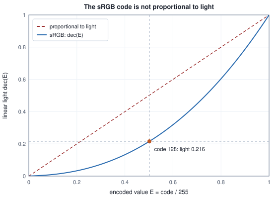
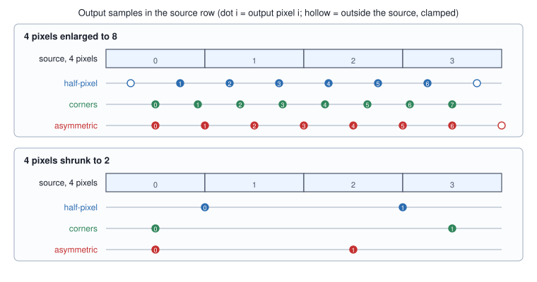
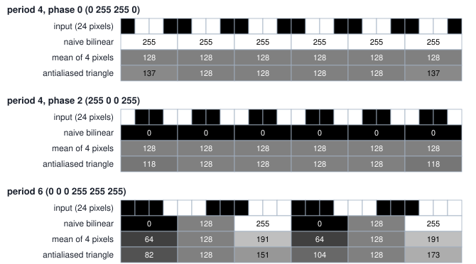

<!-- SPDX-License-Identifier: CC-BY-4.0 -->
<!-- Copyright (c) 2026 Martin Schröder <info@swedishembedded.com> -->

# Images as Data

*What is an image to a model, and how many ways can preprocessing quietly go wrong?*

A vision model that loses accuracy on real photographs is usually suspected first, and is often innocent. A network accepts any tensor of the right shape and returns an output that looks like an output, so an error in the few lines that prepared the picture does not raise an exception: a wrong image is still an image of the right shape. In July 2026 a depth model in brain was such a case. Compared with the reference implementation, brain's network was exact (cosine similarity 1.000000 between the two outputs, largest absolute difference 0.000000) on a square input and on a rectangular one; the loss was entirely in the preprocessing, which squeezed every photograph into a grey-padded square where the reference resized it to keep its shape (commit `d0de1d031`). The network accepted the square and produced a map that looked like a depth map.

The first job of a vision model's input is therefore not clever: it is to be exactly what the model was trained to see. An image arrives as a file of bytes, or as the packed output of a camera, and must become a tensor of floating-point numbers of a fixed shape in a fixed range, in a fixed channel order and layout, resampled by a fixed rule. Each of those words hides a choice that the model's author made once, silently, and the weights have never seen anything else. The choices are met here in the order the bytes meet them: what a pixel holds, how the numbers are laid out in memory, what the numbers mean as light, how cameras pack them, how an image is resized, how it is fitted to the size a model wants, and how the values are scaled before the first layer. Each is computed on stated inputs, and each has a way of being half a pixel, one channel or one constant off.

That path crosses six ideas from earlier volumes, from strides and rounding to the tolerance of a parity test; bring them back first.

1. (Volume I, [Chapter 5](../v01-mathematics/05-arrays.md), strides.) A row-major tensor has shape $[2, 3, 4]$. What are its strides in elements, and at what offset does the element with index $(1, 2, 3)$ sit?
2. (Volume I, [Chapter 15](../v01-mathematics/15-floating-point.md), rounding error.) For 32-bit numbers, what is the unit round-off $u$, and how large can the relative error of one rounded addition, subtraction, multiplication or division be?
3. (Volume IV, [Chapter 1](../v04-computation/01-number-formats.md), binary representation.) How many different values can 8 bits hold, and which is the largest as a non-negative number?
4. (Volume I, [Chapter 2](../v01-mathematics/02-functions.md), piecewise functions.) A function is defined by one rule on $x \le a$ and another on $x > a$. What must hold at $a$ for the function to have no jump there, and what more for it to have no kink?
5. (Volume IV, [Chapter 13](../v04-computation/13-npu.md), calibration sets.) What is a calibration set for, and what goes wrong if it is not representative of the inputs the deployed model will see?
6. (Volume VI, [Chapter 2](../v06-language-models/02-importing-models.md), parity tolerance.) How is the tolerance of a comparison between two implementations of the same function derived, and what does a difference above it mean?

## A grid of samples

A **pixel** (picture element) is one sample of an image: a measurement of the light arriving at one point of a sensor, or one value in a file that stands for such a measurement. A colour image has three samples per pixel, one for each of red, green and blue; each is a number, and the three numbers together are the pixel. An image of width $W$ and height $H$ is the grid of $H \times W$ pixels, which is a tensor of shape $[H, W, 3]$ or $[3, H, W]$ depending on how it is stored. A sample is not a little square of uniform colour. It is a point value, taken at the centre of the cell that the grid assigns to it, and the difference matters the moment the image is resized, because it decides which source samples a resized pixel reads (Section "Where an output pixel looks").

Files and cameras give the samples as **8-bit codes**: whole numbers from 0 to 255, one byte each. A model wants floating-point numbers, most often in $[0, 1]$, so the first operation is the division $u = c/255$ of a code $c$. Here is the 4 by 4 test image used throughout. It is small enough to read whole, and the 16 codes of each channel are all different, so that any mistake of layout shows as a wrong number rather than a coincidence.

<!-- worked: images.image_4x4 -->
The test image has 4 rows and 4 columns; each cell is the pixel (red, green, blue) as three 8-bit codes. Red of the pixel with row-major index k = 4y + x is 20 + 13k, green 10 + 9k and blue 5 + 15k.

| row \ column | x = 0 | x = 1 | x = 2 | x = 3 |
|---|---|---|---|---|
| y = 0 | (20, 10, 5) | (33, 19, 20) | (46, 28, 35) | (59, 37, 50) |
| y = 1 | (72, 46, 65) | (85, 55, 80) | (98, 64, 95) | (111, 73, 110) |
| y = 2 | (124, 82, 125) | (137, 91, 140) | (150, 100, 155) | (163, 109, 170) |
| y = 3 | (176, 118, 185) | (189, 127, 200) | (202, 136, 215) | (215, 145, 230) |
<!-- /worked -->

Going back from floats to bytes needs a rounding rule, and a rule picked carelessly loses codes. The usual one is to clamp to $[0, 1]$, multiply by 255, add 0.5 and drop the fraction. Adding one half and truncating is **round half up**: a value of exactly $127.5$ becomes 128, where plain truncation gives 127. Brain's `unit_to_u8` in `crates/imaging/src/pixels.rs` is this rule, and the same file tests that all 256 codes survive the trip bytes to floats and back. Surviving that trip is easy, because no arithmetic happens in between. The rule earns its keep after the image has been through a resampler, which comes later in the chapter; Section "Reproducing a resizer to the byte" shows the test that separates rounding from truncation.

The container is as plain as the idea. `Rgb8` in the same file holds `w`, `h` and a vector of `w * h * 3` bytes in row-major order with R, G, B interleaved, and its constructor refuses a buffer of any other length; everything else in the crate is a borrowed slice with its dimensions beside it. Decoding a file into that container is `crates/imaging/src/codec.rs`, one front door for PPM, PNG and JPEG. It is also the first place an image can hurt the program that reads it, because a PNG a few kilobytes long can declare billions of pixels. `decode_bounded` therefore reads the declared dimensions from the header and refuses the image before it decodes a single pixel when the count is over the caller's limit, and bounds the decoder's own allocation to the same figure.

## Two ways to lay out the same numbers

A tensor of shape $[4, 4, 3]$ and one of shape $[3, 4, 4]$ hold the same 48 numbers in different orders. In **interleaved** layout, called HWC for height, width, channel, the three samples of one pixel sit side by side and a row of the image is a run of triples. In **planar** layout, CHW, all the red samples come first as a $4 \times 4$ plane, then all the green, then all the blue. Volume I's strides say what each costs. For HWC the strides are $(W C, C, 1)$ elements and the sample of channel $c$ at row $y$, column $x$ is at offset $(y W + x) C + c$; for CHW the strides are $(H W, W, 1)$ and the offset is $(c H + y) W + x$.

<!-- worked: images.layouts -->
The same image stored two ways. Interleaved HWC, shape [4, 4, 3], strides (12, 3, 1) in elements; planar CHW, shape [3, 4, 4], strides (16, 4, 1). The sample at x = 2, y = 1, channel 1 (green) has offset ((1 * 4 + 2) * 3 + 1) = 19 in HWC and (1 * 4 + 1) * 4 + 2 = 22 in CHW, and both hold 64.

HWC, 48 values, one pixel (R, G, B) per group of three:

```text
 20  10   5   33  19  20   46  28  35   59  37  50
 72  46  65   85  55  80   98  64  95  111  73 110
124  82 125  137  91 140  150 100 155  163 109 170
176 118 185  189 127 200  202 136 215  215 145 230
```

CHW, 48 values, the red plane then the green plane then the blue plane (each 16 values, four rows of four):

```text
 20  33  46  59   plane R
 72  85  98 111
124 137 150 163
176 189 202 215
 10  19  28  37   plane G
 46  55  64  73
 82  91 100 109
118 127 136 145
  5  20  35  50   plane B
 65  80  95 110
125 140 155 170
185 200 215 230
```

A 1 by 2 image with R = [1, 2], G = [3, 4], B = [5, 6] is the CHW buffer [1, 2, 3, 4, 5, 6]; interleaved it is [1, 3, 5, 2, 4, 6].
<!-- /worked -->

Both layouts are in use for good reasons, and a conversion between them is a permutation, not arithmetic. Decoders and cameras produce interleaved pixels because a pixel arrives whole. A convolution (the next chapter) slides a filter over one channel plane at a time and wants each plane contiguous, so most vision networks consume CHW. In brain the conversion is two functions in `crates/imaging/src/pixels.rs`, `hwc_to_chw` and `chw_to_hwc`, each a triple loop over a flat buffer, generic over the element type so that one function serves `f32` activations and `u8` frames. Before them the code base held the same permutation several times, including a byte-typed copy that existed only because the float ones divided by 255 on the way; keeping the value conversion separate from the permutation means one permutation serves every element type and can never grow a hidden scaling.

```text
function hwc_to_chw(a: array<T>[H, W, C]) -> array<T>[C, H, W]:
    out = zeros(T, [C, H, W])
    for c in 0 .. C:
        for y in 0 .. H:
            for x in 0 .. W:
                out[c, y, x] = a[y, x, c]
    return out
```

Which layout a buffer is in is not written anywhere in the buffer. A CHW tensor read as HWC is the right number of floats in the wrong places, and the result is an image of coloured noise that a model will classify as something. The kernels brain dispatches for the permutation are named `nchw_nlc` and `nlc_nchw`, and the second name is the clue: $L = H W$ positions with the channel trailing is the interleaved layout, which is also exactly the layout of a sequence of tokens. That is why the interleaved form turns up again in the vision transformers of Chapter 6, where an image becomes a sequence.

## What the numbers measure

Now the question the layout hides: what does a code of 128 mean? Half the light of a code of 255? It does not, and the difference is where the first real preprocessing error sits.

A camera sensor responds to light linearly: twice the photons, twice the signal. If the 256 codes were spread evenly over that linear scale, the codes would be wasted at the bright end and starved at the dark. The human eye, and a display, compare brightnesses by ratio, and 255 evenly spaced steps would make the step from code 1 to 2 a doubling of the light and the step from 254 to 255 a change of 0.4 percent. The files therefore store a curve of the light instead. The curve is the **gamma encoding** of the image: a fixed nonlinear function that maps linear light to the stored number, so that equal steps in the codes are roughly equal ratios of light, and the **linear light** is what you get by undoing it. Brain's photograph loader decodes with the curve of the sRGB standard (IEC 61966-2-1), as does every library that reads photographs.

A **colour space** is the rule that turns a triple of numbers into a colour: which three primary colours the channels refer to, which colour counts as white, and which transfer curve relates the stored numbers to light. The sRGB space has its primaries and white point and the curve below. Display-P3, common on phones, shares the curve and has wider primaries, so its triples mean different colours from the same triples read as sRGB. Brain's `crates/imaging/src/photo.rs` keeps a photograph as a `Photo`: the stored values at their precision, a `Transfer` tag (the sRGB curve, a linear encoding, or a tone-curve table read from an ICC (International Color Consortium) profile embedded in the file), a matrix that carries the primaries of the file to the sRGB primaries when they differ, and the orientation recorded in the file's EXIF (Exchangeable Image File Format) metadata already applied. The models of this volume mostly start from plain sRGB codes, and the rest of this section builds the curve they hide.

Write $E = c/255$ for the encoded value of a code $c$ and $L$ for linear light, both in $[0, 1]$. The standard defines the decoding $L = \mathrm{dec}(E)$ in two pieces, a straight line at the dark end and a power law above it:

$$\mathrm{dec}(E) = \begin{cases} E/12.92 & E \le 0.04045 \\ \left(\dfrac{E + 0.055}{1.055}\right)^{2.4} & E > 0.04045, \end{cases}$$

$$\mathrm{enc}(L) = \begin{cases} 12.92\,L & L \le 0.0031308 \\ 1.055\,L^{1/2.4} - 0.055 & L > 0.0031308. \end{cases}$$

Why two pieces? A pure power law $L = E^{2.4}$ has slope zero at 0, so its inverse $E = L^{1/2.4}$ has an infinite slope there: the smallest noise in a dark linear value would become a large jump in the code. The straight line of slope 12.92 caps the slope of $\mathrm{enc}$ at the dark end, and the offset 0.055 in the power piece bends the curve so that the two pieces meet. The table checks Volume I's two conditions for a piecewise function at the join: equal values, and equal slopes.

<!-- worked: images.srgb_properties -->
Properties of the two sRGB functions, computed in 64-bit arithmetic with the library power function.

| property | value |
|---|---:|
| join at E = 0.04045: linear piece value E / 12.92 | 0.0031308 |
| join: power piece value ((E + 0.055) / 1.055)^2.4 | 0.0031308 |
| join: linear piece slope 1 / 12.92 | 0.07740 |
| join: power piece slope (2.4 / 1.055) ((E + 0.055) / 1.055)^1.4 | 0.07872 |
| slope of enc at L = 0 (the linear toe, 12.92) | 12.92 |
| dec(0.5) | 0.214041 |
| effective exponent log dec(0.5) / log 0.5 | 2.2240 |
| effective exponent log dec(0.8) / log 0.8 | 2.2607 |
| all 256 codes: half_up(255 enc(dec(c / 255))) == c | yes |
| largest |enc(dec(c / 255)) - c / 255| over the codes | 1.11e-16 |
<!-- /worked -->

The two values at $E = 0.04045$ agree to the 7 digits shown; the slopes, 0.0774 and 0.0787, differ by about 2 percent, so the function is continuous with a very slight kink, which is what the standard's constants achieve. The effective exponent of the whole curve (how large an exponent $p$ would give $E^p = \mathrm{dec}(E)$ at one point) is 2.22 at $E = 0.5$, which is why the curve is often summarised as a gamma of 2.2. Note that 2.2 is a summary: the actual function is the one above, and the difference between the two is visible in the dark tones. With the curve in hand, the claim about steps can be counted.

<!-- worked: images.srgb_steps -->
For each code c: the linear light dec(c / 255), the increase over the code c - 1 below it, and that increase as a percentage of the light at c - 1.

| code c | linear light | step from c - 1 | step relative to c - 1 (%) |
|---|---:|---:|---:|
| 1 | 0.000304 | 0.000304 | from black |
| 2 | 0.000607 | 0.000304 | 100.00 |
| 3 | 0.000911 | 0.000304 | 50.00 |
| 10 | 0.003035 | 0.000304 | 11.11 |
| 11 | 0.003347 | 0.000311 | 10.25 |
| 50 | 0.031896 | 0.001183 | 3.85 |
| 51 | 0.033105 | 0.001209 | 3.79 |
| 128 | 0.215861 | 0.003630 | 1.71 |
| 129 | 0.219526 | 0.003666 | 1.70 |
| 200 | 0.577580 | 0.006456 | 1.13 |
| 201 | 0.584078 | 0.006498 | 1.13 |
| 254 | 0.991102 | 0.008852 | 0.90 |
| 255 | 1.000000 | 0.008898 | 0.90 |

For comparison, 255 codes spaced evenly in linear light would make the same relative step from c - 1 to c equal to 100 / (c - 1) percent: 100.00, 50.00, 10.00, 2.00, 0.78, 0.50, 0.39 at c = 2, 3, 11, 51, 129, 201, 255.
<!-- /worked -->

Under sRGB the step from one code to the next is between 0.9 and 4 percent of the light for every code above 50, and the steps of the dark codes are small in absolute light but large relative to what is there. The comparison that matters is at equal light, not equal code. The light 0.033 of sRGB code 51 is code 8 or 9 of a linear encoding ($255 \times 0.033 \approx 8.4$), where one step is 12.5 to 14 percent of the light; at the bright end a linear encoding steps by 0.4 percent, finer than the eye can tell apart. The sRGB curve moves codes from where they are wasted to where they are short. The figure shows the curve against the straight line that a linear encoding would be.



Everything in a model's input pipeline that treats a code as a quantity of light makes an error of the size of the gap between the two curves, and the most common such operation is the average. Resizing, blurring, and mixing pixels are all weighted averages. Averaging two codes gives a different pixel from averaging the light they stand for:

<!-- worked: images.averaging_pairs -->
Two pixels of one channel with the given codes are averaged in two ways. In code space the average is (a + b) / 2. In linear light each code is decoded with dec, the two lights are averaged, and the mean is encoded again with enc. 'light of the code average' is dec of the code-space result, to compare with the true mean light.

| codes | code-space average | light of that average | mean light | its code (exact) | its code (rounded) |
|---|---:|---:|---:|---:|---:|
| 0 and 255 | 127.5 | 0.2140 | 0.5000 | 187.52 | 188 |
| 64 and 192 | 128 | 0.2159 | 0.2892 | 146.41 | 146 |
| 0 and 64 | 32 | 0.0144 | 0.0256 | 44.43 | 44 |
| 100 and 200 | 150 | 0.3050 | 0.3525 | 160.20 | 160 |
| 30 and 40 | 35 | 0.0168 | 0.0171 | 35.36 | 35 |
| 200 and 255 | 227.5 | 0.7720 | 0.7888 | 229.68 | 230 |
<!-- /worked -->

Black and white averaged in code space give a mid-code of 127.5, whose light is 0.214, less than half of the 0.5 that the two pixels together carry; the mean light has the code 188. The error is smaller for pairs of close codes (30 and 40 barely move) but is always in the direction of too dark, because $\mathrm{dec}$ is convex. At an edge it adds up. Halving a row that holds one black to white edge by averaging pixel pairs gives a mid-grey pixel at the edge, and the whole row loses 11 percent of its light unless the average is taken in linear light:

<!-- worked: images.edge_downsample -->
A row of 8 pixels with one edge, halved by averaging each pair (the exact 2x area average). 'mean light' is the average of dec(code / 255) over the row.

| row | codes | mean light |
|---|---|---:|
| source (8 pixels) | 0 0 0 255 255 255 255 255 | 0.6250 |
| pairs averaged as codes | 0 127.5 255 255 | 0.5535 |
| pairs averaged in linear light | 0 187.5 255 255 | 0.6250 |
<!-- /worked -->

The photograph that went in has a mean light of 0.625. Code-space averaging returns 0.5535, an edge that has darkened by that 11 percent: a box filter over an sRGB edge darkens it, because $\mathrm{dec}$ is convex. Linear-light averaging returns 0.625 exactly, because averaging linear values conserves light, which is why `Photo::linear` in `photo.rs` hands reconstruction code linear values.

If linear light is right, why do brain's resamplers not use it? Because a model's reference preprocessing does not. The reference libraries (Pillow's resize, torch's interpolate) average whatever numbers they are handed, which for an 8-bit image are the encoded codes; the network was trained on pictures prepared that way, and a pipeline that is physically more correct but different from the training one is wrong for that model. The sRGB functions of brain sit in `photo.rs` for the reconstruction code that does need light (a photograph is fitted by a scene model there, and filtering should happen in linear light), and nowhere in the resamplers. The lesson is not "linearize before you resize". It is that gamma-encoded codes are the model's input unless its reference says otherwise, and that the one place where the choice can be examined is the reference's own code.

## What a camera sends

A camera does not send RGB. A webcam or a phone sensor sends **YUV**-family formats, which split each pixel into one luma number $Y$ (the brightness) and two chroma numbers $C_b$ and $C_r$ (blue and red differences from the brightness). The split pays because the eye resolves brightness finely and colour coarsely: the chroma planes can have half the resolution in each direction, and the frame shrinks by half before any compression. Brain's `crates/capture` negotiates the pixel format YUYV through V4L2 (Video4Linux2, the Linux camera interface), the packed 4:2:2 form, with the camera driver and refuses a device that will not provide it, so the frame the rest of the system receives is YUYV and the conversion to RGB is the first thing done to it.

The conversion is a matrix, and only two constants define it. Luma is a weighted sum of the channels with weights $K_r$, $K_g$, $K_b$ that add to 1, and the chroma differences are scaled to fit the range:

$$Y = K_r R + K_g G + K_b B, \qquad C_b = \frac{B - Y}{2(1 - K_b)}, \qquad C_r = \frac{R - Y}{2(1 - K_r)}.$$

Inverting needs no matrix inversion. The first two equations give $R = Y + 2(1 - K_r) C_r$ and $B = Y + 2(1 - K_b) C_b$ at once. Green comes from the luma equation: $G = (Y - K_r R - K_b B)/K_g$, and substituting $R$ and $B$ makes the $Y$ terms cancel because the weights add to 1, leaving

$$G = Y - \frac{2(1 - K_b) K_b}{K_g} C_b - \frac{2(1 - K_r) K_r}{K_g} C_r.$$

Two standards pick the constants. ITU-R BT.601, the standard-definition television standard and the matrix USB Video Class (UVC) webcams commonly use, uses $K_r = 0.299$ and $K_b = 0.114$; ITU-R BT.709, for high-definition, uses $K_r = 0.2126$ and $K_b = 0.0722$.

<!-- worked: images.yuv_derivation -->
Two constants, K_r and K_b, fix a standard: K_g = 1 - K_r - K_b, then R = Y + 2 (1 - K_r) Cr, B = Y + 2 (1 - K_b) Cb and G = Y - [2 (1 - K_b) K_b / K_g] Cb - [2 (1 - K_r) K_r / K_g] Cr, with Cb and Cr already centred on zero.

| standard | K_r | K_b | K_g | R: Cr | G: Cb (minus) | G: Cr (minus) | B: Cb |
|---|---:|---:|---:|---:|---:|---:|---:|
| BT.601 | 0.299 | 0.114 | 0.5870 | 1.4020 | 0.344136 | 0.714136 | 1.7720 |
| BT.709 | 0.2126 | 0.0722 | 0.7152 | 1.5748 | 0.187324 | 0.468124 | 1.8556 |
<!-- /worked -->

The BT.601 line is the four numbers 1.402, 0.344136, 0.714136 and 1.772 that `yuyv_to_rgb` in `crates/imaging/src/color.rs` uses, recovered here from two constants. The function reads a YUYV buffer in groups of four bytes, $Y_0\, U\, Y_1\, V$: two pixels share one pair of chroma bytes, which are the offset forms $128 + C_b$ and $128 + C_r$ (with $C_b$ and $C_r$ already scaled for the range 0 to 255), subtracts 128 from each, applies the three formulas, clamps to $[0, 255]$ and rounds. Two things in it are decisions that a different camera would break. It assumes **full range**, Y from 0 to 255, where television video puts black at 16 and white at 235; and it assumes the BT.601 matrix. Using the wrong matrix is not dramatic and not harmless:

<!-- worked: images.wrong_matrix -->
Each RGB pixel is encoded with the BT.709 constants (K_r = 0.2126, K_b = 0.0722) into (Y, Cb, Cr), then decoded with the BT.709 coefficients and with the BT.601 ones. Values are not rounded before decoding.

| pixel (R, G, B) | Y | Cb | Cr | decoded with BT.709 | decoded with BT.601 |
|---|---:|---:|---:|---|---|
| (200, 80, 40) | 102.62 | -33.75 | +61.83 | (200, 80, 40) | (189, 70, 43) |
| (40, 160, 60) | 127.27 | -36.25 | -55.42 | (40, 160, 60) | (50, 179, 63) |
| (30, 60, 200) | 63.73 | +73.44 | -21.42 | (30, 60, 200) | (34, 54, 194) |
| (128, 128, 128) | 128.00 | +0.00 | +0.00 | (128, 128, 128) | (128, 128, 128) |

Limited range puts black at Y = 16 and white at Y = 235. A decoder that assumes full range reads Y = 16 as the grey code 16 instead of 0 and Y = 235 as 235 instead of 255; the correct map is 255 (Y - 16) / 219, which gives 0 and 255.
<!-- /worked -->

A grey pixel survives any matrix, because its chroma is zero, which is why a mistake of this kind passes the first test one thinks of. A colour does not: the saturated orange of the first row decodes 11 codes off in red with the wrong matrix. Brain's tests of the conversion (`crates/imaging/tests/it/color.rs`) are chosen for exactly this property: neutral chroma must stay grey, and positive $V$ (red chroma) must raise red above blue while positive $U$ raises blue above red, which pins the signs of the coefficients against the classic mistake of swapping them. An odd width panics, because YUYV pairs pixels horizontally and an odd width is a bug upstream rather than something to paper over.

Subsampling is cheap and not free. The 4 by 2 image below has two colours arranged so that its pixel pairs sometimes straddle a colour edge, and is encoded to YUYV (chroma shared by horizontal pairs) and to NV12, the planar 4:2:0 layout that most phones and hardware decoders produce: a plane of all the $Y$ bytes followed by a plane of interleaved $U\,V$ pairs, one per 2 by 2 block.

<!-- worked: images.subsampling -->
The 4 by 2 image (pixels in row-major order) is (200, 30, 30), (200, 30, 30), (30, 30, 200), (30, 30, 200), (200, 30, 30), (30, 30, 200), (30, 30, 200), (200, 30, 30). It is encoded with the BT.601 constants (K_r = 0.299, K_b = 0.114), full range, Y rounded half up, and the chroma code 128 + Cb (128 + Cr) of a shared pair or block taken as the mean of the unrounded chroma of its pixels, then rounded half up.

Packed 4:2:2 (YUYV), 16 bytes, groups Y0 U Y1 V: [81, 99, 81, 213, 49, 213, 49, 114, 81, 156, 49, 164, 49, 156, 81, 164]

Planar 4:2:0 (NV12), 12 bytes: Y plane (8 bytes) [81, 81, 49, 49, 81, 49, 49, 81], then the U V plane (one interleaved pair per 2 by 2 block, 4 bytes) [128, 188, 185, 139].

| pixel | original | from 4:2:2 | largest error | from 4:2:0 | largest error |
|---:|---|---:|---:|---:|---:|
| 0 | (200, 30, 30) | (200, 30, 30) | 0 | (165, 38, 81) | 51 |
| 1 | (200, 30, 30) | (200, 30, 30) | 0 | (165, 38, 81) | 51 |
| 2 | (30, 30, 200) | (29, 30, 200) | 1 | (64, 22, 150) | 50 |
| 3 | (30, 30, 200) | (29, 30, 200) | 1 | (64, 22, 150) | 50 |
| 4 | (200, 30, 30) | (131, 46, 131) | 101 | (165, 38, 81) | 51 |
| 5 | (30, 30, 200) | (99, 14, 99) | 101 | (133, 6, 49) | 151 |
| 6 | (30, 30, 200) | (99, 14, 99) | 101 | (64, 22, 150) | 50 |
| 7 | (200, 30, 30) | (131, 46, 131) | 101 | (96, 54, 182) | 152 |

Bytes per pixel: RGB 3, packed 4:2:2 2, planar 4:2:0 1.5; a 640 by 480 frame is 921,600, 614,400 and 460,800 bytes.
<!-- /worked -->

Where a pair or block lies inside one colour, the chroma is shared without loss and the decode is exact to rounding (pixels 0 and 1). Where the pair straddles the edge (row 1), the one chroma pair is the average of two very different colours and both pixels come out with the wrong hue, by 101 codes in the worst channel. 4:2:0 shares one pair among four pixels and does worse on this deliberately hard image. Real photographs are far smoother in chroma than this stripe, which is why the format is common, and the example is an illustration of a mechanism, not a measurement of the loss on photographs. Brain's camera path negotiates packed 4:2:2 and converts that; NV12 matters because it is what many phones and hardware decoders send.

The frame that comes out of the camera is also a stream, and the stream raises a question that has nothing to do with colour: what should happen when the consumer is slower than the camera? `crates/capture/src/slot.rs` answers with a buffer of capacity one. The capture thread always overwrites the slot, counting each overwrite of an untaken frame as dropped, and the render loop takes the latest frame or none. The alternatives are worse in a measurable way, as a count shows for a camera at 30 frames per second whose consumer stalls for 59 frame intervals.

<!-- worked: images.frame_slot -->
A camera delivers frame number 1 to 65 (one per tick, 30 ticks make a second). The consumer takes the slot at ticks 1, 2, 62, 63, 64 and 65 (it stalls for 59 ticks in between). The slot has capacity one and the producer overwrites an untaken frame, counting it as dropped.

| quantity | single slot | unbounded queue |
|---|---:|---:|
| frames pushed | 65 | 65 |
| frames dropped (and counted) | 59 | 0 |
| frames taken by the consumer | 6 | 6 |
| frames never taken, still queued after tick 65 | 0 | 59 |
| frame numbers the consumer sees | 1, 2, 62, 63, 64, 65 | 1, 2, 3, 4, 5, 6 |
| frames waiting at tick 62 | 1 | 60 |
| bytes waiting at tick 62 (640 x 480 RGB, 921,600 per frame) | 921,600 | 55,296,000 |
| age of the frame the consumer gets at tick 62 | 0 ticks | 59 ticks (frame 3) |
<!-- /worked -->

An unbounded queue would hold 60 frames, 55 million bytes, and deliver the oldest, two seconds stale, when the consumer returns; a blocking channel would push the stall back into the driver, whose ring fills and drops frames with no count. The slot keeps one frame of latency, never blocks either side, and its `dropped` counter is the signal a display can show. The size of a frame depends on the format the camera sends, which is the other reason for subsampling:

<!-- worked: images.frame_formats -->
Bytes in one frame by pixel format and size.

| format | 640 x 480 | 1280 x 720 | 1920 x 1080 |
|---|---:|---:|---:|
| RGB, 3 bytes | 921,600 | 2,764,800 | 6,220,800 |
| YUYV (4:2:2), 2 bytes | 614,400 | 1,843,200 | 4,147,200 |
| NV12 (4:2:0), 1.5 bytes | 460,800 | 1,382,400 | 3,110,400 |
<!-- /worked -->

## Where an output pixel looks

Resizing is the operation that most often goes wrong, and it goes wrong quietly because every convention is plausible. A resize from $n_{\mathrm{src}}$ pixels to $n_{\mathrm{dst}}$ pixels along one axis computes each output as an average of nearby source pixels. The whole matter is where, in the source, output pixel $o$ is looked up: its **source coordinate** $x_{\mathrm{src}}$, measured in units of source pixel indices, so that $x_{\mathrm{src}} = 2$ means exactly on pixel 2 and $x_{\mathrm{src}} = 2.5$ is halfway between pixels 2 and 3. Three answers are in use.

The answer that follows from what a pixel is comes from the geometry of the cell. Pixel $i$ of the source covers the interval $[i, i+1]$ of a continuous axis and is sampled at its centre $i + 0.5$. The source axis has length $n_{\mathrm{src}}$ and the output axis length $n_{\mathrm{dst}}$ and the resize stretches one onto the other, so a position $z$ on the output axis is position $z\, n_{\mathrm{src}}/n_{\mathrm{dst}}$ on the source axis. Output pixel $o$ is sampled at its centre $o + 0.5$, which is the source position $(o + 0.5)\, n_{\mathrm{src}}/n_{\mathrm{dst}}$, and converting a position back to a pixel index subtracts the half pixel that placed the centre:

$$x_{\mathrm{src}} = (o + 0.5)\,\frac{n_{\mathrm{src}}}{n_{\mathrm{dst}}} - 0.5 \qquad \text{(half-pixel)}.$$

The alternative is to line up the corners instead of the cells: the first output looks at the first source pixel, the last at the last, and the ones in between are spread evenly over the $n_{\mathrm{src}} - 1$ gaps, so $x_{\mathrm{src}} = o\,(n_{\mathrm{src}} - 1)/(n_{\mathrm{dst}} - 1)$, which is called **align corners** (and is 0 when $n_{\mathrm{dst}} = 1$). The third, the **asymmetric** rule $x_{\mathrm{src}} = o\, n_{\mathrm{src}}/n_{\mathrm{dst}}$, aligns the left edges of the first pixels; it is what torch's plain nearest mode computes and what the ONNX graph format calls `asymmetric`. For an enlargement and a reduction of a row of four pixels, the numbers are:

<!-- worked: images.source_positions -->
Resizing 4 pixels to 8. For each output index o, the source coordinate (in units of source pixel indices) under the three conventions.

| o | half-pixel (o + 0.5) n_in / n_out - 0.5 | corners o (n_in - 1) / (n_out - 1) | asymmetric o n_in / n_out |
|---|---:|---:|---:|
| 0 | -0.25 | 0 | 0 |
| 1 | 0.25 | 0.4286 | 0.5 |
| 2 | 0.75 | 0.8571 | 1 |
| 3 | 1.25 | 1.2857 | 1.5 |
| 4 | 1.75 | 1.7143 | 2 |
| 5 | 2.25 | 2.1429 | 2.5 |
| 6 | 2.75 | 2.5714 | 3 |
| 7 | 3.25 | 3 | 3.5 |

Resizing 4 pixels to 3. For each output index o, the source coordinate (in units of source pixel indices) under the three conventions.

| o | half-pixel (o + 0.5) n_in / n_out - 0.5 | corners o (n_in - 1) / (n_out - 1) | asymmetric o n_in / n_out |
|---|---:|---:|---:|
| 0 | 0.1667 | 0 | 0 |
| 1 | 1.5 | 1.5 | 1.3333 |
| 2 | 2.8333 | 3 | 2.6667 |

Resizing 4 pixels to 2. For each output index o, the source coordinate (in units of source pixel indices) under the three conventions.

| o | half-pixel (o + 0.5) n_in / n_out - 0.5 | corners o (n_in - 1) / (n_out - 1) | asymmetric o n_in / n_out |
|---|---:|---:|---:|
| 0 | 0.5 | 0 | 0 |
| 1 | 2.5 | 3 | 2 |
<!-- /worked -->



Look at the reduction by two. The half-pixel rule samples at 0.5 and 2.5: halfway between pixels 0 and 1, and halfway between 2 and 3, so a bilinear read there is the average of each pair, exactly what a 2 times reduction should compute. Align corners samples at 0 and 3 and uses pixels 0 and 3 alone, never reading the two in the middle. For an enlargement, the half-pixel samples start at $-0.25$, outside the image (they are clamped to the first pixel), while align corners puts samples on both ends. Neither is more correct in any absolute sense. They differ by up to half a pixel, which is a shift of the whole image by a fraction of a cell, and a network trained on one sees a slightly shifted picture under the other.

Because the two conventions differ by half a pixel and both look plausible, no internal check can tell them apart: a gradient check passes either way, since the kernel stays perfectly self-consistent while resampling the wrong grid. Only a comparison against the reference can. Brain's resize kernel (`crates/kernels/wgsl/resize_bilinear.wgsl`) therefore carries the choice as a parameter. `AlignCorners::HalfPixel` is the default in `crates/imaging/src/device.rs`, matching PyTorch's default and ONNX's `half_pixel`, and the corner rule is chosen explicitly where a reference demands it: the final upsampling of the depth model back to the source resolution and the upsampler of a dense-prediction transformer head. A parameter fixed once at the model's definition is the cure for a convention picked at each call. Commit `c7a5b733c` shows the other way the bug appears. A helper in `crates/zipdepth/src/blocks.rs` took a `bool align` whose true branch pushed the word 0, which is align corners off; every one of its six call sites read as "align corners on" and meant the opposite. The fix replaced the boolean by the word itself, `Option<u32>`, so that a call site says `Some(0)` and cannot be misread.

With the source coordinate fixed, the interpolation is a few lines. Bilinear interpolation reads the two source pixels on either side of $x_{\mathrm{src}}$ and blends them by distance. Clamp the coordinate into $[0, n_{\mathrm{src}} - 1]$ so that a sample outside the row repeats the edge pixel, let $i_0 = \lfloor x_{\mathrm{src}} \rfloor$, $t = x_{\mathrm{src}} - i_0$ and $i_1 = \min(i_0 + 1, n_{\mathrm{src}} - 1)$, and the output is $(1 - t)\,v[i_0] + t\,v[i_1]$.

```text
function source_coordinate(o: int, n_src: int, n_dst: int, rule: text) -> real:
    require n_src >= 1 and n_dst >= 1 and 0 <= o and o < n_dst
    if rule == "half":
        return (o + 0.5) * n_src / n_dst - 0.5
    if rule == "corners":
        return 0.0 if n_dst == 1 else o * (n_src - 1) / (n_dst - 1)
    return o * n_src / n_dst              # rule == "asymmetric"

function resize_axis(v: array<real>[n_src], n_dst: int, rule: text) -> array<real>[n_dst]:
    out = zeros(real, [n_dst])
    for o in 0 .. n_dst:
        x = clamp(source_coordinate(o, n_src, n_dst, rule), 0.0, n_src - 1)
        i0 = floor(x)
        t = x - i0
        i1 = min(i0 + 1, n_src - 1)
        out[o] = v[i0] * (1 - t) + v[i1] * t
    return out
```

An image is resized by applying `resize_axis` to every row and then to every column; the two orders give the same result, and doing both in one step as a blend of four pixels, as brain's `resize_bilinear_hwc` does with two blends along $x$ and one along $y$, gives the same numbers too. The red plane of the test image is a linear ramp, $20 + 13(4y + x)$, which makes the answer of a bilinear resize checkable by hand: it must equal the ramp's formula at the source coordinates.

<!-- worked: images.bilinear_examples -->
The red plane of the test image (20 + 13 k) is resized from 4 by 4 to 3 by 3 with bilinear interpolation under the two conventions. Because the plane is a linear ramp in x and y, the value at source coordinate (sx, sy) is exactly 20 + 13 (4 sy + sx), which the entries can be checked against by hand.

half-pixel: source coordinates ['0.1667', '1.5', '2.8333'] on each axis.

```text
 30.8333   48.1667   65.5000
100.1667  117.5000  134.8333
169.5000  186.8333  204.1667
```

Computed instead as two passes (every row along x, then every column along y), the 9 entries differ from these by less than 1e-12 at most.

corners: source coordinates ['0', '1.5', '3'] on each axis.

```text
 20.0000   39.5000   59.0000
 98.0000  117.5000  137.0000
176.0000  195.5000  215.0000
```

Computed instead as two passes (every row along x, then every column along y), the 9 entries differ from these by less than 1e-12 at most.

Resizing to the same size is the identity: the largest difference from the input is 0.0.

Doubling [0, 1] to four samples with the half-pixel rule gives ['0', '0.25', '0.75', '1']; the corner rule gives ['0', '0.3333', '0.6667', '1'].
<!-- /worked -->

The half-pixel row is at source coordinates $1/6$, $1.5$ and $17/6$, and the first entry is $20 + 13 \times (4/6 + 1/6) = 30.83$; the corner version looks at 0, $1.5$ and 3. Doubling $[0, 1]$ gives $[0, 0.25, 0.75, 1]$ under half-pixel, the closed form that brain's test `half_pixel_upsample_matches_the_closed_form` pins, and $[0, 1/3, 2/3, 1]$ under corners.

Nearest-neighbour resizing (copy the single closest source pixel) has the same three coordinates and an extra decision, the rounding, and the choices again select different pixels. Brain's letterbox uses the half-pixel rule rounded half up, $\mathrm{round}((o + 0.5)\, n_{\mathrm{src}}/n_{\mathrm{dst}} - 0.5)$. For non-negative arguments that equals $\lfloor (2o + 1)\, n_{\mathrm{src}} / (2 n_{\mathrm{dst}}) \rfloor$, an integer expression. The device kernel `resize_nearest.wgsl` carries the rule as a mode word: mode 1 is that half-pixel form, and mode 0 is torch's nearest, the asymmetric rule rounded down, $\lfloor o\, n_{\mathrm{src}}/n_{\mathrm{dst}} \rfloor$. How different are they?

<!-- worked: images.nearest_rules -->
Nearest-neighbour source index of output o for two rules: half-pixel, round_half_up((o + 0.5) n_in / n_out - 0.5) = floor((2o + 1) n_in / (2 n_out)), and asymmetric, floor(o n_in / n_out). The table counts the outputs for which they pick different source pixels. The counts use exact integer arithmetic, the rule of real numbers.

| n_in | n_out | outputs that differ | of | % |
|---|---:|---:|---:|---:|
| 3 | 2 | 1 | 2 | 50.0 |
| 4 | 2 | 2 | 2 | 100.0 |
| 5 | 3 | 2 | 3 | 66.7 |
| 7 | 4 | 3 | 4 | 75.0 |
| 479 | 640 | 239 | 640 | 37.3 |
| 640 | 224 | 224 | 224 | 100.0 |
| 1080 | 640 | 520 | 640 | 81.2 |
| 2048 | 576 | 576 | 576 | 100.0 |

For 3 to 2: half-pixel picks source indices [0, 2], asymmetric picks [0, 1].
<!-- /worked -->

For most of these ratios more than half of the outputs differ, and for 4 to 2, 640 to 224 and 2048 to 576 every output does (for a reduction by an integer factor $f \ge 2$ the half-pixel index is $of + \lfloor f/2 \rfloor$ and the asymmetric one is $of$, so they always differ). That is why the kernel has both modes and the caller names the one its reference uses: a model imported against one does not run under the other. Mode 1 needs no floating point at all, because $(2o + 1)\, n_{\mathrm{src}}$ and $2 n_{\mathrm{dst}}$ are integers and their quotient is rounded down exactly; `nearest_tap` in `crates/imaging/src/letterbox.rs` is the same expression in 64-bit integers with the clamp to the last source index, and its test pins the 3 to 2 case, taps 0 and 2, and the tie of a 2 to 1 reduction, which rounds up to 1. The rule once lived in a host loop in 32-bit floating point, where an exact tie could fall either way, while the kernel could only do torch's; commit `cec3ac164` gave the kernel the mode word and commit `00efb3d5c` made the letterbox use the integer form on the device and on the host.

A last case of the half pixel has nothing to do with resizing and shows how widely the idea applies. Commit `69a4363c6` (September 2026) found that `crates/worldmirror2/src/gaussians.rs` unprojected a pixel $n$ of a depth map to a 3D point using the coordinate $n$, where the rasterizer that later draws the points samples pixel $n$ at its centre $n + 0.5$. Every reconstructed point sat half a pixel up and left of the detail it came from. The commit's measurement put the cost at 11.5 dB of peak signal-to-noise ratio (PSNR) between rendered and real images on one scene, and it records why the error survived: at the renderer's default blur setting the shifted scene scored higher than the correct one, because a half-pixel diagonal shift spreads each pixel evenly over four neighbours, which is a 2 by 2 box blur, and the score preferred the blur. A score that rewards the bug is the lesson of the resize conventions seen from the other side: this error is invisible to anything that does not compare against a reference at the pixel level.

## Shrinking an image

Everything above treats a resize as reading at most two neighbours of each output sample. That is enough to enlarge an image and wrong for shrinking it by more than a factor of 2, because the output pixel then stands for several source pixels, and sampling two of them ignores the rest. Detail finer than the output can represent does not vanish: it reappears as a coarser pattern that was never in the picture. A stripe pattern shows it. Take a row of 24 pixels with stripes that repeat every 4 pixels, shrink it by a factor 4 to 6 pixels, and compare the naive bilinear sampler, the mean of the four covered pixels, and the antialiased filter defined next. The rows are shown as 24 cells of shaded grey, and the output cells as six cells each four times as wide.

<!-- worked: images.stripes_table -->
Rows of 24 pixels with stripes, shrunk by a factor 4 to 6 pixels three ways: naive (bilinear with the half-pixel rule, which reads two neighbouring pixels), area (the mean of the 4 pixels that the output pixel covers) and the antialiased triangle filter (window and weights as in the text, normalized). Values are shown to one decimal. The last column is the largest minus the smallest of the four middle outputs, because the two outer outputs of the triangle filter have a window clipped by the image border.

| stripes | method | 6 output pixels | range of outputs 1 to 4 |
|---|---|---:|---:|
| period 4, phase 0 (0 255 255 0) | naive | 255.0 255.0 255.0 255.0 255.0 255.0 | 0.0 |
|  | area | 127.5 127.5 127.5 127.5 127.5 127.5 | 0.0 |
|  | antialiased triangle | 136.6 127.5 127.5 127.5 127.5 136.6 | 0.0 |
| period 4, phase 2 (255 0 0 255) | naive | 0.0 0.0 0.0 0.0 0.0 0.0 | 0.0 |
|  | area | 127.5 127.5 127.5 127.5 127.5 127.5 | 0.0 |
|  | antialiased triangle | 118.4 127.5 127.5 127.5 127.5 118.4 | 0.0 |
| period 6 (0 0 0 255 255 255) | naive | 0.0 127.5 255.0 0.0 127.5 255.0 | 255.0 |
|  | area | 63.8 127.5 191.2 63.8 127.5 191.2 | 127.5 |
|  | antialiased triangle | 82.0 127.5 151.4 103.6 127.5 173.0 | 47.8 |

The antialiased weights of output pixel 0 are on source pixels 0 to 5: 0.1786, 0.2500, 0.2500, 0.1786, 0.1071, 0.0357 (they sum to 1; the window is clipped at the image border). Those of output pixel 2 are on pixels 6 to 13: 0.0312, 0.0938, 0.1562, 0.2188, 0.2188, 0.1562, 0.0938, 0.0312.
<!-- /worked -->



The stripes of the first group have a period of 4 and bring exactly 2 dark and 2 light pixels into each output cell, so the honest answer is mid-grey, 127.5, everywhere. The naive sampler reads pixels 1 and 2, which are both light, and returns 255 in every output: the stripes shifted by two pixels (second group) give 0 everywhere. The same picture, moved by two pixels, shrinks to white and to black. For stripes of period 6 (third group) the naive output is a full-contrast pattern of period 3, 0, 127.5, 255, that no stripe of the input has: a frequency the input does not contain, at an amplitude of 255 where the mean of the covered pixels has 127.5. This is aliasing, in the everyday sense of one thing appearing under another's name: a fine pattern shows up as a coarse one. Volume IX, [Chapter 1](../v09-audio/01-sound.md) derives it from the sampling theorem; the picture here is enough to see that it is a property of the sampling, not of any particular image.

The cure is to average over the source pixels that the output pixel covers, in proportion to how much of each it covers. When the reduction is by the integer factor $f$, that is the plain mean of $f$ consecutive pixels (the "area" rows). The general form is a window of source pixels around the centre of the output pixel, weighted by a kernel that is stretched by the reduction factor. Let $\mathrm{stretch} = \max(n_{\mathrm{src}}/n_{\mathrm{dst}}, 1)$ and take the source window of centre $z_o = (o + 0.5)\, n_{\mathrm{src}} / n_{\mathrm{dst}}$ and radius equal to the kernel's support times the stretch. Source pixel $j$ gets the weight $k((j - z_o + 0.5)/\mathrm{stretch})$, and the weights are divided by their sum so that a flat region stays flat. For bilinear, the **triangle** kernel $k(u) = \max(1 - |u|, 0)$ has support 1:

```text
function triangle_windows(n_src: int, n_dst: int) -> list<(int, list<real>)>:
    require n_src >= 1 and n_dst >= 1
    scale = n_src / n_dst
    stretch = max(scale, 1.0)
    result = []
    for o in 0 .. n_dst:
        centre = (o + 0.5) * scale
        first = max(floor(centre - stretch + 0.5), 0)
        end = min(floor(centre + stretch + 0.5), n_src)
        w = [max(1 - abs((j - centre + 0.5) / stretch), 0.0) for j in first .. end]
        append (first, [w[k] / sum(w) for k in 0 .. len(w)]) to result
    return result
```

For $n_{\mathrm{dst}} \ge n_{\mathrm{src}}$ the stretch is 1 and this is the interpolation of the previous section. When shrinking, the window grows with the factor; the weights of output pixel 0 and of output pixel 2 in the example above are printed under the table (the first, at the border of the image, is clipped and renormalized). Windows overlap, so every source pixel contributes to several outputs, and the filter blurs the picture as the price of not inventing a pattern. A wider filter attenuates more: for the stripes of period 6 no filter of this size removes the pattern completely, but the triangle's four middle outputs vary by 47.8 where the area mean's vary by 127.5 and the naive sampler's by 255.

Bilinear is the cheapest kernel. **Bicubic** uses four taps in place of two, with the cubic convolution kernel (Keys, 1981) whose shape has one parameter $a$:

$$k(x) = \begin{cases} (a + 2)|x|^3 - (a + 3)|x|^2 + 1 & |x| < 1 \\ a|x|^3 - 5a|x|^2 + 8a|x| - 4a & 1 \le |x| < 2 \\ 0 & \text{otherwise.} \end{cases}$$

Its weights are negative at the outer taps, which sharpens an edge and, on an edge, overshoots: the value can leave the range of the four pixels, so a result is clamped. The table shows the weights for a sample halfway between two pixels, and the overshoot on four pixels $[0, 255, 255, 0]$.

<!-- worked: images.cubic_taps -->
The four weights of cubic convolution for a sample exactly halfway between two source pixels (offsets -1.5, -0.5, +0.5, +1.5 from the sample), with k(x) = (a + 2)|x|^3 - (a + 3)|x|^2 + 1 for |x| < 1 and a|x|^3 - 5a|x|^2 + 8a|x| - 4a for 1 <= |x| < 2. The last column applies them to four pixels [0, 255, 255, 0] (before any clamp to 255).

| a | weights at -1.5, -0.5, +0.5, +1.5 | sum | value on [0, 255, 255, 0] |
|---:|---|---:|---:|
| -0.5 | -0.06250 0.56250 0.56250 -0.06250 | 1.0 | 286.88 |
| -0.75 | -0.09375 0.59375 0.59375 -0.09375 | 1.0 | 302.81 |
<!-- /worked -->

Two values of $a$ are in use and they are not interchangeable. $a = -0.5$ is the Catmull-Rom spline and what Pillow and torch's antialiased resize use; $a = -0.75$ is what PyTorch's plain, non-antialiased bicubic interpolation uses. Brain's device kernel `resize_bicubic.wgsl` is the second, with a fixed 4 by 4 support and edge-clamped taps. It is therefore a different mathematical function from Pillow's bicubic and from torch's antialiased resize, and a downsampling that needs an antialiased filter goes through the host functions of `crates/imaging/src/host.rs`, which implement the stretched windows above.

## Reproducing a resizer to the byte

A model whose reference preprocessing calls Pillow's `Image.resize` receives, for an 8-bit image, the output of an integer algorithm, and "close to" is not good enough to match the numbers its weights were fitted to. Pillow resamples in two separable passes (horizontal, then vertical) over bytes, using weights converted to fixed point: each normalized weight $w$ becomes the integer nearest to $w\, 2^{22}$ (ties away from zero), the sums accumulate in integers starting from the rounding constant $2^{21}$, and the result is shifted right by 22 bits and clamped to $[0, 255]$. The intermediate image between the passes is rounded to 8 bits, which has a consequence worth stating. The result depends on which pass runs first. Pillow runs the vertical pass first only when the height loses more than twice as many pixels as the width does; torch's uint8 path, which ports Pillow's code, always runs the horizontal pass first and, to fit its weights in 16 bits, uses fewer fraction bits, chosen so that the biggest scaled weight lies in $[2^{14}, 2^{15})$ and fits an `int16`. Commit `6b10ca66c` (November 2026) added the LANCZOS filter and that pass-order rule to `crates/imaging/src/host.rs`, and commit `2668a78ab` (October 2026) the torch variant, whose message records the consequence of the narrower weights: a pixel can differ from Pillow's by one.

Implemented from this description alone, the algorithm can be run on the fixture image of brain's reference test: 7 by 5 pixels, the code $(37x + 11y + 53c) \bmod 256$ at column $x$, row $y$, channel $c$, shrunk to 3 by 4.

<!-- worked: images.fixed_point_resize -->
The 7 by 5 fixture image has the code (37 x + 11 y + 53 c) mod 256 at column x, row y, channel c. It is resized to 3 columns by 4 rows by the two fixed-point bicubic resamplers. Both use the cubic with a = -0.5, a window stretched by the scale when shrinking, normalized weights, and round to integer weights with 2^bits as one: Pillow uses bits = 22, the uint8 path of torch the smallest bits for which the largest scaled weight reaches 2^14, so that it stays below 2^15 and fits an int16 (here bits = 16). The horizontal pass runs first (Pillow runs the vertical pass first only when the height loses more than twice as many pixels as the width, which this shrink does not) and each pass is rounded and clamped to 8 bits.

Pillow-style output, pixels in row-major order as (R, G, B):

```text
( 29, 81,137)  (113,174,201)  (197,157, 82)
( 42, 95,157)  (126,182,156)  (210,122, 49)
( 56,110,171)  (140,188,175)  (227, 61, 65)
( 69,123,184)  (160,202, 98)  (158, 80, 78)
```

The int16-weight variant differs from it in 2 of 36 bytes, at positions [3, 6], by at most 1. Both outputs equal, byte for byte, the values published for Pillow 11.3 and torch 2.14.1 (the reference of the library's own test).
<!-- /worked -->

Both outputs equal, byte for byte, the 36 values that `crates/imaging/tests/it/resize_reference.rs` takes from Pillow 11.3 and torch 2.14.1 (the constants come from `tools/goldens/imaging_resize_reference.py`), so the description above is complete: nothing more is needed to reproduce the reference. The one-pixel difference between the two libraries is exactly the 2 of 36 bytes the block reports. Its size, at most 1, is the tolerance one would write for "the same preprocessing within the library's own noise", and it comes from a rounding in the weights, not a bug.

For the float resamplers the tolerance is a different kind of number, and Volume VI's recipe applies to it: derive it, do not tune it. Brain's `resize_aa_planar` reproduces torch's antialiased bilinear and bicubic resize of a float tensor with 64-bit accumulation, and the test compares it with torch's output to $10^{-6}$. Is that a derived tolerance? Take values in $[0, 1]$ and weights that sum to 1, so a sum of $K$ products has at most $K$ terms each below 1. Each rounded weight, product and addition adds a relative error of at most $u = 2^{-24}$ of a quantity below 1, so to first order one pass adds at most $(2 + K)\,u$, and the second pass inherits the first's error (its weights sum to 1) and adds its own, giving about $(4 + K_h + K_v)\,u$ for the two passes.

<!-- worked: images.parity_tolerance -->
The red channel of the 7 by 5 fixture (code / 255) is resized to 3 by 4 with the antialiased bilinear filter. Separable 64-bit result against the double sum without separating the axes, and 32-bit result (every product and sum rounded to 32 bits, window order, horizontal pass first) against the 64-bit one. The weights are computed and normalized in 64-bit and then rounded to 32 bits, the input is code / 255 rounded to 32 bits, and each pass starts its accumulator at 0 and rounds every product and then every sum.

| comparison | largest absolute difference |
|---|---:|
| separable 64-bit vs double sum (64-bit) | 1.1e-16 |
| 32-bit separable vs 64-bit separable | 4.2e-08 |
| unit round-off u of 32 bits = 2^-24 | 6.0e-08 |
| bound (4 + K_h + K_v) u, with K_h = 5 and K_v = 2 taps in the longest windows | 6.6e-07 |
| tolerance used by the parity tests for float resizes | 1e-6 |
<!-- /worked -->

For the fixture the longest windows have 5 and 2 taps, so the first-order bound is $11u = 6.6 \times 10^{-7}$, and the measured error of the 32-bit emulation against the 64-bit result is $4.2 \times 10^{-8}$, below one unit round-off. The library's tolerance $10^{-6}$ is above the bound and therefore never refuses a correct implementation of this size; windows with $K_h + K_v$ above 12 (a much larger reduction) would need a bound of their own, which is the reason to derive the number rather than copy it. The same table shows that the two ways of organizing the arithmetic, separable passes and a double sum, agree to $10^{-16}$ in 64 bits.

The same module also closes the question of the rounding rule. A constant image holding the code $b$ as $b/255$ is run through the 32-bit antialiased resize (the 7 by 5 image to 3 by 4) and every output is converted back:

<!-- worked: images.byte_to_float -->
Every 8-bit code b becomes the 32-bit float u = b / 255 (one division) and returns by floor(u * 255 + 0.5), clamped to [0, 255], or by floor(u * 255); each operation is rounded to 32 bits. Second test: the constant 7 by 5 image of u is resized to 3 by 4 with the antialiased bilinear filter of the stripes example (32-bit arithmetic, window order, horizontal pass first, defined in the text; the weights are computed in 64-bit and rounded to 32 bits, each pass starts its accumulator at 0 and rounds every product and then every sum) and every one of the 12 outputs converted back.

| back-conversion | codes (of 256) that fail to return directly | codes that fail after the resize |
|---|---:|---:|
| floor(u * 255 + 0.5) | 0 | 0 |
| floor(u * 255) | 0 | 37 |

The codes that truncation loses after the resize begin 7, 14, 15, 28, 29, 30, 31, 55. For example the constant 7/255 comes out of the resize as 0.027450978755950928 in at least one pixel, which truncation turns into 6.

A value of exactly 0.5 gives 0.5 * 255 = 127.5, which floor(x + 0.5) rounds up to 128 and truncation to 127.
<!-- /worked -->

Every code survives direct conversion under both rules, which is why the property tests of the bytes-to-floats-to-bytes trip pass whichever rule is written. After the resize the weights have not summed to exactly 1 in 32 bits, a constant comes out a hair below its value, and truncation loses 37 codes in 256 where rounding half up loses none. Brain therefore writes the rule once, in the private function `quantize_unit` of `crates/imaging/src/pixels.rs`, which every byte conversion calls, so that the tie-break cannot drift between two spellings of it.

## Fitting an image to a model's input

A model has a fixed input, a square of 384 or 640 pixels or a size divisible by 32, and photographs are not square. There are three ways to bridge the gap, and each is what some reference model did.

Stretching resizes each axis independently to the target. It uses every pixel and distorts every shape: a circle in a 4:3 photograph becomes an ellipse. A network trained on stretched images has learned that distortion; one trained on undistorted images has not.

A **letterbox** scales the whole image by the single factor $\mathrm{scale} = \min(S/W, S/H)$ that makes its longer side fit the square of side $S$, rounds the scaled sides, and centres the result in the square with a padding fill. Nothing is distorted, and part of the square is padding. The padding is part of the input distribution: the preprocessing of brain's YOLO (You Only Look Once) detectors fills it with 114/255, the grey the detector's weights were trained with, and passes it as a parameter, never a constant, because two callers disagreed about it (the detector's 114/255 and, at the time the crate was written, a depth calibration that used 0.5).

Resizing to keep the aspect ratio with no padding, then rounding each side to a multiple the network requires, suits a fully convolutional network that runs at any size; ZipDepth's reference does exactly this, with the shorter side scaled to the model's nominal input and both sides rounded to the nearest multiple of 32. Which of the three is right for a given model is again a fact about the reference.

The letterbox is deterministic enough to compute by hand. Take a 7 by 4 image, numbered 0 to 27 in row-major order, and fit it to a square of side 8. The scale is $\min(8/7, 8/4) = 8/7$ and the content is $8 \times 5$ (the height $4 \times 8/7 = 4.57$ rounds to 5). The slack is 0 columns and 3 rows, and the padding is whole pixels: $\lfloor \mathrm{slack}/2 \rfloor$ above and to the left, and whatever is left of an odd slack below and to the right, so 1 row above and 2 below. The nearest rule of the previous section picks the source row and column of every content cell, with the extent of the source on the axis as $n_{\mathrm{src}}$ and the extent of the content as $n_{\mathrm{dst}}$ (7 and 8 on the columns, 4 and 5 on the rows), not the scale:

<!-- worked: images.letterbox_grid -->
A 7 by 4 image (pixels numbered 0 to 27 in row-major order) is letterboxed onto an 8 by 8 square. Scale s = min(8/7, 8/4) = 1.142857; content 8 by 5; slack (0, 3); padding above and left (pad_x, pad_y) = (0, 1) = floor(slack / 2), below and right (0, 2). Source column of each content column: [0, 1, 2, 3, 3, 4, 5, 6]; source row of each content row: [0, 1, 2, 2, 3]. Each axis takes content cell o from source index min(floor((2 o + 1) n_in / (2 n_out)), n_in - 1), where n_in is the source extent of the axis (7 and 4) and n_out the content extent (8 and 5): the half-pixel rule above written in integers, with the sizes of the two images and not the scale. Each cell shows the number of the source pixel that fills it, and . is padding.

```text
  .   .   .   .   .   .   .   .
  0   1   2   3   3   4   5   6
  7   8   9  10  10  11  12  13
 14  15  16  17  17  18  19  20
 14  15  16  17  17  18  19  20
 21  22  23  24  24  25  26  27
  .   .   .   .   .   .   .   .
  .   .   .   .   .   .   .   .
```
<!-- /worked -->

Source column 3 appears twice and so does source row 2, because upscaling by $8/7$ must repeat one in every 7 pixels (and $5/4$ one in every 4), and the rule decides which. The rows use $4/5$, the ratio of the extents, and not the reciprocal of the scale, which is $7/8$ and says nothing about the rounded height 5: the content is the rounded size, and the tap is the one whose centre is nearest in the content that is actually drawn. Now look at the padding: the 3 spare rows cannot be split evenly, and a split that is not whole pixels cannot be drawn. Brain's letterbox gives the floor to the top and the extra row to the bottom (`Letterbox::compute` in `crates/imaging/src/letterbox.rs`, the split `Border::centre` makes in `crates/imaging/src/device.rs`), and the pixels, the box map `apply_box`, its inverse `invert_box` and the rectangle `content_rect` all use that one pad, so an image and its coordinate frame agree at every size. The crate's first version did not: it pasted the content at the truncated offset while the box mapping used half the slack as a float, so on an odd slack, 640 by 479 into 640 for instance, the pixels sat at row 80 and the boxes were mapped with 80.5. Commit `00efb3d5c` found the disagreement and fixed it, and the spec test `pixels_and_boxes_share_one_integral_pad` states what must hold: on 640 by 479 the slack is 161 rows, the top pad is 80, and for six shapes the origin of the content rectangle is the image of the origin under `apply_box`. The same integral pad is what the reference detectors use. What would half a pixel of disagreement cost a detector? It depends on the box:

<!-- worked: images.letterbox_pad -->
The pad of a letterbox is whole pixels: floor(slack / 2) above and left, the rest below and right. Pixels and boxes share it, so the box mapping sends the original's row 0 to the row where the content starts (pad above). slack = size - content.

| image to square | scale | content | slack in y | pad above | pad below | row 0 maps to y |
|---|---:|---:|---:|---:|---:|---:|
| 4 x 3 to 4 | 1 | 4 x 3 | 1 | 0 | 1 | 0 |
| 640 x 479 to 640 | 1 | 640 x 479 | 161 | 80 | 81 | 80 |
| 640 x 480 to 640 | 1 | 640 x 480 | 160 | 80 | 80 | 80 |

What a frame that disagrees with its pixels by half a row would cost. A box of k by k pixels, written (x1, y1, x2, y2) = (0, 0, k, k), is compared with the same box moved down by 0.5; the IoU (intersection over union) is the overlap area divided by the union area, k (k - 0.5) / (2 k^2 - k (k - 0.5)) = (k - 0.5) / (k + 0.5).

| k | IoU after a shift of 0.5 |
|---|---:|
| 1 | 0.3333 |
| 2 | 0.6000 |
| 4 | 0.7778 |
| 16 | 0.9394 |
| 64 | 0.9845 |
<!-- /worked -->

An image whose frame is half a row from its pixels would score a box of 4 pixels at an overlap of 0.78 with where its pixels actually are, while one of 64 pixels would be scored at 0.98. It is a small, systematic error that matters for small objects and strict overlap thresholds, and it is the kind of bug that hides in a transform every consumer shares: a detector's weights adapt to whatever the preprocessing does, and a disagreement between the pixels and the boxes is invisible until someone lays a box on its image. The table's first row shows the integral pad at work on the smallest odd slack, and the second the case that found it. Brain removes the disagreement by construction rather than by measurement: there is one pad, and nothing computes a second.

The cost of choosing the letterbox where the reference did not is the depth model's story of July 2026, and its numbers can be checked. A 2048 by 1375 photograph, prepared for a model with a nominal input of 384:

<!-- worked: images.depth_sizes -->
A 2048 by 1375 photograph (width by height) prepared for a model whose input side is 384. The first row is the rule scale = 384 / min(w0, h0), each side times the scale divided by 32, rounded half up, times 32 (at least 32); the second is the letterbox with scale min(384 / w0, 384 / h0).

| preparation | input size (w x h) | pixels the model reads | pixels that come from the photograph | padding pixels |
|---|---:|---:|---:|---:|
| aspect-preserving, shorter side 384, sides rounded to a multiple of 32 | 576 x 384 | 221,184 | 221,184 | 0 |
| letterbox onto a 384 x 384 square | 384 x 258 inside 384 x 384 | 147,456 | 99,072 | 48,384 |

The letterbox scale is 0.1875 against 0.2793, so the photograph is shrunk by a factor 1.49 more and 44.8% as many of its pixels reach the model as in the first row.
<!-- /worked -->

The reference model resizes to $576 \times 384$ and feeds every pixel of that to the network; the letterbox hands the same network a $384 \times 384$ square of which 33 percent is grey and which holds 45 percent as many of the photograph's pixels, shrunk by 1.49 times more. The model is fully convolutional and ran perfectly well on both. The transform in brain is `preprocess_chw` in `crates/zipdepth/src/predict.rs`, with `target_size` rounding both sides to multiples of 32.

The second half of that story is the more instructive. Commit `0b9bf1235` (August 2026) found that the calibration step of the 8-bit integer (INT8) quantization of the same model, the one that records the range of every activation on a calibration set (Volume IV), still letterboxed its images into a padded square with a 0.5 grey fill, while inference used the aspect-preserving resize. The ranges were therefore fitted to a distribution of inputs that never occurs at inference, and the loader's doc comment claimed the opposite: that it used "the same transform the predictor uses at inference". The fix was structural: `preprocess_chw` was extracted from the predictor so that both paths call the single function, the calibration collector took per-image sizes (an aspect-preserving resize gives landscape and portrait photographs different input shapes, and the square letterbox is exactly what had erased that), and `crates/zipdepth/tests/it/p6_calib_transform.rs` gates what can be gated without weights: a 4:3 image must not come back square, a constant image must not acquire a 0.5 border, and portrait and landscape must stay distinguishable. The effect on the INT8 scales was not measured, because neither a checkpoint nor a calibration set was available. The lesson is that preprocessing must be shared, not described as shared.

The padding colour can be chosen with the normalization in mind. The DeepSeek-VL processor (`crates/deepseekvl/src/preprocess.rs`) pads its square with $\lfloor 255 \times \mathrm{mean} \rfloor$ per channel, the mean colour of the statistics listed in its configuration, so that after a normalization with those statistics the border is near zero.

<!-- worked: images.pad_after_norm -->
Two padding colours. A detector with no normalization pads with 114 / 255 = 0.4471 in each channel. A tower that normalizes with mean (0.481, 0.458, 0.408) and standard deviation (0.269, 0.261, 0.276) can pad with int(255 mean) = (122, 116, 104), whose normalized value (c / 255 - mean) / std is (-0.0095, -0.0119, -0.0006).

Padding with the mean makes the border close to the average pixel: after normalization the network sees values near 0 there.
<!-- /worked -->

The configuration, as the preprocessor's own test fixture shows, sets `do_normalize` to false: the processor does not normalize at all, and the listed mean serves only for the padding colour, while the normalization happens inside the tower, once per branch. Where normalization happens, then, cannot be stated as a rule.

A last case of choosing the size is not a fit but a policy: a vision-language model that reads images at several resolutions picks, for each image, the size in whole units of its patch grid, within a minimum and a maximum number of pixels. `smart_resize` in `crates/qwen3vl/src/preprocess.rs` ports that rule, rounding each side to a multiple of the factor and, when the product is over the maximum or under the minimum, scaling both sides by the square root of the ratio. The bounds are constants of the checkpoint's own `preprocessor_config.json`, and commit `70665529a` (August 2026) found that the ones in the code, said in a comment to come from that file, were wrong: it fetched the released configuration and corrected both the minimum and the maximum, and noted that for the one test image the two pairs happened to give the same size, so the error was latent rather than visible. A constant that looks like it came from the model's configuration is a claim about the configuration, and the way to check a claim is to read the file.

## The constants a model was trained with

The last step before the first layer is **input normalization**: subtracting a per-channel mean $\mu_c$ and dividing by a per-channel standard deviation $\sigma_c$, so that the numbers the network sees have roughly zero mean and unit spread. The constants are those of the data the model was trained on, and there are three in common use. ImageNet statistics, mean $(0.485, 0.456, 0.406)$ and standard deviation $(0.229, 0.224, 0.225)$ for channels in order R, G, B and values in $[0, 1]$, are the legacy of one training set that many networks inherited. The map $(x - 0.5)/0.5$ takes $[0, 1]$ to $[-1, 1]$ and is what the Qwen3-VL processor applies (`normalize_unit` in `crates/qwen3vl/src/preprocess.rs`) and several image-generation fine-tuning paths write out by hand. The identity is for models that normalize internally.

Brain keeps them as data. `Normalization` in `crates/imaging/src/color.rs` holds a `mean` and `std` for three channels, with the three cases as constants (`IMAGENET`, `HALF`, `IDENTITY`), so that the three are the same code path. It also keeps the map in the form a device kernel wants: $y = x \cdot \mathrm{scale} + \mathrm{shift}$ with $\mathrm{scale} = 1/\sigma$ and $\mathrm{shift} = -\mu/\sigma$, which is one multiply-add per element, and the inverse $x = y\sigma + \mu$ in the same form.

<!-- worked: images.scale_shift_table -->
The per-channel map (x - mean) / std written as y = x * scale + shift with scale = 1 / std and shift = -mean / std (x in [0, 1]), and its inverse x = y * std + mean.

| constants | scale (R G B) | shift (R G B) |
|---|---|---|
| ImageNet | 4.36681 4.46429 4.44444 | -2.11790 -2.03571 -1.80444 |
| (x - 0.5) / 0.5 | 2.00000 2.00000 2.00000 | -1.00000 -1.00000 -1.00000 |
| identity | 1.00000 1.00000 1.00000 | -0.00000 -0.00000 -0.00000 |
<!-- /worked -->

Why must the constants be exactly the trained ones? Because the first layer of the network has learned to read inputs in a specific coordinate system, and the wrong constants put the same picture at different coordinates. A network is not told. Here is a first-layer probe $z = \mathbf{w} \cdot \mathbf{y} + b$ with stated weights, taken to be fitted to ImageNet-normalized input. Four pixels are prepared five ways: as trained, with $(x - 0.5)/0.5$, with the normalization forgotten, with the channel order BGR before the ImageNet constants, and, as a check that must equal the first row, from the codes 0 to 255 with the constants multiplied by 255.

<!-- worked: images.wrong_constants -->
A first-layer probe z = w . y + b with w = [1.2, -0.8, 0.5] and b = 0.1 was fitted to inputs y that were normalized with the ImageNet constants from RGB pixels in [0, 1]. Four pixels (8-bit RGB codes) are prepared in five ways: as trained; with (x - 0.5) / 0.5; with no normalization; with the channels in BGR order before the ImageNet constants; and, as a check that is the same function as the first row, from the codes 0 to 255 with mean and std multiplied by 255. The last column is the largest change of z from the first row over the four pixels.

| preparation | (20, 10, 5) | (110, 70, 80) | (215, 145, 230) | (200, 30, 30) | largest |z - z_trained| |
|---|---:|---:|---:|---:|---:|
| trained: ImageNet, RGB | -1.401 | +0.262 | +2.677 | +2.236 | 0.000 |
| (x - 0.5) / 0.5 | -0.655 | +0.110 | +1.216 | +1.012 | 1.461 |
| forgotten: x in [0, 1] as is | +0.173 | +0.555 | +1.108 | +1.006 | 1.573 |
| ImageNet, channels swapped to BGR | -1.578 | -0.093 | +2.854 | +0.224 | 2.012 |
| ImageNet scaled by 255, codes as they are | -1.401 | +0.262 | +2.677 | +2.236 | 0.000 |
<!-- /worked -->

Each wrong preparation moves the probe's output by between 1.46 and 2.01 for these pixels, which is as large as the whole range of the trained outputs (from $-1.4$ to $+2.7$). The channel swap is the worst and the quietest: for the grey-ish dark pixel the output moves by only 0.18, and for the saturated red pixel it moves by 2.0, so a model fed BGR still works on neutral images and fails on coloured ones. A pipeline is often first checked on a neutral image, which is why a channel-order bug can survive. The statistics of an input tell the same story without a probe:

<!-- worked: images.input_statistics -->
Mean / standard deviation (divisor 16) of each channel of the 16 pixels of the test image after normalization.

| constants | R | G | B |
|---|---:|---:|---:|
| ImageNet | -0.106 / 1.026 | -0.679 / 0.726 | +0.243 / 1.205 |
| (x - 0.5) / 0.5 | -0.078 / 0.470 | -0.392 / 0.325 | -0.078 / 0.542 |
| identity | +0.461 / 0.235 | +0.304 / 0.163 | +0.461 / 0.271 |
<!-- /worked -->

After the correct normalization the sixteen pixels have channel means and spreads of order 1; with $(x - 0.5)/0.5$ the spreads shrink by a factor 2 and the means move; with no normalization the numbers sit between 0 and 1, where the first layer expects values that are positive and negative of order 1. The `Normalization` type carries no channel order, on purpose: a caller who hands it a BGR buffer gets BGR statistics. An interface that said RGB would be a claim the type cannot enforce.

Where the normalization runs is a property of each model, and three cases in brain are three answers. ZipDepth keeps `mean` and `std` among its weights and normalizes inside its forward pass with two kernels, one dividing by the standard deviation and one adding $-\mu/\sigma$ (`crates/zipdepth/src/model.rs`), so its predictor feeds it $[0, 1]$ and never normalizes. DeepSeek-VL normalizes inside the tower, once per branch with each branch's own statistics (Chapter 9 returns to it). And an earlier preprocessing function in the reconstruction code applied the ImageNet constants while the command-line tool that replaced it did not; commit `f669b174d` deleted the unused twin, whose message calls it the double-normalizing twin of the inline code, a copy that had already drifted. The lesson the crate keeps is to share the constants and not the place they are applied: hoisting the arrays was safe, unifying where they are applied was not.

The affine form also shows how a model can absorb its normalization. A first layer with weights $W_{oc}$ and biases $b_o$ applied to $(x - \mu_c)/\sigma_c$ equals a layer with weights $W_{oc}/\sigma_c$ and biases $b_o - \sum_c W_{oc} \mu_c/\sigma_c$ applied to $x$ directly:

<!-- worked: images.fold_into_first_layer -->
A two-output first layer with weights [[0.7, -0.2, 0.4], [-0.5, 0.3, 0.9]] and bias [0.05, -0.1] sees ImageNet-normalized input. Folding the normalization into it gives weights W[o][c] / std[c] and bias b[o] - sum_c W[o][c] mean[c] / std[c], which take the unnormalized x in [0, 1] directly.

| pixel codes | outputs (normalize, then layer) | |difference| in 64-bit | |difference| in 32-bit |
|---|---:|---:|---:|
| (20, 10, 5) | -1.507577 -1.316057 | 2.2e-16 | 0.0e+00 |
| (110, 70, 80) | -0.115925 -0.595075 | 6.9e-17 | 3.0e-08 |
| (215, 145, 230) | +1.925891 +1.252724 | 4.4e-16 | 2.4e-07 |
| (255, 255, 255) | +2.194522 +1.880117 | 4.4e-16 | 2.4e-07 |

The 32-bit columns take x = code / 255 computed in 64-bit and rounded to 32 bits, round the weights, mean, std, the folded W / std and the folded bias (computed in 64-bit) to 32 bits, and round every product, difference, quotient and sum to 32 bits, adding the three products left to right from 0 and then the bias.
<!-- /worked -->

In exact arithmetic the two are the same function; in 32-bit arithmetic they differ by rounding, at most $2.4 \times 10^{-7}$ on outputs of order 2, a few units of the round-off $u$ and the sort of difference a parity tolerance must allow. The folded form removes a step from the pipeline and takes its place in the weights, so it is a change of the checkpoint, and the old preprocessing must then be removed: a model folded and normalized again normalizes twice, and no check of shapes or types catches it. A related hazard is a face-identity vector whose reference concatenates a raw embedding with a normalized one; feeding it from a convenience function that normalizes both would have made the first half about twenty times too small, again with nothing to flag it (commit `6a9da997d`). The remedy is the same each time: verify numerically against the reference's own output.

## One definition of each step

Taken together, the sections list the places where an image pipeline carries a convention: the byte rounding, the layout, the colour matrix, the source coordinate, the filter and its pass order, the padding, the target size, the normalization constants and their channel order. A pipeline written afresh for each model makes each of those choices again, and a codebase with many models makes each of them many times. **Shared preprocessing** is the discipline that each choice has one definition, written once and used by every model that needs it, with the differences between models expressed as parameters in data and not as copies of code. The crate that holds them in brain is `crates/imaging`, and its header (`crates/imaging/src/lib.rs`) lays out the design as a table: every item either has no predecessor or the predecessor now re-exports it, because a consolidation that only adds a definition increases the count of copies by one.

Its second rule bears on every convention above. Variants that look like one function are typed parameters with a stated default, never a silent choice: `AlignCorners` (half-pixel, the default, or corners), `Filter` (nearest, bilinear, bicubic, each naming the reference function it reproduces), `ChannelPolicy` (what a one-channel buffer means when RGB is wanted), `Normalization`, and the pad fill of the letterbox. What the crate declines to share is as informative: there is no unified rule for a model's target size, because `zipdepth::predict::target_size`, `smart_resize` of the Qwen vision-language model and the resize rules of the reconstruction model are each a different reference's contract, and merging them would break at least one of them. They may live side by side under their own names; they must not be unified.

The same sentence from the other side: shared preprocessing means one implementation of each operation that is shared, not one pipeline that every model passes through. For a detector, a depth model, a vision-language model and a reconstruction model, the pipelines are different (different resize rule, different padding, different constants, normalization in different places), and what is common is the vocabulary of steps and a single implementation of each. The test that this is real is whether two paths that claim to do the same thing are one function, and the commit history above shows both outcomes: the calibration and inference paths of the depth model that did not share a function and drifted, and the six host bilinear resizes, differing only in their channel count, that did become one (commit `c7a5b733c`), now `resize_bilinear_hwc`.

Sharing the implementation does not by itself prove it matches a reference, and brain pairs it with two kinds of test. Against the outside world, the reference tests: the Pillow and torch bytes of the previous section, byte-exact for the integer resamplers and to $10^{-6}$ for the float one, with the constants regenerated by a recorded script and never edited by hand. Between its own paths, equivalence tests: `crates/imaging/tests/it/device_ops.rs` compares the half-pixel bilinear kernel with the host loop on a 3 by 4 ramp resized to 5 by 7 and requires agreement within $10^{-5}$. (The two compute the same formula but not the same floating-point operations, so `crates/imaging/src/host.rs` states the tolerance, $10^{-5}$ and not bit for bit. The nearest-neighbour letterbox is integer arithmetic on both sides, and there the test `host_letterbox_equals_the_device_letterbox_bitwise` requires equality, on odd slacks and both orientations.) Both are the tolerance question of Volume VI, and the answer is the same: say what the tolerance is, derive it, and let the test fail when it is exceeded.

The consolidation has reached the models. The letterbox, the non-maximum suppression and the host bilinear resize are the single definitions the earlier copies now re-export or call; the depth calibration preprocesses with `zipdepth::predict::preprocess_chw`, the function inference uses; and the diffusion pipelines run on the shared helpers. The inpainting model `s3dit` builds its latent mask with `mask::downsample` and `mask::feather` and its outpaint canvas with two `Ctx::pad` dispatches, an edge fill for the image and a constant fill for the mask (commit `2552fec07`); `mask::feather` takes its border as a parameter, `FeatherEdge::Zero` or `FeatherEdge::Replicate` (commit `03066fc52`), and the same commit added `pixels::hwc_unit_to_chw_signed` and `pixels::chw_signed_to_hwc_unit`, the one host form of the maps between $[0, 1]$ and $[-1, 1]$ that the image generators `flux1`, `flux2`, `sdxlunet`, `supir` and `controlnet` use, with tests that pin both bit for bit to the device composition. Moving a call site to the shared function changes the model's input whenever the function it replaces differed, and the crate's tests are written for that: they hold each host helper to the device composition it stands for.

## Check your understanding

1. A pipeline reads an 8-bit image, divides by 255, resizes with bilinear interpolation under the half-pixel rule, and quantizes back by truncation. A colleague says the output is darker than the input on every edge. Name two separate causes and say which you would check first.
2. An output of 5 pixels is produced from a source of 5 pixels with the align-corners rule and with the half-pixel rule. Do the two outputs differ? Repeat for 5 pixels to 10.
3. A model was trained on frames decoded from video with the BT.709 matrix. The camera code uses a BT.601 decoder. A test feeds grey frames and passes. Why does it pass, and what test would have caught the mistake?
4. A letterbox pads a 640 by 479 image into a 640 square. What are the pads above and below, and what must the box map add to a box's $y$ so that a box and the pixels it was found on agree?
5. A row with period-3 stripes (0, 0, 255 repeating) is reduced by a factor 3 with the mean of 3 pixels, giving 85 everywhere. What does the naive two-tap sampler give on the same row, and why does the answer depend on where the stripes start?
6. A model's checkpoint stores `mean` and `std` and normalizes in its first layer. A developer, reading the model's configuration file, also normalizes the image in the preprocessing code. What happens, and why does no assertion fail?
7. Find the error: "To compare my resizer with the reference I compared the means of the two outputs over a photograph; they agree to six digits, so they match."

## Summary

An image reaches a model as a tensor of samples whose meaning is fixed by choices that live outside the tensor. The samples are 8-bit codes on a gamma-encoded scale (sRGB), not linear light, and the transfer function that relates them, $\mathrm{dec}(E)$ in two pieces, makes averaging codes darker than averaging light; models are trained on codes, so brain resizes codes and keeps linear-light work to reconstruction. Cameras send luma and subsampled chroma, converted by a matrix defined by two constants; the matrix and the range are assumptions that a grey test cannot detect. Resizing is defined by the source coordinate of each output pixel, and the half-pixel, corner-aligned and asymmetric conventions disagree by up to half a pixel while every one of them looks right; shrinking by more than 2 needs a filter widened by the factor or the result contains patterns that were never in the picture; a reference resizer is reproduced to the byte only by following its fixed-point arithmetic and pass order. Fitting an image to a model's input is the reference's choice (stretch, letterbox, or aspect-preserving with a multiple), and the padding and the constants of normalization are part of what the weights adapted to. What holds it together is that each convention has one definition, expressed as data, and a test against the reference that states its tolerance.

The next chapter takes the tensor this one delivers and asks what a network does with it: a small filter slid across the image, which is the operation that makes layout, padding and the half pixel matter again, now inside the model.

## References

- IEC 61966-2-1:1999, *Multimedia systems and equipment: Colour measurement and management, Part 2-1: Colour management, Default RGB colour space, sRGB*. The transfer functions and primaries used above.
- ITU-R Recommendation BT.601, *Studio encoding parameters of digital television for standard 4:3 and wide-screen 16:9 aspect ratios*, and ITU-R Recommendation BT.709, *Parameter values for the HDTV standards for production and international programme exchange*. The luma weights $K_r$, $K_b$ of the two matrices.
- R. G. Keys, *Cubic convolution interpolation for digital image processing*, IEEE Transactions on Acoustics, Speech, and Signal Processing, 1981. The cubic kernel with the parameter $a$.

## Exercises

1. **[Calculate]** For a $[5, 6, 3]$ interleaved image give the strides of HWC and of CHW, the offset of the sample at row 3, column 4, channel 2 in each, and the shape and strides of the same data viewed as $[H W, C]$.
2. **[Calculate]** Compute $\mathrm{dec}(0.3)$ and $\mathrm{enc}(0.3)$ with the two-piece functions, and the codes (rounded half up) of the mean light of two pixels with codes 50 and 150, and of the code-space mean. Which is brighter in light?
3. **[Calculate]** From $K_r = 0.2627$ and $K_b = 0.0593$ (the constants of ITU-R BT.2020) derive the four decoding coefficients of Section "What a camera sends" and decode $(Y, C_b, C_r) = (100, 20, -30)$ to RGB without rounding.
4. **[Calculate]** For a 5 pixel row resized to 8, list $x_{\mathrm{src}}$ under the half-pixel and the corner rules, the $(i_0, t, i_1)$ of output 3 under each, and the output value on the row $[10, 20, 40, 80, 160]$.
5. **[Calculate]** Letterbox a 300 by 200 image to a square of 128: give the scale, the content size, the slack, the padding above and below, the offset that the pixels and the boxes both use, and the intersection over union of a 10 by 10 pixel box with the footprint of the pixels it covers if the box map used half the slack instead and so was 0.5 away in $y$.
6. **[Calculate]** Fold the normalization with mean $(0.5, 0.5, 0.5)$ and standard deviation $(0.5, 0.5, 0.5)$ into a first layer with weights $[[1, 2, 3]]$ and bias $[0.5]$, and verify on the pixel $(0.2, 0.4, 0.6)$.
7. **[Implement]** Reproduce `images.layouts` and `images.image_4x4`: build the interleaved and planar buffers of the test image and the offsets of the sample at $x = 2$, $y = 1$, channel 1 in each, and the 1 by 2 example.
8. **[Implement]** Reproduce `images.averaging_pairs` and `images.edge_downsample` with the sRGB functions above, to the digits shown.
9. **[Implement]** Reproduce `images.subsampling`: encode the 4 by 2 image to YUYV and NV12 with the BT.601 constants, decode with the four coefficients, and report the largest channel error per pixel.
10. **[Implement]** Reproduce `images.bilinear_examples` and `images.stripes_table`: your `resize_axis` and `triangle_windows` must give the printed numbers, and the 3 by 3 resize of the red plane must match the closed form of the ramp.
11. **[Implement]** Reproduce `images.fixed_point_resize`: implement the fixed-point separable bicubic resizer of Section "Reproducing a resizer to the byte" and the int16 variant, and compare them with the 36 published bytes of the 3 by 4 resize of the fixture.
12. **[Investigate]** Take a photograph of your own, shrink it by a factor 4 with a naive two-tap resizer and with the triangle filter, convert both to linear light and compare their mean light with that of the original. How large is the darkening if the averaging is done in codes, and does it depend on the image?

## Key terms

- **pixel**: one sample of an image, a point measurement of light (three numbers for a colour image, usually 8-bit codes), taken at the centre of its cell in a grid of width times height. <!-- concept: pixel -->
- **color space**: the rule that turns a triple of numbers into a colour, made of three primary colours, a white point and a transfer curve, so that the same triple is a different colour in a different space. <!-- concept: color-space -->
- **gamma encoding**: the fixed nonlinear curve, in sRGB a short line and a power law, that maps linear light to the stored code so that equal steps in the code are roughly equal ratios of light; averaging encoded values is therefore not averaging light. <!-- concept: gamma-encoding -->
- **image resampling**: computing an image of a new size by looking up each output pixel at a source coordinate fixed by a convention (half-pixel, corner-aligned or asymmetric) and combining nearby source pixels with a kernel that is widened when the image shrinks. <!-- concept: image-resampling -->
- **input normalization**: subtracting a per-channel mean and dividing by a per-channel standard deviation, with exactly the constants and channel order the model was trained with, before the first layer. <!-- concept: input-normalization -->
- **shared preprocessing**: the discipline that every preprocessing step (rounding, layout, colour conversion, resampling, padding, normalization) has one implementation used by every model, with the differences between models expressed as parameters in data and checked against the reference, not as copies of code. <!-- concept: shared-preprocessing -->

## Answers

**Recall questions.**

1. The strides are $(12, 4, 1)$ (the product of the sizes to the right); the element $(1, 2, 3)$ is at $1 \cdot 12 + 2 \cdot 4 + 3 \cdot 1 = 23$.
2. $u = 2^{-24} \approx 6 \times 10^{-8}$; one rounded operation has a relative error of at most $u$, for a result inside the normal range.
3. $2^8 = 256$ values; the largest is 255.
4. The two pieces must have the same value at $a$ to avoid a jump; to avoid a kink they must also have the same slope there. The sRGB pieces have the first and almost the second.
5. It supplies the inputs on which the ranges of every tensor are recorded; if it does not look like deployment, the ranges are too narrow (real values clip) or too wide (codes are wasted), and the quantized model is fitted to a distribution it never sees.
6. By counting the roundings along the longest chain of dependent operations and multiplying by the unit round-off; a difference above it cannot be explained by rounding alone and is evidence of a bug.

**Check your understanding.**

1. Two causes: averaging in code space darkens edges (the hardest at black to white), and truncation back to a byte loses a code wherever the 32-bit result is a hair below an integer. Check the second first: it can lose a code on a flat region, which the edge cause cannot, so a constant image separates them.
2. For 5 to 5 both give $x_{\mathrm{src}} = o$ (corners: $o \cdot 4/4$; half-pixel: $(o + 0.5) - 0.5$), so the outputs are identical, the identity. For 5 to 10, corners gives $4o/9$ and half-pixel gives $(o - 0.5)/2$; they agree only at the two ends, where the half-pixel coordinate is clamped to 0 and to 4, and differ at every interior $o$ (at $o = 3$: $1.333$ against $1.25$).
3. A grey pixel has zero chroma, and with zero chroma every matrix gives the same RGB. A saturated colour does not: encode with BT.709, decode with BT.601, and the codes change by several units, as the table of the wrong-matrix block shows.
4. The slack is $640 - 479 = 161$ rows, so the pad above is $\lfloor 161/2 \rfloor = 80$ and the pad below is 81. The box map adds 80, the same integer the pixels are pasted at, so that the content rectangle starts at row 80 and a box at $y = 0$ of the original maps to input row 80; adding 80.5 would put every box half a row from its pixels.
5. Under the half-pixel rule the factor 3 gives $x_{\mathrm{src}} = 3o + 1$, an integer, so the sampler returns the single pixel $3o + 1$: 0 for every output with the stripes as written, 255 with the pattern started one pixel later (or two), while the mean of three pixels is 85 whichever pixel the pattern starts on. The output depends on the phase because one pixel of three is read and two are ignored.
6. The image is normalized twice, once in preprocessing and once inside the model; the values are the right shape, dtype and finite, so nothing fails, and the output is wrong (compare the numbers against a reference output).
7. A mean hides nearly everything a resizer can get wrong: an image shifted by half a pixel, one that is slightly blurred, and one resampled on the wrong grid all have almost the same mean. The comparison has to be of pixels: the largest absolute difference, against a tolerance derived from the arithmetic, on inputs with edges and odd sizes.

**Exercises** (calculation answers).

1. HWC: $(18, 3, 1)$, offset $3 \cdot 18 + 4 \cdot 3 + 2 = 68$; CHW: $(30, 6, 1)$, offset $2 \cdot 30 + 3 \cdot 6 + 4 = 82$; as $[30, 3]$ the strides are $(3, 1)$.
2. $\mathrm{dec}(0.3) = ((0.3 + 0.055)/1.055)^{2.4} = 0.0732$; $\mathrm{enc}(0.3) = 1.055 \cdot 0.3^{1/2.4} - 0.055 = 0.5838$. For the codes 50 and 150: $\mathrm{dec}(50/255) = 0.0319$ and $\mathrm{dec}(150/255) = 0.3050$, so the mean light is $0.1684$ and its code is $\lfloor 255\,\mathrm{enc}(0.1684) + 0.5 \rfloor = 114$, against the code-space mean 100, whose light is only $0.1274$; the mean of the light is the brighter.
3. $K_g = 0.6780$; the coefficients are $2(1 - K_r) = 1.4746$ for $R$ from $C_r$, $2(1 - K_b) = 1.8814$ for $B$ from $C_b$, and $0.16455$ and $0.57135$ for the two terms of $G$ (the formula gives $1.8814 \cdot 0.0593 / 0.6780$ and $1.4746 \cdot 0.2627 / 0.6780$). Then $(Y, C_b, C_r) = (100, 20, -30)$ gives $R = 100 - 44.238 = 55.762$, $G = 100 - 3.291 + 17.141 = 113.850$, $B = 100 + 37.628 = 137.628$.
4. Half-pixel: $x_{\mathrm{src}} = (o + 0.5) \cdot 5/8 - 0.5 = -0.1875, 0.4375, 1.0625, 1.6875, 2.3125, 2.9375, 3.5625, 4.1875$ (the first and last are clamped to 0 and 4); corners: $4o/7 = 0, 0.5714, 1.1429, 1.7143, 2.2857, 2.8571, 3.4286, 4$. Output 3: half-pixel $(i_0, t, i_1) = (1, 0.6875, 2)$ and value $20 + 0.6875 \cdot 20 = 33.75$; corners $(1, 0.7143, 2)$ and value $34.2857$. The full half-pixel output is $[10, 14.375, 21.25, 33.75, 52.5, 77.5, 125, 160]$.
5. Scale $= \min(128/300, 128/200) = 0.4267$; content $128 \times 85$ ($200 \cdot 0.4267 = 85.3$); slack $= 128 - 85 = 43$ rows, pad above $\lfloor 43/2 \rfloor = 21$ and below 22; pixels and boxes both use 21; for a 10 by 10 pixel box 0.5 away in $y$ (the box map with 21.5) the overlap is $9.5 \cdot 10$ of the union $10.5 \cdot 10$, so $9.5/10.5 = 0.905$.
6. $W' = W/\sigma = [2, 4, 6]$ and $b' = 0.5 - (1 \cdot 0.5 + 2 \cdot 0.5 + 3 \cdot 0.5)/0.5 = 0.5 - 6 = -5.5$; on $x = (0.2, 0.4, 0.6)$: $0.4 + 1.6 + 3.6 - 5.5 = 0.1$; direct: $y = (-0.6, -0.2, 0.2)$, $-0.6 - 0.4 + 0.6 + 0.5 = 0.1$.
