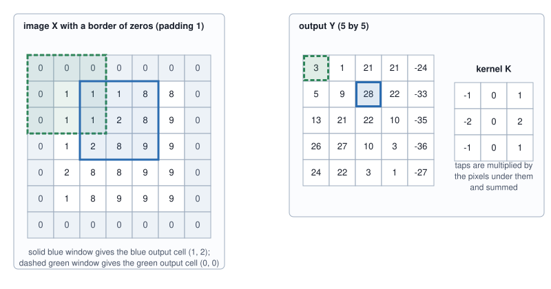
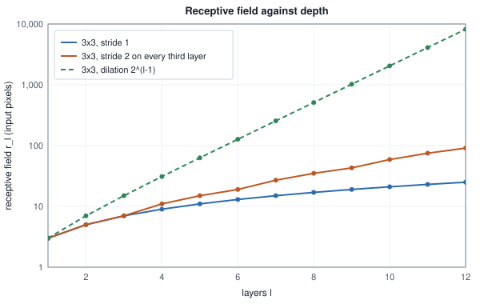
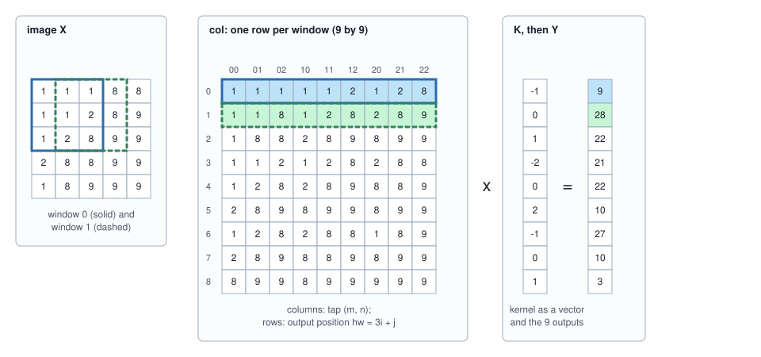
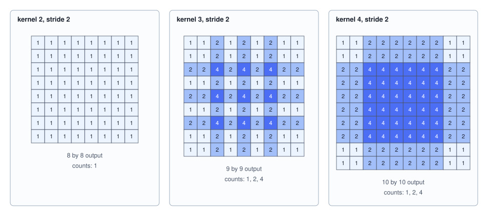

<!-- SPDX-License-Identifier: CC-BY-4.0 -->
<!-- Copyright (c) 2026 Martin Schröder <info@swedishembedded.com> -->

# Convolution

*How does a small filter slid across an image find edges, textures and eventually objects?*

The previous chapter ended with a tensor of $3 \times 224 \times 224$ numbers, 150,528 of them, and a model that has to turn it into something it can name. Volume III already has a layer for that: a dense layer that multiplies the flattened image by a weight matrix. To produce 1,000 outputs from this input it needs 150,528,000 weights, one for every pair of an input number and an output number, and a multiply-add for each of them. The size is the smaller problem. The larger one is that the layer has no idea that the picture is a picture. A vertical edge at the top left and the same edge at the bottom right are, to it, unrelated patterns, each to be learned separately from whatever examples happen to put an edge there; shift the image by one pixel and every input number meets a different weight.

The remedy is to build the structure of the input into the layer. Look at a small neighbourhood, say $3 \times 3$ pixels, with nine weights, and use the same nine weights at every position of the image. An edge detector then has to be learned once and finds edges everywhere; a shift of the image shifts the output by the same amount. The operation is called a convolution, and this chapter takes it apart: what it computes on a printed example, how large its output is, how much of the image one output can see, how to run it as a single matrix product, how to make it cheaper, how to differentiate it, what its adjoint does when it is used to enlarge an image, and when the Fourier transform of Volume I beats the sliding sum. Each of these has its own failure in practice, and brain's history has examples: weights bound in the transposed layout, which never fails a size check; a backward kernel that must add to its buffer and not overwrite it; a threshold between two code paths that went stale; and a gradient check that never reached the path a real network takes.

Six ideas from earlier chapters come first; the answers are at the end.

1. (Volume VII, [Chapter 1](01-images.md), pixel.) What are the shape and strides of a $4 \times 4$ RGB image stored planar (channels first), and at what offset does the green sample of the pixel at row 1, column 2 sit?
2. (Volume I, [Chapter 3](../v01-mathematics/03-vectors.md), dot product.) What is the dot product of $(1, 2, 3)$ and $(4, 5, 6)$, and what does a large dot product between two vectors of equal length say about them?
3. (Volume I, [Chapter 14](../v01-mathematics/14-fourier.md), convolution theorem.) What does the convolution theorem say about the transform of a circular convolution, and how does the cost of the direct sum of a signal of length $N$ with a kernel of length $M$ compare with the route through the transform?
4. (Volume III, [Chapter 5](../v03-neural-networks/05-layer-gradients.md), matmul backward.) For $\mathbf{C} = \mathbf{A}\mathbf{B}$, what are $d\mathbf{A}$ and $d\mathbf{B}$ in terms of $d\mathbf{C}$?
5. (Volume III, [Chapter 6](../v03-neural-networks/06-gradient-checking.md), gradient check.) How is a gradient checked with central differences, and what gate decides that an analytic value and a numeric one agree?
6. (Volume IV, [Chapter 3](../v04-computation/03-roofline.md), arithmetic intensity.) What is the arithmetic intensity of a computation, and what does a machine's roofline say about one whose intensity is below the machine's ridge point?

## Nine products at every position

Here is a $5 \times 5$ picture, the numbers of one channel (small numbers are dark, large ones bright), and a $3 \times 3$ grid of weights called a **kernel**. The kernel is placed on the top-left corner of the image, every weight is multiplied by the pixel under it, and the nine products are added. The window then moves one pixel to the right and the sum is repeated, and so on across the row and down the rows. The result for each position is one number of the output.

<!-- worked: convolution.slide -->
The 5 by 5 image X (rows top to bottom) and the 3 by 3 kernel K. The output at position (i, j) is the sum over (m, n) of K[m][n] X[i + m][j + n], with no padding and stride 1.

```text
X:
 1  1  1  8  8
 1  1  2  8  9
 1  2  8  9  9
 2  8  8  9  9
 1  8  9  9  9

K:
-1  0  1
-2  0  2
-1  0  1

output Y (3 by 3):
  9  28  22
 21  22  10
 27  10   3
```

Position (0, 0), term by term (kernel tap times pixel, row by row): (-1)(1) + (0)(1) + (1)(1) + (-2)(1) + (0)(1) + (2)(2) + (-1)(1) + (0)(2) + (1)(8) = 9.
<!-- /worked -->

Read the kernel as a template. Its left column is $-1, -2, -1$ and its right column $+1, +2, +1$, so the sum is a weighted difference of the right column of the window and the left one, and it is large and positive exactly where the image gets brighter from left to right. The image is dark on the left and bright on the right, with the boundary drifting leftwards as the rows go down, and the output is large (28, 22, 21, 22, 27) in the windows that straddle the boundary and small in the corner window (3) that lies wholly inside the bright region. The kernel is a vertical-edge detector, and it needed nine numbers.

Each output is a dot product of the nine kernel weights with the nine pixels under them (Volume I, Chapter 3), so the output is large when the patch looks like the kernel, a template match that is repeated at every position. In symbols, with $x$ the image, $w$ the kernel of size $k$ and $y$ the output,

$$
y[i, j] = \sum_{a=0}^{k-1}\sum_{b=0}^{k-1} w[a, b]\; x[i + a,\; j + b]. \tag{1}
$$

The sum written this way slides the kernel without turning it over. The convolution of Volume I, $y[n] = \sum_m h[m]\,x[n - m]$, reads the signal backwards from $n$. Deep learning kept the name and dropped the reversal: what networks compute is the sum (1), properly called **cross-correlation**, and it is what the rest of the chapter, and the kernels of brain, mean by a convolution. The distinction can be computed. Below, the true convolution of the same image with the same kernel is formed (all $7 \times 7$ outputs that touch the image, as Volume I counts them), and its middle block is compared with the sliding sum.

<!-- worked: convolution.convolution_vs_correlation -->
The same X and K. Correlation is what the previous table computed (sum of K[m][n] X[i + m][j + n]). The true convolution of Volume I is sum of K[m][n] X[i - m][j - n] over every output that touches the image, 7 by 7 of them; its 3 by 3 block of outputs whose whole window lies inside the image is rows 2 to 4 and columns 2 to 4.

```text
correlation, valid part (3 by 3):
  9  28  22
 21  22  10
 27  10   3

true convolution, valid part (rows 2-4, columns 2-4 of the 7 by 7):
 -9 -28 -22
-21 -22 -10
-27 -10  -3

true convolution, all 7 by 7 outputs:
 -1  -1   0  -7  -7   8   8
 -3  -3  -1 -21 -21  24  25
 -4  -5  -9 -28 -22  33  35
 -5 -13 -21 -22 -10  35  36
 -6 -26 -27 -10  -3  36  36
 -4 -24 -22  -3  -1  27  27
 -1  -8  -8  -1   0   9   9
```

Here K turned half a turn is -K (the kernel is odd under that turn), so the two valid blocks differ by a sign. In general the valid block of the true convolution with K equals the correlation with the turned kernel (largest difference over this example: 0), and the whole 7 by 7 convolution equals the correlation of X padded with a border of 2 zeros and the turned kernel (largest difference: 0).
<!-- /worked -->

The valid block of the true convolution is the sliding sum with the kernel turned half a turn; this kernel happens to be its own negative when turned, so the two blocks differ by a sign. The difference matters in one situation only. A network trained with either operation learns whatever weights make it work, and the weights of one are the turned weights of the other, so nothing is lost by choosing the sliding sum. But weights that cross the boundary between two implementations must be read with the same sliding direction, and a test with a symmetric kernel (a blur) will not notice that they are not.

Here is the **two-dimensional convolution** this chapter means: the operation that produces each output value as the sum of the products of a small kernel's weights with the image values under it (equation (1)), the same kernel at every position, with the sliding direction of the cross-correlation and not the reversal of the convolution of Volume I. The true convolution is not a stranger, though. The whole $7 \times 7$ block of the table is the sliding sum of the turned kernel over the image with a border of two zeros, an identity that the backward pass will use again, and the border is what the next section calls padding.

## How large the output is

The $5 \times 5$ image gave a $3 \times 3$ output, because a window that must lie wholly inside the image has only three positions along a side. Three numbers shape the answer, which brain's convolution kernels take as parameters (the grouped ones take the dilation below as well). The kernel size $k$ is the side of the window. The stride $s$ is how many pixels the window moves between neighbouring outputs; a stride of 2 computes every second output and shrinks the map. The padding $p$ is a border of $p$ zeros added on every side before the window slides, so that windows may overhang the image: the output can then be as large as the input, and a pixel at the edge, which without padding is read by one window at most, is read by more of them. Together they are the **kernel size, stride and padding** of a convolution. (A fourth knob, the dilation $d$, spaces the taps of the window $d$ pixels apart, so that a $3 \times 3$ kernel covers a $(2d + 1) \times (2d + 1)$ area; $d = 1$ is the ordinary kernel, and the formulas below carry it.)

Padding 1 turns the example into a $5 \times 5$ output: the image gets a frame of zeros, and the windows centred on the border pixels read zeros where they overhang.



<!-- worked: convolution.padded_slide -->
The image X and kernel K of the first table with a border of one zero on every side (padding 1) and stride 1: the padded image is 7 by 7 and the output is 5 by 5, the size of the input.

```text
padded X:
 0  0  0  0  0  0  0
 0  1  1  1  8  8  0
 0  1  1  2  8  9  0
 0  1  2  8  9  9  0
 0  2  8  8  9  9  0
 0  1  8  9  9  9  0
 0  0  0  0  0  0  0

output Y (5 by 5):
  3   1  21  21 -24
  5   9  28  22 -33
 13  21  22  10 -35
 26  27  10   3 -36
 24  22   3   1 -27
```

The output at the top-left corner, (0, 0), reads the window whose top row and left column are zeros: (-1)(0) + (0)(0) + (1)(0) + (-2)(0) + (0)(1) + (2)(1) + (-1)(0) + (0)(1) + (1)(1) = 3.
<!-- /worked -->

To get the output size for any $(k, s, p, d)$, count the windows. Output position $o$ along one axis reads the input positions $o\,s - p + d\,m$ for the taps $m = 0, \dots, k - 1$ (the $-p$ because the input starts $p$ places into the padded line). The last tap must not overrun the padded length $H + 2p$, so the position of the window must satisfy $o\,s + d(k - 1) \le H + 2p - 1$ in padded coordinates. The positions $o = 0, 1, \dots$ up to the largest that satisfies it are valid, and counting them gives

$$
H_{\mathrm{o}} = \left\lfloor \frac{H + 2p - d(k - 1) - 1}{s} \right\rfloor + 1, \tag{2}
$$

and the same formula with $W$ for the width $W_{\mathrm{o}}$. The extent $d(k - 1) + 1$ is how far one window reaches. Here are twelve cases, each computed twice: from the formula, and by trying window starts one after another until the window no longer fits.

<!-- worked: convolution.output_sizes -->
Input length H, kernel size k, stride s, padding p, dilation d. The formula is floor((H + 2p - d(k-1) - 1) / s) + 1; the count column tries window starts 0, 1, 2, ... until the window no longer fits in the padded length H + 2p; the last column is the number of input positions no window reads.

| H | k | s | p | d | extent d(k-1)+1 | formula | count | inputs never read |
|---|---:|---:|---:|---:|---:|---:|---:|---:|
| 5 | 3 | 1 | 0 | 1 | 3 | 3 | 3 | 0 |
| 5 | 3 | 1 | 1 | 1 | 3 | 5 | 5 | 0 |
| 5 | 3 | 2 | 1 | 1 | 3 | 3 | 3 | 0 |
| 6 | 3 | 2 | 0 | 1 | 3 | 2 | 2 | 1 |
| 7 | 3 | 2 | 0 | 1 | 3 | 3 | 3 | 0 |
| 7 | 3 | 1 | 2 | 2 | 5 | 7 | 7 | 0 |
| 8 | 3 | 1 | 4 | 2 | 5 | 12 | 12 | 0 |
| 5 | 5 | 1 | 0 | 1 | 5 | 1 | 1 | 0 |
| 4 | 3 | 2 | 1 | 1 | 3 | 2 | 2 | 0 |
| 224 | 7 | 2 | 3 | 1 | 7 | 112 | 112 | 0 |
| 224 | 3 | 2 | 1 | 1 | 3 | 112 | 112 | 0 |
| 225 | 3 | 2 | 1 | 1 | 3 | 113 | 113 | 0 |
<!-- /worked -->

Three things show in the table. With $s = 1$ the output keeps the input's size when $2p = d(k - 1)$, which for an odd $k$ is $p = d(k - 1)/2$, the "same" padding (rows 2 and 6 of the table: $k = 3$ at $p = 1$, and $d = 2$ at $p = 2$). With the same padding and stride $s$ the output is $\lceil H / s \rceil$ long: 224 gives 112 and 225 gives 113. And the floor in (2) can waste input: in the fourth row, an input of 6 with $k = 3$, $s = 2$ and no padding leaves one pixel at the end that no window reads. The output is 2 long, windows at $0, 2$ cover inputs $0$ to $4$, and the last pixel never reaches any output. A network that quietly drops the last row and column of an odd-sized image is an ordinary consequence of (2) and not a bug, but it means that the input size a stride-2 stack reads completely is something to choose on purpose.

The algorithm in the book's pseudocode is the formula with its preconditions, followed by the loops of equation (1) for $C_{\mathrm{in}}$ input channels (the next section) and $G$ groups of channels (a later one; $G = 1$ is the ordinary layer).

```text
function out_size(n: int, k: int, s: int, p: int, d: int) -> int:
    require k >= 1 and s >= 1 and p >= 0 and d >= 1
    require n + 2 * p >= d * (k - 1) + 1
    return (n + 2 * p - d * (k - 1) - 1) // s + 1

function conv2d(x: array<real>[C_in, H, W], w: array<real>[C_out, C_g, k, k],
                s: int, p: int, d: int, G: int) -> array<real>[C_out, H_o, W_o]:
    require C_g * G == C_in and C_out mod G == 0
    H_o = out_size(H, k, s, p, d)
    W_o = out_size(W, k, s, p, d)
    y = zeros(real, [C_out, H_o, W_o])
    for co in 0 .. C_out:
        g = co // (C_out // G)
        for i in 0 .. H_o:
            for j in 0 .. W_o:
                acc = 0.0
                for cl in 0 .. C_g:
                    for a in 0 .. k:
                        for b in 0 .. k:
                            hi = i * s - p + a * d
                            wi = j * s - p + b * d
                            if hi >= 0 and hi < H and wi >= 0 and wi < W:
                                acc = acc + w[co, cl, a, b] * x[g * C_g + cl, hi, wi]
                y[co, i, j] = acc
    return y
```

The `if` is the whole of the zero padding: a tap whose input position falls outside the image contributes nothing, which is the same as reading a zero from a frame. Brain's kernels never build the framed image. `crates/kernels/wgsl/conv2d.wgsl` gives one thread to each output element and skips the out-of-range taps in just this way; its note computes `ho * stride + kh` first and tests it against the padding, so that no subtraction happens in unsigned integers before the test. The shared shape arithmetic is `Shape::conv_out_dilated` in `crates/vision/src/net.rs`, equation (2) with the extent called `eff`, and its unit tests pin the stem of a detector (128 to 64 at $k = 3$, $s = 2$, $p = 1$) and the fact that a dilation of 2 with padding 2 keeps a 48-pixel map at 48. That function is in unsigned 32-bit integers and has no counterpart of the second `require` above: a kernel whose extent exceeds the padded input makes `h + 2 * pad - eff` wrap around (a release build) or panic (a debug build), where the transposed spec's `out_shape` in `crates/vision/src/blocks.rs` guards the analogous hazard (a padding that crops the whole output) with an assertion that names the offending shapes.

## Channels in, channels out

A colour image has three channels, and the layers after the first have dozens or hundreds, so a convolution has to take a stack of channels and give a stack of channels. The rule is the natural one: each output channel has its own kernel for every input channel, and the output value is the sum over the input channels of the sliding sums. The weights are therefore a four-dimensional tensor of shape $[C_{\mathrm{out}}, C_{\mathrm{in}}, k, k]$, and

$$
y[c_{\mathrm{o}}, i, j] = \sum_{c=0}^{C_{\mathrm{in}}-1}\sum_{a=0}^{k-1}\sum_{b=0}^{k-1} w[c_{\mathrm{o}}, c, a, b]\; x[c,\; i s - p + a d,\; j s - p + b d]. \tag{3}
$$

The pseudocode above is this formula with $G = 1$. A layer also has an optional bias, one number added to every position of an output channel. Take the $4 \times 4$ test image of the previous chapter, whose three channels are the red, green and blue planes, and put it through a layer with $C_{\mathrm{out}} = 2$ and $2 \times 2$ kernels. The first output channel is built to look at the green plane only, with the taps $[[-1, 1], [-1, 1]]$, a horizontal difference; the second sums the whole $2 \times 2$ window of all three channels.

<!-- worked: convolution.channels -->
The test image of the previous chapter (3 channels, 4 by 4, codes 20 + 13k, 10 + 9k and 5 + 15k for k = 4 y + x) through a layer with weight tensor of shape [2, 3, 2, 2] (C_out = 2, C_in = 3, 2 by 2 taps), stride 1, no padding, no bias, so the output has shape [2, 3, 3]. Output channel 0 has the green channel as its only non-zero input slice, with taps [[-1, 1], [-1, 1]] (a horizontal difference); output channel 1 has all twelve taps equal to 1 (the sum of the 2 by 2 window over all three channels).

```text
output channel 0:
  18   18   18
  18   18   18
  18   18   18

output channel 1:
 510  658  806
1102 1250 1398
1694 1842 1990
```

Parameters: 2 * 3 * 2 * 2 = 24. Multiply-adds: every one of the 2 * 3 * 3 = 18 outputs sums 3 * 2 * 2 = 12 products, so 216 multiply-adds.
<!-- /worked -->

The green plane rises by 9 per step to the right, so the horizontal difference is 9 in each of the two rows of a window and the first channel is $18$ everywhere, a constant because the image is a linear ramp. The second channel adds up twelve ramp values per window. Moving the window one step to the right raises each of its four pixels by $(13, 9, 15)$ in the three channels, so the sum grows by $4 \cdot (13 + 9 + 15) = 148$ along a row, and one step down raises every pixel index by 4 and the sum by 592.

The counts of a layer are read off (3). The parameters are $C_{\mathrm{out}} C_{\mathrm{in}} k^2$ (plus $C_{\mathrm{out}}$ for the bias), and each output value is a sum of $C_{\mathrm{in}} k^2$ products, so one image costs $H_{\mathrm{o}} W_{\mathrm{o}} C_{\mathrm{out}} C_{\mathrm{in}} k^2$ **multiply-adds** (MACs), two FLOPs each. Parameters do not depend on the image size; the work does. Here are four layers of the kind a classifier is built from, beside the dense layer of the opening.

<!-- worked: convolution.layer_costs -->
Parameters (no bias), multiply-adds (MACs) and FLOPs (2 per multiply-add) of one image through a layer; the last column is how many times each weight is used, Ho * Wo.

| layer | input to output | parameters | multiply-adds | FLOPs | uses per weight |
|---|---|---:|---:|---:|---:|
| stem 7x7 stride 2 | [3, 224, 224] to [64, 112, 112] | 9,408 | 118,013,952 | 236,027,904 | 12,544 |
| 3x3 at 56x56 | [64, 56, 56] to [64, 56, 56] | 36,864 | 115,605,504 | 231,211,008 | 3,136 |
| 3x3 at 14x14 | [256, 14, 14] to [256, 14, 14] | 589,824 | 115,605,504 | 231,211,008 | 196 |
| 1x1 at 56x56 | [64, 56, 56] to [256, 56, 56] | 16,384 | 51,380,224 | 102,760,448 | 3,136 |
| dense on the 3x224x224 image | [150528] to [1000] | 150,528,000 | 150,528,000 | 301,056,000 | 1 |
<!-- /worked -->

The last column is the point of the construction. A weight of the stem is used 12,544 times per image, once at every output position, where a weight of the dense layer is used once. The stem has 9,408 weights against the dense layer's 150,528,000, a ratio of exactly 16,000, while producing 802,816 output numbers where the dense layer produces 1,000. The two middle rows hide a pattern of the architectures of the next chapter: halving the map's side and doubling the channels keeps the multiply-adds exactly the same (both rows are 115,605,504), because $H_{\mathrm{o}}W_{\mathrm{o}}$ falls by four while $C_{\mathrm{in}}C_{\mathrm{out}}$ rises by four, even though the parameters grow fourfold from 36,864 to 589,824.

## How far one output can see

An output value of the first layer depends on a $k \times k$ patch of the image. An output of the second layer depends on a $k \times k$ patch of first-layer outputs, each of which depends on its own patch, and so on, so a deep enough stack lets one output depend on a large area. The **receptive field** of a unit is the set of input pixels on which its value depends, and its size along one axis is what is computed here.

Track two numbers layer by layer: the receptive field $r_\ell$ after layer $\ell$ (in input pixels along one axis), and the **jump** $j_\ell$, the distance in input pixels between the centres of two neighbouring units of layer $\ell$. At the input every pixel is a unit, $r_0 = 1$ and $j_0 = 1$. Layer $\ell$ has kernel size $k_\ell$, stride $s_\ell$ and dilation $d_\ell$, and each of its units reads $k_\ell$ units of the layer below, spaced $d_\ell$ apart. Their centres are $d_\ell\,j_{\ell-1}$ input pixels apart, so the first and the last of them are $d_\ell(k_\ell - 1)\,j_{\ell-1}$ pixels apart; the fields of these units, each $r_{\ell-1}$ wide, join into one block that is the distance between the two outer centres wider than a single field. So the new field is the old one plus that distance. Neighbouring units of layer $\ell$ are $s_\ell$ units of the layer below apart:

$$
r_\ell = r_{\ell-1} + d_\ell\,(k_\ell - 1)\,j_{\ell-1}, \qquad j_\ell = j_{\ell-1}\, s_\ell. \tag{4}
$$

Padding does not appear: it moves where a window sits and not how wide it is. For a stack of $L$ stride-1 layers of size 3 the recursion gives $r = 2L + 1$, a field that grows by 2 per layer. Two things make it grow faster. A stride of 2 doubles the jump and therefore doubles what every later layer adds, and a dilation $d$ multiplies the addition of its own layer by $d$. The table follows two stacks through (4) and checks the last field by tracing which input positions one output of the last layer actually reads.

<!-- worked: convolution.receptive_field -->
Receptive field r and jump j (input pixels between neighbouring outputs of a layer) after each layer along one axis, from r = j = 1 at the input. 'trunk' is seven 3x3 layers whose third and fifth have stride 2; 'dilated' is five stride-1 3x3 layers with dilations 1, 2, 4, 8, 16.

| stack | layer l | k | s | d | r | j |
|---|---:|---:|---:|---:|---:|---:|
| trunk | 1 | 3 | 1 | 1 | 3 | 1 |
|  | 2 | 3 | 1 | 1 | 5 | 1 |
|  | 3 | 3 | 2 | 1 | 7 | 2 |
|  | 4 | 3 | 1 | 1 | 11 | 2 |
|  | 5 | 3 | 2 | 1 | 15 | 4 |
|  | 6 | 3 | 1 | 1 | 23 | 4 |
|  | 7 | 3 | 1 | 1 | 31 | 4 |
| dilated | 1 | 3 | 1 | 1 | 3 | 1 |
|  | 2 | 3 | 1 | 2 | 7 | 1 |
|  | 3 | 3 | 1 | 4 | 15 | 1 |
|  | 4 | 3 | 1 | 8 | 31 | 1 |
|  | 5 | 3 | 1 | 16 | 63 | 1 |

Tracing the inputs read by one output of the last layer back through the trunk touches 31 input positions spanning an interval of 31, equal to r after layer 7; for the dilated stack it touches 63 positions (the dilated taps leave gaps) spanning 63, equal to r after layer 5.
<!-- /worked -->



The trunk of seven layers sees 31 pixels, where seven plain layers would see 15; the dilated stack, with the same number of weights per layer, doubles its field at every layer and passes 63 after five. The figure carries the comparison to twelve layers, and the numbers behind it are the ones that decide an architecture: to see all 224 pixels of an input row, a stack of plain $3 \times 3$ layers needs 112 of them ($2L + 1 \ge 224$), the strided stack of the figure needs 16 (computed from (4)), and the dilated one needs 7 ($2^{L+1} - 1 \ge 224$). Dilation is paid for in coverage: its taps are spread out, so the 63 positions of the five-layer dilated field are read by 63 distinct taps with gaps between them, which the trace above reports (63 positions touched, spanning 63). Brain's depth model has a dilated depthwise branch (the multi-scale block of `crates/zipdepth`), and a unit test of `Shape::conv_out_dilated` checks the padding rule of the previous section on its shape: dilation 2, padding 2 and a $3 \times 3$ kernel keep the map's size.

The field of (4) is a bound on what one output can depend on, and it says nothing about how much each pixel counts. It is the right number to compare with the size of the objects the network must recognise, and the reason the next chapter's networks halve the map's side every few layers.

## One matrix product

A convolution does the same multiply-adds as a matrix product and does them in an awkward order, and the matrix product is the operation that processors are good at (Volume IV, Chapter 6). The two meet in a rearrangement of the input. Cut every window of the image out as a row: the window at output position $(i, j)$ becomes a row of $C_{\mathrm{in}}k^2$ numbers, one for each tap $(c, a, b)$, and the rows for all $H_{\mathrm{o}}W_{\mathrm{o}}$ positions form a matrix. Brain's name for this layout is that of the operation that builds it, **im2col** ("image to columns"): the unrolling of an image into the matrix of its windows,

$$
\mathrm{col}[\,i W_{\mathrm{o}} + j,\;(c\,k + a)\,k + b\,] = x[c,\; i s - p + a d,\; j s - p + b d] \quad (0 \text{ outside the image}). \tag{5}
$$

Write the kernel of an output channel as a row of $C_{\mathrm{in}}k^2$ numbers in the same tap order. The output at every position is then the dot product of that row with a row of $\mathrm{col}$, and for all output channels at once, with $\mathbf{W}$ the weights viewed as a $[C_{\mathrm{out}}, C_{\mathrm{in}}k^2]$ matrix,

$$
\mathbf{Y} = \mathbf{W}\,\mathrm{col}^\top, \qquad \mathbf{Y} \text{ of shape } [C_{\mathrm{out}},\, H_{\mathrm{o}}W_{\mathrm{o}}]. \tag{6}
$$

On the small example the unrolled matrix has nine rows and nine columns, and its product with the kernel written as a vector reproduces the nine outputs of the first table.

<!-- worked: convolution.unrolled -->
The 5 by 5 image X and kernel K of the first table, unrolled: one row of the matrix per output position hw = 3 i + j, one column per tap t = 3 m + n, so entry (hw, t) is X[i + m][j + n]. Multiplying by the kernel written as a vector (taps in the same order) gives the nine outputs.

```text
col (9 by 9):
 1  1  1  1  1  2  1  2  8
 1  1  8  1  2  8  2  8  9
 1  8  8  2  8  9  8  9  9
 1  1  2  1  2  8  2  8  8
 1  2  8  2  8  9  8  8  9
 2  8  9  8  9  9  8  9  9
 1  2  8  2  8  8  1  8  9
 2  8  9  8  8  9  8  9  9
 8  9  9  8  9  9  9  9  9

K as a vector: -1 0 1 -2 0 2 -1 0 1
col times K:     9 28 22 21 22 10 27 10 3
```

These nine numbers are the output of the first table read row by row (largest difference: 0).
<!-- /worked -->



Neighbouring windows overlap, so every pixel appears in several rows of $\mathrm{col}$ (up to $k^2$ of them), and that is the price. The matrix has $H_{\mathrm{o}}W_{\mathrm{o}}C_{\mathrm{in}}k^2$ elements against the image's $C_{\mathrm{in}}HW$. This is the technique of Chellapilla, Puri and Simard (2006), who unrolled convolutions into matrix products so that a tuned matrix-multiply routine could run them. The cost is exact enough to compute:

<!-- worked: convolution.im2col_memory -->
Elements of one image's input and of its unrolled matrix, and the bytes of the matrix in 32-bit floats.

| layer | input elements | col elements Ho*Wo*Cin*k*k | col / input | col bytes (f32) |
|---|---:|---:|---:|---:|
| 3x3, 64 channels, 56x56 | 200,704 | 1,806,336 | 9.00 | 7,225,344 |
| 3x3 stride 2, 128 channels, 56x56 | 401,408 | 903,168 | 2.25 | 3,612,672 |
| 7x7 stride 2, 3 channels, 224x224 | 150,528 | 1,843,968 | 12.25 | 7,375,872 |
| 1x1, 64 channels, 56x56 | 200,704 | 200,704 | 1.00 | 802,816 |

The unrolled matrix is written once and read once by the product: 2 * 4 * Ho*Wo*Cin*k*k bytes beyond the operands, against 2 * C_out * Ho*Wo*Cin*k*k FLOPs, which is 4 / C_out bytes per FLOP whatever the rest of the shape:

| C_out | extra bytes per FLOP |
|---:|---:|
| 3 | 1.3333 |
| 16 | 0.2500 |
| 32 | 0.1250 |
| 128 | 0.0312 |
| 512 | 0.0078 |
<!-- /worked -->

The first table says that a $3 \times 3$ layer with stride 1 unrolls to nine times its input, and the $7 \times 7$ stem to twelve and a quarter times; a $1 \times 1$ layer unrolls to exactly its input, which is no unrolling at all, because a window of one pixel is the pixel. The second table is the reason for the threshold in a real implementation. The FLOPs of the product are $2\,C_{\mathrm{out}}H_{\mathrm{o}}W_{\mathrm{o}}C_{\mathrm{in}}k^2$ whether or not the matrix is formed, so unrolling adds the traffic of writing $\mathrm{col}$ and reading it back, which is $4/C_{\mathrm{out}}$ bytes per FLOP in 32-bit floats and shrinks as the layer gets wider. At three output channels the extra traffic is more than a byte per FLOP, a lot to ask of memory next to what the arithmetic needs (Volume IV, Chapter 3); at 128 it is about 0.03.

<!-- perf-number: historical measurement, commit 863016d2c -->
That is what brain's engine found by measuring. In August 2026, on one GPU, a sweep of the lowering of a convolution over the number of output channels (commit `863016d2c`) put the crossover between 16 and 32 channels, and brain's selector constant `GEMM_CONV2D_MIN_COUT` in `crates/backend-api/src/select.rs` is 32, with the backward counterpart `GEMM_CONV_BWD_MIN_COUT` at the same value. The commit's own text shows how a constant like this drifts: the forward one had been 128, set for a kernel pair that was later replaced, while the backward one had been re-derived, so in that sweep every convolution of 32 to 127 output channels took the slower path. A threshold of this kind belongs to the kernels on both sides of it and goes stale when either changes.

<!-- perf-number: historical measurement, commit 863016d2c -->
The same commit's sweep of one layer shape (128 input channels, $256 \times 256$ map, $3 \times 3$) gave 0.68 for the ratio of the direct kernel's time to the lowered path's at 16 output channels and 1.10 at 32; it is a dated observation of one card, not a property of the idea.

Two refinements of the unrolling are visible in the engine. The first is not to form the matrix. The CPU path in `crates/backend-cpu/src/fast_conv.rs` builds $\mathrm{col}$ one panel at a time, a block of output positions sized so that the panel stays in a 192 KiB budget of cache, multiplies the panel and discards it; a $1 \times 1$ stride-1 convolution needs no panel at all and the code aliases the input as the right operand of the product. The panel's width follows from the budget:

<!-- worked: convolution.panel_widths -->
A 192 KiB budget is 49,152 floats; the panel width is floor(floor(49152 / (Cin k k)) / 16) * 16 columns, at least 16 and at most Ho*Wo (the rule of the engine's CPU convolution, which builds the unrolled matrix one cache-sized panel at a time).

| layer | Cin k k | Ho*Wo | panel width | panel bytes | whole matrix bytes |
|---|---:|---:|---:|---:|---:|
| 3x3, 64 channels, 56x56 | 576 | 3136 | 80 | 184,320 | 7,225,344 |
| 3x3 stride 2, 128 channels, 56x56 | 1152 | 784 | 32 | 147,456 | 3,612,672 |
| 7x7 stride 2, 3 channels, 224x224 | 147 | 12544 | 320 | 188,160 | 7,375,872 |
<!-- /worked -->

The second is to chunk it. The window version of the kernel, `crates/kernels/wgsl/im2col_at.wgsl`, produces the rows of $\mathrm{col}$ for a range of output positions only, because the unrolled matrix of a $512 \times 512$ layer with 256 input channels and a $3 \times 3$ kernel, $262{,}144 \times 2{,}304$ elements of 4 bytes, is 2,415,919,104 bytes (the header says 2.4 GB), more than one binding of the device it was written for could hold. Rows of $\mathrm{col}$ and of the output are independent, so a chunk of positions is a contiguous row range of both and the arithmetic is unchanged. The lowered convolution of the image autoencoder in `crates/vae/src/blocks.rs` runs its GEMM per chunk, with a scratch capped by a constant of 512 MiB.

The refinement that removes the cost is the implicit one: gather the operand from the image while a GEMM tile is being staged in fast memory, so that $\mathrm{col}$ never exists. Commit `61faf0d3d` (October 2026) replaced the three naive convolution kernels of a CUDA training run, forward, input gradient and weight gradient, by implicit GEMMs of this kind in `crates/kernels-cuda/cu/conv2d_f32.cu`, and commit `65862ae65` records why the autoencoder dispatches a convolution direct, rather than through the unrolled matrix, wherever the device has such a kernel: the builder had asked only the portable selector and so had been materialising an operand nine times wider than the input for most of the network's convolutions. Unrolling is the idea; the kernel of a mature engine is the idea without the matrix.

### The same numbers in two layouts

The unrolling is easy to write in channels-first order, which brain uses throughout (NCHW: batch, channel, row, column), because the tap order $(c, a, b)$ of (5) walks the input along rows and then planes. A channels-last layout (NHWC), which the previous chapter met as HWC, makes the other order natural, tap order $(a, b, c)$, and the channel dimension is the contiguous one. The difference is visible in the memory a window touches:

<!-- worked: convolution.layouts -->
The 12 elements of the 2 by 2 window at output position (0, 0) (all three channels) of a [3, 4, 4] image, as offsets from the start of the buffer, in the two layouts, grouped into runs of consecutive offsets.

| layout | offset of (ci, h, w) | runs | offsets |
|---|---:|---:|---|
| NCHW (planes) | (ci * 4 + h) * 4 + w | 6 | 0..1, 4..5, 16..17, 20..21, 32..33, 36..37 |
| NHWC (pixels) | (h * 4 + w) * 3 + ci | 2 | 0..5, 12..17 |
<!-- /worked -->

In planes a window of a $2 \times 2$ kernel over three channels is six runs of two consecutive elements; in pixels it is two runs of six. A kernel that contracts over channels, which is every dense layer and a $1 \times 1$ convolution in particular, wants the channels contiguous; a kernel that works on one channel at a time and spatial neighbourhoods, as a depthwise convolution does, wants the planes. The product can be formed either way round. With $\mathrm{col}$ as the left operand the output is $[H_{\mathrm{o}}W_{\mathrm{o}}, C_{\mathrm{out}}]$, which is NHWC, and the lowered convolution of `crates/vae/src/blocks.rs` does that: it writes the product into a channels-last buffer and finishes with one kernel that adds the bias and permutes to channels-first. The permutation kernel pair `nchw_nlc.wgsl` and `nlc_nchw.wgsl` in `crates/kernels/wgsl` documents the property that makes it cheap to differentiate: a permutation is its own adjoint and its inverse, so the backward pass of one is a call of the other.

## Fewer weights: pointwise, depthwise and grouped

A $1 \times 1$ convolution has $k = 1$ and (with stride 1 and no padding) (3) reduces to $y[c_{\mathrm{o}}, i, j] = \sum_c w[c_{\mathrm{o}}, c]\,x[c, i, j]$: at every pixel it is the linear layer of Volume III, applied to the vector of the pixel's channels, with the same weights at every pixel. It mixes channels and looks at no neighbours, which is why it is called a **pointwise convolution**. A convolution with a large kernel, in turn, mixes space and channels at once, with $C_{\mathrm{in}}C_{\mathrm{out}}k^2$ weights; the factorization is to do the two separately. A **depthwise convolution** gives every channel its own single kernel and no cross-channel sum: the weight tensor is $[C, 1, k, k]$ and output channel $c$ is the sliding sum of input channel $c$ alone. Followed by a pointwise convolution, which does the channel mixing, the pair is a depthwise-separable convolution. The parameters and work are

$$
\underbrace{C k^2}_{\text{depthwise}} + \underbrace{C\,C_{\mathrm{out}}}_{\text{pointwise}}
\quad\text{against}\quad C\,C_{\mathrm{out}}\,k^2,
\qquad \text{a ratio of } \frac{1}{C_{\mathrm{out}}} + \frac{1}{k^2}. \tag{7}
$$

In between is the **grouped convolution**: split the $C_{\mathrm{in}}$ input channels into $G$ groups of $C_{\mathrm{in}}/G$, the output channels into $G$ groups of $C_{\mathrm{out}}/G$, and let each output channel see only the input channels of its own group, so its weights are $[C_{\mathrm{out}}, C_{\mathrm{in}}/G, k, k]$ and the parameters fall by $G$. $G = 1$ is the dense layer and $G = C_{\mathrm{in}} = C_{\mathrm{out}}$ is the depthwise one. The pseudocode of the output-size section already handles all of them through `G` and `C_g`. The counts for a layer of 128 channels on a $56 \times 56$ map:

<!-- worked: convolution.grouped_counts -->
A 128 to 128 channel 3x3 layer on a 56 by 56 map (stride 1, padding 1) with G groups: weight shape [C_out, C_in / G, 3, 3]; G = 128 is the depthwise layer.

| groups G | weight shape | parameters | multiply-adds |
|---|---:|---:|---:|
| 1 | [128, 128, 3, 3] | 147,456 | 462,422,016 |
| 2 | [128, 64, 3, 3] | 73,728 | 231,211,008 |
| 4 | [128, 32, 3, 3] | 36,864 | 115,605,504 |
| 8 | [128, 16, 3, 3] | 18,432 | 57,802,752 |
| 128 | [128, 1, 3, 3] | 1,152 | 3,612,672 |
<!-- /worked -->

<!-- worked: convolution.separable -->
A 128 to 128 channel layer on a 56 by 56 map, stride 1, padding 1, no bias. Bytes are the least traffic with every tensor read or written once in 32-bit floats (input, output and weights; the separable pair writes and reads the intermediate map, so its bytes are the sum of its two layers'). Intensity is FLOPs per byte.

| layer | parameters | multiply-adds | FLOPs | bytes | FLOP / byte |
|---|---:|---:|---:|---:|---:|
| standard 3x3 | 147,456 | 462,422,016 | 924,844,032 | 3,801,088 | 243.3 |
| depthwise 3x3 | 1,152 | 3,612,672 | 7,225,344 | 3,215,872 | 2.2 |
| pointwise 1x1 | 16,384 | 51,380,224 | 102,760,448 | 3,276,800 | 31.4 |
| separable pair (unfused) | 17,536 | 54,992,896 | 109,985,792 | 6,492,672 | 16.9 |

Parameters (and multiply-adds) of the pair over the standard layer: 0.1189, which is 1/128 + 1/9 = 0.1189.
<!-- /worked -->

The first table is the grouped family, each step of $G$ dividing both the parameters and the multiply-adds. The second table is the depthwise-separable pair against the standard layer, with the formula (7) satisfied exactly (0.1189 is $1/128 + 1/9$), and the pair does 8.4 times fewer FLOPs. It does not take 8.4 times less time, and the last two columns say why. A convolution's cost in time is bounded below by its FLOPs and by its bytes (the roofline of Volume IV, Chapter 3), and the depthwise layer does $2k^2 = 18$ FLOPs per output element while moving a $4$-byte input and a $4$-byte output for it, about 2.2 FLOPs per byte at best, where the standard layer reuses every loaded value $C_{\mathrm{out}}k^2$ times and sits at 243. The pair, unfused (so that the intermediate map is written and read), has 17 FLOPs per byte. The factorization cuts the arithmetic and the parameters by a factor of 8.4 and raises the bytes moved by a factor of 1.7, so on a machine whose roofline ridge is in the tens of FLOPs per byte a depthwise layer is bound by memory and runs far below the machine's FLOP rate.

Brain's engine has this shape in its code. A depthwise layer is a `ConvSpec` with `groups` equal to the channel count (`ConvSpec::depthwise` in `crates/vision/src/blocks.rs`), and the CPU path of `crates/backend-cpu/src/fast_conv.rs` runs it in a loop of its own, one thread per channel plane, because, as its comment says, a per-group matrix product would be a $[1 \times k^2]\cdot[k^2 \times P]$ product whose unrolling overhead would exceed its $k^2$ multiplications. The general grouped case runs a dense convolution per group on contiguous channel slices. The sliding-sum kernels that take `groups` and `dilation` carry a name of their own, `conv2d_gd`, with a uniform block of 12 words where the dense `conv2d` has 10, and the block's `is_dense` decides which to dispatch. The reason is a trap that the comments in `crates/vision/src/ids.rs` and `crates/vision/src/blocks.rs` describe: the CPU backend binds its fast dense path to the kernel name `conv2d`, and that path ignores groups, so a grouped convolution dispatched under the dense name would compute a different operator and report no error. The commit that introduced the grouped kernels (`f6d26e9a6`, July 2026) records the same reason for giving them a name of their own. Their tests in `crates/gradcheck/tests/it/depth_kernels.rs` include one that a depthwise layer's channels are isolated from each other, and one that at one group and no dilation the kernel reproduces the dense one.

To see that a grouped layer is what it claims to be, it can be compared with its definition written the other way: $G$ independent dense convolutions, each on its own channel slice.

<!-- worked: convolution.grouped_check -->
Generator `bookrng.generator("convolution.grouped_check")`, seed 0x96cb117f4e87a662. Draws in order: x of shape [4, 5, 5] (channel, row, column; every entry normal()), then w of shape [6, 2, 3, 3] (every entry normal() times 0.5), then the depthwise weight [4, 1, 3, 3] (normal() times 0.5). Stride 1, padding 1, dilation 1.

| comparison | largest difference | criterion |
|---|---|---|
| grouped layer G = 2 against two dense layers on channel slices 0-1 and 2-3 of x, output slices 0-2 and 3-5 | below 1e-12 | met |
| depthwise layer (G = 4) against filtering each channel alone | below 1e-12 | met |
<!-- /worked -->

A reader of Volume VI will recognise the shape. The short convolution of the linear-attention chapter is a depthwise causal convolution over the sequence axis with $k = 4$: one filter per channel, no mixing between channels, a few taps. It is the one-dimensional case of this section, and what that chapter added to it, causality, is a choice of padding (all of it on the left).

## Running the sliding sum backwards

A convolution layer in a network has to be trained, so it needs the gradient of the loss with respect to its input (to pass on to the layer below) and with respect to its weights (to update them). Write $dy$ for the gradient of the loss with respect to the output and $dx$, $dw$ for the two gradients sought, with the convention of Volume III. The **convolution backward** pass is the computation of $dx$ and $dw$ from $dy$, $x$ and $w$.

Start from (3). The weight $w[c_{\mathrm{o}}, c, a, b]$ multiplies $x[c, is - p + ad, js - p + bd]$ in the output at $(c_{\mathrm{o}}, i, j)$, for every $(i, j)$ where the position is in the image, and it is the same weight everywhere. A weight used at many places gets the sum of the contributions of all of them (the gradient accumulation of Volume III, Chapter 5), so

$$
dw[c_{\mathrm{o}}, c, a, b] = \sum_{i,j} dy[c_{\mathrm{o}}, i, j]\; x[c,\; i s - p + a d,\; j s - p + b d]. \tag{8}
$$

This is a sliding sum of the form (1) with $dy$ as the kernel: the roles of the two sums are exchanged, the weight indices $(a, b)$ are now the output positions, they step by $d$ through $x$, and the taps $(i, j)$ of the kernel $dy$ are $s$ apart. Stride and dilation swap places. For $s = d = 1$ the weight gradient is the correlation of $x$ with $dy$. Likewise, an input pixel $x[c, h, w]$ is read by the output positions $(i, j)$ that satisfy $is - p + ad = h$ for a tap $a$ (and likewise for $w$), each with its own weight, so

$$
dx[c, h, w] = \sum_{c_{\mathrm{o}}}\sum_{a, b}\; dy[c_{\mathrm{o}}, i, j]\; w[c_{\mathrm{o}}, c, a, b], \qquad i = \frac{h + p - ad}{s},\; j = \frac{w + p - bd}{s}, \tag{9}
$$

where the terms are present only if the divisions are exact and $(i, j)$ is an output position. With $s = d = 1$ every tap contributes, $i = h + p - a$, and substituting $a' = k - 1 - a$ turns (9) into a sliding sum over $dy$ with the kernel turned half a turn and with the roles of the channel axes exchanged: $dx$ is the correlation of $dy$ padded with $k - 1 - p$ zeros per side with the turned kernel. This is the identity of the true convolution of the first section appearing again, a "full" convolution with the turned kernel, and it is why the same algebra is called a convolution in one place and a correlation in the other. With a stride $s > 1$ only every $s$-th position has a term: equivalent to padding $dy$ with $s - 1$ zeros between neighbours first.

Here are both gradients by hand, on the image and kernel of the first table, for a given $dy$:

<!-- worked: convolution.backward_by_hand -->
The image X and kernel K of the first table (stride 1, no padding), with an upstream gradient dY of the output's shape (3 by 3). dW is the correlation of X with dY used as the kernel; dX is the correlation of dY padded with k - 1 = 2 zeros per side with K turned half a turn.

```text
dY:
  1   0  -1
  2   1   0
  0  -1   1

dW = X correlated with dY (3 by 3):
  9  -2   5
  3   6  18
  6  17  24

dX (5 by 5):
 -1   0   2   0  -1
 -4  -1   6   1  -2
 -5  -1   5   1   0
 -2   1   0  -1   2
  0   1  -1  -1   1
```

The same two arrays come out of the scatter form, the gather form, the matrix products of im2col and the two correlations above (largest difference between any two: 0, all values being integers).
<!-- /worked -->

Take $dw[0, 0] = 9$: it is the sum, over the nine positions, of $dy[i, j]\,x[i, j]$, which is $1 \cdot 1 + 0 \cdot 1 + (-1) \cdot 1 + 2 \cdot 1 + 1 \cdot 1 + 0 \cdot 2 + 0 \cdot 1 + (-1) \cdot 2 + 1 \cdot 8 = 9$. And $dx[0, 0] = -1$ is $dy[0, 0]$ times the kernel tap that read that pixel in the top-left window, $-1$; the pixel at $(2, 2)$ was read by all nine windows through all nine taps. The padding rule is the same one as before: how many zeros the identity needs is $k - 1 - p$.

<!-- worked: convolution.backward_stride1_identity -->
Generator `bookrng.generator("convolution.backward_checks.stride1")`, seed 0xf32758f0d538528f. Draws in order: x of shape [2, 6, 6] (every entry normal()), w of shape [3, 2, 3, 3] (every entry normal()), then dY of shape [3, Ho, Wo] (every entry normal()) for padding 0, 1 and 2 in turn. dX from the correlation of the padded dY with the turned, channel-exchanged kernel, and dW from the correlation of the padded X with dY, against the scatter form.

| forward padding p | zeros added to dY per side (k - 1 - p) | dY shape | largest difference |
|---:|---:|---|---|
| 0 | 2 | [3, 4, 4] | below 1e-12 |
| 1 | 1 | [3, 6, 6] | below 1e-12 |
| 2 | 0 | [3, 8, 8] | below 1e-12 |
<!-- /worked -->

The matrix form gives the same results in two lines. Equation (6) is a matrix product, $\mathbf{Y} = \mathbf{W}\,\mathrm{col}^\top$, so the matrix-multiply backward of Volume III gives

$$
d\mathbf{W} = d\mathbf{Y}\,\mathrm{col}, \qquad d\,\mathrm{col} = d\mathbf{Y}^\top \mathbf{W}, \tag{10}
$$

with $d\mathbf{Y}$ the gradient of the loss with respect to the output viewed as $[C_{\mathrm{out}}, H_{\mathrm{o}}W_{\mathrm{o}}]$. The first is $d\mathbf{W}$ already. The second is the gradient with respect to the unrolled matrix, and one more step takes it back to the image: each entry of $\mathrm{col}$ was a copy of one pixel, so the gradient of that pixel is the sum of the gradients of all its copies. That is the adjoint of im2col, called **col2im**: every element of $d\,\mathrm{col}$ is added onto the position of the image it was read from, and where windows overlap, the additions pile up.

```text
function im2col(x: array<real>[C, H, W], k: int, s: int, p: int, d: int) -> array<real>[R, T]:
    # R = H_o * W_o and T = C * k * k, taps in the order (c, a, b) of equation (5)
    H_o = out_size(H, k, s, p, d)
    W_o = out_size(W, k, s, p, d)
    col = zeros(real, [H_o * W_o, C * k * k])
    for i in 0 .. H_o:
        for j in 0 .. W_o:
            for c in 0 .. C:
                for a in 0 .. k:
                    for b in 0 .. k:
                        hi = i * s - p + a * d
                        wi = j * s - p + b * d
                        if hi >= 0 and hi < H and wi >= 0 and wi < W:
                            col[i * W_o + j, (c * k + a) * k + b] = x[c, hi, wi]
    return col

function col2im(dcol: array<real>[R, T], C: int, H: int, W: int, k: int, s: int, p: int, d: int)
        -> array<real>[C, H, W]:
    H_o = out_size(H, k, s, p, d)
    W_o = out_size(W, k, s, p, d)
    dx = zeros(real, [C, H, W])
    for i in 0 .. H_o:
        for j in 0 .. W_o:
            for c in 0 .. C:
                for a in 0 .. k:
                    for b in 0 .. k:
                        hi = i * s - p + a * d
                        wi = j * s - p + b * d
                        if hi >= 0 and hi < H and wi >= 0 and wi < W:
                            dx[c, hi, wi] = dx[c, hi, wi] + dcol[i * W_o + j, (c * k + a) * k + b]
    return dx
```

Three routes now give $dx$ and $dw$: the definition as a scatter (every output gradient is added to the weight and the input it multiplied), the definition as a gather (one sum per element of the result: (8) for each weight and (9), with its divisibility test, for each pixel), and the matrix products (10) followed by `col2im`. The worked check below compares all three on four different settings, adds the adjoint test, and runs a gradient check. The adjoint test uses a fact about linear maps. Because $y$ is bilinear in $(x, w)$, the three numbers $\langle y, dy\rangle$, $\langle x, dx\rangle$ and $\langle w, dw\rangle$ are equal, which is $\langle A x, v\rangle = \langle x, A^\top v\rangle$ for the linear map $x \mapsto y$; this is sharper than a finite difference, because it is exact up to rounding.

<!-- worked: convolution.backward_checks -->
Generator `bookrng.generator("convolution.backward_checks")`, seed 0x16256dc15d40af96. Draws in order: x of shape [2, 5, 5] (channel, row, column; every entry normal()), w of shape [3, 2, 3, 3] (every entry normal() times 0.5), then for each row of the table in turn the upstream gradient dY of shape [3, Ho, Wo] (every entry normal()). Each sum runs over the loops in the order of the definition; the comparisons below are to criteria that do not depend on that order. 'routes' compares the scatter, gather and matrix-product routes; 'adjoint' compares the three numbers <y, dY>, <x, dX> and <w, dW>; the gradient check perturbs every entry of x and w by +-1e-5, in 64-bit arithmetic, and applies the gate |a - n| <= 1e-7 + 1e-5 max(|a|, |n|) of Volume III, Chapter 6.

| case | dY shape | routes differ by | adjoint differs by | gradient check | largest |a - n| |
|---|---|---|---|---|---|
| stride 1, padding 1 | [3, 5, 5] | below 1e-12 | below 1e-12 | 104 of 104 pass | below 1e-8 |
| stride 2, padding 1 | [3, 3, 3] | below 1e-12 | below 1e-12 | 104 of 104 pass | below 1e-8 |
| stride 2, padding 0 | [3, 2, 2] | below 1e-12 | below 1e-12 | 104 of 104 pass | below 1e-8 |
| stride 1, padding 2, dilation 2 | [3, 5, 5] | below 1e-12 | below 1e-12 | 104 of 104 pass | below 1e-8 |
<!-- /worked -->

The gradient check perturbs every entry of $x$ and $w$ (104 of them) by $\pm 10^{-5}$ in double precision, forms the central difference of the loss $\sum dy \odot y$, and applies the gate of Volume III, Chapter 6; all entries pass, with the largest absolute difference below $10^{-8}$. Because $y$ is linear in each of $x$ and $w$ separately, the central difference has no truncation error and that difference is rounding alone. It is a stronger test than a nonlinear function would allow, and it is the reason the stride-2 padding-0 row, where some input pixels are read by no window (the unread pixels of the second section), still passes: an unread pixel has gradient zero and the check confirms it.

The cost of the backward pass follows from (10). Both gradients are matrix products of the size of the forward one, so the backward pass costs twice the forward:

<!-- worked: convolution.backward_cost -->
FLOPs of the 64 to 64 channel 3x3 layer on a 56 by 56 map (stride 1, padding 1) for one image.

| pass | FLOPs |
|---|---:|
| forward | 231,211,008 |
| input gradient dX | 231,211,008 |
| weight gradient dW | 231,211,008 |
| backward in all | 462,422,016 |
| forward and backward | 693,633,024 |
<!-- /worked -->

### Why a gather, and why the weight gradient accumulates

Brain's backward kernels are the gather form. The headers of `crates/kernels/wgsl/conv2d_dx.wgsl` and `conv2d_dw.wgsl` say why: in the scatter form many threads add into the same location (all the windows that read one pixel), and the engine's rule is no atomics in a backward pass (commit `3cbeb5258` calls it a rule and not a preference); gathering per input pixel makes every element of $dx$ be written by exactly one invocation, and fixes the order of its sum. The weight gradient is the other case: a weight is touched by every output position, so the kernel gives one thread to each weight element and lets it loop over all positions of the batch, and adds its result onto the weight-gradient buffer it finds rather than overwriting it, so that several uses of a weight in one step add up (Volume III's accumulation rule); its caller clears the buffer once per step. This accumulation contract is easy to hide from tests. The transposed-convolution gradient test of commit `3656ea626` (July 2026) says so in its commit message: every other test ran through a clearing helper that hid the contract, so it added one that dispatches the weight-gradient kernel twice into a buffer cleared once and requires exactly twice the value of a single dispatch. A kernel that had overwritten instead of accumulating would have passed all the others.

The direct input-gradient kernel pays for being a gather: each input pixel walks $C_{\mathrm{out}} k^2$ terms in one thread. The lowering of the same computation through (10), commit `3cbeb5258` (August 2026), moves the $C_{\mathrm{out}}$ sum into a register-tiled matrix product that computes $d\,\mathrm{col} = d\mathbf{Y}^\top\mathbf{W}$ and leaves `crates/kernels/wgsl/col2im.wgsl`, itself a gather, to add up only the $k^2$ taps that touched each pixel (nine for a $3 \times 3$ kernel, independent of $C_{\mathrm{out}}$). Its test, `crates/gradcheck/tests/it/col2im_kernels.rs`, compares the lowered gradient with the direct one on five shapes and requires a relative difference below $10^{-5}$ of the largest value. One case has widths that all differ, "so a Cin/Cout swap cannot pass", as its comment says, and a tap order that reads `col2im`'s columns transposed would still give plausible numbers for a different pixel, which is what the packing test `the_tap_packing_matches_im2col` guards. The same reasoning as the forward pass fixed the threshold, since the direct kernel's work grows with $C_{\mathrm{out}}$ and the lowered one's does not: the commit swept it and found the crossover between 16 and 32 output channels, the value of `GEMM_CONV_BWD_MIN_COUT`.

## What the gradient checks could not reach

The lowered backward illustrates a hazard of every dispatch-by-size scheme: the code path taken for real networks need not be the one the tests exercise. Commit `83990db00` (August 2026) records exactly this. The finite-difference gate of the image-autoencoder model used a small configuration with at most 8 channels, below the 32 at which the lowered path starts, so the GEMM-lowered backward ($d\mathbf{W}$ through the matrix product, $dx$ through `col2im`) that a training step of a network with 128 to 512 channels takes was unreachable from every gradient check. The commit added a configuration with 32 channels and a gate on it, and notes what the larger tensors cost the check: the directional check's step is an $L_2$ step of $\epsilon\sqrt{n}$ for $n$ elements, so on tensors 16 times larger the same $\epsilon$ leaves visible error, which the commit attributes to curvature and not to a wrong gradient, and the step was scaled down with the size.

A second lesson in how to bound an agreement is in commit `233fbc364` (November 2026). A test compared the grouped kernel with the dense one on a case where both should agree, and on CUDA, where the dense one is a tuned implicit GEMM and the grouped one a serial loop, the two differed by up to 39 units in the last place on a run (1,403 on the worst), with both within the bound of the exact value. The commit does not loosen the tolerance. It bounds each kernel against the exact value: any order of summation of an $n$-term single-precision dot product stays within $\gamma_n S$ of it, with $S = \sum|x_i w_i|$ and $\gamma_n \approx n u$ (Volume I, Chapter 15), while a wrong tap moves an element by about $S/n$, which the commit puts at some $10^4$ times that bound. The test is written in terms of the arithmetic and not of the pair of implementations, and the reasoning stands next to it.

The most useful tests of the family are the adjoint ones. The header of `crates/gradcheck/tests/it/depth_kernels.rs` explains the choice: each backward kernel there is the adjoint of a linear operator, so $\langle A x, y\rangle = \langle x, A^\top y\rangle$ holds to rounding, which is sharper than a finite difference, and "a wrong adjoint (a dropped edge tap, a transposed group index, an off-by-one window) breaks it immediately". A padding or stride off-by-one is a wrong index map, and which test sees it depends on where it sits. In one kernel of a forward-and-backward pair, the adjoint identity and a finite difference both see it, since the two kernels then disagree. In an index map that the forward and the backward share, they see nothing: the pair is still adjoint and still consistent, and a convolution on the wrong lattice has a perfectly good gradient. Only a comparison with an independent definition catches that, and brain's tests carry them: a scatter reference written from the definition for the transposed convolution (`convtr2d_ref` in `crates/vision/tests/imaging_blocks.rs`), an oracle in 64-bit arithmetic for the transposed kernels, and the requirement that the grouped kernel at one group reproduce the dense one. This chapter's worked module is such a reference in another language. The adjoint test of the grouped kernel, `conv2d_gd_backward_is_adjoint_and_weight_grad_matches`, compares the two inner products to a tolerance of $10^{-4}$ of the larger (at least 1).

## Going up: the transposed convolution

A strided convolution shrinks a map. Decoders, upsamplers and segmentation heads need the opposite, an operation that takes a small map to a larger one, and the natural candidate is the adjoint of the convolution that would have shrunk it. Write the strided convolution as a matrix $\mathbf{A}$ acting on the flattened image (its $o$-th row has the weights at the positions the $o$-th window reads), so $y = \mathbf{A}x$. The **transposed convolution** is the multiplication by $\mathbf{A}^\top$: it takes a map of the size of $y$ to a map of the size of $x$, with the same kernel, and it is exactly the operation of (9), the backward pass of a convolution with respect to its input, used as a forward layer. (It is sometimes called a deconvolution, which it is not: it does not invert the convolution, it only has its shape.)

The scatter reading is the easiest to compute by hand. Every input value multiplies the whole kernel and the product is stamped onto the output with its corner at $(i s - p, j s - p)$; where stamps overlap they add. Here is a $2 \times 2$ input stamped at stride 2 with a $3 \times 3$ kernel:

<!-- worked: convolution.stamping -->
A 2 by 2 input [[1, 2], [3, 4]] through a transposed convolution with k = 3, stride 2, padding 0 and the kernel [[1, 2, 1], [2, 4, 2], [1, 2, 1]]. Each input value multiplies the whole kernel and lands with its top-left corner at (2i, 2j) of the output; where stamps overlap they add. The output is (2 - 1) * 2 + 3 = 5 by 5.

```text
input 1 at (0, 0) is stamped onto rows 0 to 2, columns 0 to 2
input 2 at (0, 1) is stamped onto rows 0 to 2, columns 2 to 4
input 3 at (1, 0) is stamped onto rows 2 to 4, columns 0 to 2
input 4 at (1, 1) is stamped onto rows 2 to 4, columns 2 to 4

output (5 by 5):
  1   2   3   4   2
  2   4   6   8   4
  4   8  10  12   6
  6  12  14  16   8
  3   6   7   8   4
```

The centre entry (2, 2) receives all four stamps: 1 * 1 + 2 * 1 + 3 * 1 + 4 * 1 = 10; this kernel has equal sums on its even and odd taps (2 and 2 along a row), so a constant input would give a constant interior.
<!-- /worked -->

The output size follows from (2) run in reverse. Along one axis, input $n$ stamps $n$ copies of the extent $d(k - 1) + 1$ with corners $s$ apart, so

$$
H_{\mathrm{o}}' = (n - 1)\,s - 2p + d\,(k - 1) + p_{\mathrm{out}} + 1, \tag{11}
$$

with the padding $p$ cropping both ends, as brain's `ConvTrSpec::out_shape` computes. The extra term $p_{\mathrm{out}}$, output padding, exists because (2) is not invertible: with stride 2, inputs of length 5 and 6 give the same output of length 3, and a transposed convolution that must restore the original size has to be told which it was.

<!-- worked: convolution.transposed_sizes -->
A convolution with k = 3, stride 2, padding 1 maps a length H to n = floor((H - 1) / 2) + 1. The transposed convolution with the same k, stride and padding maps n to (n - 1) * 2 - 2 + 2 + out_pad + 1 = 2n - 1 + out_pad. The last two columns check that the length it returns is one the convolution maps back to n.

| H | n (convolution) | transposed, out_pad 0 | transposed, out_pad 1 | conv gives n back (0) | conv gives n back (1) |
|---|---:|---:|---:|---:|---:|
| 4 | 2 | 3 | 4 | yes | yes |
| 5 | 3 | 5 | 6 | yes | yes |
| 6 | 3 | 5 | 6 | yes | yes |
| 7 | 4 | 7 | 8 | yes | yes |
| 8 | 4 | 7 | 8 | yes | yes |

The two common upsampling shapes: k = 2, stride 2, padding 0 gives exactly 2n, and k = 4, stride 2, padding 1 gives 2n.

| n | k=2, s=2, p=0 | k=4, s=2, p=1 |
|---|---:|---:|
| 4 | 8 | 8 |
| 8 | 16 | 16 |
| 16 | 32 | 32 |
<!-- /worked -->

The table shows it: from $n = 3$ the transposed convolution gives 5 with output padding 0 and 6 with output padding 1, which are the two lengths whose convolution is 3. With $k = 2$, stride 2 and no padding the length doubles exactly, and so it does with $k = 4$, stride 2 and padding 1; these are the two ways to double a map by transposed convolution. Brain's SAM 2 decoder uses the first ($k = 2$, stride 2, twice), as the test `convtranspose_forward_matches_a_scatter_reference` in `crates/vision/tests/imaging_blocks.rs` notes.

The transposed convolution is a strided convolution's adjoint in the strict sense, and the next table checks that, by building $\mathbf{A}$ for a $5 \times 5$ map with $k = 3$, stride 2, padding 1 (a matrix of shape $[9, 25]$), and comparing $\mathbf{A}^\top y$ with the stamping routine and with its gather form (one sum per output position, with the divisibility test of (9)).

<!-- worked: convolution.transposed_adjoint -->
Generator `bookrng.generator("convolution.transposed_adjoint")`, seed 0xd4f6bc437de7efb8. Draws in order: the kernel w of shape [3, 3] (every entry normal()), the vector y of shape [3, 3] (every entry normal()), then x of shape [5, 5] (every entry normal()). The strided convolution (k = 3, stride 2, padding 1) of a 5 by 5 map is a matrix A of shape [9, 25], built column by column by convolving the 25 unit maps.

| comparison | result | criterion |
|---|---|---|
| transposed convolution of y (scatter) against A^T y | largest difference below 1e-12 | met |
| transposed convolution of y (scatter) against its gather form | largest difference below 1e-12 | met |
| <A x, y> against <x, A^T y> | difference below 1e-12 | met |
<!-- /worked -->

Two details of the layer are easy to get wrong, and brain's history has both. The first is the weight layout. A forward convolution stores $[C_{\mathrm{out}}, C_{\mathrm{in}}, k, k]$; a transposed one, in the convention brain follows from the frameworks it imports from, $[C_{\mathrm{in}}, C_{\mathrm{out}}/G, k, k]$, with the input channel outermost. Both hold the same number of numbers, so a weight stored in the wrong one binds with no complaint and computes a different operator. The commit that added the 2-D kernels (`3656ea626`) says so, and the block that wraps them, `ConvTranspose` with its own `ConvTrSpec` in `crates/vision/src/blocks.rs`, is a separate type and not a flag on the forward spec so that a mis-specified unit cannot be constructed. The table makes the failure concrete. The buffer holds $1, 2, 3, \dots$ in storage order, is read once as the transposed layout and once as the forward one, and the two readings give different outputs, a difference of 64 for $C_{\mathrm{in}} = 2$, $C_{\mathrm{out}} = 3$ and of 32 even when the channel counts are equal and the shapes agree:

<!-- worked: convolution.band_and_layout -->
Part 1. A 4 by 4 input of ones, kernel of ones, k = 3, stride 2. Without output padding the output is 9 by 9 at p = 0 and 7 by 7 at p = 1; output padding 1 adds one row and one column at the end.

| padding p | out_pad 0 | out_pad 1 | last row of the out_pad 1 output | the extra row is |
|---:|---:|---:|---|---|
| 0 | 9 by 9 | 10 by 10 | 0 0 0 0 0 0 0 0 0 0 | zeros |
| 1 | 7 by 7 | 8 by 8 | 1 2 1 2 1 2 1 1 | not zeros |

Part 2. A transposed convolution stores its weights as [C_in, C_out, k, k]; a forward convolution stores [C_out, C_in, k, k]. The input is the [2, 2, 2] map with entries 1 to 8 in row-major order, stride 2, k = 2, and the weight buffer holds 1, 2, 3, ... in storage order. 'Right' reads element (ci, co, kh, kw) at ((ci * C_out + co) * 2 + kh) * 2 + kw; 'wrong' reads the same buffer as [C_out, C_in, k, k], taking ((co * C_in + ci) * 2 + kh) * 2 + kw.

| channels C_in to C_out | weight elements | output shape | largest difference between the two readings |
|---|---:|---|---|
| 2 to 3 | 24 | [3, 4, 4] | 64 |
| 2 to 2 | 16 | [2, 4, 4] | 32 |
<!-- /worked -->

The second table's first part is the other detail. Output padding is not zero filling: with padding $p \ge 1$ the cropped border hides real output, and the extra row and column that output padding restores carry nonzero values (the last row at $p = 1$ in the table). With $p = 0$ nothing is cropped, the same extra row is beyond every stamp, and it is zero. The documentation of `ConvTrSpec` in the crate states the first case generally ("it is not zero-fill"), and its test, like the commit's, uses padding 1, where it is true; the sentence is not true for padding 0, as the table shows.

### The checkerboard

Stamps overlap unevenly. With stride 2 and a kernel of size 3, the output positions at even offsets are covered by two stamps and those at odd offsets by one, and on a map of constant input the output is not constant. In two dimensions the counts are the products of the one-dimensional ones. The grids below count the stamps on each output position for a $4 \times 4$ input of ones and a kernel of ones.



<!-- worked: convolution.checkerboard_grids -->
k = 2, stride 2, a 4 by 4 input of ones through a kernel of ones gives a 8 by 8 output of overlap counts:

```text
 1  1  1  1  1  1  1  1
 1  1  1  1  1  1  1  1
 1  1  1  1  1  1  1  1
 1  1  1  1  1  1  1  1
 1  1  1  1  1  1  1  1
 1  1  1  1  1  1  1  1
 1  1  1  1  1  1  1  1
 1  1  1  1  1  1  1  1
```

k = 3, stride 2, a 4 by 4 input of ones through a kernel of ones gives a 9 by 9 output of overlap counts:

```text
 1  1  2  1  2  1  2  1  1
 1  1  2  1  2  1  2  1  1
 2  2  4  2  4  2  4  2  2
 1  1  2  1  2  1  2  1  1
 2  2  4  2  4  2  4  2  2
 1  1  2  1  2  1  2  1  1
 2  2  4  2  4  2  4  2  2
 1  1  2  1  2  1  2  1  1
 1  1  2  1  2  1  2  1  1
```

k = 4, stride 2, a 4 by 4 input of ones through a kernel of ones gives a 10 by 10 output of overlap counts:

```text
 1  1  2  2  2  2  2  2  1  1
 1  1  2  2  2  2  2  2  1  1
 2  2  4  4  4  4  4  4  2  2
 2  2  4  4  4  4  4  4  2  2
 2  2  4  4  4  4  4  4  2  2
 2  2  4  4  4  4  4  4  2  2
 2  2  4  4  4  4  4  4  2  2
 2  2  4  4  4  4  4  4  2  2
 1  1  2  2  2  2  2  2  1  1
 1  1  2  2  2  2  2  2  1  1
```
<!-- /worked -->

For $k = 3$ the counts alternate 1 and 2 along each axis, a lattice that gives the artifact its name, and in the interior of the image the alternation does not go away. With $k = 2$ the stamps tile the output without overlap (every count is 1, the reason $k = s$ is a safe choice) and with $k = 4$ the interior is uniform, 2 along each axis and 4 in two dimensions, with only the border differing. The rule behind the pictures is a modular one. An output position at offset $o$ receives the taps whose index $m$ satisfies $m \equiv o \pmod s$, so for a constant input the interior output takes each of $s$ values in turn, the sums of every $s$-th tap, the kernel's **phase sums**:

<!-- worked: convolution.phase_sums -->
A constant input of 6 ones through a 1D transposed convolution with the given kernel and stride (no padding). An output position receives the taps whose index is congruent to its own position modulo the stride, so for constant input the interior output cycles through the 'phase sums' (the sums of every s-th tap). The 'interior' is the stretch every phase reaches.

| kernel | stride s | phase sums | output | interior |
|---|---:|---|---|---|
| [1, 1] | 2 | 1 / 1 | 1 1 1 1 1 1 1 1 1 1 1 1 | uniform |
| [1, 1, 1] | 2 | 2 / 1 | 1 1 2 1 2 1 2 1 2 1 2 1 1 | ripple |
| [1, 2, 1] | 2 | 2 / 2 | 1 2 2 2 2 2 2 2 2 2 2 2 1 | uniform |
| [1, 3, 3, 1] | 2 | 4 / 4 | 1 3 4 4 4 4 4 4 4 4 4 4 3 1 | uniform |
| [1, 1, 1, 1] | 2 | 2 / 2 | 1 1 2 2 2 2 2 2 2 2 2 2 1 1 | uniform |
| [1, 1, 1, 1, 1, 1] | 3 | 2 / 2 / 2 | 1 1 1 2 2 2 2 2 2 2 2 2 2 2 2 2 2 2 1 1 1 | uniform |
| [1, 2, 3, 2, 1] | 3 | 3 / 3 / 3 | 1 2 3 3 3 3 3 3 3 3 3 3 3 3 3 3 3 3 2 1 | uniform |
<!-- /worked -->

The interior is uniform exactly when all the phase sums are equal. The kernel of ones with $k = 3$ has sums 2 and 1, so the output ripples; the triangle $[1, 2, 1]$ has 2 and 2 and is uniform; the bilinear upsampling kernel $[1, 3, 3, 1]$ has 4 and 4. The artifact is therefore not a property of the transposed convolution as such but of a kernel whose phase sums differ, and a trained network can learn to equalize them or not. Odena, Dumoulin and Olah (2016) describe how the artifact appears in generated images and recommend, among other remedies, resizing by a fixed interpolation (nearest-neighbour or bilinear) and following with an ordinary convolution, which has no overlap pattern to inherit. The same modular structure explains a fast kernel: with stride $s$ only the taps $a \equiv (h + p) \pmod s$ reach row $h$ of the input gradient of a strided convolution, so the native kernel of commit `61faf0d3d` splits that gradient into $s^2$ classes, each a dense convolution over its own taps with no dead work, which is the phase decomposition of this section used as an optimisation.

The backward pass of a transposed convolution reuses everything above. Its input gradient is the plain strided convolution with the same kernel (the transposed layer is the adjoint of one, so the adjoint of the adjoint is the original), its weight gradient is the sliding sum of (8) with the roles of input and output exchanged, and brain's kernels `convtr2d_dx.wgsl` and `convtr2d_dw.wgsl` are those, again as gathers with accumulation. Its test, `convtranspose_backward_matches_finite_differences`, perturbs the input, weights and bias of a layer with a GELU after it, in single precision with a step of $2 \cdot 10^{-3}$ and a relative gate of $3 \cdot 10^{-2}$, which is the loose gate that single precision and a nonlinear tail need.

## When the Fourier transform pays

Volume I showed that a convolution becomes a pointwise product in the frequency domain, and that for a long kernel this beats the sliding sum. A two-dimensional version is the same: the transform of an image is a transform of every row followed by one of every column, and the convolution theorem holds for the two-dimensional circular convolution. To use it for the sliding sum of (1), transform the image and the kernel (zero-padded to a power-of-two side $L$ at least $H + k - 1$, so that the circular convolution equals the linear one), multiply the two spectra pointwise, and transform back. The cost model is the one of Volume I, Chapter 14, extended to two dimensions: a transform of side $L$ is $2L$ one-dimensional transforms of $4\,(L/2)\log_2 L$ real multiplications, the three transforms of kernel, image and result cost three of these, and the $L^2$ pointwise complex products cost four real multiplications each. The direct sum costs $H^2 k^2$ for a same-size output.

<!-- worked: convolution.fft_single_channel -->
One 224 by 224 channel filtered by a k by k kernel into a 224 by 224 output. Direct: 224^2 k^2 multiplications. Through the FFT: three 2D transforms (kernel, image, inverse) of side L, the smallest power of two at least H + k - 1, each made of 2L one-dimensional transforms of 4 (L/2) log2 L real multiplications, plus L^2 complex products at 4 real multiplications each. Smallest odd k at which the FFT route is cheaper: k = 13, and for every odd k above it.

| kernel k | direct | transform side L | FFT route | direct / FFT |
|---|---:|---:|---:|---:|
| 3 | 451,584 | 256 | 6,553,600 | 0.069 |
| 7 | 2,458,624 | 256 | 6,553,600 | 0.375 |
| 15 | 11,289,600 | 256 | 6,553,600 | 1.723 |
| 31 | 48,219,136 | 256 | 6,553,600 | 7.358 |
| 63 | 199,148,544 | 512 | 29,360,128 | 6.783 |
| 127 | 809,288,704 | 512 | 29,360,128 | 27.564 |
<!-- /worked -->

An odd kernel of 13 or more beats the transform route on a $224 \times 224$ channel, and the break-even moves in steps because the transform side is a power of two (at $k = 31$ the side is 256, at $k = 63$ it jumps to 512, which is why the ratio dips from 7.4 to 6.8 there). The size of the kernels in the networks of the next chapters is the reason the route is not used for them: they are $3 \times 3$, far below the break-even, where the direct sum costs 6.9% of the transform route (the 0.069 of the first row).

The multi-channel case changes the arithmetic and not the verdict. A layer with $C_{\mathrm{in}}$ input and $C_{\mathrm{out}}$ output channels needs the transform of each input channel once, the inverse of each output channel once, and, in the frequency domain, $C_{\mathrm{in}}C_{\mathrm{out}}$ pointwise products per frequency, which replace the sliding sums: the products are the cost that the many channels multiply. With the weights transformed beforehand and stored, the multiplication count of a layer of 64 channels at $3 \times 3$ falls below the direct count, which seems to settle the matter in favour of the transform.

<!-- worked: convolution.fft_layer -->
The 64 to 64 channel 3x3 layer on a 56 by 56 map (one image; transform side L = 64). Multiplications are real multiplications; the FFT route transforms each of the 64 input channels once and inverse-transforms each of the 64 output channels once (2L one-dimensional transforms of 4 (L/2) log2 L multiplications per 2D transform) and forms C_in C_out L^2 complex products at 4 real multiplications each; the weights' transforms are computed once, beforehand, and stored at 8 bytes per complex value. No saving from the symmetry of the transform of a real signal is taken.

| route | multiplications | breakdown | weight bytes |
|---|---:|---|---|
| direct | 115,605,504 |  | 147,456 |
| FFT, weights transformed beforehand | 79,691,776 | 12,582,912 for the 128 transforms of the activations, 67,108,864 for the products | 134,217,728 |

Weight bytes in the frequency domain over the spatial kernel's: 910 times.
<!-- /worked -->

It does not, because of what the table's last column counts. A $3 \times 3$ kernel is 9 numbers per pair of channels; its transform at the padded side is $L^2 = 4096$ complex numbers, which makes the stored weights 910 times larger than the spatial ones, 134 MB of weights for a layer whose spatial weights are 147 KB. The layer's arithmetic intensity falls with it: the multiplications are fewer, the bytes are hundreds of times more, and a layer whose weights are read once per image is bound by those bytes. Counting the work as both FLOPs and bytes, as the rest of the book insists, is what gives the practical answer: the transform pays for large kernels on few channels, and not for the small kernels of convolutional networks.

For small kernels a different algebra saves multiplications without the bytes. The Winograd form $F(2 \times 2, 3 \times 3)$ computes a $2 \times 2$ block of outputs of a $3 \times 3$ convolution from a $4 \times 4$ block of inputs with 16 multiplications in place of the 36 of the direct sums, a factor 2.25, by transforming small tiles instead of whole images.

<!-- perf-number: historical measurement, commit 1e7f398e5 -->
Brain implemented it for the $3 \times 3$ stride-1 padding-1 convolutions of its detector (commit `1e7f398e5`, June 2026) and found it slower than the tuned matrix-product path on every such layer, because the scalar transforms and the materialized transformed tensors ate the multiplication saving, so `crates/backend-cpu/src/fast_conv.rs` keeps it as an opt-in path (`BRAIN_WINOGRAD`) validated against the direct kernel and not the default. A saving in multiplications is a saving in work only when the extra data movement it brings is smaller.

## One set of blocks for every vision model

Everything above is code in four places in brain. The sliding-sum kernels live in `crates/kernels/wgsl` (`conv2d`, the grouped and dilated `conv2d_gd`, the transposed `convtr2d`, each with `_dx` and `_dw` backward kernels, `im2col`, `im2col_at` and `col2im`), the fast CPU path in `crates/backend-cpu/src/fast_conv.rs`, the native CUDA kernels in `crates/kernels-cuda`, and the blocks that compose them with normalization and activation in `crates/vision`, which every vision model of the engine shares: `Conv` with its `ConvSpec` (kernel, stride, padding, groups, dilation, norm, activation, bias), `ConvTranspose` with its own `ConvTrSpec`, the pooling and normalization units, and the composites of the detectors.

The crate exists because of an indexing accident that a convolution invites. A model hands its dispatcher an array of kernels, and a block asks for a kernel by its position in that array; the blocks of the detector imported their kernel positions as bare constants, and a second model with a different array would have dispatched the wrong kernels and produced plausible output (commits `29b246205` and `25f7fb05e`, July 2026). `ConvKernelIds::resolve` in `crates/vision/src/ids.rs` looks every kernel up by name in whatever array the model declares and marks a missing one with a sentinel that panics, naming the kernel, if used. The relocation commit states its proof: the logits of the detector were bitwise identical before and after.

The block `Conv` also carries the fusion that the earlier volumes cited. At inference a convolution followed by batch normalization (Volume III, Chapter 10) and an activation is one kernel: `conv_act.wgsl` computes the sliding sum, then applies the normalization as a per-channel scale and shift, computed from its statistics by the block (`Conv::pack_sb`) without touching the convolution's weights, then the activation, in the same pass that writes the result, so the normalization and the activation make no trips through memory of their own (Volume IV, Chapter 8; commit `b2d1b379e`, June 2026). Folding the normalization into the weights themselves (`fold_bn` in `crates/vision/src/fold.rs`) is a different form, used where a convolution must stand alone, and the next chapter derives it. The unrolled path has the same shape in three dispatches: `im2col`, a matrix product, and `conv_epilogue.wgsl`, which applies the same per-channel affine and activation to the product, and the block's lowered path reproduces the fused kernel's result. A block takes that path only when it is a dense convolution with a SiLU activation, a single image and at least `gemm_conv_min_cout()` output channels (32 by default), which is the threshold of the previous sections again.

## Check your understanding

1. Find the error: "A $3 \times 3$ convolution with stride 2 and padding 1 on a row of 6 pixels has 3 outputs, and output 2 reads the input pixels 4, 5 and 6."
2. A network trained with a true convolution (kernel turned over) in a library is imported into an engine that computes the sliding sum of (1), with the kernels copied unchanged. A test on a blurred-image example passes. Will a test on an edge image pass, and why?
3. A depthwise-separable layer does 8.4 times fewer FLOPs than the standard one it replaces. Why does it not take 8.4 times less time on a GPU, and which number of the chapter says so?
4. A convolution kernel for the weight gradient overwrites its output buffer instead of adding to it. A test of a single layer on one image passes. Give a case where a network built on the kernel trains wrongly, and say what test would catch it.
5. A decoder upsamples with a transposed convolution of $k = 3$, stride 2, and its output on a flat grey input shows a regular grid pattern. Explain it with the phase sums, and give two changes that remove it.
6. A stack of 16 layers of $3 \times 3$ stride-1 convolutions is said to give each output "a view of the whole $224$-pixel image". Is it so? What does the recursion (4) say, and what would you change?
7. The Fourier route needs fewer real multiplications than the direct sum for a $3 \times 3$ layer with 64 input and 64 output channels at $56 \times 56$. State two reasons it is nonetheless not used.
8. The lowered backward pass of a convolution is taken only above 32 output channels, and every test of the model uses at most 8. What is wrong with the test plan, and what does the history of this repository say it cost?

## Summary

A convolution applies the same small kernel at every position of an image: the output is the sum of the products of the kernel's weights with the pixels under it (equation (1)), a cross-correlation that deep learning calls a convolution and that differs from Volume I's convolution by a half turn of the kernel. Its output has the size of formula (2) in kernel size, stride, padding and dilation, with the floor that may leave pixels unread. A layer with channels has a weight tensor $[C_{\mathrm{out}}, C_{\mathrm{in}}, k, k]$ and uses each weight at every output position, so its work is $H_{\mathrm{o}}W_{\mathrm{o}}C_{\mathrm{out}}C_{\mathrm{in}}k^2$ multiply-adds on parameters that do not depend on the image size. The receptive field grows by the recursion (4): linearly for plain layers, with the stride for strided ones, and exponentially with the dilation.

Unrolling every window into a row (im2col) turns the layer into the matrix product $\mathbf{W}\,\mathrm{col}^\top$ at the price of a matrix $k^2$ times the input in memory, which engines avoid by working in panels, in chunks or by gathering the operand inside the matrix product; the extra traffic is $4/C_{\mathrm{out}}$ bytes per FLOP, the reason the lowering has a measured threshold in width. Depthwise, pointwise and grouped convolutions cut parameters and FLOPs and, because they reuse each loaded value fewer times, cut arithmetic intensity much more. The backward pass is two more matrix products, $d\mathbf{W} = d\mathbf{Y}\,\mathrm{col}$ and $d\,\mathrm{col} = d\mathbf{Y}^\top\mathbf{W}$ followed by col2im, with the weight gradient a correlation of the input with $dy$ and the input gradient a full correlation with the turned kernel; the checks that find real bugs are adjoint identities and exact bounds, and a gradient check that does not reach the path the network takes does not check it. The transposed convolution is the adjoint of a strided convolution, with the output size of (11), a weight layout that binds in the wrong order without complaint, and a checkerboard whose cause is unequal phase sums of the kernel. The Fourier route beats the sliding sum only for large kernels on few channels, in multiplications and even more in the bytes of the weights.

Stacks of these layers are what the next chapter builds: how pooling, depth and residual connections turn a small filter into an image classifier, and why the gradient of a deep stack needs a shortcut to survive.

## References

- Y. LeCun, L. Bottou, Y. Bengio and P. Haffner, *Gradient-based learning applied to document recognition*, Proceedings of the IEEE, 1998. The convolutional network and the sliding kernel with shared weights.
- K. Chellapilla, S. Puri and P. Simard, *High performance convolutional neural networks for document processing*, International Workshop on Frontiers in Handwriting Recognition, 2006. The unrolling of a convolution into a matrix product.
- V. Dumoulin and F. Visin, *A guide to convolution arithmetic for deep learning*, 2016. Output sizes under padding, stride and dilation, and of the transposed convolution.
- A. Odena, V. Dumoulin and C. Olah, *Deconvolution and checkerboard artifacts*, Distill, 2016. The uneven overlap of strided transposed convolutions in generated images.

## Exercises

1. **[Calculate]** For a row of 57 pixels, $k = 5$, $s = 3$, $p = 2$, $d = 1$: give the output length from (2), the input positions read by the last window, and the number of input pixels no window reads.
2. **[Calculate]** A stack has the layers $(k, s) = (7, 2), (3, 2), (3, 1), (3, 1)$ (dilation 1). Give $r_\ell$ and $j_\ell$ after each layer from (4).
3. **[Calculate]** A $3 \times 3$ layer maps 32 channels to 64 on a $112 \times 112$ map (stride 1, padding 1). Give the parameters and multiply-adds of the standard layer and of the depthwise-separable pair, and check the ratio against (7).
4. **[Calculate]** For an input of shape $[32, 28, 28]$ and a $5 \times 5$ kernel with stride 1 and padding 2, give the number of elements and bytes (32-bit) of the unrolled matrix, and its ratio to the input.
5. **[Calculate]** Take $x = [[1, 2, 3], [4, 5, 6], [7, 8, 9]]$, $w = [[1, 0], [0, -1]]$ with stride 1 and no padding, and $dy = [[1, 2], [3, 4]]$. Compute $y$, $dw$ from (8) and $dx$ from (9).
6. **[Calculate]** A transposed convolution with $k = 4$, $s = 2$, $p = 1$ takes a length-7 axis to which length by (11), and which lengths $H$ does a convolution with $k = 3$, $s = 2$, $p = 1$ map to 7? For stride 3, do the kernels $[1, 2, 3, 2, 1]$ and $[1, 1, 1, 1]$ give a uniform interior on a constant input?
7. **[Calculate]** With the cost model of the Fourier section, give the direct and transform multiplication counts for a $64 \times 64$ image and a $5 \times 5$ kernel.
8. **[Implement]** Reproduce `convolution.slide` and `convolution.convolution_vs_correlation`: the sliding sum, the true convolution of Volume I, and the identity of the valid block with the correlation of the turned kernel.
9. **[Implement]** Reproduce `convolution.output_sizes` and `convolution.receptive_field`: formula (2) against a count of fitting windows, and recursion (4) against the traced positions.
10. **[Implement]** Reproduce `convolution.unrolled`, `convolution.im2col_memory` and `convolution.panel_widths`: `im2col` as in (5) with the tap order $(c, a, b)$, the sizes of the unrolled matrix and the cache-panel rule.
11. **[Implement]** Reproduce `convolution.backward_by_hand` and `convolution.backward_checks`: the scatter, gather and matrix-product routes, the adjoint identity, and the central-difference gate of Volume III, Chapter 6 with the generator, seed and draw order printed.
12. **[Investigate]** Implement the transposed convolution as stamping and reproduce `convolution.stamping` and `convolution.checkerboard_grids`; then replace the stride-2 transposed convolution of $k = 3$ by nearest-neighbour doubling followed by an ordinary $3 \times 3$ convolution, and compare the two on a constant input and on the input of the stamping example.

## Key terms

- **two-dimensional convolution**: the operation that gives each output value as the sum of the products of a small kernel's weights with the image values under it, the same kernel at every position and, in deep learning, without turning the kernel over (a cross-correlation). <!-- concept: convolution-2d -->
- **kernel size, stride and padding**: the side of the window, the number of pixels it moves between neighbouring outputs, and the border of zeros added around the image; with the dilation, which spaces the taps, they fix the output size $\lfloor (H + 2p - d(k-1) - 1)/s \rfloor + 1$. <!-- concept: kernel-size-stride-padding -->
- **receptive field**: the set of input pixels on which one output value depends; along one axis its size grows by $d(k-1)$ times the jump (the input distance between neighbouring units) at each layer, and the jump multiplies by the stride. <!-- concept: receptive-field -->
- **im2col**: the unrolling of an image into a matrix with one row per window position, so that a convolution becomes one matrix product with the weights, at the price of a matrix about $k^2$ times the input in size. <!-- concept: im2col -->
- **depthwise convolution**: a convolution that gives every channel its own single kernel and sums nothing across channels (a grouped convolution with as many groups as channels); followed by a pointwise convolution it replaces a dense layer with a fraction $1/C_{\mathrm{out}} + 1/k^2$ of its parameters. <!-- concept: depthwise-convolution -->
- **transposed convolution**: the adjoint of a strided convolution, used as a layer that enlarges a map: every input value stamps the kernel onto the output at stride spacing and overlapping stamps add, so unequal overlap (unequal phase sums of the kernel) gives a checkerboard pattern. <!-- concept: transposed-convolution -->
- **convolution backward**: the gradients of a convolution layer, the weight gradient as a sum over all positions of the output gradient times the input patch (a correlation of the input with $dy$) and the input gradient as the output gradient spread back through the kernel (a full correlation with the turned kernel, col2im of $d\mathbf{Y}^\top\mathbf{W}$). <!-- concept: convolution-backward -->

## Answers

**Recall questions.**

1. The shape is $[3, 4, 4]$ with strides $(16, 4, 1)$; the green sample ($c = 1$) at row 1, column 2 is at offset $(1 \cdot 4 + 1) \cdot 4 + 2 = 22$.
2. $1 \cdot 4 + 2 \cdot 5 + 3 \cdot 6 = 32$. For vectors of equal length a large dot product says they point the same way: it is the product of the lengths and the cosine of the angle between them, so for fixed lengths it is largest when the vectors are parallel.
3. The transform of a circular convolution is the pointwise product of the transforms. The direct sum costs $NM$ multiplications and the transform route about $L \log_2 L$ for the transform side $L \ge N + M - 1$; for $N = 4096$ the transform route is cheaper from $M = 165$ on.
4. $d\mathbf{A} = d\mathbf{C}\,\mathbf{B}^\top$ and $d\mathbf{B} = \mathbf{A}^\top d\mathbf{C}$.
5. The central difference $(L(\theta + h) - L(\theta - h))/(2h)$ is compared with the analytic derivative, entry by entry or along directions; in 64-bit arithmetic the gate $|a - n| \le 10^{-7} + 10^{-5}\max(|a|, |n|)$ decides that they agree.
6. Arithmetic intensity is FLOPs per byte moved between memory and the arithmetic units. A computation below the ridge point of the machine's roofline is bound by memory bandwidth, and its attainable rate is the bandwidth times its intensity, below the machine's peak FLOP rate.

**Check your understanding.**

1. The output has 3 positions, but their windows start at $o\,s - p$, so output 2 reads the input pixels $2 \cdot 2 - 1 + a$ for $a = 0, 1, 2$: pixels 3, 4, 5. The padded line positions 4, 5, 6 were counted as input; there is no pixel 6 (the padding shifts input indices by $p$).
2. No. The two operations differ by turning the kernel half a turn, and a symmetric kernel such as a blur is its own half turn, so the test cannot see the difference; an edge kernel is not (the Sobel kernel of the chapter is turned into its negative), so the edge test fails, with the sign of every edge response reversed. The weights must be turned on import, or the sliding direction checked, with a test whose kernel is not symmetric.
3. Because time is bounded by bytes as well as FLOPs. The depthwise layer reuses each loaded value $k^2 = 9$ times against the standard layer's $C_{\mathrm{out}}k^2$: its arithmetic intensity is about 2.2 FLOPs per byte against 243 (table of the separable section), so it is bound by memory, and the unfused pair moves about 1.7 times the bytes.
4. A weight used twice in a step (shared between two layers, or a layer applied on two images processed as separate calls) must receive the sum of both gradients; an overwrite keeps only the last. The test of a single use on one image passes. The catch is the test that dispatches the kernel twice into a buffer cleared once and expects twice the value of one dispatch (the test of commit `3656ea626`), or a gradient check of a model in which a weight is used at least twice.
5. For stride 2 and $k = 3$ the interior output takes the phase sums of the kernel taps $\{0, 2\}$ and $\{1\}$, $w_0 + w_2$ and $w_1$; unless they are equal the output alternates between them on a constant input, in a lattice in two dimensions. Remedies: use a kernel size that is a multiple of the stride (the interior is then even, as for $k = 4$), or upsample by a fixed interpolation and follow it with an ordinary convolution, or constrain the kernel so that the phase sums are equal.
6. No. By (4), 16 stride-1 layers give $r = 2 \cdot 16 + 1 = 33$ pixels, about one seventh of the width; the stack needs 112 layers, or strides, or dilations (7 dilated layers suffice, at the cost of gaps in the taps), or pooling, to reach 224.
7. The multiplication count leaves out the bytes: the stored frequency-domain weights are 910 times the size of the spatial ones (134 MB against 147 KB), so the layer is bound by memory traffic. And the saving is modest (the transform route needs 0.69 of the direct count) before the complex arithmetic and the padding of a 58-pixel side to 64 are paid for; for a $3 \times 3$ kernel the Winograd form saves 2.25 in multiplications without the blow-up of the weights, which is why it is the algebraic route that is tried for small kernels.
8. The path that a training step of a wide network takes, the lowered backward through the matrix product and col2im, was never exercised by a gradient check: a wrong gradient in it (a transposed tap order, a missed overlap) would pass every test. The history is commit `83990db00`: it found that exactly this path was unreachable from the model's checks, and added a 32-channel configuration with its own gate and a smaller finite-difference step.

**Exercises** (calculation answers).

1. $H_{\mathrm{o}} = \lfloor (57 + 4 - 4 - 1)/3 \rfloor + 1 = 18 + 1 = 19$. The last window starts at padded position $54$ and covers $54, \dots, 58$, that is input pixels $52, \dots, 56$, the end of the row, so no pixel is unread (0).
2. $r_1 = 7$, $j_1 = 2$; $r_2 = 7 + 1 \cdot 2 \cdot 2 = 11$, $j_2 = 4$; $r_3 = 11 + 2 \cdot 4 = 19$, $j_3 = 4$; $r_4 = 19 + 2 \cdot 4 = 27$, $j_4 = 4$. (The stride-2 layers double the jump twice, 2 then 4; the last two layers add 8 each.)
3. Standard: $64 \cdot 32 \cdot 9 = 18{,}432$ parameters and $112^2 \cdot 18{,}432 = 231{,}211{,}008$ multiply-adds. Pair: depthwise $32 \cdot 9 = 288$ plus pointwise $32 \cdot 64 = 2{,}048$, so 2,336 parameters and $12{,}544 \cdot 2{,}336 = 29{,}302{,}784$ multiply-adds. The ratio is $2336/18432 = 0.1267 = 1/64 + 1/9$.
4. The output is $28 \times 28$ ($2p = k - 1$), so the matrix has $784 \cdot 32 \cdot 25 = 627{,}200$ elements, 2,508,800 bytes, against an input of $32 \cdot 28 \cdot 28 = 25{,}088$ elements: a ratio of 25, which is $k^2$.
5. $y = [[-4, -4], [-4, -4]]$ (each is $x[i,j] - x[i+1,j+1]$). $dw[a, b] = \sum dy[i, j]\,x[i + a, j + b]$ gives $dw = [[37, 47], [67, 77]]$ (for example $dw[0,0] = 1 \cdot 1 + 2 \cdot 2 + 3 \cdot 4 + 4 \cdot 5 = 37$). $dx[h, w] = dy[h, w] - dy[h - 1, w - 1]$ (terms outside $dy$ are zero) gives $dx = [[1, 2, 0], [3, 3, -2], [0, -3, -4]]$.
6. By (11), $(7 - 1) \cdot 2 - 2 + 3 + 0 + 1 = 14$ for $k = 4$. The convolution with $k = 3$, $s = 2$, $p = 1$ has $H_{\mathrm{o}} = \lfloor (H - 1)/2 \rfloor + 1 = 7$ for $H = 13$ and $H = 14$. For stride 3, $[1, 2, 3, 2, 1]$ has phase sums $1 + 2 = 3$, $2 + 1 = 3$ and $3$, uniform; $[1, 1, 1, 1]$ has $2, 1, 1$, so it ripples.
7. Direct: $64^2 \cdot 25 = 102{,}400$. Transform: $L = 128$ (as $64 + 5 - 1 = 68$); one 1-D transform of length 128 costs $4 \cdot 64 \cdot 7 = 1{,}792$, a 2-D one $2 \cdot 128 \cdot 1{,}792$, three of them 1,376,256, plus $4 \cdot 128^2 = 65{,}536$ for the products: 1,441,792 in all, 14 times the direct count.
