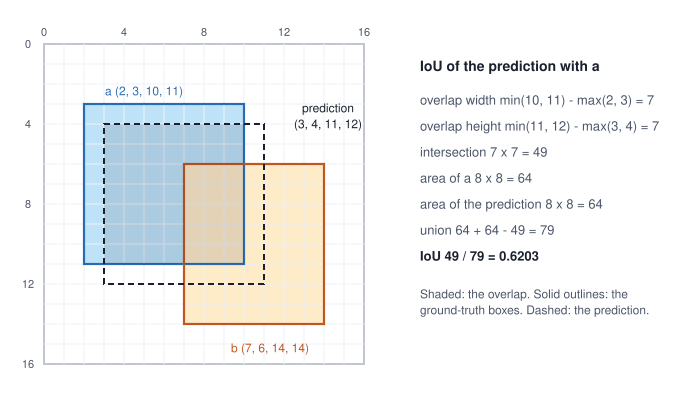
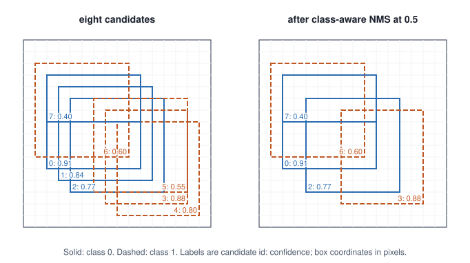
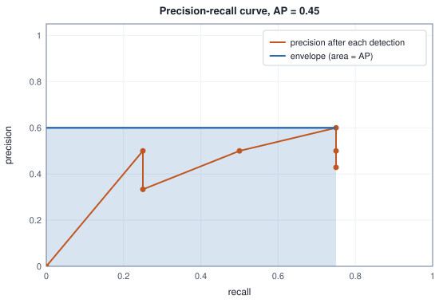

<!-- SPDX-License-Identifier: CC-BY-4.0 -->
<!-- Copyright (c) 2026 Martin Schröder <info@swedishembedded.com> -->

# Object Detection

*How does a network say not just what is in an image but where?*

Here is a picture a child could describe in one sentence: two rectangles, one in front of the other. It is 16 by 16 pixels, rectangle a is class 0, rectangle b is class 1, and the numbers beside it are the answer a detector is asked to produce.

<!-- worked: detection.toy_scene -->
A 16 by 16 picture; row 0 is the top. Rectangle a is drawn first, rectangle b second, so b covers the 3 by 5 pixels they share. A box (x1, y1, x2, y2) covers the pixels x1 <= x < x2 and y1 <= y < y2.

```text
. . . . . . . . . . . . . . . .
. . . . . . . . . . . . . . . .
. . . . . . . . . . . . . . . .
. . a a a a a a a a . . . . . .
. . a a a a a a a a . . . . . .
. . a a a a a a a a . . . . . .
. . a a a a a b b b b b b b . .
. . a a a a a b b b b b b b . .
. . a a a a a b b b b b b b . .
. . a a a a a b b b b b b b . .
. . a a a a a b b b b b b b . .
. . . . . . . b b b b b b b . .
. . . . . . . b b b b b b b . .
. . . . . . . b b b b b b b . .
. . . . . . . . . . . . . . . .
. . . . . . . . . . . . . . . .
```

| rectangle | class | xyxy | xywh (pixels) | xywh / 16 | area |
|---|---:|---|---|---|---|
| a | 0 | (2, 3, 10, 11) | (6, 7, 8, 8) | (0.375, 0.4375, 0.5, 0.5) | 64 |
| b | 1 | (7, 6, 14, 14) | (10.5, 10, 7, 8) | (0.65625, 0.625, 0.4375, 0.5) | 56 |

The two boxes share 3 * 5 = 15 pixels and together cover 64 + 56 - 15 = 105, so IoU(a, b) = 15/105 = 1/7.
<!-- /worked -->

A classifier of the previous chapter is asked one question about a picture. A detector is asked for a list, and the list is made of odd things: the number of entries is not fixed by anything in the network's input, each entry is a class and four coordinates, and a wrong entry is not simply wrong, because a box that is one pixel off in every coordinate is better than one that is ten pixels off, and the loss has to know that. The chapter settles these questions in the order a detector meets them. How is a box written, and how is the agreement of two boxes measured? What does a network with a fixed output shape emit when the answer has no fixed length? How is a box read out of one cell of one map, in the anchor-based design of YOLOv5 and in the anchor-free design of YOLOv8? How does a regression head say how sure it is about an edge? Which loss pulls four coordinates into place when the boxes do not even touch? During training, which cells are held responsible for which rectangle? How is the surplus of overlapping boxes removed, how is what remains scored against the truth, and how do the survivors get back to the coordinates of the photograph that was resized to feed the network?

Five ideas from earlier chapters first; the answers are at the end.

1. (Volume VII, [Chapter 3](03-cnns.md), feature pyramid.) A $640 \times 640$ input gives maps at strides 8, 16 and 32. What are their sides, and how many cells do the three have in all?
2. (Volume VII, [Chapter 1](01-images.md), shared preprocessing and the letterbox.) A $7 \times 4$ image is fitted to an $8 \times 8$ square with its aspect ratio kept. What are the scale and the padding?
3. (Volume III, [Chapter 3](../v03-neural-networks/03-softmax.md), softmax and cross-entropy.) What is the gradient of the cross-entropy of a softmax with respect to its logits?
4. (Volume II, [Chapter 3](../v02-learning/03-logistic-regression.md), binary cross-entropy.) For a logit $z$ and a target $t \in [0, 1]$, what is the gradient of the binary cross-entropy with respect to $z$?
5. (Volume II, [Chapter 6](../v02-learning/06-metrics.md), precision and recall.) A detector returns 4 boxes, 3 of them right, for a picture with 4 objects. What are its precision and recall?

## Boxes, and how much two of them agree

A **bounding box** is the smallest rectangle, with its sides along the axes of the picture, that holds an object. Three conventions are in daily use and a detection pipeline uses all of them, which is the first thing to get right, because a mix-up between them leaves no trace: the program runs and the boxes are merely wrong. The table under the picture writes each rectangle in the three. The corner form $(x_1, y_1, x_2, y_2)$ gives the top-left and the bottom-right corner. The centre form $(c_x, c_y, w, h)$ gives the centre and the size. And the normalized form divides the centre form by the image size, so that every number lies in $[0, 1]$ and the same label describes the picture at any resolution. A box covers the pixels $x_1 \le x < x_2$ and $y_1 \le y < y_2$: its corners lie on pixel edges, and its area is $(x_2 - x_1)(y_2 - y_1)$ with no "plus one" for the end pixel. Brain's detections are `[x1, y1, x2, y2, conf, class]` in pixels (`crates/imaging/src/nms.rs`), the labels of its training data are normalized centre boxes that the loss turns into pixel corner boxes (`xywhn_to_xyxy` in `crates/yolov8/src/boxmath.rs`), and the head's own distances are in a third unit, cells of the feature map. That is three conventions in one training step.

What a wrong reading does is easy to compute. Take one box of a $200 \times 200$ picture and read it under the wrong convention:

<!-- worked: detection.convention_mixups -->
One box of a 200 by 200 image, (x1, y1, x2, y2) = (20, 30, 120, 80), which is (cx, cy, w, h) = (70, 55, 100, 50) in pixels and (0.35, 0.275, 0.5, 0.25) divided by 200. What a reader gets when it applies the wrong convention, and the IoU of that box with the true one (a box with x2 < x1 or y2 < y1 has area 0 and IoU 0).

| mistake | resulting (x1, y1, x2, y2) | IoU with the truth |
|---|---|---:|
| xyxy read as xywh | (-40, -10, 80, 70) | 0.1967 |
| xywh read as xyxy | (70, 55, 100, 50) | 0.0000 |
| normalized xywh read as pixels | (0.1, 0.15, 0.6, 0.4) | 0.0000 |
<!-- /worked -->

The first mistake, a corner box read as a centre box, gives a box of the right size in the wrong place and still overlaps the truth, with an IoU of about 0.2, a number that looks like "a weak model" rather than "a bug". The other two give nothing at all. Overlap is the thing being measured, so it should be defined before anything else.

Two boxes agree to the extent that they cover the same pixels. The overlap region of two boxes is itself a box: its left edge is the larger of the two left edges, its right edge the smaller of the two right edges, and likewise for top and bottom, so its width is $\min(x_2, x_2') - \max(x_1, x_1')$ and its height is $\min(y_2, y_2') - \max(y_1, y_1')$, each floored at 0 when the boxes do not meet. The **intersection over union** (IoU) divides the area of that overlap by the area of everything the two boxes cover together:

$$
\mathrm{IoU}(\mathbf{b}, \mathbf{b}') = \frac{\lvert \mathbf{b} \cap \mathbf{b}' \rvert}{\lvert \mathbf{b} \cup \mathbf{b}' \rvert} = \frac{\lvert \mathbf{b} \cap \mathbf{b}' \rvert}{\lvert \mathbf{b} \rvert + \lvert \mathbf{b}' \rvert - \lvert \mathbf{b} \cap \mathbf{b}' \rvert}. \tag{1}
$$

The union is the sum of the areas minus the overlap, which would otherwise be counted twice. The number is 1 for identical boxes, 0 for boxes that share no area, symmetric in its arguments, and unchanged if both boxes are scaled by one factor or moved by one offset, which is why it can be computed in the letterboxed frame or in the original one with the same result. Here are boxes around rectangle a, $(2, 3, 10, 11)$, worked by hand and printed as exact fractions:

<!-- worked: detection.iou_pairs -->
Each box against the box of rectangle a, (2, 3, 10, 11), which has area 64. The overlap is the rectangle whose width is min(x2) - max(x1) and whose height is min(y2) - max(y1), each floored at 0.

| predicted box | (x1, y1, x2, y2) | overlap w x h | intersection | union | IoU | decimal |
|---|---|---:|---:|---:|---:|---:|
| the box itself | (2, 3, 10, 11) | 8 x 8 | 64 | 64 | 1 | 1.0000 |
| shifted by (1, 1) | (3, 4, 11, 12) | 7 x 7 | 49 | 79 | 49/79 | 0.6203 |
| shifted by (2, 2) | (4, 5, 12, 13) | 6 x 6 | 36 | 92 | 9/23 | 0.3913 |
| its top half | (2, 3, 10, 7) | 8 x 4 | 32 | 64 | 1/2 | 0.5000 |
| the whole picture | (0, 0, 16, 16) | 8 x 8 | 64 | 256 | 1/4 | 0.2500 |
| the box of b | (7, 6, 14, 14) | 3 x 5 | 15 | 105 | 1/7 | 0.1429 |
| to the right, apart | (11, 3, 19, 11) | 0 x 8 | 0 | 128 | 0 | 0.0000 |
<!-- /worked -->



The table has a lesson in its scale. A box shifted by one pixel in both directions is a very good detection and still scores only 0.62; shifted by two pixels it scores 0.39 and the whole picture, which contains the target, scores 0.25. A box shifted by a quarter of its own width along one axis has $\mathrm{IoU} = 48/80 = 0.6$. The conventional threshold of 0.5 is therefore not strict, and it is the threshold that two later sections use: to decide that two candidate boxes are duplicates, and to decide that a detection is right. The function is short enough to write once, in the book's pseudocode, with the guard that brain's `iou` keeps against two empty boxes (the union is floored so that the quotient is 0, never not-a-number):

```text
function iou(a: array<real>[4], b: array<real>[4]) -> real:
    w = max(min(a[2], b[2]) - max(a[0], b[0]), 0.0)
    h = max(min(a[3], b[3]) - max(a[1], b[1]), 0.0)
    inter = w * h
    area_a = max(a[2] - a[0], 0.0) * max(a[3] - a[1], 0.0)
    area_b = max(b[2] - b[0], 0.0) * max(b[3] - b[1], 0.0)
    return inter / max(area_a + area_b - inter, 0.000000001)
```

## A candidate for every cell

A network cannot emit a list whose length depends on the input, but it can emit a map: at every cell of every level of the feature pyramid of the previous chapter it computes the same small function, and the map has one entry per cell. Detection is therefore turned into **dense prediction**: every cell proposes one (or a few) boxes with class scores, most proposals are "nothing here", and training must say which cells should propose which object, while inference must delete the duplicates that several neighbouring cells produce for the same object. On a $640 \times 640$ input the three levels of strides 8, 16 and 32 have $80^2 + 40^2 + 20^2 = 8{,}400$ cells. A cell at stride $s$ sits $s$ pixels from its neighbours and its centre is at pixel $(g_x + 0.5)s$ for column $g_x$; a small object is the business of the fine level, where four cells span 32 pixels, and a large one of the coarse level, where one cell is 32 pixels across, as the table of the previous chapter showed.

The two families differ in what a cell says about its box. The anchor-based one, YOLOv5, says it relative to a few templates; the anchor-free one, YOLOv8, says it relative to the cell itself.

## Anchors: a template that the head corrects

An **anchor** is a template box of a fixed width and height, in pixels, that the head adjusts instead of predicting a box from nothing. In brain's YOLOv5 each of the three levels has three anchors (`COCO_ANCHORS` in `crates/yolov5/src/config.rs`): $(10, 13), (16, 30), (33, 23)$ at stride 8, $(30, 61), (62, 45), (59, 119)$ at stride 16 and $(116, 90), (156, 198), (373, 326)$ at stride 32, small templates on the fine level and large ones on the coarse level. Every cell carries one block of outputs per anchor, $5 + C$ numbers for $C$ classes: the four box fields $x, y, w, h$, an **objectness** score (how likely it is that any object has its centre here) and one score per class. With the sigmoid $o$ of each field, the decode of this version of YOLOv5 (`crates/yolov5/src/decode.rs`) is, for the cell in column $g_x$ and row $g_y$ at stride $s$ and anchor $(a_w, a_h)$:

$$
c_x = (2 o_x - 0.5 + g_x)\, s, \quad c_y = (2 o_y - 0.5 + g_y)\, s, \quad w = (2 o_w)^2 a_w, \quad h = (2 o_h)^2 a_h, \tag{2}
$$

and the score of class $c$ is the objectness times the class probability, the class of the detection being the best of them.

The two odd constants are the design. A sigmoid output is in $(0, 1)$, so the offset $2o - 0.5$ ranges over $(-0.5, 1.5)$ cells from the cell's corner: a cell can place a centre half a cell outside itself, so that an object whose centre sits at the border between two cells can be claimed by either neighbour, instead of forcing the one whose area contains the centre to be exact. And the side is $(2o)^2$ times the anchor, which is $0$ to $4$ times, with $o = 0.5$, the neutral output of a zero logit, giving exactly the anchor at exactly the middle of the cell. A bounded range is why the anchors matter: a head can only produce a box whose sides are at most four times those of one of the anchors of its level, so a box assigned to an anchor during training has to be less than four times its width and height (this is the head's range; brain imports a trained YOLOv5, and its crate has a forward pass and a decode but no loss and no assigner, so the training side of the anchor-based design is outside this chapter).

<!-- worked: detection.decode_range -->
The sigmoid output o of a coordinate and what the decode makes of it: the centre moves by 2o - 0.5 cells from the cell's corner, the side is (2o)^2 times the anchor. The last column is the logit that gives that o.

| o | centre offset 2o - 0.5, cells | side factor (2o)^2 | logit |
|---|---:|---:|---:|
| 0.01 | -0.480 | 0.0004 | -4.595 |
| 0.25 | 0.000 | 0.2500 | -1.099 |
| 0.5 | 0.500 | 1.0000 | 0.000 |
| 0.75 | 1.000 | 2.2500 | 1.099 |
| 0.99 | 1.480 | 3.9204 | 4.595 |
<!-- /worked -->

One cell, with the numbers that a head might write for it, decodes like this:

<!-- worked: detection.anchor_decode -->
One cell of the stride-16 level of a 128 by 128 input (a 8 x 8 grid), column g_x = 3, row g_y = 2, anchor 1 of that level, which is 62 x 45 pixels. The head wrote the logits below; the objectness logit is 1.5 and sigmoid(1.5) = 0.8176.

| field | logit | sigmoid | offset or scale | pixels |
|---|---:|---:|---|---|
| x | 0.4 | 0.5987 | 2 * 0.5987 - 0.5 + 3 = 3.6974 | x 16 = 59.1580 |
| y | -1.1 | 0.2497 | 2 * 0.2497 - 0.5 + 2 = 1.9995 | x 16 = 31.9917 |
| w | 0.3 | 0.5744 | (2 * 0.5744)^2 = 1.3199 | x 62 = 81.8361 |
| h | -0.2 | 0.4502 | (2 * 0.4502)^2 = 0.8106 | x 45 = 36.4769 |

|  | logit | sigmoid | objectness x class |
|---|---:|---:|---:|
| class 0 | -0.5 | 0.3775 | 0.3087 |
| class 1 | 2.0 | 0.8808 | 0.7201 |
| class 2 | 0.1 | 0.5250 | 0.4292 |

The best class is 1 with score 0.7201. The box is (x1, y1, x2, y2) = (18.2400, 13.7532, 100.0760, 50.2301).
<!-- /worked -->

The routine below is the whole decode of one anchor of one cell. It is two filters long: a candidate is kept only if its objectness exceeds the threshold, and then only if its best class score (the product) does too, which is the order of the code and spares the class products of the cells that the objectness already rejected.

```text
function decode_v5(s: array<real>[5 + C], gx: int, gy: int, stride: int, aw: real, ah: real, conf: real)
        -> optional (array<real>[4], real, int):
    obj = s[4]
    if obj <= conf:
        return none
    best = -infinity
    cls = 0
    for c in 0 .. C:
        if obj * s[5 + c] > best:                    # strict: the first best class keeps a tie
            best = obj * s[5 + c]
            cls = c
    if best <= conf:
        return none
    cx = (2.0 * s[0] - 0.5 + gx) * stride
    cy = (2.0 * s[1] - 0.5 + gy) * stride
    w = (2.0 * s[2]) ^ 2 * aw
    h = (2.0 * s[3]) ^ 2 * ah
    return ([cx - w / 2, cy - h / 2, cx + w / 2, cy + h / 2], best, cls)
```

The decode is shared with the board. On the Rockchip NPU of Volume IV ([Chapter 13](../v04-computation/13-npu.md)) the three heads leave the accelerator as int8 logits, and `crates/yolov5/src/npu.rs` applies the sigmoid only to what the decode reads: the objectness of every candidate, then the rest of the fields only for the candidates that pass the first filter. The saving is countable and is the table below: $3 \times 8{,}400 = 25{,}200$ candidates at 640, each with 85 fields.

## Distances from a point: no anchors

**Anchor-free detection** drops the templates. Each cell is a point, its **anchor point** $(a_x, a_y) = (g_x + 0.5,\ g_y + 0.5)$ in units of cells, and the head says where the four sides of the box are by their distances from that point, $\hat{\mathbf{d}} = (l, t, r, b)$, left, top, right and bottom, in cells:

$$
x_1 = (a_x - l)\, s, \quad y_1 = (a_y - t)\, s, \quad x_2 = (a_x + r)\, s, \quad y_2 = (a_y + b)\, s. \tag{3}
$$

The box needs no prior on its size, so there are no anchors to choose and no ratio rule that a ground-truth box must satisfy to be representable; every distance is a non-negative number, so the box always contains its own anchor point (brain clamps the training target at 0, in `xyxy_to_dist`, so the target of an anchor outside the rectangle never asks for a negative one). There is also no objectness: the class scores are sigmoids of $C$ logits, the confidence of a candidate is the largest of them, and a cell that sees nothing has all of them low. Brain's decode (`decode_detections` in `crates/yolov8/src/infer.rs`) takes the argmax class on the raw logits and applies the sigmoid to the winner alone. Sigmoid is monotonic, so the best class is the same either way, and the commit that did this (commit `50a3b3aea`) counts the work it saves: one sigmoid per cell where one per class would be 672,000 exponentials for 80 classes at 640 (the table below).

<!-- worked: detection.anchor_free_decode -->
One point of the stride-8 level of a 128 by 128 input (a 16 x 16 grid), column 5, row 3. Its anchor point is (5.5, 3.5) in cell units and (44, 28) in pixels. The four distances the head reports, in cell units, give the box edges below.

| side | distance d, cells | edge, cells | edge, pixels |
|---|---:|---:|---:|
| left | 2.1 | 3.40 | 27.20 |
| top | 1.6 | 1.90 | 15.20 |
| right | 3.4 | 8.90 | 71.20 |
| bottom | 2.9 | 6.40 | 51.20 |

The box is (27.2, 15.2, 71.2, 51.2), 44 wide and 36 high. The class score of the point is sigmoid(1.2) = 0.7685.
<!-- /worked -->

The two heads, side by side at 640 with 80 classes and $n_{\mathrm{bin}} = 16$ (the next section explains the 16):

<!-- worked: detection.head_counts -->
Input 640 by 640, 80 classes, n_bin = 16 bins per side (`reg_max` in the code). The anchor-based head has 3 anchors per cell, each with x, y, w, h, objectness and the 80 class scores; the anchor-free head has 80 class scores and 16 bin logits for each of the four sides. The last column is (n_bin - 1) times the stride, the farthest a side can reach when the distribution is a single bin 15 (n_bin - 1 = 15).

| stride | grid | cells | anchor-based candidates (3 per cell) | largest distance a side can have, pixels |
|---|---:|---:|---:|---:|
| 8 | 80 x 80 | 6400 | 19200 | 120 |
| 16 | 40 x 40 | 1600 | 4800 | 240 |
| 32 | 20 x 20 | 400 | 1200 | 480 |

| quantity | anchor-based | anchor-free |
|---|---:|---:|
| outputs per cell | 3 x (5 + 80) = 255 | 80 + 4 x 16 = 144 |
| cells over the three levels | 8400 | 8400 |
| boxes that can be proposed | 25,200 | 8,400 |
| numbers written per image | 2,142,000 | 1,209,600 |

Taking the best class of an anchor-free cell on the raw logits needs one sigmoid per cell, 8,400, where one sigmoid per class would need 8,400 x 80 = 672,000 exponentials; an anchor-based decoder that reads the objectness of every candidate first computes 25,200 sigmoids and evaluates the other 84 fields only for the candidates that survive, against 2,142,000 if it computes them all.
<!-- /worked -->

The anchor-free head proposes a third as many boxes and writes 56 percent as many numbers. The price is in the last column of the first table: its distances are bounded, and the bound depends on the level.

## A distribution for every side

The head of YOLOv8 does not output four distances. For each side it outputs $n_{\mathrm{bin}}$ logits, one per bin $k = 0, 1, \dots, n_{\mathrm{bin}} - 1$, and a softmax turns them into probabilities $q_k$; the distance is the expectation of the bin index under them,

$$
\hat{d} = \sum_{k=0}^{n_{\mathrm{bin}} - 1} k\, q_k, \qquad \mathbf{q} = \mathrm{softmax}(\mathbf{z}). \tag{4}
$$

The reason for the detour is that the edge of an object is not always a sharp thing: a blurred boundary, an occluded corner or a shadow gives several plausible positions, and a head that can only emit one number must commit to a position while a head that emits a distribution can place mass on several. The decode still yields one number for the box. In brain's code $n_{\mathrm{bin}}$ is called `reg_max`, it is 16 for the YOLOv8n configuration (`crates/yolov8/src/config.rs`; the tiny training configuration of the tests uses 8), and the bins are numbered $0$ to $n_{\mathrm{bin}} - 1$, so a distance can be at most $n_{\mathrm{bin}} - 1 = 15$ cells. That is $15 \times 8 = 120$ pixels at the finest level, 240 at the next and 480 at the coarsest, the last column of the table above. A box side longer than the reach of the level whose cell predicts it cannot be represented.

The head knows nothing about distributions until it is trained to have them. Regressing $\hat{d}$ with an L1 loss would constrain only its expectation, and that is a weak constraint: a distribution concentrated on bin 3 and one spread over the whole range can have the same expectation. The **distribution focal loss** (DFL) constrains the shape. Let the true distance be $d^\ast$ with $k = \lfloor d^\ast \rfloor$, so that it lies between bins $k$ and $k + 1$. Among all distributions on those two bins there is exactly one whose expectation is $d^\ast$: with weights $w_k$ and $w_{k+1}$ that sum to 1 and satisfy $k w_k + (k + 1) w_{k+1} = d^\ast$, the solution is $w_{k+1} = d^\ast - k$ and $w_k = k + 1 - d^\ast$. For $d^\ast = 3.25$ that is $0.75$ on bin 3 and $0.25$ on bin 4. This **two-hot** distribution is the target, and the loss is the cross-entropy of Volume III against it:

$$
\mathcal{L}_{\mathrm{DFL}} = -\bigl[(k + 1 - d^\ast) \ln q_k + (d^\ast - k) \ln q_{k+1}\bigr]. \tag{5}
$$

The name comes from the family of losses that it was introduced with, which generalize the focal loss of Lin and colleagues; the form (5) has no focusing factor. Here are five distributions for the target 3.25 over eight bins:

<!-- worked: detection.dfl_table -->
One side of one box with n_bin = 8 bins (numbered 0 to 7) and a true distance d* = 3.25 cells, so k = 3 and the target puts 0.75 on bin 3 and 0.25 on bin 4. The bumps are softmax(-(k - 3.25)^2 / (2 sigma^2)) over the eight bins; the spike is softmax of a logit 8 on bin 3 and 0 elsewhere.

| distribution | q0 | q1 | q2 | q3 | q4 | q5 | q6 | q7 |
|---|---:|---:|---:|---:|---:|---:|---:|---:|
| uniform | 0.125 | 0.125 | 0.125 | 0.125 | 0.125 | 0.125 | 0.125 | 0.125 |
| narrow bump (sigma 0.5) | 0.000 | 0.000 | 0.035 | 0.704 | 0.259 | 0.002 | 0.000 | 0.000 |
| wide bump (sigma 1.5) | 0.026 | 0.087 | 0.189 | 0.264 | 0.236 | 0.136 | 0.050 | 0.012 |
| spike on bin 3 | 0.000 | 0.000 | 0.000 | 0.998 | 0.000 | 0.000 | 0.000 | 0.000 |
| two-hot of 3.25 | 0.000 | 0.000 | 0.000 | 0.750 | 0.250 | 0.000 | 0.000 | 0.000 |

| distribution | expectation E | L1 error abs(E - 3.25) | DFL loss |
|---|---:|---:|---:|
| uniform | 3.5000 | 0.2500 | 2.0794 |
| narrow bump (sigma 0.5) | 3.2274 | 0.0226 | 0.6008 |
| wide bump (sigma 1.5) | 3.2644 | 0.0144 | 1.3587 |
| spike on bin 3 | 3.0013 | 0.2487 | 2.0023 |
| two-hot of 3.25 | 3.2500 | 0.0000 | 0.5623 |

The loss of the two-hot distribution is the entropy of the target, -(0.75 ln 0.75 + 0.25 ln 0.25) = 0.5623, the least any distribution can reach. For the uniform distribution the gradient q_k - target_k on the eight logits is (0.125, 0.125, 0.125, -0.625, -0.125, 0.125, 0.125, 0.125), which sums to 0.000.
<!-- /worked -->


Three things can be read from the table. The loss is smallest, $0.5623$, for the two-hot target itself, and equals the entropy of the target: because $H(\mathbf{w}, \mathbf{q}) = H(\mathbf{w}) + D_{\mathrm{KL}}(\mathbf{w} \,\Vert\, \mathbf{q}) \ge H(\mathbf{w})$, with equality exactly at $\mathbf{q} = \mathbf{w}$ (the divergence of Volume I is never negative), and at that point the expectation is exactly $d^\ast$. The wide bump has an expectation of 3.2644, an L1 error of 0.0144, nearly zero, and a DFL of 1.3587, more than twice the minimum: the loss sees the spread that the L1 error is blind to. And the spike on bin 3 has an L1 error of 0.2487 but a DFL of 2.0023, nearly that of the uniform distribution (2.0794, which is $\ln 8$), because it puts almost no mass on bin 4 where a quarter of the target is.

The gradient is the one of Volume III's softmax cross-entropy with the soft target: for the logit of bin $j$, $\partial \mathcal{L}_{\mathrm{DFL}} / \partial z_j = q_j - w_j$. For the uniform distribution it is $(0.125, 0.125, 0.125, -0.625, -0.125, 0.125, 0.125, 0.125)$, which sums to zero, as every softmax gradient does; it pushes bins 3 and 4 up and the rest down, in proportion to what is missing. The other gradient that reaches the logits comes from the box loss of the next section: it arrives at $\hat{d}$, and the logits are reached through the Jacobian of the expectation. With $\partial q_k / \partial z_j = q_k(\delta_{kj} - q_j)$,

$$
\frac{\partial \hat{d}}{\partial z_j} = \sum_k k\, q_k(\delta_{kj} - q_j) = j\, q_j - q_j \hat{d} = q_j (j - \hat{d}). \tag{6}
$$

Raising the logit of a bin above the expectation raises the expectation, in proportion to how far above and how much mass it already has.

<!-- worked: detection.dfl_jacobian -->
The logits are the wide bump of the table above. The largest difference over the eight logits between the central difference (step 1e-5) of E and q_j (j - E) is below 1e-8 (criterion): passed.
<!-- /worked -->

The routines are two short functions; the second clamps its two neighbouring bins into the range as brain's kernel (`crates/kernels/wgsl/dfl_loss.wgsl`) does, so that a target beyond the last bin puts all its weight on the last bin instead of reading past the logits.

```text
function dfl_decode(z: array<real>[n_bin]) -> real:
    q = softmax(z)
    return sum(k * q[k] for k in 0 .. n_bin)           # bins from 0 upwards

function dfl_loss(z: array<real>[n_bin], d_star: real) -> real:
    require d_star >= 0.0
    k = floor(d_star)
    w_hi = d_star - k
    lo = min(k, n_bin - 1)
    hi = min(k + 1, n_bin - 1)
    ls = z - lse(z)                                     # log-softmax of every bin
    return -((1.0 - w_hi) * ls[lo] + w_hi * ls[hi])
```

## Losses for a box

The distance loss shapes one side. The quantity that matters for the detection is the whole box, and a **box regression loss** is a loss on the difference between a predicted box and the true one. The first candidate is the sum of the absolute coordinate differences, L1, and it has a defect that a small experiment shows: the same one-pixel error on a small and a large box is the same loss, although it is a quite different mistake.

<!-- worked: detection.scale_blindness -->
The same error, a prediction one pixel to the right and one down of a square target, on a small and on a large box.

| target box | L1 | IoU | IoU loss |
|---|---:|---:|---:|
| 10 x 10 | 4.0 | 0.6807 | 0.3193 |
| 100 x 100 | 4.0 | 0.9610 | 0.0390 |
<!-- /worked -->

The L1 loss is 4 for both, while the overlap says that the error is serious for the $10 \times 10$ box, with $\mathrm{IoU} = 0.6807$, and trivial for the $100 \times 100$ one, with $0.9610$. The overlap of (1) is the quantity the evaluation uses, so the next idea is to train on it: the **IoU loss** is $1 - \mathrm{IoU}$. It is scale-free and it is what is scored. It fails exactly where the training starts. A box that misses the target entirely has an IoU of 0, and so does every box near it that also misses it, so the loss is flat and its gradient is zero: a head that begins with boxes that do not overlap the target receives no signal to move them.

Each of the three refinements below adds a term that is nonzero when the boxes do not overlap. Let $\mathbf{b}_{\mathrm{enc}}$ be the smallest box that encloses both the prediction and the target. The **generalized IoU** subtracts the share of the enclosing box that neither of them covers,

$$
\mathrm{GIoU} = \mathrm{IoU} - \frac{\lvert \mathbf{b}_{\mathrm{enc}} \rvert - \lvert \mathbf{b} \cup \mathbf{b}^\ast \rvert}{\lvert \mathbf{b}_{\mathrm{enc}} \rvert}, \tag{7}
$$

which tends to $-1$ for boxes far apart and moves as they approach, because the empty part of the enclosing box shrinks. The **distance IoU** subtracts the squared distance $d_{\mathrm{c}}^2$ between the two centres, normalized by the squared diagonal $d_{\mathrm{enc}}^2$ of the enclosing box,

$$
\mathrm{DIoU} = \mathrm{IoU} - \frac{d_{\mathrm{c}}^2}{d_{\mathrm{enc}}^2}, \tag{8}
$$

which points straight at the target's centre even when GIoU is flat (GIoU is 0 when two boxes touch and their enclosing box has no empty space). The **complete IoU** adds a term for the shape. Two boxes with the same centre and area but different aspect ratios have the same DIoU, and the term $v = (4/\pi^2)\bigl(\arctan(w^\ast/h^\ast) - \arctan(w/h)\bigr)^2$ measures the difference of their aspect ratios as angles (the $4/\pi^2$ makes its range $[0, 1)$); it is weighted by $\kappa = v/\bigl((1 - \mathrm{IoU}) + v\bigr)$, which is small where the boxes already overlap well and the shape is of no use yet:

$$
\mathrm{CIoU} = \mathrm{IoU} - \frac{d_{\mathrm{c}}^2}{d_{\mathrm{enc}}^2} - \kappa\, v. \tag{9}
$$

Each measure is at most 1, and the loss of each is 1 minus it. They are computed here for eight predictions against rectangle a, from the identical box to boxes that touch, miss by a pixel and sit in the far corner:

<!-- worked: detection.box_losses -->
Each box against the box of rectangle a, (2, 3, 10, 11). L1 is the sum of the four absolute coordinate differences; the other columns are the measures themselves, and the loss of each is 1 minus the measure. The arctangent in the aspect term of CIoU is the library atan2(w, h).

| predicted box | (x1, y1, x2, y2) | L1 | IoU | GIoU | DIoU | CIoU |
|---|---|---:|---:|---:|---:|---:|
| the box itself | (2, 3, 10, 11) | 0.0 | 1.0000 | 1.0000 | 1.0000 | 1.0000 |
| shifted by (1, 1) | (3, 4, 11, 12) | 4.0 | 0.6203 | 0.5956 | 0.6079 | 0.6079 |
| shifted by (4, 4) | (6, 7, 14, 15) | 16.0 | 0.1429 | -0.0794 | 0.0317 | 0.0317 |
| touching on the right | (10, 3, 16, 11) | 14.0 | 0.0000 | 0.0000 | -0.1885 | -0.1885 |
| one pixel apart | (11, 3, 16, 11) | 15.0 | 0.0000 | -0.0714 | -0.2163 | -0.2168 |
| far corner | (12, 12, 16, 16) | 30.0 | 0.0000 | -0.5604 | -0.3096 | -0.3096 |
| same centre, half the side | (4, 5, 8, 9) | 8.0 | 0.2500 | 0.2500 | 0.2500 | 0.2500 |
| same centre, other aspect | (1, 5, 11, 9) | 6.0 | 0.4444 | 0.3444 | 0.4444 | 0.4373 |
<!-- /worked -->

The rows to read are the touching and disjoint ones. The IoU is 0 for all of them, so $1 - \mathrm{IoU}$ cannot tell the touching box from the far corner, while the other three measures rank them as geometry does: GIoU gives 0 for the touching box and $-0.5604$ for the far corner, and DIoU and CIoU give $-0.1885$ and $-0.3096$. For the box of the same centre and a different aspect ratio DIoU is 0.4444, equal to the IoU, since the centres coincide, and CIoU is 0.4373: the shape term is the only one that notices. Whether the gradient exists is a derivative, and it can be measured by moving the box:

<!-- worked: detection.box_slopes -->
The change of each measure per unit of rightward movement of the predicted box (central difference, step 1e-6, four decimals). Moving the box left, toward the target, is the opposite sign.

| predicted box | (x1, y1, x2, y2) | d IoU | d GIoU | d DIoU | d CIoU |
|---|---|---:|---:|---:|---:|
| one pixel apart | (11, 3, 16, 11) | 0.0000 | -0.0663 | -0.0344 | -0.0344 |
| far corner | (12, 12, 16, 16) | 0.0000 | -0.0314 | -0.0201 | -0.0201 |
<!-- /worked -->

The derivative of the IoU is 0 for both boxes, so the IoU loss does not move them, and the other measures slope: moving right makes them worse by about 0.07 and 0.03 per pixel for GIoU. Brain uses CIoU. The kernel `crates/kernels/wgsl/ciou.wgsl` computes $1 - \mathrm{CIoU}$ and `ciou_grad.wgsl` its gradient with respect to the four predicted coordinates, treating the weight $\kappa$ as a constant (its comment says "alpha detached, standard YOLO"); the arctangent is a polynomial in the kernel, accurate to about $10^{-3}$, and the host version of the same formula in `crates/yolov8/src/boxmath.rs` uses the library one, because the assigner of the next section does not need the gradient. The routine, in the book's pseudocode with `atan2(w, h)` for $\arctan(w/h)$ when $h > 0$:

```text
function ciou(p: array<real>[4], g: array<real>[4]) -> real:
    i = iou(p, g)
    cp_x = (p[0] + p[2]) / 2
    cp_y = (p[1] + p[3]) / 2
    cg_x = (g[0] + g[2]) / 2
    cg_y = (g[1] + g[3]) / 2
    rho2 = (cp_x - cg_x) ^ 2 + (cp_y - cg_y) ^ 2
    cw = max(p[2], g[2]) - min(p[0], g[0])
    ch = max(p[3], g[3]) - min(p[1], g[1])
    c2 = max(cw ^ 2 + ch ^ 2, 0.000000001)
    v = 4.0 / pi ^ 2 * (atan2(g[2] - g[0], max(g[3] - g[1], 0.000000001))
                        - atan2(p[2] - p[0], max(p[3] - p[1], 0.000000001))) ^ 2
    kappa = v / max((1.0 - i) + v, 0.000000001)
    return i - rho2 / c2 - kappa * v
```

## Deciding which cells answer for which rectangle

A head produces a box at every cell and the loss compares boxes with ground truth, so training must decide, for each cell, whether it is responsible for a rectangle and which one. A cell with no rectangle is pushed toward a low score for every class; a cell with one is pushed toward the rectangle's class, box and distances. The simplest rule, the cell that contains the centre of the rectangle, wastes most of the evidence and chooses the same cell whether or not that cell predicts the box well. The rule brain uses for YOLOv8, the **task-aligned assignment** (`crates/yolov8/src/assign.rs`), chooses cells by how well they already do their task, and is run again at every step, on the current predictions.

For each ground-truth rectangle $g$ of class $c_g$ and each anchor point $i$ whose pixel centre lies strictly inside the rectangle's box (these are the candidates), the alignment metric is

$$
m_{gi} = \hat{y}_{i, c_g}^{\,\alpha_{\mathrm{tal}}}\; u_{gi}^{\,\beta_{\mathrm{tal}}}, \qquad u_{gi} = \max\bigl(\mathrm{CIoU}(\hat{\mathbf{b}}_i, \mathbf{b}_g),\, 0\bigr), \tag{10}
$$

with $\hat{y}_{i, c_g}$ the sigmoid score the anchor gives the rectangle's class, $\hat{\mathbf{b}}_i$ its decoded box, $\alpha_{\mathrm{tal}} = 0.5$ and $\beta_{\mathrm{tal}} = 6$: the product is large only where the anchor is good at both naming the object and placing its box, and the large exponent on the overlap makes the placement dominate. The method of Feng and colleagues, from which this is taken, uses the plain IoU as $u$; brain's version uses CIoU floored at 0, which is its own choice. Then four rules:

1. each rectangle keeps its $k$ candidates with the largest $m$ (brain's $k = 10$; ties go to the lower anchor number);
2. an anchor chosen by two rectangles goes to the one with the larger $u$ at that anchor, then to the larger $m$, then to the lower index of the rectangle;
3. an anchor chosen by none is background, with no box loss and a class target of 0 everywhere;
4. the class target of a foreground anchor is $m / \max m \cdot \max u$, where the two maxima are taken over the foreground anchors of its rectangle, so the target of the best anchor equals its overlap and the others are scaled down by their alignment.

The last rule is what makes the classification target a quality: the class score of the best anchor is trained toward its own overlap, not toward 1. The target distances of the DFL are computed from the rectangle and the anchor point, by the inverse of (3). The toy picture follows. Each of its 64 anchor points predicts one fixed box (so nothing is trained and every number is the arithmetic of the rules), and with $k = 3$:

<!-- worked: detection.assign_table -->
Anchor points every 2 pixels on the 16 by 16 picture (an 8 x 8 grid, row-major numbering n = 8 * row + column), each at the pixel centre ((column + 0.5) * 2, (row + 0.5) * 2). Every anchor predicts the distances (l, t, r, b) = (1.0, 1.5, 2.0, 1.0) cells, that is the box (cx - 2, cy - 3, cx + 4, cy + 2) around its centre (cx, cy), and its score for class c is 0.02 + 0.9 exp(-d^2 / 32) with d the distance from the anchor to the centre of the rectangle of class c. The assigner uses alpha = 0.5, beta = 6 and keeps the top 3 anchors per rectangle.

Rectangle a, box (2, 3, 10, 11): the 12 anchors whose centre lies strictly inside it, best alignment first.

| n | centre | score s | overlap u = max(CIoU, 0) | t = s^0.5 u^6 | top-3 |
|---|---|---|---:|---:|---|
| 26 | (5, 7) | 0.8923 | 0.4668 | 0.00977 | kept |
| 34 | (5, 9) | 0.7898 | 0.4512 | 0.00749 | kept |
| 27 | (7, 7) | 0.8923 | 0.3330 | 0.00129 | kept |
| 25 | (3, 7) | 0.6994 | 0.3330 | 0.00114 |  |
| 35 | (7, 9) | 0.7898 | 0.3192 | 0.00094 |  |
| 33 | (3, 9) | 0.6195 | 0.3192 | 0.00083 |  |
| 18 | (5, 5) | 0.7898 | 0.2997 | 0.00064 |  |
| 19 | (7, 5) | 0.7898 | 0.2070 | 0.00007 |  |
| 17 | (3, 5) | 0.6195 | 0.2070 | 0.00006 |  |
| 28 | (9, 7) | 0.6994 | 0.1020 | 0.00000 |  |
| 36 | (9, 9) | 0.6195 | 0.0912 | 0.00000 |  |
| 20 | (9, 5) | 0.6195 | 0.0362 | 0.00000 |  |

Rectangle b, box (7, 6, 14, 14): the 12 anchors whose centre lies strictly inside it, best alignment first.

| n | centre | score s | overlap u = max(CIoU, 0) | t = s^0.5 u^6 | top-3 |
|---|---|---|---:|---:|---|
| 44 | (9, 11) | 0.8331 | 0.5311 | 0.02048 | kept |
| 36 | (9, 9) | 0.8331 | 0.5134 | 0.01671 | kept |
| 45 | (11, 11) | 0.8855 | 0.3901 | 0.00332 | kept |
| 37 | (11, 9) | 0.8855 | 0.3745 | 0.00260 |  |
| 52 | (9, 13) | 0.6532 | 0.3369 | 0.00118 |  |
| 53 | (11, 13) | 0.6941 | 0.2443 | 0.00018 |  |
| 28 | (9, 7) | 0.6532 | 0.1807 | 0.00003 |  |
| 46 | (13, 11) | 0.7375 | 0.1349 | 0.00001 |  |
| 38 | (13, 9) | 0.7375 | 0.1227 | 0.00000 |  |
| 29 | (11, 7) | 0.6941 | 0.1227 | 0.00000 |  |
| 54 | (13, 13) | 0.5788 | 0.0598 | 0.00000 |  |
| 30 | (13, 7) | 0.5788 | 0.0000 | 0.00000 |  |

The foreground anchors, with the soft class target (t divided by the largest t of its rectangle among the foreground anchors, times the largest u there) and the distances (l, t, r, b) in cells from the anchor point to the sides of the rectangle.

| n | rectangle | class target | target distances (l, t, r, b) |
|---|---|---:|---|
| 26 | a | 0.4668 | (1.50, 2.00, 2.50, 2.00) |
| 27 | a | 0.0615 | (2.50, 2.00, 1.50, 2.00) |
| 34 | a | 0.3580 | (1.50, 3.00, 2.50, 1.00) |
| 36 | b | 0.4333 | (1.00, 1.50, 2.50, 2.50) |
| 44 | b | 0.5311 | (1.00, 2.50, 2.50, 1.50) |
| 45 | b | 0.0861 | (2.00, 2.50, 1.50, 1.50) |

The grid, with the foreground anchors marked by the rectangle they belong to:

```text
. . . . . . . .
. . . . . . . .
. . . . . . . .
. . a a . . . .
. . a . b . . .
. . . . b b . .
. . . . . . . .
. . . . . . . .
```
<!-- /worked -->

The two pictures of the rules at work are the table of candidates, where rank is decided by $m$ and not by the plain score or the plain overlap (anchor 34 ranks above anchor 27 although its score is lower, 0.7898 against 0.8923, because its overlap is higher, 0.4512 against 0.3330), and the final grid. Rule 2 never came into play with $k = 3$, since the anchors in the part of the picture where the rectangles overlap have a small $m$. With room for every candidate it does:

<!-- worked: detection.contested -->
The anchors that lie inside both rectangles, when each rectangle may keep all of its candidates (k = 12). Both choose them; the anchor goes to the rectangle with the larger overlap u (the larger t decides a tie, then the lower rectangle index).

| n | centre | u for a | t for a | u for b | t for b | owner |
|---|---|---:|---:|---:|---:|---|
| 28 | (9, 7) | 0.1020 | 0.00000 | 0.1807 | 0.00003 | b |
| 36 | (9, 9) | 0.0912 | 0.00000 | 0.5134 | 0.01671 | b |
<!-- /worked -->

The loss that follows from an assignment adds three terms, each normalized by the same number. The class term is the binary cross-entropy, over all anchors and all classes, against the soft target (the matched class of a foreground anchor gets the soft target and everything else gets 0); the box term is the sum of $1 - \mathrm{CIoU}$ and the distribution term the sum of the DFL of the four sides, both over the foreground anchors only. In brain (`crates/yolov8/src/loss.rs`) the gains are 7.5 for the box, 0.5 for the class and 1.5 for the distribution term, and all three divide by the sum of the class targets, floored at 1, so that the loss does not grow with the number of objects in the batch:

$$
\mathcal{L} = \frac{1}{\max(\sum_i t_i,\, 1)} \Bigl( 7.5 \sum_{i \in \mathrm{fg}} \bigl(1 - \mathrm{CIoU}_i\bigr) + 0.5 \sum_{i, c} \mathrm{BCE}(z_{ic}, t_{ic}) + 1.5 \sum_{i \in \mathrm{fg}} \sum_{\mathrm{sides}} \mathcal{L}_{\mathrm{DFL}} \Bigr). \tag{11}
$$

The sums of the box and distribution terms run with weight 1 per foreground anchor: brain does not weight them by the class target of the anchor. Here is the total for the assignment above:

<!-- worked: detection.detection_loss -->
The loss of the assignment above. Each side of an anchor's box is held by the distribution softmax(-(k - d)^2 / 2) over the 8 bins around its predicted distance d (the four d are (1.0, 1.5, 2.0, 1.0)), and the DFL of a side is the loss (5) of the chapter against the target distance of the table. The class loss is the binary cross-entropy of all 64 x 2 entries with the logit of each score as the logit and the soft target on the owner's class channel (0 elsewhere). Sums run over anchors in row-major order.

| n | rectangle | 1 - CIoU | DFL (four sides) |
|---|---|---:|---:|
| 26 | a | 0.5332 | 4.6569 |
| 27 | a | 0.6670 | 5.6569 |
| 34 | a | 0.5488 | 5.1569 |
| 36 | b | 0.4866 | 5.1569 |
| 44 | b | 0.4689 | 4.6569 |
| 45 | b | 0.6099 | 5.1569 |

Sum of (1 - CIoU) = 3.3145; sum of the DFL terms = 30.4414; sum of the binary cross-entropy over all 128 entries = 60.4878; sum of the class targets = 1.9368, so the normaliser is max(sum, 1) = 1.9368.

L = (7.5 * 3.3145 + 0.5 * 60.4878 + 1.5 * 30.4414) / 1.9368 = 52.0267.
<!-- /worked -->

The assignment is a function of the predictions, and it is not differentiable: a small change of a score can move an anchor from rank 3 to rank 4 and change a target by a jump. The gradient check of Volume III would therefore see a discontinuity wherever the perturbation crosses a rank. Brain's check of the whole detection loss (`detection_loss_gradcheck_frozen_assignment` in `crates/yolov8/tests/it/p4_detection.rs`) freezes the assignment computed from the unperturbed forward, so that the perturbed passes reuse it, and the backward pass treats the targets as constants, as the loss module's header says. The finite-difference tolerance in that test is the brain-standard relative $8 \times 10^{-2}$, and the test is marked slow and is not part of the default run; this chapter has not run it.

## Removing what overlaps: non-maximum suppression

Neighbouring cells see the same object, and a well-trained head gives all of them a high score for it. The output is a pile of boxes around each object, of which one should survive. **Non-maximum suppression** (NMS) is the greedy cleaning of the pile: visit the candidates from the most to the least confident; keep a candidate unless it overlaps, by more than a threshold, a candidate that has already been kept. In pseudocode (`argsort` with the descending flag keeps equal confidences in their original order, as the code's tie rule does):

```text
function nms(boxes: array<real>[n, 4], conf: array<real>[n], cls: array<int>[n],
             thr: real, max_det: int, class_aware: bool) -> list<int>:
    order = argsort(conf, descending)
    kept = []
    for i in order:
        if len(kept) >= max_det:
            break
        dropped = false
        for k in kept:
            if (not class_aware) or cls[k] == cls[i]:
                if iou(boxes[k, :], boxes[i, :]) > thr:
                    dropped = true
                    break
        if not dropped:
            append i to kept
    return kept
```

Eight candidates for the picture, four views of rectangle a (class 0), three of rectangle b (class 1), one class-1 box on rectangle a, traced step by step at the threshold 0.5:

<!-- worked: detection.nms_trace -->
Eight candidates, as (id, box, confidence, class):

| id | box (x1, y1, x2, y2) | confidence | class |
|---|---|---|---:|
| 0 | (2, 3, 10, 11) | 0.91 | 0 |
| 1 | (3, 4, 11, 12) | 0.84 | 0 |
| 2 | (4, 5, 12, 13) | 0.77 | 0 |
| 3 | (7, 6, 14, 14) | 0.88 | 1 |
| 4 | (8, 7, 15, 15) | 0.80 | 1 |
| 5 | (6, 5, 14, 13) | 0.55 | 1 |
| 6 | (1, 2, 9, 10) | 0.60 | 1 |
| 7 | (2, 3, 10, 7) | 0.40 | 0 |

Class-aware NMS with threshold 0.5 and a drop only when IoU > 0.5, visiting the candidates by falling confidence. For each candidate: the IoUs against the boxes kept so far that it is compared with, in the order kept, stopping at the first that exceeds the threshold.

| candidate | IoU with the kept boxes compared | outcome |
|---:|---|---|
| 0 | none | kept |
| 3 | none | kept |
| 1 | 0: 0.6203 | dropped by 0 |
| 4 | 3: 0.6000 | dropped by 3 |
| 2 | 0: 0.3913 | kept |
| 6 | 3: 0.0714 | kept |
| 5 | 3: 0.6901 | dropped by 3 |
| 7 | 0: 0.5000, 2: 0.1429 | kept |

Kept: [0, 3, 2, 6, 7]; 7 IoU evaluations.

Class-agnostic NMS with threshold 0.5 and a drop only when IoU > 0.5, visiting the candidates by falling confidence. For each candidate: the IoUs against the boxes kept so far that it is compared with, in the order kept, stopping at the first that exceeds the threshold.

| candidate | IoU with the kept boxes compared | outcome |
|---:|---|---|
| 0 | none | kept |
| 3 | 0: 0.1429 | kept |
| 1 | 0: 0.6203 | dropped by 0 |
| 4 | 0: 0.0714, 3: 0.6000 | dropped by 3 |
| 2 | 0: 0.3913, 3: 0.4118 | kept |
| 6 | 0: 0.6203 | dropped by 0 |
| 5 | 0: 0.2308, 3: 0.6901 | dropped by 3 |
| 7 | 0: 0.5000, 3: 0.0353, 2: 0.1429 | kept |

Kept: [0, 3, 2, 7]; 12 IoU evaluations.
<!-- /worked -->



Three details of the trace are the substance of the algorithm. First, the class guard: the class-1 box 6 lies over rectangle a, overlapping candidate 0 by an IoU of 0.6203. Class-aware NMS compares it only with boxes of its own class and keeps it; class-agnostic NMS drops it. Which is right depends on the world: a person in front of a car is a legitimate pair of overlapping boxes of two classes, so brain's default is class-aware (`nms` in `crates/imaging/src/nms.rs`) and the agnostic variant (`nms_agnostic`) is the same loop with the guard off. Second, the comparison is strict. Candidate 7 has an IoU of exactly 0.5000 with candidate 0, and it survives, because 0.5 is not greater than 0.5; the unit test `nms_threshold_boundary_strict_gt` in `crates/yolov8/tests/it/p6_nms.rs` pins the rule with two boxes whose IoU is exactly $1/7$ and a threshold of exactly $1/7$. The convention is a choice, but it must be one choice: the evaluation of the next section calls a detection correct at an IoU of at least the threshold, so at exactly 0.5 a detection is right and a duplicate of an equal overlap is not removed, and both facts are the way the code is written. Third, the threshold is a trade:

<!-- worked: detection.nms_threshold_sweep -->
The threshold decides how close two same-class boxes may be. Survivors of the eight candidates:

| threshold | class-aware kept | ids | class-agnostic kept | ids |
|---:|---:|---|---:|---|
| 0.3 | 3 | [0, 3, 6] | 2 | [0, 3] |
| 0.5 | 5 | [0, 3, 2, 6, 7] | 4 | [0, 3, 2, 7] |
| 0.7 | 8 | [0, 3, 1, 4, 2, 6, 5, 7] | 8 | [0, 3, 1, 4, 2, 6, 5, 7] |

At a threshold of exactly 0.5 the boxes (0, 0, 10, 10) and (0, 0, 10, 5) have IoU 0.5000; with the test IoU > 0.5 the survivors are [0, 1], with IoU >= 0.5 they are [0].
<!-- /worked -->

A low threshold removes more of the duplicates (at 0.3 the class-aware pass also drops candidate 2, a view of rectangle a that overlaps the kept candidate 0 by 0.3913, and keeps only 3 of the 8) and, in a picture with two real objects of one class standing close, would start to remove the second object; a high threshold keeps the duplicates (at 0.7 it keeps all 8). This picture has one object per class, so every survivor beyond one per object is a duplicate and the low threshold is the better one here, which is not a property of thresholds in general.

The cost is countable. Candidate $i$ in visiting order is compared with at most $\min(i, n_{\max})$ kept boxes, so a list of $n$ candidates and a cap $n_{\max}$ needs at most $\sum_i \min(i, n_{\max})$ IoU evaluations, each 18 operations:

<!-- worked: detection.nms_cost -->
A candidate list of n = 8,400 boxes (one per cell of the three levels of a 640 input) and a cap of 300 kept boxes. Candidate number i in visiting order is compared with at most min(i, 300) kept boxes, so the greatest number of IoU evaluations is the sum over i = 0 .. 8399, which is 2,474,850; with no cap it would be n(n - 1)/2 = 35,275,800. One IoU is 8 operations for the overlap (a minimum, a maximum, a subtraction and a floor at 0, for each of the width and the height), 1 product for the intersection, 3 for each of the two areas, 2 for the union and 1 division, 18 operations, so the worst case is 44,547,300 operations.
<!-- /worked -->

Two things keep the real cost far under that bound. The confidence threshold before NMS removes the great majority of the 8,400 candidates, since most cells see nothing (the YOLOv5 decode above drops a candidate whose score is at most the threshold, and the YOLOv8 decode drops one that is strictly below it, so the two disagree on a score exactly equal to the threshold). And the cap on kept boxes, `max_det`, is 300 in both detectors. Brain's NMS has no separate top-$k$ filter before the sort; the cap limits the kept list and stops the loop when it is full.

The suppression lives in one function. It lived in the YOLOv8 crate until a second detector needed the same tail, and commit `c3a161a5d` moved the box type, the IoU and both NMS variants into `crates/imaging/src/nms.rs`, leaving re-exports behind, so that YOLOv8, YOLOv5 and the NPU runtimes end in the same few lines and there is exactly one definition of what "overlaps too much" means. The commit message gives the reason in those words, a second detector that should not depend on the first's GPU training code, and the module header records the strict comparison and the tie rule, equal confidences keeping the lower index, which makes the output deterministic.

## Scoring a list of boxes

A detector is judged by the lists it produces for a set of pictures. The score has to reward the right boxes, punish the extra and the missing ones, and not depend on one confidence threshold, because a threshold is a choice of operating point. The ingredients are those of Volume II's chapter on metrics with the overlap added. A detection **matches** a ground-truth box if they are in the same picture, have the same class, the ground-truth box has not been taken by an earlier detection, and their IoU is at least the matching threshold; the detections of a class are visited in order of falling confidence and each takes the available ground-truth box with the highest IoU, if any reaches the threshold. A match is a true positive, the rest are false positives, and the ground-truth boxes that remain are the misses. Walking down the ranked list, precision is the true positives so far divided by the detections so far, and recall the true positives so far divided by the number of ground-truth boxes, and the pairs trace a precision-recall curve.

The **average precision** (AP) is the area under that curve, and for detection it has one more step than the definition of Volume II. That chapter took the precision as it stands at each recall gain. The standard for detection first takes the **envelope**: replace the precision at each rank by the largest precision at any rank at or after it, so that the curve never rises as recall falls, and then sum $(R_k - R_{k-1})$ times the enveloped precision at each recall gain, with an initial point of recall 0 and precision 1. The envelope removes the zig-zag that one false positive causes, and it can only increase the area. Brain integrates the envelope exactly (`ap_for_class` in `crates/yolov8/src/detection.rs`, whose header says that this is the area of the PASCAL VOC protocol of Everingham and colleagues from its 2010 edition on); the COCO protocol of Lin and colleagues samples the envelope at 101 recall values, so the two agree closely but not digit for digit, and this chapter did not measure the gap. A class of 4 ground-truth boxes and 7 detections:

<!-- worked: detection.ap_table -->
Class 0: four ground-truth boxes (image 0 (2, 3, 10, 11), image 0 (7, 6, 14, 14), image 1 (1, 1, 9, 9), image 2 (4, 4, 12, 12)) and seven detections. A detection is a true positive when its IoU with a ground-truth box of the same image that no earlier detection took is at least 0.5. The column best IoU is the largest IoU with any ground-truth box of the image, taken or not.

| rank | confidence | image | box | best IoU | at 0.5 | TP so far | FP so far | precision | recall | envelope |
|---:|---:|---:|---|---:|---|---:|---:|---:|---:|---:|
| 1 | 0.95 | 2 | (12, 12, 16, 16) | 0.000 | FP | 0 | 1 | 0.0000 | 0.00 | 0.6000 |
| 2 | 0.90 | 0 | (3, 4, 11, 12) | 0.620 | TP | 1 | 1 | 0.5000 | 0.25 | 0.6000 |
| 3 | 0.85 | 0 | (2, 3, 10, 11) | 1.000 | FP | 1 | 2 | 0.3333 | 0.25 | 0.6000 |
| 4 | 0.80 | 1 | (1, 2, 9, 10) | 0.778 | TP | 2 | 2 | 0.5000 | 0.50 | 0.6000 |
| 5 | 0.70 | 0 | (8, 7, 15, 15) | 0.600 | TP | 3 | 2 | 0.6000 | 0.75 | 0.6000 |
| 6 | 0.60 | 2 | (6, 6, 14, 14) | 0.391 | FP | 3 | 3 | 0.5000 | 0.75 | 0.5000 |
| 7 | 0.50 | 1 | (9, 9, 15, 15) | 0.000 | FP | 3 | 4 | 0.4286 | 0.75 | 0.4286 |

AP@0.5 = 0.25 x 0.6000 + 0.25 x 0.6000 + 0.25 x 0.6000 = 0.4500. The step-wise area of Volume II, with no envelope, is 0.4000.
<!-- /worked -->



The most confident detection is a false positive, and it costs a good deal: the true positives come at precisions 0.5, 0.5 and 0.6, and the step-wise area of Volume II is 0.4000, while the envelope raises the first two to the 0.6 that the third reaches, so that the area is $0.75 \times 0.6 = 0.4500$. The recall stops at 0.75 because the fourth ground-truth box, in picture 2, is never found at an IoU of 0.5; the detection that is nearest to it, at rank 6, has an IoU of 0.391. The mean over classes, and the dependence on the matching threshold, are in the next table, where class 1 is a second class with two ground-truth boxes:

<!-- worked: detection.map_table -->
Average precision of the two classes at three IoU thresholds, and their mean. Class 1 has two ground-truth boxes (image 1 (11, 2, 15, 6), image 2 (1, 10, 5, 15)) and three detections (image 1 (11, 2, 15, 6) 0.92, image 0 (4, 4, 8, 8) 0.75, image 2 (1, 10, 5, 14) 0.65).

| class | AP@0.3 | AP@0.5 | AP@0.75 |
|---|---:|---:|---:|
| 0 | 0.6667 | 0.4500 | 0.2500 |
| 1 | 0.8333 | 0.8333 | 0.8333 |
| mean (mAP) | 0.7500 | 0.6417 | 0.5417 |

The mean over the ten thresholds 0.50, 0.55, ..., 0.95 (mAP@0.5:0.95), whose per-threshold values are 0.6417, 0.6417, 0.6417, 0.5417, 0.5417, 0.5417, 0.4583, 0.2917, 0.2917, 0.2917, is 0.4883. A detection matches a ground-truth box when its IoU is at least the threshold. The class-1 detection in image 2 has an IoU of exactly 16/20 = 0.8, and the threshold 0.5 + 0.05 * 6, evaluated in double precision, is also exactly 0.8, so that tie is a match; an evaluator that compared with a strict inequality, or that built the thresholds by repeated addition and landed a rounding error above 0.8, would lose it and print 0.2917 at that threshold in place of 0.4583.
<!-- /worked -->

The **mean average precision** averages the AP over classes (brain averages over the classes that have at least one ground-truth box, as the module header says, so a class the dataset never labels does not pull the mean to zero), and a threshold goes in its name: mAP@0.5 uses one matching threshold of 0.5, and mAP@0.5:0.95 the mean over ten thresholds, 0.50 to 0.95 in steps of 0.05, which rewards boxes that are placed well and not merely found. In the table the class-0 AP falls from 0.4500 at 0.5 to 0.2500 at 0.75: the loose boxes at ranks 2 and 5 (IoU 0.620 and 0.600) stop matching, the exact box of rank 3, which was a duplicate at 0.5, now takes its ground-truth box and becomes a true positive, and recall ends at 0.50 instead of 0.75. The mean over the ten thresholds is 0.4883. Two details of brain's evaluator are worth the lines. It ranks the predictions of the whole dataset together, as AP requires, yet a prediction must not match a ground-truth box of another picture; `crates/yolov8/src/detection_report.rs` guarantees that by translating every picture into a private horizontal strip before the model-free metrics run (commit `8e82b226d`, which also added mAP@0.5:0.95 and the per-class table). And the evaluator was golden-tested before any model was scored with it: commit `06dfd873e` adds the pairwise IoU, the matching, precision, recall and AP together with tests on constructed inputs (perfect, empty, wrong class, confidence order), because a metric that is wrong makes every later comparison wrong. The README of `crates/yolov8` (and the message of the same commit) adds the practical rule that follows from the curve: a mAP is computed with a confidence floor of 0.001, since the default operating threshold of 0.25 truncates the precision-recall curve, cutting off the low-precision tail of recall that the area includes.

## Back to the photograph: undoing the letterbox

A detector sees a square of fixed size, and the photograph is not square. [Chapter 1](01-images.md) built the letterbox that bridges them: scale the image by $\min(S/W, S/H)$, centre it in the $S \times S$ square and fill the padding with grey. Its inverse is what the last line of the pipeline needs: the boxes found in the input square are in the square's coordinates, and the caller wants the photograph's. A point moves forward by $x_{\mathrm{in}} = x\, \mathrm{scale} + p_x$ and $y_{\mathrm{in}} = y\, \mathrm{scale} + p_y$, so a box goes back by subtracting the padding, dividing by the scale and clamping to the image:

```text
function unletterbox(b: array<real>[4], scale: real, pad_x: real, pad_y: real, w0: int, h0: int)
        -> array<real>[4]:
    return [min(max((b[0] - pad_x) / scale, 0.0), w0), min(max((b[1] - pad_y) / scale, 0.0), h0),
            min(max((b[2] - pad_x) / scale, 0.0), w0), min(max((b[3] - pad_y) / scale, 0.0), h0)]
```

<!-- worked: detection.unletterbox -->
A 200 by 100 image fitted to a 128 by 128 square: scale = min(128/200, 128/100) = 0.64, content 128 x 64, padding (pad_x, pad_y) = (0, 32). The box (20, 30, 120, 80) of the original goes to (12.8, 51.2, 76.8, 83.2) in the input, and the inverse (subtract the padding, divide by the scale, clamp to the image) returns (20, 30, 120, 80).

What each mistake in the inverse gives, and its IoU with the true box:

| inverse | box | IoU with the truth |
|---|---|---:|
| correct inverse | (20, 30, 120, 80) | 1.0000 |
| padding not subtracted | (20, 80, 120, 100) | 0.0000 |
| scale not divided | (12.8, 19.2, 76.8, 51.2) | 0.2061 |
| padding of the wrong axis | (0, 80, 70, 100) | 0.0000 |

The padding is whole pixels. A 7 by 4 image fitted to 8 by 8 has scale 1.142857, content 8 x 5, a slack of 3 rows and pad_y = floor(3 / 2) = 1: 1 padding row above the content and 2 below. The pixels are written from row 1 and the boxes are mapped with the same 1, so the original's row 0 is at input row 1 for both. A box rule that took half the slack, 1.5, would put every box 0.5 input pixel below the pixels it was found on, 0.4375 pixel of the original; the IoU of a box of height 10 input pixels with itself shifted by 0.5 is 0.9048, and of one of height 100 0.9900.
<!-- /worked -->

Each mistake in the table is a different one-line bug, and every one of them gives a box in a plausible place. Forgetting the padding moves the box by $p/\mathrm{scale}$, 50 pixels in $y$ here; forgetting the scale leaves it the wrong size; and using the padding of the wrong axis is a transposition that no test on a square image would see. The order of the steps matters too. Both detectors run NMS in the letterboxed square and map the survivors back afterwards (`finish` in `crates/yolov5/src/decode.rs` and `decode_detections` in `crates/yolov8/src/infer.rs`), which is sound for the reason stated with (1): the letterbox is one scale and one shift for both axes, so it leaves every IoU unchanged and suppression gives the same answer in either frame. Clamping is the exception, because it changes a box, and brain clamps once, last. The YOLOv5 decode test pins that: a box whose decoded corners are negative or beyond the image ends up exactly on the image border after the inverse (`detections_are_nmsd_per_class_and_mapped_back_through_the_letterbox`).

The inverse is one half of a convention that exists once, which is the principle of the first chapter, and brain's letterbox once broke it. The forward transform pasted the resized image at the truncated offset `int(pad)` while the box mapping used the float `pad`, so that on an odd slack the pixels and the boxes were half a pixel apart; the last lines of the table above work out what half a pixel costs a box. Commit `4a7148ae9` removed the disagreement: `Letterbox::compute` in `crates/imaging/src/letterbox.rs` makes the pad whole pixels, the floor of half the slack on the left and top, and the pixels, `apply_box`, `invert_box` and `content_rect` all use it, so the box rule and the pixel rule cannot differ. The test `pixels_and_boxes_share_one_integral_pad` pins it on 640 by 479 (a slack of 161 rows, a top pad of 80) and on five other shapes. The pad is also the integral one the upstream detectors use, so it is the convention the trained weights saw. Commit `f96b40b51` is where the letterbox moved out of the detector's crate: with a second definition free to drift, nothing would have compared the copies. [Chapter 1](01-images.md) tells the story of the depth model that was letterboxed when its reference was not, and the message of commit `82ed7f959`, which created the shared image crate, lists two letterboxes among the copies it replaced.

## Where the ideas live in brain's detectors

The YOLOv8 crate (`crates/yolov8`) holds the whole chain for the anchor-free design: the decoupled head (`head.rs`, a classification branch and a distribution branch of two convolutions and a biased $1 \times 1$ convolution each, per level), the assigner (`assign.rs`), the loss orchestration (`loss.rs`) over the kernels `bce_logits`, `ciou`, `dfl_loss` and their gradients and the decode kernel `dfl_decode`, the host decode and NMS tail (`infer.rs`) and the box arithmetic (`boxmath.rs`). Commit `a835e6691`, the first YOLOv8 commit, built the head, the assigner, the loss and the inference chain and, by its message, the golden tests of box math, DFL decode and NMS (`crates/yolov8/tests/it/p6_nms.rs` checks that the logits of a two-spike distribution with weights 0.75 and 0.25 on bins 3 and 4 decode to 3.25, and that an IoU is $1/7$ for the two boxes of its first test), so that every piece was gated by a number that can be computed by hand, as this chapter does. The YOLOv5 crate (`crates/yolov5`) is the anchor-based design, imported rather than trained: its decode is device-free arithmetic over three head maps (`decode.rs`), its fp32 forward is the reference an accelerator port is compared with, and its parity tests (`crates/yolov5/tests/it/parity.rs`) compare the head maps, the decoded detections and the whole path from the decoded image with fixtures dumped from the reference runtime, and skip when the fixtures are absent. Commit `acbfea7eb` reports a maximum absolute difference of $1.8 \times 10^{-5}$ at 640 on a real image against that runtime. Commit `00d202281` took the same decode to the RV1103 NPU, where the calibration of Volume IV's chapter is stored beside the checkpoint and the board only reads it.

The structure of both pipelines is the same, and it is the chapter's order read backward: a preprocessing step (letterbox), a forward pass producing maps, a decode that turns cells into boxes with scores, a confidence filter, NMS and the inverse letterbox. Everything before the filter is a function of a cell, which is why it parallelizes over the 8,400 of them, and everything after the NMS is a function of a short list, so that is where the work goes from data-parallel to sequential. The mistakes live at the seams, the three conventions of the first section and the two frames of the last, and that is where the tests are.

## Check your understanding

Answers are at the end of the chapter.

1. **Find the error.** "The IoU loss $1 - \mathrm{IoU}$ is the best box loss, since IoU is the quantity the evaluation uses; a head that starts with boxes that miss the target will be pulled toward it." What does the table of slopes say, and what does a head that misses the target everywhere receive?
2. **Predict.** A distribution with $n_{\mathrm{bin}} = 8$ is trained against the target distance 7.6. What are the two neighbouring bins that brain's kernel uses, with which weights, and what can the decoded distance be at most?
3. **Explain.** Why is a box side of $(2o)^2$ times the anchor, and not the sigmoid output $o$ times the anchor, the better design for a head with bounded outputs? What happens to the head if a ground-truth box is five times the size of every anchor of its level?
4. **Find the error.** "Class-agnostic suppression removes more duplicates, so it can only improve the result." Use the trace to show what is gained and what is lost, and say which kind of picture makes the loss real.
5. **Predict.** In the threshold table, 0.7 keeps all 8 candidates, class-aware. Counting candidate 6 as the extra box that it is, what does that do to the precision of the detections, to the recall and to the AP?
6. **Find the error.** A box found at $(12.8, 51.2, 76.8, 83.2)$ in the $128 \times 128$ input of the letterbox example is mapped back by $x / 0.64$ and $y / 0.64$, without subtracting the padding. Give the box and its IoU with the truth, and say why a test on square images would not find the mistake.
7. **Explain.** The AP of the example is 0.4500 with the envelope and 0.4000 without. Which detections cause the difference, and why does the evaluation accept the envelope?
8. **Predict.** In the evaluator a detection with IoU exactly 0.5 is a true positive and in NMS a candidate with IoU exactly 0.5 is kept. Give a case of two same-class detections of one object where both conventions together produce a false positive, and say how it affects the AP.

## Summary

A detector's answer is a list of boxes with classes, and its network's output is a fixed-shape map of candidates, one per cell of each pyramid level (8,400 at 640). A box is written in corner, centre or normalized form, and mixing them gives plausible wrong boxes; the agreement of two boxes is the IoU, the intersection area over the union area, which is scale free and zero as soon as they do not touch. The anchor-based head decodes each box from a sigmoid offset and a squared scale of an anchor, bounded to a factor of 4; the anchor-free head predicts four distances from the cell's anchor point, each as the expectation of a softmax over $n_{\mathrm{bin}}$ bins, trained by the cross-entropy against the two-hot distribution of the true distance, which constrains the shape and not only the mean. The box loss is CIoU, IoU with a centre-distance and an aspect term so that boxes that do not overlap still have a gradient; the cells that train on a rectangle are chosen by the task-aligned metric $\hat{y}^{0.5} u^6$ among the cells whose centre is inside it, the top $k$, a unique owner per cell, with soft class targets. At inference, greedy NMS removes the candidates that overlap a more confident one by more than a threshold, class by class, with a strict comparison, and the surviving boxes are mapped back by the inverse of the letterbox. The list is scored by AP, the area of the envelope of the precision-recall curve, averaged over classes and, for mAP@0.5:0.95, over ten matching thresholds.

The chapter's limits are worth stating. It treats the box as the whole answer; the pixels that belong to the object are not asked for. NMS is a hand-written step that no gradient reaches. The assignment of brain is computed from the current predictions, so the targets move as the model trains, which is why a gradient check must freeze it. The next chapter asks a different question of the same maps: not the four coordinates of a rectangle but the class, or the depth, of every pixel, which needs a decoder that returns a feature map of a network to the resolution of the picture.

## References

- J. Redmon, S. Divvala, R. Girshick and A. Farhadi, *You only look once: unified, real-time object detection*, CVPR 2016. Detection as dense prediction over a grid of cells.
- T.-Y. Lin, P. Goyal, R. Girshick, K. He and P. Dollar, *Focal loss for dense object detection*, ICCV 2017. The focal loss of the family that the distribution focal loss belongs to.
- X. Li, W. Wang, L. Wu, S. Chen, X. Hu, J. Li, J. Tang and J. Yang, *Generalized focal loss: learning qualified and distributed bounding boxes for dense object detection*, NeurIPS 2020. Box sides as distributions over bins and the distribution focal loss.
- H. Rezatofighi, N. Tsoi, J. Gwak, A. Sadeghian, I. Reid and S. Savarese, *Generalized intersection over union: a metric and a loss for bounding box regression*, CVPR 2019. The GIoU measure and loss.
- Z. Zheng, P. Wang, W. Liu, J. Li, R. Ye and D. Ren, *Distance-IoU loss: faster and better learning for bounding box regression*, AAAI 2020. The distance term, and the complete IoU with its aspect term.
- C. Feng, Y. Zhong, Y. Gao, M. R. Scott and W. Huang, *TOOD: task-aligned one-stage object detection*, ICCV 2021. The task-aligned assignment.
- M. Everingham, L. Van Gool, C. K. I. Williams, J. Winn and A. Zisserman, *The PASCAL visual object classes (VOC) challenge*, International Journal of Computer Vision, 2010. Average precision for detection.
- T.-Y. Lin, M. Maire, S. Belongie, J. Hays, P. Perona, D. Ramanan, P. Dollar and C. L. Zitnick, *Microsoft COCO: common objects in context*, ECCV 2014. The dataset and the averaging over ten matching thresholds.

## Exercises

1. **[Calculate]** For the boxes $(0, 0, 6, 6)$ and $(3, 3, 9, 9)$ compute the IoU, the GIoU, the DIoU and the CIoU. Why do the last two coincide here?
2. **[Calculate]** A YOLOv5 head at stride 16 writes sigmoid outputs $o_x = o_y = o_w = o_h = 0.5$, objectness 0.9 and one class probability 0.8 for the cell in column 2 and row 1, anchor $(30, 61)$. Give the box and the score.
3. **[Calculate]** With $n_{\mathrm{bin}} = 16$ and a true distance of 6.4 cells, what is the two-hot target, the DFL of the uniform distribution and the least value of the DFL?
4. **[Calculate]** A box side is 150 pixels from the anchor point at the centre of an object. With $n_{\mathrm{bin}} = 16$, which of the strides 8, 16 and 32 can represent it, and what is the smallest stride that can?
5. **[Calculate]** For 1,000 candidates and a cap of 100 kept boxes, give the greatest number of IoU evaluations of greedy NMS and the number without the cap.
6. **[Calculate]** A class has 3 ground-truth boxes and the ranked detections are false, true, false, true, true. Give the precision and recall after each, the average precision with and without the envelope.
7. **[Implement]** Reproduce `detection.iou_pairs` and `detection.box_losses`: the IoU as an exact fraction and the four measures to four decimals, and the central differences of `detection.box_slopes` to the stated step.
8. **[Implement]** Reproduce `detection.dfl_table` and `detection.dfl_jacobian`: the five distributions, their expectations and losses, and the Jacobian of (6) against central differences, to the criterion stated with the example.
9. **[Implement]** Reproduce `detection.assign_table`, `detection.contested` and `detection.detection_loss`: the task-aligned assignment of the toy grid with the printed rules and the loss (11) from it.
10. **[Implement]** Reproduce `detection.nms_trace` and `detection.nms_threshold_sweep` (class-aware and agnostic, the strict comparison and the boundary case), and `detection.ap_table` and `detection.map_table` (matching, envelope, the three thresholds and the ten-threshold mean).
11. **[Investigate]** In the assignment of the toy grid change $k$ to 1, 2, 3, 6 and 12 and report the foreground anchors, the sum of the class targets and the loss. At which $k$ does an anchor become contested, and what happens to the normalizer?
12. **[Investigate]** Reproduce `detection.unletterbox` and extend it: choose an image whose slack is odd on both axes, fit it to a square with the pad $\lfloor \mathrm{slack}/2 \rfloor$, and map a box once with that pad and once with half the slack. Report the IoU between the two mapped boxes for a box of width 10 and of width 100 input pixels, and say which of the two maps agrees with where the pixels were pasted.

## Key terms

- **bounding box**: the smallest axis-aligned rectangle that holds an object, written as corners $(x_1, y_1, x_2, y_2)$, as a centre and size $(c_x, c_y, w, h)$, or in either form divided by the image size; a box covers the pixels $x_1 \le x < x_2$, $y_1 \le y < y_2$. <!-- concept: bounding-box -->
- **intersection over union**: the area two boxes share divided by the area they cover together, a number from 0 to 1 that is unchanged by scaling or shifting both boxes and is 0 for boxes that do not meet. <!-- concept: intersection-over-union -->
- **anchor-free detection**: a detector whose every cell, with its anchor point at the cell centre, predicts its box as the distances from that point to the four sides, with no template boxes and no objectness score. <!-- concept: anchor-free-detection -->
- **non-maximum suppression**: the greedy removal of duplicate detections, visiting candidates by falling confidence and dropping each one whose overlap with an already kept candidate (of its class, unless the suppression is class-agnostic) exceeds a threshold. <!-- concept: non-maximum-suppression -->
- **box regression loss**: a loss on the difference between a predicted box and the true one; the IoU family (1 minus the IoU, GIoU, DIoU or CIoU) measures it by overlap, and adds terms so that boxes that do not overlap still receive a gradient. <!-- concept: box-regression-loss -->
- **distribution focal loss**: the cross-entropy between the softmax over the bins of one box side and the two-hot distribution on the two bins around the true distance, which is minimized by that distribution (whose expectation is the true distance) and so constrains the shape and not only the mean. <!-- concept: distribution-focal-loss -->

## Answers

**Recall questions.**

1. The sides are 80, 40 and 20, and the cells $6{,}400 + 1{,}600 + 400 = 8{,}400$.
2. The scale is $\min(8/7, 8/4) = 8/7$, the content $8 \times 5$, and the padding $(0, 1)$ above and left: the slack is 3 rows, the pad is $\lfloor 3/2 \rfloor = 1$ above and the extra row goes below, which is the odd-slack case of this chapter's last section).
3. $\mathbf{p} - \mathbf{y}$: the probabilities minus the one-hot target. For a soft target $\mathbf{w}$ it is $\mathbf{q} - \mathbf{w}$, the form the DFL uses.
4. $\mathrm{sigmoid}(z) - t$.
5. The precision is $3/4$ (3 right of the 4 returned) and the recall $3/4$ (3 found of 4 present).

**Check your understanding.**

1. The slope table shows $d\,\mathrm{IoU} = 0$ for both boxes that miss the target: the IoU is 0 on the whole region where the boxes do not meet, so its gradient there is 0 and the head receives no signal. GIoU, DIoU and CIoU have slopes of the right sign because their extra terms vary with the gap.
2. The kernel uses $k = \lfloor 7.6 \rfloor = 7$ and $k + 1 = 8$, clamped to $\min(8, 7) = 7$, so both neighbours are bin 7 and the weights $0.4$ and $0.6$ add to 1 on bin 7: the loss is $-\ln q_7$. The decoded distance is at most $n_{\mathrm{bin}} - 1 = 7$, so the target 7.6 is out of reach, which is the range limit of the level.
3. The sigmoid alone would make the side a fraction (0 to 1) of the anchor, so no head could say that a box is larger than its anchor; $(2o)^2$ covers 0 to 4 times and gives exactly 1 times at the neutral logit 0. A box five times every anchor of its level has a ratio above 4 and cannot be produced by the head at all: training must give it to a level whose anchors are close enough, and a box outside every level's range is never matched exactly.
4. The agnostic pass of the trace removes candidate 6, a class-1 box lying on the class-0 rectangle, which the class-aware pass keeps; it is a gain only because that box was wrong. Where two objects of different classes really overlap, as a person in front of a car, the agnostic pass removes the less confident one of a correct pair: it loses a true positive.
5. At 0.5 five boxes are kept and at 0.7 all eight. The boxes 1, 2 and 7 (class 0) and 4 and 5 (class 1) are duplicates of boxes already present, and a ground-truth box can be matched once, so each is a false positive: the precision falls, since the true positives are the same and the detections are more. The recall does not change, because the best box of each object was kept in both. The AP falls when a duplicate is ranked above a true positive that comes later, as the false positive at rank 1 of the example did, since it lowers the precision at the recall that the true positive reaches.
6. Without the padding the box is $(20, 80, 120, 130)$ before clamping, and clamped to the $200 \times 100$ image $(20, 80, 120, 100)$; its IoU with the truth is 0. On a square image the padding is 0 on both axes, so the omitted term is 0 and no test sees it.
7. The false positives at ranks 1 and 3 come before true positives, and they pull the raw precision at the first two recall steps down to 0.5, while the third true positive has precision 0.6. The envelope replaces the raw value by the best precision at that recall or later, 0.6, which is the precision a user could have had by choosing the confidence threshold that stops after rank 5, so the area is not a penalty for the order in which false positives interleave with the true positives, only for the best operating point available for each recall.
8. Two detections of one object with IoU exactly 0.5 between them, a true positive and a duplicate, both kept by the strict NMS; the duplicate's IoU with the ground truth is at least 0.5 only if it matches, but it takes no ground-truth box because the first one did, so it counts as a false positive after the true positive at its rank. It lowers the precision at every later rank and therefore the AP, by the amount of the envelope's step at the recall where it falls. With a non-strict NMS at the same threshold the duplicate would have been removed.

**Exercises** (calculation answers).

1. The overlap is $3 \times 3 = 9$ and the union $36 + 36 - 9 = 63$, so the IoU is $1/7 = 0.1429$. The enclosing box is $9 \times 9 = 81$, so GIoU $= 1/7 - (81 - 63)/81 = -0.0794$. The centres are $(3, 3)$ and $(6, 6)$, so $d_{\mathrm{c}}^2 = 18$ against $d_{\mathrm{enc}}^2 = 162$ and DIoU $= 1/7 - 1/9 = 0.0317$. The boxes have the same shape, so $v = 0$ and CIoU equals DIoU, 0.0317 (the row "shifted by (4, 4)" of the table gives the same value for the same reason).
2. With all sigmoids at 0.5: $c_x = (1 - 0.5 + 2) \cdot 16 = 40$, $c_y = (1 - 0.5 + 1) \cdot 16 = 24$, $w = 1 \cdot 30$, $h = 1 \cdot 61$, so the box is $(25, -6.5, 55, 54.5)$ (the top edge is outside the image, and is clamped to 0 by the inverse letterbox) and the score is $0.9 \cdot 0.8 = 0.72$.
3. The target puts $0.6$ on bin 6 and $0.4$ on bin 7. The uniform distribution over 16 bins gives $\ln 16 = 2.7726$ and the least value is the entropy $-(0.6 \ln 0.6 + 0.4 \ln 0.4) = 0.6730$.
4. The reach of a level is 15 times its stride: 120 pixels at stride 8, 240 at 16 and 480 at 32, so strides 16 and 32 can represent 150 pixels and stride 8 cannot; the smallest is 16.
5. At most $\sum_{i=0}^{999} \min(i, 100) = 94{,}950$ evaluations with the cap and $1000 \cdot 999/2 = 499{,}500$ without.
6. Ranks: false (precision 0, recall 0), true (1/2, 1/3), false (1/3, 1/3), true (1/2, 2/3), true (3/5, 1). Without the envelope $\mathrm{AP} = \frac13(\frac12 + \frac12 + \frac35) = 0.5333$. The envelope is 3/5 at every rank up to the last, so the AP is $3 \cdot \frac13 \cdot \frac35 = 0.6$.
