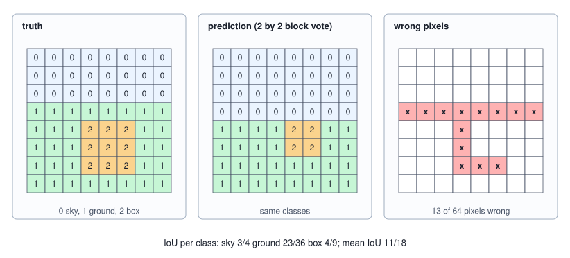
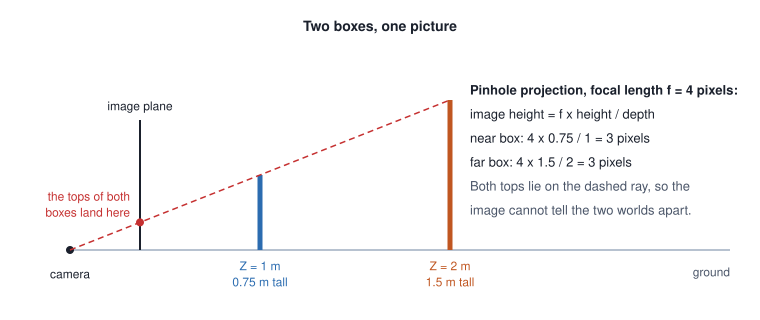

<!-- SPDX-License-Identifier: CC-BY-4.0 -->
<!-- Copyright (c) 2026 Martin Schröder <info@swedishembedded.com> -->

# Dense Prediction: Segmentation and Depth

*How does a network label every pixel or estimate how far away it is?*

A classifier answers a picture with one number and a detector with a short list. Ask instead the question that a robot needs answered before it takes a step: which pixels are floor, and how far away is each of them? The answer is no longer a label or a list, it is an array as large as the picture. Here is a scene small enough to print, with both answers written out.

<!-- worked: dense_prediction.scene -->
An 8 by 8 scene, row 0 at the top. The horizon lies on the top edge of row 3: rows 0 to 2 are sky (class 0), the others ground (class 1), and a box (class 2) of columns 3 to 5 and rows 4 to 6 stands on the ground with its base on the lower edge of row 6. The camera looks along the horizon with focal length 4 pixels, 1 metre above the ground. Ground depth on row y is Z = 4 / (y + 0.5 - 3) metres; the box is a vertical plane at the depth of its base, 4 / (7 - 3) = 1 metre. The sky has no depth.

Label map (0 sky, 1 ground, 2 box):

```text
0 0 0 0 0 0 0 0
0 0 0 0 0 0 0 0
0 0 0 0 0 0 0 0
1 1 1 1 1 1 1 1
1 1 1 2 2 2 1 1
1 1 1 2 2 2 1 1
1 1 1 2 2 2 1 1
1 1 1 1 1 1 1 1
```

Depth Z in metres:

```text
  -     -     -     -     -     -     -     -  
  -     -     -     -     -     -     -     -  
  -     -     -     -     -     -     -     -  
 8.00  8.00  8.00  8.00  8.00  8.00  8.00  8.00
 2.67  2.67  2.67  1.00  1.00  1.00  2.67  2.67
 1.60  1.60  1.60  1.00  1.00  1.00  1.60  1.60
 1.14  1.14  1.14  1.00  1.00  1.00  1.14  1.14
 0.89  0.89  0.89  0.89  0.89  0.89  0.89  0.89
```

Inverse depth 1/Z in 1/metres:

```text
  -     -     -     -     -     -     -     -  
  -     -     -     -     -     -     -     -  
  -     -     -     -     -     -     -     -  
0.125 0.125 0.125 0.125 0.125 0.125 0.125 0.125
0.375 0.375 0.375 1.000 1.000 1.000 0.375 0.375
0.625 0.625 0.625 1.000 1.000 1.000 0.625 0.625
0.875 0.875 0.875 1.000 1.000 1.000 0.875 0.875
1.125 1.125 1.125 1.125 1.125 1.125 1.125 1.125
```

Pixels per class: sky 24, ground 31, box 9 of 64.
<!-- /worked -->

The top three rows are sky, which has no distance. The ground is the lower five rows, with a box standing on it. Look at the depth of the ground: it falls from 8 metres on the horizon to 0.89 at the bottom of the picture, and one column of the picture shows it all, because every pixel of a row lies at the same distance. The box is a vertical plane, so all its pixels share one depth, and it interrupts the ground's pattern. The numbers in the last grid, the reciprocals of the depths, will matter later: they grow in equal steps of 0.25 down the ground rows.

Producing the first grid is **semantic segmentation**: a class for every pixel, which makes the network a classifier that runs once per pixel. Producing the second is **monocular depth** estimation: a distance for every pixel from one picture, with no second camera and no sensor, a regression run once per pixel. Both are dense prediction, and both pose the same difficulty. The networks of the previous three chapters shrink a picture on purpose (strides, pooling, a 32-fold reduction at the end of a backbone) because that is how a small filter comes to see an object. The answer, though, has to be back at the resolution of the picture. How much does the shrinking cost, how is the resolution brought back, and what do we measure and train when the answer has 64 entries, or 147,456 (a depth map of 384 by 384)? Depth has a further trouble of its own, which is that a picture does not contain the distances it is asked to give, and the second half of the chapter is about what can and cannot be recovered.

Five ideas from earlier chapters first; the answers are at the end.

1. (Volume VII, [Chapter 3](03-cnns.md), convolutional network and receptive field.) A $3 \times 3$ convolution, a $2 \times 2$ max pool with stride 2 and another $3 \times 3$ convolution are stacked. How many input pixels along one axis does one output value read?
2. (Volume VII, [Chapter 2](02-convolution.md), transposed convolution.) A transposed convolution with $k = 2$, stride 2 and no padding is applied to a map of side 4. What is the side of its output, and does any output position receive two taps?
3. (Volume VII, [Chapter 1](01-images.md), image resampling.) A row of 4 pixels is resized to 8. Under the half-pixel rule, at which source coordinate does output pixel $o = 0$ read, and output pixel $o = 3$?
4. (Volume VII, [Chapter 4](04-detection.md), intersection over union.) Two boxes $(0, 0, 4, 4)$ and $(2, 2, 6, 6)$ overlap. What is their IoU?
5. (Volume II, [Chapter 2](../v02-learning/02-linear-regression.md), least squares.) For the line $y = a x + b$ fitted to the points $(x_i, y_i)$ by least squares, what do the two conditions "the derivative of the sum of squares with respect to $a$ is zero" and "with respect to $b$ is zero" say about the residuals?

## One classifier at every pixel

A segmenting network's output has one score per class at every pixel, an array of shape $[K, H, W]$ for $K$ classes. The softmax of Volume III, taken over the class axis at each pixel, turns the scores into probabilities $p_c(y, x)$, and the loss is the cross-entropy of Volume III summed over the pixels. The one new decision is how to weigh the pixels. In the scene above the sky has 24 pixels, the ground 31 and the box 9, and in a real picture the imbalance is worse: a road is most of a street view and a pedestrian a few hundred pixels. A plain mean over pixels lets the abundant classes dominate the gradient. Giving class $c$ a weight $\mathrm{cw}_c$ and dividing by the total weight of the pixels, so that the loss stays an average,

$$
\mathcal{L} = \frac{\sum_{y, x} \mathrm{cw}_{t(y,x)} \bigl(-\ln p_{t(y,x)}(y, x)\bigr)}{\sum_{y, x} \mathrm{cw}_{t(y,x)}}, \qquad \mathrm{cw}_c = \frac{N}{K\, n_c}, \tag{1}
$$

where $t(y, x)$ is the true class of the pixel, $n_c$ the number of pixels of class $c$ among the $N$ of the training set, and the weights are chosen to be inverse frequency, scaled so that equally frequent classes weigh 1. The gradient with respect to the logits of one pixel is the familiar $\mathrm{cw}_t (\mathbf{p} - \mathbf{e}_t)$ over the total weight, with $\mathbf{e}_t$ the one-hot vector. With all weights 1 the loss is the plain mean. A pixel of a rare class then counts for more than a pixel of a common one; the cost is that the network is also more willing to call something rare, a trade the experiment below measures instead of asserting.

```text
function weighted_pixel_loss(logits: array<real>[K, H, W], labels: array<int>[H, W], cw: array<real>[K]) -> real:
    for y in 0 .. H: for x in 0 .. W: require 0 <= labels[y, x] < K
    num = 0.0
    den = 0.0
    for y in 0 .. H:
        for x in 0 .. W:
            t = labels[y, x]
            p = softmax(logits[:, y, x])        # over the K classes of this pixel
            num = num + cw[t] * (-log(p[t]))
            den = den + cw[t]
    return num / den
```

The pixels are visited row by row and `num` is accumulated in that order, which matters for the last digits of a printed loss.

## What the shrinking costs

A classifier reaches a label by throwing position away: pooling and strides trade resolution for a receptive field large enough to recognize the thing. A dense predictor cannot throw it all away, and the first experiment puts a number on what is lost. Take the scene above and suppose a network predicts perfectly, but only on a coarse grid: every block of $f \times f$ pixels gets one class, the one most of its pixels have, and the class is repeated across the block. This is the best that any network with output stride $f$ followed by a repetition can do on this scene.

<!-- worked: dense_prediction.ceiling -->
For each output stride f, the best prediction that is constant on f by f blocks of the scene above (each block takes the class of most of its pixels, the lowest class on a tie) scored against the true label map. No network that predicts at stride f and repeats the result can do better on this scene.

| stride f | grid | pixel accuracy | IoU sky | IoU ground | IoU box | mean IoU |
|---|---:|---:|---:|---:|---:|---:|
| 1 | 8 by 8 | 1 | 1.0000 | 1.0000 | 1.0000 | 1.0000 |
| 2 | 4 by 4 | 51/64 = 0.7969 | 0.7500 | 0.6389 | 0.4444 | 0.6111 |
| 4 | 2 by 2 | 47/64 = 0.7344 | 0.7500 | 0.5750 | 0.0000 | 0.4417 |
| 8 | 1 by 1 | 31/64 = 0.4844 | 0.0000 | 0.4844 | 0.0000 | 0.1615 |
<!-- /worked -->

At stride 2, a $4 \times 4$ grid, one fifth of the pixels are already wrong and the mean IoU (defined in the section after next) is at most 0.6111. At stride 4 the box vanishes: it has 9 pixels, no $4 \times 4$ block has most of its pixels in it, and its IoU is 0 however good the network. A backbone of Chapter 3 ends at stride 32, which on a 512 by 512 picture is a $16 \times 16$ grid. Small objects and thin boundaries live entirely below its resolution.

The repair has a shape: a network that first shrinks (the **encoder**, which gathers context) and then enlarges (the **decoder**, which puts positions back), with the decoder's output the size of the picture. A network built so, with an encoder and a decoder joined at the smallest map, is an **encoder-decoder CNN**. The decoder needs an operation that doubles a map, and there is more than one.

## Doubling a map

**Upsampling** is any operation that takes a map to one with more positions. Four are in use, and the experiment below applies them to the same coarse map, a smooth surface averaged over $2 \times 2$ blocks, and measures how close each comes to the original and whether it adds a pattern of its own.

<!-- worked: dense_prediction.doubling -->
The surface (x - 3.5)^2 + (y - 3.5)^2 over 24.5 on an 8 by 8 grid is averaged over 2 by 2 blocks to a 4 by 4 map and doubled again by five rules. 'Constant input' is a 4 by 4 map of ones doubled by the same rule: its output should be all ones, and the smallest and largest value on rows and columns 1 to 6 (the interior) show whether the rule adds a pattern. The error is against the original 8 by 8 surface, over all 64 pixels. The transposed convolutions use stride 2 and padding 1, with output padding 1 for k = 3 and 0 for k = 4, and `convolution.convT2d` of the earlier chapter.

| rule | constant input: interior min | interior max | mean absolute error | largest error |
|---|---:|---:|---:|---:|
| nearest | 1.0000 | 1.0000 | 0.1020 | 0.2449 |
| bilinear, half-pixel | 1.0000 | 1.0000 | 0.0918 | 0.2449 |
| bilinear, corners | 1.0000 | 1.0000 | 0.0758 | 0.2449 |
| transposed, k = 3, kernel of ones / 4 | 0.2500 | 1.0000 | 0.2695 | 0.8112 |
| transposed, k = 4, [1, 3, 3, 1]^2 / 16 | 1.0000 | 1.0000 | 0.1629 | 0.5753 |
<!-- /worked -->

Nearest-neighbour repetition has no cost (no multiplication) and no pattern, and it draws blocks. Bilinear interpolation of Chapter 1 costs four multiply-adds per output value and is smooth; under the corner-aligned convention it has the smallest error here, but the table says nothing about which convention a network was trained with, a point the section on BiSeNet returns to. The two transposed convolutions are the learnable rules, and their behaviour is the phase-sum story of Chapter 2 in a second guise. The kernel of ones divided by 4 turns a constant map into a ripple between 0.25 and 1, because its taps sum to different values on the four output phases; $[1, 3, 3, 1]^2/16$ turns it into a constant, and is bilinear interpolation written as a transposed convolution (with a zero padding that dims the border, which is why its error here is above that of bilinear). A network can learn a kernel with equal phase sums, or learn one that does not, and nothing in the loss insists.

The fourth rule makes the transposed convolution with $k = s = r$ look like something else. It is the **pixel shuffle** of Shi et al. (2016): a $1 \times 1$ convolution produces $r^2$ times as many channels as are needed, and the output is made by moving the $r^2$ channels of each pixel into an $r \times r$ block,

$$
\mathrm{out}_{c,\; ir + m,\; jr + n} = \mathrm{in}_{c r^2 + m r + n,\; i,\; j}, \qquad 0 \le m, n < r. \tag{2}
$$

```text
function pixel_shuffle(x: array<real>[C * r * r, H, W], r: int) -> array<real>[C, H * r, W * r]:
    y = zeros(real, [C, H * r, W * r])
    for c in 0 .. C:
        for i in 0 .. H:
            for j in 0 .. W:
                for m in 0 .. r:
                    for n in 0 .. r:
                        y[c, i * r + m, j * r + n] = x[c * r * r + m * r + n, i, j]
    return y
```

The transposed convolution with $k = s = r$ has no overlap (every input pixel stamps its own $r \times r$ block), so it is exactly a $1 \times 1$ convolution followed by this shuffle, with the weight at input channel $c_{\mathrm{in}}$, output channel $c$ and tap $(m, n)$ of the first stored at output channel $c r^2 + m r + n$ of the second. The check is a table of two outputs agreeing, and a layout that shows where the channels go:

<!-- worked: dense_prediction.shuffle_identity -->
Generator `bookrng.generator("dense_prediction.shuffle_identity")`, seed 0x0d84e05027395f70 (974150054278946672). Draws in order: the input x of shape [3, 3, 3] (channel, row, column; every entry normal()), then the transposed-convolution weight w of shape [3, 2, 2, 2] (input channel, output channel, row, column; every entry normal()). Left: the transposed convolution with k = 2, stride 2, padding 0 (`convolution.convT2d`) gives [2, 6, 6]. Right: a 1 by 1 convolution with weight V[c * 4 + m * 2 + n][ci] = w[ci][c][m][n] (sums over ci in order) gives 8 channels of 3 by 3, which the pixel shuffle y[c][2i + m][2j + n] = z[4c + 2m + n][i][j] rearranges to [2, 6, 6].

| quantity | criterion | result |
|---|---:|---:|
| largest difference of the two [2, 6, 6] outputs | below 1e-12 | met |

The layout, on four 2 by 2 channels (channel k holds 10 (k + 1) + 2 i + j at (i, j), so channel 0 is 10 11 / 12 13 and channel 1 is 20 21 / 22 23); the output channel, 4 by 4:

```text
10 20 11 21
30 40 31 41
12 22 13 23
32 42 33 43
```
<!-- /worked -->

The identity matters in practice because it moves all the work into one ordinary convolution at the low resolution, and the rearrangement is free (it moves data and does no arithmetic). It is also how a decoder can predict a different weight for every sub-pixel of a block, the idea of the last rule, which brain's depth network uses.

**Convex upsampling** lets the network decide how to interpolate. At each low-resolution pixel a convolution predicts, for each of the $r^2$ sub-pixels, nine logits, one per neighbour in the $3 \times 3$ window; their softmax gives nine non-negative weights summing to 1, and the sub-pixel's value is the weighted sum of the nine neighbouring low-resolution values (borders replicate). The nine-logit group is pixel-shuffled into place. Each output is a convex combination of values the coarse map already holds, so it can never overshoot, and bilinear interpolation is the special case with fixed weights.

$$
\mathrm{out}_{s} = \sum_{k=0}^{8} \mathrm{softmax}(\mathbf{m}_s)_k\; \mathrm{nb}_k, \tag{3}
$$

with $\mathbf{m}_s$ the nine logits of sub-pixel $s$ and $\mathrm{nb}_k$ the coarse value at neighbour $k$ of the pixel. The reason to want it is an edge. Bilinear interpolation of a step in depth makes a ramp, values between the near and the far surface that belong to neither; a network that has seen where the step lies can put all the weight on one side. A one-dimensional version, with the weights written out:

<!-- worked: dense_prediction.convex_demo -->
A row of six low-resolution depths [1, 1, 1, 5, 5, 5] doubled by bilinear interpolation (half-pixel rule) and by a convex combination of each pixel's left, own and right values (the 1-D form of the 3 by 3 rule). Output o is sub-pixel s of input pixel i; the logits of every sub-pixel are zero (weights 1/3 each) except pixel 2, whose two sub-pixels have the logits (0, 0, -4) (do not look right), and pixel 3, whose two have (-4, 0, 0) (do not look left). Weights are softmax(logits) with the library exp, replicate padding at the ends.

| output o | (i, s) | weights (left, own, right) | bilinear | convex |
|---|---|---|---:|---:|
| 0 | (0, 0) | 0.333 0.333 0.333 | 1.000 | 1.000 |
| 1 | (0, 1) | 0.333 0.333 0.333 | 1.000 | 1.000 |
| 2 | (1, 0) | 0.333 0.333 0.333 | 1.000 | 1.000 |
| 3 | (1, 1) | 0.333 0.333 0.333 | 1.000 | 1.000 |
| 4 | (2, 0) | 0.495 0.495 0.009 | 1.000 | 1.036 |
| 5 | (2, 1) | 0.495 0.495 0.009 | 2.000 | 1.036 |
| 6 | (3, 0) | 0.009 0.495 0.495 | 4.000 | 4.964 |
| 7 | (3, 1) | 0.009 0.495 0.495 | 5.000 | 4.964 |
| 8 | (4, 0) | 0.333 0.333 0.333 | 5.000 | 5.000 |
| 9 | (4, 1) | 0.333 0.333 0.333 | 5.000 | 5.000 |
| 10 | (5, 0) | 0.333 0.333 0.333 | 5.000 | 5.000 |
| 11 | (5, 1) | 0.333 0.333 0.333 | 5.000 | 5.000 |

Every convex output lies in [1.000, 5.000], the range of the input; the largest bilinear output is 5.000.
<!-- /worked -->

Bilinear interpolation turns the step 1 to 5 into 1, 2, 4, 5 across two input pixels, with intermediate values of 2 and 4 on surfaces where there are none. The convex rule with weights that look away from the step gives 1.036 and 4.964, nearly the two surfaces. The rule was introduced for optical flow by Teed and Deng (2020), and it is the upsampler that ZipDepth ends with.

## Skip connections, and the shapes they make

Doubling the map restores a number of positions, but it cannot restore information that the encoder discarded. A boundary at the pixel scale is gone by the bottleneck, and no interpolation of the bottleneck returns it. The remedy of the U-Net of Ronneberger, Fischer and Brox (2015) is to keep what the encoder knew at each resolution and hand it to the decoder at the same resolution: a **skip connection**. The decoder's upsampled map and the encoder's map of the same size are concatenated along the channel axis, and the next convolution mixes them. The network that the chapter trains is the smallest one that has the whole structure, with one level of encoding.


<!-- worked: dense_prediction.seg_shape_table -->
| layer (kind unet) | output [C, H, W] | parameters | multiply-adds |
|---|---|---:|---:|
| conv 3x3 + ReLU | [4, 8, 8] | 40 | 2,304 |
| max pool 2x2 | [4, 4, 4] | 0 | 0 |
| conv 3x3 + ReLU | [8, 4, 4] | 296 | 4,608 |
| transposed conv k2 s2 | [4, 8, 8] | 132 | 2,048 |
| concat with first stage | [8, 8, 8] | 0 | 0 |
| conv 3x3 head | [3, 8, 8] | 219 | 13,824 |

| kind | parameters | multiply-adds per image |
|---|---:|---:|
| unet | 687 | 22,784 |
| noskip | 579 | 15,872 |
| coarse | 363 | 7,296 |
| pixel | 6 | 192 |

Receptive field along one axis of one bottleneck value: after the first convolution 3, after the pool 4, after the second convolution 8 input pixels (Volume VII, Chapter 2, recursion r = r + d (k - 1) j), so the bottleneck of an 8 by 8 image sees all of it.
<!-- /worked -->

The counting shows what the skip costs and gives. The head's input has 8 channels instead of 4, so the head has 219 parameters instead of 111 and the whole network 687 instead of 579, about a fifth more, and its multiply-adds go from 15,872 to 22,784. What it gives is the 4 channels that were computed at full resolution before any pooling. The skip is a concatenation, not a sum: the U-Net lets the next layer weigh the two sources separately, where the pyramid of Chapter 3 adds them after projecting both to one width. Both exist, and a sum is cheaper in channels and a concatenation is cheaper to learn from.

Where the doubling is done matters too. The segmenter's decision is a sign (which class has the larger score), and the question is whether to take the decision at the coarse grid and repeat it, or to upsample the scores and decide afterwards. Take a row of 8 pixels with two classes whose score difference is a straight line, so that the true boundary lies between pixels 4 and 5, and give the network only 4 of its values.

<!-- worked: dense_prediction.logit_boundary -->
One row of 8 pixels, pixel p centred at c = p + 0.5. The true logit difference d = logit(1) - logit(0) is c - 5.2, so the true class is 1 from pixel 5 on. The coarse map holds d at the four cell centres c = 1, 3, 5, 7: -4.2, -2.2, -0.2, 1.8. 'Label first' takes the sign of each coarse value and repeats it twice; 'logit first' interpolates the coarse values to the 8 pixel centres with the half-pixel rule (replicating the end values) and then takes the sign.

| pixel p | true d | true class | label first | interpolated d | logit first |
|---|---:|---:|---:|---:|---:|
| 0 | -4.70 | 0 | 0 | -4.20 | 0 |
| 1 | -3.70 | 0 | 0 | -3.70 | 0 |
| 2 | -2.70 | 0 | 0 | -2.70 | 0 |
| 3 | -1.70 | 0 | 0 | -1.70 | 0 |
| 4 | -0.70 | 0 | 0 | -0.70 | 0 |
| 5 | 0.30 | 1 | 0 | 0.30 | 1 |
| 6 | 1.30 | 1 | 1 | 1.30 | 1 |
| 7 | 2.30 | 1 | 1 | 1.80 | 1 |

Label first gets 1 pixel wrong, logit first 0.
<!-- /worked -->

Deciding first can only place the boundary on a multiple of the block size, and here it misses by one pixel. Interpolating the scores first recovers the boundary exactly, because a straight line is reproduced exactly by linear interpolation: a boundary can be localized to a fraction of the output stride whenever the scores vary smoothly across it. This is why dense predictors upsample logits (or depths) and decide at full resolution, and why brain's BiSeNet returns $[19, 512, 512]$ scores and not labels. The price is bytes: the full-resolution scores hold $19 \cdot 512 \cdot 512 = 4{,}980{,}736$ numbers, 19,922,944 bytes in 32-bit floats, 64 times the 311,296 bytes of the $19 \times 64 \times 64$ scores they come from.

## Scoring a prediction: confusion matrix, IoU and the mean

How good is a label map? Pixel accuracy, the share of correct pixels, is the first idea and the first to mislead: on the scene above a prediction that calls every pixel of the box ground would still be 86 percent right. The measure that fits is the one of the last chapter, applied to sets of pixels. For class $c$, the pixels the truth calls $c$ form a set and the pixels the prediction calls $c$ another; their IoU is the size of the overlap over the size of the union. Count the pixels in a **confusion matrix** $\mathrm{conf}_{ij}$, the number of pixels of true class $i$ predicted as class $j$. Then, for class $c$,

$$
\begin{aligned}
\mathrm{IoU}_c &= \frac{\mathrm{TP}_c}{\mathrm{TP}_c + \mathrm{FP}_c + \mathrm{FN}_c}, \\
\mathrm{TP}_c = \mathrm{conf}_{cc}, &\quad \mathrm{FN}_c = \sum_{j \ne c} \mathrm{conf}_{cj}, \quad \mathrm{FP}_c = \sum_{i \ne c} \mathrm{conf}_{ic},
\end{aligned} \tag{4}
$$

and the **mean IoU** is the mean of the $\mathrm{IoU}_c$ over the classes (a class absent from both truth and prediction, with $0/0$, is left out). The denominator is the union of the two sets, the true positives counted once, so that a class pays for pixels it missed and pixels it claimed wrongly alike.

```text
function class_iou(conf: array<int>[K, K]) -> array<real>[K]:
    iou = zeros(real, [K])
    for c in 0 .. K:
        tp = conf[c, c]
        fn = sum(conf[c, :]) - tp
        fp = sum(conf[:, c]) - tp
        iou[c] = nan if tp + fp + fn == 0 else tp / (tp + fp + fn)   # absent class: left out of the mean
    return iou
```

The mean IoU is `mean` of the entries for which `is_finite` is true. The worked example scores the stride-2 block vote of the scene (the prediction behind the ceiling table, with a tie going to the lowest class), all in exact fractions:

<!-- worked: dense_prediction.iou_example -->
The prediction is the stride-2 block vote of the scene (the lowest class wins a tie). Rows of the confusion matrix are the true class, columns the predicted one.

Truth:

```text
0 0 0 0 0 0 0 0
0 0 0 0 0 0 0 0
0 0 0 0 0 0 0 0
1 1 1 1 1 1 1 1
1 1 1 2 2 2 1 1
1 1 1 2 2 2 1 1
1 1 1 2 2 2 1 1
1 1 1 1 1 1 1 1
```

Prediction:

```text
0 0 0 0 0 0 0 0
0 0 0 0 0 0 0 0
0 0 0 0 0 0 0 0
0 0 0 0 0 0 0 0
1 1 1 1 2 2 1 1
1 1 1 1 2 2 1 1
1 1 1 1 1 1 1 1
1 1 1 1 1 1 1 1
```

Wrong pixels (x):

```text
. . . . . . . .
. . . . . . . .
. . . . . . . .
x x x x x x x x
. . . x . . . .
. . . x . . . .
. . . x x x . .
. . . . . . . .
```

| true \ predicted | 0 sky | 1 ground | 2 box |
|---|---:|---:|---:|
| 0 (sky) | 24 | 0 | 0 |
| 1 (ground) | 8 | 23 | 0 |
| 2 (box) | 0 | 5 | 4 |

| class | TP | FP | FN | TP + FP + FN | IoU |
|---|---:|---:|---:|---:|---:|
| 0 (sky) | 24 | 8 | 0 | 32 | 3/4 = 0.7500 |
| 1 (ground) | 23 | 5 | 8 | 36 | 23/36 = 0.6389 |
| 2 (box) | 4 | 0 | 5 | 9 | 4/9 = 0.4444 |

Mean IoU = (3/4 + 23/36 + 4/9) / 3 = 11/18 = 0.6111. Pixel accuracy = 51/64 = 0.7969.
<!-- /worked -->



Pixel accuracy is 51/64 = 0.7969, and the class that matters, the box, scores an IoU of 4/9: four of its pixels are right, five are called ground, and none of the ground's wrong pixels are called box. The error map shows where: the whole of row 3, where the horizon fell inside a $2 \times 2$ block and the tie went to sky, and the left column and the bottom row of the box. Errors of a dense predictor lie on boundaries, because inside a region neighbouring pixels agree. That is why the shapes of the next sections concern boundaries.

## Training the small segmenter

The experiment compares four ways of building a small segmenter on one synthetic task, and measures them by the held-out IoU of every class. A scene is a horizon, a ground, a sky and a box standing on the ground, drawn at random, with each pixel's intensity set by its class plus noise, so that no pixel is certain by itself and a decision needs the neighbours and a boundary needs resolution.

<!-- worked: dense_prediction.seg_data_summary -->
Generator `bookrng.generator("dense_prediction.seg_data")`, seed 0x5bae8ab9e3465a5d (6606370234385717853). One stream makes the 60 training scenes and then the 60 test scenes; a scene draws, in this order, the horizon row h0 = 2 + integer(3), the box width bw = 2 + integer(2) and height bh = 2 + integer(2), the left column x1 = integer(8 - bw + 1), the lower edge y2 = h0 + 1 + integer(8 - h0) (the top edge is max(0, y2 - bh)), and then 64 values normal() in row-major order. The pixel is mean_c + 0.15 normal() with the class means sky 0.8, ground 0.35, box 0.65; the box overwrites sky and ground. Class weights are n_pixels / (3 count_c) of the training pixels.

| class | training pixels | share | test pixels | share | weight |
|---|---:|---:|---:|---:|---:|
| sky | 1387 | 0.3612 | 1476 | 0.3844 | 0.9229 |
| ground | 2073 | 0.5398 | 1984 | 0.5167 | 0.6175 |
| box | 380 | 0.0990 | 380 | 0.0990 | 3.3684 |
<!-- /worked -->

The four models, all in the table of shapes above or described by it: `pixel` is a $1 \times 1$ convolution, a linear classifier on one intensity (6 parameters), the baseline that never looks at a neighbour; `coarse` runs the encoder to the $4 \times 4$ bottleneck, classifies there with a $1 \times 1$ convolution and repeats each decision over its $2 \times 2$ block (363 parameters), a plain classification network's way of producing a map; `noskip` adds the transposed-convolution decoder and a $3 \times 3$ head but no skip (579); `unet` adds the skip (687). A fifth run trains unet with the class weights of (1).

All four are hand-derived backward passes in the worked module, so the first check is a gradient check, against the central difference, parameter by parameter:

<!-- worked: dense_prediction.seg_gradient_check -->
The initialized models (`dense_prediction.seg_init.<kind>`) on the first 3 training scenes with the class weights of the table: analytic gradient of the weighted loss against the central difference (L(w + h) - L(w - h)) / (2h), h = 1e-06, in 64-bit arithmetic, one parameter at a time, gate |analytic - numeric| <= 1e-7 + 1e-5 max(|analytic|, |numeric|).

| model | parameters | largest absolute difference | pass the gate |
|---|---:|---:|---:|
| unet | 687 | below 1e-7 | 687 of 687 |
| noskip | 579 | below 1e-7 | 579 of 579 |
| coarse | 363 | below 1e-7 | 363 of 363 |
| pixel | 6 | below 1e-7 | 6 of 6 |
<!-- /worked -->

Every parameter of every model passes at the gate of Volume III. Brain's own gradient check of its ZipDepth network, in the next sections, had to work harder: a deep net of ReLUs and normalizations is piecewise linear, and a finite-difference step that crosses a kink gives a number unrelated to the derivative. Commit `5393e8837` (July 2026) records the check as per element and on a ladder of step sizes, with the median of the relative errors as the gate (`crates/zipdepth/tests/it/p3_gradcheck.rs` asserts a median below 0.15 and at least 60 percent of resolvable elements in agreement), after a directional check of the kind used for the detector had stopped tracking the derivative on a post-ReLU depth map. A tiny network at a small step does not have that problem; a big one does.

The training is full-batch Adam on 60 scenes, 120 updates:

<!-- worked: dense_prediction.seg_training -->
Five segmenters trained on the 60 training scenes by full-batch Adam (beta_1 = 0.9, beta_2 = 0.999, epsilon = 1e-8, learning rate 0.03, bias correction), 120 updates, from the initializations `dense_prediction.seg_init.<kind>` (kinds pixel, coarse, noskip, unet; the last model reuses the unet initialization). Loss: the weighted mean cross-entropy of equation (1) of the chapter with the weights of the table above for the last row and 1 for the others (a plain mean). Weighted loss at update 0 and at update 120 on the training scenes; sums run over images in index order, then pixels row-major, and over taps in the order (input channel, kernel row, kernel column). A number that comes from a chaotic run is printed with only the digits that are the same in the run and in four copies of it whose first weight is changed by +1e-12, -1e-12, +3e-12 and -3e-12: in full if all agree on it, as 'about x' with the leading digits on which all agree, or as 'unstable' when not even one digit survives; the other digits cannot be reproduced in another implementation.

| model | parameters | loss at 0 | loss at 120 |
|---|---:|---:|---:|
| pixel | 6 | 1.0783 | 0.5697 |
| coarse | 363 | 1.0972 | 0.2800 |
| noskip | 579 | 1.1060 | 0.0996 |
| unet | 687 | 1.1725 | 0.0673 |
| unet + class weights | 687 | 1.1268 | 0.1145 |

(Class weights used by the last row: sky 0.9229, ground 0.6175, box 3.3684.)
<!-- /worked -->

Training loss falls fastest for the models with the most capacity at full resolution, and the ordering means little by itself, because a training loss does not measure generalization. The test is the held-out scenes, scored by (4) on the confusion matrix summed over all the test pixels:

<!-- worked: dense_prediction.seg_eval -->
The same five models on the 60 held-out scenes (3840 pixels): the prediction of a pixel is the class of the largest logit (the lowest class on a tie), the confusion matrices are summed over all test pixels and the IoU of each class is TP / (TP + FP + FN) of the summed matrix (not an average of per-image IoUs). Mean IoU is the mean of the three. A number that comes from a chaotic run is printed with only the digits that are the same in the run and in four copies of it whose first weight is changed by +1e-12, -1e-12, +3e-12 and -3e-12: in full if all agree on it, as 'about x' with the leading digits on which all agree, or as 'unstable' when not even one digit survives; the other digits cannot be reproduced in another implementation.

| model | pixel accuracy | IoU sky | IoU ground | IoU box | mean IoU |
|---|---:|---:|---:|---:|---:|
| pixel | 0.8391 | 0.7364 | 0.8310 | 0.0000 | 0.5225 |
| coarse | 0.8786 | 0.8588 | 0.8229 | 0.2966 | 0.6594 |
| noskip | 0.9234 | 0.9355 | 0.8972 | 0.4354 | 0.7560 |
| unet | 0.9396 | 0.9447 | 0.9251 | 0.4955 | 0.7884 |
| unet + class weights | 0.9315 | 0.9443 | 0.9087 | 0.5198 | 0.7909 |
<!-- /worked -->

The reading goes in order. The pixel model reaches 0.8391 accuracy and an IoU of 0 on the box: intensity alone separates sky from ground but cannot make the box, whose mean lies between the other two, a class it ever chooses. The coarse model sees context and its box IoU rises to 0.2966, but its decisions are on the $4 \times 4$ grid, and the box is $2$ to $3$ pixels wide. Adding the decoder, with its learned upsampling, raises the box to 0.4354; adding the skip raises it to 0.4955 and the mean IoU from 0.7560 to 0.7884. Resolution and context both matter, and in the order the chapter said. One reservation belongs with these numbers: they come from one initialization and one training set per model, and a different draw can move a third digit. The ordering of the five is what the run shows; no confidence interval is claimed.

The class weights act on the rare class. In the last row the box IoU is 0.5198 against 0.4955, the ground's IoU is 0.9087 against 0.9251, and the pixel accuracy falls from 0.9396 to 0.9315: the model now calls more pixels box, at the expense of the common classes. Mean IoU moves from 0.7884 to 0.7909, a small gain bought by that exchange. The confusion matrix of the unweighted model shows the shape of its error:

<!-- worked: dense_prediction.seg_confusion_table -->
Confusion matrix of the unet model on the test scenes (rows: true class, columns: predicted class). A number that comes from a chaotic run is printed with only the digits that are the same in the run and in four copies of it whose first weight is changed by +1e-12, -1e-12, +3e-12 and -3e-12: in full if all agree on it, as 'about x' with the leading digits on which all agree, or as 'unstable' when not even one digit survives; the other digits cannot be reproduced in another implementation.

| true \ predicted | 0 sky | 1 ground | 2 box |
|---|---:|---:|---:|
| 0 (sky) | 1452 | 6 | 18 |
| 1 (ground) | 4 | 1938 | 42 |
| 2 (box) | 57 | 105 | 218 |
<!-- /worked -->

The box row is where the errors are: of 380 box pixels, the model finds 218 and calls 57 sky and 105 ground. Reweighting is a choice about which of these columns to move. It is not a free improvement, and a metric that averages over classes (the mean IoU) is what makes it look like one.

## Two paths for a fast segmenter: BiSeNet

The small segmenter is a toy in one respect that dominates real use: its decisions are cheap because the picture is 64 pixels. A segmenter for video runs at 512 by 512 or more, and the encoder-decoder that recovers all the positions at full width is costly. The design of Yu et al. (2018), the **BiSeNet**, separates the two jobs the toy's U-shape does with one path. A spatial path, a few strided convolutions that keep the picture at one eighth of its size, lets boundaries keep their positions. A context path shrinks fast with a light backbone, ends with a global pool that gives every position the whole image's summary, and supplies the large receptive field that the class of an object needs. A fusion module joins them.

The version in brain, `crates/bisenet`, is the face-parsing network of a reference implementation, 19 classes, and it differs from the paper in one structural respect that the code states: there is no separate spatial path. The detail path is the context path's own stride-8 map, the output of ResNet-18's second stage (Chapter 3), taken before any refinement (`feat_res8` in `crates/bisenet/src/model.rs`) and joined to the refined context output at the same resolution. The arithmetic of the next table says how much context that map already has.

<!-- worked: dense_prediction.bisenet_counts -->
The face-parsing BiSeNet at 512 by 512 from its layer list (the parameters are the convolution weights and the scale and shift of the BatchNorm after each convolution; every convolution is bias-free, and the two auxiliary training heads are not part of the inference graph). Multiply-adds are those of the convolutions at 512 by 512; the gates' pooled 1 by 1 convolutions are counted at one position.

| stage | output [C, H, W] | parameters | multiply-adds |
|---|---|---:|---:|
| stem 7x7 stride 2, then max pool | 64 x 128 x 128 | 9,536 | 616,562,688 |
| layer 1: 2 basic blocks of 64 | 64 x 128 x 128 | 147,968 | 2,415,919,104 |
| layer 2: 2 basic blocks of 128 | 128 x 64 x 64 | 525,568 | 2,147,483,648 |
| layer 3: 2 basic blocks of 256 | 256 x 32 x 32 | 2,099,712 | 2,147,483,648 |
| layer 4: 2 basic blocks of 512 | 512 x 16 x 16 | 8,393,728 | 2,147,483,648 |
| global context: pool, 1x1 to 128 | 128 x 1 x 1 | 65,792 | 65,536 |
| refinement of layer 4 (3x3, gate) | 128 x 16 x 16 | 606,720 | 151,011,328 |
| 3x3 after doubling to 1/16 | 128 x 32 x 32 | 147,712 | 150,994,944 |
| refinement of layer 3 (3x3, gate) | 128 x 32 x 32 | 311,808 | 302,006,272 |
| 3x3 after doubling to 1/8 | 128 x 64 x 64 | 147,712 | 603,979,776 |
| fusion (1x1 on 256, gate 256 to 64 to 256) | 256 x 64 x 64 | 98,816 | 268,468,224 |
| output head (3x3 to 256, 1x1 to 19) | 19 x 64 x 64 | 595,200 | 2,435,842,048 |

Total: 13,150,272 parameters and 13,387,300,864 multiply-adds (26,774,601,728 FLOPs) per 512 by 512 image. Receptive field of one value along one axis through the main path of the backbone (Volume VII, Chapter 2, recursion): 43 pixels at stride 4 (layer 1), 99 at stride 8 (layer 2, the map that goes to the fusion unchanged), 211 at stride 16 (layer 3) and 435 at stride 32 (layer 4); the global pool sees all 512.
<!-- /worked -->

The stride-8 map has a receptive field of 99 pixels, already a fifth of the picture, and the stride-32 map 435, so the "detail" path is not a small-receptive-field path as such. What it is, is a map that has seen no downsampling beyond one eighth and that no later layer has mixed. The context path, from layer 4 down, goes as follows. The stride-32 map $F_{32}$ (512 channels) is refined by an **attention refinement module**: a $3 \times 3$ convolution to 128 channels, then a gate, the sigmoid of a $1 \times 1$ convolution and normalization of the global average of the features, which multiplies the features channel by channel. The global average of the stride-32 map, passed through a $1 \times 1$ convolution to 128 channels, is added to the refined map, and the sum is doubled in size by nearest repetition and passed through a $3 \times 3$ convolution. At stride 16 a second refinement, of layer 3, is added to that result, which is doubled again and passed through another $3 \times 3$ convolution; its output at stride 8 is `feat_cp8`. The **feature fusion module** concatenates the 128 channels of the detail map and the 128 of the context map, mixes them with a $1 \times 1$ convolution to 256 channels, and reweights the channels with a gate computed from the global average of the result (256 to 64 to 256 with a ReLU and a sigmoid), adding the gated map to the ungated one. A $3 \times 3$ convolution and a $1 \times 1$ convolution to 19 classes give scores at $64 \times 64$, which a bilinear resize with `align_corners=true` takes to $[19, 512, 512]$. Every gate in the module is the same device, a squeeze (global average) and an excitation (a small network and a sigmoid) that scales channels; it is how a global context steers local features at the price of a few thousand parameters.

The last step contains a lesson that has nothing to do with the network. Chapter 1's corner-aligned rule reads output pixel $o$ at coarse coordinate $o \cdot 63 / 511$, and the half-pixel rule at $o/8 - 0.4375$. The difference of the two is $7o/4088 - 0.4375$ coarse cells: $-0.4375$ cells (3.5 output pixels) at the left border, zero in the middle and $+0.4375$ at the right border. A boundary that moves by up to 3.5 pixels at the edges of a picture is a quiet error that no shape check finds, and the brain network follows its reference, which resizes with the corner rule, while the depth network below follows its own reference's half-pixel rule in its fusions. Each network has to use the rule it was trained with.

BiSeNet in brain is inference only: its module has no loss, no metric and no palette, and this chapter's training code is therefore the book's, not the crate's. The class map is consumed in `crates/bisenet/src/mask.rs`, which takes the per-pixel argmax over the 19 scores (so softmax is not needed, since it does not change the argmax), paints the pixels of the classes `[0, 16, 18, 7, 8, 9, 14, 15]` white (the module calls them background and the hat, neck, necklace, cloth and ear classes of the reference's list) and keeps the others as grey-scale copies of the original, the mask that an identity pipeline downstream needs. That is the use of a segmentation as a mask, and a class palette would be an additional rendering the crate does not contain.

Its test is `crates/bisenet/tests/parity.rs`, against tensors dumped from the reference on one real photograph. It compares two things, and the difference between them is a dense-prediction lesson. The logits are compared by cosine similarity (a gate of 0.999), and the decisions by the per-pixel agreement of the two argmax maps (a gate of 98 percent). The commit that added the crate, `eac63b935` (September 2026), reports 1.0000000000 and 100.0000 percent for the network alone and 0.9997813 for the chain that includes the face alignment and the mask, whose residual it attributes to the warp's zero padding against the reference's constant border, carried through a hard boundary decision. The fixtures are not committed, so the numbers are the commit's report and the gates are what the test enforces. What the pair of metrics shows is that a tiny difference in scores becomes a visible difference in a label map only at boundaries, where the argmax flips, and that "the scores are the same to $10^{-3}$" and "the masks are the same" are different statements, the second being the one the user sees. knowledge #93 records a neighbouring trap, met by the code that calls this crate's alignment: a kernel index is meaningful only to the kernel list that built it, and an index into the wrong list is a valid dispatch of the wrong kernel.

## A picture does not contain its distances

Depth begins with a puzzle that segmentation does not have. A segmenter's labels are in the picture, in the sense that a person could draw them from it. A depth map is a quantity of the world, and a camera does not measure it. A camera measures where rays land. A point at lateral offset $X$ and depth $Z$ (both in metres) lands at the pixel column

$$
x = c_x + f\,\frac{X}{Z}, \qquad y = c_y + f\,\frac{Y}{Z}, \tag{5}
$$

where $f$ is the focal length in pixels and $(c_x, c_y)$ is the pixel the optical axis passes through. Now make the world twice as large about the camera, $(X, Y, Z) \to (2X, 2Y, 2Z)$: every ratio in (5) is unchanged, so every pixel is unchanged. The scene of the opening, with the same box twice as big at twice the distance, takes the same picture.

<!-- worked: dense_prediction.pinhole_ambiguity -->
The scene of the first example seen by a camera with focal length f = 4 pixels and principal point (4, 3), which projects the point (X, Y, Z) (right, down and ahead of the camera, in metres) to x = 4 + 4 X / Z, y = 3 + 4 Y / Z. The camera is 1 metre above the ground, so the ground lies at Y = 1. Each point is shown in the scene as it is and in the scene made twice as large about the camera (every coordinate doubled, which doubles the camera height too). The last column also checks a factor of 3.

| point | (X, Y, Z) at scale 1 | (X, Y, Z) at scale 2 | pixel at scale 1 | pixel at scale 2 | same pixel at scales 1, 2, 3 |
|---|---|---|---|---|---:|
| box, top left | (-0.25, 0.25, 1) | (-0.5, 0.5, 2) | (3, 4) | (3, 4) | yes |
| box, top right | (0.5, 0.25, 1) | (1, 0.5, 2) | (6, 4) | (6, 4) | yes |
| box, base right | (0.5, 1, 1) | (1, 2, 2) | (6, 7) | (6, 7) | yes |
| ground, centre of row 3 | (0, 1, 8) | (0, 2, 16) | (4, 3.5) | (4, 3.5) | yes |
<!-- /worked -->



So no network can output metric depth from one picture by seeing; it can output it by knowing, from its training, how big a box is, how tall a person is, how far apart the eyes of a face are. What the picture does fix is the relation among the depths: which pixel is nearer, by what ratio. A model of this kind outputs **relative depth** (a map known only up to some transformation) and not **metric depth** (in metres). The transformation worth knowing is the following. The reciprocal $\nu = 1/Z$, **inverse depth** (called disparity when it is measured in a stereo pair), is the natural coordinate, because for a plane it is affine in the pixel. For a camera at height $h$ over a ground plane whose horizon is on row $y_h$, the ground pixel in row $y$ lies on a ray at $(y - y_h)/f$ below the axis, and the plane is at height $h$ below it, so $Y = h$ and (5) gives

$$
\nu = \frac{1}{Z} = \frac{y - y_h}{f\, h}. \tag{6}
$$

<!-- worked: dense_prediction.ground_plane -->
The ground rows of the first example, row y with centre y + 0.5, for a camera 1 metre and 2 metres above the ground (f = 4 pixels, horizon at row 3): Z = f h / (y + 0.5 - 3), and its reciprocal.

| row y | y + 0.5 | Z (h = 1) | 1/Z (h = 1) | Z (h = 2) | 1/Z (h = 2) |
|---|---:|---:|---:|---:|---:|
| 3 | 3.5 | 8.0000 | 0.1250 | 16.0000 | 0.0625 |
| 4 | 4.5 | 2.6667 | 0.3750 | 5.3333 | 0.1875 |
| 5 | 5.5 | 1.6000 | 0.6250 | 3.2000 | 0.3125 |
| 6 | 6.5 | 1.1429 | 0.8750 | 2.2857 | 0.4375 |
| 7 | 7.5 | 0.8889 | 1.1250 | 1.7778 | 0.5625 |

A straight line fitted by least squares through the five points (y + 0.5, 1/Z) at h = 1 has slope 0.2500 = 1/(f h) and intercept -0.7500 = -3/(f h); its largest residual is below 1e-12.
<!-- /worked -->

Inverse depth is a straight line in the row, whose slope is $1/(f h)$: doubling the camera height halves it and changes nothing else, so the picture's scale ambiguity becomes, in inverse depth, a single scale factor, and a model that has also not been told where its zero lies has a shift as well. This is the reason that monocular depth networks output inverse depth: the family of maps they cannot distinguish is the affine one, $\nu \mapsto a \nu + b$, and it is easy to work with.

## Comparing a map that has no scale: the scale-and-shift alignment

If the prediction $\hat{\nu}$ is correct only up to $(a, b)$, a loss or a metric that compares it directly with the truth $\nu^\ast$ punishes the model for an ambiguity no model can resolve. The remedy of Eigen, Puhrsch and Fergus (2014), for a scale, and of Ranftl et al. (2020), for scale and shift in inverse depth, is to remove the ambiguity before comparing: find the scale and shift that bring the prediction closest to the truth, and score what remains. Over the $n$ valid pixels, minimize the squared residual

$$
E(a, b) = \sum_{i=1}^{n} \bigl(a\, \hat{\nu}_i + b - \nu^\ast_i\bigr)^2 . \tag{7}
$$

This is the linear regression of Volume II, with the prediction as the input and the truth as the target. Setting $\partial E / \partial b = 0$ gives $b = \bar{\nu}^\ast - a \bar{\hat{\nu}}$ (the line passes through the means) and setting $\partial E / \partial a = 0$ gives, after substituting,

$$
\begin{aligned}
a &= \frac{n \sum_i \hat{\nu}_i \nu^\ast_i - \sum_i \hat{\nu}_i \sum_i \nu^\ast_i}{n \sum_i \hat{\nu}_i^2 - \bigl(\sum_i \hat{\nu}_i\bigr)^2}, \\
b &= \frac{\sum_i \nu^\ast_i - a \sum_i \hat{\nu}_i}{n},
\end{aligned} \tag{8}
$$

that is, $a = \mathrm{cov}(\hat{\nu}, \nu^\ast)/\mathrm{var}(\hat{\nu})$. If the model's scale were all that was unknown, one would fit $a$ alone, and $a = \sum \hat{\nu}\nu^\ast / \sum \hat{\nu}^2$.

```text
function align_scale_shift(u: array<real>[n], v: array<real>[n]) -> (real, real):
    require n >= 2
    su = sum(u)
    sv = sum(v)
    suu = sum(u * u)                 # elementwise product, then the sum
    suv = sum(u * v)
    den = n * suu - su * su
    require den != 0.0               # u is not constant
    a = (n * suv - su * sv) / den
    b = (sv - a * su) / n
    return (a, b)
```

The experiment predicts the inverse depth of the 40 non-sky pixels of the scene as an affine distortion of the truth, a scale of 0.45 and a shift of 0.2, with noise and a structured error on the box that no scale and shift can undo. The model is not right, and also not wrong in the way alignment can repair.

<!-- worked: dense_prediction.alignment -->
Generator `bookrng.generator("dense_prediction.depth_prediction")`, seed 0x35b867f18c7b0063 (3870958166866591843). The predicted inverse depth u of the 40 non-sky pixels of the scene, in row-major order, is 0.45 v + 0.2 + 0.03 normal() (one draw per pixel in that order) plus 0.1 on the 9 box pixels, where v is the true inverse depth. Sums over the pixels in that order: n = 40, sum u = 21.872334, sum v = 28.375000, sum u u = 13.525447, sum u v = 18.397327.

| alignment | a | b | sum of squared residuals |
|---|---:|---:|---:|
| none (a = 1, b = 0) | 1 | 0 | 2.4652 |
| scale only (a = sum uv / sum uu) | 1.360201 | 0 | 0.7103 |
| scale and shift (closed form) | 1.840749 | -0.297162 | 0.3015 |

Moving away from the closed-form pair in any direction raises the sum, by exactly the sum over the pixels of (da u + db)^2 for the move (da, db):

| (a, b) | sum of squared residuals | increase over the minimum |
|---|---:|---:|
| (1.850749, -0.297162) | 0.302836 | 0.001353 |
| (1.830749, -0.297162) | 0.302836 | 0.001353 |
| (1.840749, -0.287162) | 0.305484 | 0.004000 |
| (1.840749, -0.307162) | 0.305484 | 0.004000 |
| (1.850749, -0.287162) | 0.311211 | 0.009727 |
<!-- /worked -->

Without alignment the sum of squares is 2.4652, with the best scale alone 0.7103 and with the closed form of (8) 0.3015. The second table makes the point that (8) is a minimum: every move away from it raises the sum by exactly $\sum (\Delta a\, u_i + \Delta b)^2$, which for the first move is $0.01^2 \cdot \sum u_i^2 = 0.001353$. The recovered pair is not $(1/0.45, -0.2/0.45) = (2.2222, -0.4444)$, the inverse of the distortion, because the structured error and the noise pull the fit; the alignment finds the best affine map for the data it is given, not the one that was used to make them.

## Depth metrics, and what alignment decides

The standard measures, due to Eigen et al., are computed on depth and not on inverse depth, over the valid pixels. With $\hat{Z}$ the predicted and $Z$ the true depth,

$$
\begin{aligned}
\mathrm{AbsRel} &= \frac{1}{n}\sum_i \frac{\lvert \hat{Z}_i - Z_i \rvert}{Z_i}, \qquad \mathrm{RMSE} = \sqrt{\frac{1}{n}\sum_i (\hat{Z}_i - Z_i)^2}, \\
\mathrm{acc}_k &= \frac{1}{n}\Bigl\lvert\Bigl\{ i : \max\Bigl(\frac{\hat{Z}_i}{Z_i}, \frac{Z_i}{\hat{Z}_i}\Bigr) < 1.25^k \Bigr\}\Bigr\rvert,
\end{aligned} \tag{9}
$$

The first is the mean relative error, the second the error in metres (which a far pixel dominates), and the third, in the literature $\delta < 1.25^k$ for $k = 1, 2, 3$, the share of pixels within a factor of 1.25, 1.5625 and 1.953125 of the truth. The table scores the same predictions three times, after no alignment, after the scale alone and after the scale and shift of (8), the aligned inverse depth being inverted to a depth.

<!-- worked: dense_prediction.metrics_table -->
The predictions of the alignment example turned into depths Z-hat = 1 / (aligned inverse depth) (every aligned value is positive) and scored on the 40 non-sky pixels against the true depths Z: AbsRel = mean |Z-hat - Z| / Z, RMSE = sqrt(mean (Z-hat - Z)^2) in metres, and the share of pixels with max(Z-hat / Z, Z / Z-hat) below 1.25, 1.25^2 = 1.5625 and 1.25^3 = 1.953125.

| alignment | AbsRel | RMSE (m) | share < 1.25 | share < 1.25^2 | share < 1.25^3 |
|---|---:|---:|---:|---:|---:|
| none | 0.3867 | 1.8316 | 0.1750 | 0.7000 | 0.8750 |
| scale only | 0.2139 | 2.2780 | 0.6750 | 0.8000 | 0.8000 |
| scale and shift | 0.1235 | 1.0424 | 0.8500 | 0.9500 | 1.0000 |
<!-- /worked -->

The unaligned row is a model scored against a ground truth in a unit it never saw: 17.5 percent of its pixels are within 1.25 of the truth. Aligning the scale lifts that to 67.5 percent and the closed form to 85 percent, with AbsRel falling from 0.3867 to 0.2139 to 0.1235. One row does not improve: RMSE, 2.2780 against 1.8316 for the scale alone, because RMSE is dominated by the far pixels (a depth of 8 m), and the alignment of (7) is a fit in inverse depth, which does not care that a small error of inverse depth at a far pixel is a large error of depth. A metric is a question about the use of the map, and the alignment decides which question has been asked; a depth model's report must say which alignment, or its numbers cannot be compared.

A relative map becomes metric when two numbers are known. The next table aligns the same predictions by the least-squares fit and by the true inverse depths at two pixels (the nearest and the farthest), and checks that brain's min-max normalization of its output, which discards the scale and shift of the network, loses nothing that the alignment could have used.

<!-- worked: dense_prediction.relative_vs_metric -->
The same predictions after the min-max normalization that brain's depth action returns (u' = (u - min u) / (max u - min u), min 0.215114, max 0.826121), aligned to the truth with the closed form: the sum of squared residuals is 0.301484 for the normalized map and 0.301484 for the raw one, so the normalization (an affine map) changes nothing that a scale and a shift can undo (difference below 1e-9). Metric depth from a relative map needs two numbers; here they come from the least-squares fit, or from the true inverse depths at the nearest pixel (row 7, column 0) and the farthest (row 3, column 0) of the 40 (the first of each in row-major order):

| how a and b are found | a | b | AbsRel | RMSE (m) |
|---|---:|---:|---:|---:|
| least squares over all 40 pixels | 1.840749 | -0.297162 | 0.1235 | 1.0424 |
| two reference pixels (nearest, farthest) | 2.181384 | -0.408230 | 0.1493 | 1.5695 |
<!-- /worked -->

The normalized map aligns to exactly the same residual, since a min-max normalization is itself an affine map of the prediction, and a scale and shift can undo any other. Two reference pixels give an AbsRel of 0.1493, worse than the fit over all 40, which is the point of using many: the references are noisy too.

## ZipDepth

Brain's depth network is ZipDepth (`crates/zipdepth`), a convolutional encoder-decoder of 6.1 million parameters that outputs a relative inverse depth, non-negative (a ReLU ends it), at exactly the resolution of its input, a multiple of 32 on each side. Its stages follow the pattern of the chapter, and its table of shapes is the chapter's tiny network written at full size.

<!-- worked: dense_prediction.zipdepth_counts -->
The base ZipDepth (`dims` 48, 96, 192, 384, `depths` 2, 2, 6, 2, decoder width 96, half-resolution width 32, input 384 by 384) from its layer list. 'Before' counts the trainable parameters of the trained form: every convolution weight, bias, and the scale and shift of every BatchNorm (the running statistics and the two normalization constants are not parameters). 'After' is the form for inference, in which each branch block is one 3 by 3 convolution with a bias, each BatchNorm that follows a single convolution is folded into it, and a BatchNorm over a sum stays as a scale and a shift. Multiply-adds are those of the convolutions of the inference form at 384 by 384 (the gather of the convex upsample counts 9 per output pixel); pooling, softmax, ReLU and the element-wise sums are not counted.

| stage | output [C, H, W] | parameters before | parameters after | multiply-adds |
|---|---|---:|---:|---:|
| stem (two stride-2 3x3 convolutions) | 48 x 96 x 96 | 11,160 | 11,088 | 119,439,360 |
| stage 1: 2 blocks of 48 | 48 x 96 x 96 | 46,464 | 41,568 | 382,205,952 |
| down 2: block, 48 to 96, stride 2 | 96 x 48 x 48 | 46,464 | 41,568 | 95,551,488 |
| stage 2: 2 blocks of 96, multi-scale, strip gate | 96 x 48 x 48 | 187,296 | 168,288 | 386,408,448 |
| down 3: block, 96 to 192, stride 2 | 192 x 24 x 24 | 185,088 | 166,080 | 95,551,488 |
| stage 3: 6 blocks of 192, channel gate, context block | 192 x 24 x 24 | 2,244,625 | 2,019,985 | 1,146,756,096 |
| down 4: block, 192 to 384, stride 2 | 384 x 12 x 12 | 738,816 | 663,936 | 95,551,488 |
| stage 4: 2 blocks of 384 | 384 x 12 x 12 | 2,952,192 | 2,654,976 | 382,205,952 |
| pyramid pooling (1x1, pools, 1x1) | 384 x 12 x 12 | 185,280 | 184,800 | 26,542,080 |
| cross-scale exchange (two grouped 1x1) | 384 x 12 x 12 | 36,864 | 36,864 | 13,271,040 |
| decoder: project 384 to 288 | 288 x 12 x 12 | 111,168 | 110,880 | 15,925,248 |
| decoder: fuse 192 and 288 at 1/16 | 192 x 24 x 24 | 23,424 | 23,424 | 13,271,040 |
| decoder: fuse 96 and 192 at 1/8 | 144 x 48 x 48 | 10,656 | 10,656 | 23,887,872 |
| decoder: fuse 48 and 144 at 1/4 | 96 x 96 x 96 | 4,800 | 4,800 | 42,467,328 |
| decoder: fuse 24 and 96 at 1/2 | 32 x 192 x 192 | 1,024 | 1,024 | 35,389,440 |
| half-resolution depth head (3x3, biased) | 1 x 192 x 192 | 289 | 289 | 10,616,832 |
| convex upsample (mask 3x3, 1x1 to 36, gather) | 1 x 384 x 384 | 2,644 | 2,636 | 96,878,592 |

Total: 6,788,254 parameters before folding, 6,142,862 after, 2,981,919,744 multiply-adds (5,963,839,488 FLOPs) per 384 by 384 image.
<!-- /worked -->

The encoder starts with two stride-2 convolutions (a half-resolution feature map `s_half` of 24 channels and a quarter-resolution one of 48), then four stages at strides 4, 8, 16 and 32, with 48, 96, 192 and 384 channels and 2, 2, 6 and 2 blocks, each stage after the first entered by a stride-2 block. At the bottom a pyramid-pooling unit and a cross-scale exchange between the stride-16 and stride-32 maps give the context. The decoder is the skip structure of this chapter at four levels: `proj4` takes the stride-32 map to 288 channels, and each of four fusion modules upsamples the lower-resolution decoder map bilinearly (with the half-pixel rule, `align_corners=False`), projects it and the encoder's map of the same size by grouped $1 \times 1$ convolutions, adds them and applies a normalization and a ReLU. They sit at strides 16, 8, 4 and 2, and the last one takes the stem's half-resolution map, so that detail from the very first convolution reaches the end of the decoder. A single biased $3 \times 3$ convolution at half resolution makes the depth, and a convex upsample of (3) doubles it to the input size, with the weights predicted from the fusion output by a $3 \times 3$ convolution, a normalization, a ReLU and a $1 \times 1$ convolution to $9 \cdot 2 \cdot 2 = 36$ channels. The order of the 36 is that of (2): `crates/kernels/wgsl/convex_upsample.wgsl` takes channel $k \cdot 4 + (s_h \cdot 2 + s_w)$ as the weight of neighbour $k$ for sub-pixel $(s_h, s_w)$, which is the pixel-shuffle layout, and folds the replicate padding, the gather and the shuffle into one kernel of one thread per output pixel, so the nine-times larger intermediate never exists. The head's bias starts at 0.5, not 0 (`crates/zipdepth/src/init.rs`): the output is passed through a ReLU, and a zero start would park every pixel on its flat side, where no gradient flows.

The released model is not the one that is trained. Its workhorse block, 15 of them, is made for training as three branches whose outputs are summed and passed through a ReLU: a $3 \times 3$ convolution with BatchNorm, a $1 \times 1$ convolution with BatchNorm, and, when the shape is kept, the input itself. All three are linear in the input and the BatchNorm in evaluation mode is an affine map per channel, so the sum is one $3 \times 3$ convolution with a bias. That is the reparameterization idea of Ding et al. (2021): train with branches because they help optimization, then fold them for inference because one convolution is cheaper and has fewer parameters. The fold uses the BatchNorm folding of Chapter 3 on each branch, $\mathbf{w}' = \mathbf{w}\,\gamma/\sqrt{\sigma^2 + \epsilon_{\mathrm{norm}}}$ and $b' = \beta - \gamma\mu/\sqrt{\sigma^2 + \epsilon_{\mathrm{norm}}}$ per channel, puts the $1 \times 1$ kernel at the centre of a $3 \times 3$ kernel of zeros, and adds a 1 to the centre tap of each channel's own filter for the identity. The bias is the sum of the two branches' folded shifts. One difference from the original idea is stated in the crate and is a trap: the identity branch here has no BatchNorm, so it contributes a kernel and no bias, and adding a bias for it, the obvious mistake, still runs and still gives the right shapes (`crates/zipdepth/src/fuse.rs`, with a test that pins it). The fold, on a block of two channels:

<!-- worked: dense_prediction.reparam_demo -->
Generator `bookrng.generator("dense_prediction.reparam")`, seed 0x77b270f2392e019a (8625080422011634074). Draws in order: x of shape [2, 4, 4] (channel, row, column), the 3 by 3 weight w3 of shape [2, 2, 3, 3] (output, input, row, column), the 1 by 1 weight w1 of shape [2, 2], then for the 3 by 3 branch and then the 1 by 1 branch the BatchNorm values gamma (2 values), beta (2), running mean (2), all normal(), and running variance 0.5 + uniform() (2); epsilon = 1e-5. Left: relu(BN(w3 * x) + BN(w1 * x) + x) with zero padding, from the three branches. Right: one 3 by 3 convolution whose kernel is the scaled w3, plus the scaled w1 at its centre tap, plus 1 at the centre tap of the diagonal (o = ci), and whose bias is the two folded BatchNorm shifts (the identity adds none); then ReLU.

| quantity | criterion | result |
|---|---:|---:|
| largest difference of the two outputs | below 1e-12 | met |

Parameters of the block with 2 channels: 48 before (weights of both convolutions and the scale and shift of both BatchNorms, 2 channels each), 38 after (one 3 by 3 kernel and a bias per output channel).
<!-- /worked -->

The fold is exact to rounding, 48 parameters becoming 38 for this tiny block. On the whole network, the table above counts 6,788,254 trainable parameters before the fold and 6,142,862 after, which is the "6.1 million" of the model's headline, so that headline is a count of the inference form and the checkpoint stores the larger one. (The checkpoint's 235 float tensors hold 6,802,884 elements, which also include the BatchNorm running statistics and the two normalization constants; a test in `crates/zipdepth/src/config.rs` pins those two counts, and a comment there gives the trainable count.) The inference form costs 2,981,919,744 multiply-adds, about 5.96 billion FLOPs, at 384 by 384 (the convolutions only). The largest share, over a third, is the six blocks of stage 3, and the half-resolution and full-resolution parts (the last fusion, the head and the upsampler) are under 5 percent.

The released network has no attention in it. The configuration enum says why: global context is added by a strip-pooling gate (the mean over rows plus the mean over columns of the map, a depthwise $1 \times 1$ convolution and a sigmoid, which multiplies the map), by a learned weighted global pool (a $1 \times 1$ convolution scores every position and a softmax over all positions makes the weights of an average) and by a squeeze-and-excitation gate, none of which has a quadratic cost. Like the BiSeNet gates, they are global summaries, not attention in the sense of Volume V.

What the crate does not contain, by its own header, is the scale-and-shift loss. `crates/zipdepth/src/train.rs` trains with a masked L1 on inverse depth against synthetic scenes (rectangles at random depths, painted brighter when nearer so that intensity predicts depth) and its header describes the data and the loss as placeholders and the loop as the real thing; the alignment of (8) would slot into the loss's place. Its test, `overfit_one_batch_loss_decreases`, asks that 30 steps on one batch at least halve the loss. A loss on the raw output would teach the network a scale that the scene does not determine, which is the reason the alignment is needed for real data, and the crate does not claim to have it.

## What the depth map is for, and the cost of getting it onto a device

The output is relative, and brain's depth action says so: `crates/zipdepth/src/caps.rs` returns the map min-max normalized to $[0, 1]$ together with the raw minimum and maximum, "so the relative map stays recoverable". By the experiment above, the normalization loses nothing an alignment could use; it does lose the sign of the question "is it metric". The map is displayed, or used for an effect, and a user who needs metres must bring two numbers.

Three stories from the history of the crate show where the engineering lives. The first is in Chapter 1: the depth model lost accuracy in July 2026, the network was exact against the reference, and the fault was the preprocessing, a letterbox where the reference resizes the short side to 384 and rounds both sides to multiples of 32 (commit `d0de1d031`). The crate's `preprocess_chw` is now the one function of that transform, and the calibration path calls the same function as the predictor. A test (`crates/zipdepth/tests/it/p6_calib_transform.rs`) pins that a calibration image stays non-square and gets no padding, because calibration that saw a grey-padded square fitted its scales to a distribution that never occurs at inference. Calibration, as Volume IV taught, is only as good as its inputs.

The second is the layout of the checkpoint. Commit `f3eca767f` (July 2026) assembled the encoder and decoder and checked the built graph's parameter names against the released checkpoints, 235 float tensors for the standard model and 239 for the variant whose upsampler is a blend of nearest and bilinear in place of the convex one, with nothing missing, extra or mismatched. The order in which a stage appends its attention tails is part of the checkpoint's key names (`stage2.2` is the multi-scale unit and `stage2.3` the strip gate), so the built graph's parameter list is compared with the configuration's name by name. The same commit records a bug of a different kind: a backward buffer for the gradient into `f_half` (the half-resolution feature map, which two consumers read) was sized from the model's output where it needed the producing layer's own shape, and overflowed silently. The commit message calls the mismatch 32 times, but its own example, 8,192 against 65,536 elements, is a factor of 8, which is also the ratio of the two shapes (32 channels at a quarter of the positions against one channel); the comment in `model.rs` repeats the 32. The lesson stands without the number, size each buffer from the shape of the layer that produces it.

The third is the NPU. Commit `6ffd45430` (July 2026) exports the network to ONNX in fp32 from `crates/npu/src/depth_topology.rs`, using the blend variant because its upsampler is built from convolutions, BatchNorm, ReLU, sigmoid, resize, multiply and add alone, with no 9-way softmax or pixel shuffle, so that every operation is a standard node; each QARep block is folded first. The commit message reports parity with the CPU forward on OpenVINO of cosine 1.00000 and, on the NPU, 0.99998, which it attributes to fp16 internal precision. The test is gated on the checkpoint and skips without it. The INT8 version the message names as the next step does not exist for the depth network in this repository: what exists is the measurement that decides whether it would work. `crates/zipdepth/src/quant.rs` records, for the input of every convolution, the largest absolute activation and its 99.99th percentile, and reports their ratio. A per-tensor INT8 scale is set by the largest value, so a layer whose ratio is far above 1 spends most of its 256 codes on a tail and quantizes the bulk to a few; the report ranks the layers by that ratio, and `brain zipdepth calib --report` prints it for a set of images preprocessed as inference does.

## Where the ideas live in brain

Segmentation and depth in brain are one family of code over the shared vision blocks of Chapter 2. `crates/bisenet` and `crates/zipdepth` compose `Conv`, `MaxPool`, the transposed convolution and the normalization units of `crates/vision`, and register the kernels they dispatch in a list of their own, resolved by name, because a kernel index is only meaningful to the list that built it (knowledge #93). The face-parsing network is a reference port with one real number, the parity of its scores and its labels; the depth network is a reference port, with training, quantization measurement and NPU export beside it. Both end in the same shape of output: a map at the picture's own size, from a decoder that spends its late layers at half and eighth resolution, and a final operation (a bilinear resize of scores, a convex combination of depths) whose convention is part of the model. The next chapter changes what produces the features, from convolutions to attention, and keeps the question.

## Check your understanding

Answers are at the end of the chapter.

1. **Find the error.** "The best stride-4 predictor of the scene scores a pixel accuracy of 0.7344, so a network at stride 4 is wrong on a quarter of the pixels and fine on the rest." What does the IoU of the box say, and why is pixel accuracy a poor guide for a rare class?
2. **Predict.** The $1 \times 1$ convolution of the pixel shuffle identity is replaced by a $3 \times 3$ convolution followed by the shuffle. Is the combination still a transposed convolution with $k = s$? What does it compute that a transposed convolution does not?
3. **Explain.** Why does a convex upsample never produce a value outside the range of the nine neighbours, and why is that a good property for depth and a poor one for a map that must show a thin bright line?
4. **Find the error.** "A model with a mean IoU of 0.7909 is better than one with 0.7884, so class weights improve the segmenter." Use the accuracy and the per-class IoUs to say what changed, and what would have to be shown to call it an improvement.
5. **Predict.** The scene is made three times larger about the camera. What happens to the label map, to the depth map, to the inverse depth map, and to the scale $a$ of the alignment (8) for a given prediction?
6. **Explain.** A depth model scored with scale-only alignment has a better AbsRel and a worse RMSE than the unaligned one. Give the mechanism, and say which of the two a robot that must stop before a wall should care about.
7. **Find the error.** "The identity branch of a reparameterized block contributes a $3 \times 3$ kernel with a 1 at the centre of each channel's own filter and a bias from its BatchNorm." What is wrong, and what does the code's test pin?
8. **Predict.** BiSeNet's logits are upsampled by the half-pixel rule instead of the corner rule. Where in the picture is the boundary moved, by how much, and would a parity test on a flat input find it?

## Summary

Dense prediction gives every pixel an answer: a class for semantic segmentation, a distance for monocular depth. A network that shrinks the picture to see an object cannot give the answers back without a decoder, and the cost of not having one is measurable: a stride-2 output caps the mean IoU of the example scene at 0.6111, and a stride-4 output loses the box entirely. Upsampling comes in fixed forms (repetition, bilinear) and learned ones (transposed convolution, whose kernel decides whether it adds a checkerboard, the pixel shuffle, which is the same operation as a $1 \times 1$ convolution and a rearrangement, and the convex combination of neighbours that keeps depth edges sharp), and skip connections restore the detail that a bottleneck removes. A segmenter is trained with a per-pixel cross-entropy, optionally weighted by inverse class frequency, and scored by the confusion matrix, the IoU of every class and their mean; on the chapter's task the four ways of building it order as pixel, coarse, no-skip and U-shaped, and the weights trade the common classes for the rare one. BiSeNet separates detail from context, and brain's version takes the stride-8 map of its backbone as the detail path; ZipDepth is a fully convolutional encoder-decoder of 6.1 million parameters in its inference form, trained with branches that fold into single convolutions.

Depth has the extra problem that a picture fixes distances only up to a common scale, so a model outputs inverse depth up to a scale and a shift, a loss or a metric must align before comparing, and the closed form (8) does it. Which alignment is used decides the numbers, and a depth result without it is not comparable. The limits of the chapter are worth stating. The training experiment is a small synthetic task with one run per model; brain's depth crate has the loop but not the scale-and-shift loss, and its INT8 path is a measurement and an fp32 export, not a quantized model. The next chapter keeps the pixels and replaces the filters: the vision transformer cuts the picture into patches and treats them as a sequence, and a segmenter built on it needs a decoder like the one of this chapter all the same.

## References

- J. Long, E. Shelhamer and T. Darrell, *Fully convolutional networks for semantic segmentation*, CVPR 2015. A classification network turned into a per-pixel predictor, with skips from earlier layers to restore resolution.
- O. Ronneberger, P. Fischer and T. Brox, *U-Net: convolutional networks for biomedical image segmentation*, MICCAI 2015. The symmetric encoder-decoder with concatenating skip connections.
- C. Yu, J. Wang, C. Peng, C. Gao, G. Yu and N. Sang, *BiSeNet: bilateral segmentation network for real-time semantic segmentation*, ECCV 2018. The spatial path, the context path, the attention refinement and the feature fusion.
- D. Eigen, C. Puhrsch and R. Fergus, *Depth map prediction from a single image using a multi-scale deep network*, NeurIPS 2014. Scale-invariant depth loss and the threshold, relative-error and RMSE metrics.
- R. Ranftl, K. Lasinger, D. Hafner, K. Schindler and V. Koltun, *Towards robust monocular depth estimation: mixing datasets for zero-shot cross-dataset transfer*, 2020. Training and evaluation of relative depth after a scale-and-shift alignment in inverse depth.
- W. Shi, J. Caballero, F. Huszar, J. Totz, A. P. Aitken, R. Bishop, D. Rueckert and Z. Wang, *Real-time single image and video super-resolution using an efficient sub-pixel convolutional neural network*, CVPR 2016. The pixel shuffle.
- Z. Teed and J. Deng, *RAFT: recurrent all-pairs field transforms for optical flow*, ECCV 2020. Upsampling a coarse map by a learned convex combination of its neighbours.
- X. Ding, X. Zhang, N. Ma, J. Han, G. Ding and J. Sun, *RepVGG: making VGG-style ConvNets great again*, CVPR 2021. Training with parallel branches and folding them into one convolution for inference.
- A. Odena, V. Dumoulin and C. Olah, *Deconvolution and checkerboard artifacts*, Distill, 2016. The overlap pattern of transposed convolutions.

## Exercises

1. **[Calculate]** A prediction of the scene is correct everywhere except that the box is predicted one column too far to the right (columns 4 to 6). Give the confusion matrix, the IoU of every class and the mean IoU as exact fractions.
2. **[Calculate]** For 512 by 512 pictures and 19 classes, give the number of 32-bit values in the scores at stride 8 and at full size, and the number of bytes saved by taking the argmax before upsampling (and what that costs in accuracy of the boundary).
3. **[Calculate]** A transposed convolution with $k = s = 3$ takes a map of 4 channels to 2 channels. Write the equivalent $1 \times 1$ convolution and pixel shuffle: the number of output channels of the convolution and the index of the channel that supplies output position $(i r + 1, j r + 2)$ of output channel 1.
4. **[Calculate]** A camera at height 1.5 m with $f = 600$ pixels and the horizon at row 240 sees a ground point on row 400. Give its depth, its inverse depth, and the inverse depth if the camera were at 3 m.
5. **[Calculate]** For $\hat{\nu} = (1, 2, 3)$ and $\nu^\ast = (2, 4, 7)$ compute the scale alone and the scale and shift of (8), and the sum of squared residuals of each.
6. **[Calculate]** A depth prediction has the ratios $\hat{Z}/Z$ of 0.9, 1.1, 1.3, 0.7, 2.0. Give the AbsRel and the three accuracies of (9).
7. **[Implement]** Reproduce `dense_prediction.ceiling` and `dense_prediction.iou_example`: the block-vote predictions at strides 1, 2, 4 and 8 and the exact confusion matrix and IoU fractions for stride 2.
8. **[Implement]** Reproduce `dense_prediction.doubling`, `dense_prediction.shuffle_identity` and `dense_prediction.convex_demo`: the five rules on the constant map and the surface, the identity of the transposed convolution and the shuffle to the stated criterion, and the convex weights of the step.
9. **[Implement]** Reproduce `dense_prediction.seg_data_summary`, `dense_prediction.seg_gradient_check` and one row of `dense_prediction.seg_eval` (the generator, the data, the unet model, Adam with the stated settings, and the confusion matrix), to the digits that survive the nudges.
10. **[Implement]** Reproduce `dense_prediction.pinhole_ambiguity`, `dense_prediction.alignment` and `dense_prediction.metrics_table`: the projection of the four points at two scales, the closed-form scale and shift, and AbsRel, RMSE and the three accuracies under the three alignments.
11. **[Implement]** Reproduce `dense_prediction.reparam_demo`, `dense_prediction.zipdepth_counts` and `dense_prediction.bisenet_counts`: the fold to the stated criterion, and the parameters and multiply-adds of each stage from the layer lists.
12. **[Investigate]** Change the noise of the segmentation task from 0.15 to 0.30 and to 0.05 and train the five models again. For which noise does the skip help most, and for which does the coarse model catch up with the others? Report the mean IoU and the box IoU of each.

## Key terms

- **semantic segmentation**: assigning a class to every pixel of an image, so that the output is a label map of the picture's own size; a classifier run once per pixel, scored by the intersection over union of the classes' pixel sets. <!-- concept: semantic-segmentation -->
- **monocular depth**: estimating the distance of every pixel from a single image; because a picture is unchanged when the world is scaled about the camera, the result is a relative map (up to a scale, and for inverse depth a shift) unless the model has learned the size of things. <!-- concept: monocular-depth -->
- **encoder-decoder CNN**: a convolutional network that shrinks the picture to gather context (the encoder) and then enlarges the result back to the picture's resolution (the decoder), usually joined by skip connections that carry high-resolution encoder features to the decoder. <!-- concept: encoder-decoder-cnn -->
- **upsampling**: any operation that takes a map to one with more positions: repetition, interpolation, a transposed convolution, a pixel shuffle or a learned combination of neighbours, each with its own cost and its own artifacts. <!-- concept: upsampling -->

## Answers

**Recall questions.**

1. The receptive field recursion gives $r = 3$ after the first convolution, $r = 3 + (2 - 1) \cdot 1 = 4$ after the pool (jump 2) and $r = 4 + 2 \cdot 2 = 8$ after the second convolution: 8 input pixels along one axis.
2. The output side is $(4 - 1) \cdot 2 + 2 = 8$, and no position receives two taps, because with $k = s$ the stamps tile the output without overlap.
3. $s(o) = (o + 0.5) \cdot 4/8 - 0.5$: $-0.25$ for $o = 0$ (clamped to 0 at the border) and $1.25$ for $o = 3$.
4. The overlap is $2 \times 2 = 4$, the union $16 + 16 - 4 = 28$, so the IoU is $1/7$.
5. Both conditions say a property of the residuals $r_i = a x_i + b - y_i$: $\sum r_i = 0$ (the derivative with respect to $b$) and $\sum r_i x_i = 0$ (the derivative with respect to $a$): the residuals sum to zero and are uncorrelated with the input.

**Check your understanding.**

1. The accuracy is 47/64 = 0.7344, but the IoU of the box at stride 4 is 0: the box is not found at all. The wrong pixels of a rare class are few, so accuracy stays high while the class is lost, which is why IoU per class is reported.
2. No. A $3 \times 3$ convolution at the low resolution followed by a shuffle gives each output sub-pixel a view of the neighbouring low-resolution pixels, so a block is no longer determined by one input pixel; the transposed convolution with $k = s$ has no overlap and no neighbour mixing. The $3 \times 3$ version is a different, more expressive upsampler (it is the form many super-resolution networks use).
3. The weights are a softmax: non-negative and summing to 1, so the output is a convex combination of the nine values and lies between their minimum and maximum. For depth this is the point (a value on no surface is never invented); for a thin bright line, narrower than the coarse grid, the line's value is not among the neighbours' in the right place, and the rule cannot create a peak.
4. The mean IoU moved from 0.7884 to 0.7909 mainly because the box IoU rose by 0.0243 while the ground IoU fell by 0.0164 and the accuracy fell by 0.0081. A claim of improvement needs the cost to the common classes to be acceptable for the use and the difference to exceed the variation between runs, which one run per model cannot show.
5. The label map and the picture are unchanged, the depth map is multiplied by 3 and the inverse depth by 1/3. The network sees the same picture and gives the same prediction, so the alignment must map it to a target one third as large: $a$ and $b$ are both divided by 3.
6. The alignment is a fit in inverse depth, where every pixel counts alike and a far pixel has a small value. AbsRel counts every pixel by its relative error, and the fit improves it. RMSE is in metres and is dominated by the far pixels, where a small error of inverse depth is a large error of depth, and the fit does not reduce those. A robot that must stop before a wall cares about the near pixels and their relative error, so AbsRel (or a metric of the near range) is the one to read, and RMSE mostly reports how it did on the far background.
7. The identity branch has no BatchNorm in this network, so it has no bias to fold: it adds a 1 at the centre tap of each channel's own filter and nothing to the bias. The test `identity_branch_adds_no_bias` fixes it with zero weights everywhere and requires a zero bias and an exact identity kernel.
8. The corner rule maps output $o$ to $63 o / 511$ and the half-pixel rule to $o/8 - 0.4375$, which differ by $7o/4088 - 0.4375$ coarse cells: zero at the middle of the picture and 3.5 output pixels at the left and right borders. A flat input has no boundary to move, so a parity test on a flat image cannot see it; one on a real photograph with boundaries near the border can.
