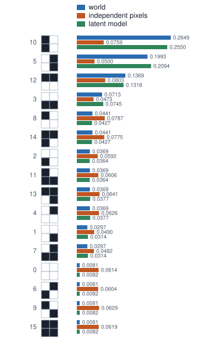

<!-- SPDX-License-Identifier: CC-BY-4.0 -->
<!-- Copyright (c) 2026 Martin Schröder <info@swedishembedded.com> -->

# What It Means to Generate

*What does it mean for a model to learn a distribution over images, and how can we sample from it?*

Draw every pixel of a $28 \times 28$ grey image independently and uniformly from the 256 codes. The result is static, and it will be static on the next draw, and on every draw after that: nothing you could call a stroke, an edge or a shape will ever appear, however many images you produce. Yet the pictures that look like something are in that set too. A handwritten digit is one of the $256^{784}$ images that the random procedure can produce, and a very specific one. What the procedure gets wrong is not the set of images it can reach but the weight it gives them: it spreads probability evenly over a space so large that the images worth having take up no measurable share.

To generate images is to put the weight where the images are. This chapter asks what that means precisely and how a program can be built around it. The answer will be a function that takes an image and returns how probable the model finds it, and a procedure that returns images in proportion to that function. The whole volume is about doing both for images of real size; this chapter does it where every number can be written down, in a world of $2 \times 2$ black-and-white pictures. There are only 16 of them, so a distribution over all of them is a table that fits on a page, every likelihood in this chapter is an exact sum, and the questions that decide whether a generative model is any good (does it see data it was not trained on, does it need a table as large as the world, can it be sampled) can be answered with arithmetic instead of with a training run.

Six earlier ideas will be used at once.

1. (Volume I, [Chapter 10](../v01-mathematics/10-probability.md), probability tables and Bayes' rule.) A part comes from machine A with probability $0.6$ and from machine B with probability $0.4$; A's parts are defective with probability $0.01$ and B's with $0.05$. Given a defective part, what is the probability that it came from B?
2. (Volume I, [Chapter 17](../v01-mathematics/17-randomness.md), sampling.) A distribution on four outcomes has probabilities $0.4, 0.3, 0.2, 0.1$. Which outcome does the uniform number $u = 0.75$ select, and why does the long-run frequency of each outcome equal its probability?
3. (Volume II, [Chapter 4](../v02-learning/04-likelihood.md), maximum likelihood.) Seven heads and three tails: what bias maximizes the likelihood of the sequence, and what is its log-likelihood?
4. (Volume II, [Chapter 4](../v02-learning/04-likelihood.md), priors as imaginary counts.) With one imaginary head and one imaginary tail added to the data, what does three heads in three flips give for the bias?
5. (Volume I, [Chapter 13](../v01-mathematics/13-information-theory.md), entropy and cross-entropy.) What is the entropy in bits of a uniform distribution on 16 outcomes? If data come from a distribution $p$ and a code is designed for a different distribution $q$, is the average code length larger or smaller than the entropy of $p$?
6. (Volume V, [Chapter 4](../v05-sequences/04-language-modeling.md), the autoregressive factorization.) How does a language model assign a probability to a whole sentence, and how does it produce one?

## Sixteen pictures and a probability for each

An image of two rows and two columns of black or white pixels has $2^4 = 16$ possible values. Number them by reading the four pixels as a binary number, top left first, so that the image with only its top left pixel bright is $1000_2 = 8$ and the one with its whole left column bright is $1010_2 = 10$. A **generative model** is, to begin with, nothing more than a rule that gives each of the 16 a probability. It earns its name by two capabilities: it can say how probable a given image is, and it can produce new images with those probabilities. Which of the two a particular model offers, and at what cost, is what separates the families of this volume.

The world that the chapter learns is the one in the table below, and it is worth saying how it was made, because the same recipe will turn out to be a model. Four bars can appear: the left column bright, the right column, the top row, the bottom row. A bar is chosen with probabilities $0.4, 0.3, 0.2, 0.1$, and then each of the four pixels is flipped (bright to dark or dark to bright) independently with probability $0.1$, as if the camera were imperfect. Two things follow at once. The pictures that look like a bar are the likely ones, and the ones that look like nothing, such as all dark or all bright, are rare. And pixels are not independent: given that the top left pixel is bright, the pixel below it is much more likely to be bright too, because a left bar is the most common explanation.

<!-- worked: generative_modeling.the_world -->
Patterns (top left, top right, bottom left, bottom right): left bar = 1010, right bar = 0101, top bar = 1100, bottom bar = 0011. Prior (0.4, 0.3, 0.2, 0.1), flip probability 0.1. Index = 8 t_l + 4 t_r + 2 b_l + b_r.

| index | image (top row / bottom row) | pixels | p(x) |
|---|---:|---:|---:|
| 0 | 00/00 | 0000 | 0.008100 |
| 1 | 00/01 | 0001 | 0.029700 |
| 2 | 00/10 | 0010 | 0.036900 |
| 3 | 00/11 | 0011 | 0.071300 |
| 4 | 01/00 | 0100 | 0.036900 |
| 5 | 01/01 | 0101 | 0.199300 |
| 6 | 01/10 | 0110 | 0.008100 |
| 7 | 01/11 | 0111 | 0.029700 |
| 8 | 10/00 | 1000 | 0.044100 |
| 9 | 10/01 | 1001 | 0.008100 |
| 10 | 10/10 | 1010 | 0.264900 |
| 11 | 10/11 | 1011 | 0.036900 |
| 12 | 11/00 | 1100 | 0.136900 |
| 13 | 11/01 | 1101 | 0.036900 |
| 14 | 11/10 | 1110 | 0.044100 |
| 15 | 11/11 | 1111 | 0.008100 |

Sum of the 16 probabilities 1.000000; entropy 3.2621 bits (0.8155 bits per pixel); the uniform distribution on 16 images has 4 bits.
<!-- /worked -->

The probabilities add to one, and the most probable image, the left bar $1010$, holds $0.2649$ of the mass. The uniform distribution on the 16 images would give each $0.0625$. The measure that separates the two is the entropy of Volume I, the average number of bits needed to name an image drawn from the distribution: $3.2621$ for this world against $4$ for the uniform one. The $0.7379$ bits of difference are the structure, the part of the picture that a model can exploit.

To make the scale of the problem visible before the tables begin, count how large the tables must get when the images are larger.

<!-- worked: generative_modeling.image_counts -->
Number of images = (levels per value)^(values per image), with log10 = values x log10(levels); the last column is the number of free parameters of a model that treats the values as independent, one probability less than the number of levels per value.

| image type | values per image | levels | number of different images | independent-value parameters |
|---|---:|---:|---:|---:|
| 2 by 2, black and white | 4 | 2 | 16 | 4 |
| 28 by 28, grey, 8 bits | 784 | 256 | about 10^1888.1 | 199920 |
| 64 by 64, colour, 8 bits | 12288 | 256 | about 10^29592.5 | 3133440 |
| 512 by 512, colour, 8 bits | 786432 | 256 | about 10^1893917.0 | 200540160 |
<!-- /worked -->

A $28 \times 28$ grey image already has about $10^{1888}$ possible values, and the table that gave every one of them a probability would need that many entries minus one. No such table can be stored, and none could be estimated even if it could, for reasons the next sections make concrete on the 16 that we do have.

## Learning the table by counting

Suppose we cannot see the world's probabilities, only $N$ images drawn from it, and we want a table $q$ that gives each image its probability. This is **density estimation**: choosing, from a family of candidate distributions $q_\theta$ with parameters $\theta$, the one that best explains data drawn from an unknown $p_{\mathrm{data}}$. For a table the parameters are the 16 entries themselves (15 free ones, since they add to one), and the criterion is the one of Volume II: choose $\theta$ to maximize the likelihood of the data, which for independent images is the product $\prod_n q(\mathbf{x}_n)$. Taking logarithms and dividing by $N$ turns the product into an average, and collecting equal images gives

$$
\frac{1}{N}\sum_{n=1}^{N} \ln q(\mathbf{x}_n) \;=\; \sum_{\mathbf{x}} \hat p(\mathbf{x})\,\ln q(\mathbf{x}),
\qquad \hat p(\mathbf{x}) = \frac{n(\mathbf{x})}{N},
$$

where $n(\mathbf{x})$ is how many of the $N$ training images equal $\mathbf{x}$ and the sum runs over all 16 images. What maximizes the right-hand side is $q = \hat p$, and there is a short proof that needs only the line that touches the logarithm at 1, $\ln t \le t - 1$. For any table $q$,

$$
\sum_{\mathbf{x}} \hat p(\mathbf{x}) \ln\frac{q(\mathbf{x})}{\hat p(\mathbf{x})}
\;\le\; \sum_{\mathbf{x}} \hat p(\mathbf{x})\Bigl(\frac{q(\mathbf{x})}{\hat p(\mathbf{x})} - 1\Bigr)
\;=\; \sum_{\mathbf{x}:\,\hat p(\mathbf{x}) > 0} q(\mathbf{x}) - 1 \;\le\; 0,
$$

so no table does better than $\hat p$, which is the multi-outcome version of "seven heads in ten flips gives $0.7$". Maximum-likelihood learning of a table is counting. The first twenty images of the dataset used throughout the chapter (drawn by the procedure of a later section from a generator with the seed printed there) show what counting finds, and what it costs.

<!-- worked: generative_modeling.the_dataset -->
Generator: the book's SplitMix64, seed 0x9e53fe4ec7f80c2c (11408741895375424556), used as the state before the first draw. Each image is one call of the ancestral sampler of the chapter: `rng.uniform()` for the pattern, then one `rng.uniform()` per pixel in the order top left, top right, bottom left, bottom right. The training set of size N is the first N of 1000 images. The first 20 images (indices): 10, 12, 5, 4, 5, 10, 7, 4, 9, 1, 7, 5, 14, 12, 0, 5, 13, 13, 10, 15.

| index | image | count in first 20 | count in 1000 | frequency in 1000 |
|---|---:|---:|---:|---:|
| 0 | 00/00 | 1 | 11 | 0.0110 |
| 1 | 00/01 | 1 | 25 | 0.0250 |
| 2 | 00/10 | 0 | 42 | 0.0420 |
| 3 | 00/11 | 0 | 74 | 0.0740 |
| 4 | 01/00 | 2 | 28 | 0.0280 |
| 5 | 01/01 | 4 | 217 | 0.2170 |
| 6 | 01/10 | 0 | 13 | 0.0130 |
| 7 | 01/11 | 2 | 28 | 0.0280 |
| 8 | 10/00 | 0 | 37 | 0.0370 |
| 9 | 10/01 | 1 | 13 | 0.0130 |
| 10 | 10/10 | 3 | 254 | 0.2540 |
| 11 | 10/11 | 0 | 39 | 0.0390 |
| 12 | 11/00 | 2 | 137 | 0.1370 |
| 13 | 11/01 | 2 | 41 | 0.0410 |
| 14 | 11/10 | 1 | 34 | 0.0340 |
| 15 | 11/11 | 1 | 7 | 0.0070 |

Images not seen among the first 20: 5 of 16; among the first 200: 1; among all 1000: 0.
<!-- /worked -->

Twenty images leave five of the sixteen unseen, and the counts of the rest are noisy: image 5 appeared 4 times, which is $0.20$, against its probability of $0.1993$ in the world, but image 3, with a probability of $0.0713$, did not appear at all. The table can be checked against the claim that counting is optimal, by scoring three candidate tables on those twenty images in bits per image, the average of $-\log_2 q(\mathbf{x}_n)$, where a lower number means the data were more probable.

<!-- worked: generative_modeling.counting_is_best -->
The first 20 training images. Mean of -log2 q(x) over them, in bits per image (lower means the data are more probable under q); sum taken in drawing order.

| candidate table q | mean -log2 q(x), training |
|---|---:|
| uniform: 1/16 each | 4.0000 |
| the world's p(x) | 4.0201 |
| counts / 20 | 3.2842 |
<!-- /worked -->

The counts table wins, as the proof says it must, and it beats the world's own table by more than 0.7 bits. It is not that the counts are a better description of the world; they are the best description of these twenty images, noise included. This particular draw happened to contain three of the four rarest images, which is why the world's table scores below the uniform one here. The comparison that matters is on images the table was not fitted to.

## A model that has never seen an image gives it probability zero

A fitted model is judged on its **held-out** likelihood: how probable it finds images drawn from the same world that were not part of the fit. Because the world is known, this can be computed exactly instead of estimated from a second dataset: the expected value of $-\log_2 q(\mathbf{x})$ over images drawn from the world is $-\sum_{\mathbf{x}} p_{\mathrm{data}}(\mathbf{x}) \log_2 q(\mathbf{x})$, the cross-entropy of Volume I. It cannot fall below the entropy $3.2621$, and its excess over the entropy is the KL divergence of Volume I, Chapter 13, from the truth to $q$. Unseen images are where the counting table breaks: its $q$ is zero there, the logarithm of zero is minus infinity, and a single image the table has never seen makes the held-out score infinite, however good the table is everywhere else.

An imagined count repairs it. The idea of Volume II, a prior that behaves like observations made before the data, gives a table whose entry for each image is $(n(\mathbf{x}) + 1)/(N + 16)$: one imaginary observation of every image, the many-outcome version of the imaginary head and tail. The two tables, and two models with structure that the next sections define, are compared as the training set grows.

<!-- worked: generative_modeling.heldout_table -->
Held-out bits = the expected -log2 q(x) over images drawn from the world, computed exactly as the sum over the 16 images in index order of p(x) times -log2 q(x) (that is what an unlimited held-out set would give). Training sets are the first N images of the dataset. Smoothed = counts plus 1 imaginary observation per image. The latent model is fitted on each prefix by 300 passes of the update of the section on the latent model, every fit started from the prior (0.25, 0.25, 0.25, 0.25) and flip probability 0.2. The entropy of the world, the best any model can do, is 3.2621 bits; the uniform table gives 4.0000.

| N | counting table, training | counting table, held-out | smoothed table, held-out | independent pixels, held-out | latent model, held-out |
|---|---:|---:|---:|---:|---:|
| 10 | 2.7219 | infinite | 3.7018 | 4.2315 | 3.5926 |
| 20 | 3.2842 | infinite | 3.6982 | 4.2242 | 3.6231 |
| 50 | 3.1223 | infinite | 3.4056 | 4.0746 | 3.3320 |
| 200 | 3.1917 | infinite | 3.3086 | 3.9834 | 3.2732 |
| 1000 | 3.2633 | 3.2737 | 3.2741 | 3.9659 | 3.2632 |
<!-- /worked -->

The counting table is infinite at $N = 10$, 20, 50 and 200, and finite only at $N = 1000$, when every image has appeared (the dataset section reported 5 unseen at 20 and 1 unseen at 200). Smoothing makes the score finite at once, but at 20 images it is $3.6982$ bits, nearly half a bit above the entropy, and it creeps toward the floor slowly: at 1000 images it is $3.2741$. Even a thousand images leave the smoothed table $0.0120$ bits above the floor, for a world of only 16 images, and a table of $10^{236}$ entries, the size of one for $28 \times 28$ black-and-white images, would need a training set larger than anything that could be stored.

There is a deeper limit that no amount of data removes. A table treats image $1010$ and image $1011$, which differ in one pixel, as unrelated outcomes; seeing the first a hundred times tells it nothing about the second. A model that generalizes must share what it learns across images, and it can only do that by having fewer parameters than there are images and by letting those parameters mean something about the picture.

## What independence cannot say

The cheapest structure is to give each pixel its own probability of being bright and to multiply: pixels are treated as independent, as in the naive Bayes of Volume II. For $2 \times 2$ images it has 4 parameters instead of 15, and for $28 \times 28$ black-and-white images 784 instead of $2^{784} - 1$.

<!-- worked: generative_modeling.parameter_counts -->
| model | 2 by 2 images | 28 by 28 black and white |
|---|---|---|
| counting table | 15 (16 probabilities that sum to 1) | 2^784 - 1, about 10^236.0 |
| independent pixels | 4 | 784 |
| latent model with K given patterns | K - 1 + 1 = 4 (prior and flip probability) | K - 1 + 1 (and the patterns) |
<!-- /worked -->

Its parameters are learned by counting too (the bright share of each pixel), and it needs a handful of images to be right about what it can be right about. What it can be right about is the trouble. All four fitted frequencies on the full training set are close to one half, the world's pixels being bright about half the time each, and a product of four such numbers gives every image a probability between $0.0473$ and $0.0803$, never far from $1/16$.

<!-- worked: generative_modeling.model_probabilities -->
Fitted on all 1000 training images. Independent-pixel frequencies (bright share of top left, top right, bottom left, bottom right): 0.5620, 0.5050, 0.4910, 0.4440. Latent model after 300 passes: prior (0.3860, 0.3162, 0.1926, 0.1051), flip probability 0.1006.

| index | image | world | counting table | independent pixels | latent model |
|---|---:|---:|---:|---:|---:|
| 0 | 00/00 | 0.0081 | 0.0110 | 0.0614 | 0.0082 |
| 1 | 00/01 | 0.0297 | 0.0250 | 0.0490 | 0.0314 |
| 2 | 00/10 | 0.0369 | 0.0420 | 0.0592 | 0.0364 |
| 3 | 00/11 | 0.0713 | 0.0740 | 0.0473 | 0.0745 |
| 4 | 01/00 | 0.0369 | 0.0280 | 0.0626 | 0.0377 |
| 5 | 01/01 | 0.1993 | 0.2170 | 0.0500 | 0.2094 |
| 6 | 01/10 | 0.0081 | 0.0130 | 0.0604 | 0.0082 |
| 7 | 01/11 | 0.0297 | 0.0280 | 0.0482 | 0.0314 |
| 8 | 10/00 | 0.0441 | 0.0370 | 0.0787 | 0.0427 |
| 9 | 10/01 | 0.0081 | 0.0130 | 0.0629 | 0.0082 |
| 10 | 10/10 | 0.2649 | 0.2540 | 0.0759 | 0.2550 |
| 11 | 10/11 | 0.0369 | 0.0390 | 0.0606 | 0.0364 |
| 12 | 11/00 | 0.1369 | 0.1370 | 0.0803 | 0.1318 |
| 13 | 11/01 | 0.0369 | 0.0410 | 0.0641 | 0.0377 |
| 14 | 11/10 | 0.0441 | 0.0340 | 0.0775 | 0.0427 |
| 15 | 11/11 | 0.0081 | 0.0070 | 0.0619 | 0.0082 |

Images whose probability in the world is below 0.01: 0, 6, 9, 15; the mass they hold is 0.0324 in the world, 0.2465 under the independent-pixel model and 0.0328 under the latent model.
<!-- /worked -->



The independent model gives the most probable image only $0.0759$ against the world's $0.2649$, and the four rarest images, which hold $0.0324$ of the world's mass between them, hold $0.2465$ of the model's. Sampled from, it produces the all-dark and all-bright pictures about as often as a bar. This is the $28 \times 28$ static of the opening in miniature: a model that knows only how bright each pixel is on average and nothing about which pixels go together. Its held-out score is $3.9659$ bits at $N = 1000$ (the last column but one of the held-out table), hardly better than the 4 bits of the uniform table; the factorization threw away exactly the structure the images have.

The missing ingredient is dependence between pixels, and there are two standard ways to put it back without paying for a table. The chain rule of probability, which Volume V used to turn a sentence into a product of next-token predictions, writes any distribution as $p(\mathbf{x}) = \prod_j p(x_j \mid x_0, \dots, x_{j-1})$ and models each factor; it is exact, and it makes the model cheap when each conditional depends on a short summary of what came before. The other is to explain the dependence by a cause that is not in the picture. The second is the subject of the next section and of most of this volume; the first returns when the sampling procedure is described.

## A hidden cause: the latent variable model

Return to the recipe that made the world: choose a bar, then flip pixels. The choice of bar is never seen in a picture, only its consequences. A variable that is part of the model and never observed is a **latent variable**; call this one $z$, taking the values $0, \dots, K - 1$ for $K = 4$ bars (a different $z$ from the logit of Volume III, and the notation page says so). The model has two kinds of parts. A prior $\pi_k = p(z = k)$ says how often each bar is chosen. Given the bar, each pixel agrees with the bar's pixel $b_{kj}$ with probability $1 - \epsilon_{\mathrm{flip}}$ and disagrees with probability $\epsilon_{\mathrm{flip}}$, independently of the other pixels:

$$
p(\mathbf{x} \mid z = k) = \prod_{j=0}^{3} \bigl(1 - \epsilon_{\mathrm{flip}}\bigr)^{[x_j = b_{kj}]}\,\epsilon_{\mathrm{flip}}^{[x_j \ne b_{kj}]},
\qquad
q_\theta(\mathbf{x}) = \sum_{k=0}^{K-1} \pi_k\, p(\mathbf{x} \mid z = k),
$$

where $[\cdot]$ is 1 when the statement inside is true and 0 otherwise. The second formula is the model's density: the probability of an image is the sum, over the hidden causes that could have produced it, of the probability of the cause times the probability of the image given the cause. It has 4 parameters (three free entries of $\pi$ and one $\epsilon_{\mathrm{flip}}$), the four bar patterns being part of the model's structure, and it is dependent by construction: given that pixel 0 is bright, a bar that lights pixel 0 is more probable, and with it the pixel below. Notice what this buys that the pixel-by-pixel product did not. The pixels are independent given $z$ and dependent once $z$ is not known, so a handful of numbers can carry correlations that a table would need fifteen to describe.

Bayes' rule turns the same ingredients into what the model believes about the cause after seeing an image. For an image with only its top left pixel bright, two bars (left and top) each differ from it in a single pixel, and the other two in three:

<!-- worked: generative_modeling.posterior_example -->
The image x = 1000 (index 8, top left bright only). Terms are summed in pattern order; p(x) = 0.044100, equal to the entry of the table of the world.

| pattern k | pixels | prior | pixels that differ | p(x \| k) | prior x p(x \| k) | posterior p(k \| x) |
|---|---:|---:|---:|---:|---:|---:|
| left bar | 1010 | 0.4 | 1 | 0.072900 | 0.029160 | 0.6612 |
| right bar | 0101 | 0.3 | 3 | 0.000900 | 0.000270 | 0.0061 |
| top bar | 1100 | 0.2 | 1 | 0.072900 | 0.014580 | 0.3306 |
| bottom bar | 0011 | 0.1 | 3 | 0.000900 | 0.000090 | 0.0020 |
<!-- /worked -->

The four terms of the fourth column's product add to $0.0441$, the density the model gives that image, and dividing each term by that sum gives the posterior $p(z = k \mid \mathbf{x})$, $0.6612$ for the left bar and $0.3306$ for the top, the prior's preference for left over top carried through unchanged. Evaluating the density took four products and a sum. Keep that in mind: for a latent variable with a continuous range of values, the sum is an integral over all of them, it has no closed form for the models that matter, and Chapter 2 is built around what to do about that.

Fitting this model by maximum likelihood is no longer counting, because the bar of a training image was never recorded. If it had been, we would count how often each bar occurred and how many pixels disagreed with it. The device that works anyway is to count with the posterior's weights: a training image counts for the left bar $0.6612$ of the time and for the top bar $0.3306$, and so on. Each pass of this **expectation-maximization** procedure computes the posterior of every training image under the current parameters, then replaces $\pi_k$ by the mean of the posterior weights of bar $k$ and $\epsilon_{\mathrm{flip}}$ by the weighted share of pixels that disagree with their bar, with divisor $4N$. In the book's pseudocode:

```text
function em_pass(images: array<int>[N, 4], patterns: array<int>[K, 4],
                 prior: array<real>[K], flip: real) -> (array<real>[K], real):
    resp = zeros(real, [N, K])                     # resp[n, k] = p(z = k | image n)
    for n in 0 .. N:
        total = 0.0
        for k in 0 .. K:
            resp[n, k] = prior[k] * pixel_probability(images[n, :], patterns[k, :], flip)
            total = total + resp[n, k]
        for k in 0 .. K:
            resp[n, k] = resp[n, k] / total
    new_prior = zeros(real, [K])
    wrong = 0.0                                    # posterior-weighted count of disagreeing pixels
    for k in 0 .. K:
        for n in 0 .. N:
            new_prior[k] = new_prior[k] + resp[n, k]
            for j in 0 .. 4:
                if images[n, j] != patterns[k, j]:
                    wrong = wrong + resp[n, k]
        new_prior[k] = new_prior[k] / N
    return (new_prior, wrong / (4 * N))
```

Here `pixel_probability(x, pattern, flip)` is the product above: the factor `1 - flip` for each pixel of `x` that equals the pattern's and `flip` for each that differs, multiplied in pixel order. The sums run over images in the order $0, \dots, N - 1$ for each bar in turn. Started from a uniform prior and $\epsilon_{\mathrm{flip}} = 0.2$ on the first 50 training images, it behaves as follows.

<!-- worked: generative_modeling.em_trace -->
The first 50 training images. Start: prior (0.25, 0.25, 0.25, 0.25), flip probability 0.2. Each pass computes the 50 x 4 posteriors, then replaces the prior by their means and the flip probability by the posterior-weighted share of pixels that differ from the pattern (divisor 4 x 50). The row for pass t shows the state before pass t (pass 0 is the start); mean bits are over the 50 training images.

| pass | mean training bits | prior | flip probability |
|---|---:|---:|---:|
| 0 | 3.5260 | 0.2500, 0.2500, 0.2500, 0.2500 | 0.2000 |
| 1 | 3.3227 | 0.2560, 0.3530, 0.2440, 0.1470 | 0.1426 |
| 2 | 3.2678 | 0.2652, 0.4102, 0.2259, 0.0986 | 0.1145 |
| 3 | 3.2612 | 0.2699, 0.4331, 0.2154, 0.0816 | 0.1073 |
| 5 | 3.2603 | 0.2728, 0.4446, 0.2088, 0.0738 | 0.1061 |
| 10 | 3.2603 | 0.2734, 0.4467, 0.2075, 0.0724 | 0.1063 |
| 20 | 3.2603 | 0.2735, 0.4467, 0.2075, 0.0724 | 0.1063 |
| 50 | 3.2603 | 0.2735, 0.4467, 0.2075, 0.0724 | 0.1063 |
| 300 | 3.2603 | 0.2735, 0.4467, 0.2075, 0.0724 | 0.1063 |
<!-- /worked -->

The mean training bits never rise at the passes shown, falling from $3.5260$ to $3.2603$, and the parameters have stopped moving to four decimals by pass 20; the run was continued to 300 passes so that no printed digit depends on where it stopped. That the training likelihood cannot decrease in a pass is a property of the update, not luck, and the reason, a lower bound on the log-likelihood that each pass raises, is the subject of Chapter 2. Here it is the evidence that a model whose density needs a sum over a hidden variable can still be fitted.

Now the comparison with the table, using the last column of the held-out table above, computed by the same procedure on each training prefix. With 10 images, the latent model scores $3.5926$ against the smoothed table's $3.7018$, 0.11 bits better, and with 50 it scores $3.3320$ against $3.4056$. With 1000 it is $0.0011$ bits above the entropy of the world, and in the last row of the probability table its numbers are close to the world's everywhere, putting $0.0328$ on the four rarest images against the world's $0.0324$. The fitted prior $(0.3860, 0.3162, 0.1926, 0.1051)$ and flip probability $0.1006$ are the world's $(0.4, 0.3, 0.2, 0.1)$ and $0.1$ recovered from 1000 images.


One caveat belongs to the comparison. The latent model won because its structure was handed the truth: the four bars and the independent flips are exactly how the world works. A model with the wrong structure would level off above the entropy however much data it saw, and the images of the rest of this volume have no known structure to hand over. Their networks have to learn the equivalent of the bars, the latent causes of an image, from the pictures alone. What carries over is the lesson that structure, a hidden cause and a few parameters that act on it, buys what data cannot: generalization to images never seen.

## Ancestral sampling

The second capability of a generative model is to produce images, and the recipe that created the world is also the procedure that does it. Draw the bar from the prior, then draw each pixel from its distribution given that bar. In general, variables are drawn one at a time, parents before children, each from its distribution given the values already drawn; this is **ancestral sampling**, and the joint distribution that results is the product of the conditionals, here $p(z)\prod_j p(x_j \mid z)$. Forgetting the bar afterwards leaves a draw from the marginal $q_\theta(\mathbf{x})$, so the images that come out follow exactly the density that the sum over the four bars defines, without that sum ever being computed.

```text
function sample_image(prior: array<real>[K], patterns: array<int>[K, 4],
                      flip: real, rng: Generator) -> array<int>[4]:
    k = sample_discrete(prior, rng)          # the cause: one rng.uniform(), first draw
    x = zeros(int, [4])
    for j in 0 .. 4:                         # then the four pixels, in order
        u = rng.uniform()                    # one draw per pixel
        if u < flip:
            x[j] = 1 - patterns[k, j]        # the pixel disagrees with the bar
        else:
            x[j] = patterns[k, j]
    return x
```

`sample_discrete` is the cumulative-table rule of Volume I, Chapter 10: with the running sum of the prior taken in order, it returns the first bar whose running sum exceeds $u$. The sampler consumes exactly five uniform numbers per image, in a fixed order, which is what makes a run reproducible: the same seed gives the same images. The three images that begin the stream with seed `seed_of("generative_modeling.ancestral")`, shown draw by draw so that a reader can follow every decision:

<!-- worked: generative_modeling.ancestral_trace -->
Generator: the book's SplitMix64, seed 0x8ce09ce308bf915f (10151286059011379551), used as the state before the first draw. Draw order for each image: one uniform for the pattern, then one for each pixel in the order top left, top right, bottom left, bottom right.

| image | u (pattern) | pattern | u (top left) | u (top right) | u (bottom left) | u (bottom right) | pixels |
|---|---:|---|---:|---:|---:|---:|---|
| 0 | 0.865532 | top bar | 0.945984 (keep) | 0.485838 (keep) | 0.034445 (flip) | 0.305573 (keep) | 1110 |
| 1 | 0.978002 | bottom bar | 0.167544 (keep) | 0.490132 (keep) | 0.579138 (keep) | 0.275126 (keep) | 0011 |
| 2 | 0.036831 | left bar | 0.895409 (keep) | 0.343900 (keep) | 0.186889 (keep) | 0.870860 (keep) | 1010 |
<!-- /worked -->

The first image is a top bar whose third pixel was flipped, because the draw $0.034445$ is below the flip probability $0.1$, and it reads $1110$; its pattern draw $0.865532$ fell in the interval $[0.7, 0.9)$ that belongs to the top bar. The proof that this sampler is right is the one for the table walk of Volume I, applied twice, and the evidence is the usual one for a sampler: count.

<!-- worked: generative_modeling.ancestral_check -->
Generator: the book's SplitMix64, seed 0x8ce09ce308bf915f (10151286059011379551), used as the state before the first draw. The 10,000 images are drawn by the same sampler, continuing the stream of the trace above (its first three images are the first three here).

| index | image | p(x) | draws of 10,000 | frequency |
|---|---:|---:|---:|---:|
| 0 | 00/00 | 0.0081 | 77 | 0.0077 |
| 1 | 00/01 | 0.0297 | 292 | 0.0292 |
| 2 | 00/10 | 0.0369 | 411 | 0.0411 |
| 3 | 00/11 | 0.0713 | 687 | 0.0687 |
| 4 | 01/00 | 0.0369 | 333 | 0.0333 |
| 5 | 01/01 | 0.1993 | 2035 | 0.2035 |
| 6 | 01/10 | 0.0081 | 90 | 0.0090 |
| 7 | 01/11 | 0.0297 | 299 | 0.0299 |
| 8 | 10/00 | 0.0441 | 418 | 0.0418 |
| 9 | 10/01 | 0.0081 | 81 | 0.0081 |
| 10 | 10/10 | 0.2649 | 2656 | 0.2656 |
| 11 | 10/11 | 0.0369 | 381 | 0.0381 |
| 12 | 11/00 | 0.1369 | 1372 | 0.1372 |
| 13 | 11/01 | 0.0369 | 335 | 0.0335 |
| 14 | 11/10 | 0.0441 | 439 | 0.0439 |
| 15 | 11/11 | 0.0081 | 94 | 0.0094 |

Largest difference between a frequency and its probability: 0.0042.
<!-- /worked -->

The frequencies follow the probabilities to within the statistical fluctuation of $10{,}000$ draws. The largest difference, $0.0042$, is image 2, drawn 411 times where 369 were expected, about 2.2 standard deviations, which among 16 images is not remarkable. One more observation about cost deserves a sentence. Sampling needed five uniform numbers and a table lookup. Evaluating the density needed a sum over the four bars. For four bars the second is also cheap, but the two do not have to be equally easy. A sampler needs only to be able to run its conditional distributions forward; a density needs the sum or integral over every hidden configuration. Models whose densities cannot be computed but whose samplers are cheap are not an oddity but the main case of the volume, and the later chapters differ largely in what they give up of the two capabilities.

The same procedure applies without a latent variable, through the chain rule. Order the pixels, draw the first from its marginal, the second from its distribution given the first, and so on. For the left bar $1010$ the factors are read off the world's table:

<!-- worked: generative_modeling.chain_rule -->
Probabilities are sums of the table of the world over the images that start with the given pixels. The factor for pixel j is the probability of the prefix through pixel j divided by the probability of the prefix before it.

| pixel j | factor | prefix probability | previous prefix | factor value |
|---|---:|---:|---:|---:|
| 0 | p(top left = 1) | 0.580000 | 1.000000 | 0.5800 |
| 1 | p(top right = 0 given top left = 1) | 0.354000 | 0.580000 | 0.6103 |
| 2 | p(bottom left = 1 given top left = 1, top right = 0) | 0.301800 | 0.354000 | 0.8525 |
| 3 | p(bottom right = 0 given top left = 1, top right = 0, bottom left = 1) | 0.264900 | 0.301800 | 0.8777 |

Product of the four factors 0.264900; p(x) of the table for image 1010 (index 10): 0.264900.
<!-- /worked -->

The four factors multiply to the table's $0.2649$. This is how a language model generates a sentence, one token at a time from its distribution given the tokens so far, and nothing prevents applying it to an image of $H \times W \times C$ values. It needs $HWC$ sequential draws, which is 12,288 steps for the $64 \times 64$ colour image of the count table and 786,432 for the $512 \times 512$ one, each step conditioned on everything before. A latent variable offers a different budget: one draw of a hidden cause, then a decoder that turns it into all the pixels at once. Both are ancestral, and which one a family uses is a design choice about where the sequential steps are spent.

## A density is not a probability

The four pixels of the world take two values. Real pixels take many, and a model that treats a pixel as a real number gives it a density, a probability per unit of the number's scale, which is a different object and does not behave like a probability. Take a model of one 8-bit pixel as a Gaussian with the mean at the code 128, the value $128/255$, and look at the density at its centre and at the probability of the code's bin, the interval of width $1/255$ around the value.

<!-- worked: generative_modeling.pixel_density -->
A Gaussian pixel model centred on the code 128, so on the value 128/255. Bin = the interval of width 1/255 centred on that value. density = 1/(sigma sqrt(2 pi)) at the centre; bin probability = erf(w / (2 sigma sqrt 2)) with w = 1/255, using the library erf; bits = -log2 of the bin probability. The uniform model on 256 codes gives 8 bits.

| sigma | density at the centre | density x 1/255 | probability of the bin | bits for the code |
|---|---:|---:|---:|---:|
| 0.25 | 1.596 | 0.0063 | 0.0063 | 7.320 |
| 0.05 | 7.979 | 0.0313 | 0.0313 | 4.999 |
| 0.01 | 39.894 | 0.1564 | 0.1555 | 2.685 |
| 0.002 | 199.471 | 0.7822 | 0.6731 | 0.571 |
| 0.0005 | 797.885 | 3.1290 | 0.9999 | 0.000 |
<!-- /worked -->

As $\sigma$ shrinks below the width of a bin, the density at the centre grows without limit ($797.885$ for $\sigma = 0.0005$), and the product density times bin width exceeds one ($3.1290$), which no probability can. The actual probability of the bin cannot exceed one, and is $0.9999$, a cost of $0.000$ bits. A density is meaningful as a ratio, or integrated over a region; for a model of discrete codes, what can be compared across models is the probability of the code, and its cost in bits. This is why image models are scored in **bits per dimension**: the total number of bits that the model's probability of an image costs, divided by the number of values $HWC$ in it. The uniform model on 256 codes costs 8 bits per dimension, any model worth having costs less, and the Gaussian with $\sigma = 0.05$ above, a model of one pixel that already believes it knows its value to within 0.05 on a scale from 0 to 1, costs $4.999$ bits for the code at its centre. The held-out numbers of the chapter's table are of the same kind: bits per image, or a quarter of that per pixel.

## Where the families go from here

The ladder of this chapter is a ladder of what each model offers. A table gives both a density and a sampler, and costs a parameter per image. A model with independent pixels gives both for a few parameters and describes nothing worth the name. A latent-variable model gives a sampler that costs one draw of the hidden cause, and a density that costs a sum over it. The volume's chapters are the continuation of that ladder to images where the cause is not a choice among four bars but a continuous vector, and where the map from cause to pixels is a neural network. The variational autoencoder of Chapter 2 keeps the latent variable and replaces the intractable sum by a lower bound that can be trained. Chapter 3 makes the cause discrete again, a short sequence of codes that an autoregressive model of the kind sketched above can predict. The adversarial models of Chapter 4 keep only the sampler: they learn a map from random numbers to images and never write a density down, so there is no held-out likelihood to report. Diffusion and flow models, Chapters 5 to 7, define the sampler as a sequence of small steps from noise to an image, and those chapters derive what a network is trained to predict at each step.

Brain's code for the volume's later chapters has two anchors. `crates/vae/src/latent.rs` packs the mean of an image's latent distribution and normalizes it on the way into the denoiser, and `crates/diffusion/src/lib.rs` is the model-agnostic core that turns a denoiser's outputs into samples, with the schedules and samplers that Chapters 5 to 7 derive. The discipline of this chapter, one fixed order of draws from one seeded generator, is what lets any of it be checked: a sample that cannot be reproduced from its seed cannot be debugged.

## Check your understanding

1. A model gives probability $0.3$ to image 10 and spreads the remaining $0.7$ evenly over the other 15 images. Using the world's probability $0.2649$ for image 10, compute its held-out bits (the 15 other images share one value of $q$, so the sum has two terms) and say whether it beats the uniform model's 4 bits and whether it can beat the world's entropy.
2. A colleague says "the counting table scored infinity on my held-out set, so the data must be broken". Explain what is probably true instead, and name two ways to make the score finite and what each assumes.
3. The independent-pixel model has the right per-pixel frequencies and the wrong held-out score. State which quantity of the data it fails to reproduce, and which feature of the world's table shows it.
4. In the latent model, $\epsilon_{\mathrm{flip}}$ is set to $0$. What does the model's density become for an image that is not exactly one of the four bars, and what does that do to maximum-likelihood fitting?
5. Find the error: "Ancestral sampling draws $z$, then $\mathbf{x}$, so the samples of $\mathbf{x}$ come from $p(\mathbf{x} \mid z)$ for the particular $z$ drawn."
6. A pixel model reports the density $400$ at the observed value of a pixel. Why is that not a probability above one, and what number would you compute instead?
7. A generative model offers a cheap sampler and no density. Which of the numbers in this chapter's held-out table can no longer be computed for it, and what could one still compute from its samples?

## Summary

A distribution over images is a function from images to probabilities (or densities) that adds up to one, and a **generative model** is a representation of such a function that can be sampled, evaluated, or both. For $2 \times 2$ black-and-white images the function is a table of 16 numbers, and everything the book has taught about estimation applies to it: maximum likelihood is counting, held-out likelihood is the honest score, an unseen image has probability zero under pure counting and an infinite loss, and imagined counts repair it. The table cannot scale, because it needs a parameter per possible image, and a model that gives each pixel its own probability scales but cannot say that pixels belong together. A latent variable restores the dependence with a handful of numbers: an unseen cause, a prior over it, and a conditional distribution of the image given it. Its density is a sum over the cause, it is fitted by counting with the posterior's weights, and it is sampled by drawing the cause first and the image second, which is ancestral sampling. When pixels are real numbers the density is not a probability, and bits per dimension is the comparable score. The next chapter replaces the four bars by a continuous latent vector and the table of conditionals by a neural network, and meets the sum that cannot be computed.

## References

- A. P. Dempster, N. M. Laird and D. B. Rubin, *Maximum likelihood from incomplete data via the EM algorithm*, Journal of the Royal Statistical Society, Series B, 1977. The iteration that counts with posterior weights.

## Exercises

1. **[Calculate]** For the world of this chapter, compute by hand the probability of image 8 (top left bright only) as the sum over the four bars of the prior times the product of the pixel factors, and check it against the table of the world.
2. **[Calculate]** A training set contains images 10 (3 times), 5 (2 times) and 0 (once). Give the counting table's probabilities, the smoothed table's (one imaginary observation per image), and the mean training bits of each.
3. **[Calculate]** For the 28 by 28 grey image, give the number of values, and the number of bits needed to name one image under the uniform model (bits per dimension times the number of values).
4. **[Calculate]** Using the chain rule on the world's table, compute $p(\text{top right} = 1 \mid \text{top left} = 1)$ and $p(\text{top right} = 1 \mid \text{top left} = 0)$ and say what they show about the dependence of the pixels.
5. **[Calculate]** For $\sigma = 0.01$ in the pixel-density table, derive the probability of the bin from the Gaussian cumulative distribution with $\Phi(a) - \Phi(-a)$, $a = w/(2\sigma)$ with $w = 1/255$, and compare it with the density times $w$.
6. **[Implement]** Reproduce `generative_modeling.the_world`: build the 16 probabilities from the bars, the prior $(0.4, 0.3, 0.2, 0.1)$ and the flip probability $0.1$, sum the four terms in bar order, and compute the entropy in bits.
7. **[Implement]** Reproduce `generative_modeling.the_dataset` and `generative_modeling.ancestral_trace`: implement SplitMix64 and `seed_of`, the five-draw ancestral sampler and the order of draws given in the chapter, and match the first 20 image indices and the three traced images.
8. **[Implement]** Reproduce `generative_modeling.heldout_table`: the counting table, the smoothed table, the independent-pixel model and the 300-pass expectation-maximization fit on each training prefix, scored by the exact cross-entropy summed over the 16 images in index order.
9. **[Implement]** Reproduce `generative_modeling.em_trace`: the pass of the chapter's pseudocode, from the stated start, with the mean training bits before each pass shown.
10. **[Implement]** Reproduce `generative_modeling.ancestral_check` and `generative_modeling.chain_rule`: 10,000 draws counted against the table, and the four conditional factors of image $1010$.
11. **[Investigate]** Replace the four bars of the latent model by only two (left and right) with everything else as in the chapter, fit it by expectation-maximization on the 1000 images and report its held-out bits. How far above the entropy does it level off, and which images does it get most wrong?
12. **[Investigate]** Change the flip probability of the world to $0.3$ and repeat the held-out comparison. Does the gap between the smoothed table and the latent model grow or shrink, and why?

## Key terms

- **generative model**: a representation of a probability distribution over data, here over images, that can be sampled to produce new data, evaluated to give the probability or density of a given image, or both. <!-- concept: generative-model -->
- **density estimation**: choosing from a family of candidate distributions the one that best explains observed data, usually by maximizing the likelihood and judging it by the likelihood of data that were held out. <!-- concept: density-estimation -->
- **latent variable**: a variable that is part of a model but never observed, whose value is a hidden cause of the data; the model's density sums or integrates it out. <!-- concept: latent-variable -->
- **expectation-maximization**: the procedure that fits a latent-variable model by repeating one pass in two halves: compute, for every training example, the posterior probability of each value of the latent under the current parameters (the expectation), then replace the parameters by the posterior-weighted averages that the counting formulas would give if the latent had been observed (the maximization); the training likelihood never falls from one pass to the next. <!-- concept: expectation-maximization -->
- **ancestral sampling**: drawing the variables of a model one at a time, parents before children, each from its distribution given the values already drawn, so that the joint draw follows the product of the conditionals. <!-- concept: ancestral-sampling -->

## Answers

**Recall questions.**

1. $P(\text{B} \mid \text{defective}) = 0.4 \cdot 0.05 / (0.6 \cdot 0.01 + 0.4 \cdot 0.05) = 0.020/0.026 = 0.7692$.
2. The running sums are $0.4, 0.7, 0.9, 1.0$, and $u = 0.75$ lies in $[0.7, 0.9)$, so the third outcome (index 2). The segments laid end to end on $[0, 1)$ have lengths equal to the probabilities, and a uniform number lands in a segment with probability equal to its length.
3. The likelihood $\theta^7(1-\theta)^3$ is maximal at $\theta = 0.7$, where the log-likelihood is $7\ln 0.7 + 3 \ln 0.3 = -2.4967 - 3.6119 = -6.1086$.
4. The estimate is $(3 + 1)/(3 + 2) = 0.8$ rather than $1$.
5. $\log_2 16 = 4$ bits. The average length with a code designed for $q$ is the cross-entropy, never smaller than the entropy of $p$, with equality only when $q = p$.
6. By the chain rule it is the product over positions of the probability of each token given the tokens before it; it produces one by drawing the first token, then the next given it, and so on, each from its conditional distribution.

**Check your understanding.**

1. The sum has two terms, $0.2649\log_2(1/0.3) + (1 - 0.2649)\log_2(15/0.7) = 3.7103$ bits. That is better than the uniform model's 4 bits (it puts extra weight on the commonest image) and worse than the entropy $3.2621$, which no model can beat; the gap is the divergence of this model from the world.
2. The set contains an image that the training set did not, and pure counting gives it probability zero, so its log is minus infinity; the data are probably fine and the model has no way to say that unseen is not impossible. The two repairs are imagined counts (assumes every image is possible, with equal prior weight) and a structured model that shares parameters across images (assumes the structure is right).
3. It reproduces the marginal frequency of each pixel and fails to reproduce the joint: the probability that pixels are bright together. The world's table shows it in the images $1010$, $0101$ and $1100$, which are the most probable, and $0000$ and $1111$, which are rare; a product of four near-half marginals gives all of them probabilities between $0.047$ and $0.080$.
4. The density is zero for any image that is not exactly a bar, so every held-out image of the other twelve has infinite loss, and a single training image of that kind makes the likelihood zero for every setting of the prior; fitting cannot proceed. The flip probability is what lets the model explain imperfect data.
5. The $\mathbf{x}$ samples are not from $p(\mathbf{x} \mid z)$ for one $z$; $z$ is drawn afresh for each sample, and discarding it leaves a draw from the marginal $\sum_k \pi_k p(\mathbf{x} \mid z = k)$.
6. A density is a probability per unit of the value's scale, so $400$ is not a probability and nothing forbids it; it says the model has put its mass within a very narrow range. What to compute is the probability of the value's bin, the integral of the density over it, which is at most 1, and from it the bits.
7. Every held-out likelihood number, since they need $q(\mathbf{x})$. From samples one can still compare their statistics with those of the data, such as pixel frequencies, but there is no likelihood to report.

**Exercises** (calculation answers).

1. $\pi_0 \cdot 0.9^3 \cdot 0.1 + \pi_1 \cdot 0.9 \cdot 0.1^3 + \pi_2 \cdot 0.9^3 \cdot 0.1 + \pi_3 \cdot 0.9 \cdot 0.1^3 = 0.4 \cdot 0.0729 + 0.3 \cdot 0.0009 + 0.2 \cdot 0.0729 + 0.1 \cdot 0.0009 = 0.02916 + 0.00027 + 0.01458 + 0.00009 = 0.0441$, the table's entry for index 8.
2. Counting: image 10 gets $3/6 = 0.5$, image 5 gets $2/6 = 0.3333$, image 0 gets $1/6 = 0.1667$, all others zero; mean training bits $= (3 \cdot 1 + 2 \cdot 1.585 + 2.585)/6 = 1.4591$. Smoothed: denominators $6 + 16 = 22$, so $4/22$, $3/22$, $2/22$ and $1/22$ for each of the 13 others; mean bits $= (3\log_2(22/4) + 2\log_2(22/3) + \log_2(22/2))/6 = (7.3782 + 5.7490 + 3.4594)/6 = 2.7644$.
3. 784 values; $784 \cdot 8 = 6272$ bits per image.
4. $p(\text{top left} = 1) = 0.58$, and $p(\text{top left} = 1, \text{top right} = 1) = 0.1369 + 0.0441 + 0.0369 + 0.0081 = 0.2260$ (images 12, 14, 13, 15), so the first is $0.2260/0.58 = 0.3897$. With top left $= 0$ the probability of that pixel pair is $0.0369 + 0.1993 + 0.0081 + 0.0297 = 0.2740$ (images 4 to 7) and $p(\text{top left} = 0) = 0.42$, so the second is $0.2740/0.42 = 0.6524$. The conditional probability changes from $0.3897$ to $0.6524$ with the value of the neighbour, so the pixels are dependent.
5. $a = (1/255)/(2 \cdot 0.01) = 0.1961$, and $\Phi(0.1961) - \Phi(-0.1961) = \mathrm{erf}(0.1961/\sqrt 2) = 0.1555$, against density times $w$ of $0.1564$; they differ because the density is not constant over the bin.
