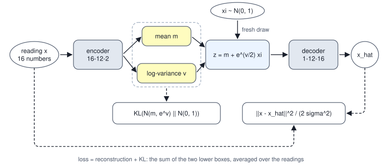

<!-- SPDX-License-Identifier: CC-BY-4.0 -->
<!-- Copyright (c) 2026 Martin Schröder <info@swedishembedded.com> -->

# Variational Autoencoders

*How can an autoencoder be made into a generator, and why does that need a bound on likelihood?*

The autoencoder of [Volume III, Chapter 13](../v03-neural-networks/13-first-models.md) on the curved sensor readings ends with a decoder that turns one number into sixteen, and it does so well: trained by the recipe given below, on 128 readings it never saw, the mean squared error per entry is $0.00245$, not far above the floor of $0.00234$ that the sensors' own noise sets ($15/16$ of its variance). A function from one number to a reading is the thing a generator needs. Feed it a number and a reading comes out. The only question is which number to feed it, and that question turns out to have no answer inside the autoencoder at all.

To see this, take the trained network and change nothing about what it computes. Multiply the code by $c$, and divide the decoder's first-layer weights by $c$ to compensate. Every reconstruction is the same to the last bit that rounding allows, so the loss is the same, so training has no way to prefer one $c$ over another. Now draw 300 numbers from a standard Gaussian, decode them, and ask how many of the decoded readings lie on the curve of readings that the sensors can produce, and how many fall in the outer half of the curve, where $|s| \ge 0.5$ for the hidden cause $s$ and where exactly half of the real readings lie.

<!-- worked: vae.rescaled_codes -->
The plain autoencoder 16-12-1-12-16 of this chapter's training recipe (below), trained on the 256 training readings of the curved data. Row c: the code multiplied by c and the decoder's input divided by c, which changes no output. Test error: mean squared error per entry on the 128 test readings. The code range is that of the 256 training readings. Draws: 300 values z ~ N(0, 1) from the generator `vae.prior` (seed 0xa588c8a5045f298f), drawn in order and used for every row, decoded as g(z / c). A decoded point is off the curve when its root-mean-square miss per sensor from the nearest point f(s) exceeds 0.1 (the sensor noise is 0.05); the nearest s is searched on a grid of step 0.005 over [-1.25, 1.25]. The data's own share with |s| >= 0.5 is 50%.

| c | test error | range of the codes | draws off the curve | draws with |s| >= 0.5 |
|---|---:|---:|---:|---:|
| 0.25 | 0.00245 | [-0.50, 0.54] | 44.7% | 82.3% |
| 1 | 0.00245 | [-2.00, 2.14] | 0.3% | 42.7% |
| 4 | 0.00245 | [-7.99, 8.58] | 0.0% | 0.3% |

Every trained number is printed with the digits that the run and four copies of it, started with the first weight changed by +1e-12, -1e-12, +3e-12 and -3e-12, share (the rule of `stable.py`); here all five agree on every digit shown.
<!-- /worked -->

At $c = 1$ the draws are mostly good: $0.3\%$ are off the curve, though only $42.7\%$ reach the outer half. At $c = 4$ the code has spread to a range of about $[-8, 8.6]$, a standard Gaussian covers the middle of it, and $0.3\%$ of the draws reach the outer half: the generator makes one kind of reading and almost never the others. At $c = \tfrac14$ the whole range of codes fits inside $[-0.5, 0.54]$, the standard Gaussian wanders far outside it, and $44.7\%$ of what the decoder returns is not a plausible reading. The test error is $0.00245$ in all three rows. The loss cannot see the difference, because the loss never asked where the codes live. That the $c = 1$ row looks acceptable is luck of the starting point: the weights begin at scale $1/\sqrt{n_{\mathrm{in}}}$, which happens to leave the codes with a spread near one.

The cure is to replace luck with a requirement. If the codes are to be drawn from a known distribution, then the training must make the codes follow it. That requires saying what the model is (a distribution over readings, with the code as a latent variable), what training should maximize (a likelihood, which cannot be computed), and what to maximize instead (a bound that can). The result is the **variational autoencoder**, and its consequences reach well beyond this toy: the encoder and decoder that move an image to and from the compact space where a modern image generator works are trained descendants of it.

The bound that does it rests on four earlier ideas.

1. (Volume III, [Chapter 13](../v03-neural-networks/13-first-models.md), the autoencoder.) What loss is an autoencoder trained on, and why does a trained code determine the span of the decoder's columns but not a particular basis of it?
2. (Volume I, [Chapter 13](../v01-mathematics/13-information-theory.md), the Kullback-Leibler (KL) divergence.) What does $D_{\mathrm{KL}}(p \,\Vert\, q)$ measure, when is it zero, and is it symmetric? Compute it in nats for $p = \mathrm{Bernoulli}(\tfrac12)$ and $q = \mathrm{Bernoulli}(\tfrac14)$.
3. (Volume I, [Chapter 11](../v01-mathematics/11-distributions.md), the Gaussian distribution.) If $\xi \sim \mathcal{N}(0, 1)$, what is the distribution of $m + \sigma\xi$?
4. ([Chapter 1](01-generative-modeling.md), latent variables.) How is a sample drawn from a latent-variable model, and what is the model's probability of an observation?

## Readings with a hidden cause

The curved readings are a latent-variable model whose truth is known, which is why they suit the argument: every answer can be checked. There are $D = 16$ sensors at positions $\mathrm{pos}_j = j/15$. A hidden cause $s$ is drawn uniformly from $[-1, 1)$, and the sensors read

$$
x_j = s\,\cos(\pi\,\mathrm{pos}_j) + 1.5\,\bigl(s^2 - \tfrac13\bigr)\sin(2\pi\,\mathrm{pos}_j) + 0.05\,n_j,
\qquad n_j \sim \mathcal{N}(0, 1),
$$

with sixteen independent noise draws per reading. Write the noiseless part as $f(s)$, so that $\mathbf{x} \mid s \sim \mathcal{N}(f(s), 0.05^2\mathbf{I})$. The data of the chapter are those of `first_models.curved_data`: the first 256 readings of the stream `first_models.curve_data` (seed `0x0927392a3e19bf27`, whose draws for one reading are $s = 2u - 1$ from one `uniform()` and then $n_0, \dots, n_{15}$ from sixteen `normal()` calls, reading after reading) train the models, readings 256 to 383 are not used, and the last 128 are the test set. The hidden cause is a one-dimensional latent variable in the sense of Chapter 1, but a continuous one, and the readings are a curve in sixteen dimensions with a small cloud of noise around it. Because the truth is a one-dimensional integral, every quantity in this chapter that involves integrating over the latent can be computed to many digits on a grid, and there is something to compare each model with.

What a model needs, to generate such readings, is the same pair of pieces that Chapter 1 named for the four bars: a prior over the latent and a conditional for the reading given the latent. Here the prior is standard Gaussian, $p(z) = \mathcal{N}(0, 1)$, and the conditional is a Gaussian centred on the output of a decoder network $g_\theta$ with a fixed noise level $\sigma_{\mathrm{x}}$:

$$
p_\theta(\mathbf{x} \mid z) = \mathcal{N}\bigl(g_\theta(z),\, \sigma_{\mathrm{x}}^2\mathbf{I}\bigr),
\qquad
q_\theta(\mathbf{x}) = \int p(z)\, p_\theta(\mathbf{x} \mid z)\, dz.
$$

The second formula is the model's density, Chapter 1's sum over the four bars with an integral in its place, and ancestral sampling works exactly as there: draw $z$ from the prior, then a reading from the conditional (or, as the plots below do, keep just the centre $g_\theta(z)$). The noise level is a choice; $\sigma_{\mathrm{x}} = 0.05$, the true sensor noise, is used throughout. The question of the previous section was where the codes should live, and this model answers it: they live where the prior puts them, and the prior is something the model has stated.

Two things are now hard. The first is the density $q_\theta(\mathbf{x})$, an integral of a network's output over the latent; for a latent of one number it is a sum over a fine grid, and for the latent of an image-sized model, with tens of thousands of entries or more, no grid is possible. The second is the posterior, what the model believes about the latent after seeing a reading, which Bayes' rule gives as

$$
p_\theta(z \mid \mathbf{x}) = \frac{p(z)\,p_\theta(\mathbf{x} \mid z)}{q_\theta(\mathbf{x})},
$$

and which has the same integral in its denominator. Training needs the first, and an encoder needs the second.

## A bound that is exact when the guess is right

Maximum likelihood would maximize $\log q_\theta(\mathbf{x})$ over the training readings, but it is out of reach. A sideways route gets close. Take any distribution $r(z \mid \mathbf{x})$ over the latent, chosen as one likes and allowed to depend on the reading. Since $q_\theta(\mathbf{x})\,p_\theta(z \mid \mathbf{x}) = p(z)\,p_\theta(\mathbf{x} \mid z)$ for every $z$, the log of the evidence is, for every $z$,

$$
\log q_\theta(\mathbf{x}) = \log \frac{p(z)\,p_\theta(\mathbf{x} \mid z)}{p_\theta(z \mid \mathbf{x})}.
$$

The left side does not depend on $z$, so averaging both sides over $z \sim r(\cdot \mid \mathbf{x})$ changes nothing on the left. On the right, multiply and divide by $r$ inside the logarithm:

$$
\begin{aligned}
\log q_\theta(\mathbf{x})
&= \mathbb{E}_{r}\!\left[\log \frac{p(z)\,p_\theta(\mathbf{x} \mid z)}{r(z \mid \mathbf{x})}\right]
 + \mathbb{E}_{r}\!\left[\log \frac{r(z \mid \mathbf{x})}{p_\theta(z \mid \mathbf{x})}\right] \\
&= \mathrm{ELBO}(\mathbf{x}) + D_{\mathrm{KL}}\bigl(r(z \mid \mathbf{x}) \,\Vert\, p_\theta(z \mid \mathbf{x})\bigr).
\end{aligned}
$$

The second term is a KL divergence, which is never negative and is zero only when its two arguments are equal. So the first term, called the **evidence lower bound** (ELBO) and written $\mathrm{ELBO}(\mathbf{x})$ above, is never above the log-likelihood, and the gap is exactly how far $r$ is from the posterior. Two readings of the same quantity matter. Splitting the logarithm of the product,

$$
\begin{aligned}
\mathrm{ELBO}(\mathbf{x}) &= \mathbb{E}_{r}\bigl[\log p_\theta(\mathbf{x} \mid z)\bigr] - D_{\mathrm{KL}}\bigl(r(z \mid \mathbf{x}) \,\Vert\, p(z)\bigr) \\
&= \log q_\theta(\mathbf{x}) - D_{\mathrm{KL}}\bigl(r(z \mid \mathbf{x}) \,\Vert\, p_\theta(z \mid \mathbf{x})\bigr).
\end{aligned}
$$

The first form can be computed whenever the decoder can be run and $r$ can be sampled from: it is how well a latent drawn from $r$ explains the reading, minus the price, in nats, of using a latent distribution different from the prior. The second form says what is being optimized: the likelihood, minus a penalty for having a poor guess at the posterior. Maximizing the bound over the decoder's parameters raises the likelihood; maximizing it over $r$ shrinks the gap.

A model small enough to solve exactly shows all of this at once. Let $z \sim \mathcal{N}(0, 1)$ and $x \mid z \sim \mathcal{N}(2z, 0.5^2)$, with a single observation $x = 1.5$. The evidence is Gaussian, $x \sim \mathcal{N}(0, 2^2 + 0.5^2)$, and the posterior is Gaussian with mean $wx/(w^2 + \sigma^2)$ and variance $\sigma^2/(w^2 + \sigma^2)$ (here $w = 2$, $\sigma = 0.5$). For $r = \mathcal{N}(m, \sigma_{\mathrm{q}}^2)$ the expected log-likelihood is $-\tfrac12\log(2\pi\sigma^2) - \bigl((x - wm)^2 + w^2\sigma_{\mathrm{q}}^2\bigr)/(2\sigma^2)$, and the two KL divergences are the Gaussian formula derived below. The table lists five guesses.

<!-- worked: vae.linear_gaussian_bound -->
Model: z ~ N(0, 1), x | z ~ N(2 z, 0.5^2), observed x = 1.5. The evidence is N(1.5; 0, 2^2 + 0.5^2), so log p(x) = -1.907104; the posterior is N(0.705882, 0.058824). Each row is a distribution q = N(m, std^2) for z. Expected log-likelihood and KL to the prior are the closed forms of the chapter, KL to the posterior is the closed Gaussian KL, and the last column is log p(x) minus the bound.

| q | m | std | E_q log p(x|z) | KL(q || prior) | bound | KL(q || posterior) | log p(x) - bound |
|---|---:|---:|---:|---:|---:|---:|---:|
| the prior | 0.0000 | 1.0000 | -12.7258 | 0.0000 | -12.7258 | 10.8187 | 10.8187 |
| the exact posterior | 0.7059 | 0.2425 | -0.7120 | 1.1952 | -1.9071 | 0.0000 | 0.0000 |
| posterior mean, std 0.5 | 0.7059 | 0.5000 | -2.2414 | 0.5673 | -2.8086 | 0.9015 | 0.9015 |
| posterior mean, std 0.1 | 0.7059 | 0.1000 | -0.3214 | 2.0567 | -2.3781 | 0.4710 | 0.4710 |
| mean 0.4, posterior std | 0.4000 | 0.2425 | -1.6764 | 1.0260 | -2.7024 | 0.7953 | 0.7953 |
<!-- /worked -->

Every row obeys the identity: the last two columns agree, and the bound is the log-evidence $-1.907104$ only in the row whose $r$ is the posterior, where the gap is zero. The row for the prior shows how bad an ignorant guess is, a bound of $-12.73$ with a gap of $10.82$ nats. The two rows that have the right mean and a wrong width show the bound penalizing both errors, too wide ($0.9015$ nats of gap) and too narrow ($0.4710$): a narrow guess explains the reading better and pays more to be so far from the prior. The ELBO is not an arbitrary surrogate. It is the likelihood minus a gap that is never negative and vanishes when the guess is the posterior.

## The encoder as a guess made in one pass

For the readings no exact posterior exists, and a separate guess $r$ for every reading would have to be found by an optimization of its own. The shortcut that gives the model its name is to let a network produce the guess. The **encoder** maps a reading to the parameters of a Gaussian over the latent, a mean $m(\mathbf{x})$ and a log-variance $v(\mathbf{x})$, so that

$$
r_\theta(z \mid \mathbf{x}) = \mathcal{N}\bigl(m(\mathbf{x}),\, \sigma_{\mathrm{q}}(\mathbf{x})^2\bigr),
\qquad \sigma_{\mathrm{q}}(\mathbf{x}) = e^{v(\mathbf{x})/2}.
$$

Predicting the logarithm of the variance keeps it positive without a constraint. Using one network for every reading, a choice called **amortized inference**, means the cost of a good guess is paid in training, and encoding a new reading afterwards is a single forward pass. The guess is Gaussian by choice, not by theorem; the gap in the bound is what that choice costs, and the trained model below measures it.

Both terms of the bound now have closed forms or cheap estimates. The KL term is a closed formula for Gaussians. For $r = \mathcal{N}(m, \sigma_{\mathrm{q}}^2)$ against the prior $\mathcal{N}(0, 1)$,

$$
\begin{aligned}
D_{\mathrm{KL}} &= \mathbb{E}_r\bigl[\log r(z) - \log p(z)\bigr] \\
&= -\tfrac12\log\bigl(2\pi\sigma_{\mathrm{q}}^2\bigr) - \tfrac12 + \tfrac12\log(2\pi) + \tfrac12\bigl(m^2 + \sigma_{\mathrm{q}}^2\bigr) \\
&= \tfrac12\bigl(m^2 + \sigma_{\mathrm{q}}^2 - 1 - \log\sigma_{\mathrm{q}}^2\bigr),
\end{aligned}
$$

where the second step uses $\mathbb{E}_r[(z - m)^2] = \sigma_{\mathrm{q}}^2$ and $\mathbb{E}_r[z^2] = m^2 + \sigma_{\mathrm{q}}^2$. In terms of the network's output, $\sigma_{\mathrm{q}}^2 = e^{v}$ and the penalty is $\tfrac12(m^2 + e^{v} - 1 - v)$ for every latent entry, summed over entries. It is zero only for $m = 0$, $v = 0$ and grows when the mean strays from zero or the width departs from one in either direction.

The reconstruction term is an expectation over $r$ that is estimated with a single draw, and with a Gaussian conditional it is the squared error of Volume III:

$$
\log p_\theta(\mathbf{x} \mid z)
= -\frac{\lVert \mathbf{x} - g_\theta(z)\rVert^2}{2\sigma_{\mathrm{x}}^2} - \frac D2 \log\bigl(2\pi\sigma_{\mathrm{x}}^2\bigr).
$$

Negating the bound, the loss of one reading and one draw $z$ is

$$
\begin{aligned}
L &= \frac{\lVert \mathbf{x} - g_\theta(z)\rVert^2}{2\sigma_{\mathrm{x}}^2} + \frac D2 \log\bigl(2\pi\sigma_{\mathrm{x}}^2\bigr) \\
&\quad + \tfrac12\bigl(m^2 + e^{v} - 1 - v\bigr),
\end{aligned}
$$

which is an autoencoder's reconstruction loss with two additions: the latent is a noisy draw, and the code is charged for departing from the prior. The fixed noise level $\sigma_{\mathrm{x}}$ is the exchange rate between the two. With $\sigma_{\mathrm{x}} = 0.05$ one unit of squared error is worth $1/(2\sigma_{\mathrm{x}}^2) = 200$ nats; a looser decoder, with a larger $\sigma_{\mathrm{x}}$, makes information in the code cheaper to give up.



Each of the two terms alone is a failure the other prevents. With only the reconstruction, the encoder would make its width as small as it likes and spread the means as far apart as it likes, and the model would be the plain autoencoder of the opening, with codes anywhere. With only the KL term, the encoder would return the prior for every reading, nothing about the reading would reach the decoder, and the best the decoder could do is the average reading. The bound is the compromise between the two, and the previous section's identity says it is a principled one.

## Gradients through a random draw

The loss contains a random draw, and training needs the gradient of its expectation with respect to the encoder's parameters, which control the distribution that the draw comes from. Written naively, the draw is a dead end for backpropagation: a sample $z$ taken from a distribution has no derivative with respect to that distribution's parameters. The standard way around it moves the randomness out of the way. Instead of sampling $z \sim \mathcal{N}(m, \sigma_{\mathrm{q}}^2)$, draw $\xi \sim \mathcal{N}(0, 1)$, a number that depends on nothing, and compute

$$
z = m + \sigma_{\mathrm{q}}\,\xi.
$$

By the closure of the Gaussian under scaling and shifting, $z$ has the right distribution; the draw $\xi$ is now an input, as constant to the derivative as the reading itself, and $z$ is a differentiable function of $m$ and $\sigma_{\mathrm{q}}$. This is the **reparameterization trick**. For any function $f$, $\mathbb{E}_{z \sim \mathcal{N}(\mu, \sigma^2)}[f(z)] = \mathbb{E}_{\xi}[f(\mu + \sigma\xi)]$, so the gradients are the expectations of ordinary derivatives:

$$
\frac{\partial}{\partial \mu}\,\mathbb{E}[f(z)] = \mathbb{E}_{\xi}\bigl[f'(z)\bigr],
\qquad
\frac{\partial}{\partial \sigma}\,\mathbb{E}[f(z)] = \mathbb{E}_{\xi}\bigl[f'(z)\,\xi\bigr].
$$

There is another estimator, and the comparison is why the trick matters. The **score-function estimator** differentiates the density instead of the sample: $\partial_\mu \mathbb{E}[f(z)] = \mathbb{E}[f(z)\,(z - \mu)/\sigma^2]$, which needs only the values of $f$ and not its derivative. Both are unbiased. They differ in variance. The test function is $f(z) = z^2$, for which $\mathbb{E}[f] = \mu^2 + \sigma^2$ and the exact gradients are $2\mu$ and $2\sigma$.

<!-- worked: vae.reparam_gradients -->
f(z) = z^2 and z ~ N(mu, sigma^2), so E f = mu^2 + sigma^2 and the exact gradients are 2 mu and 2 sigma. One sequence of 1000 draws xi ~ N(0, 1) from `vae.reparam` (seed 0x3b583fa2536b59fc) (normal calls in order, Box-Muller with the held sine partner) serves every row; z = mu + sigma xi. Reparameterized: the per-draw gradients 2 z (for mu) and 2 z xi (for sigma). Score function: f(z) (z - mu)/sigma^2 = z^2 xi/sigma and f(z) ((z - mu)^2/sigma^3 - 1/sigma) = z^2 (xi^2 - 1)/sigma. Means and standard deviations (divisor 1000) are over the 1000 per-draw values, summed in draw order.

| mu | sigma | estimator | d/dmu exact | mean | std | d/dsigma exact | mean | std |
|---:|---:|---|---:|---:|---:|---:|---:|---:|
| 1 | 0.5 | reparameterized | 2.000 | 1.977 | 0.973 | 1.000 | 0.901 | 2.338 |
| 1 | 0.5 | score function | 2.000 | 1.833 | 4.287 | 1.000 | 0.712 | 7.640 |
| 5 | 0.5 | reparameterized | 10.000 | 9.977 | 0.973 | 1.000 | 0.716 | 9.808 |
| 5 | 0.5 | score function | 10.000 | 8.300 | 51.582 | 1.000 | -1.887 | 72.356 |
<!-- /worked -->

The reparameterized per-draw gradient for $\mu$ is $2z$, whose standard deviation is $2\sigma = 1$, and the measured $0.973$ is the same whether the mean is $1$ or $5$. The score-function estimator multiplies the value $f(z)$ into the noise: its standard deviation is $4.287$ at $\mu = 1$ and $51.582$ at $\mu = 5$, because it grows with the size of $f$ and not with the sensitivity of $f$. Over 1000 draws the score-function mean at $\mu = 5$ is $8.300$ against the exact $10$, a miss of $17\%$ but only about one standard error, $51.582/\sqrt{1000} = 1.6$. The reparameterized mean is $9.977$. A gradient estimate with noise that scales with the loss itself cannot train a network whose loss is in the thousands of nats; one whose noise scales with the width of the guess can.

For the network of this chapter the backward pass through the draw is short. It is written for one reading, whose loss is $L$; a batch of $B$ readings has the mean of their losses, so every gradient of a reading below is also multiplied by $1/B$ before it is added to the parameters' gradient (the factor sits in `vae_loss` below, as `total / B`). Let $u = \partial L/\partial z$ be the gradient that arrives from the decoder (the decoder's own backward pass is that of Volume III: $\partial L/\partial \hat x_i = (\hat x_i - x_i)/\sigma_{\mathrm{x}}^2$, passed back through the layers). The latent depends on $m$ directly and on $v$ through $\sigma_{\mathrm{q}} = e^{v/2}$, for which $\partial \sigma_{\mathrm{q}}/\partial v = \sigma_{\mathrm{q}}/2$. Adding the KL term's own partial derivatives $m$ and $\tfrac12(e^{v} - 1)$,

$$
\frac{\partial L}{\partial m} = u + m,
\qquad
\frac{\partial L}{\partial v} = \tfrac12\,u\,\xi\,\sigma_{\mathrm{q}} + \tfrac12\bigl(e^{v} - 1\bigr).
$$

From $m$ and $v$ the gradient flows back through the encoder by ordinary backpropagation. In the plain autoencoder the draw is absent, $z = m$, the KL term is absent, and the same code gives $\partial L/\partial m = u$ and $\partial L/\partial v = 0$.

## Training one small enough to check

Everything above is specified by the following network and recipe. It is small enough that its gradient can be checked against finite differences, which is how a hand-written backward pass earns trust (Volume III, Chapter 6).

The encoder is $16 \to 12 \to 2$: a $12 \times 16$ weight matrix $\mathbf{W}_1$ and bias $\mathbf{b}_1$, a Gaussian error linear unit (GELU), then a $2 \times 12$ matrix $\mathbf{W}_2$ and bias $\mathbf{b}_2$ whose row 0 gives the mean $m$ and row 1 the log-variance $v$. The decoder is $1 \to 12 \to 16$: a vector $\mathbf{w}_3$ and bias $\mathbf{b}_3$ of 12 entries each, a GELU, then a $16 \times 12$ matrix $\mathbf{W}_4$ and bias $\mathbf{b}_4$. The parameters make one flat vector of 462 numbers in the order $\mathbf{W}_1, \mathbf{b}_1, \mathbf{W}_2, \mathbf{b}_2, \mathbf{w}_3, \mathbf{b}_3, \mathbf{W}_4, \mathbf{b}_4$ with each matrix row-major. The weights of each layer are drawn $\mathcal{N}(0, 1/n_{\mathrm{in}})$, layer by layer in this order, from the one generator `vae.init` (seed `0x6158ec04f6e0c37c`), and every bias starts at $0$.

```text
function encoder_forward(theta, x: array<real>[16]) -> (real, real):
    a = zeros(real, [12])
    for j in 0 .. 12:
        a[j] = gelu(dot(W1[j, :], x) + b1[j])
    return (dot(W2[0, :], a) + b2[0], dot(W2[1, :], a) + b2[1])

function decoder_forward(theta, z: real) -> array<real>[16]:
    a = zeros(real, [12])
    for j in 0 .. 12:
        a[j] = gelu(w3[j] * z + b3[j])
    xhat = zeros(real, [16])
    for i in 0 .. 16:
        xhat[i] = dot(W4[i, :], a) + b4[i]
    return xhat

function vae_loss(theta, X: array<real>[B, 16], rng: Generator) -> real:
    require B > 0, "empty batch"
    total = 0.0
    for n in 0 .. B:                                # examples in batch order
        (m, v) = encoder_forward(theta, X[n, :])
        xi = rng.normal()                           # one draw per example, in this order
        z = m + exp(0.5 * v) * xi
        xhat = decoder_forward(theta, z)
        rec = 0.0
        for i in 0 .. 16:
            rec = rec + (X[n, i] - xhat[i]) ^ 2
        rec = rec / (2 * sigma_x ^ 2) + 8 * log(2 * pi * sigma_x ^ 2)
        kl = 0.5 * (m ^ 2 + exp(v) - 1 - v)
        total = total + rec + kl
    return total / B
```

`W1`, `b1` and the other names are the slices of `theta` described above, and `sigma_x` is $0.05$; $8 = D/2$. The training loop is the one of Volume III, Chapter 13 with three changes: the loss above, no weight decay and no clipping, and a schedule of $800$ epochs of $8$ steps (batch $32$, so $6400$ steps), Adam with $(\beta_1, \beta_2, \epsilon) = (0.9, 0.999, 10^{-8})$, a rate that warms up linearly over $640$ steps to $0.03$ and then follows a cosine to $0.0003$. One in-place shuffle per epoch of the array $0, \dots, 255$ (set to the identity once, before epoch 1, and left in the order each epoch leaves it, as in Volume III, Chapter 14) comes from the generator `vae.batches` (seed `0x91bc346d502d82b7`), and the noise draws $\xi$ from the generator `vae.noise` (seed `0x562bd97e8d6393d9`), one per example in batch order, batch after batch. The plain autoencoder shares the network, the initial weights and the schedule, and differs only in using $z = m$ with no noise and no KL term, so that the two models are comparable.

The gradient check is run before any training, at the initial parameters, on the first four training readings with four fixed draws $\xi$ held constant across every perturbation:

<!-- worked: vae.vae_gradcheck -->
Initial parameters (stream `vae.init` (seed 0x6158ec04f6e0c37c)), the first 4 training readings, draws xi from `vae.gradcheck` (seed 0x74bf769840176a06) (4 normals in order, held fixed for every perturbation), central differences with step h = 1e-5 in double precision. An entry passes when |analytic - numeric| <= 1e-6 + 1e-6 max(|analytic|, |numeric|).

| model | parameters checked | entries failing the gate |
|---|---:|---:|
| variational autoencoder | 462 | 0 |
| plain autoencoder | 462 | 0 |
<!-- /worked -->

No entry of either model fails: the analytic gradient agrees with central differences to a relative $10^{-6}$ on all $462$ parameters. The check covers the reparameterized path (the entries of $\mathbf{W}_1$ and $\mathbf{W}_2$ are reached only through $m$ and $v$), which is where a sign error in $\partial L/\partial v$ would hide.

The log of the training of the variational autoencoder follows. The loss starts at thousands of nats, because an untrained decoder leaves a squared miss of about $11$ summed over the sixteen entries and each unit of squared error costs $200$ nats, and falls through zero as the decoder learns the curve:

<!-- worked: vae.training_log -->
Training readings 0 .. 255 of `first_models.curved_data`, batch 32 (8 steps per epoch, 6400 steps), Adam (0.9, 0.999, 1e-8) with no decay and no clip, rate warming up over 640 steps to 0.03 and following a cosine to 0.0003. Initial parameters from `vae.init` (seed 0x6158ec04f6e0c37c), one in-place shuffle per epoch from `vae.batches` (seed 0x91bc346d502d82b7) of the array 0 .. 255, which is set to the identity once, before epoch 1, and left in the order each epoch leaves it; the noise is one normal per example, batch by batch, from `vae.noise` (seed 0x562bd97e8d6393d9). Each cell is the mean over the epoch's 8 batches of the single-draw loss, in nats per reading.

| epoch | loss = -bound | reconstruction | KL |
|---|---:|---:|---:|
| 1 | 2161.841 | 2161.816 | 0.025 |
| 5 | 1361.524 | 1361.505 | 0.019 |
| 25 | 74.275 | 70.012 | 4.264 |
| 100 | -18.015 | -22.469 | 4.453 |
| 300 | -19.276 | -23.134 | 3.858 |
| 800 | -21.082 | -24.932 | 3.849 |
| autoencoder, epoch 800 (no KL term) | -25.382 |  |  |

Every trained number is printed with the digits that the run and four copies of it, started with the first weight changed by +1e-12, -1e-12, +3e-12 and -3e-12, share (the rule of `stable.py`); here all five agree on every digit shown.
<!-- /worked -->

At epoch 1 the KL term is $0.025$ nats, the encoder is still close to the prior, and all the loss is reconstruction. By epoch 25 the model has started to use the latent and the KL has grown to $4.264$ nats; it peaks at $4.453$ around epoch 100 and falls back to $3.849$ as the decoder gets better at using less. The reconstruction column is negative at the end because it is a negative log-density: $\frac{1}{2\sigma_{\mathrm{x}}^2}\lVert\mathbf{x} - \hat{\mathbf{x}}\rVert^2$ is about $8$ when the miss is at the noise level, and $\frac D2\log(2\pi\sigma_{\mathrm{x}}^2) = -33.2$ is subtracted from it. The plain autoencoder's last-epoch loss, $-25.382$, is lower than the variational autoencoder's reconstruction, $-24.932$, by about half a nat; with no noise in its latent and no obligation to keep the codes near a prior, it reconstructs a little better.

## What the bound says about the trained model

With a latent of one number the bound can be audited, which is not possible for a model of images. On the 128 test readings the integrals over $z$ are sums on the grid $z_k = -6 + 0.002k$ for $k = 0, \dots, 6000$. The log-evidence is a log-sum-exp over the grid,

$$
\begin{aligned}
\log q_\theta(\mathbf{x}) \approx{}& \mathrm{lse}_k\Bigl[\log p(z_k) + \log 0.002 - \frac{\lVert\mathbf{x} - g_\theta(z_k)\rVert^2}{2\sigma_{\mathrm{x}}^2}\Bigr] \\
&- \frac D2\log\bigl(2\pi\sigma_{\mathrm{x}}^2\bigr),
\end{aligned}
$$

the expected log-likelihood under $r$ is the same squared distances weighted by $r(z_k \mid \mathbf{x})\cdot 0.002$, and the KL term is the closed form. The true density of the data, $p^\star(\mathbf{x}) = \tfrac12\int_{-1}^{1} \mathcal{N}(\mathbf{x}; f(s), 0.05^2\mathbf{I})\,ds$, is a second one-dimensional integral, taken by the midpoint rule with step $0.001$. In pseudocode, the first of these is

```text
function log_marginal(theta, x: array<real>[16]) -> real:
    dz = 0.002
    terms = zeros(real, [6001])
    for k in 0 .. 6001:
        z = -6 + dz * k
        xhat = decoder_forward(theta, z)
        d2 = 0.0
        for i in 0 .. 16:
            d2 = d2 + (x[i] - xhat[i]) ^ 2
        terms[k] = -0.5 * z ^ 2 - 0.5 * log(2 * pi) + log(dz) - d2 / (2 * sigma_x ^ 2)
    return lse(terms) - 8 * log(2 * pi * sigma_x ^ 2)
```

Every number in the table is a mean over the 128 test readings, in nats per reading.

<!-- worked: vae.bound_test -->
The 128 test readings (`first_models.curved_data`, readings 384 .. 511 of the stream), the variational autoencoder after epoch 800. All integrals over z are sums on the grid z = -6, -5.998, ..., 6 (step 0.002, 6001 points): E_q by the grid weights of q(z | x), q_theta(x) by the log-sum-exp of log p(z) + log p(x | z) + log 0.002, and p*(x) = (1/2) integral over s of N(x; f(s), 0.05^2 I) by the midpoint rule with step 0.001 on [-1, 1). Values are nats per reading, means over the 128 readings.

| quantity | value |
|---|---:|
| E_q log p(x | z), the reconstruction term | 24.7673 |
| KL(q || prior) | 3.8755 |
| evidence lower bound | 20.8919 |
| log q_theta(x), the model's own log-likelihood | 21.2866 |
| gap: log q_theta(x) - bound = mean KL(q || posterior) | 0.3947 |
| log p*(x), the data's true log-density | 21.7132 |
| log p*(x) - log q_theta(x) | 0.4266 |
| smallest single-reading gap (never below 0) | 0.0018 |

Every trained number is printed with the digits that the run and four copies of it, started with the first weight changed by +1e-12, -1e-12, +3e-12 and -3e-12, share (the rule of `stable.py`); here all five agree on every digit shown.
<!-- /worked -->

The chain that the theory promises is there: the bound, $20.8919$, lies below the model's own log-likelihood, $21.2866$, which lies below the data's true log-density, $21.7132$. The smallest of the 128 single-reading gaps is $0.0018$, so the inequality holds for every reading and not only on average, as an independent integration should find. The total shortfall of the bound from the truth, $0.8213$ nats per reading, splits into two parts that mean different things. The first, $0.3947$, is the gap of the bound: it is how far the encoder's Gaussian guess is from the decoder's true posterior, averaged over the readings, and a better encoder could remove it without touching the decoder. The second, $0.4266$, is how far the learned model is from the data: its log-likelihood is below the truth, which on the test set is an estimate of the KL divergence from the data distribution to the model. How much of it is the shape of the prior (a bell) against the hidden cause (uniform), and how much is the limited width of a decoder of $12$ hidden units, this audit does not say.

The KL term deserves a second look, because it is where the model has to say how much the code carries. Averaged over the readings the penalty is $3.8755$ nats, and it splits into two pieces with different meanings. Let $\bar r(z) = \frac1N\sum_n r(z \mid \mathbf{x}_n)$ be the **aggregate posterior**, the distribution of codes when a reading is chosen at random and encoded. Then for each reading, $\log\frac{r}{p} = \log\frac{r}{\bar r} + \log\frac{\bar r}{p}$, and averaging over readings and over $z \sim r$ gives

$$
\begin{aligned}
\frac1N\sum_n D_{\mathrm{KL}}\bigl(r(z \mid \mathbf{x}_n) \,\Vert\, p(z)\bigr)
&= \underbrace{\frac1N\sum_n D_{\mathrm{KL}}\bigl(r(z \mid \mathbf{x}_n) \,\Vert\, \bar r(z)\bigr)}_{I} \\
&\quad + D_{\mathrm{KL}}\bigl(\bar r(z) \,\Vert\, p(z)\bigr).
\end{aligned}
$$

The first part, $I$, is the mutual information of Volume I, Chapter 13 between the reading and its code: how much knowing the code narrows down the reading. The second is the mismatch between the distribution of codes and the prior, which is the quantity that matters for generation: samples are drawn from the prior, and the decoder has been trained on codes from $\bar r$. The identity can be tested on the grid.

<!-- worked: vae.where_kl_goes -->
The same 128 test readings and the same grid. The aggregate posterior is the equal mixture of the 128 encoder distributions q(z | x_n), its density taken on the grid; KL(aggregate || prior) and the mutual information I = mean over n of KL(q(z | x_n) || aggregate) are sums over the grid.

| mean KL(q || prior) | KL(aggregate || prior) | I | KL(aggregate || prior) + I |
|---|---:|---:|---:|
| 3.8755 | 0.2612 | 3.6142 | 3.8755 |

| mean of the encoder means | variance of the aggregate posterior | mean encoder variance e^v |
|---|---:|---:|
| -0.1887 | 1.1866 | 0.00071 |

Every trained number is printed with the digits that the run and four copies of it, started with the first weight changed by +1e-12, -1e-12, +3e-12 and -3e-12, share (the rule of `stable.py`); here all five agree on every digit shown.
<!-- /worked -->

The two parts add to the mean KL, to the digits shown: $3.6142 + 0.2612 = 3.8754$ against $3.8755$ (rounding). Almost all of the penalty is information. The code carries $3.6142$ nats about the reading, out of at most $\log 128 = 4.852$ nats that 128 distinguishable readings could carry, and only $0.2612$ nats are mismatch with the prior. That 0.26 nat is what drawing from the prior instead of from $\bar r$ costs, and it is visible: the aggregate posterior has a mean of $-0.1887$ and a variance of $1.1866$, where the prior has $0$ and $1$.

## The latent space and its scale

The **latent space** of a variational autoencoder is the space of codes $z$ together with the structure the training gave it: a known prior that says where codes are drawn from, an encoder that maps readings into it, and a decoder that maps every point of it, not only the points that readings were encoded to, back to a reading. Each part of the definition is needed. A latent space without the prior is the unscaled space of the opening, where the generator's inputs are anywhere. A latent space whose decoder works only on the encoded points has holes. The figure shows the one-number latent of the trained model. The line is the decoder: for every $z$ it gives the point of the curve nearest to the decoded reading, expressed as a hidden cause $s$. The dots are the 128 test readings placed where the encoder puts them, at their true $s$, and they lie along the line, so that the encoder and decoder are inverse to each other where the readings are. The dashed bell is the prior, the density from which a generator draws.


The line continues beyond the points, to $\pm 4$, where the prior has almost no mass (it is flat at $\pm 1.25$ only because the search for the nearest point of the curve stops there); a decoder is defined everywhere, and its extrapolation is not trained on. Generating from the prior, and from the plain autoencoder with the same draws, is the test of the opening again:

<!-- worked: vae.generation -->
300 draws z ~ N(0, 1) from `vae.prior` (seed 0xa588c8a5045f298f) (the same draws for both models, in order), decoded. Off the curve: root-mean-square miss per sensor above 0.1. The share with |s| >= 0.5 is 50% in the data. Miss: the mean root-mean-square miss per sensor to the nearest point of the curve (the sensor noise itself is 0.05).

| model | draws off the curve | draws with |s| >= 0.5 | mean miss |
|---|---:|---:|---:|
| plain autoencoder, z ~ N(0, 1) | 0.3% | 42.7% | 0.0082 |
| variational autoencoder, z ~ N(0, 1) | 0.0% | 42.7% | 0.0081 |

Every trained number is printed with the digits that the run and four copies of it, started with the first weight changed by +1e-12, -1e-12, +3e-12 and -3e-12, share (the rule of `stable.py`); here all five agree on every digit shown.
<!-- /worked -->

The numbers are close. For the plain autoencoder $z \sim \mathcal{N}(0, 1)$ works about as well as for the variational one, because the plain model's codes (range $[-2.00, 2.14]$) happen to have a spread near one, as the first table showed. Both models place $42.7\%$ of the draws in the outer half of the curve, against $50\%$ of the data. The bins show where the missing draws are:

<!-- worked: vae.generation_bins -->
The 300 draws z ~ N(0, 1) of `vae.prior` (seed 0xa588c8a5045f298f), decoded by each model; counts of the nearest point of the curve in five bins of s of width 0.4, and the count that falls outside [-1, 1) (the training data never do). The nearest point is searched on the grid s = -1.25 + 0.005 k, k = 0 .. 500, with s computed in 64-bit floats as written and the first minimum of the squared distance kept on a tie; a draw is put in bin floor((s + 1) / 0.4) if -1 <= s < 1, so the edges -0.2, 0.2 and 0.6, which are nodes of the grid, go by the float: -0.2 (stored as -0.19999999999999996) and 0.6 (0.6000000000000001) fall in the bin on their right, 0.2 (0.19999999999999996) in the bin on its left.

| draws from | [-1, -0.6) | [-0.6, -0.2) | [-0.2, 0.2) | [0.2, 0.6) | [0.6, 1) | outside |
|---|---:|---:|---:|---:|---:|---:|
| plain autoencoder | 49 | 61 | 73 | 67 | 40 | 10 |
| variational autoencoder | 46 | 50 | 81 | 73 | 44 | 6 |
| the data (uniform s) | 60 | 60 | 60 | 60 | 60 | 0 |

Every trained number is printed with the digits that the run and four copies of it, started with the first weight changed by +1e-12, -1e-12, +3e-12 and -3e-12, share (the rule of `stable.py`); here all five agree on every digit shown.
<!-- /worked -->

A bell-shaped prior over a uniform cause puts too many draws in the middle, in both models: the decoder stretches the bell onto a line, and only partly. The variational model has no advantage here that the plain one lacks. What it has is a defined target and a measure of how well that target is hit: the 0.2612 nats of the previous section, which exist for the variational model and do not exist for the plain one. Interpolation tells the same story of a smooth code, for both models:

<!-- worked: vae.interpolation -->
The test readings with the smallest and the largest hidden cause: reading 68 (s = -0.9869) and reading 43 (s = 0.9993). Each model encodes both to the mean of its encoder distribution (the code, for the plain autoencoder), z(t) = (1 - t) z_a + t z_b is decoded, and the nearest point of the curve is searched on a grid of step 0.005. Both columns are from the base run of each model.

| t | VAE z | VAE s | VAE miss | AE z | AE s | AE miss |
|---|---:|---:|---:|---:|---:|---:|
| 0 | 2.246 | -0.995 | 0.0172 | 2.188 | -0.990 | 0.0205 |
| 0.25 | 1.130 | -0.670 | 0.0085 | 1.135 | -0.685 | 0.0079 |
| 0.5 | 0.014 | -0.015 | 0.0058 | 0.082 | -0.115 | 0.0055 |
| 0.75 | -1.101 | 0.625 | 0.0082 | -0.971 | 0.555 | 0.0089 |
| 1 | -2.217 | 1.000 | 0.0216 | -2.023 | 1.000 | 0.0202 |
<!-- /worked -->

Walking from the code of the reading with the smallest hidden cause to the code of the one with the largest, the decoded readings move along the curve monotonically in both models, and each stays within about $0.02$ of the curve in root-mean-square miss per sensor. A one-dimensional code between two codes passes through every code in between; smoothness of the decoder along the line is a property of a network of this kind, and it is what turns a path in the latent space into a path of readings.

The two models part over the lesson of the first table: the bound cares about scale. Multiply the variational model's code by $c$ as before (the encoder's mean and standard deviation by $c$, the decoder's input by $1/c$). The decoder still sees what it saw, the reconstruction term does not move, and the only term to change is the KL, now $\tfrac12\bigl(c^2(m^2 + e^{v}) - 1 - \log(c^2 e^{v})\bigr)$ averaged over readings. Its derivative with respect to $c$ is $cA - 1/c$ for $A = \overline{m^2 + e^{v}}$, which vanishes at $c^\star = 1/\sqrt{A}$: the KL is lowest when the second moment of the codes is exactly one.

<!-- worked: vae.elbo_rescale -->
The variational autoencoder of the training log, test readings. Row c: the encoder's mean and standard deviation (e^(v/2)) are multiplied by c and the decoder's input divided by c, so the decoder sees exactly what it saw, the reconstruction term does not move, and only the KL term changes: KL_c = (1/2)(c^2 (m^2 + e^v) - 1 - log(c^2 e^v)), averaged over the readings. c* = 1/sqrt(mean(m^2 + e^v)) makes the derivative of the mean KL_c with respect to c zero. The last two columns repeat the generation test of the chapter, decoding g(z / c) for the 300 draws of `vae.prior` (seed 0xa588c8a5045f298f).

| c | reconstruction term | KL | bound | draws off the curve | draws with |s| >= 0.5 |
|---|---:|---:|---:|---:|---:|
| 0.25 | 24.7673 | 4.6888 | 20.0785 | 41.0% | 83.0% |
| 0.5 | 24.7673 | 4.1103 | 20.6571 | 8.3% | 66.0% |
| 1 | 24.7673 | 3.8755 | 20.8919 | 0.0% | 42.7% |
| 0.9045 (c*) | 24.7673 | 3.8647 | 20.9026 |  |  |
| 2 | 24.7673 | 5.0157 | 19.7517 | 0.0% | 10.7% |
| 4 | 24.7673 | 11.6560 | 13.1113 | 0.0% | 0.3% |

Every trained number is printed with the digits that the run and four copies of it, started with the first weight changed by +1e-12, -1e-12, +3e-12 and -3e-12, share (the rule of `stable.py`); here all five agree on every digit shown.
<!-- /worked -->

The reconstruction term is $24.7673$ in every row and the bound falls on both sides of $c = 1$: from $20.8919$ to $20.6571$ at $c = 0.5$, to $19.7517$ at $c = 2$, and to $13.1113$ at $c = 4$, where the plain autoencoder's loss would not have moved at all. The best scale, $c^\star = 0.9045$ (from $A = 1.1866 + 0.1887^2$), improves the bound by only $0.0107$ nats, so the trained model is within a hundredth of a nat of its best rescaling. The last two columns repeat the generation test: the rescalings the bound punishes are the ones that make sampling go wrong, as in the opening. The bound is a criterion that sees the thing the autoencoder's loss was blind to.


## What a trained autoencoder is to an image generator

Image generators use exactly these two networks, scaled up, in a different role. A convolutional encoder takes an image of $3 \times H \times W$ numbers and returns the mean and the log-variance of a Gaussian over a latent of $C \times H/8 \times W/8$ numbers, so that every $8 \times 8$ block of pixels becomes one position holding $C$ numbers; a decoder returns the image. The denoiser of the chapters to come works entirely on the latent, which is far smaller. For a $1024 \times 1024$ image the table counts what it saves.

<!-- worked: vae.compression_table -->
A 1024 x 1024 RGB image has 3,145,728 numbers; each autoencoder halves the side three times (a factor of 8 per side, 64 positions per latent position).

| autoencoder | latent channels | latent shape | latent numbers | numbers per latent number |
|---|---:|---:|---:|---:|
| a 4-channel SDXL-style autoencoder | 4 | 4 x 128 x 128 | 65,536 | 48 |
| a 16-channel autoencoder | 16 | 16 x 128 x 128 | 262,144 | 12 |
| a 32-channel autoencoder (packed to 128 channels at half the side) | 32 | 32 x 128 x 128 | 524,288 | 6 |
<!-- /worked -->

The crate `crates/vae` holds these two networks. `crates/vae/src/decoder.rs` builds the decoder as a recorded sequence of kernels for a fixed latent size and uploads the weights once: a $1 \times 1$ mixing convolution when the configuration has one, a $3\times3$ convolution into the widest channel count, a middle block (a residual block, a self-attention layer, a residual block), then up-blocks, each of three residual blocks followed, in all but the last, by a nearest-neighbour doubling and a convolution, and finally a group normalization, a sigmoid linear unit (SiLU) and a convolution to three channels. `VaeEncoder` is its mirror: the same blocks in the order image to latent, with each down-block but the last ending in a stride-2 convolution, and an output of `2 * latent_channels` channels, the first `latent_channels` of which are the mean and the next the log-variance. `crates/vae/src/config.rs` carries the architecture as a `VaeConfig` read from the checkpoint's own configuration file: the latent width, the channel schedule `[128, 256, 512, 512]` (three halvings, hence the factor of eight), the number of residual blocks per level, and the group-normalization settings. The blocks are not private to the autoencoder. `crates/vae/src/blocks.rs` is a shared builder that the discrete-code autoencoder of the next chapter is built from as well, parameterized by the names a checkpoint gives its tensors (commit `cca1c341d` moved the builder there from the decoder so that the second architecture would not copy it).

What the crate does not contain is the KL term or any draw of $\xi$. It has no loss and no sampling, because the checkpoints it loads were trained elsewhere; its encoder returns the moments, and the pipelines that encode an image call `VaeEncoder::encode_mean`, which returns only the first half. Using the mean alone loses almost nothing. In the trained toy model the mean encoder variance is $0.00071$ (a standard deviation of about $0.027$) against codes that spread over a range of about five, so the encoder is nearly deterministic and the mean is the whole message; the noise during training is what made the decoder robust to small errors in the code, and at use time it has done its work. The moments it returns are raw, with no scaling or shift applied.

Two conventions then put the raw mean on the scale that the denoiser expects. For the 16-channel and the 4-channel autoencoders, the denoiser sees a scalar affine map of the mean, $z_{\mathrm{den}} = (z - c_{\mathrm{shift}})\,c_{\mathrm{scale}}$, and the inverse before decoding, $z = z_{\mathrm{den}}/c_{\mathrm{scale}} + c_{\mathrm{shift}}$. In brain the Z-Image path uses `VAE_SCALE` $= 0.3611$ with shift $0.1159$ (`crates/s3dit/src/pipeline.rs`), the FLUX.1 path applies the model's own pair in `unpack_tokens` (`crates/flux1/src/pipeline.rs`), and the Stable Diffusion XL (SDXL) path divides by $0.13025$ before decoding (`crates/sdxlunet/src/pipeline.rs` reads `scaling_factor`, and the constant appears in `crates/supir/src/pipeline.rs`). Without a KL term of weight one, nothing in training pins the scale of the code, and these factors are the $c$ of the table above, fixed after training and applied by hand; brain does not compute them but takes them from the checkpoint's configuration (on the Z-Image path as constants that copy its values). Latent-diffusion autoencoders are trained with a very small weight on the KL term (Rombach and others, 2022), so that the penalty regularizes the code without fixing its scale, which is why a stored factor is needed at all; in the toy, with a KL weight of one, $c^\star$ is $0.9045$, close to one.

FLUX.2 does not use a scalar. Its autoencoder has $32$ latent channels, and `crates/vae/src/latent.rs` finishes the job in two steps: a $2 \times 2$ pixel-unshuffle that turns a latent $[32, H/8, W/8]$ into $[128, H/16, W/16]$ by making the four pixels of every $2\times2$ patch four channels (packed channel $= 4c + 2p_i + p_j$ for patch row $p_i$, column $p_j$), and then a per-channel standardization $(z - \mu)/\sqrt{\sigma^2 + 10^{-4}}$ with the running statistics $\mu$, $\sigma^2$ of a frozen batch-normalization layer stored in the checkpoint (`bn.running_mean`, `bn.running_var`), no learned gain or shift. The patch is the denoiser's token, which is why the packing is here: for a $1024\times1024$ image a token is $128$ numbers, and there are $64 \times 64 = 4096$ of them. The worked case is the hand-computed test of the crate (`pack_channel_order`), followed by a map that shows where every pixel goes.

<!-- worked: vae.latent_packing -->
One channel, a 2 x 2 latent holding 1, 2, 3, 4 (one patch), eps = 1; the four packed channels take the four values of the patch in row-major order and are normalized by their own statistics. Unpacking multiplies and adds back.

| packed channel | patch position (row, col) | value | mean | variance | sqrt(variance + 1) | packed | unpacked |
|---|---:|---:|---:|---:|---:|---:|---:|
| 0 | (0, 0) | 1 | 0.5 | 3 | 2 | 0.250000 | 1 |
| 1 | (0, 1) | 2 | 0 | 8 | 3 | 0.666667 | 2 |
| 2 | (1, 0) | 3 | -1 | 0 | 1 | 4.000000 | 3 |
| 3 | (1, 1) | 4 | 2 | 15 | 4 | 0.500000 | 4 |

One channel, a 4 x 4 latent holding 0 .. 15 in row-major order, statistics (0, 1) and eps = 0: the four packed channels are the four 2 x 2 maps that take every second pixel.

| packed channel | patch position | packed 2 x 2 map (top row / bottom row) |
|---|---|---:|
| 0 | (0, 0) | 0 2 / 8 10 |
| 1 | (0, 1) | 1 3 / 9 11 |
| 2 | (1, 0) | 4 6 / 12 14 |
| 3 | (1, 1) | 5 7 / 13 15 |
<!-- /worked -->

The packing loses nothing and is exactly invertible: unpacking multiplies by $\sqrt{\sigma^2 + \epsilon}$, adds $\mu$ and shuffles the pixels back, and the last column of the first table recovers the input. Both the packed layout and the statistics are part of the model: using the other convention (a scalar affine on a packed latent, or the packing without the statistics) produces a latent the denoiser has never seen and does not fail loudly. The module documentation of `crates/flux1/src/pipeline.rs` records exactly that hazard, in the other direction: FLUX.1's autoencoder has no such statistics, and reusing `vae::latent::pack` for it "would silently apply the wrong normalization".


## Checking an autoencoder against its reference

A decoder with fifty million parameters and no wrong digit that anyone can see is the situation in which a gate matters. The crate's parity tests (`crates/vae/tests/it/decode_parity.rs`, `encode_parity.rs`, `flux2_parity.rs`, `sdxl_decode_parity.rs`) load the checkpoint, run a fixed input through brain and compare with a golden output from the reference implementation of the same architecture. The Z-Image and SDXL decodes must reach a cosine similarity of at least $0.999$ and a peak signal-to-noise ratio (PSNR) of at least $40$ dB; the Z-Image encode, a cosine of at least $0.999$ on the moments and the mean and a largest absolute difference within $5\%$ of the golden range; the FLUX.2 encode and decode, a cosine of at least $0.9999$; and the FLUX.2 packing, a largest absolute difference below $10^{-4}$. The additional PSNR and absolute-difference gates are there for a reason recorded as knowledge #2: a cosine is the same for an output and for $1.05$ times that output, so it cannot see a dropped scale. All of the tests skip when a checkpoint is not present, which turns out to matter (knowledge #1).

The story is in commit `a38dd31c9`. `VaeConfig::from_json` read two keys, `use_quant_conv` and `use_post_quant_conv`, and defaulted both to false when a configuration omitted them. The reference constructor defaults both to true, and a configuration file contains only the keys that override a default, so the whole SDXL family, which omits them, meant true and received false: SDXL's $1\times1$ `post_quant_conv`, a mixing of the four latent channels, was dropped from every decode. The code today states the correct default and the reason (`crates/vae/src/config.rs`, the comment above `use_quant_conv`), and the episode is knowledge #16. The commit message reports the symptom, which is worth taking seriously because of what it says about verification: the output stayed in a plausible range of $[-1, 1]$ and kept the structure of the picture, because the structure is carried by the spatial layout of the latent, while the mixing that was missing decides the colour. The reported cosine with the reference was $-0.03$, and the check that had been run on the image, the mean gradient magnitude, is passed by any textured picture. The existing parity test covered the 16-channel model only and skipped without its weights, so no decode on the machine was gated at all. The fix added `sdxl_decode_parity.rs`, which asserts the four-channel shape (`latent_channels == 4`), the cosine and the PSNR; the commit message reports a change from cosine $-0.034098$ to $1.000000$ on the golden fixture, and the lesson is general: a quantity that looks fine in every summary statistic can be uncorrelated with the right answer, and only a comparison to an independent computation is evidence.

The encoder has its own small verification story. The reference's downsampling pads the right and bottom of the map with one zero and applies a stride-2 convolution without padding. `Builder::conv_down` in `crates/vae/src/blocks.rs` gets the same result without a pad operation by asking for the output size $h/2 \times w/2$ with zero padding: the convolution kernels check their bounds, and the taps that fall past the bottom and right edges read zero, which is the asymmetric pad (commit `a609d5274`, which added `VaeEncoder` to support image-conditioned generation, reports a cosine of $1.000000$ and a largest absolute difference of $5\times10^{-5}$ against the reference, and the Z-Image encode test gates it at cosine $0.999$).

Last, the memory. A decoder's cost is mostly its activations: they scale with the output image and not with the weights. Counting the bytes one buffer holds at each of the four levels of resolution gives `level_bytes_per_pixel` in `crates/vae/src/decoder.rs`, and the footprint, as the crate estimates it, is the weights plus eleven such sets live at once plus a fixed scratch of $768$ MiB. The table reproduces the estimate from the architecture, parameter by parameter.

<!-- worked: vae.decoder_footprint -->
Channels (128, 256, 512, 512), so one live 32-bit buffer at every resolution level costs 4 (128 + 256/4 + 512/16 + 512/64) = 928 bytes per output pixel; 11 such sets are live at once; the decoder has 49,620,259 parameters (189.3 MiB in 32-bit floats); a fixed scratch of 768 MiB is added. GiB = 2^30 bytes. The parameter count is that of this decoder, input to output: a 1x1 convolution on the 32 latent channels, a 3x3 convolution from 32 to 512 channels, a middle block (resnet, attention, resnet) at 512 channels, then four up levels with channels 512, 512, 256, 128 (the channel list reversed), each of 3 resnets (layers + 1, layers = 2), the first three levels followed by a nearest-neighbour doubling and a 3x3 convolution at the level's channels, and finally a group norm and a 3x3 convolution from 128 to 3 channels. A resnet from ci to co channels is group norm (2 ci scale and shift), 3x3 convolution, group norm (2 co), 3x3 convolution, plus a 1x1 shortcut convolution when ci differs from co. An attention block is a group norm (2 c) and four 1x1 convolutions (query, key, value, output) on c channels, single head. A convolution from ci to co channels with a k x k kernel has co ci k^2 weights and co biases. These terms are summed to the total above; nothing else carries parameters.

| output image | output pixels | activations (GiB) | total (GiB) |
|---|---:|---:|---:|
| 512 x 512 | 262,144 | 2.49 | 3.43 |
| 1024 x 1024 | 1,048,576 | 9.97 | 10.90 |
| 2048 x 2048 | 4,194,304 | 39.88 | 40.81 |
<!-- /worked -->

A $1024 \times 1024$ decode asks for $10.90$ GiB and a $2048 \times 2048$ one for $40.81$ GiB, which no card holds; the commit that introduced tiling (`884caf972`) quotes the same $10.9$ and $40.8$ GiB. `crates/vae/src/tiled.rs` decodes in overlapping tiles of $512$ pixels so that the peak is one tile's, the $3.43$ GiB of the first row, however large the image. The subtle part is that a tile is not the image. A group normalization divides by the mean and variance of whatever it is handed, and a tile is handed different content from its neighbour, so a naive tiled decode comes out with a brightness shift across each tile's whole interior, not at the seams, where no overlap blend can touch it. The remedy is to run the cover twice, the first time only to collect each normalization's statistics from every tile and pool them as if they were the whole image's, and the second time to give every tile the pooled values. Pooling must combine variances correctly, which the worked case shows on two tiles:

<!-- worked: vae.pooled_statistics -->
A signal of 10 values cut into tile A = (1, 2, 3, 4) and tile B = (3, 6, 9, 12, 15, 18). A norm treats the values it is handed as one group: mean, variance with divisor n, then (x - mean)/sqrt(variance + 10^-6). The pooled mean is the count-weighted mean; the pooled variance is the weighted mean of (variance + mean^2) minus the square of the pooled mean.

| group | count | mean | variance |
|---|---:|---:|---:|
| tile A | 4 | 2.5000 | 1.2500 |
| tile B | 6 | 10.5000 | 26.2500 |
| whole signal | 10 | 7.3000 | 31.6100 |
| pooled from the tiles | 10 | 7.3000 | 31.6100 |

| value | normalized by its own tile | normalized by the whole signal |
|---|---:|---:|
| 1.0 | -1.3416 | -1.1205 |
| 2.0 | -0.4472 | -0.9427 |
| 3.0 | 0.4472 | -0.7648 |
| 4.0 | 1.3416 | -0.5870 |
| 3.0 | -1.4639 | -0.7648 |
| 6.0 | -0.8783 | -0.2312 |
| 9.0 | -0.2928 | 0.3024 |
| 12.0 | 0.2928 | 0.8360 |
| 15.0 | 0.8783 | 1.3696 |
| 18.0 | 1.4639 | 1.9031 |
<!-- /worked -->

The pooled mean and variance equal those of the whole signal, $7.3$ and $31.61$, exactly, because a variance is a mean of squares minus the square of the mean and both pieces pool as weighted means; and normalizing by a tile's own statistics, as in the first of the two columns, puts the value $3$ at $0.4472$ in tile A and $-1.4639$ in tile B, while the whole signal has it at $-0.7648$ in both. The code accumulates in double precision because the subtraction of two similar large numbers is where single precision loses its digits (`GlobalGn` in `tiled.rs`). The module documentation records the measured effect on the real 32-channel autoencoder for one $1024\times1024$ decode in nine tiles: $38.5$ dB against the whole-image decode with the pooled statistics and $26.5$ dB with each tile's own, the autoencoder's own round-trip reconstruction of the image being $38.6$ dB. That measurement needs the checkpoint and cannot be repeated from the book. What the test suite asserts without one is the structure: a cover that yields one tile is bit-identical to the whole-image decode, and the pooled statistics recover most of the discrepancy of per-tile statistics on a small random network (`crates/vae/tests/it/tiled_parity.rs`).

## Check your understanding

1. A colleague says "with a flexible enough encoder family, the bound can exceed the log-likelihood, because the bound has a free distribution $r$ to tune." Find the error, using the identity of the second section.
2. The trained encoder returns $m = 0$ and $v = 0$ for every reading. What is the KL term, what does the decoder receive, and what does the best decoder output?
3. Predict the effect on the optimum of doubling $\sigma_{\mathrm{x}}$ from $0.05$ to $0.1$, with everything else unchanged: which term of the loss gets lighter, and does the code carry more or less information about the reading?
4. Find the error: "the reparameterization trick makes the sample $z = m + \sigma_{\mathrm{q}}\xi$ deterministic, so the variational autoencoder is a deterministic network and its loss needs no expectation."
5. Explain why the loss of the plain autoencoder is unchanged by multiplying the code by $c$ and dividing the decoder's first layer by $c$, and where in the bound of the variational autoencoder the scale $c$ is detected.
6. A configuration file for a new autoencoder does not contain the key `use_post_quant_conv`. Which value should a loader assume, and why does the opposite assumption fail silently and not with an error?
7. A tiled decode uses each tile's own group-normalization statistics. Why does the error appear as a brightness change over a tile's interior rather than as a seam, and why does blending the overlaps not remove it?

## Summary

An autoencoder reconstructs; it does not generate, because its loss is blind to where its codes live and so gives no distribution to draw them from. Making the code a latent variable with a stated prior turns the decoder into a generative model, $q_\theta(\mathbf{x}) = \int p(z)\,p_\theta(\mathbf{x} \mid z)\,dz$, and training it by likelihood would need an integral over the latent and a posterior that cannot be computed. The **evidence lower bound** gets around both: for any distribution $r(z \mid \mathbf{x})$ the log-likelihood is the bound plus the KL divergence from $r$ to the posterior, so the bound never exceeds the log-likelihood and equals it when $r$ is the posterior. A network, the encoder, supplies $r$ for every reading in one pass, as a Gaussian with a mean and a log-variance; the KL term to the prior is a closed formula, and the reconstruction term is a squared error with a single draw. The **reparameterization trick**, $z = m + \sigma_{\mathrm{q}}\xi$, makes that draw differentiable, with a variance that does not grow with the loss. A **variational autoencoder** is this encoder, decoder and bound together, trained as one network; its **latent space** is the space of codes with a known prior, and the bound is the criterion that fixes the scale of the codes that the plain autoencoder's loss could not see. A one-number latent makes every part auditable by quadrature: here the bound sits $0.82$ nats below the true log-density, $0.39$ of it the encoder's shortfall and $0.43$ the model's distance from the data, and the KL term is $3.61$ nats of information about the reading and $0.26$ of mismatch with the prior.

In brain the two networks are inference graphs, loaded from a trained checkpoint, with the mean of the encoder used as the code, a scalar affine or a pack-and-standardize step between the autoencoder and the denoiser, parity tests against a reference, and a tiled mode whose group-normalization statistics are pooled. The limits of the chapter are those of its model: a Gaussian guess for the posterior; a Gaussian decoder with a fixed noise level, which makes the reconstruction a mean squared error, a criterion that favours blurred images and is the reason the later chapters add perceptual and adversarial terms; and a prior that the decoder must bend onto the data and does so only in part. The next chapter changes the latent from a real-valued grid to a short sequence of discrete codes drawn from a learned table, which a language model can predict, and with it the way the gradient crosses the quantization.

## References

- Diederik P. Kingma and Max Welling, *Auto-Encoding Variational Bayes*, 2013. The bound, the Gaussian encoder and the reparameterization trick.
- Danilo J. Rezende, Shakir Mohamed and Daan Wierstra, *Stochastic Backpropagation and Approximate Inference in Deep Generative Models*, 2014. The same construction derived independently.
- Matthew D. Hoffman and Matthew J. Johnson, *ELBO surgery: yet another way to carve up the variational evidence lower bound*, 2016. The split of the average KL term into mutual information and the mismatch of the aggregate posterior with the prior.
- Robin Rombach, Andreas Blattmann, Dominik Lorenz, Patrick Esser and Bjorn Ommer, *High-Resolution Image Synthesis with Latent Diffusion Models*, 2022. Autoencoders with a weak KL term as the compression stage of a latent generator.

## Exercises

1. **[Calculate]** Using $D_{\mathrm{KL}} = \tfrac12(m^2 + \sigma_{\mathrm{q}}^2 - 1 - \log\sigma_{\mathrm{q}}^2)$, compute the KL divergence in nats from $\mathcal{N}(1, 0.5^2)$ to $\mathcal{N}(0, 1)$, and the divergence in the other direction from the general Gaussian formula $\tfrac12\bigl(\log\frac{\sigma_2^2}{\sigma_1^2} + \frac{\sigma_1^2 + (m_1 - m_2)^2}{\sigma_2^2} - 1\bigr)$. Are they equal?
2. **[Calculate]** For the linear Gaussian model of the second section ($w = 2$, $\sigma = 0.5$, $x = 1.5$), compute the bound for $r = \mathcal{N}(0.5, 0.3^2)$ from its two terms, and check that the log-evidence minus the bound equals the KL divergence from $r$ to the posterior $\mathcal{N}(0.705882, 0.058824)$.
3. **[Calculate]** For $f(z) = z^2$ and $z \sim \mathcal{N}(\mu, \sigma^2)$, derive the exact gradient with respect to $\sigma$ with the reparameterization $z = \mu + \sigma\xi$ and show that the per-draw reparameterized gradient for $\mu$, $2z$, has variance $4\sigma^2$, independent of $\mu$.
4. **[Calculate]** A $1536 \times 1024$ image goes through the 32-channel autoencoder and the packing of this chapter. Give the shape of the latent, the shape after packing, the number of tokens and the numbers per token, and the number of latent numbers per image number.
5. **[Calculate]** Two tiles hold $3$ values (mean $1$, variance $2$) and $5$ values (mean $3$, variance $1$), variances with divisor $n$. Compute the mean and variance of the 8 values taken together by pooling.
6. **[Implement]** Reproduce `vae.linear_gaussian_bound`: the evidence, the posterior, and the five rows with the two closed forms and the gap, to six decimals.
7. **[Implement]** Reproduce `vae.reparam_gradients`: the SplitMix64 generator with `seed_of("vae.reparam")`, 1000 normal draws in order, and the means and standard deviations (divisor 1000) of the two estimators at both settings.
8. **[Implement]** Reproduce `vae.vae_gradcheck`: write the forward and backward pass of the variational autoencoder from the formulas of the chapter, with the initial weights drawn from `vae.init` in the order stated, and report the number of entries that fail the gate $1\text{e-}6 + 1\text{e-}6\max(\lvert a\rvert, \lvert n\rvert)$ at central-difference step $10^{-5}$.
9. **[Implement]** Reproduce `vae.training_log`: train the variational autoencoder with the recipe of the chapter (batch order from `vae.batches`, noise from `vae.noise`) and match the printed epoch averages to the printed digits, which are the digits that survive a nudge of $10^{-12}$ in the first weight.
10. **[Implement]** Reproduce `vae.bound_test`: evaluate the bound, the log-evidence by log-sum-exp on the grid, and the true log-density by the midpoint rule for your own trained model, and confirm that the single-reading gap is never negative.
11. **[Implement]** Reproduce `vae.latent_packing`: pack and unpack the $1\times2\times2$ and $1\times4\times4$ latents, and then the round trip of a random $32 \times 8 \times 8$ latent with statistics of your choice to $10^{-6}$.
12. **[Investigate]** Retrain the variational autoencoder with the KL term multiplied by $0.01$ and measure $A = \overline{m^2 + e^{v}}$ and $c^\star$. How do the codes' scale and the generation test change, and what does the result say about why latent generators store a scale factor?

## Key terms

- **evidence lower bound (ELBO)**: for any distribution $r(z \mid \mathbf{x})$ over the latent, the quantity $\mathbb{E}_r[\log p_\theta(\mathbf{x} \mid z)] - D_{\mathrm{KL}}(r \,\Vert\, p(z))$; it is never above the log-likelihood of the reading, and the gap is the KL divergence from $r$ to the model's posterior. <!-- concept: evidence-lower-bound -->
- **reparameterization trick**: writing a draw from a Gaussian as $z = m + \sigma_{\mathrm{q}}\xi$ with a noise $\xi \sim \mathcal{N}(0, 1)$ that does not depend on the parameters, so that the sample is a differentiable function of the mean and the width and the gradient of an expectation is the expectation of a derivative. <!-- concept: reparameterization-trick -->
- **variational autoencoder**: an autoencoder trained as a latent-variable model by maximizing the evidence lower bound: an encoder that returns the mean and log-variance of a Gaussian over the latent, a draw from it by the reparameterization trick, a decoder that returns a reading, and a loss of reconstruction error plus the KL divergence of the encoder's distribution from the prior. <!-- concept: variational-autoencoder -->
- **amortized inference**: using one encoder network, with shared weights, to produce the approximate posterior of every reading in a single forward pass, so that the cost of finding a good guess is paid once in training and not again for each new reading. <!-- concept: amortized-inference -->
- **aggregate posterior**: the distribution of codes obtained when a reading is chosen at random from the data and encoded, the average of the per-reading posteriors over the data; the KL term of the bound splits into a part that measures how much the code tells about the reading and a part that measures how far this average lies from the prior. <!-- concept: aggregate-posterior -->
- **latent space**: the space of codes of a latent-variable model together with its prior and its maps, an encoder into it and a decoder out of it that is defined and trained at every point the prior can produce; nearby codes decode to similar readings, and a typical draw from the prior decodes to a plausible one. <!-- concept: latent-space -->

## Answers

**Recall questions.**

1. An autoencoder minimizes the mean squared error between its output and its own input after passing it through a narrow code. A linear autoencoder reaches the same loss for the decoder $\mathbf{D}$ and the encoder $\mathbf{E}$ and for $\mathbf{D}\mathbf{A}^{-1}$ and $\mathbf{A}\mathbf{E}$ for any invertible $\mathbf{A}$, because the output is $\mathbf{D}\mathbf{A}^{-1}\mathbf{A}\mathbf{E}\mathbf{x}$ in both cases, so training determines the span, not a basis or a scale in it. (The opening's rescaling is the one-number case, $\mathbf{A} = c$.)
2. $D_{\mathrm{KL}}(p \,\Vert\, q) = \sum_x p(x)\log\frac{p(x)}{q(x)}$ is the extra nats per outcome of describing data from $p$ with a code built for $q$; it is never negative, zero only when $p = q$, and not symmetric. For $p = \mathrm{Bernoulli}(\tfrac12)$ and $q = \mathrm{Bernoulli}(\tfrac14)$, $\tfrac12\ln\frac{1/2}{1/4} + \tfrac12\ln\frac{1/2}{3/4} = \tfrac12\ln 2 + \tfrac12\ln\tfrac23 = 0.1438$ nats; the other direction is $\tfrac14\ln\tfrac12 + \tfrac34\ln\tfrac32 = 0.1308$.
3. A Gaussian: $\mathcal{N}(m, \sigma^2)$, with mean $m$ and variance $\sigma^2$, because the Gaussian family is closed under scaling and shifting.
4. Draw $z$ from the prior, then the observation from $p(x \mid z)$ (ancestral sampling); the probability of an observation is the sum, here an integral, over the latent of the prior times the conditional, $q_\theta(\mathbf{x}) = \int p(z)\,p_\theta(\mathbf{x} \mid z)\,dz$. The posterior over the latent given an observation is the prior times the conditional divided by that sum (Bayes' rule).

**Check your understanding.**

1. The bound plus the KL divergence from $r$ to the posterior equals the log-likelihood, and a KL divergence is never negative, so the bound can never exceed the log-likelihood for any $r$; a free $r$ can only shrink the gap to zero, reached when $r$ is the posterior.
2. The KL term is zero for every reading (it is zero exactly for $m = 0$, $v = 0$); the decoder receives a standard normal draw that carries nothing about the reading, so the best it can do is output the average reading, whatever the input. The model has ignored the latent (a collapse of the posterior onto the prior).
3. The reconstruction weight $1/(2\sigma_{\mathrm{x}}^2)$ falls by a factor of four, so a given miss costs less and the KL term, which is unchanged, matters relatively more; the optimum moves to codes that carry less information about the reading (a lower KL and a larger reconstruction error).
4. The sample is still random: $\xi$ is drawn afresh at every step; what the trick changes is that the randomness is an input, so that $z$ is a differentiable function of $m$ and $\sigma_{\mathrm{q}}$ for a given $\xi$. The loss is still an expectation over $\xi$, estimated with one draw.
5. The output is $g(c z/c)$ in both cases, so the reconstruction error cannot depend on $c$ and the loss has no term that involves the code alone. In the bound, the reconstruction term is also unchanged, but the KL term $\tfrac12\bigl(c^2(m^2 + e^{v}) - 1 - \log(c^2 e^{v})\bigr)$ depends on $c$ and has its minimum where the second moment of the codes is one.
6. True, the reference's default. The reference constructor defaults to true, and a configuration file holds only the keys that override a default. Assuming false removes a $1\times1$ convolution whose output is still a plausible-looking latent of the right shape: no shape or range check fails; only a comparison to the reference, whose cosine would be near $0$, reveals it.
7. The statistics of a whole tile, not those of pixels near its border, set the affine transform that the normalization applies, and every tile has a different mean and variance of the same kind of content, so the whole interior is shifted and scaled; a blend of two overlapping tiles averages two images that both differ from the whole-image decode, so it hides the step at a seam but leaves the interior errors.

**Exercises.**

1. $\tfrac12(1 + 0.25 - 1 - \log 0.25) = \tfrac12(0.25 + 1.386294) = 0.8181$ nats. The other direction, from $\mathcal{N}(0, 1)$ to $\mathcal{N}(1, 0.5^2)$, with $\sigma_1^2 = 1$, $\sigma_2^2 = 0.25$: $\tfrac12\bigl(\log 0.25 + \frac{1 + 1}{0.25} - 1\bigr) = \tfrac12(-1.386294 + 8 - 1) = 2.8069$ nats. They are not equal.
2. Expected log-likelihood: $-\tfrac12\log(2\pi \cdot 0.25) - \bigl((1.5 - 1)^2 + 4 \cdot 0.09\bigr)/(2 \cdot 0.25) = -0.225791 - 1.22 = -1.445791$. KL to the prior: $\tfrac12(0.25 + 0.09 - 1 - \log 0.09) = 0.873973$. Bound: $-2.319764$. Log-evidence minus the bound: $0.412660$, equal to the KL from $r$ to the posterior by the Gaussian formula.
3. $\partial_\sigma \mathbb{E}[(\mu + \sigma\xi)^2] = \mathbb{E}[2(\mu + \sigma\xi)\xi] = 2\mu\,\mathbb{E}\xi + 2\sigma\,\mathbb{E}\xi^2 = 2\sigma$. The estimator $2z = 2\mu + 2\sigma\xi$ has variance $4\sigma^2\mathrm{Var}(\xi) = 4\sigma^2$, with no $\mu$ in it.
4. The latent is $32 \times 192 \times 128$ ($786{,}432$ numbers); packed it is $128 \times 96 \times 64$, the same $786{,}432$ numbers; $96 \times 64 = 6144$ tokens of $128$ numbers; the image has $3 \cdot 1536 \cdot 1024 = 4{,}718{,}592$ numbers, so $6$ image numbers per latent number.
5. Mean $(3 \cdot 1 + 5 \cdot 3)/8 = 2.25$. Second moment $\bigl(3(2 + 1) + 5(1 + 9)\bigr)/8 = 59/8 = 7.375$; variance $7.375 - 2.25^2 = 2.3125$.
6. to 11. Match the printed tables of the named blocks; the tolerances are the printed digits.
12. A KL weight of $0.01$ lets the codes spread: expect $A$ well above one, $c^\star$ well below one, and prior draws to cover a small part of the code range, so that generation needs a stored scale (or a standardization like FLUX.2's) to work. Compare your measured $c^\star$ with $0.9045$ at weight one.
