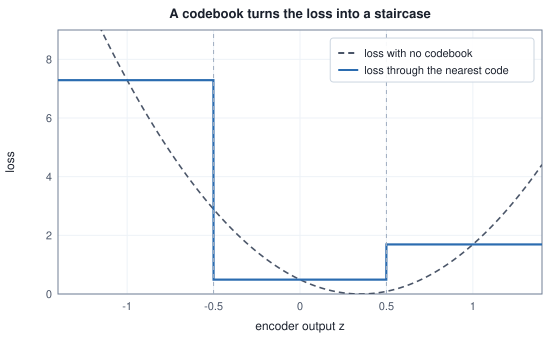
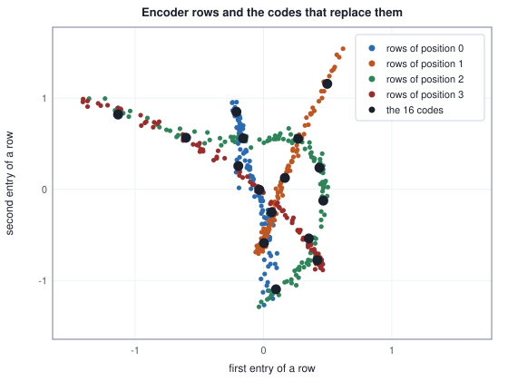

<!-- SPDX-License-Identifier: CC-BY-4.0 -->
<!-- Copyright (c) 2026 Martin Schröder <info@swedishembedded.com> -->

# Discrete Latents and Vector Quantization

*How can an image be turned into a short sequence of discrete codes?*

A 512 by 512 colour photograph is 786,432 bytes. The tokenizer under CodeFormer, one of the face-restoration models brain runs, writes the same photograph as 256 integers, each between 0 and 1023, and a decoder turns those 256 integers back into a face that is recognisably the same face. The tokenizer that Janus-Pro uses for image generation, LlamaGen's VQ-16, does it for a 384 by 384 picture with 576 integers below 16,384. Counting what that costs takes one line per tokenizer:

<!-- worked: vector_quantization.token_budget -->
An encoder halves the side once for each level but the last, so the side shrinks by 2 raised to (number of levels - 1); a position holds one index into the codebook, which costs log2 K bits; the image is stored as 8-bit RGB.

| tokenizer | image | halvings | side divided by | positions | codebook size K | bits per position | bits per image | bytes per image | bytes of the 8-bit image | image bytes per code byte |
|---|---:|---:|---:|---:|---:|---:|---:|---:|---:|---:|
| CodeFormer tokenizer | 512 x 512 | 5 | 32 | 16 x 16 = 256 | 1,024 | 10 | 2,560 | 320 | 786,432 | 2457.6 |
| LlamaGen VQ-16 tokenizer | 384 x 384 | 4 | 16 | 24 x 24 = 576 | 16,384 | 14 | 8,064 | 1,008 | 442,368 | 438.9 |
<!-- /worked -->

Nothing in the previous chapter can be counted like this. The latent of a variational autoencoder is a grid of real numbers, each of which carries as many bits as the floating-point format allows, and whatever sits downstream has to put a density on a continuous space. A sequence of 256 integers from an alphabet of 1024 is a different kind of object: it is a sentence in a language with 1024 words. The chain rule of probability that [Chapter 1](01-generative-modeling.md) used to factor an image into pixels factors a sentence into words just as well, and every language model of Volumes V and VI is a machine for the factors. A tokenizer is what lets an image join that machinery, and it also answers a complaint the previous chapter ended on: a decoder trained with a squared error under a Gaussian guess blurs, and a decoder that must choose among a finite list of codes is at least forced to commit.

The price is that nothing in the pipeline from image to code is differentiable any more. Paying it draws on five earlier ideas, from the nearest-neighbour search to the perceptual distance.

1. (Volume II, [Chapter 7](../v02-learning/07-classical-methods.md), nearest neighbours.) How is the nearest training row to a query found, and what decides between two rows at the same distance?
2. (Volume II, [Chapter 7](../v02-learning/07-classical-methods.md), k-means.) What are the two steps of one round of Lloyd's algorithm, and where does each centre move?
3. (Volume I, [Chapter 13](../v01-mathematics/13-information-theory.md), perplexity.) What are the smallest and the largest perplexity of a distribution over $K$ symbols?
4. (Volume III, [Chapter 6](../v03-neural-networks/06-gradient-checking.md), gradient checking.) What does a central difference compare with, and what does it say about a function that is flat?
5. (Volume VII, [Chapter 8](../v07-vision/08-clip.md), perceptual distance.) In the toy of that chapter, which was further from the reference by pixel error, a picture shifted by one pixel or a blurred one, and which by feature distance?

## A table of centres in place of a real number

Take six points of the plane and a table of four centres. Each point is replaced by the centre at the smallest squared distance, and when two centres are equally near the lower index wins, the tie rule of the nearest-neighbour search of Volume II:

<!-- worked: vector_quantization.quantize_points -->
Codebook: c0 = (0, 0), c1 = (1, 0), c2 = (0, 1), c3 = (1, 1). Each point is replaced by the code at the smallest squared distance; when two codes are equally near, the lower index wins.

| point z | dist to c0 | dist to c1 | dist to c2 | dist to c3 | index k | code q | squared error |
|---|---:|---:|---:|---:|---:|---:|---:|
| (0.2, 0.1) | 0.05 | 0.65 | 0.85 | 1.45 | 0 | (0, 0) | 0.05 |
| (0.9, 0.2) | 0.85 | 0.05 | 1.45 | 0.65 | 1 | (1, 0) | 0.05 |
| (0.5, 0) | 0.25 | 0.25 | 1.25 | 1.25 | 0 | (0, 0) | 0.25 |
| (0.4, 0.8) | 0.80 | 1.00 | 0.20 | 0.40 | 2 | (0, 1) | 0.20 |
| (1.2, 1.1) | 2.65 | 1.25 | 1.45 | 0.05 | 3 | (1, 1) | 0.05 |
| (-0.3, 0.4) | 0.25 | 1.85 | 0.45 | 2.05 | 0 | (0, 0) | 0.25 |

Mean squared error of the six points: 0.1417.
<!-- /worked -->

The point $(0.5, 0)$ is exactly between $\mathbf{c}_0$ and $\mathbf{c}_1$, and goes to index 0. The table of centres is the **codebook**: a matrix $\mathbf{C}$ of $K$ rows $\mathbf{c}_0, \dots, \mathbf{c}_{K-1}$ (the codes, or entries) of $d$ numbers each. **Vector quantization** replaces a vector $\mathbf{z}$ by the code nearest to it,

$$
k(\mathbf{z}) = \arg\min_{k}\ \lVert \mathbf{z} - \mathbf{c}_k \rVert^2, \qquad \mathbf{z}_q = \mathbf{c}_{k(\mathbf{z})},
$$

and stores only the index $k(\mathbf{z})$, which costs $\log_2 K$ bits. The word "vector" is the point: the whole $d$-vector is replaced by one index. Rounding each of its entries to one of $b$ levels would need $b^d$ cells, a number that grows with $d$ whatever the data look like, while a codebook has exactly $K$ cells whose shapes follow the centres, and the centres can sit where the data are. This is the assignment step of k-means, kept as a permanent part of a model instead of one half of a loop.

```text
function quantize(Z: array<real>[T, d], C: array<real>[K, d]) -> (array<int>[T], array<real>[T, d])
    require K >= 1, "a codebook needs at least one code"
    idx = zeros(int, [T])
    Q = zeros(real, [T, d])
    for t in 0 .. T:
        best = infinity
        for k in 0 .. K:
            dist = sum((Z[t, j] - C[k, j]) ^ 2 for j in 0 .. d)
            if dist < best:                  # strictly less: the lowest index keeps a tie
                best = dist
                idx[t] = k
        Q[t, :] = C[idx[t], :]
    return (idx, Q)
```

In an image tokenizer the rows come from a convolutional encoder. Its output is a grid of $d$ channels over $h \times w$ positions, read as $T = hw$ rows of $d$ numbers, one for each position; each row is quantized on its own, with one codebook shared by all positions, and the decoder receives the grid of the codes' vectors. The image is therefore a grid of integers, and the grid is the sentence. The token budget at the top is this arithmetic.

The error of the six points above, the mean of $\lVert \mathbf{z} - \mathbf{z}_q \rVert^2$ over the points, is 0.1417, and it is the first of two things a tokenizer trades. More codes mean smaller cells and a smaller error, and more bits per position. The second is what the decoder can do with so few bits, which a small tokenizer trained below measures.

## The gradient of a staircase

Put the quantizer between an encoder and a decoder and ask for the derivative of the loss with respect to what the encoder produced. The smallest case has one number: codes $\{-1, 0, 1\}$, a decoder $g(q) = 2q$, a target $0.7$ and the loss $L = (g(q) - 0.7)^2$, as a function of the encoder's output $z$:

<!-- worked: vector_quantization.staircase -->
Codebook {-1, 0, 1}, decoder g(q) = 2q, target 0.7, loss L = (g(q) - 0.7)^2, the lower index winning a tie (z = 0.5 is equally near 0 and 1). The derivative of the loss through the codebook is a central difference with step 0.0001.

| z | code q | loss L | central difference dL/dz | dL/dq (straight-through) | dL/dz with no codebook |
|---|---:|---:|---:|---:|---:|
| -0.80 | -1.0 | 7.29 | 0.0 | -10.80 | -9.20 |
| -0.40 | 0.0 | 0.49 | 0.0 | -2.80 | -6.00 |
| 0.00 | 0.0 | 0.49 | 0.0 | -2.80 | -2.80 |
| 0.30 | 0.0 | 0.49 | 0.0 | -2.80 | -0.40 |
| 0.45 | 0.0 | 0.49 | 0.0 | -2.80 | 0.80 |
| 0.50 | 0.0 | 0.49 | 6000.0 | -2.80 | 1.20 |
| 0.55 | 1.0 | 1.69 | 0.0 | 5.20 | 1.60 |
| 0.90 | 1.0 | 1.69 | 0.0 | 5.20 | 4.40 |
<!-- /worked -->



The third column is flat between cell boundaries, so its central difference is exactly zero in all but one row. The exception is $z = 0.5$, where the step of $10^{-4}$ straddles the boundary and measures a jump of $1.2$ over a width of $2 \times 10^{-4}$; with a smaller step the number grows without limit, because at the boundary there is no derivative. By the chain rule, $dL/dz = (dL/dq)(dq/dz)$, and $dq/dz$ is zero wherever it exists. The rule is not wrong. A function that is a staircase has no slope to follow, and an encoder trained by gradients through it receives exactly nothing.

The way out, from the vector-quantized variational autoencoder (VQ-VAE) of van den Oord and others, is to stop asking the quantizer for a derivative and to hand the encoder the one that is available. The decoder knows how its loss changes with its input $q$; the fifth column gives that, $dL/dq$. The **straight-through estimator** passes that gradient to $z$ unchanged, as if $q$ had been $z$: in the backward pass the quantizer is the identity. It is written with a stop-gradient, a function $\mathrm{sg}[\cdot]$ that is the identity when computing a value and has derivative zero when computing a gradient:

$$
\mathbf{z}_q^{\mathrm{st}} = \mathbf{z} + \mathrm{sg}[\mathbf{z}_q - \mathbf{z}].
$$

Its value is $\mathbf{z}_q$, so the decoder sees the quantized vector; its derivative with respect to $\mathbf{z}$ is the identity, because the second term is a constant to the backward pass. One addition and one frozen buffer implement it.

The estimator is biased, and the table says how. At $z = 0.45$ the loss without a codebook would rise with $z$ (slope $+0.80$, last column), yet the estimator reports $-2.80$, the slope at the code $0$, which says to increase $z$; and since a step upward crosses the boundary at $0.5$ into a cell whose code is worse (loss $1.69$ against $0.49$), the next gradient, $+5.20$, pushes back. An encoder trained this way is drawn to the edges of its cells, because the gradient it receives answers a question about the code, "what if the code were a little larger", and not about itself. Something has to hold $z$ near its code, which is the job of the commitment term below. The estimator works because the codebook is usually fine enough that "the code is a little larger" and "the encoder output is a little larger" mean nearly the same, and not because it is exact.

## Two terms that keep the table and the encoder together

With the straight-through estimator the training graph looks like this:


Two things are missing from it. The decoder's gradient reaches the encoder, but nothing in the reconstruction loss reaches the codebook, because the path from the codes to the loss runs through $\mathrm{sg}$. The table of centres would stay where it was initialised. Moving it is a job k-means already solved: the best place for a centre is the mean of the rows assigned to it, and a gradient step on the squared distance does the same thing gradually. So the loss gets a **codebook loss** that pulls each code toward the encoder rows that chose it, with the rows held fixed:

$$
\mathcal{L}_{\mathrm{cb}} = \frac{1}{n}\lVert \mathrm{sg}[\mathbf{z}] - \mathbf{z}_q \rVert^2 .
$$

The second thing missing is a leash on the encoder. The reconstruction gradient that reaches it was computed at the code, not at the encoder's output, so nothing prevents the output from drifting away from every code (the staircase table showed it being drawn to the cell edges), and the quantization error would grow unseen. A **commitment loss** pulls the encoder's rows toward the codes they were assigned, with the code held fixed:

$$
\mathcal{L}_{\mathrm{com}} = \frac{1}{n}\lVert \mathbf{z} - \mathrm{sg}[\mathbf{z}_q] \rVert^2 .
$$

Here $n$ is the number of entries averaged, $T d$ for one image. The full loss is $\mathcal{L}_{\mathrm{rec}} + w_{\mathrm{cb}}\mathcal{L}_{\mathrm{cb}} + w_{\mathrm{com}}\mathcal{L}_{\mathrm{com}}$. The two quantizer terms have the same value, the mean squared distance between rows and codes, and opposite stop-gradients: the first reaches the codebook only and the second the encoder only. One weight $\beta = 0.25$ sits on one of them, and which one is a decision with consequences. In the VQ-VAE paper $\beta$ multiplies the commitment term, $w_{\mathrm{cb}} = 1$ and $w_{\mathrm{com}} = \beta$. The reference implementation behind CodeFormer's tokenizer, as brain's training code records, puts it on the codebook term, $w_{\mathrm{cb}} = \beta$ and $w_{\mathrm{com}} = 1$, and the tokenizer of LlamaGen puts it back on the commitment term. Whatever the placement, $w_{\mathrm{cb}} + w_{\mathrm{com}} = 1.25$, so the value of the loss is the same.

The gradients are the content. In the pseudocode, with the straight-through copy first:

```text
function quantizer_backward(Z: array<real>[T, d], C: array<real>[K, d], idx: array<int>[T],
                            dQ: array<real>[T, d], w_cb: real, w_com: real)
        -> (array<real>[T, d], array<real>[K, d])
    # dQ is the gradient of the reconstruction loss at the decoder's input
    # one image; a batch of B images has the mean of the losses, so the caller divides every dZ and dC (and dQ) by B
    n = T * d
    dZ = zeros(real, [T, d])
    dC = zeros(real, [K, d])
    for t in 0 .. T:
        k = idx[t]
        for j in 0 .. d:
            diff = Z[t, j] - C[k, j]
            dZ[t, j] = dQ[t, j] + w_com * 2 * diff / n       # straight-through, then commitment
            dC[k, j] = dC[k, j] - w_cb * 2 * diff / n        # codebook: rows sharing a code add up
    return (dZ, dC)
```

One position with a pair of numbers shows the arithmetic, and the two placements side by side:

<!-- worked: vector_quantization.term_gradients -->
One position with a 2-vector: z_e = (0.30, -0.20), nearest code q = (0.50, 0.10), n = 2 entries, beta = 0.25. The decoder is stood in for by rec = (1/2)||z_q - t||^2 with t = (0.10, 0.45), so that the gradient it hands back at z_q = q is q - t = (0.40, -0.35). The gradient that the encoder receives is that vector (straight-through) plus the commitment gradient; the codebook entry receives the codebook gradient alone. The last column is the largest difference between each formula and a central difference (step 1e-6) of the smooth loss with the stop-gradient values held fixed.

| placement of beta | straight-through into the encoder | commitment into the encoder | codebook term into the code | pull on the code / pull on the encoder | formulas against finite differences |
|---|---:|---:|---:|---:|---:|
| beta on the commitment term (VQ-VAE paper) | (0.400, -0.350) | (-0.0500, -0.0750) | (0.2000, 0.3000) | 4.0000 | below 1e-6 |
| beta on the codebook term (CodeFormer's reference) | (0.400, -0.350) | (-0.2000, -0.3000) | (0.0500, 0.0750) | 0.2500 | below 1e-6 |

Moving beta from the codebook term to the commitment term multiplies the ratio of the pull on the code to the pull on the encoder by 16.0, which is 1/beta^2.
<!-- /worked -->

The decoder's gradient reaches the encoder in both rows, and what differs is the leash: the commitment gradient is four times smaller than the codebook gradient in the first row and four times larger in the second. The ratio of the pull on the code to the pull on the encoder is $4$ in the paper's placement and $1/4$ in the other, a difference of $1/\beta^2 = 16$.

The last column deserves a second look. Both placements agree with finite differences to better than $10^{-6}$. A finite-difference check compares a backward pass with the forward it was written for, whatever that forward is, so it cannot tell a loss that was meant from one with $\beta$ on the wrong term; and a training curve cannot either, since both losses have the same value at every step. The placement has to be read from the reference. This is the part of brain's tokenizer that has most to teach, and it comes back below with the code.

## A tokenizer small enough to check

The curved sensor readings of the previous chapters make a tokenizer small enough to be trained and checked entirely. A reading has 16 sensors; the encoder maps it to 8 numbers read as $T = 4$ rows of $d = 2$, each row is quantized with a shared codebook of $K$ codes, and the decoder maps the 8 numbers of the codes back to a reading. The tokens of a reading are four integers.

The network is $16 \to 12 \to 8$ (a Gaussian error linear unit, GELU, after the first layer) for the encoder and $8 \to 12 \to 16$ (a GELU after the first layer) for the decoder. Its 624 weights and biases and the codebook (a $K \times 2$ matrix, row-major, last) form one flat vector in the order $\mathbf{W}_1, \mathbf{b}_1, \mathbf{W}_2, \mathbf{b}_2, \mathbf{W}_3, \mathbf{b}_3, \mathbf{W}_4, \mathbf{b}_4, \mathbf{C}$, each matrix row-major, with the shapes $12 \times 16$, $8 \times 12$, $12 \times 8$, $16 \times 12$. Weights are drawn $\mathcal{N}(0, 1/n_{\mathrm{in}})$ layer by layer in this order from the one generator `vector_quantization.init` (seed `0xc5fea9a6298d9c2c`), biases start at $0$. The codebook starts at $K$ encoder rows: code by code, a reading is chosen with `integer(256)` and a position with `integer(4)` from `vector_quantization.codebook` (seed `0xdb1fe8fc132e588a`), and the code is that position's row at the initial weights. The loss per reading is the mean over the 16 sensors of the squared error plus the two quantizer terms, each a mean over the 8 entries. Everything else (data, batch, schedule, optimiser) is printed with the first table below.

Before training, the backward pass of the loss is checked, as Volume III taught. The straight-through gradient is the exact gradient of a smooth function, the one in which the assignment, the encoder rows $\mathbf{z}_0$ and the codes $\mathbf{q}_0$ at the current parameters are frozen (a latch) and the decoder is fed $\mathbf{z} + (\mathbf{q}_0 - \mathbf{z}_0)$; a central difference of that function checks it. Held against the loss as written, with the nearest code looked up again at each perturbed point, the same difference measures the derivative that the estimator replaces:

<!-- worked: vector_quantization.gradient_check -->
The first 8 training readings, the initial parameters (`vector_quantization.init` (seed 0xc5fea9a6298d9c2c), then the codebook from `vector_quantization.codebook` (seed 0xdb1fe8fc132e588a), initialisation 'data'), K = 16. The assignments, z_0 and q_0 are pinned (the latch) and each of the parameters is moved by plus and minus 1e-05 in turn; an entry fails when |analytic - numerical| exceeds 1e-6 + 1e-6 max(|analytic|, |numerical|).

| objective | parameters checked | entries failing the gate | worst absolute difference |
|---|---:|---:|---:|
| beta on the commitment term | 656 | 0 | below 1e-6 |
| beta on the codebook term | 656 | 0 | below 1e-6 |

The reconstruction term alone, written as the network computes it, with the nearest code looked up again at every perturbed point, has the same 308 encoder parameters (W1, b1, W2, b2): a central difference of step 1e-05 is nonzero for 0 of them, while the straight-through gradient is nonzero for 308.
<!-- /worked -->

All 656 parameters agree for both placements, below $10^{-6}$, which is the gate; and the reconstruction term differentiated as the network computes it gives zero for each of the 308 encoder parameters, where the straight-through gradient gives a nonzero number for each. That is the staircase again at the scale of a network: against the literal function, the gradient the training step applies is the gradient of something else, deliberately.

Now the training, with the codebook of $K = 16$ and the placement of the paper:

<!-- worked: vector_quantization.training_log -->
Data: the 256 training readings of `first_models.curved_data` (16 sensors, noise sd 0.05), tested on its 128 test readings. Encoder 16-12-8 with GELU after the first layer, whose 8 outputs are read as 4 rows of 2 numbers; decoder 8-12-16 with GELU; 624 weights and biases outside the codebook. Weights N(0, 1/n_in) layer by layer in row-major order, biases 0, from `vector_quantization.init` (seed 0xc5fea9a6298d9c2c) (weights only, layer by layer). Batch 32 (8 steps per epoch), 200 epochs, one in-place shuffle per epoch from `vector_quantization.batches` (seed 0x8bedc66ba4885b5b) of the array 0 .. 255, set to the identity once before epoch 1 and left in the order each epoch leaves it; Adam (0.9, 0.999, 1e-8), no decay and no clip, rate warming up over 160 steps to 0.01 and following a cosine to 0.0001; the codebook is trained by the same optimiser as the weights. Loss per reading: rec + codebook term + commitment term, rec the mean over the 16 sensors of the squared error and each term the mean over the 8 entries of the squared distance, with beta = 0.25. K = 16; the codebook starts at 16 encoder rows (reading by `integer(256)`, then position by `integer(4)`, code by code, from `vector_quantization.codebook` (seed 0xdb1fe8fc132e588a)). Each cell is the mean over the epoch's 8 batches (the codes used and the perplexity count the epoch's 1024 tokens).

| epoch | loss | reconstruction | mean (z_e - q)^2 | codes used (of 16) | perplexity of the codes |
|---|---:|---:|---:|---:|---:|
| 1 | 0.2849 | 0.2628 | 0.0177 | 16 | 14.23 |
| 5 | 0.2056 | 0.1658 | 0.0319 | 16 | 11.16 |
| 25 | 0.0188 | 0.0069 | 0.0095 | 16 | 14.17 |
| 100 | 0.0130 | 0.0043 | 0.0070 | 16 | 14.08 |
| 200 | 0.0116 | 0.0041 | 0.0060 | 16 | 14.26 |

Every trained number is printed with the digits that the run and four copies of it, started with the first weight changed by +1e-12, -1e-12, +3e-12 and -3e-12, share (the rule of `stable.py`); here all five agree on every digit shown.
<!-- /worked -->

All 16 codes are used from the first epoch to the last. Perplexity, the exponential of the entropy of the code frequencies, counts how many codes the tokens use evenly: 16 would be a uniform use and 1 a single code, and the final 14.26 says that nearly all are used, some more often than others. The reconstruction error settles at 0.0041 on the training readings (the sensor noise has variance 0.0025), while the mean squared distance between rows and codes, 0.0319 at epoch 5 when the codes are still finding the rows, ends at 0.0060.



The map of the latent space shows what the tokens are. The readings are all points of a one-parameter family, so the rows of each position trace out a curve in the plane, the four positions trace different curves (the encoder has no reason to give the four rows the same meaning), and the codes sit along those curves like beads. A token is the bead nearest to a row, so the codes amount to a division of the curves into cells. This is the same fact as the previous chapter's, that the decoder maps a simple set onto the curve of readings, seen from the other side: the set is now finite.

## What the codes cost, and what each part of the loss does

The rate of the tokenizer is $4\log_2 K$ bits per reading, and the cost of the codes is the error that the same network makes without them: a continuous code of 8 numbers has no limit on its bits.

<!-- worked: vector_quantization.rate_table -->
The recipe of the previous table with the codebook size K changed (initialisation 'data', all else equal) and, in the first row, the same network without a quantizer. The sensor noise has variance 0.0025. Codes used and perplexity count the 1024 tokens of the 256 training readings encoded once more with the final parameters, after the last epoch; the training reconstruction is instead the mean over the last epoch's eight batches, taken while the parameters moved (the last row of the training log), and the test reconstruction uses the final parameters.

| model | bits per reading | training reconstruction | test reconstruction | codes used | perplexity |
|---|---:|---:|---:|---:|---:|
| autoencoder, no codebook | 8 numbers | 0.0018 | 0.0019 |  |  |
| K = 4 | 8 | 0.0063 | 0.0071 | 4 | 3.71 |
| K = 8 | 12 | 0.0042 | 0.0049 | 8 | 6.98 |
| K = 16 | 16 | 0.0041 | 0.0046 | 16 | 14.26 |
| K = 32 | 20 | about 0.003 | unstable | 32 | about 30 |
| K = 64 | 24 | about 0.003 | about 0.003 | about 60 | about 50 |

A number that comes from a chaotic run is printed with only the digits that are the same in the run and in four copies of it whose first weight is changed by +1e-12, -1e-12, +3e-12 and -3e-12: in full if all agree on it, as 'about x' with the leading digits on which all agree, or as 'unstable' when not even one digit survives; the other digits cannot be reproduced in another implementation. 'About x' means x rounded to three, two or one significant digits, as many as the five values round to alike while lying within half a unit of that last digit, so 'about 0.003' stands for a value anywhere from 0.0025 to 0.0035.
<!-- /worked -->

Two caveats come with the table. The continuous autoencoder reconstructs the readings to 0.0019 on the test readings, below the noise variance of 0.0025, because eight free numbers can carry some of the sensor noise as well as the curve; the noise variance is a floor for a model of the curve and not for an autoencoder of the readings. And the digits that remain are fewer for the larger codebooks. When a code is added the assignments of a few rows change, and a training run that depends on discrete assignments is not a smooth function of its start: the runs whose starts differ by a part in $10^{12}$ end with test errors that agree to one digit for $K = 64$ and to none for $K = 32$. The rule of Volume III prints only what survives. What survives is the order: the error falls with every doubling of the codebook, from 0.0071 at $K = 4$ through 0.0049 and 0.0046 to about 0.003 at $K = 64$, and the codebook of 64 comes within a factor of two of the continuous code at 24 bits per reading.

Cutting the gradient and moving $\beta$ both change the training of the same network:

<!-- worked: vector_quantization.straight_through_and_beta -->
The recipe of the first table, K = 16, three ways of training the same network. In the last row the decoder's gradient goes to the codebook entry it read (the lookup is differentiable in the codebook), the encoder is trained by the commitment term alone, and the loss is otherwise the same. The training reconstruction of the second row is printed to one digit although the five runs of the nudge test agree on two (0.0034): five copies of an independent implementation of this chapter, summing in another order, ended at values from 0.00327 to 0.00339, so the second digit is not reproducible across implementations, and a first digit is all that the evidence supports.

| variant | training reconstruction | test reconstruction | mean (z_e - q)^2 | perplexity |
|---|---:|---:|---:|---:|
| straight-through, beta on the commitment term | 0.0041 | 0.0046 | 0.0060 | 14.26 |
| straight-through, beta on the codebook term | about 0.003 | about 0.004 | about 0.001 | about 14 |
| no straight-through (a plain lookup) | 0.0503 | 0.0701 | 0.0005 | 11.34 |

A number that comes from a chaotic run is printed with only the digits that are the same in the run and in four copies of it whose first weight is changed by +1e-12, -1e-12, +3e-12 and -3e-12: in full if all agree on it, as 'about x' with the leading digits on which all agree, or as 'unstable' when not even one digit survives; the other digits cannot be reproduced in another implementation. 'About x' means x rounded to three, two or one significant digits, as many as the five values round to alike while lying within half a unit of that last digit, so 'about 0.003' stands for a value anywhere from 0.0025 to 0.0035.
<!-- /worked -->

Without the straight-through gradient the encoder is trained by the commitment term alone, which asks it only to stay near the codes. It never hears from the decoder. The reconstruction error stays at 0.0503, twelve times that of the network that does hear, and the distance between rows and codes is a mere 0.0005, small and useless: the encoder has become a faithful follower of codes that were chosen at random at the start. The loss, which includes this small distance, looks like the loss of a network that is training.

Moving $\beta$ onto the codebook term changes what the table can see. The distance between rows and codes drops to about 0.001 from 0.0060, because the commitment term is now four times as heavy compared with the reconstruction pull, and the rows hug their codes. Both networks reach a similar reconstruction error (the digits of the second row's test error do not survive), so the experiment does not say which placement is better; it says that the choice moves a number the loss curve does not show.

## Codes that die

A code that is never the nearest to any row receives no gradient: the codebook term touches only the codes that were chosen, and the reconstruction term does not touch the codebook at all. A code that loses the first rounds is never chosen again, and the table stays small, a **dead code** in the common phrase. It costs bits in the format and buys nothing.

How the codebook starts decides how many die. With $K = 64$, three starts: encoder rows as above, 64 points uniform in $(-4, 4)^2$ (most of them far from every row the encoder produces), and the same uniform start with a rule that revives any code that an epoch never used by moving it onto an encoder row:

<!-- worked: vector_quantization.dead_codes -->
K = 64, the recipe of the first table. 'wide' draws both coordinates of every code as 4 * (2 u - 1) with u from `uniform()`, code by code, from `vector_quantization.codebook` (seed 0xdb1fe8fc132e588a). The revival rule (stream `vector_quantization.reset` (seed 0x7effb3bf81890620)): at the end of every epoch but the last, each code that none of the epoch's 1024 tokens used becomes the encoder row of a reading chosen with `integer(256)` and a position chosen with `integer(4)` (in that order, dead codes in index order), and its Adam moments are set to 0.

| codebook of 64 starts as | used in epoch 5 | used at the end | perplexity | test reconstruction |
|---|---:|---:|---:|---:|
| encoder rows (initialisation 'data') | 51 | about 60 | about 50 | about 0.003 |
| uniform in (-4, 4) ('wide') | 5 | 18 | 10.64 | 0.0036 |
| 'wide', and dead codes revived each epoch | 61 | 64 | about 60 | about 0.003 |

A number that comes from a chaotic run is printed with only the digits that are the same in the run and in four copies of it whose first weight is changed by +1e-12, -1e-12, +3e-12 and -3e-12: in full if all agree on it, as 'about x' with the leading digits on which all agree, or as 'unstable' when not even one digit survives; the other digits cannot be reproduced in another implementation. 'About x' means x rounded to three, two or one significant digits, as many as the five values round to alike while lying within half a unit of that last digit, so 'about 0.003' stands for a value anywhere from 0.0025 to 0.0035.
<!-- /worked -->

A start on encoder rows keeps about 60 of the codes in use. The uniform start uses 5 in epoch 5 and ends with 18, and 46 codes of the table are dead weight. The test error with these 18 codes is 0.0036, only a little worse than that of the 60-code table, because these readings lie on a curve that 18 codes cover well; a tokenizer for photographs has no such curve to hide behind. The revival rule restores all 64 at the price of some randomness, a draw from the stream `vector_quantization.reset` for each dead code.

Volume II, [Chapter 7](../v02-learning/07-classical-methods.md) met a second remedy in `crates/wm-core/src/vq.rs`: an exponential moving average in place of the codebook gradient, with the statistics of usage and perplexity as the check that a codebook has collapsed. A third is in the LlamaGen configuration below, a codebook of only 8 numbers per code and normalised, which makes every code a unit vector and the search a cosine. All three keep the codebook alive by different means.

## Tokens as a language

If the tokens are a language, a model of the language can be fitted, and the simplest language model is a table of counts. Take the tokens of the 256 training readings of the $K = 16$ tokenizer and fit three models of the four-token sequences: uniform (no model), each position independent of the others, and a chain, in which each token depends on the one before. Every count starts at $1$ (Laplace smoothing, from Chapter 1), and the model is scored by the bits it needs for the 128 test readings. The same models also generate: draw four tokens, decode them, and measure how far the decoded reading is from the curve of real readings.

<!-- worked: vector_quantization.sequence_model -->
The tokenizer of the first table (K = 16). Counts: every entry of the tables starts at 1 (Laplace), the 256 training readings add their tokens; the chain has one table for the first token and one 16 x 16 table for each of the three steps, the independent model one table per position. Bits are the mean of -log2 of the model's probability of the 4 tokens of each of the 128 test readings.

| model of the four tokens | bits per test reading |
|---|---:|
| uniform over 16^4 sequences | 16.00 |
| the four positions independent | 10.88 |
| a chain, each token given the one before | 7.72 |

Then 300 readings are sampled from each model and decoded; the distance is the root-mean-square miss per sensor of the nearest point of the noiseless curve, found as in Chapter 2's `vae.rescaled_codes` block (a grid of step 0.005 over [-1.25, 1.25], the first minimum kept). Draws: for each sample, one `uniform()` per token walked through the cumulative probabilities in code order (a token is the first code whose running total exceeds the draw), or one `integer(16)` per token for the uniform model, from `vector_quantization.sample.chain` (seed 0xca0a268fc3bd200e), `vector_quantization.sample.independent` (seed 0xcc1eefb48f2c0720) and `vector_quantization.sample.uniform` (seed 0x87066d983ea9d0c6).

| token model | decoded within 0.03 of the curve | within 0.1 |
|---|---:|---:|
| tokens drawn uniformly | 0.017 | 0.500 |
| positions drawn independently | 0.137 | 0.677 |
| chain | 0.250 | 0.680 |

Every trained number is printed with the digits that the run and four copies of it, started with the first weight changed by +1e-12, -1e-12, +3e-12 and -3e-12, share (the rule of `stable.py`); here all five agree on every digit shown.
<!-- /worked -->

The independent model needs 10.88 bits where uniform tokens need 16, so the tokens are far from uniformly used; and the chain needs 7.72 bits, 3.2 less, because neighbouring tokens say much about each other (the four rows of a reading all come from the same hidden cause). The generated readings tell the same story at the other end: of the samples from independently drawn positions, 13.7% decode to within $0.03$ of the curve, and of the samples from the chain 25.0%, against 1.7% for tokens drawn uniformly. The chain model is a sentence-level model with a memory of one word; a transformer over 256 positions is the same idea with a memory of the whole image, which is how a token-based image generator is built from this tokenizer. The factorisation is Chapter 1's autoregressive factorisation, $q(t_0, \dots, t_{T-1}) = \prod_i q(t_i \mid t_{<i})$, over a finite alphabet, and the previous chapter's Gaussian prior is replaced by whatever model the sequence calls for.

CodeFormer in brain uses the codebook in exactly this way, with a twist (`crates/codeformer/src/model.rs`). Its transformer reads the features of a degraded face and predicts, for each of the 256 positions, a distribution over the 1024 codes; the prediction used is the argmax, ties to the lowest index, and the codes are looked up in the tokenizer's codebook and decoded. The nearest-code search is not on that path; the codebook is.

## What a squared error prefers

The reconstruction error of the model above is a squared error. A decoder facing a code that cannot tell two pictures apart cannot pick one, and the loss decides how it hedges. Let the two pictures be the toy picture of Volume VII (a vertical grating in the top half, a horizontal one below) and the same picture shifted right by one pixel, which inverts the top grating and leaves the bottom one unchanged. Each is the truth half of the time. The decoder may output either picture or their mean:

<!-- worked: vector_quantization.blur_and_feature_distance -->
The reference picture A of Volume VII, Chapter 8 (the picture printed in its `clip.toy_picture_text` block: 12 x 12, values 0.8 and 0.2, a vertical grating in the top six rows and a horizontal one below) and picture B, A shifted right by one pixel with wraparound (the top half inverts, the bottom half is unchanged). The code cannot tell which of the two was encoded, so each is the truth with probability 1/2. Each row is a candidate output; the cells are the expected loss, 1/2 loss(P, A) + 1/2 loss(P, B), under the pixel mean squared error, the pixel mean absolute error and the toy feature distance of that chapter's `clip.pixel_vs_feature` block (weights 1 on each channel, both taps summed).

| decoder output P | expected squared error | expected absolute error | expected feature distance |
|---|---:|---:|---:|
| picture A | 0.0900 | 0.1500 | 0.0157 |
| picture B | 0.0900 | 0.1500 | 0.0157 |
| the mean of A and B | 0.0450 | 0.1500 | 1.1725 |
<!-- /worked -->

The mean has half the squared error of either picture, so a decoder trained on squared error outputs the mean, a grey top half with no grating, a blur. The absolute error ties: every output between the two pictures has the same expected error, and the hedge is no worse than a choice. The feature distance of the toy perceptual distance of Volume VII says the opposite of the squared error: either sharp picture is about 75 times closer, in expectation, than the grey one, because the grey one has lost the texture that the features respond to. A quantizer makes this situation common, since many images share one code; so the loss of a tokenizer matters more than the loss of an autoencoder.

A **perceptual loss** is a perceptual distance used as a training loss: the decoder's output and the target both go through a frozen pretrained network, and the loss is the channel-normalised, weighted squared difference of their features. The VQGAN (vector-quantized generative adversarial network) of Esser, Rombach and Ommer adds it to the reconstruction term, together with an adversarial term from a patch discriminator, the subject of Chapter 4, and the sharp images of tokenizers in practice owe more to these two terms than to any property of the codebook. In brain the metric is `crates/lpips`, the learned perceptual image patch similarity (LPIPS) v0.1, on the device with either of the two released trunks, AlexNet or VGG16 (commit `6a7e9d464`), and it is trainable in the sense this section needs: `distance_grad` returns the gradient of the distance with respect to both images with the network frozen, and the gradient is held against central differences of an independent double-precision transcription of the reference. The tokenizer in `crates/vqgan` trains on exactly the sum this paragraph describes, with the LPIPS term on the VGG16 trunk and a patch discriminator in the adversarial term (`crates/vqgan/src/objective.rs`, commit `27016d1be`); the next chapter takes up the discriminator.

## The tokenizer in brain

`crates/vqgan` is the whole tokenizer at full size. It adds no new block and no new kernel: the encoder and generator are the convolutional graph that `crates/vae` runs for the autoencoder of the previous chapter (`vae::blocks::Builder`, with a naming scheme for the checkpoint's tensors), the nearest-code search is the `vq_argmin` kernel dispatched through `crates/wm-core/src/vq.rs`, and the lookup is the existing `embed` gather. The crate adds the schedule, a list of blocks whose positions the checkpoint's tensor names encode (for CodeFormer's tokenizer an encoder of 25 blocks, two attention blocks after each residual block of the last level and one in the middle, and a generator of the same count), an import that validates tensor names in both directions, and the training graph. Two presets are in `crates/vqgan/src/config.rs`: `VqganConfig::codeformer` (a codebook of 1024 codes of 256 numbers, five halvings of the side, hence the 16 by 16 grid of the first table) and `VqganConfig::llamagen_vq16` (16,384 codes of 8 numbers, four halvings, a 1 by 1 convolution between a 256-channel latent and the narrow codebook, and an L2-normalised codebook and query). The second was added by commit `a1ea4ce7f` (30 September 2026) as configuration of the first and not as a second model: the differences are a count of residual blocks, an activation, the bridge, the normalisation and the placement of $\beta$.

The search costs little next to the networks around it, and its cost is the cost of an exhaustive nearest-neighbour search:

<!-- worked: vector_quantization.search_cost -->
The kernel sketched in the chapter evaluates, for each of the M positions, the squared distance to each of the K codes of width d: per entry one subtraction, one multiplication and one addition. Each position reads the whole table once; 32-bit floats.

| tokenizer | positions M | codes K | width d | operations of the search 3 M K d | codebook entries K d | codebook bytes | bytes requested by all M positions |
|---|---:|---:|---:|---:|---:|---:|---:|
| CodeFormer tokenizer | 256 | 1,024 | 256 | 201,326,592 | 262,144 | 1,048,576 | 268,435,456 |
| LlamaGen VQ-16 tokenizer | 576 | 16,384 | 8 | 226,492,416 | 131,072 | 524,288 | 301,989,888 |
<!-- /worked -->

The kernel (`crates/kernels/wgsl/vq_argmin.wgsl`) runs one thread per position and reads the whole table once per position, strictly-less so that the lowest index keeps a tie; the last column is the traffic the loads request, and the table is small enough (1 MiB and 0.5 MiB) to be served from cache after the first touches. Both counts are exact for the loops as written.

The training graph is the straight-through estimator of this chapter put into buffers (`crates/vqgan/src/train.rs`). Its header explains the construction: the graph emits $\mathbf{z} + \mathbf{s}_0$ with $\mathbf{s}_0 = \mathbf{q}_0 - \mathbf{z}_0$ a latched constant, which is numerically the quantized vector and routes the gradient onto $\mathbf{z}$; the stop-gradient is literally which buffer a kernel is bound to, the codebook term binding the latched $\mathbf{z}_0$ and the commitment term the latched $\mathbf{q}_0$; and `latch_assignment` pins the indices, $\mathbf{z}_0$, $\mathbf{q}_0$ and $\mathbf{s}_0$ at the start of each step. The same latch makes the gradient check possible, as in the table above, and `gradcheck::check_vqgan` in `crates/gradcheck/src/vqgan.rs` runs it over a small instance (a codebook of 6 codes of 4 numbers, 8 by 8 images) with the workspace tolerances. Like any finite-difference gate, it cannot see the placement of $\beta$.

The straight-through graph is the core of the trainer; the rest of the loss is the recipe of the paragraph on the perceptual loss, and the crate implements it whole. The generator trains on

$$L_G = L_{\mathrm{rec}} + w_p\,\mathrm{LPIPS}(\hat{x}, x) + L_{\mathrm{cb}} + L_{\mathrm{com}} + w_e L_{\mathrm{ent}} + w_d\,\lambda\,\overline{(-D(\hat{x}))},$$

the last term present only from the step `disc_start`. $L_{\mathrm{rec}}$ is an L1 or an L2 reconstruction, as the recipe has it; $\lambda$ is $1$ or, in the recipe that adapts it, the ratio $\|\nabla_W (L_{\mathrm{rec}} + w_p \mathrm{LPIPS})\| / (\|\nabla_W (-\overline{D(\hat{x})})\| + 10^{-4})$ of the gradient norms at the weight $W$ of the generator's last convolution, clamped and treated as a constant; and $L_{\mathrm{ent}}$ is the codebook entropy loss of the LlamaGen recipe (`crates/vqgan/src/entropy.rs`), the mean over tokens of the entropy of the softmax over codes, with the squared distances scaled by a temperature as logits, minus the entropy of the mean assignment: each token confident, the codebook as a whole used evenly, and differentiable in both the encoder's output and the codebook. The two presets of the objective, `Objective::llamagen_vq16` and `Objective::codeformer`, carry the values of the upstream training files (an L2 or an L1 reconstruction, the LPIPS weight, the discriminator weight and start step, the optimiser settings). The tests of commit `27016d1be` check that each term enters the loss and the gradient, that the adaptive weight balances the two gradients at the last layer, that the discriminator term waits for `disc_start`, that the hinge loss falls when only the discriminator trains, and that all the terms together overfit a small batch; the discriminator and the entropy gradients are checked against double-precision oracles.

The story of that placement is worth telling because it is a lesson about gates. Commit `7b1310889` (August 2026) added the training graph and records the discovery in its message: reading the reference implementation, the author found that $\beta$ weights the codebook term, in the opposite place from the paper and from the reference's own comment, which calls $\beta$ the commitment cost. The code that trained the released weights is what counts, so the placement follows the code. The message also observes that a swap of the two stop-gradients is invisible to a loss curve and that finite differences cannot see which term carries $\beta$. Commit `a1ea4ce7f` turned the placement into configuration (`BetaTerm::Codebook` or `BetaTerm::Commitment`), because the LlamaGen reference weights the commitment term, and added a test that pins it by the exact ratio of the codebook gradient (`beta_weights_the_term_its_config_names` in `crates/vqgan/src/train.rs`: moving $\beta$ off the codebook term multiplies that gradient by $1/\beta$). The table of gradients and the table of the loss with $\beta$ moved show with numbers what that test defends.

Two smaller pieces of history belong with the tokenizer's tests. Commit `4426b60a9` (the first version, forward only, July 2026) gates the stages of the network on a relative L2 error as well as the cosine, because a cosine is blind to a dropped scale, and checks code indices in `decode`, because the `embed` gather does not bounds-check and an index past the table would read past the buffer; `Vqgan::decode` and `CodeFormer::generate` still validate caller-supplied indices for that reason. And knowledge #188 records the lesson of the LlamaGen import: a codebook that is trained under a normalisation has near-unit rows, so using it raw looks almost right, and only a gate on magnitudes saw the error; the normalised copy is computed once on upload.

## Check your understanding

1. A colleague trains a tokenizer, and the loss falls smoothly to a small value, but every reconstruction is the same blurred face. Name two ways the training graph could be wrong that give this loss curve, and one measurement that separates them.
2. The staircase of the second section has a flat loss between boundaries. Why is a finite difference with a step of $10^{-4}$ at $z = 0.5$ not a derivative, and what would a step of $10^{-8}$ give?
3. Find the error: "the codebook term is not needed, because the reconstruction gradient already tells the codes where to go."
4. A codebook of 1024 codes is trained from a uniform start. After an epoch 700 codes have never been chosen. What will happen to them without a remedy, and why is the perplexity of the used codes the number to watch?
5. In the table of gradients, the commitment gradient on the encoder is $(-0.0500, -0.0750)$ in the first row. Which way does a step of gradient descent move $\mathbf{z}_e = (0.30, -0.20)$, and toward what?
6. A gate checks a backward pass of the tokenizer against finite differences and passes. Does it show that $\beta$ is on the right term? Explain.
7. Two decoders are trained for the same tokenizer, one on squared error and one on a perceptual loss. For the same codes, which has the lower pixel error and which the sharper output, and why?

## Summary

A tokenizer turns the grid of vectors an encoder produces into a grid of integers by replacing each vector with the nearest row of a codebook. The integers cost $\log_2 K$ bits per position, and they form a sentence that a model of sequences can predict; in brain a 512 by 512 face is 256 integers and a 384 by 384 picture 576. The nearest-code step is a staircase, so the gradient is zero where it exists; the straight-through estimator copies the decoder's gradient past it, at the price of a bias, and two terms complete the loss: a codebook loss that moves the codes toward the rows that chose them and a commitment loss that keeps the rows near their codes. Which term carries the weight $\beta$ is a choice that no gradient check and no loss curve can see; brain makes it a configuration and pins it by a test of the gradient ratio. On a small tokenizer, the checks passed for both placements, the network without the straight-through path never learned, the error fell with every doubling of the codebook, a poor start left most of a 64-code table dead, and a table of counts over the four tokens needed 3.2 fewer bits than the independent model and nearly doubled the share of samples that decode close to the curve.

The limits are the model's. The tokenizer's hedge under a squared error is a blur, and the sharp output of real tokenizers comes from a perceptual term and an adversarial one, which brain's trainer carries alongside the reconstruction and the codebook terms; the code is a sequence, but the toy's sequence model is a table. The next chapter takes up the adversarial term: a loss that is itself a network trained to catch the generator.

## References

- Aaron van den Oord, Oriol Vinyals and Koray Kavukcuoglu, *Neural Discrete Representation Learning*, 2017. The codebook, the straight-through estimator, and the codebook and commitment terms.
- Patrick Esser, Robin Rombach and Bjorn Ommer, *Taming Transformers for High-Resolution Image Synthesis*, 2021. A quantized autoencoder with perceptual and adversarial losses, whose codes are modelled by a transformer.
- Richard Zhang, Phillip Isola, Alexei A. Efros, Eli Shechtman and Oliver Wang, *The Unreasonable Effectiveness of Deep Features as a Perceptual Metric*, 2018. The perceptual distance used as a loss.
- Shangchen Zhou, Kelvin C. K. Chan, Chongyi Li and Chen Change Loy, *Towards Robust Blind Face Restoration with Codebook Lookup Transformer*, 2022. Predicting the codes of a face tokenizer.
- Peize Sun and others, *Autoregressive Model Beats Diffusion: Llama for Scalable Image Generation*, 2024. The tokenizer with an L2-normalised low-dimensional codebook.

## Exercises

1. **[Calculate]** For the six points and four codes of `vector_quantization.quantize_points`, compute the assignment of $(0.5, 0.5)$ and its squared error. Which index wins, and which rule decided?
2. **[Calculate]** In the staircase of the second section, for $z = 0.30$ give $dL/dq$ at the code and the slope of the loss without a codebook, and say which way each moves $z$.
3. **[Calculate]** With $n = 2$, $\beta = 0.25$, $\mathbf{z} = (0.30, -0.20)$, $\mathbf{q} = (0.50, 0.10)$ and a decoder gradient $(0.40, -0.35)$, compute the total gradient on the encoder row and on the code for both placements of $\beta$.
4. **[Calculate]** A tokenizer halves the side of a $768 \times 768$ image 4 times and has 8192 codes. Give the number of positions, the bits per image, and the number of image bytes per code byte.
5. **[Calculate]** A codebook of 8 codes is used by 1000 tokens with frequencies $500, 250, 125, 125, 0, 0, 0, 0$. Compute its perplexity.
6. **[Implement]** Reproduce `vector_quantization.quantize_points` and `vector_quantization.staircase` to the printed digits.
7. **[Implement]** Reproduce `vector_quantization.term_gradients`: the two placements of $\beta$, with the ratio of pulls and the finite-difference check at step $10^{-6}$.
8. **[Implement]** Reproduce `vector_quantization.gradient_check`: the tokenizer with the stated init (`vector_quantization.init`, then the codebook from `vector_quantization.codebook`), the latch, the 656 parameters at step $10^{-5}$, and the count of encoder parameters for which the literal reconstruction has a nonzero central difference.
9. **[Implement]** Reproduce the first epochs of `vector_quantization.training_log` (epoch 1 and 5) with the stated recipe, to the printed digits.
10. **[Implement]** Reproduce `vector_quantization.blur_and_feature_distance` from the toy distance of Volume VII.
11. **[Investigate]** Train the tokenizer with $K = 16$ and the 'tiny' start (both coordinates of every code uniform in $(-1/K, 1/K)$) and compare the number of codes used, the perplexity and the test error with the 'data' start of the chapter.
12. **[Investigate]** Make the chain model of `vector_quantization.sequence_model` condition each token on the two before it. Does the test bit count fall, and what does the 256-reading training set say about whether it should?

## Key terms

- **codebook**: a table of $K$ vectors of $d$ numbers each, the only values a quantized vector may take; a position of a tokenizer stores the index of a row. <!-- concept: codebook -->
- **vector quantization**: replacing a vector by the nearest row of a codebook (smallest squared distance, lowest index on a tie), so that it is stored as one index of $\log_2 K$ bits. <!-- concept: vector-quantization -->
- **straight-through estimator**: the rule that passes the gradient at a quantizer's output to its input unchanged, written $\mathbf{z} + \mathrm{sg}[\mathbf{z}_q - \mathbf{z}]$ with a stop-gradient $\mathrm{sg}$; it replaces a derivative that is zero by a biased one that trains the encoder. <!-- concept: straight-through-estimator -->
- **dead code**: a code of a codebook that is never the nearest to any encoder row, so that it receives no gradient, is never chosen again and costs bits in the format while buying nothing; it is revived by moving it onto an encoder row. <!-- concept: dead-code -->
- **perceptual loss**: a training loss that is a perceptual distance, the difference of the features that a frozen pretrained network computes for the output and the target, which prefers a sharp output where a squared error prefers the blurred mean. <!-- concept: perceptual-loss -->

## Answers

**Recall questions.**

1. Compute the distance from the query to every stored row and take the smallest; two rows at the same distance are decided by the lower row number, with a stable sort.
2. Assign each row to its nearest centre; then move each centre to the mean of the rows assigned to it (a centre with none stays where it is).
3. The smallest is 1, when one symbol has probability 1; the largest is $K$, when all are equally likely.
4. A central difference compares the slope $(f(x+h) - f(x-h))/2h$ with the analytic derivative; for a flat function it is zero, and it is wrong for a function with jumps at the point where $x \pm h$ straddle one.
5. By pixel error the shifted picture (0.1800 against 0.0844); by feature distance the blurred one (2.2073 against 0.0314).

**Check your understanding.**

1. A decoder that ignores its codes (all positions the same code, a collapsed table), and an encoder that never receives the decoder's gradient (the straight-through path missing); the loss is small in both because the quantizer distance is small. The perplexity of the codes (near 1 in the first case) and the reconstruction error with the encoder's weights compared between two checkpoints separate them.
2. The step straddles a boundary and measures a jump divided by the step; at $z = 0.5$ it measures $1.2 / (2 \times 10^{-8}) = 6 \times 10^7$, and it grows without limit as the step falls, because the function has no derivative there.
3. The reconstruction loss reaches the codes only through $\mathrm{sg}$, so the codes receive no gradient from it; without the codebook term the table never moves from its start.
4. They receive no gradient from the codebook term, are never chosen again and stay dead. The perplexity counts the codes in effective use: it falls when a few codes take the traffic, while the count of codes used can stay high with most of them rare.
5. The gradient is negative in both entries, so a step subtracts it: both entries of $\mathbf{z}_e$ increase, moving toward the code $(0.50, 0.10)$.
6. No. It compares the backward pass with finite differences of the forward as emitted; a loss with $\beta$ on the other term is just as differentiable and passes. The placement is pinned by the reference and by a test of the gradient ratio.
7. The squared-error decoder has the lower pixel error and the blurrier output (it outputs the mean of what the code allows); the perceptual-loss decoder commits to one sharp output and has the higher pixel error.

**Exercises.**

1. Distances to $\mathbf{c}_0, \dots, \mathbf{c}_3$ are all $0.5$; the lowest index wins, index 0, error $0.5$.
2. $dL/dq$ at the code $0$ is $2(0 - 0.7)\cdot 2 = -2.80$, which increases $z$; the slope with no codebook is $2(0.6 - 0.7)\cdot 2 = -0.40$, which also increases $z$. They agree in sign here and differ in size.
3. Encoder, paper placement: $(0.40, -0.35) + 0.25\cdot 2\cdot(-0.20, -0.30)/2 = (0.35, -0.425)$; code: $2(0.20, 0.30)/2 = (0.20, 0.30)$. Encoder, other placement: $(0.40, -0.35) + (-0.20, -0.30) = (0.20, -0.65)$; code: $0.25(0.20, 0.30) = (0.05, 0.075)$.
4. $768 / 16 = 48$, so $2304$ positions; 13 bits each, $29{,}952$ bits; the image is $3 \cdot 768^2 = 1{,}769{,}472$ bytes and the code $3744$ bytes, a factor of $472.6$.
5. Entropy in nats $= 0.5\ln 2 + 0.25\ln 4 + 2\cdot 0.125\ln 8 = 0.3466 + 0.3466 + 0.5199 = 1.2130$ (that is, $1.75$ bits), perplexity $2^{1.75} = 3.364$.
6. to 10. Match the printed tables of the named blocks to the printed digits.
11. Expect fewer codes used and a higher error for the small start; compare your counts with the data-start row (16 of 16, perplexity 14.26).
12. A second-order chain has $16^3$ rows of counts for $256$ readings, most of them empty; with Laplace smoothing the test bits should rise as often as fall, which is the Chapter 1 lesson that a table cannot be larger than the data supports.
