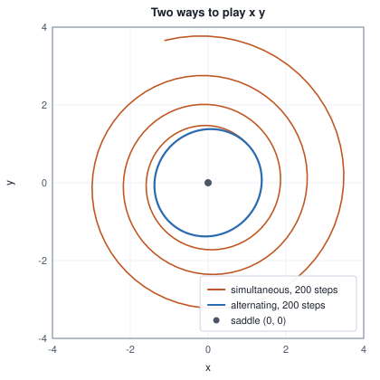

<!-- SPDX-License-Identifier: CC-BY-4.0 -->
<!-- Copyright (c) 2026 Martin Schröder <info@swedishembedded.com> -->

# Adversarial Training

*What happens when the loss itself is a network trained to catch the generator?*

A decoder trained on a squared error, facing a code that cannot tell two pictures apart, outputs their mean, and the mean is no picture. A perceptual distance repairs the hedge but keeps the shape of the question: how far is the output from this particular target? A generator that makes new images from noise has no particular target. The question it needs answered is different, and it concerns the whole population of images: could this sample have come from the data?

Start with a judge who is told everything. Take two bell curves on a line: the data are $\mathcal{N}(2, 1)$ and the generator's output is $\mathcal{N}(0, 1)$. A number is shown, and the judge is told only that it came from one curve or the other, each equally likely. The best possible answer is Bayes' rule: the probability that the number came from the data is $p_{\mathrm{data}}(x)/(p_{\mathrm{data}}(x) + q(x))$, and dividing top and bottom by $q$ turns it into a sigmoid of the logarithm of the density ratio. For two unit-variance Gaussians the logarithm of the ratio is a straight line, $2x - 2$:

<!-- worked: gans.optimal_discriminator -->
Data p_data = N(2, 1) and a generator whose output is q = N(0, 1), both densities of one real number, each equally likely to have produced the number shown. D*(x) = p_data(x) / (p_data(x) + q(x)) = sigmoid(log p_data(x) / q(x)).

| x | log p_data(x) / q(x) = 2x - 2 | best discriminator D*(x) |
|---|---:|---:|
| -2 | -6.0 | 0.0025 |
| -1 | -4.0 | 0.0180 |
| 0 | -2.0 | 0.1192 |
| 1 | 0.0 | 0.5000 |
| 2 | 2.0 | 0.8808 |
| 3 | 4.0 | 0.9820 |
| 4 | 6.0 | 0.9975 |
<!-- /worked -->

At $x = 1$, midway between the means, the judge shrugs. At $x = -2$ it is almost sure the number came from the generator (probability $0.0025$ that it is data), and at $x = 4$ almost sure it came from the data ($0.9975$). The judge needs both densities to say this, and a generator whose density cannot be computed, which is the usual case, cannot supply one. But the answer is a probability that something is a data sample, and a classifier produces exactly that from labelled examples alone. Draw samples from the data, draw samples from the generator, label them 1 and 0, and train a network on the binary cross-entropy. Nothing in that recipe mentions a density. Using the classifier's output as the generator's loss is the idea of adversarial training; it works, and it has costs that a likelihood never had.

The classifier, its loss and the two networks that play against each other rest on five earlier ideas; bring them back before the derivation leans on them.

1. (Volume II, [Chapter 3](../v02-learning/03-logistic-regression.md), binary cross-entropy.) What is the loss for a label $y \in \{0, 1\}$ and a predicted probability $p = \sigma(\ell)$, and what is its derivative with respect to the logit $\ell$?
2. ([Chapter 1](01-generative-modeling.md), generative models.) What can a generative model give you, and which of the two things can be had without the other?
3. ([Chapter 3](03-vector-quantization.md), the blur.) Why does a decoder trained on squared error output the mean of the pictures its code cannot tell apart?
4. (Volume VII, [Chapter 3](../v07-vision/03-cnns.md), convolutional networks.) A convolution with kernel $3 \times 3$, stride 1 and padding 1 maps a $5 \times 5$ map to what size, and how large a patch of the input does one output see after three such layers?
5. (Volume III, [Chapter 6](../v03-neural-networks/06-gradient-checking.md), gradient checking.) What does a central difference compare with, and what does a gate with a tolerance of $10^{-6}$ accept?

## Training a judge from samples

Write $D_\omega(\mathbf{x}) = \sigma(\ell_\omega(\mathbf{x}))$ for a network with parameters $\omega$ that maps a sample to the probability that it is real, with $\ell_\omega$ its logit. A **discriminator** is a classifier trained to tell samples of the data from samples of a generator. Its loss is the binary cross-entropy of Volume II with the label $1$ on real samples $\mathbf{x}_{\mathrm{r}} \sim p_{\mathrm{data}}$ and $0$ on fakes $\mathbf{x}_{\mathrm{f}} \sim q_\theta$:

$$
\mathcal{L}_D(\omega) = -\,\mathbb{E}_{\mathbf{x}_{\mathrm{r}}}\bigl[\log D_\omega(\mathbf{x}_{\mathrm{r}})\bigr] - \mathbb{E}_{\mathbf{x}_{\mathrm{f}}}\bigl[\log\bigl(1 - D_\omega(\mathbf{x}_{\mathrm{f}})\bigr)\bigr].
$$

Its negative is the value $V(\omega, \theta) = -\mathcal{L}_D(\omega)$ of the game the two networks play, so the discriminator maximizes $V$. If the network could be any function, the maximum is found one point at a time: at a fixed $\mathbf{x}$ the contribution to $V$ is $p(\mathbf{x}) \log D + q(\mathbf{x}) \log(1 - D)$, whose derivative in $D$ is $p/D - q/(1 - D)$, zero at $D^\star(\mathbf{x}) = p/(p + q)$. That is the judge of the opening, now derived instead of assumed. Put it back and the value splits into two Kullback-Leibler divergences from the even mixture $p_{\mathrm{mix}} = (p + q)/2$:

$$
\begin{aligned}
V(D^\star, \theta) &= \mathbb{E}_{p}\Bigl[\log \tfrac{p}{p + q}\Bigr] + \mathbb{E}_{q}\Bigl[\log \tfrac{q}{p + q}\Bigr] \\
&= -\log 4 + D_{\mathrm{KL}}(p \,\Vert\, p_{\mathrm{mix}}) + D_{\mathrm{KL}}(q \,\Vert\, p_{\mathrm{mix}}) \\
&= -\log 4 + 2\,\mathrm{JS}(p, q),
\end{aligned}
$$

where $\mathrm{JS}(p, q) = \tfrac12 D_{\mathrm{KL}}(p \Vert p_{\mathrm{mix}}) + \tfrac12 D_{\mathrm{KL}}(q \Vert p_{\mathrm{mix}})$ is the **Jensen-Shannon divergence**: zero when the two distributions are equal, and never more than $\log 2$. The first step of the equality writes $\log\frac{p}{p+q} = \log\frac{p}{2 p_{\mathrm{mix}}} = \log\frac{p}{p_{\mathrm{mix}}} - \log 2$ and the same for $q$; the two $-\log 2$ terms add to $-\log 4$. A discriminator that has reached its best therefore reports, as the value of the game, how far apart the two populations are, on a scale from $-\log 4$ (identical) up to $0$ (never confused). The table computes it for the Gaussians, with the shift $\mu$ of the data growing:

<!-- worked: gans.game_value -->
Data N(mu, 1) against a generator output N(0, 1), for five values of mu. JS is the Jensen-Shannon divergence in nats, JS(p, q) = 1/2 KL(p || m) + 1/2 KL(q || m) with m = (p + q) / 2; the game value is V = E_p log D*(x) + E_q log(1 - D*(x)); the accuracy is the probability that D* labels a sample correctly when data and generated samples are equally likely (it says 'data' when D*(x) > 1/2), which is Phi(mu / 2) for the standard normal distribution function Phi, computed with the library erf. JS and V are midpoint sums with step 0.001 over [-14, mu + 14], at the midpoints; since D* underflows in the tails for large mu, log D*(x) is evaluated as -softplus(-a) and log(1 - D*(x)) as -softplus(a) with a = mu x - mu^2 / 2 and softplus(u) = max(u, 0) + log(1 + exp(-|u|)), never as the log of a rounded probability. log 2 = 0.6931 and log 4 = 1.3863.

| shift mu | KL(p_data || q) = mu^2 / 2 | JS(p_data, q) | game value V(D*, q) | accuracy of D* |
|---|---:|---:|---:|---:|
| 0 | 0.0000 | 0.0000 | -1.3863 | 0.5000 |
| 1 | 0.5000 | 0.1114 | -1.1635 | 0.6915 |
| 2 | 2.0000 | 0.3368 | -0.7126 | 0.8413 |
| 4 | 8.0000 | 0.6327 | -0.1209 | 0.9772 |
| 6 | 18.0000 | 0.6893 | -0.0077 | 0.9987 |

The largest difference between V and 2 JS - log 4 over the five rows is below 1e-9.
<!-- /worked -->

The last column is a reading of the same fact in plain terms: with the data shifted by $\mu = 1$ even the perfect judge is right only $69\%$ of the time, and at $\mu = 6$ it is right $99.87\%$ of the time and the value has fallen to $-0.0077$. Two things are worth noticing. The JS divergence stops growing: from $\mu = 4$ to $\mu = 6$ it rises from $0.6327$ to $0.6893$, never past $\log 2 = 0.6931$, while the Kullback-Leibler divergence $\mu^2/2$ climbs from $8$ to $18$. And a judge that is nearly perfect has a loss that is nearly flat, a fact that will matter as soon as the generator is the one reading the loss.

## A generator with no density

The player on the other side needs no density either. A **generator network** is a function $g_\theta$ that maps a noise vector $\mathbf{z}$, drawn from a simple distribution such as $\mathcal{N}(\mathbf{0}, \mathbf{I})$, to a sample $\mathbf{x}_{\mathrm{f}} = g_\theta(\mathbf{z})$. It is the decoder of Chapter 2 with the encoder and the likelihood taken away: only the noise and the half that produces samples are kept. The distribution $q_\theta$ of its outputs is whatever the pushed-forward noise makes, and as in Chapter 2 the density of that distribution is an integral that cannot be computed in practice. Sampling is trivial, and that is all the model offers.

What replaces the likelihood is the discriminator. The generator's job is to make $D_\omega(g_\theta(\mathbf{z}))$ large, and the gradient it learns from is a chain through the judge:

$$
\frac{\partial \mathcal{L}_G}{\partial \theta}
= \frac{\partial \mathcal{L}_G}{\partial \ell_\omega}\;\frac{\partial \ell_\omega}{\partial \mathbf{x}}\bigg|_{\mathbf{x} = g_\theta(\mathbf{z})}\;\frac{\partial g_\theta(\mathbf{z})}{\partial \theta}.
$$

The middle factor is the discriminator's opinion of which way to move a sample to make it look more real. It exists only because the discriminator is a differentiable network, which is why the judge has to be a differentiable function and not a hard decision rule. The **adversarial loss** is this pair of losses taken together: the discriminator's $\mathcal{L}_D$ above and a generator loss $\mathcal{L}_G$ that is a function of the discriminator's score on fakes, each network minimizing its own while the other holds still.

The choice of $\mathcal{L}_G$ matters, and the obvious one is a trap. The mirror of the discriminator's loss is to minimize $\log(1 - D)$ on fakes, the **saturating** loss, since the discriminator maximizes it. Its derivative with respect to the logit $\ell$ on a fake is $-\sigma(\ell)$, and when the discriminator is sure that a sample is fake, $\sigma(\ell)$ is near zero and so is the gradient. The **non-saturating** loss $-\log D$ asks for the same thing, that fakes be scored as real, and has derivative $-(1 - \sigma(\ell))$, which is nearly $-1$ exactly there. The least-squares loss $(\ell - 1)^2$, used with brain's audio discriminators below, has derivative $2(\ell - 1)$:

<!-- worked: gans.generator_gradients -->
A fake sample on which the discriminator has logit l, so D = sigmoid(l). Each column is the derivative, with respect to l, of the generator's loss named in its heading, for that sample.

| logit l | D = sigmoid(l) | d/dl log(1 - D) | d/dl (-log D) | d/dl (l - 1)^2 |
|---|---:|---:|---:|---:|
| -8 | 0.00034 | -0.00034 | -0.99966 | -18.0 |
| -4 | 0.01799 | -0.01799 | -0.98201 | -10.0 |
| -2 | 0.11920 | -0.11920 | -0.88080 | -6.0 |
| 0 | 0.50000 | -0.50000 | -0.50000 | -2.0 |
| 2 | 0.88080 | -0.88080 | -0.11920 | 2.0 |
| 4 | 0.98201 | -0.98201 | -0.01799 | 6.0 |
<!-- /worked -->


At a logit of $-8$ (the discriminator says: fake, with probability $0.99966$) the saturating loss pushes the generator with a force of $0.00034$ and the non-saturating loss with $0.99966$. At a logit of $0$ ($D = \tfrac12$) all three push the same way; they disagree about what happens on the way there, which is where a generator spends its early life. The non-saturating loss has the same fixed point as the saturating one in the standard argument, a discriminator that outputs one half everywhere, but its value is no longer the JS divergence of the previous section, so the derivation does not describe what the generator minimizes. That compromise is the usual one, and it is the first of several in which the clean theory gives way to what trains.

The whole loop fits on one diagram. Real samples and fakes both reach the discriminator; its two scores are turned into two losses; the discriminator's gradient stays in the discriminator and the generator's passes through it.


## A game with no minimum

Training a generator and a discriminator by alternating gradient steps is not descent on a single loss. The discriminator descends $\mathcal{L}_D$, the generator descends a different function of the same quantities, and what one gains the other loses. Even for the smallest such game the consequence is surprising. Let the first player choose a number $x$ and the second a number $y$, with the payoff $x y$: the first wants it small, the second large. The only equilibrium is $(0, 0)$, where neither can improve. Give each a gradient step of size $\eta$ on its own objective, $x \leftarrow x - \eta y$ and $y \leftarrow y + \eta x$, and watch what the pair does from $(1, 1)$ with $\eta = 0.1$:

<!-- worked: gans.bilinear_game -->
The game: x chooses to make x y small and y to make it large, each by a gradient step of size eta = 0.1 on its own objective, from (x, y) = (1, 1). Simultaneous: both steps use the old pair. Alternating: x steps first and y steps from the new x. Radius = sqrt(x^2 + y^2).

| step t | radius, simultaneous | sqrt(2) (1 + eta^2)^(t/2) | radius, alternating | x^2 - eta x y + y^2, alternating |
|---|---:|---:|---:|---:|
| 0 | 1.4142 | 1.4142 | 1.4142 | 1.9000 |
| 1 | 1.4213 | 1.4213 | 1.4135 | 1.9000 |
| 2 | 1.4284 | 1.4284 | 1.4116 | 1.9000 |
| 5 | 1.4498 | 1.4498 | 1.3986 | 1.9000 |
| 10 | 1.4864 | 1.4864 | 1.3657 | 1.9000 |
| 50 | 1.8136 | 1.8136 | 1.3510 | 1.9000 |
| 100 | 2.3259 | 2.3259 | 1.3939 | 1.9000 |
| 200 | 3.8252 | 3.8252 | 1.3565 | 1.9000 |

Over all 200 alternating steps the radius stays between 1.3452 and 1.4142.
<!-- /worked -->



When both players step from the same old pair, the update multiplies the complex number $x + i y$ by $1 + i\eta$, a rotation together with a stretch of $\sqrt{1 + \eta^2}$, so the radius grows by that factor every step: $\sqrt{2}\,(1.01)^{t/2}$, which the table confirms to four digits. The players do not converge to the equilibrium; they circle it with growing amplitude. If one player moves first and the other responds to the move, as a GAN loop does, the update is area-preserving, and a short computation shows what it preserves: after $x' = x - \eta y$ and $y' = y + \eta x'$ the quantity $x'^2 - \eta x' y' + y'^2$ equals $x^2 - \eta x y + y^2$ (substitute $y'$, then $x'$, and the cross terms cancel). The orbit is a closed oval, and the radius stays between $1.3452$ and $1.4142$ for as long as one cares to run. Nothing damps it. The equilibrium exists and the dynamics never reach it.

This is the simplest case of a fact that shapes everything that follows. The training signal of a GAN is a pair of gradients that do not point downhill on one shared surface, and near an equilibrium they tend to rotate around it. There is no loss curve whose fall means success. A discriminator's loss rising does not mean the generator got better, and a falling one does not mean the discriminator did. The evidence of progress has to come from outside the loop, from samples looked at and from a measure computed on held-out data.

## Two networks on three clusters

To watch the dynamics, take a case small enough to write down in full. The data are a line with three narrow clusters, $x_{\mathrm{r}} = c + 0.25\,n$ with $c$ one of $-3$, $0$, $3$ chosen uniformly and $n \sim \mathcal{N}(0, 1)$ (draw `k = integer(3)`, then `n = normal()`). The standard deviation of the data is $\sqrt{6 + 0.0625} = 2.462$. A generator that has learned them puts a third of its samples in each cluster and none between: the centres are $3$ apart and each cluster is about $1.5$ wide at three standard deviations either side.

The generator has a noise input of $2$ numbers and one output: $\mathbf{x}_{\mathrm{f}} = \mathbf{w}_2 \cdot \tanh(\mathbf{W}_1 \mathbf{z} + \mathbf{b}_1) + b_2$ with $16$ hidden units, $\mathbf{W}_1 \in \mathbb{R}^{16 \times 2}$, $65$ parameters in all. The discriminator reads one number: $\ell = \mathbf{w}_2 \cdot \mathrm{leaky}(\mathbf{w}_1 x + \mathbf{b}_1) + b_2$ with $16$ hidden units and the leaky rectifier $\mathrm{leaky}(a) = a$ for $a > 0$ and $0.1\,a$ otherwise, $49$ parameters. Each parameter vector is laid out as $\mathbf{W}_1$ (row-major), $\mathbf{b}_1$, $\mathbf{w}_2$, $b_2$. The weights are drawn from the run's random number generator as `normal() / sqrt(fan_in)`, all of $\mathbf{W}_1$ and then all of $\mathbf{w}_2$, for the generator ($32$ draws, then $16$) and then for the discriminator ($16$, then $16$); biases start at $0$. `init_net(rng, n_in, n_hid)` in the pseudocode below performs exactly those draws:

```text
function init_net(rng: Generator, n_in: int, n_hid: int) -> array<real>[n_hid * n_in + 2 * n_hid + 1]
    require n_in >= 1 and n_hid >= 1, "a network needs inputs and hidden units"
    net = zeros(real, [n_hid * n_in + 2 * n_hid + 1])      # laid out W1, b1, w2, b2; biases stay 0
    for i in 0 .. n_hid * n_in:
        net[i] = rng.normal() / sqrt(n_in)                 # all of W1 first, row-major
    for j in 0 .. n_hid:
        net[n_hid * n_in + n_hid + j] = rng.normal() / sqrt(n_hid)     # then w2
    return net
```

`generator(theta, z)` and `logit(omega, x)` are the two formulas above.

The loop is the following, with the two updates in a fixed order:

```text
function adversarial_run(rng: Generator, steps: int, n_g: int) -> (array<real>[65], array<real>[49])
    require steps >= 1 and n_g >= 1, "each network steps at least once per round"
    modes = [-3.0, 0.0, 3.0]
    theta = init_net(rng, 2, 16)                 # generator, 65 numbers
    omega = init_net(rng, 1, 16)                 # discriminator, 49 numbers
    m_g = zeros(real, [65]); v_g = zeros(real, [65]); t_g = 0
    m_d = zeros(real, [49]); v_d = zeros(real, [49])
    for t in 1 .. steps + 1:
        gd = zeros(real, [49])
        for b in 0 .. 32:
            k = rng.integer(3)
            x_r = modes[k] + 0.25 * rng.normal()
            z = [rng.normal(), rng.normal()]
            x_f = generator(theta, z)
            l_r = logit(omega, x_r)
            l_f = logit(omega, x_f)
            gd = gd + grad_omega(omega, x_r, -(1.0 - sigmoid(l_r)) / 32)    # -log sigmoid(l_r), averaged
            gd = gd + grad_omega(omega, x_f, sigmoid(l_f) / 32)             # -log(1 - sigmoid(l_f)), averaged
        adam_step(omega, gd, m_d, v_d, t, 0.002, 0.5, 0.999, 1e-8, 0.0, false)
        for s in 0 .. n_g:
            gg = zeros(real, [65])
            for b in 0 .. 32:
                z = [rng.normal(), rng.normal()]
                x_f = generator(theta, z)
                l_f = logit(omega, x_f)
                u = -(1.0 - sigmoid(l_f)) / 32               # d(-log sigmoid(l_f)) / d l_f, averaged
                gg = gg + grad_theta(theta, z, u * dlogit_dx(omega, x_f))
            t_g = t_g + 1
            adam_step(theta, gg, m_g, v_g, t_g, 0.002, 0.5, 0.999, 1e-8, 0.0, false)
    return (theta, omega)
```

Here `grad_omega(omega, x, u)` is $u\,\partial \ell_\omega(x)/\partial \omega$ and `dlogit_dx(omega, x)` is $\partial \ell_\omega(x)/\partial x$, the vector-Jacobian products of Volume III, Chapter 4; `grad_theta(theta, z, u)` is $u\,\partial g_\theta(\mathbf{z})/\partial \theta$. `adam_step` is the rule of Volume III, Chapter 7 with no weight decay; the momentum constant $\beta_1 = 0.5$ is lower than the usual $0.9$ because an optimizer that remembers too much of the past reacts too slowly to an opponent that keeps changing. The discriminator takes one step on $32$ real and $32$ fake samples, and then the generator takes $n_g$ steps on $32$ fresh noise vectors with the non-saturating loss. Each network keeps its own Adam moments and its own step count. Draws come from one random number generator in the order the code shows: for each of the $32$ items a cluster index, its offset, then two noise values, and for each generator step $32$ pairs of noise values. Every ten discriminator steps the generator is read out, on noise vectors that are separate from the training draws.

Two hand-written backward passes are two chances for a sign error, and every result below depends on them. The gradient check of Volume III compares each against central differences of the loss it claims to differentiate:

<!-- worked: gans.gradient_check -->
Both networks start from their `gans.gradcheck` (seed 0x588abed21845e06c) initialisation (init_net, then 0.1 normal() added to every entry in order, generator first), a batch of 4 reals and 4 noise vectors drawn real, real, ..., then noise, noise, ..., and central differences of step 1e-05. An entry fails when |analytic - numerical| exceeds 1e-6 + 1e-6 max(|analytic|, |numerical|).

| gradient | parameters checked | entries failing the gate | worst absolute difference |
|---|---:|---:|---:|
| discriminator, its own loss | 49 | 0 | below 1e-6 |
| generator, through the discriminator | 65 | 0 | below 1e-6 |
<!-- /worked -->

The generator's gradient passes the gate through the discriminator, which is the path the whole method rests on. Now train, with $n_g = 1$, for $400$ discriminator steps, and read the generator out on a fixed set of $1000$ noise vectors: how many samples lie within $0.75$ (three cluster standard deviations) of each centre, how many lie elsewhere, and the standard deviation of all $1000$ samples.

<!-- worked: gans.training_run -->
Stream `gans.run1` (seed 0x058945312771b996), initialisation and every draw in the order of the chapter. The generator is read out on the 1000 evaluation noise vectors (`gans.evaluation` (seed 0xa020842a95759dde), 2 normal() each, drawn in order and used for every read-out): the columns count the samples within 0.75 of each centre, 'elsewhere' is the rest, and the spread is the standard deviation of all 1000 samples (the data's is 2.462). Digits are those shared by the run and four copies with the first generator weight changed by +1e-12, -1e-12, +3e-12 and -3e-12.

one generator step per discriminator step:

| discriminator steps | near -3 | near 0 | near +3 | elsewhere | spread of samples |
|---|---:|---:|---:|---:|---:|
| 10 | 0 | 921 | 0 | 79 | 0.404 |
| 50 | 0 | 894 | 0 | 106 | 0.385 |
| 100 | 12 | 247 | 145 | 596 | 1.495 |
| 200 | 197 | 113 | 150 | 540 | 3.036 |
| 400 | 216 | 176 | 184 | 424 | 2.289 |

twenty generator steps per discriminator step:

| discriminator steps | near -3 | near 0 | near +3 | elsewhere | spread of samples |
|---|---:|---:|---:|---:|---:|
| 10 | 0 | 1000 | 0 | 0 | 0.050 |
| 50 | 0 | 435 | 0 | 565 | 0.737 |
| 100 | 0 | 0 | 0 | 1000 | 0.553 |
| 200 | 0 | 1000 | 0 | 0 | 0.133 |
| 400 | 0 | 0 | 65 | 935 | 0.370 |
<!-- /worked -->

The first table is a generator that works, with an honest account of how well. For the first $50$ steps it is a narrow blob near $0$ with a spread of about $0.4$: with its output bias at zero, that is where a freshly initialised generator puts everything. By step $200$ it has spread beyond the data (a spread of $3.036$ against $2.462$) and by step $400$ the three clusters are covered about equally ($216$, $176$ and $184$ samples), but $424$ of the $1000$ samples lie in the gaps. That is not a defect of the optimizer. A generator that is a smooth function of a Gaussian noise vector cannot send a continuous range of inputs to three separated intervals without sending some of them across the gaps in between, and the discriminator's pressure on those bridge samples is exactly what narrows them over time. Every digit of this table is shared by the run and its four nudged copies.


## A generator that runs ahead

The second table of the same example gives the generator twenty steps for every one of the discriminator's, with everything else unchanged: same initial weights, same seed. At step $10$ all $1000$ samples sit in the middle cluster with a spread of $0.050$: the initial blob has shrunk to a point. At step $100$ the samples are in no cluster at all (spread $0.553$), at step $200$ they are back in the middle one (spread $0.133$), and at step $400$ only $65$ samples are inside any cluster, all in the right-hand one (the other $935$ lie elsewhere, spread $0.370$). At none of these five read-outs does the generator cover more than one cluster. Read out every ten steps (the figure), its spread stays below $1$ almost everywhere, with excursions to $4.93$ at step $180$ and $3.15$ at step $340$, where the bunch breaks apart for a few read-outs before it forms again; the schedule with one step rises to $3.04$ at step $200$ and from step $330$ on stays between $2.2$ and $2.3$, near the data's $2.462$.

That is **mode collapse**: the generator maps most or all of its noise to a few outputs, so that the distribution of its samples covers a small part of the data's, even though each individual sample may look entirely plausible. A mode is a peak of a distribution, here a cluster. The run above could be an accident of one seed, so the next table counts it over five streams. At every tenth discriminator step after the first hundred ($30$ read-outs), it counts the read-outs at which at most one cluster holds at least $100$ of the $1000$ samples, and those at which all three do:

<!-- worked: gans.collapse_counts -->
Five streams, each trained under both schedules for 400 discriminator steps and read out every 10 (the same 1000 evaluation noise vectors). Of the 30 read-outs after step 100, the table counts those at which at most one mode holds 100 or more of the 1000 samples (collapsed) and those at which all three do (all three covered). Counts keep the digits shared with the four nudged copies.

| stream | one: collapsed | one: all three covered | twenty: collapsed | twenty: all three covered |
|---|---:|---:|---:|---:|
| `gans.run1` (0x058945312771b996) | 0 | 28 | 25 | 3 |
| `gans.run2` (0x8276b6865f702a7a) | 0 | 30 | 27 | 1 |
| `gans.run3` (0x54e1585730b5fddb) | 5 | 24 | 16 | 6 |
| `gans.run4` (0x84c39a2877944ee3) | 0 | 30 | 16 | 3 |
| `gans.run5` (0xe787ef1243a61e00) | 0 | 30 | 25 | 1 |
<!-- /worked -->

With one generator step per discriminator step, four of the five streams are never collapsed after step $100$ and the fifth is for $5$ of $30$ read-outs; all three clusters are covered at $24$ to $30$ of the $30$. With twenty, the generator is collapsed at $16$ to $27$ of the $30$ read-outs and covers all three at $1$ to $6$. These are counts of a dynamical process, so the exact numbers belong to these five seeds, but each count is the same in the run and in its four nudged copies. The toy does not tell us how often an image GAN collapses; it shows that the schedule alone can move a training run between the two regimes, and what the collapsed regime looks like in the numbers.

Why does a generator that runs ahead collapse? Freeze the discriminator and let the generator alone train for longer. What it minimizes is the expected loss of its samples under a fixed judge, and an expected loss is never smaller than the loss at its best point: the generator does best by sending every noise vector to the point where the judge's logit is highest. Start from the generator and discriminator of the first run after its $400$ steps, freeze the discriminator, and keep stepping the generator:

<!-- worked: gans.frozen_judge -->
The discriminator and generator of the run `gans.run1` after 400 steps of one generator step per discriminator step (first table of the previous example). The discriminator is now frozen and only the generator trains: Adam with the same settings and a fresh state, 32 noise vectors per step from `gans.frozen` (seed 0x7730aa9be9ea01fe) (2 normal() each, in order), the non-saturating loss. Read out on the 1000 evaluation noise vectors: the mean discriminator logit of the samples, their mean and spread, and how many lie within 0.75 of a centre. Shared digits with the four nudged copies.

| generator-only steps | mean logit of the samples | mean of the samples | spread of the samples | samples near a centre |
|---|---:|---:|---:|---:|
| 0 | 0.013 | -0.04 | 2.289 | 576 |
| 25 | 0.021 | 0.11 | 2.642 | 521 |
| 100 | 0.074 | 1.02 | 3.833 | 350 |
| 400 | 0.793 | 12.48 | 6.508 | 84 |
| 1600 | 3.325 | 45.53 | 0.137 | 0 |
<!-- /worked -->

The judge's mean logit on the samples climbs from $0.013$ to $3.325$, and the samples go nowhere near the data. After $400$ steps they are scattered around $12.5$, and after $1600$ they are a single tight bunch at $45.5$ (spread $0.137$) in a place where the trained discriminator, a piecewise-linear function that was never shown anything out there, extrapolates its line upward. The judge has an opinion only where it was trained. The generator climbs that opinion rather than approaching the data, so it needs the discriminator to be retrained against each new location the generator finds; and a generator that gets many steps between retrainings does all of its climbing against a stale judge. The collapsed runs are consistent with this process cut short by the next discriminator step, which lowers the judge's score where the bunch just formed and sends it looking for the next place where the opinion is high, so the bunch hops from place to place instead of spreading.

A discriminator cannot repair this by looking harder, because it scores one sample at a time. A bunch of perfectly good samples all from one cluster is, sample by sample, indistinguishable from a sample of the data; the fault is in the frequencies, and a per-sample score can only react to the frequencies through the hopping described above. This is why the literature has proposed discriminators that look at a batch together, objectives that match features rather than scores, and generators that anticipate the discriminator's next steps; brain's audio discriminators below use the feature-matching loss.

## A judge that is too good

The opposite failure is the one that the first section's table foreshadowed. When the discriminator is far ahead, the saturating loss gives the generator almost nothing to learn from. The next experiment sets this up by hand. A generator is given an output bias of $-8$, so that its samples start far to the left of every cluster. The discriminator trains alone for $600$ steps against it, until it is confident that those samples are fake. Then it is frozen, and the generator takes $100$ steps of plain gradient descent (no Adam, so that the size of the gradient is not rescaled away) on each of the three generator losses in turn, from the same start and with the same noise:

<!-- worked: gans.dark_start -->
A generator and a discriminator from the stream `gans.dark` (seed 0xd6eedb6549f6ec1b) (init_net for each, generator first), with -8 added to the generator's output bias so that its samples start near -8. The discriminator trains alone for 600 Adam steps (rate 0.002, betas (0.5, 0.999), epsilon 1e-8, no weight decay, as in the training runs of this chapter) against that generator (each step: 32 items, for each item a real draw `real_sample` then a noise draw of 2 `normal()` values, all from the same stream, which continues after the two initialisations; the discriminator's gradient is the mean over the 32 items of the loss -log D(real) - log(1 - D(fake)), and the generator is not updated) and is then frozen; its mean logit on the generator's samples at the start, over the 256 noise vectors of the read-out below, is -3.80. The generator then takes 100 steps of plain gradient descent, rate 0.05, on each loss in turn, from the same start and the same noise (the stream `gans.dark.generator` (seed 0x58e303f0d019c5bb), restarted for each loss: 32 vectors of 2 `normal()` values per step, the gradient the mean over them), read out (the 'mean sample' and 'mean logit' columns) on 256 noise vectors drawn in order from `gans.dark.evaluation` (seed 0x49799e7170c489bd); the norm is that of the generator's full gradient at the first step.

| generator loss | norm of its gradient at step 1 | mean sample at start | after 25 steps | after 100 steps | mean logit after 100 steps |
|---|---:|---:|---:|---:|---:|
| saturating | 0.0751 | -8.04 | -7.98 | -7.72 | -3.47 |
| non-saturating | 1.4510 | -8.04 | -5.67 | -1.89 | 2.64 |
| least-squares | 13.0170 | -8.04 | -3.43 | -3.46 | 0.99 |
<!-- /worked -->

The norm of the gradient at the first step is $0.0751$ for the saturating loss, $1.4510$ for the non-saturating one and $13.0170$ for the least-squares one. After $100$ steps the saturating generator has moved from $-8.04$ to $-7.72$, a third of a unit, and the discriminator still scores its samples $-3.47$: a minimal change, from a loss that stopped listening when the judge became sure. The non-saturating generator has reached $-1.89$, between the left-hand and the middle cluster, with a mean logit of $2.64$. The least-squares generator was the fastest, at $-3.43$ after $25$ steps, and then stopped: its gradient $2(\ell - 1)$ is zero at a logit of $1$, and the mean logit after $100$ steps is $0.99$, at a mean sample $-3.46$ not far from the left-hand cluster. Its force at the start is more than a hundred times the saturating one's, which is a hazard of another kind: a gradient proportional to how far the logit is from its target is large exactly where the discriminator is most wrong.

So both too weak and too strong a discriminator damage training, and the good regime is a narrow band between them. The first section's table gave the reason in the plainest form: the value of the game is nearly flat once the two populations are distinguishable, so a perfect judge hands the generator a loss with almost no slope.

## Convolutions on both sides

For images, both networks are convolutional, and the shapes mirror each other. The generator reshapes a noise vector into a small map with many channels and enlarges it with transposed convolutions, each of which doubles the side while the channel count falls; the discriminator is the same stack run in reverse with strided convolutions, each of which halves the side and doubles the channels. The pattern comes from the convolutional GANs of Radford and others, and a layout for $64 \times 64$ colour images is a good place to count what it costs:

<!-- worked: gans.conv_shapes -->
A layout for 64 x 64 colour images chosen here to count with: a transposed convolution of output size (in - 1) stride - 2 padding + kernel, a convolution of output size floor((in + 2 padding - kernel) / stride) + 1, weights c_in c_out k^2 plus c_out biases, and c_in c_out k^2 multiply-adds per input position of a transposed convolution or per output position of a convolution. Activations and the linear layer that maps the noise to 4 x 4 x 512 are not counted.

| network | layer | input | output | parameters | multiply-adds |
|---|---|---|---:|---:|---:|
| generator | transposed conv 4 x 4, stride 2, padding 1 | 512 x 4 x 4 | 256 x 8 x 8 | 2,097,408 | 33,554,432 |
| generator | transposed conv 4 x 4, stride 2, padding 1 | 256 x 8 x 8 | 128 x 16 x 16 | 524,416 | 33,554,432 |
| generator | transposed conv 4 x 4, stride 2, padding 1 | 128 x 16 x 16 | 64 x 32 x 32 | 131,136 | 33,554,432 |
| generator | transposed conv 4 x 4, stride 2, padding 1 | 64 x 32 x 32 | 3 x 64 x 64 | 3,075 | 3,145,728 |
| generator | total after the 4 x 4 x 512 start |  |  | 2,756,035 | 103,809,024 |
| discriminator | conv 4 x 4, stride 2, padding 1 | 3 x 64 x 64 | 64 x 32 x 32 | 3,136 | 3,145,728 |
| discriminator | conv 4 x 4, stride 2, padding 1 | 64 x 32 x 32 | 128 x 16 x 16 | 131,200 | 33,554,432 |
| discriminator | conv 4 x 4, stride 2, padding 1 | 128 x 16 x 16 | 256 x 8 x 8 | 524,544 | 33,554,432 |
| discriminator | conv 4 x 4, stride 2, padding 1 | 256 x 8 x 8 | 512 x 4 x 4 | 2,097,664 | 33,554,432 |
| discriminator | conv 3 x 3, stride 1, padding 1, to one channel | 512 x 4 x 4 | 1 x 4 x 4 (16 patch logits) | 4,609 | 73,728 |
| discriminator | total |  |  | 2,761,153 | 103,882,752 |
<!-- /worked -->

The two networks come out the same size, to within a fifth of a percent in parameters and in multiply-adds, and a regularity appears in the multiply-adds: each of the three large generator layers costs exactly $33{,}554{,}432$. A transposed convolution with $c_{\mathrm{in}}$ input channels, $c_{\mathrm{out}}$ output channels, kernel $4 \times 4$ and a map of side $s$ costs $16\,c_{\mathrm{in}} c_{\mathrm{out}} s^2$; going one level up halves both channel counts, which divides $c_{\mathrm{in}} c_{\mathrm{out}}$ by four, and doubles the side, which multiplies $s^2$ by four. The work is constant per level, and so the low-resolution levels are as expensive as the high-resolution ones.

The last row of the discriminator is not a single number. Its output is a $4 \times 4$ map of logits, each computed from a patch of the image, and the loss is the average over the map. A **patch discriminator** judges texture and local structure rather than the whole picture, gives the generator sixteen signals per image instead of one, and has no linear layer at the end tying it to a fixed image size. The receptive-field arithmetic of Volume VII governs how large a patch each logit sees: for $n$ stacked stride-1 convolutions of kernel $k$ it is $1 + n(k - 1)$ pixels on a side, so three layers of kernel $3$ see $7$.

## Discriminators in brain

Some of the generators brain runs were trained adversarially elsewhere, and the clearest case is `crates/rrdbnet`. It is the generator half of an upscaler that was trained as a GAN; its header says the discriminator "is a training-time component and is not part of the released inference checkpoint", and commit `5926aaad7` (5 August 2026, when the crate was still named `upscale`) records the same decision. Its training graph, `crates/rrdbnet/src/train.rs`, is a mean squared error against a random target, whose purpose is gradient coverage: every weight of the whole generator receives a gradient that the workspace's gradient check compares with finite differences.

Three crates train against discriminators. The tokenizer of Chapter 3, `crates/vqgan`, trains against a PatchGAN of the kind described above (`crates/vqgan/src/patchgan.rs`). Its discriminator is the `NLayerDiscriminator` of the published tokenizer recipes: a 4 x 4 convolution of stride 2, then batch-normalised strided convolutions with leaky rectifiers of slope $0.2$, a stride-1 convolution, and a last convolution to one logit per patch, three layers and $64$ filters in the first level by default, with the weights initialised from a normal distribution of mean $0$ and standard deviation $0.02$ as the recipes do. It trains on the hinge loss, $\tfrac{1}{2}$ times the sum of the two hinge means, $\overline{\max(0, 1 - D(x))}$ on real images and $\overline{\max(0, 1 + D(\hat{x}))}$ on reconstructions, with its own optimiser, and the generator's adversarial term, the mean of $-D(\hat{x})$, enters the loss only from a step called `disc_start`, so that the tokenizer has learned to reconstruct before it is judged. The recipes weight that term in one of two ways: CodeFormer's scales it by the ratio of the gradient norms of the reconstruction and adversarial terms at the generator's last convolution (clamped, and treated as a constant), and LlamaGen's leaves it at a fixed weight. Both are options of `crates/vqgan/src/objective.rs`, and the two presets, `Objective::llamagen_vq16` and `Objective::codeformer`, are read off the upstream training files. `crates/mimi` trains its codec against HiFi-GAN's waveform discriminators, a multi-period family (periods 2, 3, 5, 7 and 11, each reshaping the waveform into columns of samples spaced one period apart) and a multi-scale family (the waveform and two average-pooled copies), with the least-squares losses of this chapter and a feature-matching loss (the mean absolute difference between the discriminators' hidden feature maps on real and on generated audio) at weights $1$ and $2$ (`crates/mimi/src/disc.rs`, commit `835b7e0e8`).

The third is the vocoder of the music model. `crates/minimaxmusic3/src/discriminator.rs` was added by commit `205d2c487` (20 August 2026) as a discriminator of magnitude spectrograms, and commit `afa1c7a88` (13 November 2026) made it the discriminator of a joint loop, run at a list of short-time Fourier transform (STFT) sizes. The network at one size takes a Hann-windowed STFT, computed as a direct sum for every bin and frame (counted below as $2 n_{\mathrm{fft}}$ multiply-adds per bin and frame, not counting the sine and cosine evaluations that the code makes in the same loop; a fast transform would do less, but the direct form has an easy backward pass), and applies three stride-1 convolutions of kernel $k$ with padding $1$ and leaky rectifiers of slope $0.1$, to give a map of patch logits. The sizes are set by a configuration of a first-layer width, a second-layer width and a kernel size. The table counts what this costs for the configuration of its tests and for the default widths of the joint loop at one of its three STFT sizes, over a clip length chosen here for the count:

<!-- worked: gans.patch_discriminator -->
A discriminator of three stride-1 convolutions of kernel k = 3 and padding 1 over a magnitude spectrogram (frequency bins x frames), LeakyReLU after the first two, as in `crates/minimaxmusic3/src/discriminator.rs`: 1 -> c1 -> c2 -> 1 channels. Frames = (clip - n_fft) / hop + 1 rounded down, bins = n_fft / 2 + 1. A convolution layer with c_in -> c_out channels has c_out c_in k^2 weights and c_out biases and costs c_out c_in k^2 multiply-adds per output position; the direct transform costs 2 n_fft multiply-adds per bin and frame (a real and an imaginary sum). The second row takes the widths (16, 32) and the middle STFT size (1024, hop 256) of the joint loop's default recipe, over a 24,000-sample clip chosen here for the count.

| configuration | n_fft / hop / samples | spectrogram | logit map (patches) | receptive field of one logit | c1, c2 | parameters | multiply-adds of D | multiply-adds of the transform |
|---|---:|---:|---:|---:|---:|---:|---:|---:|
| the crate's test configuration | 8 / 4 / 24 | 5 x 5 | 5 x 5 = 25 | 7 x 7 | 2, 2 | 77 | 1,800 | 400 |
| the joint loop's default widths at one of its sizes | 1024 / 256 / 24,000 | 513 x 90 | 513 x 90 = 46,170 | 7 x 7 | 16, 32 | 5,089 | 232,696,800 | 94,556,160 |
<!-- /worked -->

In the test configuration the logit map is $5 \times 5$ and the receptive field $7 \times 7$ is larger than the map, so every logit sees the whole spectrogram: it is a patch discriminator only in shape. At audio size, a $513 \times 90$ map of logits judges $7 \times 7$ patches, $5{,}089$ parameters do all of it, and the direct transform costs about two fifths as many multiply-adds as the discriminator itself.

The losses are those of least squares, written out in the file. The discriminator target is $1$ on real logits and $0$ on fake ones, each squared and averaged; the generator's target is $1$ on fake logits; and a feature-matching loss, the mean absolute difference between the first hidden layer's activations on a real and on a fake clip, gives the generator a second, steadier target. On a few numbers:

<!-- worked: gans.least_squares_losses -->
Real logits (0.8, 0.3, 1.2, 0.5), fake logits (-0.2, 0.4, 0.1, -0.6); features of the real sample (0.2, -0.1, 0.5, 0.0) and of the fake (0.1, 0.3, 0.6, -0.4) (no pair equal, so the absolute value has a slope everywhere). Means are over the entries of the array they name.

| quantity | value |
|---|---|
| discriminator loss, mean((D(real) - 1)^2) + mean(D(fake)^2) | 0.2050 + 0.1425 = 0.3475 |
| its gradient on the real logits | (-0.1000, -0.3500, 0.1000, -0.2500) |
| its gradient on the fake logits | (-0.1000, 0.2000, 0.0500, -0.3000) |
| generator loss, mean((D(fake) - 1)^2) | 1.2925 |
| its gradient on the fake logits | (-0.6000, -0.3000, -0.4500, -0.8000) |
| feature-matching loss, mean(|feature(fake) - feature(real)|) | 0.2500 |
| its gradient on the fake features | (-0.2500, 0.2500, 0.2500, -0.2500) |
<!-- /worked -->

How the code checks them is as informative as what it computes. The tests compare the short-time transform with a hand-computed bin, and compare the backward of the transform, of the feature-matching loss and of the discriminator's weights with central differences. The chain that matters most is the full one: perturbing the fake waveform and following the least-squares generator loss through the discriminator and back through the transform must agree with the analytic gradient, because that chain is exactly the one a joint training loop would use to teach a generator. The tolerances are of order $10^{-2}$ to $5 \times 10^{-2}$, looser than the $10^{-6}$ of this chapter's double-precision check; the code computes in 32-bit floats. A last test trains the discriminator alone, on a sinusoid against noise, and asserts that its loss falls below half its starting value in $200$ steps.

The same chain is what the joint loop uses, and it is checked in the form the loop uses it: `GanTrainer` in `crates/minimaxmusic3/src/adversarial.rs` steps the discriminators on real against generated audio with their own optimiser once `disc_start_step` is reached, and trains the vocoder on reconstruction plus the least-squares adversarial and feature-matching terms, whose gradient enters the vocoder's backward at its output (commit `afa1c7a88`). The discriminator is a list of the single-resolution network above, at STFT sizes $512$, $1024$ and $2048$ with a hop of a quarter of the size, and its default weights are those of the published GAN-vocoder recipe, because the music model's authors publish no vocoder training code: feature matching $2$, adversarial and reconstruction $1$, learning rate $2 \times 10^{-4}$. The tests compare the joint generator gradient with central differences under a bound derived from the rounding of 32-bit arithmetic, check that dropping the adversarial terms fails that comparison, show the discriminator's loss falling when only it trains, and show the joint objective falling over a short overfit. The game of this chapter is thus played, in code, between a vocoder and its discriminators, and the tests assert gradients and the fall of losses, which are what a test can assert about a game with no loss whose fall means success.

## Check your understanding

1. A fake sample has discriminator logit $-9$. Give the derivative of the saturating generator loss and of the non-saturating generator loss with respect to the logit, and say which one will move the generator.
2. Find the error: "if the discriminator is trained to perfection before every generator step, the generator gets the cleanest possible signal."
3. During training, the discriminator's loss falls steadily to nearly zero while the generator's non-saturating loss rises. What is the discriminator doing, what does the generator receive, and why is a falling loss not a sign of success?
4. In the game $x y$ with simultaneous steps, the radius after $t$ steps is $\sqrt{2}\,(1 + \eta^2)^{t/2}$. What does this predict for the number of steps until the radius has doubled with $\eta = 0.1$, and why does alternating the updates avoid the growth?
5. A generator produces only perfect-looking images of a single digit. What does a per-sample discriminator see when it is shown them, and how can it nevertheless eventually penalize the generator?
6. The frozen-judge table shows the generator's mean sample drifting to $45.5$. Explain in a sentence why the discriminator, which is accurate on the data, gives high logits there.
7. Two loss curves from two GAN runs are identical. Does it follow that the generators are equally good? What would you compute?

## Summary

A discriminator is a classifier trained with binary cross-entropy to tell the data from a generator's samples, and at its best it computes $p/(p + q)$, so that the value of the game it plays is $-\log 4 + 2\,\mathrm{JS}(p, q)$: a measure of the distance between the two populations obtained from samples alone. A generator network maps noise to samples and has no density; its training signal is the gradient of a loss on the discriminator's score, passed through the discriminator. The saturating form of that loss vanishes when the discriminator is confident; the non-saturating and least-squares forms do not. The two networks play a game rather than descend a loss: in the smallest example the pair circles the equilibrium forever or spirals away, and there is no loss curve whose fall means success. In a toy of two networks on three clusters, with every draw specified, the balanced schedule covers all three clusters and the generator that runs twenty steps ahead collapses onto a few outputs in most read-outs of all five streams, because it climbs the discriminator's opinion in places the data never visited.

The limits are the method's. A GAN gives a sampler and no density, so the held-out likelihood of Chapter 1 is not available; its training is a game, sensitive to the schedule and the loss; and what brain has of it is the discriminators of its tokenizer, its audio codec and its music vocoder, each with gradients checked, and generators whose adversarial training happened elsewhere. The next chapter changes the question so that none of this is needed. A diffusion model also generates by transforming noise, but it learns by regressing a plain target, a squared error whose fall does mean progress; the cost is that it takes many steps to sample instead of one.

## References

- Ian Goodfellow and others, *Generative Adversarial Nets*, 2014. The game, the best discriminator, the Jensen-Shannon form of its value and the non-saturating generator loss.
- Alec Radford, Luke Metz and Soumith Chintala, *Unsupervised Representation Learning with Deep Convolutional Generative Adversarial Networks*, 2016. Strided convolutions in the discriminator and transposed convolutions in the generator.
- Xudong Mao and others, *Least Squares Generative Adversarial Networks*, 2017. The squared-error form of both losses.
- Phillip Isola, Jun-Yan Zhu, Tinghui Zhou and Alexei A. Efros, *Image-to-Image Translation with Conditional Adversarial Networks*, 2017. A discriminator that judges patches.
- Tim Salimans and others, *Improved Techniques for Training GANs*, 2016. Feature matching and discriminators that look at a batch together.
- Martin Arjovsky, Soumith Chintala and Leon Bottou, *Wasserstein GAN*, 2017, and Luke Metz and others, *Unrolled Generative Adversarial Networks*, 2017. Two remedies for an unstable game.
- Xintao Wang and others, *Real-ESRGAN: Training Real-World Blind Super-Resolution with Pure Synthetic Data*, 2021. The upscaler whose generator brain runs.
- Jungil Kong, Jaehyeon Kim and Jaekyoung Bae, *HiFi-GAN: Generative Adversarial Networks for Efficient and High Fidelity Speech Synthesis*, 2020. Discriminators for waveforms.

## Exercises

1. **[Calculate]** For data $\mathcal{N}(3, 1)$ and a generator output $\mathcal{N}(0, 1)$, give the best discriminator's output at $x = 1$.
2. **[Calculate]** A fake has logit $-6$. Compute the derivative of the saturating and of the non-saturating generator losses with respect to the logit.
3. **[Calculate]** In the game $x y$ with $\eta = 0.2$ from $(1, 0)$, take two simultaneous steps and two alternating steps. Give the radius after the simultaneous steps and the value of $x^2 - \eta x y + y^2$ before and after the alternating ones.
4. **[Calculate]** Real logits $(1.0, 0.0)$ and fake logits $(0.5, -0.5)$: compute the least-squares discriminator loss and the least-squares generator loss.
5. **[Calculate]** For a spectrogram discriminator with $n_{\mathrm{fft}} = 16$, hop $8$, a clip of $64$ samples, $c_1 = c_2 = 4$ and kernel $3$, give the size of the spectrogram, the parameters and the multiply-adds of the discriminator and of the direct transform.
6. **[Implement]** Reproduce `gans.optimal_discriminator` and `gans.game_value`: the table of $D^\star$, and the Jensen-Shannon divergence, game value and accuracy by the midpoint rule with step $0.001$.
7. **[Implement]** Reproduce `gans.bilinear_game` to the printed digits, with both update orders.
8. **[Implement]** Reproduce `gans.gradient_check`: the two networks from the stream `gans.gradcheck` with the added $0.1$ normal draws, the batch of four reals and four noise vectors, and the central differences at step $10^{-5}$.
9. **[Implement]** Reproduce the first two rows (discriminator steps $10$ and $50$) of the first table of `gans.training_run`, from the stream `gans.run1` and the evaluation noise of `gans.evaluation`.
10. **[Investigate]** Replace the non-saturating generator loss of the toy by the least-squares loss on the logit (target $1$) and run the schedule with $n_g = 1$. Count the collapsed read-outs and the read-outs with all three clusters covered over five streams.
11. **[Investigate]** Keep the schedule $n_g = 1$ and give the discriminator five steps per generator step instead of one. Is the training more or less collapsed than the table of `gans.collapse_counts`, and what does `gans.dark_start` predict?
12. **[Investigate]** Repeat the toy with $4$ hidden units in the discriminator and then with $64$. Which capacity gives the generator the cleanest gradient, and does the answer change with the schedule?

## Key terms

- **generator network**: a network that maps a noise vector drawn from a simple distribution to a sample, so that the samples it makes are draws from a distribution whose density need not be computable; it is the decoder of an autoencoder with the encoder removed. <!-- concept: generator-network -->
- **discriminator**: a classifier trained to tell real samples from a generator's samples, whose output is the probability that a sample is real; at its best it equals $p/(p + q)$. <!-- concept: discriminator -->
- **adversarial loss**: the pair of losses in which a discriminator minimizes a classification loss on real and fake samples while the generator minimizes a loss on the discriminator's score of its samples, each holding the other fixed. <!-- concept: adversarial-loss -->
- **Jensen-Shannon divergence**: the symmetric measure of the difference between two distributions p and q, the mean of the KL divergences of p and of q from their mixture, which is zero when they are equal and never more than log 2; it is the value of the adversarial game, up to a constant, at the best discriminator. <!-- concept: jensen-shannon-divergence -->
- **non-saturating loss**: the generator loss that asks the discriminator to score fakes as real by minimizing -log D on them instead of log(1 - D), whose gradient stays near its largest value exactly when the discriminator is sure a sample is fake and the saturating loss gives none. <!-- concept: non-saturating-loss -->
- **patch discriminator**: a convolutional discriminator whose output is a map of logits, each judging one patch of the image, with the loss averaged over the map, so that it scores texture and local structure and does not tie the network to one image size. <!-- concept: patch-discriminator -->
- **mode collapse**: the failure in which a generator maps most of its noise to a few outputs, so its samples cover only a small part of the data's distribution even if each looks plausible. <!-- concept: mode-collapse -->

## Answers

**Recall questions.**

1. $-[y \log p + (1 - y)\log(1 - p)]$; its derivative with respect to the logit is $p - y$.
2. A sampler (a way to draw new data) and a density (a probability for any given data). A sampler can be had without a density: ancestral sampling of a latent variable model needs no integral, and the integral is the density.
3. The expected squared error over the possible targets is smallest at their mean, and the decoder cannot tell the targets apart, so it outputs the mean: a grey top half with no grating.
4. $5 \times 5$; three layers see $1 + 3(3 - 1) = 7$ pixels on a side.
5. It compares the slope $(L(\theta + h) - L(\theta - h))/2h$ with the analytic gradient entry by entry; a gate of $10^{-6}$ accepts an entry when the two differ by at most $10^{-6}$ plus $10^{-6}$ times the larger of their sizes.

**Check your understanding.**

1. The saturating derivative is $-\sigma(-9) = -0.00012$; the non-saturating derivative is $-(1 - \sigma(-9)) = -0.99988$. Only the non-saturating loss moves the generator.
2. A perfect discriminator has a loss that is nearly flat: the value of the game approaches $0$ when the populations are separable (the table of `gans.game_value`), and the saturating generator loss has a vanishing gradient where the judge is sure. The generator needs a judge that is informative about where to go, not one that is certain.
3. The discriminator is winning: it tells the generator's samples from the data easily. The generator's loss rises because its samples are scored as fake with confidence. A falling discriminator loss is the sign that the generator is not keeping up, so it is evidence against success.
4. The radius doubles when $(1.01)^{t/2} = 2$, that is $t = 2\ln 2/\ln 1.01 = 139.3$, so after about $140$ steps. Alternating the updates makes the map area-preserving and keeps $x^2 - \eta x y + y^2$ constant, so the orbit is a closed oval.
5. Each image is a good sample; the discriminator has no basis for rejecting any one of them. It can only penalize the generator when the generator's samples cluster at a place where the discriminator's score is high: the next discriminator steps lower the score there and the generator moves, which is the hopping of the collapsed runs.
6. The discriminator's logit is a piecewise-linear function of the input; trained only on samples near the data and near the old fakes, it continues the last line it learned beyond them, and that line is increasing toward the right.
7. No. The two curves do not measure the quality or the coverage of the samples. Compute a measure on held-out data (for example, the mode counts of this chapter's example, or a distance between feature statistics of samples and data), and look at the samples.

**Exercises.**

1. $D^\star(1) = \sigma(\mu x - \mu^2/2) = \sigma(3 - 4.5) = \sigma(-1.5) = 0.1824$.
2. Saturating: $-\sigma(-6) = -0.0025$; non-saturating: $-(1 - \sigma(-6)) = -0.9975$.
3. After the simultaneous steps $(1, 0) \to (1, 0.2) \to (0.96, 0.4)$, the radius is $\sqrt{0.9216 + 0.16} = 1.04 = 1 + \eta^2$. The alternating steps give $(1, 0.2)$ and then $(0.96, 0.392)$; the quantity is $1$ before and $0.9216 - 0.2\cdot 0.96 \cdot 0.392 + 0.153664 = 1.0000$ after.
4. Discriminator: $\tfrac12(0 + 1) + \tfrac12(0.25 + 0.25) = 0.75$. Generator: $\tfrac12\bigl((0.5 - 1)^2 + (-0.5 - 1)^2\bigr) = \tfrac12(0.25 + 2.25) = 1.25$.
5. Bins $9$, frames $(64 - 16)/8 + 1 = 7$, so $9 \times 7$; parameters $(4 \cdot 9 + 4) + (4 \cdot 4 \cdot 9 + 4) + (4 \cdot 9 + 1) = 40 + 148 + 37 = 225$; multiply-adds $4 \cdot 9 \cdot 63 + 4 \cdot 4 \cdot 9 \cdot 63 + 4 \cdot 9 \cdot 63 = 2268 + 9072 + 2268 = 13{,}608$; transform $2 \cdot 16 \cdot 63 = 2016$.
6. to 9. Match the printed tables of the named blocks to the printed digits.
10. Expect the least-squares generator to behave like the non-saturating one on this toy at the balanced schedule: the losses differ in the size of the force on a badly wrong sample, which this schedule rarely produces. Count honestly and report any difference with the five seeds printed.
11. A stronger discriminator is more often confident on the fakes, the regime of `gans.dark_start`; compare the generator's gradient norm at the first steps with the table of `gans.dark_start`.
12. A discriminator with too few hidden units has a logit made of few linear pieces and cannot resolve three clusters; one with many has sharper edges and a larger gradient on the bridge samples. Report the counts and the gradient norms for each, and state which stream each used.
