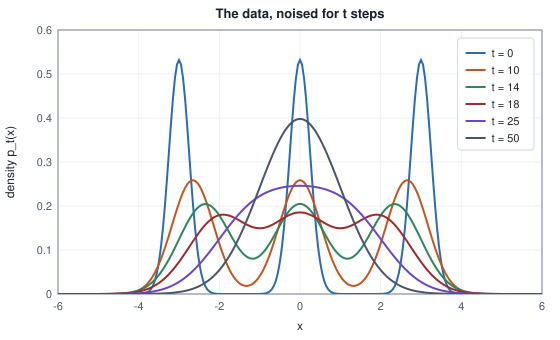

<!-- SPDX-License-Identifier: CC-BY-4.0 -->
<!-- Copyright (c) 2026 Martin Schröder <info@swedishembedded.com> -->

# Diffusion Models

*How can a model learn to create an image by learning to remove noise?*

Take a set of numbers that fall in three narrow clusters centred at $-3$, $0$ and $3$, and pick one of them, say $2.9$, a point in the cluster centred at $3$. Add a little noise to it, and again, and again, fifty times in all. After the first few additions it is still close to $2.9$. After twenty it has wandered so far that it could as easily have started in the cluster at $0$ as in the one at $3$, and after fifty nothing of the original is left: the number is, to within a part in a thousand, a draw from a standard normal distribution. That much is only addition. The question is whether the film can be run backwards: whether a model that has seen many such films can take a number that is pure noise and walk it, one small step at a time, to a point in one of the three clusters.

There is a reason to hope. Each addition is a tiny Gaussian step, and the reverse of a tiny Gaussian step is, as shown below, also Gaussian, with a mean that depends on the one thing the sampler does not know, which is what the clean number was. A network can be asked to guess that, and a guess is a regression: a squared error against a target that the training procedure itself supplies. No density has to be written down, no bound is loose, and no second network plays a game against the first. The price, which Chapter 4 ended on, is that sampling takes many steps instead of one.

The derivation needs five earlier ideas: how Gaussians combine, what a generative model offers, what a squared error is minimized by, the decay equation and the blur of a squared-error decoder. Bring them back first.

1. (Volume I, [Chapter 11](../v01-mathematics/11-distributions.md), Gaussian distribution.) If $X \sim \mathcal{N}(\mu, \sigma^2)$ and $Z \sim \mathcal{N}(0, 1)$ are independent, what is the distribution of $aX + bZ$ for two constants $a$ and $b$?
2. ([Chapter 1](01-generative-modeling.md), generative models.) What can a generative model offer, and which of the two offers does ancestral sampling need?
3. (Volume II, [Chapter 2](../v02-learning/02-linear-regression.md), mean squared error.) Which single number $c$ minimizes $\mathbb{E}(Y - c)^2$, and what is the minimum? What changes if the prediction may depend on a second variable $X$?
4. (Volume I, [Chapter 9](../v01-mathematics/09-integrals-and-odes.md), ordinary differential equations.) What is the solution of $dy/dt = -k\,y$ with $y(0) = 1$?
5. ([Chapter 3](03-vector-quantization.md), the blur.) Why does a decoder trained on a squared error output the average of the pictures its code cannot tell apart?

Everything below is written for one real number. An image is a vector of numbers, every entry is noised with a draw of its own and every squared error is averaged over the entries, so nothing changes except the bookkeeping. The data are the three clusters of the opening, which are also those of Chapter 4: centres $-3$, $0$ and $3$, each of standard deviation $0.25$ and weight $1/3$, because for them every quantity below can be computed exactly and a trained network can be checked against the exact answer.

## Noise that can be added in one jump

A step of the **forward noising process** takes the previous value $x_{t-1}$, shrinks it a little and adds fresh Gaussian noise:

$$
x_t = \sqrt{1 - \beta_t}\;x_{t-1} + \sqrt{\beta_t}\;\varepsilon_t, \qquad \varepsilon_t \sim \mathcal{N}(0, 1) \text{ independent}, \quad t = 1, \dots, T.
$$

The numbers $\beta_t \in (0, 1)$ are the **noise schedule**: how much variance is added at step $t$. The shrinking factor is there so that the variance stays where it started. If $x_{t-1}$ has variance $1$, then $x_t$ has variance $(1 - \beta_t) + \beta_t = 1$, so the chain never blows up or fades away, however long it runs. Write $\alpha_t = 1 - \beta_t$.

Adding noise fifty times sounds like fifty draws, but the chain collapses to one. Two steps show how. Substituting the first step into the second,

$$
x_2 = \sqrt{\alpha_2}\bigl(\sqrt{\alpha_1}\,x_0 + \sqrt{\beta_1}\,\varepsilon_1\bigr) + \sqrt{\beta_2}\,\varepsilon_2 = \sqrt{\alpha_1\alpha_2}\;x_0 + \bigl(\sqrt{\alpha_2\beta_1}\,\varepsilon_1 + \sqrt{\beta_2}\,\varepsilon_2\bigr).
$$

The bracket is a sum of two independent Gaussians, so by Recall question 1 it is a Gaussian with mean zero and variance $\alpha_2\beta_1 + \beta_2 = \alpha_2(1 - \alpha_1) + 1 - \alpha_2 = 1 - \alpha_1\alpha_2$. It can therefore be written as $\sqrt{1 - \alpha_1\alpha_2}$ times one standard normal draw. The same argument at every further step (the new noise has variance $\beta_t = 1 - \alpha_t$ and the old noise is shrunk by $\alpha_t$, so the variance $1 - \bar\alpha_{t-1}$ becomes $\alpha_t(1 - \bar\alpha_{t-1}) + 1 - \alpha_t = 1 - \bar\alpha_t$) gives, with the running product $\bar\alpha_t = \alpha_1\alpha_2\cdots\alpha_t$,

$$
x_t = a_t\,x_0 + b_t\,\varepsilon, \qquad a_t = \sqrt{\bar\alpha_t},\quad b_t = \sqrt{1 - \bar\alpha_t},\quad \varepsilon \sim \mathcal{N}(0, 1).
$$

This is the reparameterization trick of Chapter 2 once more: a draw from a distribution written as a deterministic function of the clean value and one standard normal. It is the reason training is cheap, because a noisy value at any step comes in one jump from $x_0$ and a single noise draw, without simulating the steps in between. The pair $(a_t, b_t)$ lies on the unit circle ($a_t^2 + b_t^2 = 1$), and the ratio of the squares, $\mathrm{SNR}_t = a_t^2/b_t^2 = \bar\alpha_t/(1 - \bar\alpha_t)$, is the **signal-to-noise ratio**: the variance of the signal part over the variance of the noise part.

A schedule is then any of three equivalent lists, the $\beta_t$, the $\bar\alpha_t$ or the $\mathrm{SNR}_t$, and the continuous version of the idea is an old friend. Taking logarithms, $\ln\bar\alpha_t = \sum_s \ln(1 - \beta_s) \approx -\sum_s \beta_s$ when the steps are small, so that in continuous time $d\bar\alpha/dt = -\beta(t)\,\bar\alpha$: the decay equation of Volume I, Chapter 9, with the schedule as its rate. A schedule is a rule for how fast the signal decays.

The chain used throughout has $T = 50$ steps with $\beta_t$ rising linearly from $0.001$ to $0.25$. The table gives the quantities of the jump at a few steps, and checks the closed form against the step-by-step recursion for the mean and the variance of a cluster.

<!-- worked: diffusion.schedule_table -->
The chain of 50 steps with beta_t = 0.001 + (0.25 - 0.001) (t - 1) / 49 for t = 1 .. 50, abar_t = (1 - beta_1) ... (1 - beta_t), a_t = sqrt(abar_t), b_t = sqrt(1 - abar_t) and the signal-to-noise ratio abar_t / (1 - abar_t). The products are taken in increasing t.

| t | beta_t | abar_t | a_t | b_t | abar_t / (1 - abar_t) |
|---|---:|---:|---:|---:|---:|
| 1 | 0.0010 | 0.9990 | 0.9995 | 0.0316 | 999 |
| 2 | 0.0061 | 0.9929 | 0.9965 | 0.0841 | 140.3 |
| 5 | 0.0213 | 0.9453 | 0.9723 | 0.2339 | 17.28 |
| 10 | 0.0467 | 0.7845 | 0.8857 | 0.4642 | 3.641 |
| 20 | 0.0976 | 0.3605 | 0.6005 | 0.7997 | 0.5638 |
| 30 | 0.1484 | 0.0942 | 0.3069 | 0.9517 | 0.104 |
| 40 | 0.1992 | 0.0135 | 0.1163 | 0.9932 | 0.0137 |
| 50 | 0.2500 | 0.0010 | 0.0320 | 0.9995 | 0.001027 |

The largest difference over the 50 steps between the mean and variance of a cluster (centre 3, standard deviation 0.25) carried step by step and the closed form is below 1e-12.
<!-- /worked -->

Read the columns as a clock. Up to $t = 10$ the signal dominates ($\mathrm{SNR} > 3$); at $t = 20$ the noise already has the larger variance ($\mathrm{SNR} = 0.56$); at $t = 30$ the signal is a tenth of the noise, and at $t = 50$ the coefficient on $x_0$ is $a_{50} = 0.032$. The data are not quite gone, only too faint to see. That small remainder will matter in a moment.

## What the noise does to the distribution

A single number is one film. What the sampler will need is the distribution of $x_t$ over all films, call its density $p_t$, because walking backwards means moving from $p_T$ to $p_0 = p_{\text{data}}$. For a Gaussian cluster this is easy. If $x_0 \sim \mathcal{N}(m, s^2)$ then $x_t = a_t x_0 + b_t\varepsilon$ is Gaussian with mean $a_t m$ and variance $s^2 a_t^2 + b_t^2$ (again Recall question 1), so the noised mixture is the mixture of the noised clusters:

$$
p_t(x) = \tfrac13 \sum_{k} \mathcal{N}\bigl(x;\; a_t m_k,\; s^2 a_t^2 + b_t^2\bigr), \qquad m_k \in \{-3, 0, 3\},\; s = 0.25.
$$

The three bumps slide toward the origin, since their centres are $a_t m_k$, and widen, since their variance moves from $s^2$ toward $1$. The table follows the density at the middle cluster and in the valley between the clusters at $0$ and $3$, counts the local maxima on a grid, and measures how far $p_t$ is from the standard normal in Kullback-Leibler divergence.

<!-- worked: diffusion.noised_marginals -->
The three clusters (centres -3, 0, 3, standard deviation 0.25, weight 1/3 each) after t steps of the chain: p_t(x) = (1/3) sum_k N(x; a_t m_k, a_t^2 0.25^2 + b_t^2). The valley is x = 1.5, between the clusters at 0 and 3, and 'valley / peak' is p_t(1.5) / p_t(0), the peak being the density at the centre of the middle cluster. Modes are local maxima on the grid -8, -7.99, ..., 8. The distance is KL(p_t || N(0, 1)) in nats by the midpoint rule with step 0.002 on [-12, 12].

| t | p_t(0) | p_t(1.5) | valley / peak | modes | KL(p_t \|\| N(0, 1)) |
|---|---:|---:|---:|---:|---:|
| 0 | 0.5319 | 0.0000 | 3.05e-08 | 3 | 2.8189 |
| 5 | 0.3942 | 0.0001 | 0.000199 | 3 | 2.3809 |
| 10 | 0.2586 | 0.0242 | 0.0938 | 3 | 1.5703 |
| 14 | 0.2047 | 0.1015 | 0.496 | 3 | 1.0073 |
| 18 | 0.1854 | 0.1669 | 0.9 | 3 | 0.5931 |
| 25 | 0.2460 | 0.1830 | 0.744 | 1 | 0.1646 |
| 35 | 0.3617 | 0.1443 | 0.399 | 1 | 0.0085 |
| 50 | 0.3979 | 0.1299 | 0.327 | 1 | 0.0000 |
<!-- /worked -->



The picture of the table is a distribution being melted. For the first ten steps the clusters stay distinct and only blur; the valley fills in between $t = 14$ and $t = 18$ (at $t = 18$ it is $90\%$ of the peak but the three modes survive), and by $t = 25$ there is a single mode. The divergence from the standard normal falls from $2.82$ nats at $t = 0$ to $0.16$ at $t = 25$ and to a number that rounds to $0.0000$ at $t = 50$. Two consequences follow, one for the sampler and one for the training.

The sampler's starting point is known. If $p_T$ is the standard normal to a good approximation, then drawing from $p_T$ needs no model at all, only `normal()`. That is the defining feature of the whole approach: all the learning is in the walk, none is in the start. And the training will see inputs from every stage of the melt, from the sharply peaked $p_0$ to the featureless $p_{50}$, so the network must serve a distribution that changes character along the way: at small $t$ it is deciding which narrow cluster a value belongs to, at large $t$ nearly all it can do is shrink.

## How fast to destroy the signal

The schedule is a design choice, and the choice shows up in how the information is spent. Roughly, a signal-to-noise ratio that stays high for most of the chain spends most steps on fine detail, and one that falls quickly spends them on the coarse decisions that make an image. The discrete schedulers of brain carry three schedules, named `BetaSchedule::Linear`, `ScaledLinear` and `SquaredcosCapV2` in `crates/diffusion/src/discrete.rs`. The linear one is the chapter's chain: $\beta_t$ equally spaced between a first and a last value. The scaled linear one, which Stable Diffusion XL (SDXL) ships with $\beta$ from $0.00085$ to $0.012$ in $1000$ steps, spaces the square roots equally and squares them. The cosine one is defined through the product directly, by $\bar\alpha(s) = \cos^2\bigl(\tfrac{s + 0.008}{1.008}\cdot\tfrac{\pi}{2}\bigr)$ at $s = t/T$, with $\beta_t = \min\bigl(1 - \bar\alpha(\tfrac{t}{T})/\bar\alpha(\tfrac{t-1}{T}),\,0.999\bigr)$. The cap of $0.999$ stops the last factor from reaching zero.

<!-- worked: diffusion.schedules_compared -->
Each schedule has 1000 steps; abar_t = (1 - beta_1) ... (1 - beta_t) in float64, t counted from 1 (the entry of brain's table with index t - 1). Linear: beta from 0.0001 to 0.02. Scaled linear (SDXL): the square root of beta from sqrt(0.00085) to sqrt(0.012) in 1000 equal steps, squared. Cosine: abar(s) = cos((s + 0.008) / 1.008 * pi / 2)^2, beta_i = min(1 - abar((i + 1) / 1000) / abar(i / 1000), 0.999) for i = 0 .. 999. 'First t below' is the smallest t at which abar_t falls below the threshold.

| schedule | abar_250 | abar_500 | abar_750 | abar_1000 | SNR at t = 1000 | first t below 1/2 | first t below 0.01 |
|---|---:|---:|---:|---:|---:|---:|---:|
| linear | 0.524 | 0.0786 | 0.00335 | 4.04e-05 | 4.04e-05 | 260 | 674 |
| scaled linear | 0.675 | 0.278 | 0.0566 | 0.00466 | 0.00468 | 355 | 934 |
| cosine | 0.847 | 0.494 | 0.144 | 2.43e-09 | 2.43e-09 | 497 | 936 |

The chain of this chapter ends at abar_50 = 1.026e-03, a signal-to-noise ratio of 1.027e-03.
<!-- /worked -->


The linear schedule loses half its signal variance ($\bar\alpha < 1/2$) after $260$ steps of $1000$; the scaled linear one after $355$; the cosine one after $497$. The cosine schedule stays gentle for the first half and then falls steeply, which is the shape a log-SNR plot makes visible: the three curves cross zero (equal signal and noise) at very different fractions of the chain, and end very far apart.

The last column deserves a second look. SDXL's schedule ends with $\bar\alpha_{1000} = 0.00466$, a signal-to-noise ratio of $0.0047$: the final noised value still carries a copy of the image, $a_{1000} = 0.068$ of it. The sampler, however, starts from pure noise. The model is never shown at training time the exact input it will be given at the first sampling step. A schedule whose terminal ratio is zero removes the mismatch, and the cosine schedule above gets within $2.4 \times 10^{-9}$ of that. In brain the choice is left to the model's configuration, and it is a fact of the checkpoint, not of the sampler: a checkpoint trained with a schedule must be sampled with the same one.

A last detail is numerical and belongs here because the schedule is a product of a thousand numbers close to one. The partial products can be rounded to 32 bits after every multiplication, or accumulated in 64 bits and rounded once per entry. The two disagree in the sixth digit:

<!-- worked: diffusion.product_order -->
The scaled-linear schedule of SDXL, beta computed in float64 and rounded to float32 (round to nearest). Left: every factor 1 - beta_t is rounded to float32 and every partial product too. Right: the product is accumulated in float64 from the same float32 betas and rounded to float32 once, at the end of each entry.

| quantity | float32 partial products | float64 accumulator |
|---|---:|---:|
| abar_1000 | 0.0046600895 | 0.0046600983 |
| abar_500 | 0.2776694894 | 0.2776696384 |
| largest relative difference over the 1000 entries | 2.079e-06 | reference |
<!-- /worked -->

The difference, a few parts in a million, is far smaller than anything a picture would show and is large against what a parity test can tolerate. The product in brain is accumulated in 64-bit arithmetic (`DiscreteConfig::alphas_cumprod`), and the history in the last section says why.

## The reverse of a small step

Now the film runs backwards. Suppose for a moment that the sampler knew the clean value $x_0$ as well as the current $x_t$. What would be the distribution of $x_{t-1}$? Bayes' rule says it is proportional to the product of two Gaussians that are known exactly. Given $x_0$, the value $x_{t-1}$ is $\mathcal{N}(\sqrt{\bar\alpha_{t-1}}\,x_0,\; 1 - \bar\alpha_{t-1})$ by the jump formula, and given $x_{t-1}$, the next value $x_t$ is $\mathcal{N}(\sqrt{\alpha_t}\,x_{t-1},\; \beta_t)$ by the definition of a step (the step does not depend on $x_0$ once $x_{t-1}$ is known). A product of two Gaussians in $x_{t-1}$ is a Gaussian, whose precision, the reciprocal of the variance, is the sum of the two precisions:

$$
\frac{1}{\tilde\beta_t} = \frac{\alpha_t}{\beta_t} + \frac{1}{1 - \bar\alpha_{t-1}} = \frac{\alpha_t(1 - \bar\alpha_{t-1}) + \beta_t}{\beta_t(1 - \bar\alpha_{t-1})} = \frac{1 - \bar\alpha_t}{\beta_t(1 - \bar\alpha_{t-1})},
$$

because $\alpha_t(1 - \bar\alpha_{t-1}) + \beta_t = \alpha_t - \bar\alpha_t + 1 - \alpha_t = 1 - \bar\alpha_t$. The mean is the variance times the sum of the two precision-weighted centres, which, with the same simplification, is

$$
\tilde\mu_t(x_t, x_0) = \frac{\sqrt{\bar\alpha_{t-1}}\,\beta_t}{1 - \bar\alpha_t}\,x_0 + \frac{\sqrt{\alpha_t}\,(1 - \bar\alpha_{t-1})}{1 - \bar\alpha_t}\,x_t, \qquad \tilde\beta_t = \frac{1 - \bar\alpha_{t-1}}{1 - \bar\alpha_t}\,\beta_t.
$$

Replace $x_0$ by what it is in terms of $x_t$ and the noise that made it, $x_0 = (x_t - b_t\varepsilon)/a_t$. Since $\sqrt{\bar\alpha_{t-1}}/a_t = 1/\sqrt{\alpha_t}$, the coefficient of $x_t$ becomes $\bigl[\alpha_t(1 - \bar\alpha_{t-1}) + \beta_t\bigr]/\bigl(\sqrt{\alpha_t}\,(1 - \bar\alpha_t)\bigr) = 1/\sqrt{\alpha_t}$ and the coefficient of $\varepsilon$ becomes $-\beta_t b_t/\bigl(\sqrt{\alpha_t}(1 - \bar\alpha_t)\bigr) = -\beta_t/(\sqrt{\alpha_t}\,b_t)$:

$$
\tilde\mu_t = \frac{1}{\sqrt{\alpha_t}}\Bigl(x_t - \frac{\beta_t}{b_t}\,\varepsilon\Bigr).
$$

In words: the best place to step back to is the current value with the share of the noise that was added by this step taken out, and then rescaled by the factor the forward step shrank by. The table computes the mean and the variance three ways for one set of numbers, by multiplying the two Gaussians directly, by the formula in $x_0$ and $x_t$, and by the formula in $x_t$ and the noise.

<!-- worked: diffusion.reverse_posterior -->
t = 20, x_0 = 2.9, noise = 0.7, so x_t = a_t x_0 + b_t noise = 2.3010865623, beta_t = 0.097551, abar_t = 0.3605492816, abar_(t-1) = 0.3995231750. The three ways of writing the mean and variance of p(x_(t-1) | x_t, x_0):

| route | mean | variance |
|---|---:|---:|
| product of the two Gaussians | 2.3323741038 | 0.0916053815 |
| closed form in x_0 and x_t | 2.3323741038 | 0.0916053815 |
| closed form in x_t and the noise | 2.3323741038 | 0.0916053815 |

The three means and the two variances agree to below 1e-12.
<!-- /worked -->

A sampler does not know $\varepsilon$. But it only needs a number for it, and a trained network $\varepsilon_\theta(x_t, t)$ can supply an estimate. The reverse step is then a Gaussian draw with the posterior's variance and a mean in which $\varepsilon_\theta$ replaces the unknown noise:

$$
x_{t-1} = \frac{1}{\sqrt{\alpha_t}}\Bigl(x_t - \frac{\beta_t}{b_t}\,\varepsilon_\theta(x_t, t)\Bigr) + \sqrt{\tilde\beta_t}\,z, \qquad z \sim \mathcal{N}(0, 1) \text{ (and } z = 0 \text{ at } t = 1\text{)}.
$$

At $t = 1$ the variance $\tilde\beta_1$ is $0$ anyway because $\bar\alpha_0 = 1$, so the last step adds nothing.

Why is the reverse of one step Gaussian when the clean value is *not* known? For the marginal chain, a step back is a Gaussian only approximately, and the approximation is good when the steps are small (a classical result of the theory of diffusion processes, on which Sohl-Dickstein and colleagues built the first diffusion models; Anderson's reverse-time equation is its continuous form). The chain here has large steps at its end ($\beta_{50} = 0.25$), so the approximation will be visibly imperfect there, and that is a fair price for keeping the table short; SDXL's $\beta$ never exceeds $0.012$.

## Training by predicting the noise

The reverse chain is a latent variable model with latents $x_1, \dots, x_T$ and the data $x_0$, exactly the setting of Chapter 2, so its training objective is a bound on the log-likelihood. The bound splits into one term per step. At step $t$ it is the Kullback-Leibler divergence between the exact reverse step $q(x_{t-1}\mid x_t, x_0) = \mathcal{N}(\tilde\mu_t, \tilde\beta_t)$ and the model's $p_\theta(x_{t-1}\mid x_t) = \mathcal{N}(\mu_\theta, \tilde\beta_t)$. Two Gaussians of the same variance differ by $(\tilde\mu_t - \mu_\theta)^2/(2\tilde\beta_t)$ in KL divergence, and with $\mu_\theta$ written like $\tilde\mu_t$ but with $\varepsilon_\theta$ for $\varepsilon$ the difference of means is $\frac{\beta_t}{\sqrt{\alpha_t}\,b_t}(\varepsilon - \varepsilon_\theta)$, so

$$
D_{\mathrm{KL}}\bigl(q \,\Vert\, p_\theta\bigr) = \frac{\beta_t^2}{2\tilde\beta_t\,\alpha_t\,(1 - \bar\alpha_t)}\;\bigl(\varepsilon - \varepsilon_\theta(x_t, t)\bigr)^2 .
$$

The likelihood bound is a sum of squared errors on the noise, each with a weight $w_t = \beta_t^2/(2\tilde\beta_t\alpha_t(1 - \bar\alpha_t))$ that simplifies to $\beta_t/(2\alpha_t(1 - \bar\alpha_{t-1}))$. The table shows how unevenly the bound spends its effort:

<!-- worked: diffusion.bound_weights -->
The weight w_t of (noise - estimate)^2 in the t-th term of the bound, w_t = beta_t^2 / (2 tilde-beta_t alpha_t (1 - abar_t)), for the chain of the chapter (tilde-beta_t = (1 - abar_(t-1)) beta_t / (1 - abar_t)).

| t | beta_t | tilde-beta_t | w_t |
|---|---:|---:|---:|
| 2 | 0.00608 | 0.00086 | 3.059 |
| 5 | 0.0213 | 0.0133 | 0.3194 |
| 10 | 0.0467 | 0.0384 | 0.1385 |
| 20 | 0.0976 | 0.0916 | 0.09001 |
| 30 | 0.148 | 0.146 | 0.09794 |
| 40 | 0.199 | 0.199 | 0.1265 |
| 50 | 0.25 | 0.25 | 0.1669 |
<!-- /worked -->

The weight of the second step is about $3.06$, thirty-four times the weight at $t = 20$, the smallest in the table. Ho, Jain and Abbeel observed that the plain unweighted average produces better samples than the true bound: it down-weights the nearly clean steps, which train the network to remove very little noise, so that the network can spend its capacity on the harder steps at larger $t$. The training objective used ever since is that average:

$$
\mathcal{L}(\theta) = \mathbb{E}_{t \sim \mathrm{Uniform}\{1..T\}}\;\mathbb{E}_{x_0 \sim p_{\text{data}}}\;\mathbb{E}_{\varepsilon \sim \mathcal{N}(0,1)}\;\bigl(\varepsilon - \varepsilon_\theta(a_t x_0 + b_t\varepsilon,\; t)\bigr)^2 .
$$

Call it the **denoising objective**: the network is handed a noisy value and the step number and is scored on how well it recovers the noise that was added. A network trained with it is doing **epsilon prediction**: its output is read as an estimate of $\varepsilon$. As an algorithm, in the book's pseudocode, one training loss on a batch is:

```text
function noise_loss(theta, abar: array<real>[51], T: int, B: int, rng: Generator) -> real:
    require B > 0, "empty batch"
    total = 0.0
    for n in 0 .. B:                                # items in batch order
        t = rng.integer(T) + 1
        x0 = draw_data(rng)                         # a cluster by integer(3), then the offset by normal()
        e = rng.normal()
        xt = sqrt(abar[t]) * x0 + sqrt(1 - abar[t]) * e
        total = total + (eps_theta(theta, xt, t) - e) ^ 2
    return total / B
```

with the two routines it calls defined by the toy of this chapter (three clusters, centres $-3$, $0$, $3$, width $0.25$; the network of the section "A noise predictor small enough to check", whose parameters `theta` are stored in the order $\mathbf{W}_1, \mathbf{b}_1, \mathbf{W}_2, \mathbf{b}_2, \mathbf{w}_3, b_3$, each matrix row-major):

```text
function draw_data(rng: Generator) -> real:
    k = rng.integer(3)                              # the cluster, drawn first
    return [-3.0, 0.0, 3.0][k] + 0.25 * rng.normal()

function eps_theta(theta, x: real, t: int) -> real:
    tau = t / 50                                    # the step as a fraction of the chain
    h1 = zeros(real, [32])
    for i in 0 .. 32:
        h1[i] = tanh(W1[i, 0] * x + W1[i, 1] * tau + b1[i])
    h2 = zeros(real, [32])
    for j in 0 .. 32:
        h2[j] = tanh(dot(W2[j, :], h1) + b2[j])
    return dot(w3, h2) + b3
```

The loss is a plain regression, and a regression has a floor. From Recall question 3, the squared error is smallest at the conditional mean, so the best any function of $(x_t, t)$ can do is $\varepsilon^\star(x_t, t) = \mathbb{E}[\varepsilon \mid x_t]$, and the least loss at step $t$ is $\mathbb{E}\varepsilon^2 - \mathbb{E}[\varepsilon^{\star 2}] = 1 - \mathbb{E}[\varepsilon^{\star 2}]$. For the clusters, everything is Gaussian inside a cluster. Given that $x_0$ came from cluster $k$, the pair $(x_0, x_t)$ is jointly Gaussian and the posterior mean of $x_0$ is $m_k + \frac{a_t s^2}{s^2 a_t^2 + b_t^2}(x_t - a_t m_k)$; the cluster's weight is its prior $\tfrac13$ times the density of $x_t$ under it. The posterior mean of $x_0$ given only $x_t$ is the weighted average over the three clusters, and the noise estimate follows from $x_t = a_t x_0 + b_t\varepsilon$: $\varepsilon^\star = (x_t - a_t\,\mathbb{E}[x_0\mid x_t])/b_t$. The first table below is the floor; the **exact denoiser** at three steps and four noisy values is tabulated in the next section.

<!-- worked: diffusion.floor_table -->
The least mean squared error of any predictor of the noise from (x_t, t), computed from the exact denoiser: 1 - E[E(noise | x_t)^2], the expectation by the midpoint rule with step 0.005 on [-14, 14]. The weights of the three clusters in the exact denoiser are computed as a softmax in the log domain, the largest log-weight subtracted before exponentiating, because at t = 1 and 2 the density of a far cluster underflows otherwise.

| t | least error |
|---|---:|
| 1 | 0.9842 |
| 2 | 0.8977 |
| 5 | 0.5195 |
| 10 | 0.2938 |
| 20 | 0.6578 |
| 30 | 0.3794 |
| 40 | 0.0767 |
| 50 | 0.0062 |

The mean over the 50 steps (the least value of the training loss when t is uniform) is 0.3682.
<!-- /worked -->

The floor is a map of where the work is. At $t = 1$ it is $0.984$: the noise is so small that a value like $2.9 + 0.03\,\varepsilon$ gives no way to tell how much of its distance from the cluster centre is noise and how much is the cluster's own width of $0.25$. At $t = 20$, where the three bumps merge, it rises again to $0.66$ because the cluster itself is ambiguous. Only at large $t$ does it fall toward zero, since then $x_t \approx b_t\varepsilon$ and the noise is simply the value. The mean over the steps, $0.368$, is what a perfect training run would reach. Unlike the loss of Chapter 4's game, the loss here is measured against a floor that does not move, and a fall toward it is progress.

## The score hidden in the noise estimate

The noise estimate has a second meaning, and the second meaning is what the following chapters build on. The **score function** of a density $p_t$ is the slope of its logarithm, $s(x, t) = \frac{\partial}{\partial x}\ln p_t(x)$: at every point it says which way the density rises and how steeply. It is the direction a particle would move to become more probable, and it is unaffected by the normalizing constant, which is usually impossible to compute.

The score of the noised data equals the noise estimate, up to a factor. Write the density as $p_t(x) = \int p_{\text{data}}(x_0)\,\mathcal{N}(x; a_t x_0, b_t^2)\,dx_0$ and differentiate under the integral. The slope of the Gaussian is $-(x - a_t x_0)/b_t^2\,\mathcal{N}(\cdot)$, and dividing by $p_t$ turns the weights $p_{\text{data}}(x_0)\mathcal{N}(\cdot)/p_t$ into the posterior of $x_0$ given $x_t = x$:

$$
s(x, t) = -\,\mathbb{E}\!\left[\frac{x - a_t x_0}{b_t^2}\;\middle|\; x_t = x\right] = -\frac{1}{b_t}\,\mathbb{E}[\varepsilon \mid x_t = x] = -\frac{\varepsilon^\star(x, t)}{b_t}.
$$

A network trained to predict the noise has therefore learned the score of the noised data, $s_\theta = -\varepsilon_\theta/b_t$, and the denoising objective is a weighted case of **denoising score matching**, whose weight on the error of the score is $b_t^2$. The table below checks the identity numerically: at 24 points the score, computed as $-\varepsilon^\star/b_t$ from the closed-form denoiser, differs from a central difference of $\ln p_t$ (step $10^{-5}$) by less than $10^{-6}$.

<!-- worked: diffusion.denoiser_table -->
The exact denoiser of the three clusters at three steps and four noisy values x_t each: the posterior mean E[x_0 | x_t], the noise estimate E[noise | x_t] = (x_t - a_t E[x_0 | x_t]) / b_t and the score -E[noise | x_t] / b_t.

| t | x_t | E[x_0 given x_t] | E[noise given x_t] | -E[noise given x_t] / b_t |
|---|---:|---:|---:|---:|
| 5 | -1.0000 | -0.5340 | -2.0555 | 8.7880 |
| 5 | 0.2500 | 0.1335 | 0.5139 | -2.1970 |
| 5 | 1.0000 | 0.5340 | 2.0555 | -8.7880 |
| 5 | 2.5000 | 2.7774 | -0.8567 | 3.6628 |
| 20 | -1.0000 | -1.6891 | 0.0178 | -0.0223 |
| 20 | 0.2500 | 0.3163 | 0.0751 | -0.0939 |
| 20 | 1.0000 | 1.6891 | -0.0178 | 0.0223 |
| 20 | 2.5000 | 3.0027 | 0.8716 | -1.0900 |
| 35 | -1.0000 | -1.0983 | -0.7999 | 0.8158 |
| 35 | 0.2500 | 0.2882 | 0.1973 | -0.2012 |
| 35 | 1.0000 | 1.0983 | 0.7999 | -0.8158 |
| 35 | 2.5000 | 2.2136 | 2.1064 | -2.1482 |

At 24 further values of x_t (at each of the three steps, x_t = (k - 4) a_t + 0.37 (k mod 3) for k = 0 .. 7) the score -E[noise | x_t] / b_t differs from the central difference of ln p_t(x_t) (step 1e-5) by less than 1e-6.
<!-- /worked -->

The numbers read as directions. At $t = 20$, $x_t = 2.5$ has score $-1.09$: it lies to the right of the cluster that sits at $a_{20}\cdot 3 = 1.80$, and the score points left, back toward the cluster. At $t = 35$, $x_t = -1$ has a positive score, $+0.82$, pointing toward the merged mass near zero. The posterior mean $\mathbb{E}[x_0\mid x_t]$ is the same information as the score read as a position: it says where the clean value is expected to be. Because it is an average over clusters it is the blurred answer of Chapter 3, and this is why one jump is not enough. Taking $x_{50}$ and jumping straight to $\mathbb{E}[x_0\mid x_{50}]$ would put every sample near the average of the data, at the centre. The sampler walks in small steps, adding fresh noise between them, so that each step's blur is a small one and the cluster is decided gradually.

## Three things to ask the network for

The network has been asked for the noise, but nothing forces that. The triple $(x_0, \varepsilon, x_t)$ has one relation, $x_t = a_t x_0 + b_t\varepsilon$, so either of $x_0$ and $\varepsilon$ determines the other given $x_t$, and a third target, the velocity $v = a_t\varepsilon - b_t x_0$, determines both. The pair $(x_t, v)$ is a rotation of the pair $(\varepsilon, x_0)$ by the angle whose cosine is $a_t$ and sine $b_t$:

$$
\begin{pmatrix} x_t \\ v \end{pmatrix} = \begin{pmatrix} a_t & b_t \\ -b_t & a_t \end{pmatrix}\begin{pmatrix} x_0 \\ \varepsilon \end{pmatrix}, \qquad x_0 = a_t x_t - b_t v, \quad \varepsilon = b_t x_t + a_t v ,
$$

the inverse of a rotation being its transpose. Training a network to output $v$ is **v-prediction**; training it to output $x_0$ is the clean-value prediction brain's code calls `Prediction::Sample`. All three carry the same information, and the table converts among them for one pair $(x_0 = 2.9, \varepsilon = 0.7)$ at four steps.

<!-- worked: diffusion.targets_table -->
x_0 = 2.9, noise = 0.7. x_t = a_t x_0 + b_t noise and v = a_t noise - b_t x_0. The clean value recovered from (x_t, noise) as (x_t - b_t noise) / a_t and from (x_t, v) as a_t x_t - b_t v; the noise recovered from (x_t, x_0) as (x_t - a_t x_0) / b_t and from (x_t, v) as b_t x_t + a_t v.

| t | x_t | v | x_0 from noise | x_0 from v | noise from x_0 | noise from v |
|---|---:|---:|---:|---:|---:|---:|
| 1 | 2.920686 | 0.607944 | 2.900000 | 2.900000 | 0.700000 | 0.700000 |
| 10 | 2.893558 | -0.726171 | 2.900000 | 2.900000 | 0.700000 | 0.700000 |
| 25 | 1.917752 | -2.285219 | 2.900000 | 2.900000 | 0.700000 | 0.700000 |
| 50 | 0.792532 | -2.876090 | 2.900000 | 2.900000 | 0.700000 | 0.700000 |

The largest difference from the true x_0 or noise over the four rows is below 1e-12.
<!-- /worked -->

So why more than one? Because a network is never exact, and what an error costs depends on the target. Suppose the noise estimate is off by $d$. The clean value that estimate implies, $(x_t - b_t(\varepsilon + d))/a_t$, is off by $b_t d/a_t$, the ratio $b_t/a_t = 1/\sqrt{\mathrm{SNR}_t}$. At $t = 1$ that factor is $0.032$ and the error shrinks; at $t = 50$ it is $31$, and a small error in the noise estimate becomes a large one in the image. For the velocity, the implied error in $x_0$ is $b_t d$ and in $\varepsilon$ is $a_t d$, never more than $d$. The same factors give the weights each loss puts on the error of the implied clean value. A loss on $x_0$ weights it by $1$; a loss on $\varepsilon$ by $a_t^2/b_t^2 = \mathrm{SNR}_t$; a loss on $v$, since $\delta v = -\delta x_0/b_t$, by $1/b_t^2 = \mathrm{SNR}_t + 1$.

<!-- worked: diffusion.error_table -->
For each step: the signal-to-noise ratio SNR = a_t^2 / b_t^2; the error of the clean value x_0 implied by a noise estimate that is off by 1 (it is b_t / a_t); the error of x_0 implied by a velocity estimate that is off by 1 (it is b_t); and the weight each loss puts on the squared error of the implied clean value: 1 for the loss on x_0, SNR for the loss on the noise, SNR + 1 for the loss on the velocity.

| t | SNR | x_0 error per unit noise error | x_0 error per unit velocity error | weight, x_0 loss | weight, noise loss | weight, velocity loss |
|---|---:|---:|---:|---:|---:|---:|
| 1 | 999 | 0.03164 | 0.03162 | 1 | 999 | 1000 |
| 5 | 17.28 | 0.2406 | 0.2339 | 1 | 17.28 | 18.28 |
| 10 | 3.641 | 0.5241 | 0.4642 | 1 | 3.641 | 4.641 |
| 20 | 0.5638 | 1.332 | 0.7997 | 1 | 0.5638 | 1.564 |
| 30 | 0.104 | 3.101 | 0.9517 | 1 | 0.104 | 1.104 |
| 40 | 0.0137 | 8.543 | 0.9932 | 1 | 0.0137 | 1.014 |
| 50 | 0.001027 | 31.2 | 0.9995 | 1 | 0.001027 | 1.001 |

Check on 1000 draws from `diffusion.targets` (seed 0xc4606e7f6288addc) (per draw: t = integer(50) + 1, then x_0, noise and an error d = 0.1 normal(), each by normal(), in this order): the squared noise error equals SNR times the squared x_0 error, and the squared velocity error equals (SNR + 1) times it, with a largest relative difference below 1e-9.
<!-- /worked -->

The weights say what the plain noise loss has been doing without being asked. It cares about the error of the clean value in proportion to the signal-to-noise ratio, so it all but ignores the high-noise steps ($\mathrm{SNR}_{50} = 0.001$), where the clusters of the toy are being merged and, in an image, the coarse layout is still undecided. The velocity loss puts a floor of $1$ under the weight and so never ignores them. There is one more reason, at the end of the chain. If the schedule reaches zero signal ($a_T = 0$) the noise estimate cannot determine $x_0$ at all, since $(x_t - b_T\varepsilon)/a_T$ is $0/0$, while $x_0 = a_T x_t - b_T v$ is perfectly fine. That is the setting in which Salimans and Ho introduced the velocity target, and brain's `Prediction` enum has all three because the checkpoints it runs were trained with different ones.

The conversions in brain are the ones above. In `crates/diffusion/src/discrete.rs`, `DdimScheduler::step` computes, from a model output $m$ and $\sqrt{\bar\alpha}$, $\sqrt{1 - \bar\alpha}$ written `sa`, `sb`, the clean value and the noise as `(x - sb*m)/sa` and `m` for $\varepsilon$ prediction, `m` and `(x - sa*m)/sb` for clean-value prediction, and `sa*x - sb*m` and `sa*m + sb*x` for velocity, which are the two rotation formulas verbatim. The unit test `ddim_v_prediction_agrees_with_epsilon` builds the velocity from the definition $v = \sqrt{\bar\alpha}\,\varepsilon - \sqrt{1 - \bar\alpha}\,x_0$ at the first step of a 10-step schedule and asserts that the epsilon scheduler and the v-prediction scheduler take the same step to within $2\times 10^{-5}$, a property that would catch a swapped sign in either branch.

## A noise predictor small enough to check

Everything so far has been about what the network should compute. Here is one that computes it. The input is the pair $(x_t,\ t/50)$, the noisy value and the step as a fraction of the chain; the output is the noise estimate. There are two hidden layers of $32$ units each with the hyperbolic tangent (the library `tanh`), so the network is $\varepsilon_\theta(x, t) = \mathbf{w}_3\cdot\tanh\bigl(\mathbf{W}_2\tanh(\mathbf{W}_1[x,\ t/50]^\top + \mathbf{b}_1) + \mathbf{b}_2\bigr) + b_3$ with $64 + 32 + 1024 + 32 + 32 + 1 = 1185$ parameters. Feeding the step as a plain number is the crudest way of telling a network where in the chain it is, and Chapter 8 replaces it by an embedding. It is enough here.

Each weight matrix is drawn from the book's random number generator with `normal()` divided by the square root of its fan-in ($\sqrt 2$ for $\mathbf{W}_1$, $\sqrt{32}$ for $\mathbf{W}_2$ and $\mathbf{w}_3$), in the order $\mathbf{W}_1$, $\mathbf{W}_2$, $\mathbf{w}_3$, each row by row, the row of $\mathbf{W}_1$ holding the weight on $x$ first and the weight on $t/50$ second. All biases start at $0$. The sums over the input index run in increasing order. The backward pass is written by hand, as in Volume III, and the check is the one of Volume III, Chapter 6, on a network perturbed by $0.1$ times a normal draw per entry so that no entry is accidentally zero:

<!-- worked: diffusion.gradient_check -->
The network from the stream `diffusion.gradcheck` (seed 0xbfe2ec0de9c4a000): init_net, then 0.1 normal() added to every entry in order; a batch of four items drawn item after item (t, cluster, x_0 and noise as in training); the loss is the mean of (out - noise)^2 with tau = t / 50; central differences of step 1e-05. An entry fails when |analytic - numerical| exceeds 1e-6 + 1e-6 max(|analytic|, |numerical|).

| parameters checked | entries failing the gate | worst absolute difference |
|---|---:|---:|
| 1185 | 0 | below 1e-6 |
<!-- /worked -->

The training stream `diffusion.run` (seed `0x2e5527fe0ff61c82`) gives the initial weights and then the training items: for each item, in order, the step $t$ is `integer(50)` plus $1$, the cluster index $k$ is `integer(3)`, the clean value is $x_0 = m_k + 0.25\,z$ with $z$ the next `normal()`, and the noise $\varepsilon$ is the `normal()` after that. A batch is $64$ items; the loss is the mean of $(\text{output} - \varepsilon)^2$; the optimizer is Adam with $\beta_1 = 0.9$, $\beta_2 = 0.999$, $\epsilon = 10^{-8}$, no weight decay, and a rate that falls linearly from $0.003$: at step $s$ it is $0.003\,(1 - (s - 1)/5000)$, for $5000$ steps. The run is scored on $1000$ evaluation items from the stream `diffusion.evaluation` (seed `0x3ab375faa90039a9`), drawn in the same order. Because the exact denoiser is known, the table can report three things at once: the loss of the network, the loss of the best possible predictor on the same items, and the mean squared distance between the two outputs, which is zero for a network that has learned the exact function.

<!-- worked: diffusion.training_table -->
One run: the network of init_net from the stream `diffusion.run` (seed 0x2e5527fe0ff61c82), then batches of 64 items drawn from the same stream in the order of the chapter, Adam with beta1 0.9, beta2 0.999, epsilon 1e-8 and rate 0.003 (1 - (s - 1) / 5000) at step s. After each listed step the network and the exact denoiser are scored on 1000 evaluation items (`diffusion.evaluation` (seed 0x3ab375faa90039a9), each drawn as in training): the mean of (network - noise)^2, the mean of (exact - noise)^2, and the mean of (network - exact)^2. Digits are those shared by the run and four copies with the first weight changed by +1e-12, -1e-12, +3e-12 and -3e-12.

| step | loss of the network | loss of the exact denoiser | mean (network - exact)^2 |
|---|---:|---:|---:|
| 500 | 0.5416 | 0.3906 | 0.1373 |
| 1000 | 0.4995 | 0.3906 | 0.1030 |
| 2000 | 0.4393 | 0.3906 | 0.0376 |
| 3000 | 0.4397 | 0.3906 | 0.0426 |
| 4000 | 0.4309 | 0.3906 | 0.0307 |
| 5000 | 0.4275 | 0.3906 | 0.0250 |
<!-- /worked -->

The loss falls from $0.5416$ after $500$ steps to $0.4275$ after $5000$, against $0.3906$ for the exact denoiser on the same items, and the distance to the exact denoiser falls from $0.1373$ to $0.0250$. (The floor of the evaluation items is $0.3906$ and the quadrature value of the previous table is $0.3682$; the difference is the luck of $1000$ draws.) None of the digits are chaotic: they are the same in the run and in all four nudged copies, which differ in one weight by $10^{-12}$ or $3\times 10^{-12}$, so the table can be reproduced to the printed digits. The loss does not fall at every read-out (step $3000$ is above step $2000$), because the batch changes every step. Splitting the evaluation items by step is more informative than the average, since the network is not equally good everywhere:

<!-- worked: diffusion.band_table -->
The evaluation items of the table above, split by the step t of the item, after the last training step.

| steps t | items | loss of the exact denoiser | loss of the network | mean (network - exact)^2 |
|---|---:|---:|---:|---:|
| 1 .. 10 | 206 | 0.5497 | 0.6367 | 0.0758 |
| 11 .. 20 | 173 | 0.4588 | 0.5389 | 0.0353 |
| 21 .. 30 | 203 | 0.7432 | 0.7596 | 0.0079 |
| 31 .. 40 | 214 | 0.1958 | 0.2003 | 0.0042 |
| 41 .. 50 | 204 | 0.0256 | 0.0296 | 0.0040 |
<!-- /worked -->


The network is good where the answer is smooth and weakest where it is sharp. For $t$ from $31$ to $50$ the mean squared distance from the exact estimate is about $0.004$, and the network's loss is within $0.005$ of the exact denoiser's; for $t \le 10$, where each cluster is narrow, the exact estimate has steep jumps between the clusters (the dashed curve at $t = 5$ in the figure rounds them off), and the distance is $0.0758$, about nineteen times that of the last band. A network with $1185$ weights and a few thousand steps cannot reproduce a function that jumps by several units within a fraction of a unit of its input, and a real image model is in the same position at its lowest noise levels, where it must reproduce detail. That is what the capacity of a U-Net or transformer, Chapter 8, is for.

## Sampling by walking back

A trained noise predictor becomes a generator by the reverse step of the earlier section, repeated. In the book's pseudocode, with $T = 50$, the array `beta` holding $\beta_1, \dots, \beta_T$ and `abar` holding $\bar\alpha_0 = 1, \bar\alpha_1, \dots, \bar\alpha_T$:

```text
function sample(theta, beta: array<real>[50], abar: array<real>[51], rng: Generator) -> real:
    x = rng.normal()
    for t in 50 down to 1:
        e = eps_theta(theta, x, t)
        x = (x - beta[t - 1] / sqrt(1 - abar[t]) * e) / sqrt(1 - beta[t - 1])
        if t > 1:
            var = (1 - abar[t - 1]) / (1 - abar[t]) * beta[t - 1]
            x = x + sqrt(var) * rng.normal()
    return x
```


Here `beta` is indexed from $0$, so `beta[t - 1]` is $\beta_t$. The table draws $1000$ samples at once from the stream `diffusion.sample` (seed `0x58b6a5504aeccd7a`): first the $1000$ starting values, one `normal()` each, then for $t = 50, \dots, 2$ one `normal()` per sample in order. It runs three samplers on the same stream. The first uses the exact denoiser, which tests the sampler itself, apart from any network. The second uses the exact denoiser once, as a single jump from $x_{50}$ to $\mathbb{E}[x_0\mid x_{50}]$. The third is the trained network.

<!-- worked: diffusion.sample_table -->
1000 samples from the stream `diffusion.sample` (seed 0x58b6a5504aeccd7a): first the 1000 starting values x_T = normal(), then, for t = 50, 49, ..., 2, one normal() for each sample in order (none at t = 1). The columns count the samples within 0.75 of each centre; 'elsewhere' is the rest; the spread is the population standard deviation of all samples (divisor the number of samples, not one less; the data's is 2.462). The one jump replaces each x_T by E[x_0 | x_T] and stops. The network row keeps the digits shared with the four nudged copies.

| sampler | near -3 | near 0 | near +3 | elsewhere | spread |
|---|---:|---:|---:|---:|---:|
| 50 steps, exact denoiser | 341 | 332 | 324 | 3 | 2.447 |
| one jump, exact denoiser | 0 | 1000 | 0 | 0 | 0.190 |
| 50 steps, trained network | 333 | 280 | 316 | 71 | 2.422 |
<!-- /worked -->


The first row is the check that the derivation is right. With a perfect denoiser the $50$ steps put $341$, $332$ and $324$ samples in the three clusters, $3$ in none, the spread $2.447$ against the data's $2.462$ (a sample of $1000$ has a standard error of about $0.05$), although the reverse step is only approximately Gaussian at this chain's coarse end. The second row is the blur of Chapter 3: one jump puts all $1000$ samples near the centre, spread $0.190$, because the best single guess for the clean value from pure noise is the average. The third row is the trained network, whose errors the previous section located: $333$, $280$ and $316$ samples in the clusters and $71$ between them, the spread $2.422$. The deficit of the middle cluster and the samples left between clusters are the fingerprints of a denoiser that is imprecise at small $t$, where the last steps are supposed to settle a value onto its cluster. The network learned the gross structure of the distribution, which cluster to go to and roughly how far apart they are, from a regression with a known floor.

## What brain's diffusion crate carries, and how its arithmetic is checked

`crates/diffusion` is the part of brain's image generation that does not depend on the denoiser's architecture: the schedule, the conversion of a network's output into the next latent, and the sampler. It splits by forward process. The family of this chapter, the variance-preserving chain $x_t = \sqrt{\bar\alpha_t}\,x_0 + \sqrt{1 - \bar\alpha_t}\,\varepsilon$ that SDXL's U-Net was trained on, lives in `crates/diffusion/src/discrete.rs`. The family of Z-Image and FLUX.2, whose noisy sample is a straight line between data and noise and whose network predicts a velocity, lives in `crates/diffusion/src/scheduler.rs` and is the subject of the next chapter. The training loss of that second family is not in this crate; it sits with the models that train it (`crates/s3dit/src/train.rs`, for one).

The chain of the first section is `DiscreteConfig`: a count of training steps, the first and last $\beta$, one of the three `BetaSchedule` shapes, a `Prediction` (epsilon, clean value or velocity), and how to space a smaller number of sampling steps over the training grid. `DiscreteConfig::sdxl()` carries the values of the SDXL checkpoint: $1000$ steps, $\beta$ from $0.00085$ to $0.012$ with the scaled-linear shape. The cumulative product is accumulated in 64 bits, for the reason the product-order table showed, and the network is given the scheduler's integer timestep (`crates/sdxlunet/src/sampler.rs` passes each entry of `timesteps()` to the denoiser), which is also the index into that table and so is $t - 1$ in this chapter's counting.

How does one gain confidence in a sampler's arithmetic when the check is "does the picture look right"? Almost every error in the conventions above produces a picture that is merely a little worse. The answer in brain is `crates/diffusion/tests/it/discrete_parity.rs`: a deterministic stand-in for the network (a fixed sine of the latent, with no weights) is run through each scheduler, for both epsilon and velocity prediction and for $4$ and $20$ steps, and the schedule, the scaled inputs and every intermediate latent of the trajectory are compared with the values a reference implementation produced from the same inputs, to a relative tolerance of $10^{-5}$. The reference values are dumped by a script and are not committed; the test skips itself when they are absent. Commit `cb0b83f62`, which added the discrete schedulers, reports $66$ checks passing with a worst deviation of $7.5\times 10^{-6}$, and it records three conventions that were pinned by measurement.

The one that bears on this chapter is the starting noise. The Euler-family samplers of the next chapters do not run on the variance-preserving value $x_t$ but on $x_t/a_t = x_0 + \sigma_t\varepsilon$ with $\sigma_t = b_t/a_t$, a data-sized signal plus noise of standard deviation $\sigma_t$; that is why `Sigmas::scale_model_input` multiplies the latent by $a_t = 1/\sqrt{\sigma_t^2 + 1}$ before every network call, since the network was trained on $x_t$. The question of how big the first latent is then has two plausible answers. If the data has unit variance, $x_t$ has unit variance and $x_t/a_t$ has standard deviation $1/a_t = \sqrt{\sigma_t^2 + 1}$; the bare $\sigma_t$ would ignore the data's share. For the 20-step run of SDXL, which starts at table index $951$:

<!-- worked: diffusion.start_noise -->
The SDXL schedule (scaled linear, 1000 steps, float64) at table index 951, the product of the first 952 factors (index counted from 0, so t = 952 in this chapter's counting), where a 20-step sampler with offset 1 starts. abar = 0.0081550046, a = sqrt(abar) = 0.0903050639.

| quantity | value |
|---|---:|
| sigma = b / a = sqrt((1 - abar) / abar) | 11.0283 |
| sqrt(sigma^2 + 1) = 1 / a | 11.0736 |
| the second over the first, minus 1 | 0.4103% |
<!-- /worked -->

The commit's message says that `Sigmas::init_noise_sigma` had its two branches inverted, so that every SDXL run (which uses the leading spacing) would have started from the bare $\sigma$, $11.0283$, instead of the lifted $11.0736$, and that nothing had gated the value: the two differ by $0.4\%$, which no inspection of pictures reveals. The code today takes `sqrt(s*s + 1)` for the `Leading` spacing and the bare maximum for `Linspace` and `Trailing`, as the reference does, and the reference dump now includes the value. The block above computes both from the schedule alone; the $0.41\%$ is the size of the error that a plausible-looking branch swap makes.

The same commit records the 64-bit accumulation. A sequential 32-bit product of the thousand factors drifted from the reference's by about a part in a million, and with a 64-bit accumulator fed the reference's own $\beta$ values it matched all $1000$ entries bit for bit; the product-order table shows the same effect from first principles, for a different rounding. The $\beta$ grid itself, computed in 64 bits, keeps a bounded gap from the reference of about a part in a million, and the comment on `DiscreteConfig::betas` records the measured gap and asks that it be quoted "rather than claiming bit-equality".

Training of the epsilon family appears in brain as the U-Net trainer of `crates/sdxlunet/src/train.rs`. Its loss is a plain mean squared error against a target supplied by the caller, which is the denoising objective with the noise already drawn; the file says so itself, and adds that a fine-tune puts the schedule, the sampling of steps and a weighting on top. What the trainer proves is that the backward pass is right. Commit `7537e04ca` closed the gradient gate `check_unet` (`crates/gradcheck/src/unet.rs`, a directional finite-difference check over every trainable tensor) and found that half of the network had no backward pass at all: the transformer blocks were recorded in a way that appended a step to the forward pass and nothing to the tape, so every parameter upstream of a block received a zero gradient and no error. The lesson, which applies to the toy network above, is that a gradient check has to cover every parameter and that a zero gradient must be treated as a failure and not as a small number.

## Check your understanding

1. Why does a forward step multiply $x_{t-1}$ by $\sqrt{1 - \beta_t}$ instead of only adding noise of variance $\beta_t$? What would the variance of $x_t$ do over a long chain if the factor were left out?
2. Find the error: "The least loss at $t = 1$ is $0.98$, so a network trained on the denoising objective is nearly useless at the first step of the chain."
3. A noise estimate is off by $0.05$ at $t = 50$ of the chapter's chain (where $a_{50} = 0.032$, $b_{50} = 0.9995$). By how much is the clean value it implies off, and by how much if the network had predicted the velocity with the same error of $0.05$?
4. The score at $x_t = 2.5$ and $t = 20$ is $-1.09$. Say in words what that means for a particle at that point, and why a posterior mean $\mathbb{E}[x_0 \mid x_t]$ of $3.00$ is consistent with it.
5. One jump from $x_{50}$ to $\mathbb{E}[x_0\mid x_{50}]$ puts all $1000$ samples near the centre cluster. Explain why with the formula of the exact denoiser, and say what the fresh noise added at every step of the ancestral sampler does that the jump cannot.
6. A checkpoint was trained with a schedule whose terminal signal-to-noise ratio is $0.0047$ and is sampled from a standard normal. What is the mismatch, how large is it in the coefficient of the data, and why does a schedule with a terminal ratio of $0$ remove it?
7. A colleague computes the cumulative product of $1000$ factors in 32 bits and finds that a parity test against a reference fails at $10^{-6}$ relative. Give two causes that are not a bug in the sampler.

## Summary

A diffusion model turns generation into regression. The forward process adds a little Gaussian noise at every step according to a schedule, and because Gaussians add, the noisy value at any step comes in one jump from the clean value and one noise draw, $x_t = a_t x_0 + b_t\varepsilon$. The reverse of one step, given the clean value, is an exact Gaussian whose mean can be written with the noise; a network that estimates the noise from the noisy value and the step defines the reverse step, and its training objective is the mean squared error of that estimate, a weight-free simplification of the likelihood bound. The best possible estimate is the conditional mean of the noise, which equals the score of the noised data up to the factor $-1/b_t$, so the same network can be read as a model of the gradient of the log density at every noise level; for clusters of known width both can be computed exactly, and a small network trained from a fully specified initialization approaches them, with the shortfall concentrated at small $t$. A network can equally be asked for the clean value or the velocity, which differ in how an error in the output is magnified into an error in the image and in the weight the loss puts on each noise level. In brain, `crates/diffusion/src/discrete.rs` carries three schedules, the three targets and their conversions, and the samplers that apply them, and it holds them to a reference by a parity gate whose most instructive finding was a noise scale that differed by $0.4\%$.

These limits are the sampler's. Fifty steps, each with a network call, is the cost of this method, and the walk is stochastic: a fresh normal draw at every step, so a sample cannot be reproduced without the whole stream. The reverse step is approximate when steps are coarse. The next chapter keeps the network and the training idea but changes the forward process to a straight line between data and noise, so that the network predicts a velocity and sampling becomes the solution of an ordinary differential equation, which opens the way to fewer steps and to samplers that are deterministic.

## References

- Jascha Sohl-Dickstein, Eric Weiss, Niru Maheswaranathan and Surya Ganguli, *Deep Unsupervised Learning using Nonequilibrium Thermodynamics*, 2015. The forward process, the Gaussian reverse process and the variational bound.
- Jonathan Ho, Ajay Jain and Pieter Abbeel, *Denoising Diffusion Probabilistic Models*, 2020. The closed-form jump, the noise-prediction parameterization and the unweighted objective.
- Pascal Vincent, *A Connection Between Score Matching and Denoising Autoencoders*, 2011, and Yang Song and Stefano Ermon, *Generative Modeling by Estimating Gradients of the Data Distribution*, 2019. Denoising score matching and sampling with the score.
- Brian D. O. Anderson, *Reverse-time diffusion equation models*, 1982. The reverse of a diffusion process.
- Alexander Quinn Nichol and Prafulla Dhariwal, *Improved Denoising Diffusion Probabilistic Models*, 2021. The cosine schedule.
- Tim Salimans and Jonathan Ho, *Progressive Distillation for Fast Sampling of Diffusion Models*, 2022. The velocity parameterization.
- Shanchuan Lin, Bingchen Liu, Jiashi Li and Xiao Yang, *Common Diffusion Noise Schedules and Sample Steps are Flawed*, 2023. The nonzero terminal signal-to-noise ratio and the spacing of sampling steps.
- Bradley Efron, *Tweedie's Formula and Selection Bias*, 2011. The relation between the posterior mean and the score.

## Exercises

1. **[Calculate]** A chain has $\beta_1 = 0.1$, $\beta_2 = 0.2$, $\beta_3 = 0.3$. Give $\bar\alpha_1, \bar\alpha_2, \bar\alpha_3$, the coefficients $a_3$ and $b_3$ of the jump, and the signal-to-noise ratio at each step.
2. **[Calculate]** For the same chain compute $\tilde\beta_2$ and $\tilde\beta_3$ and the coefficients of $x_3$ and $x_0$ in $\tilde\mu_3(x_3, x_0)$.
3. **[Calculate]** With $a_t = 0.6$, $b_t = 0.8$, $x_0 = 1$ and $\varepsilon = -0.5$, give $x_t$ and $v$, then recover $x_0$ and $\varepsilon$ from $(x_t, v)$.
4. **[Calculate]** The data are $\mathcal{N}(0, 1)$ rather than the three clusters. Show that $x_t \sim \mathcal{N}(0, 1)$ at every step, that the exact noise estimate is $\varepsilon^\star(x, t) = b_t x$, and that the least loss at step $t$ is $a_t^2$.
5. **[Calculate]** A network predicting $x_0$, one predicting $\varepsilon$ and one predicting $v$ each make a squared error of $0.01$ at a step with $\mathrm{SNR} = 4$. For each, give the squared error of the implied clean value.
6. **[Implement]** Reproduce `diffusion.schedule_table` and `diffusion.noised_marginals`: the chain of $50$ steps, the closed-form jump and its check against the recursion, and the density, mode count and divergence from the standard normal of the noised clusters.
7. **[Implement]** Reproduce `diffusion.reverse_posterior` and `diffusion.denoiser_table`: the three routes to the posterior, the exact denoiser at the listed points, and the check of the score against a central difference of the log density.
8. **[Implement]** Reproduce `diffusion.floor_table` with the midpoint rule of step $0.005$ on $[-14, 14]$, and `diffusion.error_table` with its $1000$ draws from `diffusion.targets`.
9. **[Implement]** Reproduce `diffusion.gradient_check` and the rows of `diffusion.training_table` for $500$ and $1000$ steps from the stream `diffusion.run`, to the printed digits.
10. **[Implement]** Reproduce the first row of `diffusion.sample_table`, the $50$-step sampler with the exact denoiser, from the stream `diffusion.sample`.
11. **[Investigate]** Train the network of the chapter to predict the velocity instead of the noise (same initialization, draws and optimizer) and sample with the conversion $\varepsilon = b_t x_t + a_t v$. Compare the counts of `diffusion.sample_table` and the band table, and say at which steps the two targets differ.
12. **[Investigate]** Rebuild the chain with $T = 200$ steps and $\beta$ from $0.00025$ to $0.0625$ (about the same total noise) and run the sampler with the exact denoiser. Does the fraction of samples between clusters change, and does that agree with the statement that the reverse step is Gaussian only for small steps?

## Key terms

- **forward noising process**: the chain that turns a data value into noise by adding a little Gaussian noise at each step, $x_t = \sqrt{1 - \beta_t}\,x_{t-1} + \sqrt{\beta_t}\,\varepsilon_t$, which by the addition of Gaussians gives any step directly from the clean value, $x_t = \sqrt{\bar\alpha_t}\,x_0 + \sqrt{1 - \bar\alpha_t}\,\varepsilon$. <!-- concept: forward-noising-process -->
- **noise schedule**: the rule that fixes how much noise each step adds, given as the variances $\beta_t$, the running products $\bar\alpha_t$ or the signal-to-noise ratios, and in the continuous limit as the rate of a decay equation. <!-- concept: noise-schedule -->
- **denoising objective**: the training loss of a diffusion model: the mean squared error between the network's output for a noisy input and the target that the noising supplied, averaged over the data, the step and the noise. <!-- concept: denoising-objective -->
- **score function**: the slope of the logarithm of a density, $\partial \ln p_t(x)/\partial x$, which points toward higher probability; for noised data it equals minus the conditional mean of the noise divided by $b_t$. <!-- concept: score-function -->
- **epsilon prediction**: asking the network for the noise that was added to the clean value, so that its output $\varepsilon_\theta$ is the estimate from which the clean value or the score follows. <!-- concept: epsilon-prediction -->
- **v-prediction**: asking the network for the velocity $v = a_t\varepsilon - b_t x_0$, a rotation of the clean value and the noise that keeps the error of the implied clean value bounded at every noise level. <!-- concept: v-prediction -->

## Answers

**Recall questions.**

1. $\mathcal{N}(a\mu,\ a^2\sigma^2 + b^2)$: a sum of independent Gaussians is Gaussian, the means add after scaling, and the variances add after squaring the scales.
2. A sampler, a density, or both. Ancestral sampling needs only the sampler: it draws each variable from its conditional given the ones already drawn and never evaluates a density.
3. The mean $c = \mathbb{E}Y$, with minimum $\mathrm{Var}(Y)$. With a second variable the best prediction is the conditional mean $\mathbb{E}[Y\mid X]$ and the minimum is the average conditional variance.
4. $y(t) = e^{-kt}$.
5. For every input the squared error is smallest at the mean of the targets that share it; a decoder that cannot tell two pictures apart therefore outputs their average.

**Check your understanding.**

1. The factor keeps the variance at $1$: $(1 - \beta_t)\cdot 1 + \beta_t = 1$. Without it the variance after $t$ steps would be the data's variance plus $\sum_{s \le t}\beta_s$, which grows without bound (the sum is $6.275$ for this chain), and the endpoint would be a wide distribution that still depends on the data, not a standard normal.
2. The floor is a statement about the noise, not about the network: at $t = 1$ a noisy value cannot say how much of its distance from the cluster centre is noise, because the cluster's own width ($0.25$) is much larger than the noise ($0.03$). The error that matters is the one in the clean value, and an error of $d$ in the noise there implies an error of only $(b_1/a_1)d = 0.032\,d$ in it. The step is easy to get right in the quantity that counts.
3. The clean value is off by $(b/a)\,d = 0.9995/0.032 \times 0.05 = 1.56$. With the velocity target an error of $0.05$ implies an error of $b\,d = 0.05$ in the clean value, about thirty times smaller.
4. The log density rises toward the left: the cluster at $a_{20}\cdot 3 = 1.80$ lies to the left of $2.5$, so a particle that follows the score moves toward it. The posterior mean $3.00$ is the position of the clean value, not of the noisy one: the clean value that most likely produced $x_t = 2.5$ is near the cluster at $3$, because $a_{20}\cdot 3 = 1.80$ plus noise of standard deviation $0.80$ reaches $2.5$ easily.
5. At $t = 50$, $a_t = 0.032$ and $b_t = 0.9995$, so $x_{50}$ is almost independent of $x_0$; the posterior over the three clusters is nearly the prior with only a faint tilt, and the posterior mean is the weighted average of the centres, about $0$. Every sample is mapped to nearly the same point. The fresh noise, together with the step's mean, lets each sample commit to a cluster gradually, each step's choice being small and corrected by the later steps, so the spread of the samples is restored.
6. The model was trained on inputs $x_T$ that contain a copy of the data with coefficient $a_T = \sqrt{0.0047/(1 + 0.0047)} = 0.068$, and at the first sampling step it is given a draw from the standard normal, which contains none. A schedule with terminal ratio $0$ has $a_T = 0$: the training input at the last step is pure noise, exactly what the sampler supplies.
7. Rounding after every one of $1000$ multiplications adds relative errors of up to $6\times 10^{-8}$ each, which accumulate to a few parts in a million (the earlier table shows $2.1\times 10^{-6}$), and the order of operations in a library's parallel product differs from the sequential one; and the reference may have built the $\beta$ grid in 32 bits where the test builds it in 64. Both move the table by a few parts in a million without any error in the sampler.

**Exercises.**

1. $\bar\alpha_1 = 0.9$, $\bar\alpha_2 = 0.9\cdot 0.8 = 0.72$, $\bar\alpha_3 = 0.72\cdot 0.7 = 0.504$; $a_3 = \sqrt{0.504} = 0.7099$, $b_3 = \sqrt{0.496} = 0.7043$; the signal-to-noise ratios are $9$, $0.72/0.28 = 2.5714$ and $0.504/0.496 = 1.0161$.
2. $\tilde\beta_2 = (1 - 0.9)/(1 - 0.72)\cdot 0.2 = 0.0714$; $\tilde\beta_3 = (1 - 0.72)/(1 - 0.504)\cdot 0.3 = 0.1694$. For $\tilde\mu_3$: the coefficient of $x_0$ is $\sqrt{\bar\alpha_2}\,\beta_3/(1 - \bar\alpha_3) = 0.8485\cdot 0.3/0.496 = 0.5132$ and of $x_3$ is $\sqrt{\alpha_3}\,(1 - \bar\alpha_2)/(1 - \bar\alpha_3) = 0.8367\cdot 0.28/0.496 = 0.4723$.
3. $x_t = 0.6 - 0.4 = 0.2$; $v = 0.6(-0.5) - 0.8\cdot 1 = -1.1$. Recovered: $x_0 = 0.6\cdot 0.2 - 0.8(-1.1) = 0.12 + 0.88 = 1$; $\varepsilon = 0.8\cdot 0.2 + 0.6(-1.1) = 0.16 - 0.66 = -0.5$.
4. By Recall question 1 and induction, $x_t = a_t x_0 + b_t\varepsilon$ has variance $a_t^2 + b_t^2 = 1$ and mean $0$. The pair $(x_t, \varepsilon)$ is jointly Gaussian with $\mathrm{Cov}(x_t, \varepsilon) = b_t$, so $\mathbb{E}[\varepsilon\mid x_t = x] = b_t x$. The least loss is $1 - \mathbb{E}[(b_t x_t)^2] = 1 - b_t^2 = a_t^2$.
5. $x_0$ target: $0.01$. $\varepsilon$ target: the implied clean value has squared error $0.01/\mathrm{SNR} = 0.0025$. $v$ target: $0.01/(\mathrm{SNR} + 1) = 0.002$. (For equal squared error in the network's own output, the noise target understates the damage at low signal-to-noise ratio and overstates it at high.)
6. to 10. Match the printed tables of the named blocks to their digits; for the trained rows the digits are those shared by the run and its four nudged copies.
11. A velocity network is penalized more at the large-$t$ steps (weight $\mathrm{SNR} + 1 \ge 1$ rather than $\mathrm{SNR}$ on the error of the clean value). Expect a similar or slightly better distance to the exact denoiser in the bands $t > 30$ and little change for $t \le 5$, where the two weights differ by under $6\%$ ($\mathrm{SNR} + 1$ against $\mathrm{SNR}$ for $\mathrm{SNR} \ge 17$). Report the counts to the digits shared by the run and its four nudged copies.
12. With 4 times as many steps each reverse step is closer to Gaussian, so the exact-denoiser sampler should leave no more samples between clusters than the $3$ of the table; the check is a count, not a trend, so report it with the stream name used. The cost is 4 times as many denoiser calls.
