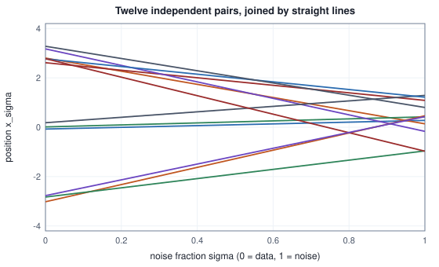
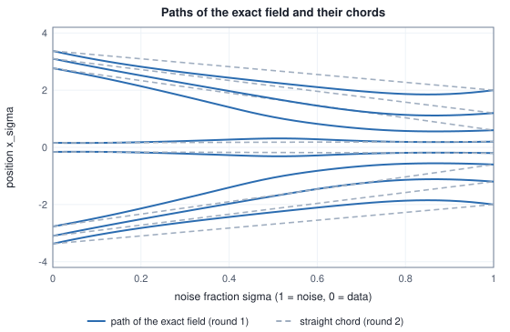

<!-- SPDX-License-Identifier: CC-BY-4.0 -->
<!-- Copyright (c) 2026 Martin Schröder <info@swedishembedded.com> -->

# Flow Matching and Rectified Flow

*Can generation be a straight path from noise to data, followed by an ordinary differential equation?*

Take a data value and a noise value and join them with a straight line. Do it for two pairs and the lines may well cross.

<!-- worked: flow_matching.two_lines -->
Two pairs (x_0, noise): A = (3, -1) and B = (0, 2). The point of a pair at noise fraction sigma is x_sigma = (1 - sigma) x_0 + sigma noise, and it moves with velocity noise - x_0: -4 for A and +2 for B.

| sigma | x_sigma of A | x_sigma of B | difference |
|---|---:|---:|---:|
| 1.0 | -1.00 | 2.00 | -3.00 |
| 0.75 | 0.00 | 1.50 | -1.50 |
| 0.5 | 1.00 | 1.00 | 0.00 |
| 0.25 | 2.00 | 0.50 | 1.50 |
| 0.0 | 3.00 | 0.00 | 3.00 |

The lines meet at sigma = 0.5, at x = 1.00. A network given (x, sigma) = (1.00, 0.5) must give one velocity; if the two pairs are equally likely the squared error is smallest at the mean of -4 and 2, which is -1.
<!-- /worked -->

At the crossing, $(x, \sigma) = (1, 0.5)$, one pair is moving down at $4$ per unit of $\sigma$ and the other up at $2$. A sampler that stands at that point and asks which way to go has two answers, and a network that is asked the same question can give only one. Trained on a squared error it gives the mean of the two, $-1$ if the pairs are equally likely, and that mean is a velocity that neither line has. Yet the whole idea of this chapter is that a sampler can follow such averaged velocities, starting from a draw of noise and ending at a draw from the data, and that doing so is nothing more exotic than solving an ordinary differential equation with the Euler method of Volume I.

The last chapter reached generation by a different road: a chain of small random steps, each undone by a network that estimated the noise, with a fresh random draw at every step. That road was long (fifty network calls for three clusters on a line) and noisy, in the sense that two runs from the same starting value end in different places. The road here has no random steps at all. Once the starting noise is drawn, the end point is determined, and the path between them can be made nearly straight, which is what makes few steps enough. It is the road that brain's FLUX.2 and Z-Image models take: their schedulers, their training losses and their fine-tuning code are all in this chapter's terms.

Five earlier ideas return within a few pages, so try them first from memory (the answers are at the end, under "Recall questions").

1. (Volume VIII, [Chapter 5](05-diffusion.md), the denoising objective.) A network is trained by squared error against a target that is not a function of its input alone, such as the noise that was added. What function does it converge to, and what loss is left at the optimum?
2. (Volume VIII, [Chapter 5](05-diffusion.md), v-prediction.) For $x_t = a_t x_0 + b_t\varepsilon$ with $a_t^2 + b_t^2 = 1$, what is the velocity target $v$, and how do $x_0$ and $\varepsilon$ come back from $(x_t, v)$?
3. (Volume I, [Chapter 9](../v01-mathematics/09-integrals-and-odes.md), ordinary differential equations.) What does $dx/d\sigma = f(x, \sigma)$ together with a starting value determine, and can two solutions that start at different points ever meet?
4. (Volume I, [Chapter 9](../v01-mathematics/09-integrals-and-odes.md), the Euler method.) Give one Euler step of size $h = 0.5$ for $dx/dt = -x$ from $x = 1$, and say what happens to the final error when $h$ is halved.
5. (Volume I, [Chapter 11](../v01-mathematics/11-distributions.md), the Gaussian distribution.) If $X \sim \mathcal{N}(0, 1)$ and $Z \sim \mathcal{N}(0, 1)$ are independent, what is the distribution of $(1 - \sigma)X + \sigma Z$, and what is its variance at $\sigma = \tfrac12$?

Everything below is written for one real number, with the data of the last two chapters: three clusters at $-3$, $0$ and $3$, each of standard deviation $0.25$, with equal weights. An image is a vector, every entry is noised by a draw of its own, and every squared error is averaged over the entries, so nothing changes except the bookkeeping. For these data every quantity of the chapter can be computed exactly, and a network trained on them can be compared with the exact answer.

## A velocity for every point

Let $x_0$ be a data value and $\varepsilon$ a draw from $\mathcal{N}(0, 1)$, independent of it. The **noise fraction** $\sigma \in [0, 1]$ names a point on the straight line between them:

$$
x_\sigma = (1 - \sigma)\,x_0 + \sigma\,\varepsilon .
$$

At $\sigma = 0$ the point is the data value, at $\sigma = 1$ it is the noise, and brain's code uses exactly this convention (the module documentation of `crates/diffusion/src/scheduler.rs` writes it $x_\sigma = (1 - \sigma)x_0 + \sigma\varepsilon$). Many papers run the time the other way; the formulas of this chapter are brain's. Each pair $(x_0, \varepsilon)$ moves along its line with the constant velocity $w = \varepsilon - x_0$, the derivative of $x_\sigma$ with respect to $\sigma$.

Draw the pair from the data and the noise and the point $x_\sigma$ is a random number with a density $p_\sigma$. For $\sigma = 0$ that is the data's, for $\sigma = 1$ the standard normal, and in between it is a smooth interpolation; the family $p_\sigma$ is a **probability path** from data to noise. For the three clusters it is a mixture of three Gaussians, one per cluster, with means $(1 - \sigma)m_k$ for the centres $m_k \in \{-3, 0, 3\}$ and variance $(1 - \sigma)^2\cdot 0.25^2 + \sigma^2$. The last chapter's chain was also a probability path, discrete and with the coefficients $a_t, b_t$ instead of $1 - \sigma, \sigma$.

A sampler wants to walk the path backwards, from the noise end to the data end, using a rule that depends only on where it is and on $\sigma$. The pairs supply a velocity, but only for the line through the point, and many lines pass through any given point. The rule that a network can learn is the average over all of them, weighted by how likely each is to have produced the point. The **velocity field** is

$$
u(x, \sigma) = \mathbb{E}\bigl[\,\varepsilon - x_0 \;\big|\; x_\sigma = x\,\bigr].
$$

Because $x_\sigma = (1 - \sigma)x_0 + \sigma\varepsilon$, we have $\varepsilon - x_0 = (x_\sigma - x_0)/\sigma$, and so the conditional expectation reduces to the posterior mean of the clean value that the last chapter already computed:

$$
u(x, \sigma) = \frac{x - \mathbb{E}[x_0 \mid x_\sigma = x]}{\sigma},
$$

where the posterior mean for the three clusters is

$$
\mathbb{E}[x_0 \mid x_\sigma = x] = \frac{\sum_k w_k\bigl(m_k + \frac{a\,0.25^2}{v}(x - a\,m_k)\bigr)}{\sum_k w_k},
$$

with $a = 1 - \sigma$, $v = a^2\cdot 0.25^2 + \sigma^2$ and the weights $w_k \propto \exp\bigl(-(x - a\,m_k)^2/(2v)\bigr)$. These are the formulas of the exact denoiser of Chapter 5 with $(a_t, b_t)$ replaced by $(1 - \sigma, \sigma)$, and the worked module checks that the code agrees with `diffusion.exact_denoiser` when it is given $(a_t, b_t)$ instead.

<!-- worked: flow_matching.field_table -->
The three clusters (centres -3, 0, 3, standard deviation 0.25, weight 1/3 each) along the straight path x_sigma = (1 - sigma) x_0 + sigma noise. For each sigma and x: the density p_sigma(x), the posterior mean E[x_0 | x_sigma = x] and the velocity u(x, sigma) = (x - E[x_0 | x_sigma = x]) / sigma.

| sigma | x | p_sigma(x) | E[x_0 given x] | u(x, sigma) |
|---|---:|---:|---:|---:|
| 0.1 | -1.00 | 0.0001 | -0.9278 | -0.7216 |
| 0.1 | 0.25 | 0.3226 | 0.2320 | 0.1804 |
| 0.1 | 1.00 | 0.0001 | 0.9278 | 0.7216 |
| 0.1 | 2.50 | 0.3883 | 2.8144 | -3.1443 |
| 0.4 | -1.00 | 0.0740 | -2.1212 | 2.8029 |
| 0.4 | 0.25 | 0.2627 | 0.0557 | 0.4859 |
| 0.4 | 1.00 | 0.0740 | 2.1212 | -2.8029 |
| 0.4 | 2.50 | 0.0813 | 3.1438 | -1.6096 |
| 0.7 | -1.00 | 0.2608 | -2.1080 | 1.5828 |
| 0.7 | 0.25 | 0.3504 | 0.6323 | -0.5461 |
| 0.7 | 1.00 | 0.2608 | 2.1080 | -1.5828 |
| 0.7 | 2.50 | 0.0146 | 2.9899 | -0.6998 |

At the coefficients (a_t, b_t) of the last chapter's chain the posterior mean agrees with `diffusion.exact_denoiser` to below 1e-12 (t = 5, 20, 35 and the four values of x). At 24 further points (sigma in {0.2, 0.5, 0.8}, x = (k - 4)(1 - sigma) + 0.37 (k mod 3) for k = 0 .. 7) the velocity differs from -(x + sigma score)/(1 - sigma), with the score the central difference (step 1e-5) of ln p_s, by less than 1e-6, and the continuity residual dp/ds + d(p u)/dx, by central differences of step 1e-5, is below 1e-6.
<!-- /worked -->

Read one row. At $\sigma = 0.1$ and $x = 2.5$ the clean value that most likely produced $x$ is $2.8144$ (the cluster at $3$, pulled a little toward the point), and the velocity is $(2.5 - 2.8144)/0.1 = -3.1443$. A step from $\sigma = 0.1$ to $\sigma = 0$ adds $(0 - 0.1)\cdot(-3.1443) = +0.3144$ to $x$ and lands on $2.8144$ exactly. That is a general fact, and it will matter: one Euler step with the exact field from $\sigma$ to $0$ lands on the posterior mean $x - \sigma\,u(x, \sigma)$. Chapter 5's "one jump" row, in which every sample went to the middle cluster, is this statement at $\sigma = 1$.

Two other readings of the same field are useful. The first is that a network which has learned the noise (Chapter 5) has learned the velocity, because the score $s(x, \sigma) = \partial\ln p_\sigma/\partial x$ equals $-\mathbb{E}[\varepsilon \mid x_\sigma = x]/\sigma$ by the argument of that chapter, and substituting $\mathbb{E}[x_0\mid x] = (x - \sigma\,\mathbb{E}[\varepsilon\mid x])/(1 - \sigma)$ gives

$$
u(x, \sigma) = -\,\frac{x + \sigma\,s(x, \sigma)}{1 - \sigma}.
$$

The two parametrizations hold the same information and differ in how a given error in the network translates into an error in the picture, which is the question of the weights further on. The second reading is that Chapter 5's velocity target $v = a_t\varepsilon - b_t x_0$ was already the velocity of a probability path: writing $a_t = \cos\varphi$ and $b_t = \sin\varphi$, the point $x_t = \cos\varphi\,x_0 + \sin\varphi\,\varepsilon$ moves along a quarter circle, and $dx_t/d\varphi = -\sin\varphi\,x_0 + \cos\varphi\,\varepsilon = v$. What changes in this chapter is the path: a straight line instead of an arc.

## Why regressing on one pair finds the average

The field $u$ is not available during training. What a training step has is one pair and the velocity $w = \varepsilon - x_0$ of its own line. The training objective of **flow matching** asks a network $u_\theta(x, \sigma)$ to match that velocity at the point of the line, averaged over the data, the noise and the noise fraction:

$$
\mathcal{L}(\theta) = \mathbb{E}\,\bigl(u_\theta(x_\sigma, \sigma) - (\varepsilon - x_0)\bigr)^2 .
$$

Flow matching is the name for training a velocity network on a probability path by regressing on the velocity of a sampled pair; the path is a choice, and this chapter makes the simplest one. The objective looks as if it asks the network to be right about an impossible thing, since at the crossing of the opening no single number matches both pairs. It does not, because of the argument behind Recall question 1. Add and subtract the field inside the square:

$$
\mathcal{L}(\theta) = \mathbb{E}\bigl(u_\theta - u\bigr)^2 + 2\,\mathbb{E}\bigl[(u_\theta - u)(u - w)\bigr] + \mathbb{E}\bigl(u - w\bigr)^2 .
$$

Condition the cross term on $(x_\sigma, \sigma)$. Both $u_\theta$ and $u$ are fixed by that pair, and $\mathbb{E}[u - w \mid x_\sigma, \sigma] = 0$ by the definition of $u$, so the cross term vanishes. What is left is a term that is zero exactly when the network is the field, and a term that does not mention the network at all. Regressing on single pairs and regressing on the field differ by a constant, so they have the same minimizer and the same gradients, and the constant is the least loss any network can reach. For the clusters it can be estimated from the evaluation items of the training section below: it is about $3.26$, not $0$, and no amount of training lowers it.

The second question is whether following the field really produces the data. A cloud of particles, each moving with the velocity $u$ at its own position, has a density $p$ that changes only because mass flows across points, which is the continuity equation $\partial p/\partial\sigma + \partial(p\,u)/\partial x = 0$. The densities of the path obey it, by a short argument. Take any smooth function $f$ that is zero outside a bounded interval. Its average over the path changes as the points move:

$$
\begin{aligned}
\frac{d}{d\sigma}\,\mathbb{E}f(x_\sigma) &= \mathbb{E}\bigl[f'(x_\sigma)\,(\varepsilon - x_0)\bigr] = \mathbb{E}\bigl[f'(x_\sigma)\,u(x_\sigma, \sigma)\bigr] \\
&= \int f'(x)\,u(x, \sigma)\,p_\sigma(x)\,dx = -\int f(x)\,\frac{\partial\,(p_\sigma u)}{\partial x}\,dx ,
\end{aligned}
$$

where the second equality conditions on $x_\sigma$ and the last integrates by parts. The left side is $\int f\,\partial p_\sigma/\partial\sigma\,dx$. Since $f$ was arbitrary, $\partial p_\sigma/\partial\sigma = -\partial(p_\sigma u)/\partial x$. The particles that start as a draw from $p_1 = \mathcal{N}(0,1)$ and move with $u$ therefore have density $p_\sigma$ at every $\sigma$, and at $\sigma = 0$ that is the data's (a solution of the continuity equation is determined by its start, a fact the chapter takes from the theory of transport equations). The worked module checks both identities of this section numerically:

- the velocity equals $-(x + \sigma s)/(1 - \sigma)$ with the score taken as a central difference of $\ln p_\sigma$; and
- the continuity residual $\partial p/\partial\sigma + \partial(p\,u)/\partial x$, by central differences, is small.

Both are reported against their criteria in the paragraph under the table above. The two together say that the field of the table is not merely a plausible rule but the one that carries $\mathcal{N}(0,1)$ onto the data.

## Where the three clusters turn into one

Walking from $\sigma = 1$ to $0$, the sampler first sees one broad bump and must at some point commit to a cluster. The path itself shows where.

<!-- worked: flow_matching.path_marginals -->
The three clusters after the straight path to noise fraction sigma: each cluster is N((1 - sigma) m_k, (1 - sigma)^2 0.25^2 + sigma^2). 'Spread' is the standard deviation of one cluster, 'gap / spread' the distance 3 (1 - sigma) between neighbouring centres over it, 'valley / peak' the density halfway between two centres, 1.5 (1 - sigma), over the density at the centre 3 (1 - sigma). Modes are local maxima on the grid -6, -5.99, ..., 6.

| sigma | 1 - sigma | spread | gap / spread | modes | valley / peak |
|---|---:|---:|---:|---:|---:|
| 0.0 | 1.00 | 0.2500 | 12.000 | 3 | 3.05e-08 |
| 0.2 | 0.80 | 0.2828 | 8.485 | 3 | 0.000247 |
| 0.4 | 0.60 | 0.4272 | 4.213 | 3 | 0.217 |
| 0.5 | 0.50 | 0.5154 | 2.910 | 3 | 0.684 |
| 0.6 | 0.40 | 0.6083 | 1.973 | 1 | 1.09 |
| 0.7 | 0.30 | 0.7040 | 1.278 | 1 | 1.21 |
| 0.8 | 0.20 | 0.8016 | 0.749 | 1 | 1.15 |
| 1.0 | 0.00 | 1.0000 | 0.000 | 1 | 1 |

By bisection on the mode count the three modes become one between sigma = 0.5890 and sigma = 0.5890.
<!-- /worked -->

The valley between two clusters is shallow at $\sigma = 0.5$ (the density halfway between two centres is $0.684$ of the density at a centre) and gone at $\sigma = 0.6$; bisection puts the merge between $0.5890$ and $0.5891$. Chapter 5's chain still had three modes at $t = 18$ (signal-to-noise ratio $0.79$) and one at $t = 25$ ($0.25$); the straight path merges at a signal-to-noise ratio of $((1 - 0.589)/0.589)^2 = 0.49$, of the same size. Where the commitment happens will matter again below, for the grid on which the field is sampled.

## Running the field backwards

The ordinary differential equation is $dx/d\sigma = u(x, \sigma)$, with the starting value $x_1 = \varepsilon$, a draw from the standard normal, and the answer wanted at $\sigma = 0$. Euler's method on a grid $1 = \sigma_0 > \sigma_1 > \dots > \sigma_n = 0$ is

$$
x_{\sigma_{i+1}} = x_{\sigma_i} + (\sigma_{i+1} - \sigma_i)\,u(x_{\sigma_i}, \sigma_i), \qquad i = 0, \dots, n - 1,
$$

and every step is a move against the direction of increasing $\sigma$, which is why the factor $\sigma_{i+1} - \sigma_i$ is negative. The velocity is evaluated at the left end of each step, so the undefined value $u(x, 0)$ (a $0/0$) is never needed. In the pseudocode of the book, with the velocity network `u_theta` and the grid `grid[0..n]`:

```text
function sample_flow(u_theta: function(real, real) -> real, grid: array<real>[n + 1], x1: real) -> real:
    require grid[0] == 1 and grid[n] == 0, "the grid runs from noise to data"
    x = x1
    for i in 0 .. n:
        x = x + (grid[i + 1] - grid[i]) * u_theta(x, grid[i])
    return x
```

The update can be read as a weighted average. Substituting $u = (x - \hat x_0)/\sigma_i$ with $\hat x_0 = \mathbb{E}[x_0\mid x_{\sigma_i}]$ gives $x_{\sigma_{i+1}} = (\sigma_{i+1}/\sigma_i)\,x + (1 - \sigma_{i+1}/\sigma_i)\,\hat x_0$: the next point is the current one pulled toward the denoiser's guess, by the fraction of the remaining noise that is removed. A step to $\sigma = 0$ takes the guess whole, and a tiny step barely moves.

Because the exact transport of this one-dimensional problem is known, the sampler can be scored without a second sampler. Let $F$ be the cumulative distribution of the data and $\Phi$ that of the standard normal; then $T(\varepsilon) = F^{-1}(\Phi(\varepsilon))$ is the increasing map that carries $\mathcal{N}(0, 1)$ onto the data. Two trajectories of an ordinary differential equation never meet (Recall question 3), so the flow map from $\varepsilon$ to $x_0$ keeps the order of the starting values; there is exactly one increasing map between the two distributions, and so the exact flow of the field is $T$. The table scores Euler on the exact field by the mean of $|x_0 - T(\varepsilon)|$, and the last line checks the claim: a fourth-order Runge-Kutta run with $200$ steps lands within $10^{-6}$ of $T$.

<!-- worked: flow_matching.euler_exact -->
1000 starting values x_1 = noise from the stream `flow_matching.sample` (seed 0x40611b1c8371ae36) (one normal() each, in order), carried from sigma = 1 to 0 by n Euler steps on the grid s_i = 1 - i/n with the exact velocity u at the left end of each step. 'Distance' is the mean of |x_0 - T(noise)|, with T = F^-1(Phi(noise)) the exact transport map of one dimension (F the cumulative distribution of the data, 46 bisection steps); the counts are the samples within 0.75 of each centre and the rest.

| Euler steps n | distance | near -3 | near 0 | near +3 | elsewhere |
|---|---:|---:|---:|---:|---:|
| exact map T(noise) | 0 | 344 | 312 | 341 | 3 |
| 1 | 2.11 | 0 | 1000 | 0 | 0 |
| 2 | 1.51 | 33 | 750 | 33 | 184 |
| 4 | 0.694 | 219 | 513 | 222 | 46 |
| 8 | 0.349 | 279 | 412 | 284 | 25 |
| 16 | 0.164 | 319 | 357 | 313 | 11 |
| 32 | 0.0798 | 331 | 334 | 332 | 3 |
| 64 | 0.0352 | 339 | 321 | 339 | 1 |

For the first 20 starting values, 200 steps of classical fourth-order Runge-Kutta on the same field end within 1e-6 of T(noise).
<!-- /worked -->

The first row after the reference is the "one jump" of the last chapter: with one step every sample lands on the posterior mean at $\sigma = 1$, which is the mean of the data, $0$. As steps are added, the distance falls by a factor of about $2$ per doubling ($2.11$, $1.51$, $0.694$, $0.349$, $0.164$, $0.0798$, $0.0352$ at $n = 1, 2, 4, \dots, 64$), the first-order convergence of Euler's method from Volume I, and the number of samples left between the clusters falls from $184$ at two steps to $1$ at sixty-four. Reading the error as the cost of curvature is the right instinct: if the velocity were constant along each trajectory, one step would be exact, and every doubling of steps would buy nothing.


The cost of a sample is $n$ evaluations of the velocity, and for an image model the evaluation is the whole cost: the update itself is one multiplication and one addition per element, against the billions of operations of the network. For the small network of the next sections an evaluation is $2\cdot 32 + 32\cdot 32 + 32 = 1120$ multiply-adds, so $32$ Euler steps take $35{,}840$ of them per sample. Fewer steps at the same quality is therefore the direct measure of a faster sampler, and the rest of the chapter is about two ways to get there: make the trajectories straighter, and put the steps where the trajectory bends.

## Straightening the paths

Why do the trajectories of the field bend when each pair travels on a straight line? Because the lines cross, and where they cross the field is an average.



With the data and the noise drawn independently, a pair of lines crosses inside the path exactly when the data values and the noise values of the two pairs are in opposite order, $(x_{0i} - x_{0j})(\varepsilon_i - \varepsilon_j) < 0$. For independent draws that is half of all pairs of pairs, and the table counts it. The same table puts a number on the bending. The chord energy $\mathbb{E}(\varepsilon - x_0)^2$ is the average squared velocity of the lines. The field can explain part of it, the average squared velocity $\int\mathbb{E}\,u^2\,d\sigma$ of the field, and what it cannot explain is the **straightness** $S = \int \mathbb{E}\,(w - u(x_\sigma, \sigma))^2\,d\sigma$, the average squared gap between the line's velocity and the field's at the same point. It is zero exactly when the field at every point equals the velocity of every line through it, that is, when only one line passes through each point.

<!-- worked: flow_matching.straightness -->
1000 pairs (x_0, noise) from the stream `flow_matching.pairs` (seed 0x3e85cd42521a4795): for each pair k = integer(3), then x_0 = m_k + 0.25 normal(), then noise = normal(). 'Round 2' keeps each noise and replaces its partner by T(noise). A pair of lines crosses inside the path when (x_0i - x_0j)(noise_i - noise_j) < 0; there are 499500 pairs of pairs. 'Chord energy' is E (noise - x_0)^2, for the independent coupling 1 + E x_0^2 = 7.0625 exactly, and for round 2 the midpoint rule with step 0.005 on [-8, 8]. 'Field energy' is the integral over sigma of E u^2 for the field of that coupling's own marginals (round 1: midpoint rule over 200 values of sigma and step 0.01 in x on [-6, 6]; round 2: equal to the chord energy because the chord is determined by x). Their difference is the straightness S, the part of the chord's energy that no function of (x, sigma) can explain.

| coupling | crossing pairs of lines | chord energy | field energy | S |
|---|---:|---:|---:|---:|
| independent (round 1) | 256267 | 7.0625 | 3.7585 | 3.3040 |
| increasing map (round 2) | 0 | 2.4928 | 2.4928 | 0.0000 |

The second-round field, found by bisection on the line, reproduces the chord's velocity at sigma = 0.1, 0.3, 0.5, 0.7, 0.9 for the first 100 pairs to below 1e-9.
<!-- /worked -->

The independent coupling leaves $S = 3.3040$ of its $7.0625$. Is there a different way to pair data with noise that leaves nothing? In one dimension there is, and it was already on the page: the increasing map $T$. Keep each noise value and replace its partner by $T(\varepsilon)$. The pairs are now in the same order on both ends, no two lines cross (the table's count is zero), and since the lines through a point are all the same line, the field at a point is the velocity $\varepsilon - T(\varepsilon)$ of that line, so $S = 0$. Training on the straight path is **rectified flow**, and the construction just described is its second round (often called reflow). The first round trains the velocity network on independent pairs, as in the sections above. The second round makes pairs by running the first round's sampler, with $x_0$ the sampler's output for $\varepsilon$, and trains a fresh network on those; the straightening that gives the method its name is the effect of this repetition on the paths. With the exact field and an exact solver the first round's sampler is $T$ itself, so the second round's field can be computed exactly, by solving $(1 - \sigma)T(\varepsilon) + \sigma\varepsilon = x$ for $\varepsilon$ by bisection and returning $\varepsilon - T(\varepsilon)$.



<!-- worked: flow_matching.reflow_table -->
The 1000 starting values of `flow_matching.sample` carried by n Euler steps on s_i = 1 - i/n, with the exact field of round 1 and of round 2 (the second by bisection on the line, so a distance below 1e-9 is the solver's tolerance, not a trend). 'Distance' is the mean of |x_0 - T(noise)| and 'elsewhere' the number of samples farther than 0.75 from every centre; the map T itself leaves 3.

| steps n | round 1: distance | round 1: elsewhere | round 2: distance | round 2: elsewhere |
|---|---:|---:|---:|---:|
| 1 | 2.11 | 0 | below 1e-9 | 3 |
| 2 | 1.51 | 184 | below 1e-9 | 3 |
| 4 | 0.694 | 46 | below 1e-9 | 3 |
| 8 | 0.349 | 25 | below 1e-9 | 3 |
<!-- /worked -->

With the second-round field one Euler step is exact, and so is any other number, because the velocity along a line is constant and a constant is integrated exactly by any sum of steps: it is the property that brain's scheduler test `constant_velocity_integrates_exactly_to_minus_v` (in `crates/diffusion/tests/it/scheduler.rs`) checks, since the increments $\sigma_{i+1} - \sigma_i$ telescope to $-1$ for any schedule. The three samples that stay elsewhere are the data's own tail beyond three standard deviations, the same three that $T$ leaves.

Two warnings keep this from being read as a recipe. The first is the price. The second round needs a trained first round, one run of its sampler per training pair (many network evaluations to make one example), and a second training. The second is that the argument rests on the order of the real line. A draw of two numbers has no increasing order that carries one distribution onto another, and in an image space a second round reduces the crossings and lowers the cost of transport (Liu and others show that repeating the construction does not raise the transport cost and straightens the paths) without any promise that one step becomes exact. What the models in brain actually do is train on the first round and spend their remaining effort on the sampler and on the schedule, which is where this chapter goes next.

## Teaching a network the field

The network of the last chapter is reused without change, to isolate what the target does: two inputs ($x$ and the noise fraction $\sigma$, in place of the step fraction $t/T$), two hidden layers of $32$ units with $\tanh$, one output, and the same hand-written backward pass. Its parameters are initialized as in Chapter 5, from the generator named below: $W_1$ ($32 \times 2$, the weight on $x$ then the weight on $\sigma$ in each row) from $\mathtt{normal}()/\sqrt{2}$, $W_2$ ($32\times 32$) and $W_3$ ($32$) from $\mathtt{normal}()/\sqrt{32}$, each in row-major order and in the order $W_1, W_2, W_3$, with all biases $0$. The sums over a layer's inputs run in increasing index order. One training item is drawn as

```text
function draw_item(rng: Generator) -> (real, real, real):
    sigma = rng.uniform()
    k = rng.integer(3)
    x0 = m[k] + 0.25 * rng.normal()
    e = rng.normal()
    return (sigma, (1 - sigma) * x0 + sigma * e, e - x0)
```

with $m = [-3, 0, 3]$; the result is the noise fraction, the point of the line and the target velocity. The noise fraction is uniform on $[0, 1)$, the simplest choice and the one the fine-tuning code of `crates/s3dit/src/finetune.rs` makes (it clamps the draw to $[0.001, 1]$). A step of the run averages $64$ items drawn one after another from the stream `flow_matching.run`, after the initialization has drawn its weights from it; the loss is the mean of $(\text{output} - \text{target})^2$; the optimizer is Adam with the settings of Chapter 5, rate $0.003\,(1 - (i - 1)/5000)$ at step $i = 1, \dots, 5000$.

<!-- worked: flow_matching.training_table -->
One run: the network of `diffusion.init_net` from the stream `flow_matching.run` (seed 0x05822529247d9c64), input (x_sigma, sigma), then batches of 64 items drawn from the same stream in the order of the chapter, Adam with beta1 0.9, beta2 0.999, epsilon 1e-8 and rate 0.003 (1 - (i - 1) / 5000) at step i. After each listed step the network and the exact field are scored on 1000 evaluation items (`flow_matching.evaluation` (seed 0x22c0f36ccf00d7ea), each drawn as in training): the mean of (network - target)^2, the mean of (exact - target)^2, and the mean of (network - exact)^2. Digits are those shared by the run and four copies with the first weight changed by +1e-12, -1e-12, +3e-12 and -3e-12.

| step | loss of the network | loss of the exact field | mean (network - exact)^2 |
|---|---:|---:|---:|
| 500 | 3.6378 | 3.2565 | 0.6463 |
| 1000 | 3.5192 | 3.2565 | 0.4394 |
| 2000 | 3.3874 | 3.2565 | 0.1883 |
| 3000 | 3.3146 | 3.2565 | 0.0951 |
| 4000 | 3.3401 | 3.2565 | 0.0917 |
| 5000 | 3.2912 | 3.2565 | 0.0666 |
<!-- /worked -->

The loss of the network falls from $3.64$ at $500$ steps to $3.29$ at $5000$, toward the floor of $3.2565$ that even the exact field has on these $1000$ items. The distance to the exact field falls from $0.646$ to $0.0666$ over the same steps. (The loss at $4000$ steps, $3.3401$, is above the one at $3000$, $3.3146$: Adam's last steps with a decaying rate still move the weights, and the table is a view at one moment.) The digits are the ones shared with four copies of the run in which the first weight is changed by $\pm 10^{-12}$ and $\pm 3\times 10^{-12}$; all of the digits survived, so this run is not chaotic at the printed precision.

<!-- worked: flow_matching.band_table -->
The evaluation items of the table above, split by their noise fraction sigma (lower end included, upper end excluded), after the last training step.

| sigma | items | loss of the exact field | loss of the network | mean (network - exact)^2 |
|---|---:|---:|---:|---:|
| 0 .. 0.2 | 211 | 0.8111 | 0.8699 | 0.0501 |
| 0.2 .. 0.4 | 187 | 0.5692 | 0.7787 | 0.1865 |
| 0.4 .. 0.6 | 200 | 2.5925 | 2.6371 | 0.0469 |
| 0.6 .. 0.8 | 181 | 5.8027 | 5.7207 | 0.0221 |
| 0.8 .. 1 | 221 | 6.3808 | 6.3311 | 0.0353 |
<!-- /worked -->

The floor is not the same everywhere. At small $\sigma$ the point $x_\sigma$ is almost the data value, so what is unknowable is only the noise (the floor is $0.81$ in the first band, lower than the variance of the noise itself, $1$), and at large $\sigma$ the point carries little of the data value, whose variance is $6.06$, so the floor is $6.38$. The network's own error is largest in the second band, $0.1865$ from the exact field, where the three bumps are separating (Figure below, $\sigma = 0.2$ and $0.5$): the exact field there has steep ridges between the clusters, which a network with $32$ tanh units rounds off. In the fourth band the network's loss, $5.7207$, is below the exact field's, $5.8027$. That is chance on $181$ items, not a better field: a field other than $u$ cannot have a smaller expected loss.


The reason the loss on the velocity is a sensible loss for an image is the same as in Chapter 5, and it can be read from the weights. If a network's velocity is off by $d$ at a point, the clean value it implies, $x_\sigma - \sigma\,u$, is off by $\sigma d$; the noise it implies, $x_\sigma + (1 - \sigma)\,u$, by $(1 - \sigma)d$. The first block below checks both conversions, the second tabulates how heavily each loss weighs the error of the implied clean value: the loss on $\varepsilon$ by $\mathrm{SNR}$, Chapter 5's loss on its circular velocity by $\mathrm{SNR} + 1$, and the straight velocity here by $1/\sigma^2 = (1 + \sqrt{\mathrm{SNR}})^2$, with $\mathrm{SNR} = ((1 - \sigma)/\sigma)^2$.

<!-- worked: flow_matching.targets_table -->
x_0 = 2.9, noise = 0.7; x_sigma = (1 - sigma) x_0 + sigma noise and u = noise - x_0. The clean value recovered from (x_sigma, u) as x_sigma - sigma u and the noise as x_sigma + (1 - sigma) u.

| sigma | x_sigma | u | x_0 from u | noise from u |
|---|---:|---:|---:|---:|
| 0.1 | 2.680000 | -2.200000 | 2.900000 | 0.700000 |
| 0.5 | 1.800000 | -2.200000 | 2.900000 | 0.700000 |
| 0.9 | 0.920000 | -2.200000 | 2.900000 | 0.700000 |

The largest difference from the true x_0 or noise over the three rows is below 1e-12.

The weight each loss puts on the squared error of the clean value it implies. Signal-to-noise ratio SNR = ((1 - sigma)/sigma)^2; the loss on the noise weighs by SNR, the last chapter's loss on the velocity of the circular path by SNR + 1, and the loss on the velocity u of the straight path by 1/sigma^2 = (1 + sqrt(SNR))^2.

| sigma | SNR | noise loss | circular velocity loss | straight velocity loss |
|---|---:|---:|---:|---:|
| 0.05 | 361 | 361 | 362 | 400 |
| 0.1 | 81 | 81 | 82 | 100 |
| 0.25 | 9 | 9 | 10 | 16 |
| 0.5 | 1 | 1 | 2 | 4 |
| 0.75 | 0.1111 | 0.1111 | 1.111 | 1.778 |
| 0.9 | 0.01235 | 0.01235 | 1.012 | 1.235 |
| 1.0 | 0 | 0 | 1 | 1 |

Check on 1000 draws from `flow_matching.targets` (seed 0xfc45d18b962cd6ef) (per draw: sigma = uniform(), then x_0, noise and an error d = 0.1 normal(), each by normal(), in this order): the squared error of the clean value implied by a velocity off by d equals sigma^2 d^2 with a largest relative difference below 1e-9.
<!-- /worked -->

The straight velocity weighs the error of the clean value like the circular velocity at high noise (both tend to $1$ as $\sigma \to 1$, so neither ignores the coarse structure the way the noise loss does) and more heavily than either at low noise, where it weighs it by about $\mathrm{SNR}$ plus a term of order $\sqrt{\mathrm{SNR}}$ (at $\sigma = 0.1$: $100$ against $82$). And an error of $d$ in the output is never more than $d$ in the implied noise or clean value, since $\sigma$ and $1 - \sigma$ are both at most $1$.

Now the sampler. The same $1000$ starting values, the same grids, and the trained network in place of the exact field.

<!-- worked: flow_matching.net_sampling_table -->
The 1000 starting values of `flow_matching.sample` carried from sigma = 1 to 0 by n Euler steps on sigma_i = 1 - i/n, with the exact field and with the trained network (input (x, s_i) at the left end of each step). 'Distance' is the mean of |x_0 - T(noise)| as before; the counts are the network's samples within 0.75 of each centre and the rest. The network columns keep the digits shared with the four nudged copies.

| steps n | exact: distance | network: distance | near -3 | near 0 | near +3 | elsewhere |
|---|---:|---:|---:|---:|---:|---:|
| 1 | 2.11 | 1.984 | 0 | 955 | 2 | 43 |
| 2 | 1.51 | 1.406 | 60 | 700 | 45 | 195 |
| 4 | 0.694 | 0.613 | 188 | 431 | 210 | 171 |
| 8 | 0.349 | 0.283 | 258 | 334 | 273 | 135 |
| 16 | 0.164 | 0.137 | 294 | 305 | 296 | 105 |
| 32 | 0.0798 | 0.089 | 320 | 289 | 312 | 79 |
<!-- /worked -->

The mean distance of the network's samples is close to the exact field's at every step count, and smaller in the first rows, which shows that a mean distance alone is not a measure of sample quality. The count of samples left between the clusters is the better reading: $135$ at eight steps and $79$ at thirty-two, against $25$ and $3$ for the exact field, consistent with the rounded ridges of the figure. For comparison, the noise-predicting network of Chapter 5, with the same architecture and optimizer, run for fifty ancestral steps with a fresh random draw at each, left $71$ samples between the clusters. The two samplers leave a comparable number; what separates them is structure. This one is deterministic, and its step count can be chosen at sampling time without retraining, which is the subject of the next chapter.

## Moving the grid toward noise

The uniform grid $\sigma_i = 1 - i/n$ is a choice. The field changes fastest where the three bumps separate, near $\sigma = 0.59$ for these data, and a grid with more points there spends its steps where they are needed; even for a single value a modest move of the grid toward noise helps, as the first column of the table below shows. For a given problem the right move is a matter of measurement. For images there is a systematic reason for it, which can be derived.

Suppose the data are not one number but $d$ numbers that are copies of the same value (an extreme case of the redundancy of neighbouring pixels), and each copy receives its own noise: $x_i = (1 - \sigma)x_0 + \sigma\varepsilon_i$. The mean of the copies is $\bar x = (1 - \sigma)x_0 + \sigma\bar\varepsilon$, where the mean noise $\bar\varepsilon$ has variance $1/d$ (a sum of $d$ independent standard normals divided by $d$). It is the same problem as before with the noise of standard deviation $\sigma/\sqrt{d}$ instead of $\sigma$, so the signal-to-noise ratio of what the network can learn from the whole vector is $d$ times larger at the same $\sigma$:

$$
\mathrm{SNR}_d(\sigma) = d\,\Bigl(\frac{1 - \sigma}{\sigma}\Bigr)^2 .
$$

A schedule that has been found to work for one copy puts its steps at certain signal-to-noise ratios. To put them at the same signal-to-noise ratios for $d$ copies, the noise fraction $\sigma'$ must satisfy $d\,((1 - \sigma')/\sigma')^2 = ((1 - \sigma)/\sigma)^2$, that is, $\sigma'/(1 - \sigma') = \sqrt{d}\;\sigma/(1 - \sigma)$, and solving for $\sigma'$ gives the **timestep shift**:

$$
\sigma' = \frac{k\,\sigma}{1 + (k - 1)\,\sigma}, \qquad k = \sqrt{d}.
$$

A shift with factor $k > 1$ keeps the endpoints, $0 \mapsto 0$ and $1 \mapsto 1$, and moves every other value toward $1$: the same number of steps, with a larger share of them in the noisy half. In terms of the logarithm of the signal-to-noise ratio, the shift is a translation by $-2\ln k$, and the exponential form brain's code uses for it is the same map with $k = e^{\mu}$, $\sigma' = e^{\mu}/(e^{\mu} + 1/\sigma - 1)$; the strength $\mu$ is half the drop in the logarithm of the signal-to-noise ratio. The worked block verifies the algebra, the logarithm shift and the equality of the two forms.

<!-- worked: flow_matching.shift_map -->
The shifted noise fraction sigma' = k sigma / (1 + (k - 1) sigma).

| sigma | sigma', k = 2 | sigma', k = 3 | sigma', k = 4 |
|---|---:|---:|---:|
| 0.1 | 0.1818 | 0.2500 | 0.3077 |
| 0.25 | 0.4000 | 0.5000 | 0.5714 |
| 0.5 | 0.6667 | 0.7500 | 0.8000 |
| 0.75 | 0.8571 | 0.9000 | 0.9231 |
| 0.9 | 0.9474 | 0.9643 | 0.9730 |

With k = 4 and 16 redundant copies the effective signal-to-noise ratio 16 SNR(sigma') equals SNR(sigma) with a largest relative difference below 1e-12; the logarithm of SNR moves by exactly -2 ln 4 = -2.7726 (largest deviation below 1e-12); and the exponential form with mu = ln 3 equals the static shift 3 on sigma = 0, 0.01, ..., 1 to below 1e-15.
<!-- /worked -->

The claim of the derivation can be tested, because the toy with $d$ copies has an exact velocity field. The mean coordinate follows the one-dimensional problem with noise $\sigma/\sqrt{d}$, so its field is the posterior mean computed with that noise, and the other coordinates simply shrink in proportion to $\sigma$ (their deviation from the mean has velocity deviation$/\sigma$, which an Euler step integrates exactly). The first test is where the three modes of the mean coordinate merge, which the derivation says should move to the shifted value of the single-value merge point.

<!-- worked: flow_matching.merge_shift_table -->
Where the three modes of the mean coordinate of d copies become one (the d copies share one data value and carry their own noise, so the mean coordinate is a mixture of N((1 - sigma) m_k, (1 - sigma)^2 0.25^2 + sigma^2 / d); modes on the grid -6, -5.99, ..., 6, bisection to a width of 1e-4, midpoint printed), against the shift with k = sqrt(d) of the single-value merge point 0.5890.

| copies d | merge point | shifted single-value merge point |
|---|---:|---:|
| 1 | 0.5890 | 0.5890 |
| 4 | 0.7414 | 0.7413 |
| 16 | 0.8514 | 0.8515 |
| 64 | 0.9197 | 0.9198 |
<!-- /worked -->

The merge points, $0.5890$, $0.7414$, $0.8514$ and $0.9197$ for $1$, $4$, $16$ and $64$ copies, agree with the shifted single-value point to within $2\times 10^{-4}$. The second test is the sampler itself: eight Euler steps with the exact field on the shifted grid, for each number of copies and several shift factors.

<!-- worked: flow_matching.shift_toy -->
1000 samples for each number d of copies, d = 1, 4, 16, 64 in this order, from the stream `flow_matching.shift` (seed 0xfe84839c90912d5a): for each sample d normal() draws, summed in draw order and divided by sqrt(d), which gives z with a standard normal distribution; the mean noise of the d copies is z / sqrt(d). The data x_0 is one value shared by all d coordinates, each coordinate has its own noise, so the mean coordinate satisfies x = (1 - sigma) x_0 + sigma z / sqrt(d) and its exact velocity is (x - E[x_0 | x]) / sigma with the posterior mean taken for noise of standard deviation sigma / sqrt(d). Eight Euler steps on the grid sigma_i' = k sigma_i / (1 + (k - 1) sigma_i), sigma_i = 1 - i/8 (the factor k = 1 is the uniform grid). The entry is the mean of |x_0 - T(z)| over the samples, T the transport map of the data.

| k \ d | 1 | 4 | 16 | 64 |
|---|---:|---:|---:|---:|
| 1 | 0.313 | 0.512 | 0.92 | 1.66 |
| 2 | 0.248 | 0.307 | 0.478 | 0.911 |
| 4 | 0.248 | 0.238 | 0.289 | 0.484 |
| 8 | 0.44 | 0.242 | 0.228 | 0.308 |

For d = 4, k = 2 and the first sample of that block, carrying all four coordinates with the exact velocity of each (each coordinate's velocity is (c - (1 - sigma) E[x_0 | mean]) / sigma - E[x_0 | mean]) ends at the value of the one-dimensional run on the mean coordinate, in all four coordinates, to below 1e-12.
<!-- /worked -->

Read the first row: with the uniform grid the same eight steps are worth less and less as the copies multiply ($0.313$, $0.512$, $0.92$, $1.66$). Read along the diagonal $k = \sqrt{d}$ (entries $0.313$ at $d = 1$, $0.307$ at $d = 4$ with $k = 2$, $0.289$ at $d = 16$ with $k = 4$, $0.308$ at $d = 64$ with $k = 8$): the error stays near the single-copy value, which is what keeping the signal-to-noise ratios fixed is meant to do. The best factor in each column lies at or above $\sqrt{d}$ in this toy ($4$ to $8$ at $d = 16$), because the error of Euler is not only a function of the signal-to-noise ratios at the steps; but the diagonal is the principled choice and it lands close to the optimum.

For images the number of redundant copies is not known, and the strength of the shift is an empirical quantity. Doubling the side of an image multiplies the pixels by $4$, so the idealization predicts a factor of $2$ in $k$; the fits that brain carries (the next section) grow more slowly: for the $200$-step fit of FLUX.2, from $1024$ to $4096$ tokens, $e^{1.15 - 0.63} = 1.68$. The direction is what the derivation delivers: the larger the image, the more of the sampler's steps belong in the noisy half of the schedule.

## What brain's flow-matching scheduler carries

The family of Z-Image and FLUX.2 lives in `crates/diffusion/src/scheduler.rs`. `FlowMatchEulerScheduler` is the sampler of this chapter in a few lines. `set_timesteps` takes the pipeline's own noise fractions in $(0, 1]$, applies the static shift $\sigma' = k\sigma/(1 + (k - 1)\sigma)$ of its `FlowMatchConfig` (the default is $k = 3$ with $1000$ training steps; Z-Image's pipeline passes $k = 1$ and shifts its sigmas beforehand, with an exponential shift whose $\mu$ rises linearly from $0.5$ at $256$ tokens to $1.15$ at $4096$), appends the terminal $0$ so that the last step lands exactly on the clean latent, and records the discrete timesteps $\sigma'\cdot 1000$ that the network sees. `step` is the Euler update above, $x + (\sigma_{\text{next}} - \sigma)\,v$ with $v$ the network's output. Its first commit (commit 5f7ae6dc2) ports a reference scheduler and pins the schedule with closed-form values checked by hand; the test file `crates/diffusion/tests/it/scheduler.rs` holds the 8-step schedule that the first block below reproduces from the formula.

<!-- worked: flow_matching.brain_schedules -->
Z-Image's static schedule, 8 steps and shift 3: linspace(1, 1/8, 8) shifted by sigma' = 3 sigma / (1 + 2 sigma), then a terminal 0.

| step | 0 | 1 | 2 | 3 | 4 | 5 | 6 | 7 | 8 |
|---|---:|---:|---:|---:|---:|---:|---:|---:|---:|
| sigma | 1.0000 | 0.9545 | 0.9000 | 0.8333 | 0.7500 | 0.6429 | 0.5000 | 0.3000 | 0.0000 |

The exponential form with mu = ln 3 gives the same nine values to below 1e-15.

The strength mu of FLUX.2's exponential shift as a function of the number of image tokens and the number of steps, mu = a_2 n + b_2 above 4300 tokens and the line through (10, a_1 n + b_1) and (200, a_2 n + b_2) below, with a_1 = 8.7381e-05, b_1 = 1.89833, a_2 = 0.00016927, b_2 = 0.456667.

| tokens n | 4 steps | 10 steps | 50 steps | 200 steps |
|---|---:|---:|---:|---:|
| 256 | 1.9656 | 1.9207 | 1.6216 | 0.5000 |
| 1024 | 2.0307 | 1.9878 | 1.7020 | 0.6300 |
| 2304 | 2.1392 | 2.0997 | 1.8359 | 0.8467 |
| 4096 | 2.2912 | 2.2562 | 2.0234 | 1.1500 |
| 4300 | 2.3085 | 2.2741 | 2.0447 | 1.1845 |
| 4301 | 1.1847 | 1.1847 | 1.1847 | 1.1847 |
| 8192 | 1.8433 | 1.8433 | 1.8433 | 1.8433 |

The 4-step schedule of FLUX.2 Klein (linspace(1, 1/4, 4) shifted by e^mu / (e^mu + 1/sigma - 1), a terminal 0 after the fourth), with one token per 16 x 16 pixels, computed in float64; the first four entries are the values the model sees.

| image | tokens | e^mu | sigma 0 | sigma 1 | sigma 2 | sigma 3 |
|---|---:|---:|---:|---:|---:|---:|
| 512 x 512 | 1024 | 7.6193 | 1.0000 | 0.9581 | 0.8840 | 0.7175 |
| 1024 x 1024 | 4096 | 9.8866 | 1.0000 | 0.9674 | 0.9081 | 0.7672 |
<!-- /worked -->

Two things in the schedule code deserve a reader's attention. The first is that the two forms of the shift are different parametrizations of one map, not two maps, and the code says so: `flow_shift(shift, sigmas)` is $k\sigma/(1 + (k - 1)\sigma)$ and `time_shift_exponential(mu, sigmas)` is $e^\mu/(e^\mu + 1/\sigma - 1)$, which agree only when $e^\mu$ equals the shift, as the doc comment of `flow_shift` warns. The worked block verifies that at $\mu = \ln 3$ the two give the same $8$-step schedule. The second is FLUX.2's empirical $\mu$, `empirical_mu(image_seq_len, num_steps)`. Its commit (commit 7ee9cb205) says it matches reference sigma vectors to better than $2\times 10^{-6}$, including the branch below $4300$ tokens in which the step count matters. The code is two straight lines in the number of image tokens $n$: above $4300$ tokens $\mu = a_2 n + b_2$ whatever the step count, and below that the line through the $10$-step fit $a_1 n + b_1$ and the $200$-step fit $a_2 n + b_2$, evaluated at the number of steps. The table prints it. It shows what an empirical fit is: the strength grows with the number of tokens (the idealization above), it is larger for fewer steps (a 4-step run is shifted much harder than a 50-step one), and it has a seam at $4300$ tokens, where the shift for a 4-step run drops from $\mu = 2.3085$ to $1.1847$ on the next token, because the second line is the $200$-step fit and ignores the step count. The seam is in the fit, which the code reproduces from its reference; it means that a schedule of this kind is a table to be looked up, not a smooth function to be trusted between its measured points.

The sigmas of FLUX.2 Klein at $512\times 512$ pixels, $1024$ tokens, are $1.0000$, $0.9581$, $0.8840$ and $0.7175$: $e^\mu = 7.62$ is a heavy shift, which turns the uniform grid $1, 0.75, 0.5, 0.25$ into four points that all lie above $0.71$. Figure below puts them on the family of shift curves.


The same four numbers are the story of how the training side of the code caught up with the sampling side. A distilled Klein run evaluates the network at those four values and nowhere else. A fine-tune that drew $\sigma$ uniformly from $[0, 1)$, as the small network above does, spent the larger part of its steps (the fraction of a uniform draw below $0.7175$ is $71.75\%$) on noise fractions the deployed sampler never visits. Commit 39b5964c9 made `training_sigmas` in `crates/flux2/src/finetune.rs` read the deployed schedule itself, `klein_sigmas` at the run's token count and resolved step count with the terminal $0$ dropped, and the test `crates/flux2/tests/it/training_matches_deployment.rs` pins the four values to four digits. A later commit (commit 97704014f) replaced the independent draw of one of those values per step with `step_sigma`, a systematic sample: each block of four steps is a fresh seed-derived permutation of the schedule, so every aligned block contains each value exactly once. The marginal distribution is the same and the variance of the mix inside any short window is not, and with one sample per step and a loss at the highest value that the code's own comment puts near twice the loss at the lowest, that mix was the largest single term in what a window of losses averaged. Both pieces of code read the sampler's schedule rather than copying it, which is the lesson: a schedule that appears in two places drifts, and a test that makes one the other's input does not.

A schedule is not the whole of a convention. The loss of `crates/s3dit/src/train.rs` is the mean squared error between the network's output and a target velocity, as above, but the network of Z-Image is trained and sampled with its own sign and clock: the training batch of `crates/s3dit/src/finetune.rs` gives the network the time $1 - \sigma$ and the target $x_{\text{clean}} - x_{\text{noise}}$, the negative of this chapter's $w$, and the sampler in `crates/s3dit/src/pipeline.rs` evaluates it at $(1000 - t)/1000$ and negates the output before the Euler step. Nothing about the mathematics is changed, and every sign flip is a place where a sampler and a trainer can disagree without an error message. The modules say, in their doc comments, that the training convention was verified against the sampler's integrator, and `FlowMatchConfig` carries a flag, `invert_sigmas` (commit c0468958f), for a model whose clock runs the other way: the update is expressed through the differences of the sigma list, so it is direction-agnostic and the flag needs only to invert the list and append the terminal value $1$ in place of $0$.

The terminal value is a second place for an off-by-one. `klein_sigmas` returns $n + 1$ values ending in $0$, and `set_timesteps` appends a terminal $0$ itself; the sampling loops of FLUX.1 and FLUX.2 therefore step the list directly, with `dt = sigmas[i + 1] - sigmas[i]`, and the module documentation of `crates/flux1/src/pipeline.rs` records that passing such a list through the scheduler would count the terminal value twice.

The last piece of history concerns the one arithmetic detail that the shift hides. `klein_sigmas` builds its ramp $\mathrm{linspace}(1, 1/n, n)$ inline, while `default_z_image_sigmas` builds the same ramp with another spelling, and the two read as duplicates that a cleanup would unify. Commit a8bdc4ee2 says they are not interchangeable: in 32-bit arithmetic they disagree by one unit in the last place for $1979$ of the first $2001$ step counts. The block reproduces the count from the two spellings, rounding every operation to a 32-bit float; for step counts $1$ to $2000$ it finds $1979$ disagreements, and the counts that agree are the small numbers $1$ to $5$ and the powers of two with their successors, which are exactly the counts a spot check tries.

<!-- worked: flow_matching.ramp_table -->
The first sigma of a 4-step or 50-step schedule is the same however the ramp linspace(1, 1/n, n) is spelled; in 32-bit arithmetic the two spellings (A) 1 - i (1 - 1/n) / (n - 1) and (B) 1 + i (1/n - 1) / (n - 1), each operation rounded to nearest 32-bit float, are compared over i = 0 .. n - 1 for each n = 1 .. 2000 (for n = 1 the single entry is 1; the maximum with 1 keeps n - 1 from being 0 in (A)).

| quantity | value |
|---|---:|
| step counts n at which some entry differs | 1979 of 2000 |
| largest difference | 1.192e-07 (2 times 2^-24 = 5.96e-8) |
| step counts below 60 at which they agree | 1, 2, 3, 4, 5, 8, 9, 16, 17, 32, 33 |
<!-- /worked -->

(The entry-wise differences are one or two multiples of $2^{-24}$, since a result near $0.06$ built as $1$ minus a number near $0.94$ inherits the rounding of the number near $1$.) The fix in the commit is a guard test that fails at the refactor rather than at whatever consumes the golden schedules later, and a note on the function. That is the lesson of the order of the products in Chapter 5 in a new setting: two expressions that are equal in real arithmetic are two programs in floating point, and the schedule is where the difference becomes a different picture.

## Check your understanding

1. Find the error: "Two pairs' lines cross at $(x, \sigma) = (1, 0.5)$, so the trajectories of the learned field must cross there too, and the sampler is ill-defined."
2. Predict: the exact field is used for one Euler step from $\sigma = 1$ to $0$, starting from a draw of the standard normal. Where do the samples land, and which row of the Euler table shows it?
3. A distilled sampler visits four noise fractions, $1.0$, $0.9581$, $0.8840$ and $0.7175$. What fraction of a uniform training draw lies below the lowest of them, and what does brain's fine-tune draw instead?
4. With a shift of $k = 4$, where does $\sigma = 0.5$ go, and why does it matter that $0$ and $1$ are fixed points of the map?
5. Why can the second round of rectified flow make one Euler step exact in one dimension, and what two properties of that argument fail for images?
6. `klein_sigmas(4, 1024)` returns five values. What goes wrong if they are passed to `FlowMatchEulerScheduler::set_timesteps`, and how do the FLUX pipelines avoid it?
7. A network's velocity is off by $0.2$ at $\sigma = 0.9$ and by $0.2$ at $\sigma = 0.1$. Which error costs more in the clean value it implies, and by how much?

## Summary

Generation can be posed as transport. A straight path $x_\sigma = (1 - \sigma)x_0 + \sigma\varepsilon$ joins each data value to a noise value; the points of the path have densities $p_\sigma$, the probability path; and the velocity field $u(x, \sigma) = \mathbb{E}[\varepsilon - x_0 \mid x_\sigma = x]$ carries the standard normal onto the data when it is followed as an ordinary differential equation, by the continuity equation. A network can learn the field by regressing on the velocity of single pairs, because the cross term vanishes and the field is the minimizer. Sampling is then Euler's method from $\sigma = 1$ to $0$, deterministic once the noise is drawn, with a first-order error that halves with every doubling of the steps.

The error comes from the crossings of the lines: where many lines meet, the field is an average and the trajectory bends. A pairing of data and noise that leaves no crossings makes the field constant along each trajectory, and Euler exact in one step; in one dimension that pairing exists and the second round of rectified flow reaches it, while in an image space it can only be approached at the price of extra sampling and training. The other lever is the grid. The timestep shift moves the steps toward noise by a factor derived from the redundancy of pixels, and brain applies it as a static factor or as an empirical strength that depends on the number of image tokens and the number of steps; its training code reads the same schedule so that it optimizes the points the sampler visits.

What remains is the sampler itself. This chapter used one first-order solver and one prompt-free field. The next one asks how many steps a given solver needs, what higher-order and multistep solvers buy, how a model is made to follow its prompt (guidance) and how that guidance can be folded into the model so that it costs one network call instead of two.

## References

- Yaron Lipman, Ricky T. Q. Chen, Heli Ben-Hamu, Maximilian Nickel and Matthew Le, *Flow Matching for Generative Modeling*, 2022. The flow-matching objective and the equality of the conditional and marginal gradients.
- Xingchao Liu, Chengyue Gong and Qiang Liu, *Flow Straight and Fast: Learning to Generate and Transfer Data with Rectified Flow*, 2022. The straight-path training and the repetition that straightens the paths.
- Michael S. Albergo and Eric Vanden-Eijnden, *Building Normalizing Flows with Stochastic Interpolants*, 2022. A parallel derivation of velocity regression on a path between two distributions.
- Yang Song, Jascha Sohl-Dickstein, Diederik P. Kingma, Abhishek Kumar, Stefano Ermon and Ben Poole, *Score-Based Generative Modeling through Stochastic Differential Equations*, 2021. The deterministic probability-flow ordinary differential equation that has the same marginals as a diffusion.
- Patrick Esser and others, *Scaling Rectified Flow Transformers for High-Resolution Image Synthesis*, 2024. A resolution-dependent shift of the noise schedule.

## Exercises

1. **[Calculate]** Two pairs: A has $x_0 = 1$, $\varepsilon = -2$; B has $x_0 = -1$, $\varepsilon = 1$. Find the noise fraction and position at which their lines cross, the two velocities there, and the squared-error-optimal velocity if A is three times as likely as B.
2. **[Calculate]** The data are $\mathcal{N}(0, 1)$. Show that $\mathbb{E}[x_0 \mid x_\sigma = x] = (1 - \sigma)x/D$ with $D = (1 - \sigma)^2 + \sigma^2$, and that $u(x, \sigma) = (2\sigma - 1)x/D$. Evaluate $u$ at $x = 1$ for $\sigma = 0.25, 0.5, 0.75$ and say what a trajectory of this field does to a starting value.
3. **[Calculate]** Show that one Euler step of the exact field from $\sigma$ to $\sigma'$ gives $(\sigma'/\sigma)\,x + (1 - \sigma'/\sigma)\,\mathbb{E}[x_0\mid x_\sigma = x]$, and evaluate it with the row $\sigma = 0.4$, $x = 1.0$ of the field table ($\mathbb{E}[x_0 \mid x] = 2.1212$) for $\sigma' = 0.2$.
4. **[Calculate]** For $k = 3$ compute the shifted values of $\sigma = 0.2, 0.4, 0.6, 0.8$, and the amount by which the logarithm of the signal-to-noise ratio moves at each.
5. **[Calculate]** A network's velocity is off by $0.1$ at every point. Give the error of the clean value it implies at $\sigma = 0.25$ and at $\sigma = 0.9$, and the error of the noise it implies at each.
6. **[Implement]** Reproduce `flow_matching.field_table` and `flow_matching.path_marginals`: the exact field of the three clusters, the check of its posterior mean against Chapter 5's denoiser, and the mode count and merge point of the path.
7. **[Implement]** Reproduce `flow_matching.euler_exact` from the stream `flow_matching.sample`: the transport map by bisection on the data's cumulative distribution, Euler on the exact field for $n = 1, 2, 4, 8$, and the distance and the counts.
8. **[Implement]** Reproduce `flow_matching.straightness` and `flow_matching.reflow_table` for the first $200$ pairs of the stream `flow_matching.pairs`, with the second-round field found by bisection on the line.
9. **[Implement]** Reproduce the first two rows of `flow_matching.training_table` ($500$ and $1000$ steps) from the stream `flow_matching.run`, with the network and optimizer of Chapter 5, to the printed digits.
10. **[Implement]** Reproduce the columns $d = 1$ and $d = 16$ of `flow_matching.shift_toy` from the stream `flow_matching.shift`, and the merge points of `flow_matching.merge_shift_table`.
11. **[Investigate]** Train the network again with the noise fraction drawn as $\sigma = 3u/(1 + 2u)$ with $u = \mathtt{uniform}()$, which puts more of the training at high noise, and compare the band table and the $8$-step sample counts with the uniform draw. Which bands gain and which lose?
12. **[Investigate]** Replace Euler by the midpoint method (two velocity evaluations per step) on the exact field. At an equal number of evaluations, compare it with Euler: does $4$ midpoint steps beat $8$ Euler steps in the distance to $T$? State the work per sample for each in multiply-adds of the network.

## Key terms

- **probability path**: a family of densities $p_\sigma$, one for each noise fraction, that runs from the data's density at $\sigma = 0$ to the standard normal at $\sigma = 1$; here the density of $x_\sigma = (1 - \sigma)x_0 + \sigma\varepsilon$. <!-- concept: probability-path -->
- **velocity field**: the average velocity $u(x, \sigma) = \mathbb{E}[\varepsilon - x_0 \mid x_\sigma = x]$ of all the straight lines through a point; following it as an ordinary differential equation carries the standard normal onto the data. <!-- concept: velocity-field -->
- **flow matching**: training a network to give the velocity field by regressing, with squared error, on the velocity of a sampled pair at its own point of the path; the constant that separates this loss from the loss on the field itself does not depend on the network. <!-- concept: flow-matching -->
- **rectified flow**: flow matching on the straight path between a data value and a noise value, together with the repetition that pairs data with the noise it was generated from, which straightens the paths until a few Euler steps suffice. <!-- concept: rectified-flow -->
- **timestep shift**: the map $\sigma' = k\sigma/(1 + (k - 1)\sigma)$, or with $k = e^\mu$ the exponential form $e^\mu/(e^\mu + 1/\sigma - 1)$, that moves the sampling steps toward noise while keeping $0$ and $1$ fixed, so that larger images, which carry more redundant pixels per noise level, spend their steps where the commitment happens. <!-- concept: timestep-shift -->

## Answers

**Recall questions.**

1. The conditional mean of the target given the input; the loss left is the average conditional variance of the target, the part no function of the input can predict.
2. $v = a_t\varepsilon - b_t x_0$; then $x_0 = a_t x_t - b_t v$ and $\varepsilon = b_t x_t + a_t v$.
3. The equation and a starting value determine a unique solution (for a smooth enough $f$), so two solutions that start at different points never meet.
4. $x_1 = 1 + 0.5\cdot(-1) = 0.5$ (the exact value is $e^{-0.5} = 0.6065$). Euler's method has global error proportional to $h$, so halving $h$ halves the error.
5. A Gaussian with mean $0$ and variance $(1 - \sigma)^2 + \sigma^2$, which is $0.5$ at $\sigma = \tfrac12$: smaller than the variance $1$ of either end.

**Check your understanding.**

1. Lines of pairs are not trajectories of the field. The field gives one velocity at $(1, 0.5)$, the average of the lines through it, and a trajectory is a solution of the equation with that velocity. Two solutions of one equation never cross, and the sampler follows one.
2. The step goes to $\sigma = 0$ in one move and lands on $\mathbb{E}[x_0\mid x_1]$, the mean of the data, which is $0$, for every sample: $1000$ samples near the middle cluster, the row $n = 1$ of the Euler table.
3. $71.75\%$, the fraction of $[0, 1)$ below $0.7175$. Brain's fine-tune draws from the four values themselves, a permutation of them in every block of four steps.
4. To $4\cdot 0.5/(1 + 3\cdot 0.5) = 0.8$. The sampler starts from pure noise at $\sigma = 1$ and ends at the clean latent at $\sigma = 0$, and a shift that moved either end would change the starting distribution or leave noise in the result.
5. All lines are the unique line through their points when the pairing is increasing, so the field is the line's constant velocity and a sum of steps of any size integrates a constant exactly. The order on the real line is what makes an increasing pairing exist; there is no such order for images, and creating the pairs costs one sampler run per pair plus a second training.
6. The list already ends in $0$ and `set_timesteps` appends another. The first $0$ is also recorded as a timestep, so the loop makes a fifth network call, at $\sigma = 0$, followed by a step of size $0$. The pipelines step the list directly, with the differences of consecutive entries.
7. The implied error in the clean value is $\sigma\cdot 0.2$: $0.18$ at $\sigma = 0.9$ and $0.02$ at $\sigma = 0.1$. The same velocity error costs nine times as much in the clean value at high noise, and $81$ times as much in the squared error. (Seen from the loss instead, one unit of error in the clean value costs $1/\sigma^2$ in the squared velocity error, which is why the loss presses hardest on the clean value at low noise.)

**Exercises.**

1. The lines are $x = (1 - \sigma)\cdot 1 + \sigma(-2) = 1 - 3\sigma$ and $x = (1 - \sigma)(-1) + \sigma = -1 + 2\sigma$; equal at $\sigma = 0.4$, $x = -0.2$. The velocities are $\varepsilon - x_0 = -3$ and $2$. With weights $3/4$ and $1/4$ the mean is $-9/4 + 2/4 = -1.75$.
2. $(x_\sigma, x_0)$ is jointly Gaussian with covariance $1 - \sigma$ and $\mathrm{Var}\,x_\sigma = D$, so $\mathbb{E}[x_0\mid x] = (1 - \sigma)x/D$; then $u = (x - (1 - \sigma)x/D)/\sigma = x(D - 1 + \sigma)/(\sigma D) = x(2\sigma^2 - \sigma)/(\sigma D) = (2\sigma - 1)x/D$. At $x = 1$: $\sigma = 0.25$: $D = 0.625$, $u = -0.8$; $\sigma = 0.5$: $u = 0$; $\sigma = 0.75$: $D = 0.625$, $u = 0.8$. Following the field from $\sigma = 1$ to $0$, a starting value is scaled by $\sqrt{D(\sigma)}$: it shrinks to $0.707$ of its size at $\sigma = \frac12$ (where $u = 0$) and returns to its starting size at $\sigma = 0$.
3. $x + (\sigma' - \sigma)(x - \hat x_0)/\sigma = x(1 + (\sigma' - \sigma)/\sigma) - (\sigma' - \sigma)\hat x_0/\sigma = (\sigma'/\sigma)x + (1 - \sigma'/\sigma)\hat x_0$. With $\sigma'/\sigma = 0.5$: $0.5\cdot 1.0 + 0.5\cdot 2.1212 = 1.5606$.
4. $\sigma' = 3\sigma/(1 + 2\sigma)$: $0.6/1.4 = 0.4286$, $1.2/1.8 = 0.6667$, $1.8/2.2 = 0.8182$, $2.4/2.6 = 0.9231$. The log signal-to-noise ratio moves by $-2\ln 3 = -2.1972$ at each.
5. Clean value: $\sigma\cdot 0.1$, so $0.025$ at $\sigma = 0.25$ and $0.09$ at $\sigma = 0.9$. Noise: $(1 - \sigma)\cdot 0.1$, so $0.075$ and $0.01$.
6. to 10. Match the printed tables of the named blocks; for the trained rows the digits are those shared by the run and its four nudged copies, and for the bisections the tolerance stated in the block.
11. Expect the high-noise bands to improve and the low-noise ones to worsen in the distance to the exact field, and the sample counts at eight steps to depend on which of the two matters more; report the counts with the stream name used. The work is unchanged.
12. The midpoint method needs two evaluations per step, so $4$ steps cost $8$ evaluations, each $1120$ multiply-adds for the network of the chapter, $8960$ per sample, the same as $8$ Euler steps. Whether it beats Euler at that cost is the question of the next chapter; the exact-field experiment answers it for these data.
