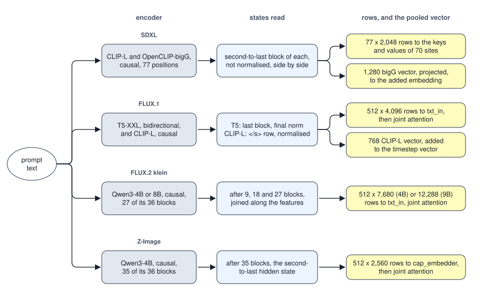

<!-- SPDX-License-Identifier: CC-BY-4.0 -->
<!-- Copyright (c) 2026 Martin Schröder <info@swedishembedded.com> -->

# Conditioning on Text

*How does a sentence become the signal that steers image generation?*

A prompt of seven words, `a red cube on a blue sphere`, reaches SDXL's denoiser as 77 rows of 2,048 numbers. If every word is one token, the prompt fills nine of those rows: the start marker, the seven words and the end marker. The other 68 rows are not words, and they are not empty either. They hold real numbers, the denoiser's attention reads them in every one of its 70 cross-attention blocks, and a generator trained on rows like these would be handed something different if the rows were different. Whoever ports the pipeline has to know what those 68 rows contain, and the weights that read them cannot say.

Chapter 8 took the prompt as given, a sequence of vectors that "some encoder produced", and studied the network that reads it. A sentence, though, is a string of characters, and the denoiser is a function of arrays, so something has to turn one into the other, and everything that something does is part of what the denoiser was trained on: which encoder, which of its layers, how long the window is, what fills it past the words, and whether the encoder was told which positions are real. A prompt meets three questions in turn. What does the encoder hand over, and where in the denoiser does each part of it go? Which of the encoder's states is the one that is read? And how much of the signal is decided by the padding, which looks like nothing?

Conditioning on text leans on five earlier ideas.

1. (Volume V, [Chapter 14](../v05-sequences/14-encoders.md), the bidirectional encoder.) A text of 5 tokens is padded to a window of 8 and read under the full mask. How many keys does the query at position 0 read, and what does that do to the vectors of the 5 real positions?
2. (Volume V, [Chapter 6](../v05-sequences/06-seq2seq.md), cross-attention.) Image queries at 6 positions read a prompt of 4 rows. What is the shape of the matrix of attention weights, what does each row of it sum to, and which side has its vectors rewritten by the layer?
3. (Volume VII, [Chapter 8](../v07-vision/08-clip.md), contrastive pretraining.) In the CLIP text tower, at which position is the readout taken, after what operation, and why does the code take the first position holding the largest id?
4. (Volume VI, [Chapter 1](../v06-language-models/01-modern-decoder.md), the modern decoder recipe.) Qwen3-4B has width 2560, 32 query heads and 8 key-value heads, each of width 128. What is the width of its attention output, and how many numbers do the keys and values of one token hold in one layer?
5. (Volume V, [Chapter 9](../v05-sequences/09-transformer-block.md), the cost of a block.) By the rule of that chapter, how many FLOPs do the four attention projections of one block cost over $T = 77$ tokens at width $D = 768$?

## What the denoiser is handed, counted

Text conditioning is easiest to see by counting what leaves the text side of each pipeline for one prompt.

<!-- worked: text_conditioning.interface_table -->
What leaves the text side of each pipeline for one prompt, from the configurations of the crates (SDXL: the 77-position windows of its two CLIP towers, concatenated along the feature axis, 768 + 1280; FLUX.1: the 512-row T5-XXL window, the largest `max_len` it accepts, and the pooled CLIP-L vector; FLUX.2: three Qwen3 hidden states per token; Z-Image: one Qwen3-4B hidden state per token and the default caption capacity of 512). The latent is what the denoiser steers at 1024 by 1024 pixels: 4 x 128 x 128 for SDXL, 16 x 128 x 128 for FLUX.1 and Z-Image, and 4096 tokens of 128 values for FLUX.2.

| pipeline | rows | row width | sequence numbers | pooled numbers | text numbers | latent numbers | sequence / latent |
|---|---:|---:|---:|---:|---:|---:|---:|
| SDXL | 77 | 2,048 | 157,696 | 1,280 | 158,976 | 65,536 | 2.4 |
| FLUX.1 dev | 512 | 4,096 | 2,097,152 | 768 | 2,097,920 | 262,144 | 8.0 |
| FLUX.2 klein-4b | 512 | 7,680 | 3,932,160 | none | 3,932,160 | 524,288 | 7.5 |
| FLUX.2 klein-9b | 512 | 12,288 | 6,291,456 | none | 6,291,456 | 524,288 | 12.0 |
| Z-Image Turbo | 512 | 2,560 | 1,310,720 | none | 1,310,720 | 262,144 | 5.0 |
<!-- /worked -->

Two things in the table are surprising on a first reading. The first is size. At $1024 \times 1024$ SDXL's latent has 65,536 numbers and its prompt 157,696, which is 2.4 times as many; the transformers' prompts carry 5 to 12 times as many numbers as the latent they steer. The denoiser's input is mostly text. The second is that two different kinds of object leave the encoder. The **prompt embedding sequence** is the array of rows, one vector per position of the window, $\mathbf{X} \in \mathbb{R}^{R \times D}$ with $R$ rows (the window) and a width $D$ that the pipeline fixes. It is what Chapter 8 called the prompt: cross-attention reads it in SDXL, and the transformers project it into their own width and let the picture and it attend to one another. The **pooled text embedding** is a single vector, $\mathbf{p}_{\mathrm{txt}} \in \mathbb{R}^{D_p}$, a summary of the whole prompt, and it has no positions at all. SDXL and FLUX.1 take one; FLUX.2 and Z-Image take none. Where it exists it does not go where the rows go: it joins the timestep embedding of Chapter 8, and so reaches every block of the network as a part of the clock.

Both come from one idea. **Text-encoder conditioning** is the practice of turning a prompt into the generator's input with a separate, pretrained text encoder that is only run forward when an image is made, so that the denoiser sees the prompt only through the rows and the pooled vector the encoder produced. Nothing about words is built into the denoiser. It sees arrays, and it was trained against the arrays one particular encoder made, which makes every choice in producing them (the tokenizer, the window, the layer, the padding) part of the denoiser's input contract. The word contract is exact: the weights are fixed, and an input that differs from the training one in any of those respects is a different input, not a noisier one.

A separate encoder earns its place by what the denoiser cannot learn alone. The denoiser's own loss, a squared error on noise or on a velocity, rewards knowing what a "red cube" looks like when it is paired with pixels, and it rewards little else about language. An encoder pretrained on text, or on text paired with images, brings the rest (word senses, syntax, the effect of "on" against "under") from a source whose task rewards them. The price is small in work and large in weights.

<!-- worked: text_conditioning.encoder_work -->
The text side against the denoising side of one 1024 by 1024 image at the default step counts of Chapter 7, from the configurations: the parameters the text encoders read, the parameters of the denoiser, the work (a multiply-add is two operations; lookups, norms and activations are left out) of encoding one prompt by the rule of Volume V, Chapter 9, and the work of all the denoising passes. Encoders: SDXL's two CLIP towers over 77 tokens; FLUX.1's T5-XXL over 512 tokens and CLIP-L over 77; FLUX.2's Qwen3 over 512 tokens and the first 27 of its 36 blocks, which is as deep as its deepest tap reads; Z-Image's Qwen3-4B over 512 tokens and the first 35 of 36. Denoisers: `denoiser_architectures` (FLUX.1 by this rule: 19 double and 38 single blocks of width d = 3072, n = (side / 16)^2 image rows and t text rows, N = n + t; a double-stream or a single-stream block has 12 d^2 linear weights per row (a double block: the query-key-value 3 d^2, the projection d^2 and a feed-forward network of 2 x 4 d^2; a single block: 7 d^2 in and 5 d^2 out), so the linear layers cost 2 x 12 d^2 N per block, attention 4 N^2 d per block, and the embedders 2 n 64 d (image rows in), 2 t 4096 d (text rows in) and 2 n d 64 (out); norms, softmax and modulation are left out).

| pipeline | encoder params | denoiser params | ratio | encode, GFLOP | denoise, TFLOP | work ratio |
|---|---:|---:|---:|---:|---:|---:|
| SDXL, 30 steps with guidance | 817,720,320 | 2,567,463,684 | 0.32 | 111.2 | 405.7 | 0.027% |
| FLUX.1 dev, 50 steps | 4,885,371,136 | 11,901,408,320 | 0.41 | 4,860.0 | 3,718.9 | 0.131% |
| FLUX.2 klein-4b, 4 steps | 3,114,088,192 | 3,875,544,576 | 0.80 | 2,907.5 | 139.3 | 2.088% |
| FLUX.2 klein-9b, 4 steps | 5,831,883,520 | 9,078,581,248 | 0.64 | 5,451.4 | 302.1 | 1.805% |
| Z-Image Turbo, 8 steps | 3,921,534,720 | 6,154,908,736 | 0.64 | 3,769.0 | 500.0 | 0.754% |
<!-- /worked -->

By the rule of Volume V, Chapter 9, encoding a prompt is between 0.027% and 2.1% of the work of denoising the image it steers, because the encoder runs once and the denoiser 4 to 60 times. The weights are another matter. FLUX.2 klein-4b reads 3.1 billion parameters of text encoder to steer a denoiser of 3.9 billion, and Z-Image 3.9 billion for 6.2 billion; the encoder is nearly as large as the network it conditions, and for one prompt it has nothing to do for the whole of the denoising. Where those weights live between their one use and the next is a question of the pipeline as a whole, taken up in Chapter 10.

Two entries of the table are not what a reader might guess. FLUX.2's encoder needs 27 of the Qwen3's 36 blocks, and Z-Image's 35 of 36, because each reads a state that exists before the last block. When the encoder is placed on a card of its own the code builds a shard of the model that stops there (`qwen3::Shard { start: 0, end: deepest, embed: true, head: false, .. }` in `crates/flux2/src/pipeline.rs`, and the same shape with `end: n - 1` in `crates/s3dit/src/pipeline.rs`), and does not even demand the layers past the tap, the final norm or the language-model head from the checkpoint. An encoder used for its states and not for its words has no use for the part that chooses the next word. And FLUX.1 runs two encoders, T5-XXL for the rows and a CLIP text tower for the pooled vector, so that one prompt is encoded twice by different models and the results go to different places.

## A sentence as rows

A row of the prompt embedding sequence belongs to a position of the window, and what it holds depends on which positions its encoder was allowed to read. That is the mask of Volume V, Chapter 14, and it divides the encoders of the table into two kinds. CLIP's text tower and the Qwen3 decoders are causal: row $i$ is computed from tokens $0 \dots i$ only. T5 is bidirectional: row $i$ is computed from every token of the window. Which of the two an encoder is decides which rows can know what, and the cleanest way to see it is a small encoder that can be read to the last digit.

<!-- worked: text_conditioning.toy_setup -->
The toy encoder is `init_gpt` of Volume V (stream `text_conditioning.toy`, seed 0x5ba73f3b3325562c) with V = 9, D = 8, 2 heads of width 4, SwiGLU width 12, L = 4 blocks and 16 learned positions, every matrix entry `0.5 * normal()` (instead of the 0.02 of a language model, so that attention has something to do), drawn row by row in the order embedding table, position table, then per block W_Q, W_K, W_V, W_O, W_gate, W_up, W_down (W_O and W_down multiplied by 1 / sqrt(2 L)); all norm gains are 1 (two a block and a final one, 72 numbers, not drawn). That is 2,448 parameters, 2,376 of them drawn. The pre-norm block is the one of Volume V, Chapter 9, the epsilon of every RMS norm is 1e-6, and a text is `<s>`, its words, `</s>`, then `<pad>` up to the window. Vocabulary: 0 `<pad>`, 1 `<s>`, 2 `</s>`, 3 `a`, 4 `red`, 5 `blue`, 6 `cube`, 7 `sphere`, 8 `on`.

| text | tokens | ids |
|---|---:|---|
| `a red cube on a blue sphere` | 9 | 1 3 4 6 8 3 5 7 2 |
| `a blue cube on a red sphere` | 9 | 1 3 5 6 8 3 4 7 2 |
| `a red cube` | 5 | 1 3 4 6 2 |
<!-- /worked -->

Take the two prompts that exchange their colours, `a red cube on a blue sphere` and `a blue cube on a red sphere`, with no padding. They contain the same words, so any representation that is a sum over the words cannot tell them apart. What the encoder adds is the dependence of each row on the others.

<!-- worked: text_conditioning.order_example -->
Two prompts of nine tokens with no padding, `a red cube on a blue sphere` and `a blue cube on a red sphere` (the two colours exchanged), through the toy encoder of `text_conditioning.toy_setup`, once with the causal mask and once with the full mask. A row is the final RMS-normalised vector of a position (its Euclidean norm is about 2.83 = sqrt(8)). Distance between the two prompts' rows at each position:

| position | token, prompt 1 | token, prompt 2 | causal | bidirectional |
|---|---|---|---:|---:|
| 0 | `<s>` | `<s>` | 0 | 2.6662 |
| 1 | `a` | `a` | 0 | 0.4943 |
| 2 | `red` | `blue` | 2.9614 | 2.2368 |
| 3 | `cube` | `cube` | 1.0517 | 1.7248 |
| 4 | `on` | `on` | 0.7823 | 0.7885 |
| 5 | `a` | `a` | 0.7314 | 0.6695 |
| 6 | `blue` | `red` | 0.7980 | 1.2081 |
| 7 | `sphere` | `sphere` | 0.6227 | 1.0409 |
| 8 | `</s>` | `</s>` | 0.7884 | 0.7292 |

Distance between the two prompts' single vectors for five ways of pooling:

| pooled vector | distance |
|---|---:|
| mean of the token embeddings (no encoder) | below 1e-12 |
| causal encoder, mean of the rows | 0.4556 |
| causal encoder, row of `</s>` | 0.7884 |
| bidirectional encoder, mean of the rows | 0.4267 |
| bidirectional encoder, row of `<s>` | 2.6662 |
<!-- /worked -->

The table holds three facts. Under the causal mask the rows at positions 0 and 1 are the same for both prompts, exactly, because nothing before the first colour differs and the encoder reads nothing after it. From position 2 on, every row differs, because every row has read a colour: the row of `cube` has read `red` in the first prompt and `blue` in the second, and so in the first prompt the object's row carries its colour with it. Under the full mask the rows at positions 0 and 1 differ too, by 2.6662 at the start marker, the largest of that column: a start marker that reads everything is a summary of the prompt, and the colours changed the prompt. The mean of the token embeddings, with no encoder, is the one pooled vector of the five that cannot tell the prompts apart, which is why no such summary of the words alone is a conditioning signal for a prompt that has relations in it.

What the toy shows is where the information can sit, not that a trained encoder puts it there. In a trained encoder the row of `cube` carries the colour when the encoder's training rewarded it for doing so. The denoiser's cross-attention then needs only to find the row of `cube` to get a coloured cube, which is plausibly a simpler thing for it to learn than to find the row of `red` and the row of `cube` and relate them. The transformers have a further reason for relying on the rows to carry order: FLUX.1's joint attention gives every text row the position `(0, 0, 0)` (`position_ids` in `crates/flux1/src/model.rs`), so the order of the words reaches the denoiser only through what the encoder put in the rows. FLUX.2 numbers its text rows on a fourth axis and Z-Image on its first, so there the denoiser at least knows which row is which.

The reading of the rows is a short list of weights. SDXL's 70 spatial-transformer blocks each project all 77 rows to keys and values.

<!-- worked: text_conditioning.sdxl_reading -->
How SDXL's U-Net reads the 77 x 2048 sequence, from the configuration of `denoiser_architectures` (levels of 320, 640 and 1280 channels, 1, 2 and 10 transformer blocks per resnet slot, attention at the two coarser levels, the middle block once, 2 resnet slots per down level and 3 per up level). Every block projects the 77 rows to keys and values with one weight of 2c by 2048, 2 x c x 2048 numbers, which costs 2 x 77 x (that many) FLOPs in a pass; the table sums it over the blocks of each width.

| channels c | blocks | k and v weights per block | k and v weights in all | FLOPs of those projections per pass |
|---:|---:|---:|---:|---:|
| 640 | 10 | 2,621,440 | 26,214,400 | 4,037,017,600 |
| 1280 | 60 | 5,242,880 | 314,572,800 | 48,444,211,200 |
| total | 70 |  | 340,787,200 | 52,481,228,800 |

The two CLIP towers cost 111,181,575,120 FLOPs for a prompt (`text_conditioning.encoder_work`), once; the key and value projections of the same rows cost 52,481,228,800 in every pass, 0.47 times as much, and 28.3 times as much over the 60 passes of 30 steps with guidance.

The pooled vector enters elsewhere: the added embedding reads 2,816 numbers (1280 pooled and six 256-wide sinusoids, so 1280 of them text), through two layers of 5,245,440 parameters. FLUX.1's `vector_in` reads 768 numbers through two layers of 11,802,624 parameters and adds the result to the timestep's vector.
<!-- /worked -->

The prompt does not change during a generation, and the table says what that costs: the encoders run once, and the projections of their rows are recomputed in every pass, 28.3 times the encoders' work over 60 passes. The graph computes the projection from the prompt buffer inside every pass (the `attn2.kv` linear of `crates/sdxlunet/src/model.rs`), because the network is a function of its inputs and the prompt is one of them. That the projections are a fixed function of an array that does not change during a generation is a fact a pass does not use.

The transformers read the rows with one layer first, and then let the blocks rewrite them.

<!-- worked: text_conditioning.readers -->
The first layer that reads the rows of the transformers' prompt window, from the configurations (`crates/flux1/src/config.rs`, `crates/flux2/src/config.rs`, `crates/s3dit/src/model.rs`):

| pipeline | layer | shape | parameters |
|---|---|---|---:|
| FLUX.1 dev | txt_in | 4096 to 3072, biased | 12,585,984 |
| FLUX.2 klein-4b | txt_in | 7680 to 3072, no bias | 23,592,960 |
| FLUX.2 klein-9b | txt_in | 12288 to 4096, no bias | 50,331,648 |
| Z-Image Turbo | cap_embedder | RMS norm of 2560, then 2560 to 3840, biased | 9,836,800 |
<!-- /worked -->

These are small next to the blocks: the largest, FLUX.2 klein-9b's, is 50 million parameters of a 9.1 billion model. What they decide is the width at which the rows meet the image tokens. Z-Image puts an RMS norm in front of its projection, and a norm at the entrance of the denoiser removes the scale of each row, so a reader built that way is insensitive to the length of the prompt's vectors, and one that reads rows directly is not.

## A sentence as one vector

A single vector for the whole text is the product of Volume V, Chapter 14: pooling, by averaging the rows or by reading a designated one. The text tower of CLIP uses the second. Its attention is causal, so only the last real position, the end token, has read every word, and the vector the contrastive loss of Volume VII, Chapter 8 compares with the picture's is that row after the final normalization and a linear projection. Reading the row of the end token is the classification-token (CLS) pooling of Volume V in a decoder-shaped encoder: the position that has seen everything is the one to read. The code finds it as the first position that holds the largest id, `argmax(ids)` in `crates/clip/src/model.rs`, and its comment records the trap that a last-wins maximum falls into: CLIP-L pads with the end token itself, so every pad ties with the real end token, and a rule that takes the last of the ties reads row $R - 1$, a pad row, instead of the end of the text.

The five poolings of the toy, at the end of the earlier table, show what pooling can and cannot keep. The mean of the encoder's rows separates the prompts by 0.4556 under the causal mask and 0.4267 under the full one, and the row of the end token, which is all the causal encoder has to say about the whole, by 0.7884. Averaging dilutes the rows that changed among the rows that did not. The reading of one position concentrates the effect on that position's row, and it is the training of the encoder that must make the position carry the whole.

For an encoder trained as CLIP is, that training is the contrastive loss of Volume VII: the readout at the end token is the vector the loss pulls toward the vector of the picture that goes with the caption and away from the others in the batch. The pooled vector is therefore, by construction, a vector that says what a picture of this text looks like, which is why it is the right one to hand a generator. The other encoders of the table were trained for a different task, and neither T5's span corruption nor Qwen3's next-token loss ever asked its readout to be a summary. T5 has no pooled output, and Qwen3 has none that its training shaped. The pipelines that use them take no pooled vector, and the pipelines that take one take it from a CLIP tower.

Which tower and which readout is a decision of each pipeline. SDXL takes the projected vector of its larger tower: the final-normalized row at the end token multiplied by the tower's 1280-by-1280 projection, the vector that lives in the joint space of pictures and captions. FLUX.1 takes CLIP-L's final-normalized row with no projection (the CLIP-L configuration has no projection in `crates/clip/src/config.rs`), 768 numbers. The tower's rows are computed in both cases and thrown away; FLUX.1 runs a whole text tower of 123,060,480 parameters to keep one row of it.

Where the pooled vector enters is the part of the design that ties it to Chapter 8. A vector without positions cannot be read by attention, since attention needs rows to choose among. It goes where a global signal goes, which is with the clock. SDXL concatenates it with six size and crop sinusoids and runs the 2,816 numbers through two layers whose output is added to the timestep embedding; 1280 of those 2,816 numbers are text. The sum then reaches every resnet through the per-channel projection of Chapter 8, which is a shift and nothing else, so in SDXL a prompt's global summary can move the channels of the network and cannot scale them. FLUX.1 adds its pooled vector, after two layers of its own, to the timestep vector, and that sum is the vector from which every block's shift, scale and gate are computed (`conditioning` in `crates/flux1/src/model.rs`: `time_in(t) + guidance_in(g) + vector_in(pooled)`). The same 768 numbers can there scale and gate the blocks, which is the form Chapter 8 showed to be the one a global condition needs when it has to change a gain.

The order of the concatenation in SDXL's added embedding is one of those things that type-checks either way. The code puts the pooled text first and the six sinusoids after it, the order of the reference implementation, and the comment of `crates/sdxlunet/src/hostemb.rs` calls the reverse "the classic mistake": 2,816 numbers either way, so the types cannot object, and the composition and the crop framing of the images change silently.

## Which state of the encoder is the prompt

An encoder has many layers, and the denoiser was trained against one of them. Nothing in the shape of the denoiser's weights says which. SDXL's cross-attention reads rows of width 2048, which is as true of the last layer of the two towers as of any other.

Four pipelines make four choices, and the code states each as a fact that a port can get wrong. SDXL takes, from each CLIP tower, the output of the second-to-last block, before any normalization: the crate's `penultimate_layer` is the 0-based layer $L - 2$, which is layer 10 of CLIP-L's 12 and layer 30 of OpenCLIP-bigG's 32, and the parity test `crates/clip/tests/it/parity.rs` asserts both indexes. The module header of `crates/sdxlunet/src/textenc.rs` says that taking the last layer instead "runs, produces an image, and is not SDXL". FLUX.1 takes the opposite for its T5: the last block, after the final RMS norm, which is the `last_hidden_state` of the reference implementation. Z-Image takes the second-to-last state of a decoder language model, the output of block 34 of Qwen3-4B's 36 (`res[n_layers - 1]` in the code of `crates/qwen3/src/model.rs`, which says that it is `hidden_states[-2]`), and FLUX.2 takes three, the states after 9, 18 and 27 blocks, joined per token.

The last of these has a layout, and the layout is a hazard of its own.

<!-- worked: text_conditioning.taps_example -->
The prompt `a red cube on a blue sphere` (nine tokens, causal mask) through the toy encoder. The residual stream is not normalised between blocks, so the length of a row is something the blocks add to; the table gives the RMS of the rows at each depth (mean, smallest, largest over the nine positions) and the mean cosine similarity of each depth's rows with the penultimate rows.

| depth | mean RMS | smallest RMS | largest RMS | mean cosine similarity with the penultimate rows |
|---|---:|---:|---:|---:|
| embedding + position | 0.6846 | 0.4068 | 1.1898 | 0.4944 |
| after block 0 | 0.8612 | 0.6511 | 1.4020 | 0.5806 |
| after block 1 | 1.4629 | 1.0895 | 2.0342 | 0.8555 |
| after block 2 (the penultimate) | 1.6792 | 0.9054 | 2.4868 | 1.0000 |
| after block 3 (the last) | 1.6662 | 0.4373 | 2.3513 | 0.7292 |
| final RMS norm of the last block | 1.0000 | 1.0000 | 1.0000 | 0.7292 |

Three taps (the streams after 1, 2 and 3 blocks, a quarter, a half and three quarters of the depth as 9, 18 and 27 are of 36, written tap 1, 2 and 3 in the table) of the same nine positions have to enter a conditioning row of 24 numbers per position. A buffer `taps[3, 9, 8]` read as 9 rows of 24 numbers without moving anything fills each row from other positions' states:

| row | right layout: the row holds | buffer reshaped as it lies: the row holds |
|---|---|---|
| 0 | tap 1 token 0, tap 2 token 0, tap 3 token 0 | tap 1 token 0, tap 1 token 1, tap 1 token 2 |
| 1 | tap 1 token 1, tap 2 token 1, tap 3 token 1 | tap 1 token 3, tap 1 token 4, tap 1 token 5 |
| 8 | tap 1 token 8, tap 2 token 8, tap 3 token 8 | tap 3 token 6, tap 3 token 7, tap 3 token 8 |
<!-- /worked -->

The toy's table gives the first half of the lesson. The residual stream of a pre-norm network is not normalized between blocks, so the length of a row is something the blocks add to: at the last block the smallest RMS of the nine rows is 0.4373 and the largest 2.3513. The final RMS norm sets every one to 1.0000, and the penultimate state, which has not been through it, keeps its own scale. A conditioning that reads the penultimate state un-normalized and one that reads the normalized last state are therefore different in more than depth: they differ in the scale of every row, by a factor that varies with the token. The weights that read the rows were fitted to one of them. This is also the reason a parity gate that taps the encoder after the final norm cannot see a scale error upstream of it, as happened with another model's encoder in brain (knowledge #47); the CLIP parity test taps the penultimate state directly, as well as the last.

The second half is the layout. FLUX.2 puts three taps in one row, $\mathbf{X}^{\mathrm{cat}}_i = [\mathbf{X}^{(9)}_i;\, \mathbf{X}^{(18)}_i;\, \mathbf{X}^{(27)}_i]$, for $i = 0 \dots R - 1$, with $\mathbf{X}^{(\ell)}$ the stream after $\ell$ blocks, so a row of the buffer is $3D$ numbers wide (7680 for Qwen3-4B, 12,288 for Qwen3-8B). An encoder run naturally produces the taps as three arrays, one per layer, and a buffer of three arrays of $R$ rows is a tensor of shape $[3, R, D]$ in memory, tap-major. Reading it as $R$ rows of $3D$ numbers without moving anything is a plain reshape, it has the right shape, and in the toy it fills each row from three other positions of one layer, as the second table shows. The code does the transposition explicitly, a loop over rows and, inside it, a loop over the taps (`encode_prompt` in `crates/flux2/src/pipeline.rs`); the loop is the only thing that stands between the pipeline and a conditioning in which the denoiser's `txt_in` layer, whose first 2560 columns were fitted to the state after 9 blocks, reads other positions' tokens.

SDXL has the same hazard in a smaller form. Its sequence is $[\text{CLIP-L};\, \text{bigG}]$ along the features, 768 first, and the key and value weights of every cross-attention block were trained with that order of their 2048 columns. The readers differ in how much a wrong scale can hurt them. Z-Image's reader begins with an RMS norm of the rows, so it is blind to the length of each row and sees only its direction; FLUX.2's `txt_in` is one linear layer, with no norm among its manifest's tensors (`crates/flux2/src/config.rs`), and a tap of the wrong scale reaches it whole.

## Padding is part of the model

Return to the 68 rows. A fixed window is a convention that buys fixed shapes (the recorded graph of a denoiser is built once for $R$ rows), and a prompt shorter than the window leaves rows to fill. What fills them is a rule of the training, and the rule has two parts that vary independently: whether the encoder is causal or bidirectional, and whether the encoder is told which positions are padding, by a key padding mask that removes the pad positions from every query's keys. The four combinations can be run on the toy.

<!-- worked: text_conditioning.padding_matrix -->
The prompt `a red cube` (five tokens with `<s>` and `</s>`) padded with `<pad>` to a window of 8 positions (3 pads) and to 12 (7 pads), through the toy encoder of `text_conditioning.toy_setup`; the pad keys are removed by the mask `j < 5` where stated. Largest absolute difference in any coordinate of the final normalised rows between the two windows, at the five content rows and at the three pad rows (positions 5 to 7) that both windows have:

| encoder | content rows, window 8 against 12 | pad rows 5 to 7, window 8 against 12 |
|---|---:|---:|
| bidirectional, pad keys readable | 1.0552 | 1.5885 |
| bidirectional, pad keys masked | below 1e-12 | below 1e-12 |
| causal, pad keys readable | below 1e-12 | below 1e-12 |
| causal, pad keys masked | below 1e-12 | below 1e-12 |

And at the one window of 8, the largest difference between the encoder with its pad keys readable and the same encoder with them masked:

| encoder | content rows | pad rows 5 to 7 |
|---|---:|---:|
| full encoder | 2.2041 | 0.7383 |
| causal encoder | below 1e-12 | 1.5179 |
<!-- /worked -->

The first table is the one that matters for a port. A bidirectional encoder that can read its pad keys changes the vectors of the real tokens when the number of pads changes: by up to 1.0552 in a coordinate between a window of 8 and a window of 12. The prompt did not change, and its rows did. A key mask removes the dependence completely, and so does a causal mask, because with right padding no real position reads to its right: both give a difference below $10^{-12}$ at the content rows. The pad rows follow the same pattern, since a causal row is a function of its prefix.

The second table is about the convention. At one window of 8 the full encoder with its pad keys readable and the same encoder with them masked disagree at the content rows by 2.2041, as in Volume V, Chapter 14. The causal encoder agrees with itself at the content rows (below $10^{-12}$, since the mask removes only keys the content never read), and disagrees at the three pad rows by 1.5179: a causal encoder's pad rows are computed from the content, and so carry it, and whether the pad keys are masked decides what they carry. The pad rows of a causal encoder are therefore not nothing. They are states that have read the whole prompt, and a denoiser trained on them can use them as it uses the end token.

Then the denoiser reads all the rows, and that is the second place padding matters.

<!-- worked: text_conditioning.reader_mass -->
A reader of the encoder's rows that never masks (as the cross-attention of SDXL and the joint attention of the transformers do not): `a red cube` in windows of 8, 12 and 16 through the four encoders of `text_conditioning.padding_matrix`, read by 6 queries of one head of width 8. Stream `text_conditioning.reader` (seed 0xfa4dc78d5fab9ddd); draws in this order: the 6 queries, each 8 values of `normal()`, then W_K (8 by 8, row by row, `0.5 * normal()`). The keys are the final normalised rows times W_K, the scores are the dot products over sqrt(8), the softmax runs over every row of the window, and the table gives the mean over the queries of the weight that falls on the pad rows (positions 5 and up).

| encoder | window 8 | window 12 | window 16 |
|---|---:|---:|---:|
| share of the window that is padding | 37.5% | 58.3% | 68.8% |
| bidirectional, pad keys readable | 19.96% | 45.38% | 65.37% |
| bidirectional, pad keys masked | 30.56% | 52.58% | 66.98% |
| causal, pad keys readable | 38.48% | 60.45% | 71.57% |
| causal, pad keys masked | 35.71% | 56.92% | 66.37% |
<!-- /worked -->

The reader here is a toy with random weights and nothing is learned, so the mass is a measurement of what a reader that never masks does with the rows, not of what a trained one does. It says that the weight on the pad rows grows with their number in every convention, from between 20% and 38% at 8 rows to between 65% and 72% at 16, even where the content rows are identical in every window (the two causal encoders). The softmax runs over every row of the window, so a longer window is a different attention even for the same words. That is why the window length is part of the contract. A denoiser trained on 77-row windows was trained to look at 77 rows, one trained on 512-row windows at 512, and neither was trained to look at the other's window.

The pipelines in brain differ in exactly these conventions, and each follows its reference implementation.

SDXL's encoder is causal and has no key mask (the reference passes `attention_mask=None`, and causal attention already keeps the pad rows, which come last, out of every content row, so `crates/clip/src/model.rs` dispatches no key-padding kernel), CLIP-L pads with the end token and bigG with id 0, and the cross-attention is handed all 77 rows (`CONTEXT` in `crates/sdxlunet/src/textenc.rs`) with no key mask among its inputs. A prompt longer than 75 tokens is cut, because `encode_with_context` in `crates/data/src/clip_bpe.rs` keeps 75 content tokens and then the end marker.

FLUX.1's T5 is bidirectional, pads with id 0, and is called with no mask, so its 512-row window is the first row of the toy's padding table, a bidirectional encoder reading its pad keys: the content rows depend on the window length. The window, `max_len`, is a parameter of the served action, from 32 to 512 with a default of 512 (`crates/flux1/src/caps.rs`), and it looks like a speed setting. It is not one. Lowering it changes the encoder's rows for the same words and changes what the joint attention of the denoiser sees. A T5 prompt that does not fit is cut, keeping the end marker (`encode_padded` in `crates/data/src/unigram.rs`).

FLUX.2 and Z-Image use a causal Qwen3 whose pad keys are masked. Their pad rows are computed (and, as the second toy table shows, they differ from the ones an unmasked encoder would compute) and then handed to the denoiser, which has no mask for them: the comment on the `txt_len` field of `crates/flux2/src/config.rs` says that pad tokens attend un-masked, and the forward graphs of `crates/flux2/src/model.rs` and `crates/s3dit/src/block.rs` have no text key mask. A prompt that does not fit is refused.

The refusals have a history. Prompts past the window were once cut without a word. Commit `bd5765e20` (August 2026) made the cut report itself, with the token counts, and commit `801ec40ff` (September 2026) turned the report into an error for FLUX.2, naming the same failure that the Z-Image pipeline already refused by contract: an image conditioned on the prefix of a prompt, with nothing in the picture to say so. The code that remains is `check_prompt_length` in `crates/flux2/src/pipeline.rs` and `fit_caption` in `crates/s3dit/src/pipeline.rs`. The lesson is about what a truncation is. A cut that keeps the template's end markers produces a perfectly well-formed input, so no check downstream can see it, and only the refusal is a statement that the caller can act on.

The padding of Z-Image has a story too. Its resident pipeline once filled a short prompt by repeating the final token, with no mask, and commit `1159a8692` (August 2026) replaced it: pad with the end-of-text token and exclude the pads as keys past the true length, the semantics of the reference implementation's attention mask, through a mask the FLUX.2 path had already used (`arm_pad_kmask` in `crates/qwen3/src/model.rs`). The message names the old fill as unsound, and the toy says why in its own terms. The pad rows were what a causal encoder computes for a repeated final token that it could read, and the denoiser attends all of them, so the features the denoiser got from a short prompt were a function of how the padding was written. The code that remains states the new contract in the doc comment of `fit_caption`: the pad rows past the content "are excluded as attention keys, so the caption features never depend on how many pads the encoder saw". (The crate was called `zimage` then; it is `s3dit` now.)

The unconditional prompt of Chapter 7 is, in these terms, a prompt like any other. SDXL's default negative prompt is the empty string and the encoder runs on it (`encode_all(&[prompt, negative])` in `crates/sdxlunet/src/pipeline.rs`); FLUX.2's unconditional branch is `encode_prompt("")`. The null condition is the encoder's output for an empty text: for SDXL the start and end markers and 75 pad rows, with a pooled vector of their own, not an array of zeros. Wan's rows past the prompt are an exception, described with T5 below.

## T5-XXL, from its configuration

`crates/t5encoder` exists for FLUX.1, and for Wan, whose video model conditions on the multilingual variant. The commit that introduced it (`a3a479800`, August 2026) gives the reason for its being a crate of its own: a general text encoder does not belong inside one diffusion backbone, and a second backbone does reuse it (`crates/flux1/Cargo.toml` and `crates/wan/Cargo.toml` both depend on it). [Chapter 14 of Volume V](../v05-sequences/14-encoders.md) described how it differs from a BERT, and the differences that make a port wrong silently (no score scaling, a learned position bias, the gated feed-forward network); its parameters follow from its configuration.

<!-- worked: text_conditioning.t5_count -->
The encoder stacks of `crates/t5encoder`, counted from the configuration: width 4096, 24 blocks, 64 heads of width 64 (so the attention inner width is 4096), gated feed-forward width 10240, 32 relative-position buckets, vocabulary 32128 (umT5: 256384 and one bias table per block). The attention holds q, k, v and the output matrix (4 x 4096 x 4096 per block) and the feed-forward network three matrices of 10240 by 4096.

| encoder | part | parameters | share |
|---|---|---:|---:|
| T5-XXL (FLUX.1) | token embedding | 131,596,288 | 2.76% |
|  | attention (fused q, k, v and o) | 1,610,612,736 | 33.82% |
|  | feed-forward (wi_0, wi_1, wo) | 3,019,898,880 | 63.41% |
|  | block norms (two per block) | 196,608 | 0.00% |
|  | relative-position bias | 2,048 | 0.00% |
|  | final norm | 4,096 | 0.00% |
|  | total | 4,762,310,656 | 100% |
|  | bytes in 32-bit floats | 19,049,242,624 |  |
| umT5-XXL (Wan) | token embedding | 1,050,148,864 | 18.49% |
|  | attention (fused q, k, v and o) | 1,610,612,736 | 28.35% |
|  | feed-forward (wi_0, wi_1, wo) | 3,019,898,880 | 53.16% |
|  | block norms (two per block) | 196,608 | 0.00% |
|  | relative-position bias | 49,152 | 0.00% |
|  | final norm | 4,096 | 0.00% |
|  | total | 5,680,910,336 | 100% |
|  | bytes in 32-bit floats | 22,723,641,344 |  |
<!-- /worked -->

The 24 blocks hold 97% of the 4,762,310,656 parameters of T5-XXL, 63.41% of them in the three matrices of the gated feed-forward network, and the token table is 2.76%; at 32-bit floats the whole is 19,049,242,624 bytes, the "19.05 GB" of the crate's header. The umT5 variant has the same blocks and a table eight times as large. Its 918,599,680 further parameters, 22.72 GB in all at 32 bits, are the whole difference, and all but 47,104 of them are token rows (the 23 extra position tables, one for each block after the first).

The same count has its own story, and it shows why a count should be taken from the manifest. The placement code of FLUX.1 decides which card holds the text encoder before it loads anything, so it needs the encoder's weight bytes in advance. `te_bytes` once computed them with a formula of its own, and commit `dec49aaec` (September 2026) found it short by one feed-forward matrix per block and replaced it with the manifest's parameter count.

<!-- worked: text_conditioning.te_bytes_story -->
T5-XXL's weight bytes in 32-bit floats, as `te_bytes` of `crates/flux1/src/pipeline.rs` once computed them ((2 d d_ff + 4 x 64 x heads x d + 2 d) x layers x 4 + d x vocab x 4, with d = 4096, d_ff = 10240, 64 heads and 24 layers) and as the tensor manifest counts them (three feed-forward matrices a block, the bias table of 32 x 64 and the final norm of 4096 as well). One GiB is 2^30 bytes. The difference is the missing matrix in each block plus 24,576 bytes for the bias table and the final norm.

| quantity | bytes | GiB |
|---|---:|---:|
| the formula with two feed-forward matrices a block | 15,022,686,208 | 13.99 |
| the manifest count (three matrices, bias table, final norm) | 19,049,242,624 | 17.74 |
| the difference | 4,026,556,416 | 3.75 |
| one matrix of 10240 by 4096 in each of 24 blocks | 4,026,531,840 | 3.75 |
<!-- /worked -->

The mechanism in the commit message is right and the figure in it is not: it calls the miss "about 5 GiB", and the count is 3.75 GiB (4,026,556,416 bytes), the 24 matrices of 10240 by 4096 and 24,576 bytes more. A message is a claim; the code comment in `crates/flux1/src/pipeline.rs` now states 3.75 GiB. What the commit gets right is the lesson: the formula counted two feed-forward matrices, the shape of the classic transformer, where T5 v1.1 has three, and the manifest, which every importer is checked against, cannot forget a tensor.

The other thing the crate settles is the mask. `T5Config::masked` is a field of the configuration, and the two variants set it differently: FLUX.1 passes no mask, so its configuration is unmasked and its graph has no mask step at all, and Wan's is masked. The commit that added the masked variant, `c5d5e7da4` (August 2026), records the reason as a measurement, that the reference's unmasked run differs from its masked run at the content rows, and the crate's test `masking_the_pad_keys_equals_never_having_padded` in `crates/t5encoder/tests/it/smoke.rs` states the property that the toy's first table shows, at toy sizes and with an exact comparison: a masked run over a padded window equals the run over the unpadded text at every content row. It also checks the other convention of Wan, in the same test: `read_context` hands the denoiser exact zeros at the pad rows and not the encoder's own output there, which is nonzero. The pad positions of this pipeline therefore hold zero rows, not removed ones, and what an attention with no mask makes of a zero row is the denoiser's own matter (Exercise 10 asks the toy reader).

## Four checks for a port of a prompt interface

The layer that is read, the order of the taps, the window and the padding are all part of the contract, and every one of them type-checks when it is wrong. The tables above model the checks that catch them. Compare the rows of a short prompt in two window lengths for the encoder as it is called, so that the dependence on the window is known and not assumed. Gate the tap that is read at its own depth, and look at its scale. Count the weights from the manifest. And refuse a prompt that does not fit, since a cut one conditions the image on a prefix of what was asked.

## Check your understanding

1. Find the error: "Padding a prompt with end tokens does nothing to the prompt's rows, so a window of 77 and a window of 512 give the same conditioning for the same words."
2. In the toy's first table, the causal rows at positions 0 and 1 are exactly equal for the two prompts. Explain why from the mask alone, without running anything, and say what would change if the encoder were bidirectional.
3. A port of FLUX.2's text path stacks the three taps as a $[3, R, D]$ buffer and hands it to `txt_in` as an $R \times 3D$ matrix. The image comes out as a plausible scene that ignores most of the prompt. Which two facts of the chapter predict this, and what test would catch it before an image is generated?
4. SDXL's pooled vector enters through the timestep embedding and reaches each resnet as a per-channel shift. FLUX.1's enters the same way and reaches each block as a shift, a scale and a gate. Which of the two can change the gain on a block's activations for a prompt, and why does Chapter 8's argument make that matter?
5. A user lowers FLUX.1's `max_len` from 512 to 128 for speed and the same prompt gives a different image. Give two separate reasons, one in the encoder and one in the denoiser.
6. The key and value projections of SDXL's 70 cross-attention blocks cost $52.5$ GFLOP in a pass and the encoders cost $111.2$ GFLOP once. A colleague proposes caching the projected rows across steps. For which passes is the cache valid, and what does it save over the 60 passes of a 30-step generation with guidance?
7. A refusal and a truncation both end with a generated image. Why is a refusal the better contract for a window of fixed size?

## Summary

A prompt reaches the denoiser as arrays made by a separate pretrained encoder: a prompt embedding sequence of $R$ rows, one per position of the window, and in some pipelines one pooled text embedding for the whole text. The sequence is read by cross-attention in SDXL and projected into the token stream in the transformers; the pooled vector joins the timestep embedding and reaches every block with the clock. A causal encoder's rows know the words before them, a bidirectional one's know all of them, and a single pooled vector is only as good as the training that asked a position to summarize.

Every choice in making the arrays is part of the input contract of the denoiser trained on them: which layer (the penultimate for SDXL, the last for FLUX.1's T5, the penultimate for Z-Image, three for FLUX.2), the layout of several taps in one row, the window, the pad token, the key mask, and whether a prompt that does not fit is cut or refused. The toy encoder shows each at a scale that can be re-computed: a bidirectional encoder's real rows depend on the padding unless the pad keys are masked, a causal encoder's pad rows depend on the prompt and on the mask, and a reader that never masks puts a share of its attention on pad rows that grows with their number. The encoding is between 0.027% and 2.1% of a pipeline's arithmetic and as much as 80% of the denoiser's weights.

The assembled system comes next: how an encoder, a denoiser, a sampler and a decoder, each with its weights, make an image generator, and what it takes to run them when they do not fit on one device at once.

## References

- Colin Raffel and others, *Exploring the Limits of Transfer Learning with a Unified Text-to-Text Transformer*, 2019. The T5 encoder-decoder, relative-position bias and the gated feed-forward variants.
- Alec Radford and others, *Learning Transferable Visual Models From Natural Language Supervision*, 2021. The contrastive training of the text tower whose end-token readout is the pooled vector.
- Chitwan Saharia and others, *Photorealistic Text-to-Image Diffusion Models with Deep Language Understanding*, 2022. A frozen pretrained text encoder conditioning a diffusion model, with the size of the encoder as the variable.
- Dustin Podell and others, *SDXL: Improving Latent Diffusion Models for High-Resolution Image Synthesis*, 2023. Two text encoders, the penultimate layer and the pooled vector that joins the size conditioning.
- Patrick Esser and others, *Scaling Rectified Flow Transformers for High-Resolution Image Synthesis*, 2024. Several text encoders, a pooled vector in the conditioning and the sequence of rows in the joint attention.

## Exercises

1. **[Calculate]** A prompt of 9 tokens (with its start and end markers) is encoded in a window of 77. What share of the window is padding, and what is the share if the prompt is 20 tokens? Check your method on prompts of 12 and 40 tokens, which leave 84.4% and 48.1% of the window as padding.
2. **[Calculate]** In the joint sequence of a transformer at $1024 \times 1024$ pixels (4096 image tokens) with a caption window of 512 rows and a prompt of 100 rows, how many score elements involve a padded query or key? Give the count and the share.
3. **[Calculate]** Reproduce the count of `text_conditioning.t5_count` for T5-XXL: the token table, the four attention matrices and three feed-forward matrices of each block, the block norms, the bias table and the final norm, and the total in bytes at 32 bits. Then change only the feed-forward width to 8192 and say what the total becomes.
4. **[Calculate]** The 70 cross-attention blocks of SDXL read 77 rows of width 2048. Compute the FLOPs of the key and value projections of one block at width 1280, and of all 60 blocks of that width. If the 77 rows were reduced to the 11 rows of a prompt of nine words, by what factor would the projection cost fall in a pass?
5. **[Calculate]** The parameters of Qwen3-4B's embedding table and first 27 blocks are the FLUX.2 klein-4b encoder entry of `text_conditioning.encoder_work`. Derive the parameters of one block (queries and output over $32 \times 128$, keys and values over $8 \times 128$, three feed-forward matrices of $2560 \times 9728$, two norms of width 2560 and two of width 128) and the total of the 27 blocks and the table.
6. **[Implement]** Build the toy encoder of `text_conditioning.toy_setup` from its recipe and reproduce the nine rows of the first table of `text_conditioning.order_example`, and the five poolings, to four digits.
7. **[Implement]** Reproduce `text_conditioning.padding_matrix`: the four encoders, the two windows and the two tables, with the key mask `j < 5`, to four digits and the "below $10^{-12}$" entries as identities up to rounding.
8. **[Implement]** Reproduce `text_conditioning.reader_mass` from the stream `text_conditioning.reader`: six queries of 8 draws each, then the $8 \times 8$ matrix at $0.5\,\mathtt{normal()}$, in the order the block states, for the windows 8, 12 and 16.
9. **[Implement]** Reproduce the layout table of `text_conditioning.taps_example`, the right layout and the plain reshape, for rows 0, 1 and 8, and extend it to the wrong layout's row 4: which (tap, token) pairs does it hold?
10. **[Investigate]** Add a fifth convention to the padding matrix: a bidirectional encoder with its pad keys masked and then its pad rows replaced by zeros, as Wan's pipeline does. Using the reader of `text_conditioning.reader_mass` without a mask, what mass falls on the zero rows, and is it larger or smaller than the share of the window they occupy? What does a reader with a bias in its key projection change?
11. **[Investigate]** Using the toy, find the smallest window at which the causal and the bidirectional encoders' rows at the first position of `a red cube` differ by more than $10^{-6}$ from their values at the window of 5. Does the bidirectional encoder's dependence on the window decrease as the window grows?

## Key terms

- **text-encoder conditioning**: turning a prompt into the generator's input with a separate pretrained text encoder that is run forward at generation time, so that the denoiser sees the prompt only through the arrays the encoder produced; the tokenizer, the window, the layer read and the padding are then part of the denoiser's input contract. <!-- concept: text-encoder-conditioning -->
- **pooled text embedding**: a single vector for the whole prompt, usually the row of an encoder at its end token after the final normalization (and, for SDXL, a projection), with no positions, so that it is added to the timestep embedding and reaches every block with the clock and not through attention. <!-- concept: pooled-text-embedding -->
- **prompt embedding sequence**: the array of rows, one vector per position of the fixed window, that an encoder produces for a prompt, including the rows of the padding; the denoiser reads it by cross-attention or by joint attention. <!-- concept: prompt-embedding-sequence -->

## Answers

**Recall questions.**

1. The query at position 0 reads all 8 keys, the 5 real tokens and the 3 pads, since the full mask allows every pair. The vectors of the real positions change with the number of pads (the worked example of Volume V, Chapter 14 gives a change of 0.0810 in a coordinate for three pads), unless the pad keys are masked.
2. The matrix is $6 \times 4$; each row sums to 1; the image positions, which supply the queries, have their vectors rewritten, and the prompt rows are only read.
3. At the position of the end token, after the final layer normalization and a linear projection. The end token's id is the largest of the vocabulary, so the first position holding the largest id is the end of the text; when padding uses the end token too, a last-wins maximum would pick a pad position.
4. $32 \times 128 = 4096$, wider than the model's 2560; the keys and values hold $2 \times 8 \times 128 = 2048$ numbers per token in one layer.
5. $8 \cdot 77 \cdot 768^2 = 363{,}331{,}584$.

**Check your understanding.**

1. The statement holds only for an encoder that cannot read its pad keys, and only for the real rows. A bidirectional encoder with readable pad keys changes the real rows when the number of pads changes (the first row of the toy's first table), and in every case the softmax of the denoiser's attention runs over all rows of the window, so the pad rows take a share of the weight that depends on their number (the reader's table).
2. Under the causal mask, row $i$ is a function of tokens $0 \dots i$ only. Positions 0 and 1 hold `<s>` and `a` in both prompts, so their inputs are the same numbers and they go through the same arithmetic. In a bidirectional encoder every row reads the colours, and the rows at positions 0 and 1 differ, by 2.6662 and 0.4943.
3. The buffer's row $i$ would hold three consecutive positions of one layer instead of three layers of position $i$, so `txt_in` reads other tokens' states through columns fitted to other layers (the layout table), and the wrong inputs have the right shape and a plausible scale. A test of the layout on a tiny buffer, in which each entry encodes its tap and token, catches it, as does a parity gate on `txt_in`'s input for a known prompt.
4. FLUX.1's: the shift, scale and gate computed from the sum vector can multiply the activations, and the per-channel add of SDXL's resnet cannot. Chapter 8's argument is that a layer that only adds a term keeps one gain for every condition, which is far from the best gain at the noise levels where detail is decided; a condition that can set the gain has no such limit.
5. In the encoder: T5 is bidirectional and called without a mask, so a window of 128 changes the content rows' values for the same words (the first row of the padding table). In the denoiser: the joint attention's softmax runs over 128 text rows instead of 512, so the weight that falls on the pad rows differs (the reader's table), and the denoiser was trained at 512.
6. The projections of the conditional branch depend only on the prompt's rows and on fixed weights, so they are valid in every pass of the same generation. The unconditional branch has its own rows and its own cache, so two sets of projections are computed instead of 60, which saves $58 \times 52.5 \approx 3{,}044$ GFLOP of the $3{,}149$ GFLOP spent on them.
7. A truncation produces a well-formed input, with its end markers intact, so no later stage can detect that the image conditions on a prefix, and the caller has no signal to act on. A refusal names the token count and the window and leaves the choice (shorten, or build for a larger window) with the caller.

**Exercises (calculation answers).**

1. $(77 - 9)/77 = 88.3\%$ for 9 rows and $(77 - 20)/77 = 74.0\%$ for 20 rows; the 84.4% (12 rows) and 48.1% (40 rows) of the check are the same formula.
2. $N = 4096 + 512 = 4608$, $p = 412$: $N^2 - (N - p)^2 = 4608^2 - 4196^2 = 21{,}233{,}664 - 17{,}606{,}416 = 3{,}627{,}248$ elements, $17.1\%$ of $N^2$.
3. $32128 \cdot 4096 = 131{,}596{,}288$; attention $24 \cdot 4 \cdot 4096^2 = 1{,}610{,}612{,}736$; feed-forward $24 \cdot 3 \cdot 10240 \cdot 4096 = 3{,}019{,}898{,}880$; norms $24 \cdot 2 \cdot 4096 + 4096 = 200{,}704$ with the final norm; bias table $32 \cdot 64 = 2048$; total $4{,}762{,}310{,}656$, which is $19{,}049{,}242{,}624$ bytes. With the width 8192 the feed-forward network is $24 \cdot 3 \cdot 8192 \cdot 4096 = 2{,}415{,}919{,}104$ parameters and the total $4{,}158{,}330{,}880$.
4. One block at width 1280: $2 \cdot 77 \cdot (2 \cdot 1280 \cdot 2048) = 807{,}403{,}520$ FLOPs; 60 blocks: $48{,}444{,}211{,}200$. The cost is linear in the rows, so 11 rows instead of 77 is a factor of 7 (the denoiser was trained at 77 and could not use it).
5. A block: $2560 \cdot 4096 + 2 \cdot 2560 \cdot 1024 + 4096 \cdot 2560 + 3 \cdot 2560 \cdot 9728 + 2 \cdot 2560 + 2 \cdot 128 = 100{,}930{,}816$; 27 blocks $2{,}725{,}132{,}032$; the table $151936 \cdot 2560 = 388{,}956{,}160$; total $3{,}114{,}088{,}192$.

**Investigate.** Exercise 10: with the pad rows zeroed, a bias-free key projection gives them a score of 0 against every query, so they take mass $e^{0}/Z$ each, which is not zero; a bias in the key projection would give them the score $\mathbf{q} \cdot \mathbf{b}_K$, and the reader chooses whether the rows are attractive or not. Exercise 11 is open; the bidirectional encoder's dependence on the window should shrink only slowly, because each pad key is one more key among all.
