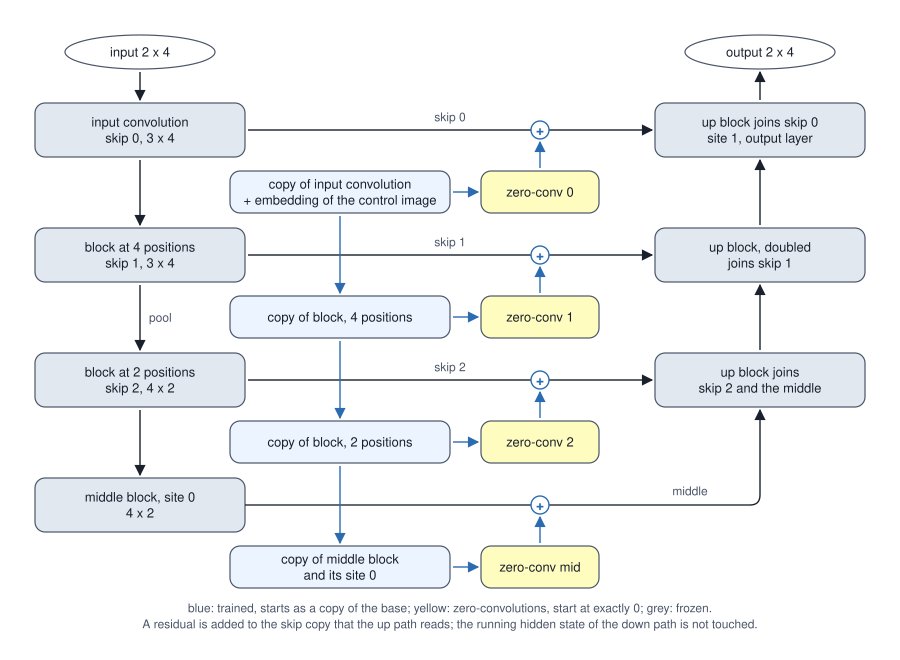
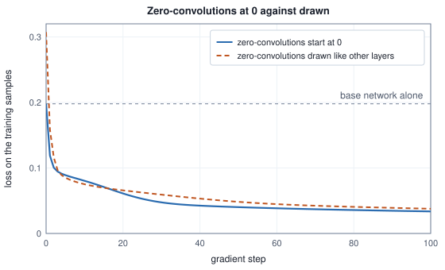
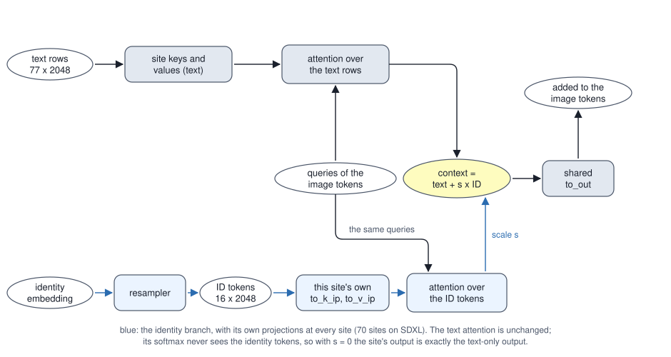

<!-- SPDX-License-Identifier: CC-BY-4.0 -->
<!-- Copyright (c) 2026 Martin Schröder <info@swedishembedded.com> -->

# Control, Identity and Adapters

*How do we steer a generator with a pose, an edge map or a particular person's face?*

Take a linear layer whose weights and bias are all zero. Whatever it is fed, it answers zero. Whatever the loss says about its output, it passes zero on to its input, because the gradient to the input is $\mathbf{W}^\top\,\mathrm{d}\mathbf{y}$ and $\mathbf{W}$ is nothing but zeros. A layer like that looks like the end of learning: nothing behind it can be told anything through it. It is also the one place where a trained network can be extended at no risk, and the first half of this chapter is built on it. The question to carry is what the same layer says about its *own* weights.

The need comes from the last chapter. A latent diffusion pipeline of Chapter 10 turns a prompt into a picture with a denoiser of billions of weights, and a prompt is a poor way to say two kinds of thing. It cannot say where the arms of a figure are, or where the edges of a room run: seven words do not hold a skeleton. And it cannot say who a person is, because a name is not a face. The missing information has to come from somewhere else, and it comes in two shapes. A pose, an edge map or a depth map has the shape of the picture, a grid. A face, once Volume VII has turned it into an identity embedding, has the shape of nothing, a vector. The two shapes need two kinds of entry into a network that was never built for them, and both have to respect one condition: the generator was trained at great cost, so on the first step of training the new branch must leave it exactly as it was, and training must still be able to start.

The questions come in that order. What must a branch be, so that its first step changes nothing and it can still learn? Where in the U-Net do its outputs go, and what goes wrong, silently, when they go somewhere else? What changes when the signal is a vector, and how does a vector become something a network can attend to? And what do brain's three adapters, `crates/controlnet`, `crates/pulid` and `crates/instantid`, add to a generator, counted from their configurations?

Five ideas from earlier chapters come back first. Try them from memory; the answers are at the end, under "Recall questions".

1. (Volume III, [Chapter 4](../v03-neural-networks/04-backpropagation.md), backpropagation.) A layer $\mathbf{y} = \mathbf{W}\mathbf{x} + \mathbf{b}$ has $\mathbf{W} = \mathbf{0}$ and $\mathbf{b} = \mathbf{0}$, input $\mathbf{x} = (1, 2)$ and an upstream gradient $\mathrm{d}\mathbf{y} = (-0.5, 1)$. What are the gradients of the weights, of the bias and of the input?
2. (Volume VIII, [Chapter 8](08-denoiser-architectures.md), the U-Net.) How many entries does the SDXL U-Net's skip stack hold, what are their widths, and how many extra inputs does the chapter say a control signal needs?
3. (Volume V, [Chapter 6](../v05-sequences/06-seq2seq.md), cross-attention, with the scores of [Chapter 7](../v05-sequences/07-self-attention.md).) Image tokens of a $32 \times 32$ level (1,024 of them, width 1,280) read 77 text rows of width 2,048. What are the shapes of the key and value projection weights and of the matrix of attention weights, and what does each of its rows sum to?
4. (Volume VII, [Chapter 11](../v07-vision/11-faces.md), identity embeddings.) Two photographs are compared by the cosine of their 512-number embeddings. What happens to the cosine if one embedding is doubled?
5. (Volume VIII, [Chapter 10](10-latent-diffusion-systems.md), latent diffusion.) A 30-step generation with guidance evaluates the denoiser how many times, and what does that say about the price of anything added to the denoiser?

## A dead layer that can still learn

Run the layer of the first recall question for a few steps. The target is $\mathbf{t} = (0.5, -1)$, the loss is half the squared error, so $\mathrm{d}\mathbf{y} = \mathbf{y} - \mathbf{t}$, the weights follow $\mathrm{d}\mathbf{W} = \mathrm{d}\mathbf{y}\,\mathbf{x}^\top$, and plain gradient descent updates $\mathbf{W}$ and $\mathbf{b}$.

<!-- worked: control_and_identity.zero_layer -->
A linear layer y = W x + b with every weight and bias equal to 0, input x = (1, 2), target t = (0.5, -1), loss (1/2) sum (y - t)^2 so that dy = y - t, gradient of the weights dW = dy x^T, gradient of the input dx = W^T dy, and plain gradient descent at rate 0.1 on W and b (W and b are written row by row, rows separated by semicolons).

| step | W | y | dy | dW | dx |
|---|---|---|---:|---|---|
| 0 | 0, 0; 0, 0 | 0, 0 | -0.5, 1 | -0.5, -1; 1, 2 | 0, 0 |
| 1 | 0.05, 0.1; -0.1, -0.2 | 0.3, -0.6 | -0.2, 0.4 | -0.2, -0.4; 0.4, 0.8 | -0.05, -0.1 |
| 2 | 0.07, 0.14; -0.14, -0.28 | 0.42, -0.84 | -0.08, 0.16 | -0.08, -0.16; 0.16, 0.32 | -0.028, -0.056 |
<!-- /worked -->

At step 0 the layer outputs nothing and the gradient into its input is $(0, 0)$, as predicted. But its weights have a gradient, $\mathrm{d}\mathbf{W} = \mathrm{d}\mathbf{y}\,\mathbf{x}^\top$, because the gradient with respect to a weight depends on the layer's *input* and on the upstream gradient, and neither is zero. One update later the weights are not zero, and the gradient into the input, $\mathbf{W}^\top\mathrm{d}\mathbf{y}$, is $(-0.05, -0.1)$: whatever is behind the layer has started to hear from the loss. The silence lasts exactly one step.

That is the whole principle. A **zero convolution** is a $1 \times 1$ convolution, a linear layer applied at every position of a feature map as in Volume VII, whose weights and bias start at exactly zero. Put it as the *last* layer of a branch and the branch's output is zero at the start, however the branch is built, so that adding it to a trained network changes nothing. The zero convolution's own weights learn at once; the layers behind it learn from the second step, when the weights in front of them are no longer zero. Two details matter later. The bias has to start at zero too, because a constant output is a change. And "small" is not "zero": a layer drawn at a small scale disturbs the network at the first step by a small amount, and the chapter will measure how much that costs.

## A copy of the reading half, and a way to add what it learns

The zero convolution says how to attach a new branch without harm. It does not say what the branch should compute. Think of what the signal needs. A control picture, an edge map say, only means something in the context of the noisy latent it is supposed to shape: where the latent already has a surface, the edge says which way it bends. So the branch has to read the noisy latent, the prompt and the clock, as well as the control picture, and the generator already contains a network that does exactly that: the down path and the middle block of its own U-Net, the half that reads. A **ControlNet** copies that half, starting from the generator's own weights; adds a small network, the conditioning embedder, that brings the control picture down to the latent grid; adds the embedder's output to the copy's first activation; and takes the copy's activation at each place where the original stores something for its up path through a zero convolution. The zero convolutions' outputs are the residuals, and each is added to the stored value: to the skip entries of Chapter 8's stack, nine of them in SDXL, and to the middle block's output, ten places in all. The original is frozen. Only the copy, the embedder and the zero convolutions are trained.

Starting from a copy is the point. A branch drawn at random would have to learn what a latent looks like before it could say anything about it, and the generator's own encoder half has already learned that. Training the generator itself would put at risk what took months to learn, and would need a gradient for every weight of a network of billions. The price of the design is that the original's up path still takes part in every backward pass, since the gradient from the loss has to travel through it to reach the skip entries where the residuals land, even though none of its weights is updated.

The whole mechanism fits in a network small enough to write out, and the rest of the chapter builds on one. The toy is a one-dimensional U-Net: four positions of two numbers in and out, an input convolution to three channels, a block at four positions, a pooling to two positions and a block of four channels, a middle block with a cross-attention site on three text rows, and an up path of three blocks that joins the three skip entries, with a second site at the end. There is no clock; a clock is a constant added per step, and it changes nothing in the argument. The skip stack has three entries, with the middle that makes four places for a residual, where SDXL has nine and ten.



The forward pass, written out so that it can be rebuilt from the page. Positions are columns of numbers, a matrix acts on each position separately, and $[\mathbf{u}; \mathbf{v}]$ stacks two vectors with $\mathbf{u}$ first. The input convolution gives $\mathbf{a} = \mathbf{W}_{\mathrm{in}}\mathbf{x} + \mathbf{b}_{\mathrm{in}}$ at each of the four positions (the first skip entry). The block at four positions gives $\mathbf{r}_0 = \mathbf{a} + \tanh(\mathbf{W}_0\mathbf{a} + \mathbf{b}_0)$ (the second). Pooling replaces positions 0 and 1 by their mean and positions 2 and 3 by theirs (call the two results $\mathbf{p}$), and the block at two positions gives $\mathbf{r}_1 = \tanh(\mathbf{W}_1\mathbf{p} + \mathbf{b}_1)$ with four channels (the third). The middle block is $\mathbf{m} = \mathbf{r}_1 + \tanh(\mathbf{W}_m\mathbf{r}_1 + \mathbf{b}_m)$, followed by site 0. A site of width $C$ maps each position $\mathbf{h}$ to $\mathbf{h} + \mathbf{W}_O\mathbf{o}$, where the context $\mathbf{o}$ is the weighted sum, with softmax weights over the three text rows, of the values $\mathbf{W}_V\mathbf{e}_j$ of the rows, the scores being $(\mathbf{W}_Q\mathbf{h}) \cdot (\mathbf{W}_K\mathbf{e}_j)/\sqrt{C}$ (one head). The up path takes the middle activation and the third skip entry, $\mathbf{u}_1 = \tanh(\mathbf{U}_1[\mathbf{m}; \mathbf{r}_1] + \mathbf{c}_1)$ at two positions; repeats each of the two positions twice (positions 0, 0, 1, 1); takes $\mathbf{u}_2 = \tanh(\mathbf{U}_2[\mathbf{u}_1; \mathbf{r}_0] + \mathbf{c}_2)$ and $\mathbf{u}_3 = \tanh(\mathbf{U}_3[\mathbf{u}_2; \mathbf{a}] + \mathbf{c}_3)$; runs site 1 on $\mathbf{u}_3$; and the output layer gives $\mathbf{W}_{\mathrm{out}}\mathbf{u}_3 + \mathbf{b}_{\mathrm{out}}$. The weights of the sites are the table's `q`, `k`, `v` and `o` ($\mathbf{W}_Q$, $\mathbf{W}_K$, $\mathbf{W}_V$, $\mathbf{W}_O$), the text rows are $\mathbf{E}$ with rows $\mathbf{e}_j$, and the tanh is the library function.

<!-- worked: control_and_identity.toy_setup -->
The toy denoiser. Input and output are 4 positions of 2 numbers. The base network, in the order in which its tensors are drawn from `control_and_identity.base` (seed 0x50b42ef65b9075f8) (a bias is 0.1 times one normal draw per entry; a matrix is one normal draw divided by the square root of its number of columns per entry, row by row; N is `normal()`); after the 24 tensors, three text rows of 3 numbers are drawn, 9 normal draws with no scale. Every sum (a matrix-vector product, which starts from its bias, an attention score, a softmax denominator, the loss) is accumulated from the first term to the last, and a softmax subtracts the largest score of its row before the exponentials; a layer normalisation (the resampler's) subtracts the mean and divides by sqrt(variance + 1e-5), the variance having the width as its divisor.

| tensor | role | shape | numbers | recipe |
|---|---|---|---:|---|
| `Win` | input convolution | 3x2 | 6 | N / sqrt(2) |
| `bin` | bias | 3 | 3 | 0.1 N |
| `W0` | block at 4 positions | 3x3 | 9 | N / sqrt(3) |
| `b0` | bias | 3 | 3 | 0.1 N |
| `W1` | block at 2 positions (3 to 4 channels) | 4x3 | 12 | N / sqrt(3) |
| `b1` | bias | 4 | 4 | 0.1 N |
| `Wm` | middle block | 4x4 | 16 | N / sqrt(4) |
| `bm` | bias | 4 | 4 | 0.1 N |
| `q0` | site 0 queries | 4x4 | 16 | N / sqrt(4) |
| `k0` | site 0 keys | 4x3 | 12 | N / sqrt(3) |
| `v0` | site 0 values | 4x3 | 12 | N / sqrt(3) |
| `o0` | site 0 output | 4x4 | 16 | N / sqrt(4) |
| `U1` | up block, joins skip 2 | 4x8 | 32 | N / sqrt(8) |
| `c1` | bias | 4 | 4 | 0.1 N |
| `U2` | up block, joins skip 1 | 3x7 | 21 | N / sqrt(7) |
| `c2` | bias | 3 | 3 | 0.1 N |
| `U3` | up block, joins skip 0 | 3x6 | 18 | N / sqrt(6) |
| `c3` | bias | 3 | 3 | 0.1 N |
| `q1` | site 1 queries | 3x3 | 9 | N / sqrt(3) |
| `k1` | site 1 keys | 3x3 | 9 | N / sqrt(3) |
| `v1` | site 1 values | 3x3 | 9 | N / sqrt(3) |
| `o1` | site 1 output | 3x3 | 9 | N / sqrt(3) |
| `Wout` | output layer | 2x3 | 6 | N / sqrt(3) |
| `bout` | bias | 2 | 2 | 0.1 N |

The base has 238 numbers. The control branch has 198 more:

| tensors | what | numbers | start |
|---|---|---:|---|
| copy of 12 tensors | `Win` to `bm` and site 0 (`q0` to `o0`), copied from the base | 113 | the base's values |
| `Ec` 3x2, `bc` 3, `Eo` 3x3, `bo` 3 | conditioning embedder | 21 | drawn in this order, as the base's tensors, from `control_and_identity.control` (seed 0x1142a3b941ad5fa5) |
| `Z0`..`Zm`, `z0`..`zm` | four zero-convolutions | 64 | all zeros |

The training set is 6 samples from `control_and_identity.data` (seed 0xd0dca4039be8a88d), each drawn as 8 normal draws (the input, position by position) and then 8 draws of `integer(2)` (the control image: 8 pixels, each 0 or 1). The first sample's input, the text rows and the base network's output on it, as anchors:

| x (4 positions) | 1.599103, -1.154352; -0.749259, -0.000617; -0.147530, 1.682864; -1.233608, -0.355188 |
|---|---|
| text rows E | -0.188616, -0.467498, -0.181086; -1.215703, -0.046103, 1.181156; -0.390488, 1.504313, -1.081983 |
| base output | -0.698530, -0.611118; 0.214661, -0.394225; -0.208668, 0.298672; 0.214256, -0.500283 |
| control pixels | 1, 1, 1, 1, 0, 1, 1, 1 |
<!-- /worked -->

The control branch is the blue part of the figure. The control picture here is a row of eight pixels, each 0 or 1, twice the resolution of the latent, as SDXL's is eight times. The embedder takes each pair of pixels through a $3 \times 2$ matrix and a bias and a $\tanh$, and then, with no activation, through a $3 \times 3$ matrix and a bias, and the 3 numbers per position are added to the input convolution's output in the copy (its tensors are in the second table below). The copy then runs the same blocks and the middle site on its own weights, and $\mathbf{a}_i$, its activation at point $i$, is the number at the place that the base stores on the stack (its input convolution's output after the addition, the two block outputs, and the middle activation after site 0). The task is to make the generator draw something it does not draw by itself: the target is the base output plus, at each position, a shift of channel 0 by $0.8$ and of channel 1 by $-0.6$ times the mean of that position's two control pixels. The base network alone is wrong by exactly that shift, and the control branch has to learn to supply it.

## What the first step leaves alone

Three things should be true before anything is trained, and each can be computed. The first is the promise of the zero convolution: with the four zero convolutions at zero the residuals are zero, and the controlled network is the base network. The second is the claim about gradients: at step 0 only the zero convolutions have any, and one step later everything does. The third is that the tape that computes the gradients is right, which a finite-difference check decides.

<!-- worked: control_and_identity.zero_start -->
With the four zero-convolutions at 0 (and the other 134 control numbers as specified), on the 6 training samples: the control residuals have 0 nonzero entries out of 240; the largest difference between the controlled network's output and the base network's is 0 (the outputs are equal as floating-point numbers); the loss of the base network on the control task is 0.197917.

The gradient norms (the square root of the sum of squares of every gradient entry of a group of tensors) at step 0, and after one step of gradient descent at rate 1:

| step | loss | zero-convs | trainable copy | embedder |
|---|---:|---:|---:|---:|
| 0 | 0.197917 | 0.332187 | 0.000000 | 0.000000 |
| 1 | 0.118734 | 0.151727 | 0.020663 | 0.031668 |

Gradient check (central differences with step 1e-5 against the tape, every one of the 198 trainable numbers): the largest absolute difference is below 1e-7 at step 0 (passed) and below 1e-7 at step 1 (passed); at step 0 the 134 numbers outside the zero-convs have a tape gradient of exactly zero.
<!-- /worked -->

The outputs are not merely close: adding an array of zeros leaves every floating-point number as it was, so the difference is exactly 0. Brain's smoke test for the ControlNet asserts the same thing in the same terms. In `crates/controlnet/tests/it/smoke.rs` the control branch is evaluated at a conditioning scale of $0$, and the test requires that the U-Net's output moves by exactly $0.0$, "what pins that the control path is additive and touches nothing else". The scale in brain is a factor on the zero convolutions' output and on nothing else, kept in a one-element device buffer so that changing it is a write and not a rebuild (`crates/controlnet/src/model.rs`); that is the dial of the table further on.

The test's neighbour has a lesson in it. `crates/controlnet/src/init.rs` builds synthetic weights for the smoke test, and it deliberately does not initialise the zero convolutions to zero. A test that feeds a graph with zero residuals passes for any graph at all: whatever went into the zero convolutions, nothing comes out. The released checkpoints are trained, and their zero convolutions are not zero, so the synthetic ones are not either, and a unit test (`synthetic_zero_convs_are_not_zero`) keeps it so. The same applies to the gradient check of the training graph, which picks a non-zero conditioning scale, since "a zero scale would zero every gradient reaching the trainable copy": a check that is green at the point where the right answer is zero proves nothing about the wiring.

## Where the residuals go in

A residual has the shape of the thing it is added to, so there is a place for it, but which place? Chapter 8 said that the control signal is added "to the skip copies and not to the running hidden state (adding it to both would count it twice, with every shape still correct)". Now the claim can be tested, on the toy.

Chapter 8's U-Net pushes each down-path activation on a stack for the up path to pop, so there are two copies of the value: the running hidden state that feeds the next down block, and the entry on the stack. A residual belongs on the entry. The control branch has already summarised what the control picture says about the activation at that depth, and the up path is where the generator decides what to draw from the skips; the down path is the generator's reading of its own input, and a control signal added there would be read again by every later block, and by the middle block. The table adds one residual at a time in both ways.

<!-- worked: control_and_identity.placement -->
One input of the first training sample, one residual at a time. The residual of point k has entry (position p, channel c) equal to 0.05 (((3 p + 5 c + 7 k) mod 11) - 5), the other three are 0. The first two columns are the point and the shape of its residual (channels x positions). "skip only": the residual is added to the skip copy that the up path reads, as the chapter's network does; the third column is the largest change of the network's output and the fourth the largest change of the middle activation (the running hidden state, read before the middle residual). "also hidden": the same residual is added to the running hidden state too (so it reaches the later down blocks and the middle block): the fifth column is the change of the middle activation and the sixth the change of the output.

| point | shape | output, skip only | middle, skip only | middle, also hidden | output, also hidden |
|---|---|---:|---:|---:|---:|
| down.0 | 3 x 4 | 0.127668 | 0.000000 | 0.180095 | 0.160307 |
| down.1 | 3 x 4 | 0.107253 | 0.000000 | 0.125486 | 0.106263 |
| down.2 | 4 x 2 | 0.029318 | 0.000000 | 0.833462 | 0.078544 |
| mid | 4 x 2 | 0.026735 | 0.000000 | (added after the middle) | - |

Exchanging the residuals of down.0 and down.1, which have the same shape (3 channels x 4 positions), runs without a shape error and moves the output by 0.282818 (largest change) when only those two residuals are present, and by 0.276175 when all four are present (each with its own pattern); exchanging the residuals of down.1 and down.2 (12 and 8 numbers) fails the element-count check before anything runs.
<!-- /worked -->

Added to the skip entry only, a residual leaves the middle activation exactly where it was (the fourth column is 0 at every point) and still changes the output. Added to the running state as well, the middle activation moves at all three down points, by up to $0.83$ at the last one, and the output moves by a different amount. The last down point is the treacherous one. Its shape is exactly that of the activation that enters the middle block, so the wrong placement type-checks, runs, is still a no-op at scale 0, and still "moves the output" at scale 1: both of the usual smoke checks pass. Brain gates it with a test whose name states the property, `a_down_residual_reaches_the_output_only_through_the_up_path` in `crates/controlnet/tests/it/smoke.rs`: it injects at one point at a time and requires the middle block's output to equal, exactly, that of the run with no residual.

The second hazard is order. The residuals come as a list, and the U-Net takes a list. SDXL's ten residuals include groups of equal shape: down.0, down.1 and down.2 are all $320 \times 128 \times 128$ at a $128 \times 128$ latent, down.4 and down.5 are $640 \times 64 \times 64$, and down.7, down.8 and the middle are $1280 \times 32 \times 32$, so $3! \cdot 2! \cdot 3! = 72$ orderings of the ten are legal by shape, and 71 of them are wrong. In the toy, exchanging the two residuals of the same shape runs without error and moves the output by 0.28, more than any single injection does. Brain's answer is in `crates/controlnet/src/adapter.rs`. Every backbone declares its **injection points** by name and shape (`down.0` to `down.8` and `mid` for SDXL's U-Net, derived from the skip stack so that they cannot drift from what the graph does), a control model declares the points it produces, `check_compatible` matches the two by name and element count and `order_for` turns a bundle of named residuals into the list in the backbone's order, failing with the name of a missing point and never returning a short or permuted list. The commit that introduced the seam (commit e76c839a0) gives the reason in one sentence: the reference implementation passes the residuals as a bare tuple zipped against the U-Net's own list of skips, and SDXL has equal-shaped points, "so a permutation among them type-checks, runs, and produces a plausible image". The seam is typed by layout, a feature map for a U-Net and a token stream for a transformer, because a ControlNet for a diffusion transformer injects the same way into its blocks.

With the injection points numbered $i = 0, \dots, P - 1$, the last being the middle block, the residual of point $i$ and its use are

$$\boldsymbol{\delta}_i = w_{\mathrm{ctl}}\,(\mathbf{Z}_i\mathbf{a}_i + \boldsymbol{\zeta}_i),\qquad \mathbf{x}^{\mathrm{skip}}_i \leftarrow \mathbf{x}^{\mathrm{skip}}_i + \boldsymbol{\delta}_i\ \ (i < P - 1),\qquad \mathbf{x}^{\mathrm{mid}} \leftarrow \mathbf{x}^{\mathrm{mid}} + \boldsymbol{\delta}_{P-1},$$

where $\mathbf{Z}_i$ and $\boldsymbol{\zeta}_i$ are the zero convolution's weights and bias and $w_{\mathrm{ctl}}$ is the conditioning scale. Two routines in the book's pseudocode make this concrete. The first makes one residual from the copy's activation at a point, through the zero convolution and the dial; the second injects the list of residuals into the base's stack and middle activation, with the shape checks that a bare zip lacks.

```text
function control_residual(a: array<real>[C, P], Z: array<real>[C, C],
                          zb: array<real>[C], w_ctl: real) -> array<real>[C, P]
    y = matmul(Z, a)
    r = zeros(real, [C, P])
    for c in 0 .. C:
        for p in 0 .. P:
            r[c, p] = w_ctl * (y[c, p] + zb[c])
    return r

function inject_control(skips: list<tensor>, mid: tensor, res: list<tensor>)
                        -> (list<tensor>, tensor)
    require len(res) == len(skips) + 1, "one residual per skip entry and one for the middle"
    out = []
    for k in 0 .. len(skips):
        require res[k].shape == skips[k].shape, "a residual has the shape of its skip entry"
        append skips[k] + res[k] to out
    require res[len(skips)].shape == mid.shape, "the last residual has the shape of the middle"
    return (out, mid + res[len(skips)])
```

`a` is the activation of the copy at the point, with its $P$ positions as columns (a $1 \times 1$ convolution is the same $C \times C$ matrix applied to every column), and `w_ctl` is the **conditioning scale**, the factor that multiplies every residual. The skip entries are replaced by new arrays and the running hidden state of the down path is not an argument at all: that is the placement of the table, written so that the wrong one cannot be expressed.

Why can the residuals be computed in advance and handed to the generator as inputs? Because none of them depends on anything the generator computes inside the same pass. The copy reads the same noisy latent, the same prompt rows and the same clock, plus the control picture; what the base computes mid-pass is not an input to it. In brain, `ControlNet::run` returns the ten residuals to the host, `order_for` puts them in the backbone's order, and `sdxlunet::Unet::run_with_control` writes them into device inputs of a graph that was recorded with a control branch and adds them where `record_into` in `crates/sdxlunet/src/model.rs` says. The host round trip is a design choice with a price, and the counts of a later section state it.

## Learning to supply the shift

Now train the branch. The loss is the mean squared error between the controlled network and the target, over six training samples, with full-batch gradient descent at a rate of 1 for 100 steps, in two runs that differ in one thing only: the zero convolutions start at zero, or they are drawn like every other layer.

<!-- worked: control_and_identity.control_training -->
Full-batch gradient descent at rate 1 for 100 steps on the 6 training samples, in two runs that differ only in the start of the four zero-convolutions: all zeros, or drawn like every other layer from `control_and_identity.randomz` (seed 0x843263aad1e0e14d) (Z0, z0, Z1, z1, Z2, z2, Zm, zm in that order, a matrix as N / sqrt(columns) and a bias as 0.1 N). Loss is the mean squared error over the 8 numbers of a sample and the samples; the norms are those of the zero-start run before each update. The embedder's first weight is the one the nudges change (it multiplies a control pixel that is 1 in the first sample).

| step | loss, zero start | grad zero-convs | grad copy | grad embedder | loss, random start |
|---|---:|---:|---:|---:|---:|
| 0 | 0.197917 | 0.332187 | 0.000000 | 0.000000 | 0.307422 |
| 1 | 0.118734 | 0.151727 | 0.020663 | 0.031668 | 0.158450 |
| 2 | 0.100490 | 0.082457 | 0.013111 | 0.018747 | 0.115995 |
| 3 | 0.094509 | 0.055836 | 0.010835 | 0.017411 | 0.096624 |
| 5 | 0.089084 | 0.039700 | 0.009794 | 0.016601 | 0.085247 |
| 10 | 0.080356 | 0.032832 | 0.012726 | 0.022590 | 0.075156 |
| 25 | 0.052931 | 0.022864 | 0.014266 | 0.024710 | 0.062475 |
| 50 | 0.040196 | 0.010368 | 0.004069 | 0.008227 | 0.048290 |
| 100 | 0.033664 | 0.007014 | 0.002536 | 0.006111 | 0.037728 |

The digits shown are shared by the run and by its four nudged copies (the rule of `stable.py`).
<!-- /worked -->



The first row is the story of the first step. With zero convolutions at zero the run starts at the loss of the base network alone, $0.197917$, and only the zero convolutions have a gradient: $0.3322$ for them, exactly zero for the copy and the embedder. One step later the copy has a gradient, $0.0207$, and the embedder has one, $0.0317$. By step 25 the loss is $0.0529$ and at step 100 it is $0.033664$, a sixth of where it started. The drawn start begins at $0.307422$: before any training the control branch makes the generator *worse* than the base alone, by about half as much again, because its random residuals are added to a network that was fine. It recovers, and by the end of the run the two are close ($0.037728$ against $0.033664$); the zero start's advantage in this toy is its starting point and a slightly lower end, not a different destination. In a real generator the starting point is what is at stake. A branch that begins by damaging a network of billions has a long way to climb, and a generator in the middle of fine-tuning is not one that can be checked by eye at step 0.

A trained control branch has a dial, the conditioning scale.

<!-- worked: control_and_identity.scale_and_heldout -->
The trained control branch of the zero-start run, with its residuals multiplied by the conditioning scale s (a pure multiplication of every zero-convolution's output) at evaluation. The first loss is on the 6 training samples; the second on 4 samples from `control_and_identity.heldout` (seed 0x730957a8ca0a0746) that the branch has not seen (drawn like the training set: 8 normal draws and 8 `integer(2)` draws per sample).

| s | loss, training samples | loss, held-out samples |
|---|---:|---:|
| 0 | 0.197917 | 0.203125 |
| 0.5 | 0.062878 | 0.044326 |
| 1 | 0.033664 | 0.022873 |
| 1.5 | 0.041074 | 0.034978 |
| 2 | 0.057540 | 0.053439 |
<!-- /worked -->

At $s = 0$ the branch is off, and the loss is the base network's (the second column of that row is the held-out base loss, $0.203125$). At $s = 1$ it is what it was trained at: $0.033664$ on the training samples and $0.022873$ on four samples the branch has never seen, which is the number that says it learned the shift and did not memorise six pictures. Above 1 the loss rises again, to $0.057540$ at $s = 2$: the dial extrapolates, and a control that was fitted at one strength does not get better by being turned up. Brain exposes the dial as `conditioning_scale` with a default of $1$ and a range of $0$ to $2$ (`crates/controlnet/src/caps.rs`), the same range as the table.

Gradient descent on a tape is only as right as the tape. The check printed under the gradient norms earlier compares every trainable number's gradient with a central difference of the loss, and reports a criterion, not a residual: the largest absolute difference is below $10^{-7}$, at step 0 and at step 1, over all 198 numbers. The two checkpoints are chosen on purpose. At step 0 the tape must agree that the copy's gradient is zero, which is what a broken tape also says; at step 1 it must agree on the non-zero values, which a broken tape cannot.

## The SDXL control branch, counted

The toy's branch has 198 numbers against the base's 238, 83 percent of the base. SDXL's has a fraction of that, and the fraction can be derived from the configuration of the generator: take the U-Net of Chapter 8, stop after the middle block, add the embedder and one zero convolution per injection point.

<!-- worked: control_and_identity.sdxl_control_counts -->
The SDXL ControlNet derived from the configuration of the SDXL U-Net of Chapter 8 (the stages of its parameter and operation tables from the clock through the middle block, the rows of those tables summed) at a 128 by 128 latent, a 1024 by 1024 control image of 3 channels and 77 text tokens. The conditioning embedder is eight 3 x 3 convolutions with bias, 3 to 16, 16 to 16, 16 to 32 (stride 2), 32 to 32, 32 to 96 (stride 2), 96 to 96, 96 to 256 (stride 2) and 256 to 320 channels, the first two at 1024 x 1024, and each of the ten zero-convolutions is a 1 x 1 convolution with bias at the width and size of its injection point (the table of the next block). Tensors are counted in brain's layout (a fused query-key-value matrix is one tensor, the feed-forward's gated projection two); a multiply-add is two operations; norms, activations and softmax are not counted.

| part | parameters | tensors | GFLOP per evaluation |
|---|---:|---:|---:|
| trainable copy: clock, input convolution, down blocks, middle block | 1,243,367,040 | 774 | 2,933.0 |
| conditioning embedder | 1,086,480 | 16 | 58.9 |
| ten zero-convolutions | 6,560,640 | 20 | 28.5 |
| ControlNet total | 1,251,014,160 | 810 | 3,020.4 |
| SDXL U-Net, for comparison | 2,567,463,684 | 1610 | 6,761.2 |

The ControlNet has 48.7 percent of the U-Net's parameters and 44.7 percent of the operations of one of its passes. With the 34 spatial-transformer blocks of the copy each stored as three attention matrices and one gated projection instead of the fused layout, the tensor count is 810 + 34 = 844.
<!-- /worked -->

The total, $1{,}251{,}014{,}160$ parameters in 810 tensors, is the figure that the commit introducing the crate records for the released checkpoint (commit e76c839a0, which also gives 844 tensors before brain's fusions; the derivation reproduces both, the fused layout having one tensor fewer for each of the 34 transformer blocks of the copy). The branch is 48.7 percent of the U-Net's weights and 44.7 percent of the arithmetic of one of its passes, $3{,}020.4$ GFLOP at a $128 \times 128$ latent. Nothing about it is free. Two parts of the count deserve a second look. The conditioning embedder is nearly nothing in parameters (about a million) but $58.9$ GFLOP in operations, because its first convolutions run at the control image's own resolution, $1024 \times 1024$, before three stride-2 stages bring it to the $128 \times 128$ latent grid; the stride product, $2^3 = 8$, has to equal the autoencoder's factor, and `ControlNet::new` asserts that the embedder "lands at" the latent's size, a named error in place of a mis-sized add deeper in the graph. And the embedder's input is a picture in $[0, 1]$, not the $[-1, 1]$ of the autoencoder's own input: `crates/controlnet/src/cond.rs` says that feeding it $[-1, 1]$ "runs, produces finite residuals, and is wrong everywhere", which is why the conversion lives in a named module with its own test.

<!-- worked: control_and_identity.control_traffic -->
The ten control residuals of the SDXL ControlNet at a 128 by 128 latent, in the order in which the U-Net takes them (the nine entries of its skip stack, finest first, and the middle block), as channels x height x width and as numbers.

| injection point | shape | numbers |
|---|---|---:|
| down.0 | 320 x 128 x 128 | 5,242,880 |
| down.1 | 320 x 128 x 128 | 5,242,880 |
| down.2 | 320 x 128 x 128 | 5,242,880 |
| down.3 | 320 x 64 x 64 | 1,310,720 |
| down.4 | 640 x 64 x 64 | 2,621,440 |
| down.5 | 640 x 64 x 64 | 2,621,440 |
| down.6 | 640 x 32 x 32 | 655,360 |
| down.7 | 1280 x 32 x 32 | 1,310,720 |
| down.8 | 1280 x 32 x 32 | 1,310,720 |
| mid | 1280 x 32 x 32 | 1,310,720 |
| total |  | 26,869,760 |

In 32-bit floats the ten residuals are 102.5 MiB. brain's ControlNet returns them to the host and the U-Net writes them back, so every evaluation moves 205.0 MiB across that boundary in addition to the 102.5 MiB the zero-convolutions write. A generation of 30 steps with guidance evaluates the denoiser 60 times, and each evaluation is a ControlNet pass of $3{,}020.4$ GFLOP and a U-Net pass of $6{,}761.2$ GFLOP: $181{,}223$ GFLOP and $405{,}674$ GFLOP.
<!-- /worked -->

The residuals are the cost of the seam. Their 26,869,760 numbers are $102.5$ MiB, and because brain's ControlNet returns them to the host and the U-Net writes them back, every evaluation moves twice that across the boundary. That is small beside the $3.0$ TFLOP of arithmetic of the pass, but it is a boundary that a graph in which both networks share one tape does not have, and that shared tape is what the training path builds; the next section says why it had to. Per image the cost is multiplied by the number of evaluations. The sampler calls `ControlledDenoiser::eval` in `crates/controlnet/src/caps.rs` once with the prompt and once with the empty prompt at every step, and each call runs both networks, so a 30-step generation runs the ControlNet 60 times, $181$ TFLOP in all against the U-Net's $406$.

## When a zero gradient is also the broken answer

The training path of the ControlNet came in a later commit (commit 8f11d6c93), and its message records a defect that inference cannot show. The forward graph of the ControlNet discarded its differentiable tape, and its one operation that was not composed of the shared blocks, the multiplication by the conditioning scale, was recorded with a call that puts a step on the forward list and nothing on the reverse tape. A step like that is invisible to a forward comparison against the reference, which matched; and it silently zeroes every gradient upstream of it. In this model, everything upstream of a zero convolution is the entire trainable copy. The code says so in the doc comment of the replacement (`scale_buf` in `crates/controlnet/src/model.rs`): the multiplication is now a recorder, `Builder::scale_chan`, whose reverse pass passes the gradient to the zero convolution underneath, with a deliberate omission, a gradient for the scale itself, because the scale is a request parameter and nothing trains it.

The gradient columns of the training table show why this fault is so quiet. At step 0 a correct tape reports an exactly zero gradient for the copy, and a tape that has lost its connection reports the same thing, for ever. The two differ only after the zero convolutions have moved, and a check that runs at the start sees no difference. The gate that came with the fix, `crates/gradcheck/src/controlnet.rs`, takes three precautions that each answer a way of passing for the wrong reason. It uses a non-zero conditioning scale (`COND_SCALE`), because a zero one would zero the gradient legitimately and make the check vacuous. It trains on a target that is not the model's own output, so the residual is not zero. And it counts what it checked: the test requires more than 100 checked tensors, and the graph has 150 of them, because "a near-empty `checks` list passing by accident" is the likeliest way for a discarded tape to pass. Its tolerances are an absolute $4 \times 10^{-3}$ and a relative $8 \times 10^{-2}$; the tests skip when no GPU test device is available, so the check proves what it proves where the device exists.

The same commit meets a second silent failure, of naming. A ControlNet's tensors are a filter of the generator's own manifest, so its names are byte-for-byte the generator's: `time_embedding.linear_2.weight` is both. Merging the frozen network's weights and the trainable copy's into one map the way a different adapter crate does would have collided on every shared name and trained one copy, or the wrong one, without an error. `tensors_for` in `crates/controlnet/src/train.rs` prefixes the trainable copy with `controlnet.` when it merges. The residual injection in that file is recorded by hand onto the one tape, because the inference path's `record_into` adds residuals from device buffers that the host writes, a design that severs a tape between two networks. Both halves take their lists of skip entries from the same call of `down_path`, once under the prefix and once without, so the permutation hazard of the previous section cannot arise there: index $k$ means the $k$-th entry that call pushed, on both sides, by construction.

## A face is a vector, not a picture

Everything so far added a picture-shaped signal to picture-shaped activations. An identity cannot go that way. An edge map says where, and the generator's activations are indexed by where; who the person is has no position in the grid. Volume VII's identity embedding is 512 numbers with no spatial structure, and the cosine of two of them is what says that two photographs show one person. To condition a generator on it, the vector has to become the kind of thing the generator already knows how to read from outside: rows that its cross-attention sites attend to, as they attend to the prompt.

So an **identity adapter** has two parts. The first turns an embedding into a few tokens. The second gives every attention site of the generator a way to read those tokens. The first part is a **resampler**: a small attention network in the Perceiver family, whose queries are a fixed number of learned vectors, so that its output has a fixed number of rows however long the input is, and whose keys and values come from the input. In the toy it has the following form, and the pieces are the ones the real adapters have. The embedding $\mathbf{e}$ is projected to one row. The input to keys and values is that row and the learned latents, each layer-normalised and stacked, so there are $1 + n_{\mathrm{id}}$ rows where $n_{\mathrm{id}}$ is the number of tokens: one more than there are tokens. `ResamplerConfig::kv_rows` in `crates/instantid/src/config.rs` names the number, because sizing the keys and values at $n_{\mathrm{id}}$ is legal by shape only when there is a single token and silently drops the embedding's own row everywhere else. Each latent queries the stack, through the query projection of its own normalised self; the attention result goes through an output projection and is added to the latent, and the token is a last projection of that sum. The block below gives the computation row by row.

<!-- worked: control_and_identity.identity_tokens -->
The resampler of the toy on identity embeddings of 4 numbers (the identities of the stream `control_and_identity.faces` (seed 0x18230496ec04f1f0): 16 of them, each 4 draws of `normal()` times 2, in order; the first two are used here). Its tensors are drawn from `control_and_identity.identity` (seed 0xfdc8a57e3eda86fc) in the order `Win` (3 x 4), `bin`, the two latent rows (6 plain normal draws), `Wq`, `Wk`, `Wv`, `Wo`, `Wp` (3 x 3 each, drawn as the base's matrices), then the two sites' key projections (4 x 3, 3 x 3). The computation, for an embedding e: x = `Win` e + `bin`; the key and value input is the three rows LN(x), LN(latent 0), LN(latent 1), where LN subtracts the mean and divides by sqrt(variance + 1e-5), with no gain or offset; the keys are `Wk` and the values `Wv` of those rows; token i has the query `Wq` LN(latent i) (the latent itself, not its attention, is normalised for the query), scores q . k / sqrt(3) with a softmax over the three rows, the attention result a, and the token `Wp` (latent i + `Wo` a), the unnormalised latent being the residual. The key and value input has 3 rows (one for the projected embedding, one for each latent), which is one more than the number of tokens. The columns: the length of the embedding, its cosine with identity 0's embedding, the relative change of the 6 token numbers from identity 0's tokens, and the 6 numbers (token 0, then token 1).

| embedding | length | cosine with identity 0 | relative change of tokens | tokens |
|---|---:|---:|---:|---|
| identity 0, as drawn | 2.5691 | - | - | 0.6138 -1.0584 -1.8741 0.0050 1.6213 2.3717 |
| identity 0, scaled to length 1 | 1.0000 | 1.000000 | 0.0184 | 0.6562 -1.0464 -1.8636 0.0515 1.6373 2.3683 |
| identity 0, doubled | 5.1382 | 1.000000 | 0.0055 | 0.6017 -1.0618 -1.8775 -0.0094 1.6164 2.3723 |
| identity 1 | 1.8712 | 0.052275 | 0.1478 | 1.0315 -0.9250 -1.8482 0.2869 1.7286 2.2961 |
<!-- /worked -->

The table settles a question that a cosine cannot. Doubling an embedding leaves its cosine with the original at exactly 1, as the recall question promised, but the tokens move, a little: by $0.55$ percent for the doubled vector and by $1.84$ percent for the unit vector, against $14.78$ percent between two different identities. In the toy the scale of the embedding matters little, because the layer normalisation removes most of it and only the projection's bias survives. The next paragraph shows a path on which the length is not removed at all. The relevant lesson: cosine cannot see a dropped scale, so the ladder that gates an adapter must also report an error that can.

The scale of the input is, in fact, the one thing brain's PuLID code spends a module on (`crates/pulid/src/idcond.rs`, commit 6a9da997d). PuLID conditions on the concatenation of two vectors, the face recognition network's 512-number embedding and the 768 numbers of an image encoder's class vector. The reference normalises only the second. brain's own face-recognition action normalises its output, because it is meant to be compared by cosine, so wiring it into the concatenation is the natural thing to do, and nothing structural catches it: the length is right, the type is right, every value is finite. The first 512 numbers would simply be about twenty times too small, the lengths recorded from the reference's dump being $20.11$ and $1.0000$ (commit 6a9da997d gives them; the unit test uses synthetic vectors), and the other half of the vector would dominate. `compose` in that module leaves the first half untouched and normalises the second; a unit test keeps the ArcFace half byte-identical to its input and the other half at length 1. The same convention shows in InstantID's parity test (`crates/instantid/tests/parity.rs`), which deliberately feeds a non-unit embedding: the released embedding's length is about 15 to 20, the resampler is not scale-invariant, and a unit vector would gate the wrong operating point.

Brain's two resamplers have different shapes. InstantID's has a width of 1,280, four layers of 20 heads of 64, a single projected input token and 16 learned latents, so that $1 + 16 = 17$ rows enter every layer's keys and values and 16 tokens of width 2,048 come out. PuLID's has a width of 1,024 and ten layers, two for each of five hidden states of the image encoder. Its latents are 32 learned vectors joined with 5 tokens made from the embedding, and every layer's keys and values are the 5 embedding tokens, the 577 rows of one mapped hidden state and the 37 latent rows themselves, $5 + 577 + 37 = 619$ rows; its 32 output tokens are 2,048 wide too. Both end by feeding tokens to cross-attention, which is the second part.

## A second attention beside the text one

Where do the tokens go? The obvious answer is to append them to the text rows and let the existing cross-attention read both. It runs, and it produces an image; it is still the wrong thing, for reasons that the toy can measure. The second part of an identity adapter is a second attention at every site, with its own key and value projections, over the identity tokens only, whose result is added to the text attention's result before the site's output projection. This is what the chapter calls **attention injection**: the contribution of the extra tokens is computed by a separate attention, with a separate softmax, and added with a strength. With the text rows $\mathbf{E}$ and the identity tokens $\mathbf{T}_{\mathrm{id}}$, the queries $\mathbf{Q}$ of a site, the site's projections $\mathbf{W}_K$ and $\mathbf{W}_V$ and the adapter's own pair $\mathbf{W}_K^{\mathrm{id}}$ and $\mathbf{W}_V^{\mathrm{id}}$, the context that goes to the output projection is

$$\mathbf{O} = \mathbf{O}_{\mathrm{txt}} + w_{\mathrm{id}}\,\mathbf{O}_{\mathrm{id}},\qquad \mathbf{O}_{\mathrm{id}} = \mathrm{softmax}\!\Big(\frac{\mathbf{Q}\,(\mathbf{T}_{\mathrm{id}}\mathbf{W}_K^{\mathrm{id}\top})^{\top}}{\sqrt{C}}\Big)\,\mathbf{T}_{\mathrm{id}}\mathbf{W}_V^{\mathrm{id}\top},$$

with $\mathbf{O}_{\mathrm{txt}}$ the same expression with $\mathbf{E}$, $\mathbf{W}_K$ and $\mathbf{W}_V$, $C$ the site's width, and $w_{\mathrm{id}}$ the strength. It is written out below, with the attention as its own routine.

```text
function attend(Q: array<real>[T, C], Kx: array<real>[n, C], Vx: array<real>[n, C])
                -> array<real>[T, C]
    S = matmul(Q, transpose(Kx))
    for t in 0 .. T:
        for j in 0 .. n:
            S[t, j] = S[t, j] / sqrt(C)
    return matmul(softmax(S), Vx)

function site_context(Q: array<real>[T, C], E: array<real>[n, D], Tid: array<real>[Nid, D],
                      Wk: array<real>[C, D], Wv: array<real>[C, D],
                      Wkid: array<real>[C, D], Wvid: array<real>[C, D],
                      w_id: real) -> array<real>[T, C]
    Otxt = attend(Q, matmul(E, transpose(Wk)), matmul(E, transpose(Wv)))
    Oid = attend(Q, matmul(Tid, transpose(Wkid)), matmul(Tid, transpose(Wvid)))
    O = zeros(real, [T, C])
    for t in 0 .. T:
        for c in 0 .. C:
            O[t, c] = Otxt[t, c] + w_id * Oid[t, c]
    return O
```

`matmul(E, transpose(Wk))` is the $n \times C$ matrix of the text rows' keys; the queries are the text attention's own, computed once. The figure shows the site, and the table puts the two ways of letting tokens in side by side on one site of the toy.



<!-- worked: control_and_identity.injection_variants -->
Site 0 of the toy (width 4, on the base network's middle activation of the first training sample) with the identity of `control_and_identity.faces` (seed 0x18230496ec04f1f0) (the first of its identities). Both branches use the same query, text rows and ID tokens; the added attention has its own key and value projections (the key projection of the chapter's start, the value projection drawn from `control_and_identity.valuefill`, 12 plain draws of the base's matrix recipe, halved), the joined variant sends the ID tokens through the site's text projections. The columns are the largest change of the site's output from the text-only output when the identity is switched off (the added attention's scale 0; the joined variant's ID values multiplied by 0) and when it is on (scale 1).

| how the identity enters | switched off | on |
|---|---:|---:|
| added second attention | 0.000000000 | 0.257120 |
| ID tokens joined to the text rows | 0.480354 | 0.722740 |

In the joined variant the 2 ID tokens take between 0.3662 and 0.4361 of the attention weight at the 2 positions of the site even when their values are zeroed. Scaling the added branch's context by 0.3 and scaling its value projection by 0.3 give outputs that differ by less than 1e-15 (passed; the difference is rounding only); scaling the key projection by 0.3 instead gives an output that differs by 0.101569 from the unscaled scale-1 output, by 0.086184 from the 0.3-context output and by 0.155552 from the text-only output.
<!-- /worked -->

The first row is the property that makes the design safe to bolt onto a trained generator: with the strength at 0 the site's output is exactly the text-only output, because the added attention is added after its own softmax and then multiplied by 0. The second row is joining. The ID tokens share the text attention's softmax, so they take weight from the text rows whether their values are zeroed or not: between $0.37$ and $0.44$ of the attention at the two positions of the site goes to two tokens, and "switching off" the identity by zeroing its values still changes the output by $0.48$. There is no strength at which the joined design returns the generator it started from. The same fact is why the identity branch can be trained to be gentle: its influence is a sum, not a competition.

The strength is also exact in a way that matters for a recorded graph. A kernel's parameters are fixed when the graph is recorded, so a per-request strength cannot be a parameter of the attention, and re-recording seventy sites per step to change one number would be absurd. Brain folds the strength into the value projection: $\mathbf{O}_{\mathrm{id}}$ is linear in $\mathbf{V}$, so scaling the values by $w$ scales the output by exactly $w$ (`SiteAttnSet::set_scale` in `crates/instantid/src/model.rs` re-uploads the value half of each site's fused weight, scaled, from the unscaled original so that repeated calls do not compound). The last paragraph of the table above confirms it on the toy: folding $0.3$ into the values and applying $0.3$ to the context agree to rounding, and folding it into the *keys* is a different function, off by $0.10$ from the unscaled output, because keys pass through the softmax.

A second way of seeing the same trick is that the adapter has the same shape as the control branch. There the zero convolution was the last layer and its weights started at zero; here the value projection can start at zero and the attention's output is zero, the keys then having no gradient at all. The toy trains it that way. This is the toy's choice, made to repeat the argument of the first section, and not a claim about how released adapters are initialised.

<!-- worked: control_and_identity.identity_training -->
Training the key and value projections of the two sites (42 numbers: 4 x 3 and 3 x 3, twice) by full-batch gradient descent, with no momentum and no randomness after the data are drawn, at rate 0.3 for 200 steps on 16 identities with their images, the resampler and the base fixed. The added attention is present at both sites of the toy: at site 0 on the middle activation and at site 1 on the up path's last activation. At each site the queries are the site's own `q` of its input, the keys and values are the adapter's key and value projections of the identity's 2 tokens (the resampler's output for that identity, fixed), the scores are divided by the square root of the site's width, a softmax runs over the 2 tokens alone, and the result times the identity scale 1 is added to the text attention's context before the site's output projection `o`. The first site's change therefore reaches the second site and the output through the whole up path. The value projections start at zero (the keys at the last two tensors of the stream `control_and_identity.identity` (seed 0xfdc8a57e3eda86fc)); the target for identity i is the base network's output on its image (no identity branch) plus the offset G e_i at all 4 positions, where e_i is the identity's embedding and G = [[0.2, -0.1, 0.0, 0.15], [-0.05, 0.1, 0.2, -0.1]]. The embeddings are the 16 identities of `control_and_identity.faces` (seed 0x18230496ec04f1f0) (4 draws of `normal()` times 2 each); the images are 16 blocks of 8 normal draws from `control_and_identity.idata` (seed 0x6a6714099df696a4), a block being the input of one identity, position by position (2 numbers a position). The loss is the squared error summed over the 8 output numbers of each identity and over the 16 identities, divided by 8 x 16: the mean over all 128 numbers, with the identities added in order. The two gradient columns are the square root of the sum of squares of the 21 key (or 21 value) gradient entries of both sites at that step, before the update, and every one of the 42 numbers is updated at once. The digits are those shared by the run and four copies whose first key weight of site 0 is changed by +1e-12, -1e-12, +3e-12 and -3e-12 (the nudge rule introduced with the first trained tables of Chapter 2).

| step | loss | grad keys | grad values |
|---|---:|---:|---:|
| 0 | 0.210946 | 0.000000 | 0.046499 |
| 1 | 0.210363 | 0.000492 | 0.038025 |
| 2 | 0.209955 | 0.001069 | 0.034166 |
| 5 | 0.209002 | 0.002100 | 0.031261 |
| 10 | 0.207576 | 0.002537 | 0.030224 |
| 25 | 0.203714 | 0.002992 | 0.028141 |
| 50 | 0.198206 | 0.003924 | 0.025717 |
| 100 | 0.188948 | 0.008813 | 0.022890 |
| 200 | 0.155203 | 0.006668 | 0.030189 |

On 6 identities with images from `control_and_identity.faces_heldout` (seed 0xbc44a34426652a50) (each: 4 draws of `normal()` times 2, then 8 normal draws) the loss is 0.278044 without the identity branch and 0.246088 with the trained one. Gradient check (central differences with step 1e-5 against the tape at a point with nonzero values, every one of the 42 numbers, 6 identities): the largest absolute difference is below 1e-7 (passed).
<!-- /worked -->

The first row is the zero start again: the value projections have the gradient, $0.0465$, and the keys have exactly none; one step later the keys do. The loss falls from $0.210946$ to $0.155203$ in 200 steps, a quarter, and on six identities that were not in training it falls from $0.278044$ to $0.246088$: a smaller improvement than the control branch's, with a good reason, since an identity has to be read off a vector of four numbers through two tokens and 42 trainable weights, from sixteen examples. The toy says what the mechanism can do and how it starts, not what a trained face adapter achieves; those are trained on far more faces, and brain runs them as released and does not train them.

## Two seams, and what each one checks

The control branch and the identity branch enter the network through different seams, and the reason is the content of this chapter. A control residual depends on nothing that the generator computes inside the pass, so it can be an input: the branch runs first and its outputs are handed in. An identity branch is not like that, because the attention it adds reads the *query* of a site, a tensor produced inside the generator's own attention block, and so its dispatches must be recorded inside the graph at the point where the query exists. The commit that adds that seam (commit c85cc2e4f) says it in those terms, and the trait is `CrossAttnInject` in `crates/model/src/attninject.rs`. It receives the site index, the site's queries and the context to add into, before the output projection, and it must add rather than overwrite. It makes three promises that the commit lists, each because the obvious alternative is silently wrong. The contribution goes on the context, before the shared output projection, where the reference's attention puts it; adding it after that projection, or concatenating the tokens, both run and both produce a plausible image, and neither is what the weights were trained for. The count of sites is taken from the recorded graph and not from a formula over the configuration (`record_into` asserts that what it recorded equals what the adapter serves), so a checkpoint built for another backbone fails at construction with two numbers, not mid-forward with a shape. And an adapter dispatches on the generator's device, so it declares its kernels and the backbone checks them by name at construction.

Two tests in `crates/sdxlunet/tests/it/inject.rs` gate what would otherwise rot. A zero-contribution adapter must leave every output bit equal to the output with no adapter: if merely installing the seam changed the plain graph, every parity number of the U-Net would have been quietly invalidated. And an installed adapter must reach every site once, in graph order, because a seam that is wired but never dispatched looks exactly like a correct no-op. Both are checkable at toy sizes without weights, so they always run.

FLUX.1 has no site of this kind. Its text rows are part of one joint sequence with the image rows (Chapter 8), there is no cross-attention to add a context to, and PuLID therefore enters at a coarser grain: `flux1::inject::BlockInject` in `crates/flux1/src/inject.rs` lets an adapter append dispatches after a chosen block on the image rows of the joint slab, and PuLID's adapter adds, after those blocks, to the image rows of the stream $w_{\mathrm{id}}$ times the result of a cross-attention whose queries are those rows and whose keys and values are the 32 identity tokens. The same idea, an attention over extra tokens whose output is added with a strength, lands in the residual stream because there is no context to land in. The schedule, from `crates/pulid/src/config.rs`, is one site after every second double-stream block and every fourth single-stream block, with one counter for both, so that the sites take the module numbers 0 to 19 in order.

## PuLID and InstantID, counted

The numbers below are derived from the configurations, as the ControlNet's were. For PuLID the schedule gives the sites and the shapes give the work; the comparison pass is the FLUX.1 pass of Chapter 9's table.

<!-- worked: control_and_identity.pulid_counts -->
PuLID's adapter for FLUX.1 from its configuration (IdFormer width 1024, 10 layers, 16 heads of 64, 32 learned queries and 5 ID tokens, 577 tokens per tapped EVA-CLIP state, 5 states, ID condition of 1280 numbers; cross-attention sites of width 3072 with 16 heads of 128 and 2048-wide ID tokens). Tensors in brain's layout; a multiply-add is two operations. One site has seven tensors: the gain and offset of a layer normalisation of the ID tokens (4,096 numbers), the gain and offset of one of the image rows (6,144), the query projection (6,291,456, bias-free), the fused key and value projection (8,388,608) and the output projection (6,291,456), which add up to the table's count of one site.

| part | parameters | tensors | GFLOP |
|---|---:|---:|---:|
| IdFormer (once per identity) | 151,398,400 | 172 | 53.0 |
| 20 cross-attention sites | 419,635,200 | 140 | 2,093.8 per pass |
| one site | 20,981,760 | 7 | 104.69 |

The schedule: one site after double-stream block b for b = 0, 2, 4, 6, 8, 10, 12, 14, 16, 18 (every second of 19) and one after single-stream block b for b = 0, 4, 8, 12, 16, 20, 24, 28, 32, 36 (every fourth of 38), 20 in all; the sites take the module indices 0 to 19 in that order, one counter for both streams.

| part of one site, 4,096 image rows | GFLOP |
|---|---:|
| queries: Wq on 4,096 image rows | 51.540 |
| keys and values from 32 tokens | 0.537 |
| scores and weighted sums over 32 tokens | 1.074 |
| output projection | 51.540 |
| one site | 104.690 |
| 20 sites | 2093.80 |

One FLUX.1 dev pass at 1024 by 1024 with 512 text rows is $74{,}378.1$ GFLOP (Chapter 9's rule for a FLUX.1 pass, in the caption of its work table), so the 20 sites add 2.82 percent to every pass they are present in; the IdFormer's $53.0$ GFLOP are paid once per identity.
<!-- /worked -->

Twenty sites at a $1024 \times 1024$ canvas, where the query and output projections over the 4,096 image rows dominate, add $2.82$ percent to every pass they are present in, and the identity encoder is paid once per identity. The identity tokens are 32 rows, so the scores and weighted sums are nearly nothing ($1.07$ GFLOP a site) and the cost is two projections applied to every image row: the adapter is cheap because it attends to little, not because it computes little. The strength $w_{\mathrm{id}}$ is a request parameter from $0$ to $3$, default $1$ (`crates/pulid/src/caps.rs`), and a second dial, `start_step`, decides at which denoising step the injection begins: before it the plain forward runs. The dial lives in the sampler loop, `generate_injected` in `crates/flux1/src/pipeline.rs`, as a test `i >= o.start_step`, and the commit that added it (commit 17c2871ab) describes it as one of the two principal controls of the reference: injecting sooner is more faithful to the face and gives the base structure less freedom. Whether a given value is the better one for a given picture is not something the code can say, and it is not measured here.

<!-- worked: control_and_identity.instantid_counts -->
InstantID's identity branch derived from the SDXL U-Net's 70 cross-attention sites (counted from the configuration of `denoiser_architectures`, at a 128 by 128 latent) and the released resampler's shapes (width 1280, 4 layers, 20 heads of 64, 16 queries, 512 in, 2048 out, feed-forward ratio 4). A site's added attention has two bias-free projections from the 2048-wide tokens (`to_k_ip`, `to_v_ip`), its keys and values are computed from the 16 tokens and the scores and weighted sums over 16 rows for each of the site's tokens (the queries are the text attention's own); operations in MFLOP per site. The resampler's count is, per layer, three layer norms (the input rows, the latents and the feed-forward's input, each a gain and an offset: 6 x 1280 numbers), the bias-free query, fused key-value and output projections (1280 to 1280, 1280 to 2 x 1280 and 1280 to 1280, with 20 heads of 64) and the bias-free feed-forward pair (1280 to 5120 and back): 11 tensors a layer; outside the layers, the input projection 512 to 1280 with its bias, the 16 learned latents, the output projection 1280 to 2048 with its bias and a last layer norm of 2048 (gain and offset): 7 tensors.

| site width | sites | tokens T | numbers per site | numbers, all sites | keys and values, MFLOP | scores and sums, MFLOP |
|---:|---:|---:|---:|---:|---:|---:|
| 640 | 10 | 4,096 | 2,621,440 | 26,214,400 | 83.9 | 167.8 |
| 1280 | 60 | 1,024 | 5,242,880 | 314,572,800 | 167.8 | 83.9 |

The 70 sites hold 340,787,200 numbers and the resampler 81,978,624 in 51 tensors, 422,765,824 in all (1.69 GB in 32-bit floats). The resampler costs $2.63$ GFLOP once per identity, and so do the keys and values of the 16 tokens ($10.9$ GFLOP), which depend only on the identity. In every evaluation of the denoiser the added attention costs $6.7$ GFLOP for the scores and sums, 0.10 percent of the $6{,}761.2$ GFLOP of the U-Net pass.
<!-- /worked -->

InstantID uses both branches at once, which is why it is the best illustration of the chapter: a ControlNet fed an image of five facial keypoints for where the face goes and how it is turned, and an identity branch for who it is. Its identity branch is the toy's structure at SDXL's size: a resampler of 16 tokens of 2,048 numbers, and at each of the U-Net's 70 cross-attention sites a pair of bias-free projections, `to_k_ip` and `to_v_ip`. The 70 sites are found by walking the configuration of Chapter 8 (4 at the 640-wide level of the down path, 20 at the 1,280-wide level, 10 in the middle, 30 and 6 on the way up), and they come in two widths, 10 at 640 and 60 at 1,280. The history of the crate has a lesson about that width. The first version of the gate dumped reference values for two sites that were both 640 wide, while 120 of the 140 tensors of the released adapter are 1,280 wide and the head count differs between the widths, so a width-dependent bug would have passed at a cosine of 1; the commit that fixed it (commit 944b2c851) makes the dumper choose one site per distinct width, and the test discovers the indices from the dump and asserts that it saw at least two widths. The counts above reproduce the commit's proportion from the configuration alone: $60 \times 2 = 120$ of $70 \times 2 = 140$.

The identity branch of InstantID is about $6.7$ GFLOP per evaluation, against $3{,}020.4$ GFLOP for its ControlNet half: the two conditioning signals differ by a factor of about 450 in what they cost to add, though both only condition. A control residual is the activation of a half network at image resolution. The identity branch has sixteen tokens for the image rows to read. The honest limits are the same in both adapters. The crates gate their stages against reference dumps where the released weights and the dumps are present, and report a skip, not a pass, when they are not; `crates/pulid/src/caps.rs` says that a full identity-conditioned generation has no reference dump to be checked against, so the image path composes pieces that are individually gated. The keys and values of the identity tokens depend on the identity alone, so the $10.9$ GFLOP of them in the table are computed once per identity and not once per evaluation: `SiteAttnSet::set_id` (and `SiteAttn::set_id` for one site) projects the tokens, and the graph recorded for a sampling step only attends over the result. A test pins that the steps `inject` records are the attention and one add, with no projection, and that the context agrees with a double-precision reference whether the strength is set before or after the identity. Because the strength is folded into the values, `set_scale` projects again when an identity is already set. The adapter holds its own handle onto the device, whose command stream is separate from the backbone's, so the projection ends with a one-word read of the last site's keys as a fence: without it the backbone's graph can run before the projection has finished.

## Check your understanding

1. Find the error: "A zero convolution outputs zero, so no gradient can ever reach the trainable copy behind it, and a ControlNet cannot be trained from a zero start."
2. A port adds each control residual to the skip entry *and* to the running hidden state. At conditioning scale 0 its output equals the base's, at scale 1 it differs, and both checks pass. Which check would have failed, and what does it measure?
3. SDXL's ten residuals come from a tuple that a port zips against the skip stack by position. Which swaps are shape-legal, how many orderings are, and what does brain's `order_for` do differently?
4. A colleague proposes to inject the identity by appending the 16 ID tokens to the 77 text rows at every site, "so that no new weights are needed". Give two things the toy shows go wrong, and one thing that it does not show but a trained network would.
5. The identity table shows the cosine of an embedding with its double equal to 1 and the tokens different. A reviewer says "the cosine is 1, so the input convention cannot matter". Reply, using the scale blindness of a cosine and the PuLID concatenation.
6. Why is it exact to fold the identity strength into the value projection and wrong to fold it into the key projection?
7. Why do a ControlNet and an identity branch use different seams, and what does that predict about where a ControlNet for FLUX.1 would attach?
8. The first version of InstantID's attention gate dumped sites 1 and 3. Why is that a bad choice, and what does the fixed test assert?

## Summary

A branch added to a trained generator has to leave it unchanged at the first step and still be able to learn. A zero convolution, a $1 \times 1$ convolution at exactly zero, does both: its output is zero, its own weights have a gradient from the first step, and the layers behind it receive one from the second. A ControlNet is the generator's own reading half, copied, fed a control picture through an embedder, joined to the generator by one zero convolution per skip entry and one for the middle, and its residuals are added to the skip copies and not to the running state. The toy confirmed each part, including the two silent failures: the placement that type-checks and still double-counts, and the order of equal-shaped residuals. An identity is a vector, so it cannot enter that way. A resampler turns it into a few tokens, and an identity adapter lets every attention site read them through a second attention with its own keys and values whose result is added with a strength, which is attention injection; at strength zero the site is the old site, and the strength can be folded exactly into the values.

Brain's three adapters are these ideas at scale, derived here from their configurations: the SDXL ControlNet at $1{,}251{,}014{,}160$ parameters and nearly half a U-Net pass per evaluation, PuLID's 20 sites at $2.82$ percent of a FLUX.1 pass, and InstantID's 70 sites at $0.26$ percent of an SDXL pass. The limits are the toy's own: its adapters are trained on a few samples, brain's identity adapters are run and not trained, and a full identity-conditioned generation is not checked against a reference. The next chapter turns to the opposite problem: not adding information to a generation, but recovering information that an input has lost.

## References

- Lvmin Zhang, Anyi Rao and Maneesh Agrawala, *Adding Conditional Control to Text-to-Image Diffusion Models*, 2023. The trainable copy of a diffusion network's encoder, joined by zero-initialised convolutions.
- Hu Ye and others, *IP-Adapter: Text Compatible Image Prompt Adapter for Text-to-Image Diffusion Models*, 2023. The decoupled cross-attention: a second attention over image tokens whose result is added to the text attention's.
- Qixun Wang and others, *InstantID: Zero-shot Identity-Preserving Generation in Seconds*, 2024. A face-recognition embedding resampled into tokens, with a keypoint ControlNet.
- Zinan Guo and others, *PuLID: Pure and Lightning ID Customization via Contrastive Alignment*, 2024. Identity tokens injected by cross-attention into the blocks of a diffusion transformer.
- Andrew Jaegle and others, *Perceiver: General Perception with Iterative Attention*, 2021. Learned latent queries attending an input of any length.
- Jiankang Deng and others, *ArcFace: Additive Angular Margin Loss for Deep Face Recognition*, 2019. The embedding whose raw length and direction the adapters consume.

## Exercises

1. **[Calculate]** From the table of `control_and_identity.zero_layer`, compute the weights after step 0 and the gradient into the input at step 1 by hand, and say after how many updates the input gradient first differs from zero when the bias alone starts nonzero and the weights at zero (a bias of $(0.1, 0.1)$).
2. **[Calculate]** The ten zero convolutions of the SDXL ControlNet have widths $320, 320, 320, 320, 640, 640, 640, 1280, 1280, 1280$. Each has $c^2 + c$ parameters. Add them and reproduce the third row of `control_and_identity.sdxl_control_counts`.
3. **[Calculate]** The ten residuals of `control_and_identity.control_traffic` are at a $128 \times 128$ latent. How many numbers and how many MiB are they at a $64 \times 64$ latent (a $512 \times 512$ image), and how much of each denoiser evaluation's host traffic is that, in 32-bit floats?
4. **[Calculate]** For a backbone of 5 double-stream and 10 single-stream blocks with PuLID's intervals (2 and 4), list the sites in order with their module numbers and give the number by the formula `ceil(5/2) + ceil(10/4)`.
5. **[Calculate]** One InstantID site of width 1,280 has `to_k_ip` and `to_v_ip` of shape $1280 \times 2048$. How many numbers and how many bytes is that in 32-bit floats, and how many bytes are the 16 identity tokens?
6. **[Implement]** Build the toy of `control_and_identity.toy_setup` from the stream names and the recipe in the table, and reproduce its anchor row (the first sample's base output) to six decimals.
7. **[Implement]** Reproduce `control_and_identity.zero_start` and `control_and_identity.placement`: the exact equality with zero convolutions at zero, the gradient norms at steps 0 and 1, the criterion of the gradient check (below $10^{-7}$), and the six columns of the placement table.
8. **[Implement]** Reproduce `control_and_identity.control_training` for the zero-start run and its first five rows (rate 1, full batch), and `control_and_identity.scale_and_heldout`; use the nudges of the stable-digit rule if your last digits differ.
9. **[Implement]** Reproduce `control_and_identity.identity_tokens` and `control_and_identity.injection_variants`: the resampler with its $1 + 2$ key and value rows, the exact zero in the added attention at strength zero and the nonzero difference of the joined variant.
10. **[Investigate]** Start the zero convolutions with zero weights and random biases (a constant residual). Predict, before running it, the copy's gradient at step 0 and whether the output equals the base's, then check.
11. **[Investigate]** In the placement experiment, add the middle residual before site 0 instead of after it, and read the middle activation after the site. Predict whether the column that was exactly 0 stays 0, then check, and say what the order of the two operations has to do with it.
12. **[Investigate]** Train the identity adapter with the value projections drawn like the keys (a stream of your own) instead of starting at zero. Compare the first loss, the gradient of the keys at step 0 and the loss after 200 steps with the table, and say which property of the first section it loses.

## Key terms

- **ControlNet**: a trainable copy of a frozen generator's down and middle blocks, fed a control signal (an image brought to the latent grid) and joined to the generator by zero convolutions whose outputs are added to its skip entries and middle activation, so that a pose, an edge map or a depth map steers generation while the generator's own weights stay as they are. <!-- concept: controlnet -->
- **zero convolution**: a $1 \times 1$ convolution whose weights and bias start at exactly zero, so that a branch ending in it adds nothing at the first step, yet its own weights already have a gradient, and the layers behind it receive one from the second step on. <!-- concept: zero-convolution -->
- **identity adapter**: the weights added to a frozen generator to condition it on who a person is: a resampler that turns an identity embedding into a few tokens, and at each attention site its own key and value projections for them. <!-- concept: identity-adapter -->
- **attention injection**: adding the result of a second attention, over extra tokens with their own keys and values, to the context of an attention site (or to the residual stream where no site exists) with a strength, so that at strength zero the site's output is exactly what it was. <!-- concept: attention-injection -->

## Answers

**Recall questions.**

1. The weight gradient is $\mathrm{d}\mathbf{W} = \mathrm{d}\mathbf{y}\,\mathbf{x}^\top = \begin{pmatrix} -0.5 & -1 \\ 1 & 2 \end{pmatrix}$, the bias gradient is $\mathrm{d}\mathbf{b} = \mathrm{d}\mathbf{y} = (-0.5, 1)$, and the input gradient is $\mathbf{W}^\top\mathrm{d}\mathbf{y} = (0, 0)$.
2. Nine entries, of widths $320, 320, 320, 320, 640, 640, 640, 1280, 1280$ (the input convolution, two resnets and a downsampler for each of the first two levels, two resnets for the third), and with the middle block ten extra inputs, added to the skip copies and not to the running hidden state.
3. Each of $\mathbf{W}_K$ and $\mathbf{W}_V$ is $1280 \times 2048$ (it maps a 2,048-wide text row to the 1,280-wide level); the matrix of attention weights is $1024 \times 77$ and each of its rows sums to 1. The image tokens are rewritten by the layer; the text rows are not.
4. The cosine is unchanged: it divides by both lengths, so doubling one embedding leaves the angle, and the cosine, as they were.
5. $2 \cdot 30 = 60$ evaluations (the prompt and the empty prompt at each step), so anything added to the denoiser is paid 60 times per image.

**Check your understanding.**

1. The zero convolution's weights have a gradient at step 0, $\mathrm{d}\mathbf{y}\,\mathbf{a}^\top$, which is not zero. Only the layers behind it have none at that step. After one update the weights are not zero and the gradient reaches the copy: in the toy it is exactly zero at step 0 and $0.0207$ at step 1.
2. The test that injects at one point at a time and requires the middle block's output to equal that of the run with no residual: with the double placement the middle activation moves at every down point (up to $0.83$ at the last), while the correct placement leaves it unchanged. The scale-0 and scale-1 checks cannot see it, because the wrong placement is a no-op at 0 and moves the output at 1.
3. Any permutation within a group of equal shape: down.0, down.1, down.2; down.4, down.5; down.7, down.8, mid. There are $3! \cdot 2! \cdot 3! = 72$ such orderings of ten, 71 of them wrong. `order_for` takes a bundle of named residuals and returns the list in the backbone's order, failing by name on a missing point or a wrong element count, so no position is ever matched to a name by accident.
4. In the toy the ID tokens take between $0.37$ and $0.44$ of the attention weight even when their values are zeroed, and there is no strength at which the site returns the text-only output (switching off still changes it by $0.48$). What the toy does not show: the text attention's softmax was trained with 77 rows only, and a trained generator would see its text weights diluted by rows it has never met.
5. Cosine is scale-invariant, so it says that the embedding and its double are the same direction; that does not make the *downstream* network scale-invariant. In PuLID the embedding is concatenated with another vector before a linear layer, and the relative lengths of the halves decide which half dominates: the raw first half is about 20 times longer than the unit second half in the reference. The same holds of any gate: cosine cannot see a scale, so an error that can must be reported beside it.
6. The identity context is $\mathrm{softmax}(\mathbf{Q}\mathbf{K}^\top/\sqrt{C})\,\mathbf{V}$, which is linear in $\mathbf{V}$: scaling $\mathbf{V}$ by $w$ scales the output by $w$, exactly up to rounding (the table: less than $10^{-15}$). Scaling $\mathbf{K}$ by $w$ scales the scores before the softmax, which changes the weights nonlinearly: a different function (a difference of $0.10$ from the unscaled output in the toy).
7. A control residual depends only on the generator's inputs, so a branch can run first and hand its outputs in. An identity branch reads the queries of a site, which exist only inside the pass, so it must be recorded in the graph. A ControlNet for FLUX.1 has the same property as the SDXL one, so it would attach as a set of precomputed residuals added after chosen blocks, through the same kind of named injection points with token-stream layouts (the `Layout::Tokens` of `crates/controlnet/src/adapter.rs`), and not through a context seam, since FLUX.1 has no cross-attention site.
8. Sites 1 and 3 are both 640 wide, while 120 of the 140 tensors are 1,280 wide and the head count differs (10 against 20), so a bug that depends on the width would pass at cosine 1. The fixed test discovers the dumped sites from the goldens and asserts at least two distinct widths.

**Exercises (calculation answers).**

1. After step 0: $\mathbf{W} = \begin{pmatrix} 0.05 & 0.1 \\ -0.1 & -0.2 \end{pmatrix}$, $\mathbf{b} = (0.05, -0.1)$; at step 1, $\mathrm{d}\mathbf{y} = (-0.2, 0.4)$ and $\mathrm{d}\mathbf{x} = \mathbf{W}^\top\mathrm{d}\mathbf{y} = (-0.05, -0.1)$. With a nonzero bias and zero weights the input gradient is still zero at step 0, since it is $\mathbf{W}^\top\mathrm{d}\mathbf{y}$ and $\mathbf{W}$ is zero; it first differs from zero after the first update.
2. $4(320^2 + 320) + 3(640^2 + 640) + 3(1280^2 + 1280) = 4 \cdot 102{,}720 + 3 \cdot 410{,}240 + 3 \cdot 1{,}639{,}680 = 410{,}880 + 1{,}230{,}720 + 4{,}919{,}040 = 6{,}560{,}640$.
3. All dimensions are halved: a quarter of the numbers, $26{,}869{,}760 / 4 = 6{,}717{,}440$, which is $25.6$ MiB, and a round trip of twice that, $51.3$ MiB, per evaluation.
4. Doubles: blocks 0, 2, 4 take modules 0, 1, 2; singles: blocks 0, 4, 8 take modules 3, 4, 5; six sites, and $\lceil 5/2 \rceil + \lceil 10/4 \rceil = 3 + 3 = 6$.
5. $2 \cdot 1280 \cdot 2048 = 5{,}242{,}880$ numbers, $20{,}971{,}520$ bytes (the "numbers per site" column of `instantid_counts` for width 1,280); the 16 tokens are $16 \cdot 2048 \cdot 4 = 131{,}072$ bytes.

**Investigate.** Exercise 10: the copy's gradient at step 0 is still exactly zero (the residual is the constant bias, which does not depend on the copy), but the output no longer equals the base's, so the first property is lost while the second is not; a zero bias is part of the definition. Exercise 11: the residual is now an input of the site, so the site's attention reads a changed activation and the middle activation after the site is no longer unchanged; only an addition after the site leaves everything before it alone. Exercise 12: the identity branch starts by moving the generator (in the author's run the first loss rose to about half as much again as the base's) and the keys have a nonzero gradient at step 0, so the exact start is lost; the loss after 200 steps is of the same size as the table's.
