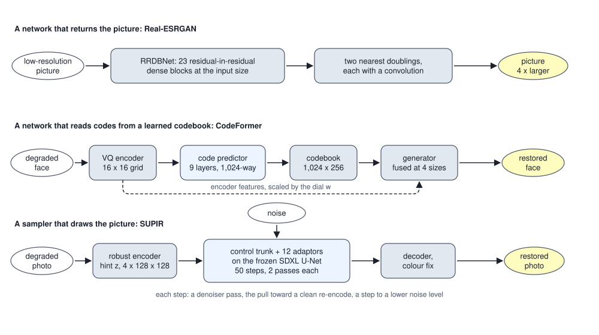
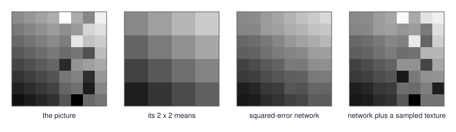
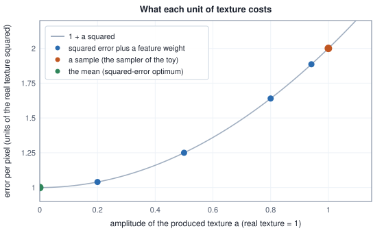

<!-- SPDX-License-Identifier: CC-BY-4.0 -->
<!-- Copyright (c) 2026 Martin Schröder <info@swedishembedded.com> -->

# Restoration and Super-Resolution

*How can a network recover detail that is not in the input?*

A pixel that reads 127.5 after a 2 by 2 average was made by one of 11,184,896 different blocks of four 8-bit pixels. The number is exact: it is how many ways four integers between 0 and 255 can add up to 510, and a table below computes it. A 4 by 4 picture of such pixels has that many explanations sixteen times over, a number of 113 digits, and a restorer that is handed the picture must name one of them. Whichever it names, the other eleven million per pixel were equally good readings of the input. The input cannot say which one was right.

That is the position of every network in this chapter, and the strange fact is that they work. A face blurred past recognition comes back with eyelashes. A thumbnail comes back as a photograph with pores in the skin. The eyelashes and the pores were not in the input; the network put them there. The question is on what grounds, and what a person who receives the result is entitled to believe about it.

The chapter answers with three machines, one for each way of choosing among the readings that brain keeps, and with the same two instruments each time: a toy small enough to compute exactly, and a count of the real network from its configuration. The first machine is a convolutional network that regresses the restored picture, Real-ESRGAN's `RRDBNet`, and the toy shows what any such network must do to a texture that the input has lost, even the best one. The second reads a face as a short list of codes from a codebook of clean faces and predicts the codes from the whole degraded face at once, CodeFormer. The third draws the restoration with a diffusion sampler, steered by the degraded picture, SUPIR. Each gives up something the previous one kept, and the numbers say what.

Restoration starts from five earlier ideas.

1. (Volume VII, [Chapter 3](../v07-vision/03-cnns.md), convolutional networks.) A $3 \times 3$ convolution with bias maps 64 channels to 32. How many parameters has it, and how many operations does it take on a $128 \times 128$ map, counting a multiply-add as two?
2. (Volume VII, [Chapter 1](../v07-vision/01-images.md), shrinking an image.) A shrink by 2 replaces each non-overlapping $2 \times 2$ block by its mean. What does the block $(10, 30; 50, 70)$ become, and what is the block $(30, 10; 70, 50)$ turned into?
3. (Volume VIII, [Chapter 3](03-vector-quantization.md), the codebook.) A feature $(0.9, 0.2)$ is quantized against the codes $(1, 0)$, $(0, 1)$ and $(-1, 0)$. Which code is chosen, and how is a tie broken?
4. (Volume VIII, [Chapter 4](04-gans.md), the adversarial loss.) At the optimum of the game, what does the discriminator output for any sample, and what distribution does the generator produce?
5. (Volume VIII, [Chapter 10](10-latent-diffusion-systems.md), latent diffusion.) A 50-step generation with guidance runs the denoiser how many times, and which stage after the loop runs only once?



## Eleven million blocks for one pixel

A **degradation** is whatever turned the good picture $\mathbf{x}$ into the one in hand, $\mathbf{y}$: a function $\mathcal{A}$ and, usually, some noise, $\mathbf{y} = \mathcal{A}(\mathbf{x}) + \mathbf{n}$. Four of them cover most of what happens to a photograph, and each is easy to write down exactly. A blur replaces each pixel by a weighted mean of its neighbours. A downsampling keeps one number for every block of pixels. Noise adds a random number to each pixel. A compression codec rounds its coefficients to a coarse grid. The first table applies all four, in that order, to one 8 by 8 picture: a dark field with a bright half and a checkerboard on the dark corner. Every constant is printed with it.

<!-- worked: restoration.degradations -->
The picture x (grey levels 0 to 255: 40 on the dark side, 200 on the bright side, a checkerboard of plus and minus 24 on the dark top-left 4 by 4 corner; rows are y, columns x, the bright side is x + y >= 8) and its blur by (1, 2, 1) / 4 along x and then along y with the edge value repeated beyond the border.

| row | picture x | blurred |
|---:|---|---|
| 0 | 64 16 64 16 40 40 40 40 | 46.0 40.0 40.0 37.0 37.0 40.0 50.0 70.0 |
| 1 | 16 64 16 64 40 40 40 200 | 40.0 40.0 40.0 40.0 40.0 50.0 90.0 140.0 |
| 2 | 64 16 64 16 40 40 200 200 | 40.0 40.0 40.0 40.0 50.0 90.0 150.0 190.0 |
| 3 | 16 64 16 64 40 200 200 200 | 37.0 40.0 40.0 51.5 91.5 150.0 190.0 200.0 |
| 4 | 40 40 40 40 200 200 200 200 | 37.0 40.0 50.0 91.5 151.5 190.0 200.0 200.0 |
| 5 | 40 40 40 200 200 200 200 200 | 40.0 50.0 90.0 150.0 190.0 200.0 200.0 200.0 |
| 6 | 40 40 200 200 200 200 200 200 | 50.0 90.0 150.0 190.0 200.0 200.0 200.0 200.0 |
| 7 | 40 200 200 200 200 200 200 200 | 70.0 140.0 190.0 200.0 200.0 200.0 200.0 200.0 |

The degraded 4 by 4 pictures. 'Box mean only' averages each non-overlapping 2 by 2 block of x; 'blur, then box mean' does so after the blur; '+ noise' adds 6 times one draw of `normal()` of the stream `restoration.degradations` (seed 0x19cf28ef940c75ff) to each of the 16 pixels in row-major order; '+ quantised' takes each 2 by 2 block (p00 p01 / p10 p11) of the noisy picture as a mean m = (p00 + p01 + p10 + p11) / 4 and three differences h = (p00 + p01 - p10 - p11) / 4, v = (p00 - p01 + p10 - p11) / 4 and d = (p00 - p01 - p10 + p11) / 4, rounds m to a multiple of 2 and each of h, v, d to a multiple of 16 (halves round upward: step times floor(value / step + 1/2)), and rebuilds the block as m + h + v + d, m + h - v - d, m - h + v - d, m - h - v + d.

| row | box mean only | blur, then box mean | + noise | + quantised |
|---:|---|---|---|---|
| 0 | 40.0 40.0 40.0 80.0 | 41.5 39.2 41.8 87.5 | 41.8 36.8 42.0 83.5 | 42.0 42.0 40.0 72.0 |
| 1 | 40.0 40.0 80.0 200.0 | 39.2 42.9 95.4 182.5 | 41.4 45.2 99.9 190.9 | 42.0 42.0 104.0 200.0 |
| 2 | 40.0 80.0 200.0 200.0 | 41.8 95.4 182.9 200.0 | 46.8 92.2 186.3 194.1 | 58.0 90.0 194.0 194.0 |
| 3 | 80.0 200.0 200.0 200.0 | 87.5 182.5 200.0 200.0 | 97.9 183.6 194.3 202.6 | 90.0 186.0 194.0 194.0 |

How far each stage moves the 4 by 4 picture from the box mean of x alone (the mean over the 16 pixels of the squared change).

| stage | mean squared change of the 4 by 4 picture |
|---|---:|
| box mean only | 0.00 |
| blur, then box mean | 94.30 |
| + noise | 99.07 |
| + quantised | 95.00 |
<!-- /worked -->

The last stage moves the picture a little less than the noise before it did, because rounding removes small differences that the noise had added; that is a property of this draw and not of codecs. The checkerboard is gone after the box mean, and no later stage brings it back: $+24$ and $-24$ sit side by side in every block, and a mean cannot tell them from each other. The diagonal edge has not gone, but the blur has smeared it so that a block that straddles it is a blend of dark and bright, which a block with different contents could also have been. That is the whole difficulty in a small case. Restoring means inverting $\mathcal{A}$, and these maps are not invertible, in the strict sense or in the practical one.

The strict sense first. Averaging four pixels maps $\mathbb{R}^4$ to $\mathbb{R}$, so three directions in the block map to nothing: the horizontal stripe $(+, +; -, -)$, the vertical stripe $(+, -; +, -)$ and the checkerboard $(+, -; -, +)$. Add any combination of them to a block and its mean does not move. An 8 by 8 picture averaged down to 4 by 4 loses $64 - 16 = 48$ of its numbers. The next table counts what that means for 8-bit pixels.

<!-- worked: restoration.ill_posed -->
The number of ways to choose the four pixels of a 2 by 2 block (integers 0 to 255) so that they sum to a given S, which is all that the 2 by 2 box mean of the block (S / 4) records. Counts are exact integers.

| sum S | blocks with that sum |
|---|---:|
| 0 | 1 |
| 1 | 4 |
| 2 | 10 |
| 3 | 20 |
| 255 | 2,829,056 |
| 510 | 11,184,896 |
| 765 | 2,829,056 |
| 1020 | 1 |

A 4 by 4 picture all of whose blocks sum to 510 (every low-resolution pixel 127.5) is the box mean of 11,184,896^16 different 8 by 8 pictures, a number of 113 digits. Two 4 by 4 pictures with the same four block sums: A, B = A plus a checkerboard of plus and minus 30, and the difference B - A (the block sums of both are 320, 480 / 480, 640).

| row | A | B | B - A |
|---:|---|---|---|
| 0 |  60  80 100 120 |  90  50 130  90 |  30 -30  30 -30 |
| 1 |  80 100 120 140 |  50 130  90 170 | -30  30 -30  30 |
| 2 | 100 120 140 160 | 130  90 170 130 |  30 -30  30 -30 |
| 3 | 120 140 160 180 |  90 170 130 210 | -30  30 -30  30 |
<!-- /worked -->

A problem whose data do not determine its answer is called **ill-posed** in the sense of Hadamard: no unique solution. Here the non-uniqueness is not subtle. Column B differs from column A by a checkerboard of $\pm 30$, and the two have the same four block sums. Nothing computed from the low-resolution picture can distinguish them.

The practical sense is about blur, which loses less. A blur is invertible on paper whenever its response is nonzero at every frequency, and the next table shows how little "on paper" is worth.

<!-- worked: restoration.blur_response -->
The response of the kernel (1, 2, 1) / 4 on a periodic row of 16 pixels at frequency k (k periods per row): H_k = (1 + cos(2 pi k / 16)) / 2, and the factor 1 / H_k by which an inverse filter must multiply that frequency.

| k | H_k | 1 / H_k |
|---|---:|---:|
| 0 | 1.000000 | 1.000 |
| 1 | 0.961940 | 1.040 |
| 2 | 0.853553 | 1.172 |
| 3 | 0.691342 | 1.446 |
| 4 | 0.500000 | 2.000 |
| 5 | 0.308658 | 3.240 |
| 6 | 0.146447 | 6.828 |
| 7 | 0.038060 | 26.274 |
| 8 | 0.000000 | no inverse |

The alternating row (+1, -1, +1, ...) blurred by this kernel is exactly 0 at every pixel after the blur. An inverse filter that leaves out k = 8 and divides every other frequency by its H_k multiplies the standard deviation of white noise by 9.72.
<!-- /worked -->

The kernel $(1, 2, 1)/4$ multiplies the frequency $k$ of a row of 16 pixels by $H_k = (1 + \cos(2\pi k/16))/2$. At $k = 8$ that is exactly zero: the alternating row is erased, and no inverse exists. At $k = 7$ it is $0.038$, so an inverse must multiply that frequency by 26, and noise at that frequency by the same. Dropping the single lost frequency and inverting all the others multiplies the standard deviation of white noise by $9.72$. This is why "deblurring" a noisy picture by division turns the noise into stripes. The degradation is invertible in the strict sense and useless in the practical one: noise decides.

What the four degradations share is that they are many-to-one or nearly so, and the picture that comes out of them is a *summary* of the picture that went in. **Super-resolution** is the name for the case in which the summary is a picture with fewer pixels and the task is to produce one with more: given the downsampled $\mathbf{y}$, estimate a picture whose own downsampling is $\mathbf{y}$ and which has the detail of a picture, not just the pixel count. Every other kind of restoration (removing noise, undoing a codec, repairing a face) differs in which part of $\mathbf{x}$ the degradation lost and not in the shape of the problem.

So a restorer cannot be told what the answer is. It can only be told how to choose one. The most natural rule, and the one that supervised learning of the earlier volumes uses without comment, is the squared error. What it picks is the subject of the next section.

## What squared error chooses

Suppose the restorer sees $\mathbf{y}$ and must output one picture $\hat{\mathbf{x}}$. If the true picture is drawn from the pictures consistent with $\mathbf{y}$, the output that minimizes the expected squared error is their mean. The proof is one line: write $\mathbf{m} = \mathbb{E}[\mathbf{x} \mid \mathbf{y}]$, then $\mathbb{E}\lVert\mathbf{x} - \hat{\mathbf{x}}\rVert^2 = \mathbb{E}\lVert\mathbf{x} - \mathbf{m}\rVert^2 + \lVert\mathbf{m} - \hat{\mathbf{x}}\rVert^2$, because the cross term has a factor $\mathbb{E}[\mathbf{x} - \mathbf{m} \mid \mathbf{y}] = 0$. The first term does not depend on the restorer; the second is zero exactly when $\hat{\mathbf{x}} = \mathbf{m}$. A network trained to minimize squared error, if it were perfect, would output the conditional mean, and the conditional mean of pictures that differ in their texture is a picture with no texture. A restorer that is trained that way regresses to the mean, and its output is blurrier than any picture it could have been given.

The smallest case that shows it is a single pair of pixels. Let the pair be $(m + t, m - t)$ where the average $m$ is what the restorer sees and the half-difference $t$ is $+\delta$ or $-\delta$ with probability one half. The average removes $t$ completely. The mean of the two possibilities is $(m, m)$, and its squared error per pixel is $\delta^2$. Return one of the two textured pairs instead, drawn at random, and the restorer is wrong half the time by $2\delta$ in each pixel: the error is $2\delta^2$, twice as large. A sharper picture costs squared error, exactly and unavoidably.

<!-- worked: restoration.pair_world -->
A pair of pixels (m + t, m - t) in units of delta, with the pair average m known to the restorer and t = +1 or -1 with probability 1/2 each, lost by the averaging. For three restorers: the mean squared error per pixel in units of delta squared, the signed gap (first pixel minus second, real pairs have +2 or -2) that their outputs show, and the best accuracy of a judge that sees only that gap and is shown real and restored pairs equally often (50% is a coin toss).

| restorer | mean squared error | gap shown | judge accuracy |
|---|---:|---:|---:|
| the mean: (m, m) | 1.00 | 0 | 100% |
| a sample: (m + t', m - t') | 2.00 | -2 or +2 | 50% |
| a fixed guess: (m + 1, m - 1) | 2.00 | +2 | 75% |
<!-- /worked -->

The last column of the table is a judge in the sense of [Chapter 4](04-gans.md): a classifier that is shown real pairs and restored pairs equally often and must tell them apart, here from a single number, the signed difference between the two pixels. The mean is detected every time, because no real pair has a gap of zero. The sample cannot be detected at all, because its gap has the same distribution as the real gap. That is what the adversarial game of Chapter 4 converges to when it converges: the generator that the judge can no longer tell from the data is a sampler of the conditional distribution. The two rows are two different answers to the same question, and the squared error prefers the one that no judge would accept.

### A texture the average removes, and a network that finds the mean

The pair is the smallest case. The same thing should happen in a world of pictures and for a network trained with gradient descent, and a world small enough to do the computation by hand lets us check how closely. The world is 8 by 8 pictures: a plane $a + b(x - 3.5) + c(y - 3.5)$ with random offset and slopes, which the low-resolution picture largely determines, and on the right half of the picture a texture. In each of the 8 blocks of the right half the three stripe and checkerboard patterns of the 2 by 2 block each carry a random sign times $0.08$. The box mean of a block removes the texture exactly. The texture energy, the mean squared value of the texture over the picture, is the same $1.5 \times 0.08^2 = 0.0096$ for every picture, since the three patterns are orthogonal and each carries one sign of size $0.08$. So $0.0096$ is a floor: no restorer that has only the low-resolution picture can score below it in expectation, and the one that returns the conditional mean sits at it, up to the part of the plane that has to be estimated.

The restorer is a small convolutional network of [Volume VII](../v07-vision/03-cnns.md): a $3 \times 3$ convolution from one channel to three, a leaky ReLU (slope $0.2$ for negative inputs), a second $3 \times 3$ convolution from three channels to four, and then a rearrangement in which channel $2i + j$ at the position $(r, q)$ becomes the high-resolution pixel $(2r + i, 2q + j)$. This is the sub-pixel arrangement: a convolution at the small size that produces the values of a $2 \times 2$ block, not a convolution at the large size. The network does not predict the picture but a correction to the nearest enlargement, so that a second layer of zeros would return the enlargement itself. It has 142 numbers. The next block prints its shapes, its draws and its starting error.

<!-- worked: restoration.sr_setup -->
The network and its starting point. The picture is 8 by 8, the input 4 by 4; the input and every hidden map are zero-padded by one pixel for the 3 by 3 convolutions. The 142 numbers are drawn from the stream `restoration.sr.init` with `normal()`, W1 first and W2 second, each in row-major order of its shape. The pictures of the streams `restoration.sr.train` and `restoration.sr.test` are drawn one after another, each from `uniform()` draws in this order: u1, u2, u3 give the plane, a = 0.4 + 0.2 u1, b = 0.12 (u2 - 0.5), c = 0.12 (u3 - 0.5), pixel (row y, column x) a + b (x - 3.5) + c (y - 3.5); then, for each of the 8 blocks of the right half in row-major order (low-resolution rows 0 to 3, columns 2 then 3) three draws h, v, d, each +1 if `uniform()` < 0.5 and -1 otherwise, are added to the block's four pixels as 0.08 (h s_y + v s_x + d s_y s_x), where s_y is +1 for the block's top row and -1 for its bottom row and s_x is +1 for its left column and -1 for its right column (h is the horizontal stripe, v the vertical stripe, d the checkerboard). The low-resolution picture is the box mean of the 2 by 2 blocks.

| tensor | shape | numbers | initial value, in draw order |
|---|---|---:|---|
| `W1` | 3 x 1 x 3 x 3 (output channel, input channel, row, column) | 27 | `normal()` x sqrt(2/9) |
| `b1` | 3 | 3 | 0 |
| `W2` | 4 x 3 x 3 x 3 | 108 | `normal()` x 0.1 |
| `b2` | 4 | 4 | 0 |

| quantity | value |
|---|---|
| streams | `restoration.sr.train` (seed 0xbed7854bfb0503a8) (256 pictures), `restoration.sr.test` (seed 0x63476531ef8bef56) (256), `restoration.sr.init` (seed 0x2f8e80678f4001fd) |
| first training picture: a, b, c | 0.499437, 0.050201, -0.056392 |
| its low-resolution row 0 | 0.518012 0.618414 0.718815 0.819217 |
| mean squared error of the initial network on the training set | 0.021030 |
<!-- /worked -->

The gradient is written out by hand (the reverse pass of the two convolutions and the leaky ReLU, as in [Volume III](../v03-neural-networks/04-backpropagation.md)), and the next block checks it before using it. Then 300 Adam steps train the network; a second table compares it with two fixed enlargements that need no training, the nearest and the bilinear, and with a restorer that draws a texture.

<!-- worked: restoration.sr_training -->
The network trained for 300 Adam steps (learning rate 0.01, first moment 0.9, second moment 0.999, epsilon 1e-08, moments corrected for their start) on batches of 32 training pictures taken in order and cyclically; step t uses pictures (t - 1) x 32 mod 256 onwards. The loss is the mean over the batch and the 64 pixels of the squared error. A number that comes from a chaotic run is printed with only the digits that are the same in the run and in four copies of it whose first weight is changed by +1e-12, -1e-12, +3e-12 and -3e-12: in full if all agree on it, as 'about x' with the leading digits on which all agree, or as 'unstable' when not even one digit survives; the other digits cannot be reproduced in another implementation.

The check of the hand-written gradient: on four training pictures at the initial weights the norm of (analytic - numeric) over the norm of the analytic gradient of the loss, with central differences of step 1e-5 on every one of the 142 weights, is below 1e-8 (the criterion).

| steps taken | mean squared error on the 256 training pictures |
|---|---:|
| 0 | 0.021030 |
| 50 | 0.010078 |
| 100 | 0.009880 |
| 200 | 0.009723 |
| 300 | 0.009659 |

On the 256 test pictures. The texture energy is the mean squared value of the texture the average removed, 0.009600: the same for every picture, since the three patterns of a block are orthogonal and each carries a sign of size 0.08, so a block's four pixels have squared values adding to 12 x 0.08^2 and half the pixels of a picture are in such blocks (1.5 x 0.08^2 = 0.009600). The last row adds to the network's picture a fresh texture drawn by `draw_texture` from the stream `restoration.sr.sample` (seed 0xe539322ce51a2e11), one per test picture.

| restorer | mean squared error | minus the texture energy |
|---|---:|---:|
| nearest enlargement | 0.010223 | 0.000623 |
| bilinear enlargement | 0.009765 | 0.000165 |
| the network, 300 steps | 0.009814 | 0.000214 |
| the network plus a texture drawn like the real one | 0.019490 | 0.009890 |

The detail energy of a picture is the mean over its pixels of the squared difference between a pixel and the mean of its 2 by 2 block, measured separately on the left half (no texture) and the right half (texture) and averaged over the 256 test pictures.

| output | detail energy, left half | detail energy, right half |
|---|---:|---:|
| the pictures themselves | 0.000627 | 0.019819 |
| nearest enlargement | 0.000000 | 0.000000 |
| bilinear enlargement | 0.000392 | 0.000392 |
| the network | 0.000408 | 0.000611 |
<!-- /worked -->

Three things stand out. The network ends at $0.009814$ on the test pictures, within $0.000214$ of the texture energy $0.009600$, and a fixed bilinear enlargement is at $0.009765$. Everything that a trainable network can add over a fixed one is in the fourth decimal, because the plane is easy and the texture is the whole error. The second: adding a texture drawn like the real one to the network's picture *doubles* the error, from $0.009814$ to $0.019490$, as the pair predicted. The third is the table of detail energy. The real pictures have $0.019819$ of squared detail per pixel on the right half, the network $0.000611$: it returns about 3 percent of the energy that a real picture there has, and the part it does return is the slope of the plane, which the left half has as well ($0.000408$ against the real $0.000627$). The network has found the mean, and it found it with 142 numbers and 300 steps.



The figure shows it in grey levels. The picture has a salt-and-pepper texture on its right half; the box means have lost it; the network's picture is a smooth ramp that goes through the right half at the average level; the sampled picture has the texture back, at the wrong places. The question of the chapter has two readings and they have different answers. If *recover* means to return a picture closer in squared error to the true one, the network cannot do it, in this world or in any other where the lost part is symmetric about zero. If it means to return a picture that looks like a picture, with the texture a picture of this kind has, it can, at a price that is now exact.

## What a judge asks for

A restorer that wants the texture needs a loss that asks for it. The squared error asks for the opposite. Chapter 4 gave one loss that does ask: a discriminator, a second network trained on real and restored pictures, whose judgement of the restoration the restorer is trained to improve. Real-ESRGAN trains its generator with three terms: a pixel loss, a loss on the features that a fixed image network assigns to the restored and the true picture (a perceptual loss), and the adversarial loss of a discriminator. The first term keeps the picture near the truth, the second makes the texture statistically right, and the third lets a learned judge say what the second misses. The pair can show what each of them does to the texture, in closed form.

Let the restorer return $(m + a s, m - a s)$, with the sign $s = \pm 1$ drawn like the real one and $a$ the amplitude of the texture it produces, in units of $\delta$. Its error is $1 + a^2$ in units of $\delta^2$: the unavoidable $1$ plus the amplitude squared. A penalty that asks the gap to be the real gap, $\lambda(a - 1)^2$, stands in for the part of a judge that sees the gap. Minimizing $a^2 + \lambda(a - 1)^2$ gives $a^\ast = \lambda/(1 + \lambda)$.

<!-- worked: restoration.feature_weight -->
Restorers that return (m + a s, m - a s) with s = +1 or -1 drawn like t, and a the amplitude of the texture they produce, in units of delta. Minimising a^2 + lambda (a - 1)^2 (the first term is what a restorer's squared error would add to the unavoidable error, the second a penalty on a gap that differs from the real gap 2, with weight lambda) gives a* = lambda / (1 + lambda), and the mean squared error per pixel is 1 + a*^2 in units of delta squared. Whether the gap judge of the previous table can see the difference from real pairs (a* = 1 is the only amplitude it cannot).

| lambda | a* | mean squared error | judge |
|---|---:|---:|---:|
| 0 | 0.0000 | 1.0000 | seen (a < 1) |
| 0.25 | 0.2000 | 1.0400 | seen (a < 1) |
| 1 | 0.5000 | 1.2500 | seen (a < 1) |
| 4 | 0.8000 | 1.6400 | seen (a < 1) |
| 16 | 0.9412 | 1.8858 | seen (a < 1) |
| 1000 | 0.9990 | 1.9980 | seen (a < 1) |
<!-- /worked -->



Every restorer in the pair world lies on one parabola. Squared error alone sits at the bottom, with no texture. Raising the weight of the judge's term moves the restorer along the curve toward the full texture, and each step buys realism with distortion: at $\lambda = 1$ half the real amplitude costs a quarter of the unavoidable error again, and at full amplitude the error has doubled. Only the end of the curve is out of the judge's sight. This is the trade between distortion and perception that the literature names, and it is not a defect of any method. It is the shape of the problem.

What the texture is deserves saying clearly. The sign $s$ is drawn independently of the true $t$, so a sampled texture matches the real one half the time, as a coin would. The restored picture has the right kind of texture in the wrong places. On a photograph of a wall that does not matter. On a photograph of a person it is the question of whether the pores are theirs. A model that was trained on faces will produce the pores of a face, and the squared error of the result against the person's own face is worse than that of the blur.

## When nobody says what was done to the picture

Everything so far fixed $\mathcal{A}$. A photograph from a phone has been blurred by a lens nobody described, scaled by an app, compressed twice by two services and noised by a sensor, in an order and with parameters that vary from picture to picture. A restorer trained for one fixed $\mathcal{A}$ fails on another. **Blind restoration** is the name for restoration where the degradation is not given: it is unknown and varies, so the restorer must work without being told what was done. The remedy that the field settled on is to put the degradation into the training data. The published recipe of Real-ESRGAN generates low-resolution pictures from clean ones by applying a random blur, a random resize, random noise and a random compression, twice over, each with parameters drawn from a range; the restorer is trained on millions of such pairs and sees the real degradation as one more draw from the family. The family is an assumption, and it is the most consequential one of the pipeline.

The toy can show the cost and the gain in one table. The same network is trained twice from the same starting point: on clean low-resolution pictures, and on pictures to each of which noise of one of four levels has been added. The levels $0, 0.02, 0.05, 0.1$ are the standard deviation of the noise per pixel. Both are then tested at all four.

<!-- worked: restoration.blind_restoration -->
The same network (the same 142 initial numbers, the same 300 steps) trained twice: on the clean low-resolution pictures, and on the same pictures with noise added to each: its level one of 0, 0.02, 0.05, 0.1 chosen by one `integer(4)` draw per picture from the stream `restoration.sr.levels` (seed 0x98b1aca61170695f), then the noise of each picture drawn row-major from `restoration.sr.noise.train` (seed 0x211a7212aa5e5621) (16 draws per picture, every picture included, each multiplied by the level of its picture, so that a picture of level 0 is unchanged). Mean squared error on the 256 test pictures when 4 by 4 pixels of noise of the given standard deviation are added to every low-resolution picture (from the stream `restoration.sr.noise.test.<level>` with the level written as in the table, 0.02, 0.05 or 0.1: `restoration.sr.noise.test.0.02`; 16 `normal()` draws per picture, pictures in order, row-major; level 0 adds nothing). The `integer(4)` draw k of a training picture chooses the level 0, 0.02, 0.05 or 0.1 for k = 0, 1, 2, 3.

| noise level | nearest | bilinear | trained on clean pictures | trained on a mixture |
|---|---:|---:|---:|---:|
| 0 | 0.010223 | 0.009765 | 0.009814 | 0.010197 |
| 0.02 | 0.010610 | 0.009952 | 0.010219 | 0.010349 |
| 0.05 | 0.012785 | 0.011092 | 0.012432 | 0.011242 |
| 0.1 | 0.020143 | 0.014877 | 0.020163 | 0.014093 |
<!-- /worked -->

The network trained on clean pictures trusts every pixel of its input. At noise level $0.1$ its error is $0.020163$, as bad as no restoration at all (the nearest enlargement, $0.020143$), and well behind the bilinear enlargement, whose four-tap average smooths a little by its construction ($0.014877$). The network trained on the mixture has learned that a pixel is not to be trusted by itself: at the same level it reaches $0.014093$, better than either. It pays for this where the clean network is best: at noise level 0 it is at $0.010197$ against $0.009814$, the price of being prepared. A fixed distribution of degradations is a compromise, and the compromise is visible in the table to the fourth decimal.

The same is true for every part of the degradation family in the published recipe: it decides what the restorer is robust to and what it will treat as detail. This is the place where a restorer's failures come from most often in practice, and they are failures of the *training distribution*, not of the architecture. A restorer asked to repair a degradation outside the family does not fail loudly; it produces a confident picture.

## The generator of Real-ESRGAN, counted

brain keeps the generator half of Real-ESRGAN, in `crates/rrdbnet`. The discriminator is a training-time component and the released checkpoint does not contain it, so the crate does not have it either; the network is a function from a picture to a picture four times larger. What the crate trains, in `crates/rrdbnet/src/train.rs`, is a mean squared error against a random target: the loss exists to cover the whole backward pass with a gradient check, not to be a restoration recipe.

The architecture is a stack of residual-in-residual dense blocks. A dense block has five $3 \times 3$ convolutions whose inputs grow: the first reads the 64 channels of the block's input, and each later one reads that and every earlier output, so the five read $64, 96, 128, 160, 192$ channels. The first four write 32 channels and are followed by a leaky ReLU with slope $0.2$; the fifth writes 64 and has no activation. The block returns $x + 0.2\,f(x)$. A residual-in-residual block (an RRDB) chains three dense blocks and returns $x + 0.2\,f(x)$ again. The trunk is 23 RRDBs, then a convolution whose output is added to the input of the trunk, then, for each factor of two of the scale, a nearest-neighbour doubling followed by a convolution and a leaky ReLU, and two final convolutions. The `0.2` in both places is the architecture: the crate names it once (`RESIDUAL_SCALE`) because dropping either leaves a network that runs and produces a plausible, wrong picture.

The configuration is not typed in. `RrdbConfig::from_tensors` in `crates/rrdbnet/src/config.rs` reads the width, the growth, the number of blocks and the scale out of the shapes of the checkpoint's tensors (the number of blocks from the highest `body.<i>.` index, the scale from how many `conv_up` layers there are), and a test checks that the list of shapes a configuration needs derives back to the same configuration. Counting the network is therefore a matter of running the same arithmetic on the numbers.

<!-- worked: restoration.rrdbnet_counts -->
Real-ESRGAN's RRDBNet (64 channels, growth 32, 23 blocks, scale 4) counted from its configuration for a 128 by 128 input and a 512 by 512 output. A multiply-add is two operations; bias additions, activations and the concatenations are not counted. conv_up1 runs at 256 by 256, conv_up2 and conv_hr are two different 64 to 64 convolutions that both run at 512 by 512, so their rows are equal; the rows add up to the total.

| part | parameters | tensors | GFLOP | share of the operations |
|---|---:|---:|---:|---:|
| conv_first | 1,792 | 2 | 0.1 | 0.0% |
| trunk (RRDB blocks) | 16,546,752 | 690 | 541.8 | 92.2% |
| conv_body | 36,928 | 2 | 1.2 | 0.2% |
| conv_up1 | 36,928 | 2 | 4.8 | 0.8% |
| conv_up2 | 36,928 | 2 | 19.3 | 3.3% |
| conv_hr | 36,928 | 2 | 19.3 | 3.3% |
| conv_last | 1,731 | 2 | 0.9 | 0.2% |
| total | 16,697,987 | 702 | 587.4 | 100.0% |

One RRDB block has 719,424 parameters (three dense blocks of 239,808). The 6-block configuration keeps every other number of the architecture:

| configuration | parameters | tensors | GFLOP for 128 x 128 | kilo-FLOP per output pixel |
|---|---:|---:|---:|---:|
| 23 blocks | 16,697,987 | 702 | 587.4 | 2,240.9 |
| 6 blocks | 4,467,779 | 192 | 187.0 | 713.3 |
<!-- /worked -->

Almost everything is in the trunk. 92.2 percent of the operations are in the 23 blocks, which run at the input resolution, and the whole upsampling head, though its convolutions work on pictures four and sixteen times as large as the input, takes 7.6 percent: the head has one convolution at twice the side and three at four times the side, and the trunk has $23 \times 15$ at the input size. The parameters are more concentrated still, since 719,424 of the 16,697,987 belong to each block's 15 convolutions. Because the net is fully convolutional, its work is linear in the number of pixels, which is why the crate's serving action does not override the batch default: batching $N$ images saves no work and multiplies the high-water mark by $N$.

Linear work does not make tiling free. Each of the 15 convolutions of an RRDB (five in each of its three dense blocks) adds a pixel to the neighbourhood that an output pixel depends on, so the receptive field of the trunk alone is wide, and the crate derives the whole radius from the graph instead of typing it (`RrdbConfig::receptive_radius` in `crates/rrdbnet/src/config.rs`). Counting backwards from the output, $r = 2$ for `conv_last` and `conv_hr`, each doubling of the scale maps $r$ to $\lceil (r + 1)/2 \rceil$ (its convolution works at the lower resolution, and the nearest doubling halves what the layers after it contribute), and then $+1$ for `conv_body`, $+15$ per block and $+1$ for `conv_first`:

<!-- worked: restoration.rrdbnet_tiling -->
The receptive radius of RRDBNet by the rule of `RrdbConfig::receptive_radius`: r = 2 for conv_last and conv_hr; for each factor of 2 of the scale, r becomes ceil((r + 1) / 2) (the convolution after the doubling, then the doubling); then +1 for conv_body, +15 for every block and +1 for conv_first. Every convolution is 3 x 3 with padding 1, so each adds one pixel at its own resolution. The trace for the released x4 network:

| layer, counted from the output | radius r after it, in input pixels |
|---|---:|
| conv_last, conv_hr | 2 |
| conv_up2 and its doubling | 2 |
| conv_up1 and its doubling | 2 |
| conv_body | 3 |
| 23 blocks | 348 |
| conv_first | 349 |

| configuration | receptive radius R |
|---|---:|
| 23 blocks, x4 | 349 |
| 23 blocks, x2 | 349 |
| 6 blocks, x4 | 94 |
| 6 blocks, x2 | 94 |

A tiled pass cuts, along each axis, cores of `tile` pixels that partition the axis (the last one shorter), reads each core through a window of min(extent, tile + 2R) pixels kept inside the axis, and so runs ceil(extent / tile) windows per axis, each costing a pass over its window. R = 349 here. The work of a pass is proportional to the pixels of its window; the last column is the limit for an axis that is long compared with the tile.

| input | tile | window side min(extent, tile + 2R) | windows | work relative to one whole-image pass | ((tile + 2R) / tile)^2 |
|---|---:|---:|---:|---:|---:|
| 600 x 600 | 64 | 600 | 10 x 10 = 100 | 100.00 | 141.76 |
| 600 x 600 | 256 | 600 | 3 x 3 = 9 | 9.00 | 13.89 |
| 600 x 600 | 512 | 600 | 2 x 2 = 4 | 4.00 | 5.59 |
| 2048 x 2048 | 64 | 762 | 32 x 32 = 1024 | 141.76 | 141.76 |
| 2048 x 2048 | 256 | 954 | 8 x 8 = 64 | 13.89 | 13.89 |
| 2048 x 2048 | 512 | 1,210 | 4 x 4 = 16 | 5.59 | 5.59 |
<!-- /worked -->

The released x4 network has a radius of $R = 349$ input pixels, and it is $R$ that the serving action's `tile` parameter is built on (`crates/rrdbnet/src/caps.rs`, commit f0113ff73). A tile of side $t$ is a core of $t$ pixels that the sweep keeps; the core is read through a window of $\min(\text{extent}, t + 2R)$ pixels that lies inside the image, shifted inward at a border instead of padded past it. Every kept pixel then sees its whole receptive field, or a window edge that is the image edge, where the convolutions zero-pad exactly as they do in the whole-image pass. The tiled output is therefore equal to the whole-image output bit for bit, and the parity tests assert that on three odd sizes and tiles. The price is work and memory, not quality: a window holds $(t + 2R)^2$ input pixels, so on a long axis the work is multiplied by $((t + 2R)/t)^2$, which the last table gives as $5.59$ for a tile of 512 and $141.76$ for a tile of 64, and an image shorter than a window is read whole by every core. `tile` defaults to 0, the whole image in one graph, and a tile is worth cutting only for an image larger than about $2R + t$ pixels a side.

### A silent zero in the gradient

The crate's history has one story that belongs in a chapter about restoring pictures, because it is the failure shape this family of networks is prone to: a network that runs and trains badly. `crates/rrdbnet/src/model.rs` used to record its leaky ReLU and its scaled residual through the shared block builder's `push_step`, which puts a step on the forward list and nothing on the tape that the backward pass walks. The backward walk skips any operation whose output no consumer claimed. So every convolution before the last activation received a zero gradient, not a wrong one, and the forward values were right. commit 8023cbdbe gave the builder two recorders, one for the leaky ReLU and one for the scaled residual, each backed by an adjoint kernel that already existed, and added a gradient check on every trainable tensor and one element by element on the convolution farthest from the loss, the one whose gradient has to flow through the single shared `0.2` buffer at all the $4 \times 23$ residual sites. It was the second occurrence of a bug class that had already shown on SDXL's transformer half, and the instruction that came out of it is to search for `push_step` in every crate built on the builder. A later change, commit a4a741939, lets the dense blocks free their intermediate buffers and recompute them in the backward pass, with an inference output equal to the training forward's.

## Reading the face as a whole

A restorer that regresses has no idea what a face is; it knows what pixels near each other tend to be. [Chapter 3](03-vector-quantization.md) built the other thing: an autoencoder whose latent is a grid of codes from a codebook, trained on clean pictures, so that every image the decoder can produce is made of the same $K$ code vectors. A decoder like that is a model of what clean faces are made of. If a degraded face could be mapped to the codes of the clean face it came from, the decoder would do the rest, and the result would be a face made of face parts by construction, whatever had happened to the input.

CodeFormer's one idea is how to find those codes. The obvious way, the one the VQ autoencoder itself uses, is the nearest-code search of Chapter 3: encode the degraded face and replace each position's feature by the nearest code. It fails in the way that matters, because the degraded face has a degraded encoding, and the nearest code to a corrupted feature is a corrupted choice. The codes are being chosen one position at a time, from a feature that has been damaged at that position. The alternative is to *predict* the codes: let a network look at all 256 positions of the face at once and say, for each position, which of the 1,024 codes belongs there. A position whose own feature is destroyed can still be predicted from the rest of the face, as a gap in a sentence is predicted from the other words. The learned set of codes, and what the predictor knows about how they combine, is what this chapter calls the **codebook prior**: the restoration is constrained to the space of pictures that the codebook can express, and it is chosen within that space using everything the face shows.

The toy is a codebook of 8 vectors of the plane and a prior of 16 faces of 8 positions each. A degraded face is the vector of its code at each position plus Gaussian noise of one standard deviation for the whole face. The nearest-code rule treats the positions separately. The whole-face read compares the 8 noisy features with each of the 16 template faces, takes the template with the smallest summed squared distance and returns its codes. For equal Gaussian noise that is the most probable template, which is the best that any predictor with perfect knowledge of the 16 faces can do. The routine is short enough to write out.

```text
function read_whole_face(feats: array<real>[T, 2], codes: array<real>[K, 2], faces: array<int>[M, T]) -> list<int>:
    scores = zeros(real, [M])
    for m in 0 .. M:
        for t in 0 .. T:
            k = faces[m, t]
            scores[m] = scores[m] + (feats[t, 0] - codes[k, 0]) ^ 2 + (feats[t, 1] - codes[k, 1]) ^ 2
    best = argmin(scores)
    return [faces[best, t] for t in 0 .. T]
```

<!-- worked: restoration.codebook_prior -->
A codebook of 8 vectors of the plane and a prior of 16 faces of 8 positions each. The codes are the points (1.5 cos(2 pi k / 8), 1.5 sin(2 pi k / 8)); face m is the list of 8 codes drawn from the stream `restoration.codebook.templates` (seed 0x6c960ccba3439aa5) (`integer(8)`, m = 0 .. 15, positions 0 .. 7). A degraded face has, at each position, the vector of its code plus the noise level times two `normal()` draws (x then y) from the stream `restoration.codebook.faces` (seed 0x1d44cefa5344ba25), which draws first 2,000 face numbers (`integer(16)`), then the codes of 2,000 faces that are not templates (`integer(8)` for each of 8 positions), then the noise (two draws per position, faces in order); the noise draws of face i are the same for the face i that is a template and for the face i that is not, so the two sets of columns share their 2,000 x 16 noise numbers. 'Nearest code' replaces each position's vector by the index of the nearest code; the whole-face read picks the template with the smallest summed squared distance and returns its codes. Shares of the 16,000 positions that come out wrong, and of the 2,000 faces that come out right.

| code k | vector |
|---:|---|
| 0 | (1.5000, 0.0000) |
| 1 | (1.0607, 1.0607) |
| 2 | (0.0000, 1.5000) |
| 3 | (-1.0607, 1.0607) |
| 4 | (-1.5000, 0.0000) |
| 5 | (-1.0607, -1.0607) |
| 6 | (0.0000, -1.5000) |
| 7 | (1.0607, -1.0607) |

| noise level | nearest code, wrong | whole-face read, wrong | whole face right | nearest, wrong (not a template) | whole-face read, wrong (not a template) |
|---|---:|---:|---:|---:|---:|
| 0.25 | 2.2% | 0.0% | 100.0% | 2.1% | 75.1% |
| 0.5 | 25.5% | 0.0% | 100.0% | 25.2% | 76.1% |
| 0.75 | 44.4% | 0.3% | 99.7% | 44.5% | 77.3% |
| 1 | 55.9% | 2.7% | 96.6% | 56.3% | 78.6% |
<!-- /worked -->


At noise $0.5$ the nearest-code rule is wrong at a quarter of the positions (25.5 percent) and the whole-face read at almost none of the 16,000 (0.0 percent to one decimal). The noise has to reach $1.0$, nearly the distance between neighbouring codes, before the read of the whole face is wrong at 2.7 percent of the positions. The prior is worth that much. The last two columns are the price. A face that is *not* among the 16, drawn from the codes at random, has its positions read wrong at three in four by the whole-face read, because the read snaps it to the nearest template: it makes the face more typical than it was. The nearest-code rule, blind to the whole, is no better or worse on those faces than on the others. A restorer built on a prior is wrong in a different way from one that is not, and it is wrong about the very faces that are unusual.

A prior of 16 faces is a toy. The real one is not a list of faces but a codebook of 1,024 vectors of width 256 on a $16 \times 16$ grid, whose combinations are of the order of $1024^{256}$ faces; the predictor is a transformer of nine layers, width 512 and 8 heads, and it learns what it learns from data and not from a list. The failure survives the change of scale, because it does not come from the size: any prior makes the unusual usual.

### A dial between quality and fidelity

CodeFormer does not leave it at that. The encoder's features from the degraded face carry some of what the codes cannot: a scar, a crooked tooth, the exact outline of an eye. The generator that decodes the predicted codes is given those features back at four sizes, through a small learned block, the controllable feature transformation. At each of four sizes (32, 64, 128 and 256 pixels on a side) a residual block reads the encoder's feature and the generator's feature at that size together and produces a scale and a shift; the generator's feature $\mathbf{d}$ becomes

$$\mathbf{d} + w\,(\mathbf{d} \odot \text{scale} + \text{shift}),$$

and $w$ is a number the caller chooses, the **fidelity dial**. At $w = 0$ no encoder feature reaches the generator: the output is the decoding of the predicted codes alone, maximum quality and maximum trust in the prior. At $w = 1$ the full correction is applied, maximum fidelity to the input. The reference implementation skips the block entirely when $w = 0$, and `crates/codeformer/src/model.rs` does not: it evaluates the block and scales by zero, which is bit-identical to skipping it ($0 \cdot \text{finite} = 0$ and $x + 0 = x$), so that the golden at $w = 0$ tests the wiring of the fusion and not the branch that skips it. The dial lives in a one-element device buffer, so changing it is a write and not a rebuild of the graph, and the served `restore_face` action defaults it to $0.5$.

The toy dial needs only the form of the interpolation: with the scale at zero and the shift equal to the encoder's feature $\mathbf{e}$ minus the decoded feature $\mathbf{d}$, the output is $\mathbf{d} + w(\mathbf{e} - \mathbf{d})$, a mix of the decoded codes and the degraded feature. Two kinds of face are tried: those that sit exactly on the prior, and those with a personal offset that the codebook cannot carry.

<!-- worked: restoration.fidelity_dial -->
The fidelity dial on the toy faces. The encoder's feature e is the true feature f plus noise of standard deviation 0.5 (the noise of the previous table, stream `restoration.codebook.faces` (seed 0x1d44cefa5344ba25)); d is the codes of the whole-face read of e; the output is out(w) = d + w (e - d). 'On the prior' faces have f equal to their template's codes; 'with detail' faces have f equal to those codes plus a personal offset, two `normal()` draws of standard deviation 0.5 per position, from the stream `restoration.dial` (seed 0x5404b5399103bcd9) (drawn per position, x then y, faces in order). Mean squared error per coordinate against f, and for the faces with detail the mean squared distance to the degraded input e.

| w | error, on the prior | error, with detail | distance to e, with detail |
|---|---:|---:|---:|
| 0 | 0.0000 | 0.2517 | 0.5025 |
| 0.25 | 0.0156 | 0.1571 | 0.2826 |
| 0.5 | 0.0625 | 0.1253 | 0.1256 |
| 0.75 | 0.1407 | 0.1563 | 0.0314 |
| 1 | 0.2501 | 0.2501 | 0.0000 |

With d equal to the codes, the error per coordinate is 0.25 w^2 on the prior and 0.25 (1 - w)^2 + 0.25 w^2 with detail (the squared offset and the squared noise), which is smallest at w = 0.25 / (0.25 + 0.25) = 0.5.
<!-- /worked -->

For a face that is on the prior, the best dial is 0: the codes are right and the encoder's feature adds only noise, so the error rises as $0.25 w^2$. For a face with detail the codes miss, the error is a parabola in $w$ with its minimum at $w = 0.25/(0.25 + 0.25) = 0.5$, the ratio of the squared offset to the squared offset plus the squared noise. The more the input is trusted, the more of its noise is let in. There is no best $w$ for pictures in general; there is a best $w$ for a given amount of detail that the prior misses and a given amount of damage in the encoder's feature, and a person who turns the dial is estimating both.

<!-- worked: restoration.codeformer_counts -->
CodeFormer counted from its configuration for a 512 by 512 face: the VQ autoencoder (width 64, multipliers 1, 2, 2, 4, 4, 8, two residual blocks per level, attention at 16 by 16, a 1,024 by 256 codebook), the code predictor (width 512, 8 heads, 9 layers, feed-forward width 1,024, 256 positions, position embedding, a 256 to 512 input projection, a layer norm and a 512 to 1,024 head without bias), and the controllable feature transformation at four sizes (32, 64, 128, 256; 256, 256, 128, 128 channels). A multiply-add is two operations; normalisations, activations, softmax and the elementwise feature mix are not counted. Each predictor layer has, with biases, the query, key and value projections and the output projection (512 to 512 each: 1,050,624), the feed-forward pair 512 to 1,024 and back (1,050,112) and two layer norms of gain and offset (2,048), so 2,102,784 parameters in 14 tensors (the query and key matrices are stored as one tensor, with their biases as another). Each of the four feature transformations is a residual block from twice the channels to the channels (two 3 x 3 convolutions and a 1 x 1 shortcut, two norms) and two towers of two 3 x 3 convolutions at the channels, all with bias.

| part | parameters | tensors | GFLOP | share of the operations |
|---|---:|---:|---:|---:|
| encoder | 29,416,000 | 164 | 212.4 | 26.2% |
| codebook | 262,144 | 1 | 0.0 | 0.0% |
| code predictor | 19,713,024 | 132 | 11.2 | 1.4% |
| generator | 34,061,955 | 164 | 367.9 | 45.4% |
| feature transformation (4 taps) | 10,659,584 | 72 | 218.1 | 26.9% |
| total | 94,112,707 | 533 | 809.6 | 100.0% |

The VQ autoencoder alone has 63,740,099 parameters in 329 tensors; the rest is what CodeFormer adds. Stored in 32-bit floats the parameters are 359.0 MiB.
<!-- /worked -->

The count says where CodeFormer's work and its parameters are. The code predictor, which does what is new, has 19,713,024 parameters, a fifth of the model, and $11.2$ GFLOP, 1.4 percent of the work: the predictor sees only 256 positions. The VQ autoencoder that it sits between has 63,740,099 parameters in 329 tensors, and is not re-implemented: `crates/codeformer` composes `crates/vqgan`, and what it adds is the predictor, the fusion and the dial. The tensor count of 533 is the count of the graph as it is built: the checkpoint's 515 tensors have each layer's attention input stored as one fused matrix, which the port splits into a query-key part and a value part because the position embedding is added to the queries and keys but not to the values, so one fused matrix cannot serve both.

What brain trains of CodeFormer is also narrower than the whole. `crates/codeformer/src/train.rs` has the second stage only: the predictor under the cross-entropy of its 1,024-way logits against the codes that the frozen VQ encoder gives for the clean picture, the same split as the paper's stage II. The module's header is careful to say what a green gradient check there does not cover (the fusion and the dial are frozen and the gradient does not reach the encoder), and a gradient check, `gradcheck::check_codeformer`, covers the part that is trained. Nothing about the argmax needs a gradient: it is downstream of the loss, not inside it.

One more thing from the history is worth keeping, because it is a trap that a layered design invites. commit 030fc9e5c fixed a kernel registered twice in `crates/codeformer/src/model.rs`: the shared block set already carried `matmul_reg3`, the crate appended a second entry under a new slot, and nothing was wrong on the GPU backend, where both slots compile. On the CPU backend only the slot the fast path had cached at construction is intercepted; the second fell through to a compiler that cannot compile that kernel, and the first real call panicked. The fix resolves the constant to the shared slot, and a test asserts the name appears exactly once. The restoration pipeline's end-to-end fixture, a complete all-zero 515-tensor checkpoint at the real size (commit 2bf08ed59), was what first made a full call possible and so found it.

## Drawing the restoration

The third answer gives up the cleverness of the second and keeps its goal. A diffusion model of the whole image distribution already knows what photographs look like; run from noise, it produces one. **Diffusion restoration** conditions that run on the degraded picture: the sampler starts from pure noise and, at every step, the denoiser is told what the degraded picture is, so that the sample it settles on is a photograph that is consistent with the input, drawn from the model's own distribution rather than regressed. In the language of this chapter it aims to draw from the conditional distribution that the pair world's judge could not tell from the truth.

SUPIR does this with SDXL, the denoiser of Chapter 8 inside the pipeline of Chapter 10, and with the idea of Chapter 11: SDXL is frozen, and what is added is a trainable control branch. The branch is larger than a ControlNet's, because the degraded picture is not a sketch to be followed but the thing whose details matter. The path of the pictures, in the order in which `crates/supir/src/pipeline.rs` runs it, is:

1. A degradation-robust encoder (the same topology as the SDXL VAE encoder, with different weights) maps the degraded picture to a latent $\mathbf{z}$ of 4 channels at one eighth of the size, the hint.
2. The frozen VAE decoder decodes $\mathbf{z}$ into a first-stage picture, and the frozen VAE encoder encodes that again into $\mathbf{x}_{\mathrm{center}}$, a clean reference in the latent space.
3. The latent starts as noise scaled by the largest noise level of the schedule, 14.6146.
4. Each step runs the sampler below, and at the default guidance each denoiser evaluation runs twice, once with the prompt and once with the negative prompt.
5. The final latent is decoded, and a wavelet colour fix keeps the high frequencies of the new picture and takes the low frequencies from the first-stage picture, since a diffusion decode is free to drift in colour while it gets the structure right.

The control branch has two parts. The trunk (called `GLVControl`) is a copy of SDXL's down path and middle block with its own clock and its own weights, fed the same noisy latent as the backbone and, added after its first convolution, the hint $\mathbf{z}$ through one $3 \times 3$ convolution that the reference initializes at zero. It returns the ten hidden states of the copy, which mirror the nine skip entries of the backbone and its middle block. The twelve adaptors are what SUPIR does differently from a ControlNet. A ControlNet adds a residual to each skip entry and leaves the up path as it is. SUPIR adds a term to each skip entry too, and then goes on to rewrite the joined activation. At each of the nine places where the backbone's up path concatenates the running state $\mathbf{h}$ with a skip entry $\mathbf{s}$, a ZeroSFT module takes the control tensor $\mathbf{c}$ for that skip and computes

$$\mathbf{h}_1 = [\mathbf{h};\ \mathbf{s} + \mathrm{Z}(\mathbf{c})],\qquad \mathbf{out} = \mathrm{norm}(\mathbf{h}_1) \odot (1 + \boldsymbol{\gamma}_{\mathrm{sft}}(\mathbf{c})) + \boldsymbol{\beta}_{\mathrm{sft}}(\mathbf{c}),$$

where $\mathrm{Z}$ is a $1 \times 1$ convolution of the control tensor (the zero convolution of Chapter 11 by name and by origin; the checkpoint holds its trained values), $\boldsymbol{\gamma}_{\mathrm{sft}}$ and $\boldsymbol{\beta}_{\mathrm{sft}}$ are $3 \times 3$ convolutions applied to $\mathrm{silu}$ of a $3 \times 3$ convolution of $\mathbf{c}$ down to 128 channels, and $\mathrm{norm}$ is a group normalization with 32 groups and a gain and shift of its own (the checkpoint calls it `param_free_norm`), so that the scale and shift of $\mathbf{c}$ modulate the normalized joined activation as the conditioning vector modulates a layer in Chapter 8. The module's output is then mixed with the plain concatenation: $s_c\,\mathbf{out} + (1 - s_c)[\mathbf{h};\ \mathbf{s}]$, with the control scale $s_c$ a number the caller chooses. At $s_c = 0$ the up path is SDXL's up path, exactly. A tenth ZeroSFT, with no concatenation, sits after the middle block, and two ZeroCrossAttn modules, after the last join of each of the two upsampling up blocks, let the running state attend to the control tensor of its own size by cross-attention and add the result with the same control scale. That is twelve: ten ZeroSFT and two ZeroCrossAttn.

The module's schedule is not typed in: `AdaptorConfig::for_backbone` in `crates/supir/src/adaptors.rs` walks the backbone's own skip stack in the order the up path pops it, and a test pins the nine joins' widths and the twelve checkpoint indices.

### The sampler that restoration uses

The sampler is not Karras's, despite what its name suggests: it runs on the SDXL training grid of 1,000 noise levels, with four additions to a plain Euler solver. A first-order Euler step of Chapter 7 goes from noise level $\sigma$ to the next one $\sigma'$ by moving the latent along $(\mathbf{x} - \hat{\mathbf{x}}_0)/\sigma$. The additions are a churn, a guidance ramp, a pull, and a grid. The routine below has them all, with a denoiser $\hat{\mathbf{x}}_0$ that returns the estimate of the clean latent.

```text
function restore_sample(denoise: function(array<real>[N], real) -> array<real>[N], center: array<real>[N], grid: array<real>[n + 1], s_churn: real, s_noise: real, r: real, rng: Generator) -> array<real>[N]:
    require grid[n] == 0, "the grid ends at the noise level 0"
    sigma_max = 14.6146
    gamma_ch = min(s_churn / (n - 1), sqrt(2) - 1)
    x = zeros(real, [N])
    for j in 0 .. N:
        x[j] = sigma_max * rng.normal()
    for i in 0 .. n:
        sigma = grid[i]
        next = grid[i + 1]
        sigma_hat = sigma * (gamma_ch + 1)
        if gamma_ch > 0:
            extra = s_noise * sqrt(sigma_hat ^ 2 - sigma ^ 2)
            for j in 0 .. N:
                x[j] = x[j] + extra * rng.normal()
        d = denoise(x, sigma_hat)
        if r > 0 and next > 0.05:
            f = (sigma / sigma_max) ^ r
            for j in 0 .. N:
                d[j] = d[j] - (d[j] - center[j]) * f
        for j in 0 .. N:
            x[j] = x[j] + (x[j] - d[j]) / sigma_hat * (next - sigma_hat)
    return x
```

The churn $\gamma_{\mathrm{ch}} = \min(s_{\mathrm{churn}}/(n - 1), \sqrt{2} - 1)$ raises each step's noise level from $\sigma$ to $\hat\sigma = \sigma(1 + \gamma_{\mathrm{ch}})$ by adding fresh noise, so that an error made at one step is partly washed out by noise before the next. The pull moves the denoiser's estimate toward the clean reference $\mathbf{x}_{\mathrm{center}}$ by the fraction $(\sigma/\sigma_{\max})^r$, which is 1 at the first step and shrinks toward 0, and it is switched off when the next level is below $0.05$ so that the last steps are the denoiser's. It is only on when $r > 0$, and the served `restore_cfg` defaults to $-1$, off. The guidance, which the routine leaves to the denoiser, ramps linearly in $\hat\sigma$ from the scale $1$ at $\sigma_{\max}$ to the scale $4$ at $\sigma = 0$, combined in the noise-prediction space as in Chapter 7. One detail is easy to get backwards, and `crates/diffusion/src/restore.rs` takes both endpoints as plain arguments for that reason: the reference's constructor calls the value at the largest noise level `scale` and the value at 0 `scale_min`, so that with the defaults 1 and 4 the "minimum" is the larger number.

<!-- worked: restoration.sampler_grids -->
The 1000 noise levels of the SDXL training schedule, sigma_t = sqrt((1 - abar_t) / abar_t) with beta_t the square of a line from sqrt(0.00085) to sqrt(0.012) in 1000 equal steps, t = 0 .. 999 (abar_t the running product of 1 - beta_s), at a few indices.

| training level | value |
|---|---:|
| sigma[0] | 0.029167 |
| sigma[1] | 0.041314 |
| sigma[20] | 0.137991 |
| sigma[500] | 1.618279 |
| sigma[981] | 13.120411 |
| sigma[999] | 14.614641 |

Two ways to take 50 of them, largest first with a final 0: the grid at the indices floor(999 - 999 i / 50), and the grid at the indices 20 i + 1 for i = 49 down to 0.

| step i | equal-spaced grid | leading-spaced grid |
|---|---:|---:|
| 0 | 14.6146 | 13.1204 |
| 1 | 12.9663 | 11.6760 |
| 2 | 11.5428 | 10.4250 |
| 3 | 10.3094 | 9.3381 |
| 47 | 0.2482 | 0.2018 |
| 48 | 0.1963 | 0.1415 |
| 49 | 0.1345 | 0.0413 |
| 50 | 0.0000 | 0.0000 |
<!-- /worked -->

The two grids differ from the very first value. The first starts at the training schedule's own largest level, $\sigma_{999} = 14.6146$; a grid that takes the indices $20i + 1$ from $981$ down to $1$ starts at $\sigma_{981} = 13.1204$. The sampler's first latent has the standard deviation 14.6146 either way, since that constant is part of the algorithm, and an invariant that a sampler has to keep is that the first latent's standard deviation is the noise level the schedule says it has at its first step. With the first grid it is; with the second the latent is 11 percent noisier than the first step assumes. The schedule in the table that follows uses the first, which is what the reference's own dump script derives (`_hand_sigma_schedule` in `tools/goldens/supir_dump_reference.py`). Until this chapter compared the two, `crates/supir/src/pipeline.rs` built its levels with `Sigmas::new` of `crates/diffusion/src/discrete.rs`, which spaces them the second way, and nothing read the dumped schedule to notice; commit `24aa37f39` gave `crates/diffusion/src/restore.rs` a `sampler_sigmas` that builds the first grid, pinned it with a test, and made the schedule parity test compare it with the dump.

<!-- worked: restoration.sampler_schedule -->
The numbers of the sampler for 50 steps on the equal-spaced grid, with churn 5 (so gamma = min(5 / 49, sqrt(2) - 1) = 0.102041, sigma-hat = sigma (1 + gamma)), the guidance scale ramp g = (1 - 4) sigma-hat / 14.6146 + 4 (1 at the largest level, 4 at 0), the factor (sigma / 14.6146)^r that scales the restoration pull for r = 1 and r = 4, and whether the pull is applied (only while the next level exceeds 0.05).

| step i | sigma | next sigma | sigma-hat | guidance g | (sigma / max)^1 | (sigma / max)^4 | restoration pull on |
|---|---:|---:|---:|---:|---:|---:|---:|
| 0 | 14.6146 | 12.9663 | 16.1059 | 0.694 | 1.00000 | 1.00e+00 | yes |
| 1 | 12.9663 | 11.5428 | 14.2894 | 1.067 | 0.88722 | 6.20e-01 | yes |
| 5 | 8.3028 | 7.4854 | 9.1500 | 2.122 | 0.56812 | 1.04e-01 | yes |
| 15 | 3.3211 | 3.0689 | 3.6600 | 3.249 | 0.22724 | 2.67e-03 | yes |
| 25 | 1.6129 | 1.5092 | 1.7775 | 3.635 | 0.11036 | 1.48e-04 | yes |
| 35 | 0.8299 | 0.7734 | 0.9145 | 3.812 | 0.05678 | 1.04e-05 | yes |
| 45 | 0.3417 | 0.2959 | 0.3765 | 3.923 | 0.02338 | 2.99e-07 | yes |
| 48 | 0.1963 | 0.1345 | 0.2163 | 3.956 | 0.01343 | 3.26e-08 | yes |
| 49 | 0.1345 | 0.0000 | 0.1482 | 3.970 | 0.00920 | 7.16e-09 | no |
<!-- /worked -->

The first row shows the guidance below 1 at the first step ($g = 0.694$): the churned level $16.1059$ is above $\sigma_{\max}$, and the ramp extrapolates beyond its endpoint. The factor $(\sigma/14.6146)^r$ falls with the noise level at a rate set by $r$: at $r = 1$ it is $0.23$ at step 15, and at $r = 4$ it is $0.0027$. Whether the pull reaches the part of the run where the picture is decided depends entirely on this exponent.

That can be seen in a world small enough that the denoiser is exact. Take the pair of pixels again: the average is known, and the half-difference $t$ is $+1$ or $-1$ with equal probability. The exact denoiser given a noisy half-difference $g$ at noise level $\sigma$ is the posterior mean $\tanh(2g/\sigma^2)$: $g$ is half the difference of two pixels that each carry noise of standard deviation $\sigma$, so its noise has variance $\sigma^2/2$, and the likelihood ratio of the two points $\pm 1$ is $e^{4g/\sigma^2}$. The sampler above can be run on it with the SDXL grid and constants.

<!-- worked: restoration.diffusion_toy -->
The sampler of the previous table run on a world of two pixels: the pair average is known to be 0.5, the half-difference t of the true pair is +1 or -1 with probability 1/2, and the denoiser is the exact posterior mean. The reference that the pull aims at is the pair (0.9, 0.1), whose half-difference is +0.4. 2,000 runs of 50 steps on the equal-spaced grid, every configuration from the stream `restoration.diffusion` (seed 0x6ac0933c67cde83e) read from its start (two `normal()` draws for the first latent, then two per step when the churn is on), so the first latents are the same in every row. A run: x is the sigma_max = 14.6146 times the two first draws. At each step with level sigma and next level sigma': sigma-hat = sigma (1 + gamma); with churn, add 1.01 sqrt(sigma-hat^2 - sigma^2) times two fresh draws, one to each pixel (s_noise = 1.01); the estimate d is the exact denoiser at sigma-hat; when a pull r is on and sigma' > 0.05, d moves to d - (d - c) (sigma / 14.6146)^r with c the reference pair (sigma, not sigma-hat); then x <- x + (x - d) (sigma' - sigma-hat) / sigma-hat. The no-churn row uses gamma = 0 and draws no noise per step. Every figure here moves with the fifth digit of s_noise on a few runs of the 2,000, so the constant is part of the specification. Share of the runs whose half-difference ends positive, the mean of its absolute value, and the mean squared error per pixel against a true pair that is +1 or -1 with equal probability independently of the run (1 plus the mean square of the half-difference). The pair average of every run ends within 1e-12 of 0.5.

| restorer | t positive | mean |t| | error per pixel |
|---|---:|---:|---:|
| posterior mean (what squared error picks) | - | 0.0000 | 1.0000 |
| sampler, no churn, no pull | 49.5% | 1.0000 | 2.0000 |
| sampler, churn 5, no pull | 51.2% | 1.0000 | 2.0000 |
| ... pull r = 0.25 | 71.0% | 1.0000 | 2.0000 |
| ... pull r = 0.5 | 60.5% | 1.0000 | 2.0000 |
| ... pull r = 1 | 54.0% | 1.0000 | 2.0000 |
| ... pull r = 2 | 51.7% | 1.0000 | 2.0000 |
| ... pull r = 4 | 51.3% | 1.0000 | 2.0000 |
<!-- /worked -->

Three observations. The sampler never returns the mean: the mean absolute half-difference is $1.0000$ in every row, and the error per pixel is the sampler's $2$, not the posterior mean's $1$. It draws a pair and commits to it, and which one is decided at noise levels near the data scale, where the denoiser's output turns from the middle toward one of the two points. Second, in the unguided rows the two textures come out about equally often (49.5 and 51.2 percent positive), as the posterior says they should. Third, the pull toward a reference whose half-difference is $+0.4$ steers *which* texture is drawn and not whether one is: at $r = 0.25$ 71.0 percent of the runs choose the reference's, at $r = 0.5$ 60.5 percent, at $r = 1$ 54.0, and at $r = 4$ the effect is within the noise of 2,000 runs. The factor at the noise level where the choice is made, a level near 1 where $(1/14.6146)^4 \approx 2 \times 10^{-5}$, is why. A pull toward a clean re-encode is a way of telling a sampler which of its plausible pictures to prefer, and with a large exponent it says nothing at all.

### What 100 evaluations cost

<!-- worked: restoration.supir_counts -->
SUPIR counted from its configuration, at a 128 by 128 latent (a 1024 by 1024 image). The backbone and the trunk are the SDXL U-Net of Chapter 8 (the trunk is its stages through the middle block, plus the 4 to 320 3 x 3 convolution that embeds the hint). Each of the 10 joins (nine skip entries and the middle) is a ZeroSFT: a 3 x 3 convolution from the control tensor's channels c to 128, then two 3 x 3 convolutions from 128 to the joined width (the scale and the shift), a norm of the joined width (gain and offset) and a 1 x 1 convolution c to c, all with bias; each of the two ZeroCrossAttn sites has two norms (of the query width x and the context width), a query matrix x to x, a fused key-value matrix from the context to 2 x, and an output matrix x to x with bias, with 64-wide heads. The degradation-robust encoder is an autoencoder encoder run once at 1024 by 1024: a 3 x 3 convolution to 128 channels, two residual blocks (two norms, two 3 x 3 convolutions, a 1 x 1 shortcut when the width changes) at each of the widths 128, 256, 512, 512 with a stride-2 3 x 3 convolution between levels, a mid block of residual block, attention (one norm, four 1 x 1 projections) and residual block, a norm and a 3 x 3 convolution to the 8 channels of the moments of the 4 latent channels. Multiply-adds count two operations; normalisations, activations and softmax do not count.

| part | parameters | tensors | GFLOP |
|---|---:|---:|---:|
| frozen SDXL U-Net (the backbone) | 2,567,463,684 | 1610 | 6,761.2 |
| control trunk (GLVControl) | 1,243,378,880 | 776 | 2,933.4 |
| 12 adaptors | 54,797,440 | 116 | 445.8 |
| one denoiser evaluation | 3,865,640,004 | 2502 | 10,140.4 |
| degradation-robust encoder (once, at 1024 x 1024) | 34,163,592 | 106 | 4,878.9 |

The parts that SUPIR adds to SDXL (trunk, adaptors and encoder) have 1,332,339,912 parameters in 998 tensors; with the backbone the total is 3,899,803,596 parameters, 15.60 GB in 32-bit floats. A restoration of 50 steps with a guidance branch runs the denoiser 100 times: $1{,}014.0$ TFLOP, against $9.8$ TFLOP for the two encoder passes of the pipeline (the hint encoder and the re-encoding of the first-stage picture).

The two ZeroCrossAttn sites attend between a level of the up path and the control tensor of the same size, and materialise a score matrix of heads x tokens x tokens (32-bit floats):

| site | widths | tokens | heads | bytes of the scores |
|---|---|---:|---:|---:|
| cross | 1280 (query), 640 (context) | 1,024 | 20 | 83,886,080 |
| cross | 640 (query), 320 (context) | 4,096 | 10 | 671,088,640 |
<!-- /worked -->

The model SUPIR adds to SDXL is large: the trunk alone has 1,243,378,880 parameters, 48.4 percent of the 2.57 billion of the frozen U-Net, and the twelve adaptors another 54,797,440. A denoiser evaluation is the U-Net plus the trunk plus the adaptors, $10{,}140.4$ GFLOP at a 128 by 128 latent, and a restoration of 50 steps runs it a hundred times: about a thousand TFLOP, a hundred times the two encoder passes. The total in 32-bit floats is $15.60$ GB, the figure commit 5c7eef7ed records for the host-resident weights, and what that commit establishes is a limit and not a result: it packed the weights to 8 bits in host memory (5.62 GB), and the builder dequantizes each tensor to 32 bits when it uploads it, so the device holds what it held before. The crate's own documentation says that real-checkpoint end-to-end parity is open and that a real run on its development machine is expected to reach the device-memory ceiling.

The two cross-attention sites have a cost in bytes that the operation counts do not show. They materialize a score matrix of heads times tokens times tokens: 83,886,080 bytes at the 32 by 32 level and 671,088,640 bytes at the 64 by 64 level, since a level's tokens attend to as many control tokens. The larger is the one at the finer level, not the one with more heads.

<!-- worked: restoration.work_per_pixel -->
The operations of one restoration by each of brain's three restorers (the network passes only: SUPIR's two encoder passes and its decodes are left out), and per pixel of the restored picture.

| restorer | picture | network passes | GFLOP | kilo-FLOP per output pixel |
|---|---|---:|---:|---:|
| Real-ESRGAN (RRDBNet) | 128 x 128 in, 512 x 512 out | 1 | 587.4 | 2,240.9 |
| CodeFormer | 512 x 512 in and out | 1 | 809.6 | 3,088.5 |
| SUPIR, 50 steps with guidance | 1024 x 1024 in and out | 100 | 1,014,035.8 | 967,059.9 |
<!-- /worked -->

Per pixel of the restored picture the work is $2.2$ MFLOP for Real-ESRGAN, $3.1$ MFLOP for CodeFormer and $967$ MFLOP for SUPIR, a factor of about 430 between the first and the last. The sampling is the cost: a regression runs its network once and a sampler runs it a hundred times, each pass larger than the whole of the others. What the extra work buys is the property of the section before: a draw from the conditional distribution and not its mean.

### A limit cycle that looked like a bug

One more story belongs here, because it is about a number that cannot be trusted. SUPIR has a fine-tuning mode in `crates/supir/src/finetune.rs`, and a test that asked it to overfit a single example failed deterministically: the loss went from 0.706 to 0.468 where the test wanted less than 0.35 of the start. It looked like a wrong gradient, and a directional finite-difference sweep over the 263 tensors that only the full-backbone mode trains found none. Printing every step and not every twentieth showed that the run was a limit cycle: a slow descent punctuated by excursions that reached 1.40 times the starting loss, with the failing step simply one of them. The optimizer's update moves every unfrozen entry by about its learning rate whatever the gradient, and unfreezing the backbone's encoder moves the input every later stage is conditioned on, so the stable regime ends at a smaller rate for the mode with more capacity. commit 4e9b7ece5 lowered the rate to 0.005 and made the gate assert that the worst loss after warm-up stays below the starting loss, the check that would have caught the failure at the step it happened; the lesson is that a gate that reads one step of a trajectory is only a gate if the trajectory has converged. It is the same discipline as this book's stable-digits rule, which prints a trained number only to the digits that survive a change of $10^{-12}$ in the first weight: a number read off one step of a trajectory says nothing when the trajectory does not settle.

## Check your understanding

1. Find the error: "The network's test error is $0.009814$ and the texture energy is $0.009600$, so the network recovers 98 percent of the picture."
2. A reviewer says that since a sampled texture doubles the squared error, a restorer should never sample. Another says that since the mean can be told from a real picture every time by a judge, a restorer should never return the mean. State what each is assuming, and what changes if the output is a portrait of a person who will look at it.
3. The inverse filter that leaves out the lost frequency still multiplies white noise by $9.72$. Where in the table does that factor come from, and what does it say about deblurring a photograph that was also noisy?
4. The whole-face read has no errors up to noise $0.5$ on faces in the prior and three errors in four on faces outside it. A colleague says the prior therefore makes the restorer more accurate. Reply with the two columns.
5. In the dial table the best $w$ for faces with detail is $0.5$. What is it if the input is twice as noisy (standard deviation $1$), and what is it for faces with no detail beyond the codes?
6. The first row of the schedule has a guidance scale of $0.694$, below the scale of $1$ that the ramp has at $\sigma_{\max}$. Where does the number come from?
7. In the diffusion toy a pull with exponent $r = 4$ changes nothing and $r = 0.25$ moves 71 percent of the runs. What decides this, and what would you change to make $r = 4$ matter?
8. At control scale $0$ the ZeroSFT output is mixed with the plain concatenation. What does the up path compute then, and what does that give a test of the port that no run at scale 1 can give? Is it the same mechanism as the zero start of Chapter 11?

## Summary

A degraded picture is a summary of the picture that produced it, and a restorer has to choose one of the many pictures with that summary. The exact counts and the pair of pixels showed the choice is a real one and not a technicality: the squared error picks the mean of the candidates, which has no texture where the average removed it, and a small convolutional network trained on a world of such pictures finds exactly that mean, returning 3 percent of the detail energy and an error about 2 percent above the floor. A judge's term moves the restorer along one parabola, from the mean to a sample, and the sample costs twice the distortion. Real-ESRGAN's generator is this machine counted: 16,697,987 parameters, 92 percent of its work in the trunk, and a gradient that a silent `push_step` once zeroed.

The other two machines choose differently. CodeFormer restricts the answer to a codebook of clean faces and predicts the codes from the whole face, which is worth a great deal at moderate noise and costs the unusual face, with a dial $w$ that gives back as much of the input's own feature as the user is willing to trust. SUPIR samples a diffusion model that has been told the degraded picture through a control trunk and twelve adaptors, draws one of the plausible pictures and not their mean, steers the draw toward a clean reference with a pull whose exponent decides whether it reaches the stage where the picture is decided, and costs about 430 times as much per pixel. None of the three recovers detail that the input lost; all three supply it. Which supply is acceptable is a decision about the use of the picture, and the numbers above are what the decision needs. The next chapter turns the whole volume into a project: a small generator trained from scratch and grown, step by step, into a conditioned latent system.

## References

- Xintao Wang, Liangbin Xie, Chao Dong and Ying Shan, *Real-ESRGAN: Training Real-World Blind Super-Resolution with Pure Synthetic Data*, 2021. The higher-order degradation pipeline and the generator whose weights brain loads.
- Xintao Wang and others, *ESRGAN: Enhanced Super-Resolution Generative Adversarial Networks*, 2018. The residual-in-residual dense block and the loss with a perceptual and an adversarial term.
- Christian Ledig and others, *Photo-Realistic Single Image Super-Resolution Using a Generative Adversarial Network*, 2017. The adversarial loss for super-resolution.
- Yochai Blau and Tomer Michaeli, *The Perception-Distortion Tradeoff*, 2018. The bound that the parabola of this chapter is a one-dimensional case of.
- Shangchen Zhou, Kelvin C. K. Chan, Chongyi Li and Chen Change Loy, *Towards Robust Blind Face Restoration with Codebook Lookup Transformer*, 2022. The code-prediction transformer and the controllable feature transformation.
- Patrick Esser, Robin Rombach and Bjorn Ommer, *Taming Transformers for High-Resolution Image Synthesis*, 2021. The codebook and the autoencoder that CodeFormer is built on.
- Fanghua Yu and others, *Scaling Up to Excellence: Practicing Model Scaling for Photo-Realistic Image Restoration In the Wild*, 2024. The control trunk, the adaptors and the restoration sampler.
- Tero Karras, Miika Aittala, Timo Aila and Samuli Laine, *Elucidating the Design Space of Diffusion-Based Generative Models*, 2022. The churn of the sampler.

## Exercises

1. **[Calculate]** The number of ways four integers in $0 \ldots 255$ sum to $S$ is a polynomial coefficient. For $S = 2$ count the blocks by hand, and for $S = 1020$ say why the count is 1. Compare with the first rows of `restoration.ill_posed`.
2. **[Calculate]** The third dense convolution of an RRDB reads 128 channels and writes 32. Its parameter count is $9 \cdot 128 \cdot 32 + 32$. Add the five convolutions of a dense block and the three of an RRDB, and reproduce the 719,424 of `restoration.rrdbnet_counts`.
3. **[Calculate]** Reproduce the operations of the second upsampling convolution of `restoration.rrdbnet_counts` for the $128 \times 128$ input: $2 \cdot 9 \cdot 64 \cdot 64$ per output pixel times $512^2$ pixels.
4. **[Calculate]** One feature-transformation tap at 128 channels has a residual block from 256 to 128 channels and two towers of two $3 \times 3$ convolutions at 128 channels. Count its parameters (the block has two normalizations, two $3 \times 3$ convolutions and a $1 \times 1$ shortcut), and check that two taps of 128 and two of 256 channels give the 10,659,584 of `restoration.codeformer_counts`.
5. **[Calculate]** At step 15 of `restoration.sampler_schedule`, compute $\hat\sigma$ from $\sigma = 3.3211$ and $\gamma_{\mathrm{ch}} = 0.102041$, the guidance $g$ and the factor $(\sigma/14.6146)^4$.
6. **[Calculate]** Apply the quantiser of `restoration.degradations` by hand to the block $(46.8, 92.2; 97.9, 183.6)$ (step 2 for the mean, step 16 for the differences) and give the four values of the output block.
7. **[Implement]** Reproduce `restoration.degradations` and `restoration.blur_response` from the text: the picture, the three passes and the quantiser, the draws from the stream named there, and the response table.
8. **[Implement]** Build the world, the network and the optimizer of `restoration.sr_setup` and `restoration.sr_training` from the text and the table of shapes, check your gradient against central differences, and reproduce the training and test errors (use the nudges of the stable-digit rule if your last digits differ).
9. **[Implement]** Reproduce `restoration.blind_restoration`: both training sets from their streams, both networks, and the four-level test.
10. **[Implement]** Reproduce `restoration.codebook_prior` and `restoration.fidelity_dial`, including the order of the draws, and verify the optimum $w$ of the second against the formula.
11. **[Implement]** Reproduce `restoration.sampler_grids`, `restoration.sampler_schedule` and `restoration.diffusion_toy` with the routine of the text, and add a run at $r = 0.5$ with a reference whose half-difference is $-0.4$ and say what share of runs you expect to end positive (about 40 percent, the mirror of the table, up to the noise of 2,000 runs).
12. **[Investigate]** Add a vertical step edge to the world of the network, at a random position between two random levels, and train again. Predict whether the network's error against the texture energy changes, and whether a bilinear enlargement still comes within a decimal of it, then check.

## Key terms

- **super-resolution**: producing a picture with more pixels than the one in hand, by estimating the detail that the downsampling removed; because many pictures share one downsampling, the output is a choice among them. <!-- concept: super-resolution -->
- **blind restoration**: restoration in which the degradation that produced the input is not given and varies from picture to picture, so that the restorer must work without being told what was done, in practice by being trained on a wide family of degradations. <!-- concept: blind-restoration -->
- **codebook prior**: a learned codebook of clean-picture parts used as the space of allowed restorations, so that every restored feature is one of the codes the decoder was trained on and the codes are chosen from the whole degraded picture. <!-- concept: codebook-prior -->
- **diffusion restoration**: restoration by running a diffusion sampler from noise while conditioning every step on the degraded picture, so that the output is a draw from the model's distribution of pictures consistent with the input and not their mean. <!-- concept: diffusion-restoration -->

## Answers

**Recall questions.**

1. $9 \cdot 64 \cdot 32 + 32 = 18{,}464$ parameters; on a $128 \times 128$ map, $9 \cdot 64 \cdot 32 \cdot 16{,}384 = 301{,}989{,}888$ multiply-adds, $603{,}979{,}776$ operations.
2. Both blocks become $40$; the mean cannot tell them apart, nor tell any block with the same sum from them.
3. The distances squared are $0.05$, $0.81 + 0.64 = 1.45$ and $3.61 + 0.04 = 3.65$, so the code $(1, 0)$; a tie goes to the lowest index.
4. The discriminator outputs $1/2$ for every sample, and the generator produces the data distribution.
5. $2 \cdot 50 = 100$ evaluations (the prompt and the negative prompt at each step); the decoder runs once.

**Check your understanding.**

1. It recovered the smooth part. The texture energy $0.009600$ is the part no restorer sees, and $0.009814$ minus it is the excess of $0.000214$; the network returns 3 percent of the detail energy of the right half. The share that is "98 percent" is the share of the error that is texture, not of the picture that was recovered.
2. The first assumes the error to the true picture is what matters; the second assumes a person will notice a picture with no texture. Both are right about their metric and the choice is a point on the parabola. For a portrait, a sampled texture is right in kind and wrong in place, half the time, so a viewer who trusts the pores trusts something invented, and a blur that nobody takes for a record may be the safer output.
3. It is $\sqrt{\frac{1}{16}\sum_{k \ne 8} 1/H_k^2} = \sqrt{94.56} = 9.72$, and the two frequencies next to the lost one, $k = 7$ and $k = 9$, supply $2 \cdot 26.27^2/16 = 86.3$ of the $94.56$ under the root. A noisy blurred photograph cannot be divided by the blur: the noise at the near-lost frequencies is multiplied by 26.
4. The first column is the share of wrong positions of faces that are in the prior, near zero up to noise $0.5$; the second is for faces that are not, three in four wrong. The prior is accurate for the faces it contains and wrong for the others, and the faces that are unusual are exactly the ones a restorer is asked about.
5. $w = 0.25/(0.25 + 1) = 0.2$ for noise 1; for faces without detail the parabola is $0.25 w^2$ and the best $w$ is 0.
6. The ramp is evaluated at the churned level $\hat\sigma = 14.6146 \cdot 1.102041 = 16.1059$, which lies beyond $\sigma_{\max}$, so the linear ramp extrapolates past its endpoint of scale 1: $(1 - 4) \cdot 16.1059/14.6146 + 4 = 0.694$.
7. The factor $(\sigma/\sigma_{\max})^r$ at the level where the choice of a texture is made (near 1); at $r = 4$ it is about $2 \times 10^{-5}$. To make it matter there, use a smaller exponent, or normalize the factor to that level and not to $\sigma_{\max}$.
8. The mixture is $0 \cdot \mathbf{out} + 1 \cdot [\mathbf{h};\ \mathbf{s}]$, so every join is SDXL's own concatenation and the cross-attention sites add nothing: the whole network is the frozen SDXL. A run at scale 0 must therefore reproduce the base network exactly, which is a test of the wiring (every join, every index) that a run at scale 1 cannot give, because there nothing can be compared with. It is not the mechanism of Chapter 11, which makes a branch start at zero through its weights; here a mixing weight does it, and the adaptors' own weights are whatever training left.

**Exercises (calculation answers).**

1. For $S = 2$ the solutions are the four-tuples with sum 2: two ones among four places (6), or one 2 (4), a total of 10. For $S = 1020$ every integer is 255, so there is exactly one.
2. The five convolutions have $18{,}464$, $27{,}680$, $36{,}896$, $46{,}112$ and $110{,}656$ parameters (they read $64$, $96$, $128$, $160$ and $192$ channels and write $32$, $32$, $32$, $32$ and $64$): $239{,}808$ in a dense block, $3 \times 239{,}808 = 719{,}424$ in a block.
3. $2 \cdot 9 \cdot 64 \cdot 64 \cdot 262{,}144 = 19.33 \times 10^9$, which is the $19.3$ GFLOP of `conv_up2`.
4. Residual block from 256 to 128: $2 \cdot 256 + (9 \cdot 256 \cdot 128 + 128) + 2 \cdot 128 + (9 \cdot 128 \cdot 128 + 128) + (256 \cdot 128 + 128) = 512 + 295{,}040 + 256 + 147{,}584 + 32{,}896$; the towers are $4 \cdot 147{,}584 = 590{,}336$; the tap is $1{,}066{,}624$. A tap at 256 channels has $4{,}263{,}168$ in the same way, and $2 \cdot 4{,}263{,}168 + 2 \cdot 1{,}066{,}624 = 10{,}659{,}584$.
5. $\hat\sigma = 3.3211 \cdot 1.102041 = 3.6600$, $g = (1 - 4) \cdot 3.6600/14.6146 + 4 = 3.249$, and $(3.3211/14.6146)^4 = 0.2272^4 = 2.67 \times 10^{-3}$.
6. The block has $m = (46.8 + 92.2 + 97.9 + 183.6)/4 = 105.125$, $h = (46.8 + 92.2 - 97.9 - 183.6)/4 = -35.625$, $v = (46.8 - 92.2 + 97.9 - 183.6)/4 = -32.775$ and $d = (46.8 - 92.2 - 97.9 + 183.6)/4 = 10.075$. The mean rounds to $2\lfloor 105.125/2 + 0.5 \rfloor = 106$, and the differences to $16\lfloor -35.625/16 + 0.5 \rfloor = -32$, $16\lfloor -32.775/16 + 0.5 \rfloor = -32$ and $16\lfloor 10.075/16 + 0.5 \rfloor = 16$. The output block is $(106 - 32 - 32 + 16,\ 106 - 32 + 32 - 16;\ 106 + 32 - 32 - 16,\ 106 + 32 + 32 + 16) = (58, 90; 90, 186)$, which is the block of the last column of the table.

**Investigate.** Exercise 12: what to look for. An edge between two levels is determined by the low-resolution picture, since a block that contains it has a mean between the two levels that its neighbours fix, so the floor should stay the texture energy and the extra error of a restorer should be the edge's. A bilinear enlargement averages across the edge and loses what a trained network with a nonlinearity can keep, so the gap between them should grow, and the 142-weight network may need more channels to close it. Whether it does is the experiment; write your prediction down first.
