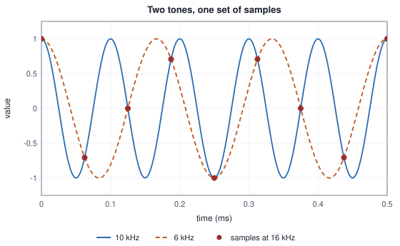
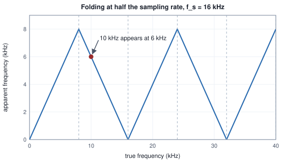

<!-- SPDX-License-Identifier: CC-BY-4.0 -->
<!-- Copyright (c) 2026 Martin Schröder <info@swedishembedded.com> -->

# Sound and Sampling

*How is a sound wave turned into numbers without losing what we hear?*

Someone records a whistle at 10 kHz, high and thin, and uploads the file to a speech recogniser. The file is a WAV at 48 kHz, the recogniser reads 16 kHz, and so something has to convert one to the other. The simplest conversion keeps every third sample, because 48 divided by 16 is 3, and that is what brain's upload path does to such a file. The recogniser then hears a tone at 6 kHz. Not a quieter whistle, not a muffled one: a different note, at a frequency the whistle never had. Here are the first twelve numbers of each.

<!-- worked: sound.alias_samples -->
x(t) = cos(2 pi 10000 t). Column 3: x sampled at 48 kHz, sample 3n kept. Column 4: x sampled at 16 kHz. Column 5: cos(2 pi 6000 t) sampled at 16 kHz.

| n | 48 kHz index 3n | 10 kHz, every third of 48 kHz | 10 kHz at 16 kHz | 6 kHz at 16 kHz |
|---|---:|---:|---:|---:|
| 0 | 0 | 1.0000 | 1.0000 | 1.0000 |
| 1 | 3 | -0.7071 | -0.7071 | -0.7071 |
| 2 | 6 | 0.0000 | 0.0000 | 0.0000 |
| 3 | 9 | 0.7071 | 0.7071 | 0.7071 |
| 4 | 12 | -1.0000 | -1.0000 | -1.0000 |
| 5 | 15 | 0.7071 | 0.7071 | 0.7071 |
| 6 | 18 | 0.0000 | 0.0000 | 0.0000 |
| 7 | 21 | -0.7071 | -0.7071 | -0.7071 |
| 8 | 24 | 1.0000 | 1.0000 | 1.0000 |
| 9 | 27 | -0.7071 | -0.7071 | -0.7071 |
| 10 | 30 | 0.0000 | 0.0000 | 0.0000 |
| 11 | 33 | 0.7071 | 0.7071 | 0.7071 |

Largest difference between columns 3 and 5 over the first 1600 values of n: below 1e-9.
<!-- /worked -->

Column 3 is the 10 kHz tone of the recording with all but every third sample thrown away. Column 4 is the same tone as a recorder running at 16 kHz would have written it. Column 5 is a 6 kHz tone at 16 kHz. They are the same list of numbers. Once the samples are taken, no later step can tell which of the three tones produced them, and the choice that decided what the model would hear was made by a filter that was never applied.

This chapter is about what a list of samples keeps of a sound and what it cannot. It gives the rule that decides which frequencies survive, shows how a signal is rebuilt between its samples when they do, follows the amplitude into integers, opens the file format that carries those integers, and then builds the operation that moves a recording from one rate to another without the accident above. Five ideas from earlier volumes come first; the answers are at the end.

1. (Volume I, [Chapter 14](../v01-mathematics/14-fourier.md), sinusoid.) What is the period, in milliseconds, of a tone of 440 Hz, and how many samples of a recording at 16 kHz does one period cover?
2. (Volume I, [Chapter 14](../v01-mathematics/14-fourier.md), the discrete Fourier transform.) A real signal has $N = 32$ samples. How are $X[32 - k]$ and $X[k]$ related, and how many bins carry independent information?
3. (Volume I, [Chapter 14](../v01-mathematics/14-fourier.md), the convolution theorem.) What does convolving a signal with a kernel do to each of its frequencies?
4. (Volume I, [Chapter 10](../v01-mathematics/10-probability.md), variance.) What is the variance of a number drawn uniformly from $(-a, a)$?
5. (Volume IV, [Chapter 1](../v04-computation/01-number-formats.md), integer-quantized format.) A signed 8-bit code $q$ with scale $\Delta$ stands for $\Delta\,q$. What range of codes is there, and how far can $\Delta\,q$ be from the number it was rounded from?

## Pressure becomes a list of numbers

A sound is a pressure that varies in the air. A microphone turns that variation into a voltage that varies the same way, and the function of time that describes it, $x(t)$, is the **waveform**. Everything in Volume I about sinusoids applies to it: a pure tone is $A\cos(2\pi f t + \varphi)$, any recorded sound is a sum of such tones, and what makes a vowel different from a hiss is which frequencies are present and how strongly.

A computer cannot hold a function of continuous time. It holds the values at equally spaced moments, $x[n] = x(n/f_s)$ for $n = 0, 1, 2, \dots$, where $f_s$ is the **sampling rate**, the number of samples per second, in hertz. At $f_s = 16000$ Hz the samples are $62.5$ microseconds apart. The rest of the chapter is the question of what the list $x[0], x[1], \dots$ keeps. The answer will depend on frequency, so it helps to have the scale in mind. Human hearing is usually quoted as running from about 20 Hz to 20 kHz. Most of what makes speech intelligible lies below about 8 kHz, although the hiss of an "s" carries energy above it. Speech models are, as a convention of the field, fed audio at 16 kHz, and the speech synthesisers and audio codecs that follow in this volume work at 24 kHz; both numbers will matter in the sections on resampling.

Choosing the moments is one discretisation, and the second is writing each value with a finite number of digits. The two are independent, and each has its own limit. The first limit is the subject of the next three sections, the second of the one after.

## Two tones with the same samples

Volume I ended its chapter on the Fourier transform with a caution: in a window of eight samples the cosines that complete 1, 7 and 9 cycles cannot be told apart. Turn the cycles-per-window into hertz and the caution becomes a rule about every sampled signal.

Take a cosine of frequency $f$ and sample it at rate $f_s$: $\cos(2\pi f n/f_s)$ for whole numbers $n$. Add a whole multiple $m f_s$ to the frequency. The angle changes by $2\pi m n$, a whole number of turns, so the samples do not change:

$$
\cos\!\Bigl(\frac{2\pi (f + m f_s)\,n}{f_s}\Bigr) = \cos\!\Bigl(\frac{2\pi f n}{f_s} + 2\pi m n\Bigr) = \cos\!\Bigl(\frac{2\pi f n}{f_s}\Bigr).
$$

Now use that the cosine is even. Replacing $f$ by $f_s - f$ gives $\cos(2\pi n - 2\pi f n/f_s) = \cos(2\pi f n/f_s)$. For a sine the same steps leave a minus sign, because the sine is odd: the samples of $\sin(2\pi (f_s - f) n/f_s)$ are the negative of those of $\sin(2\pi f n/f_s)$. Together these say that the samples cannot distinguish $f$ from $f + m f_s$ for any whole $m$, nor from $-f$, and so every frequency is indistinguishable from exactly one frequency between $0$ and $f_s/2$. The table applies the rule at $f_s = 16000$ Hz. Its last two columns check it against the samples themselves.

<!-- worked: sound.alias_table -->
Sampling rate f_s = 16000 Hz. r = f mod f_s; the apparent frequency is r if r <= f_s / 2 and f_s - r otherwise; the sine at f equals s times the sine at the apparent frequency, with s = -1 in the second case. The last two columns are the largest difference over n = 0 .. 31 between the samples of the tone at f and the predicted samples.

| f (Hz) | r = f mod f_s | apparent frequency (Hz) | s | cosine, largest difference | sine, largest difference |
|---|---:|---:|---:|---:|---:|
| 1000 | 1000 | 1000 | +1 | below 1e-12 | below 1e-12 |
| 4000 | 4000 | 4000 | +1 | below 1e-12 | below 1e-12 |
| 7500 | 7500 | 7500 | +1 | below 1e-12 | below 1e-12 |
| 8000 | 8000 | 8000 | +1 | below 1e-12 | below 1e-12 |
| 8500 | 8500 | 7500 | -1 | below 1e-12 | below 1e-12 |
| 10000 | 10000 | 6000 | -1 | below 1e-12 | below 1e-12 |
| 12000 | 12000 | 4000 | -1 | below 1e-12 | below 1e-12 |
| 15000 | 15000 | 1000 | -1 | below 1e-12 | below 1e-12 |
| 16000 | 0 | 0 | +1 | below 1e-12 | below 1e-12 |
| 17000 | 1000 | 1000 | +1 | below 1e-12 | below 1e-12 |
| 20000 | 4000 | 4000 | +1 | below 1e-12 | below 1e-12 |
| 25000 | 9000 | 7000 | -1 | below 1e-12 | below 1e-12 |
<!-- /worked -->

The opening tone is the row for 10 000 Hz: $r = 10000$ lies above $f_s/2 = 8000$, so the tone appears at $16000 - 10000 = 6000$ Hz, and its sine appears upside down. The rule is a short routine:

```text
function apparent_frequency(f: real, fs: real) -> (real, int):
    require f >= 0 and fs > 0
    r = f - fs * floor(f / fs)
    if r <= fs / 2:
        return (r, 1)
    return (fs - r, -1)
```

It returns the frequency in $[0, f_s/2]$ whose cosine has the same samples as the cosine at `f`, and the sign (1 or -1) by which that frequency's sine must be multiplied to equal the sine at `f`. The picture below is the opening in time: two cosines that disagree everywhere except at the instants where the sampler looks.



This effect is **aliasing**: a tone above half the sampling rate shows up in the samples as a slower tone, its alias. It is the effect that makes a wagon wheel appear to turn backwards in a film, and it is a property of the sampling, not of any recording. Plotted against its true frequency, the apparent frequency of a tone climbs to $f_s/2$, folds back down to zero at $f_s$, climbs again, and so on, which is why the rule is sometimes called folding.



The frequency $f_s/2$ at which the folding turns is the **Nyquist frequency** of the sampling rate. Its own row of the table is odd, and it is worth seeing why, because it decides whether the requirement is "below half the rate" or "up to half the rate". A cosine at exactly $f_s/2$ has samples $\cos(\pi n + \varphi) = \cos\varphi\,(-1)^n$:

<!-- worked: sound.nyquist_edge -->
A cosine at exactly f_s / 2, cos(2 pi (f_s / 2) n / f_s + phi) = cos(pi n + phi), for four phases.

| phi | samples n = 0 .. 5 | cos(phi), the factor of (-1)^n |
|---|---|---|
| 0 | 1.0000 -1.0000 1.0000 -1.0000 1.0000 -1.0000 | 1.0000 |
| pi / 4 | 0.7071 -0.7071 0.7071 -0.7071 0.7071 -0.7071 | 0.7071 |
| pi / 2 | 0.0000 0.0000 0.0000 0.0000 0.0000 0.0000 | 0.0000 |
| 3 pi / 4 | -0.7071 0.7071 -0.7071 0.7071 -0.7071 0.7071 | -0.7071 |
<!-- /worked -->

The samples alternate in sign with an amplitude of $\cos\varphi$: a tone of amplitude 1 and phase $\pi/2$ has samples that are all zero, and a tone of amplitude $\sqrt 2$ and phase $\pi/4$ looks like one of amplitude 1 and phase $0$. Amplitude and phase have merged into one number, so the tone at the Nyquist frequency is not determined by its samples. Every frequency strictly below it is, as the next section shows. And every frequency above it is lost for good, since the 10 kHz tone, the 6 kHz tone and a 22 kHz tone at the same rate produce one list of numbers. So aliasing cannot be repaired after the fact. The only place to prevent it is before the samples are taken, or before samples are discarded: the frequencies that the rate cannot carry have to be removed first. A microphone's converter does that with an analogue filter ahead of the sampler. A program that lowers the rate of a recording has to do it with arithmetic, which is the last third of this chapter.

## What the samples determine

The folding rule says which frequencies the samples confuse. The reverse question is what they pin down: when a signal contains only frequencies below $f_s/2$, do its samples determine it between the samples as well? The answer is the **sampling theorem**: a signal whose frequencies are all below $f_s/2$ is completely determined by its samples at rate $f_s$, and is given back at every time $t$ by

$$
x(t) = \sum_{n=-\infty}^{\infty} x[n]\,\operatorname{sinc}(f_s t - n), \qquad \operatorname{sinc}(u) = \frac{\sin \pi u}{\pi u}, \quad \operatorname{sinc}(0) = 1.
$$

The tools of Volume I prove the case in which the signal repeats within a window of $N$ samples, and the general statement follows by letting the window grow. Take $N$ even and a signal made of tones with whole numbers of cycles in the window, so that its frequencies are $k f_s/N$ for $k = 0, 1, \dots$. Every frequency below $f_s/2$ has $k \le K = N/2 - 1$. The signal is a sum of complex exponentials, the pairs $\pm k$ combining into real cosines:

$$
x(t) = \sum_{k=-K}^{K} c_k\, e^{2\pi \mathrm{i}\, k f_s t/N}.
$$

At the sample times $t = n/f_s$ this is $x[n] = \sum_{k} c_k e^{2\pi \mathrm{i}\, kn/N}$. That is the inverse DFT of Chapter 14 with $c_k = X[k \bmod N]/N$, where a negative $k$ is read as $N + k$ because the exponential repeats with period $N$ in $k$ at whole $n$. The DFT is invertible, so the $N$ samples fix every $c_k$, and the $c_k$ fix $x(t)$ at every $t$, including between the samples. To reconstruct, evaluate the same sum at a non-whole position $u = t f_s$:

$$
x(u) = \frac{1}{N}\sum_{k=-K}^{K} X[k \bmod N]\,e^{2\pi \mathrm{i}\, ku/N}.
$$

The table does it for a signal with tones at 1000, 3000 and 6500 Hz ($k = 2$, $6$ and $13$ of $N = 32$ at $f_s = 16000$ Hz, a window of 32 samples), in the columns 3 and 4: the exact value of $x$ halfway between samples and the value rebuilt from the 32 samples alone. Columns 5 to 7 show what the hypothesis is for. Add a tone at 8500 Hz, which has $k = 17$ and is above the Nyquist frequency. Its samples are those of a 7500 Hz tone, and the same formula, which has no room for $k = 17$, rebuilds the 7500 Hz tone, not the one that was played.

<!-- worked: sound.reconstruction -->
f_s = 16000 Hz, a window of N = 32 samples, x(t) = cos(2 pi 1000 t) + 0.5 cos(2 pi 3000 t + 0.7) + 0.25 sin(2 pi 6500 t), evaluated at t = (n + 0.5) / f_s by the inverse DFT of its 32 samples with the frequencies |k| <= 15 (columns 3 and 4). Columns 5 and 6: the same with an extra 0.5 cos(2 pi 8500 t), which has k = 17 > 16. Column 7: the signal with that tone replaced by 0.5 cos(2 pi 7500 t), the tone it aliases to.

| n | t (ms) | x(t) exact | x(t) from samples | with 8500 Hz, exact | with 8500 Hz, from samples | clean + 7500 Hz tone |
|---|---:|---:|---:|---:|---:|---:|
| 0 | 0.0312 | 1.359038 | 1.359038 | 1.310029 | 1.408046 | 1.408046 |
| 1 | 0.0938 | 0.282345 | 0.282345 | 0.427487 | 0.137203 | 0.137203 |
| 2 | 0.1562 | 0.142161 | 0.142161 | -0.093537 | 0.377860 | 0.377860 |
| 3 | 0.2188 | 0.368301 | 0.368301 | 0.685498 | 0.051105 | 0.051105 |
| 4 | 0.2812 | 0.064715 | 0.064715 | -0.321790 | 0.451220 | 0.451220 |
| 5 | 0.3438 | 0.005459 | 0.005459 | 0.446419 | -0.435502 | -0.435502 |

Largest difference between exact and reconstructed over the 32 half-sample points, clean signal: below 1e-12. Largest difference between the 32 samples of the signal with the 8500 Hz tone and the samples of the signal with the 7500 Hz tone: below 1e-12.
<!-- /worked -->

The reconstruction is exact to rounding for the clean signal and wrong, in the way the folding rule predicts, for the signal that broke the condition. The theorem is a statement about the signal, not about the method: no cleverer reconstruction could have recovered the 8500 Hz tone, because its samples are identical to those of another signal.

Writing $X[k]$ out as the sum of the samples and swapping the order of summation turns the evaluation into a weighted sum of the samples, which is the form the theorem takes:

$$
x(u) = \sum_{n=0}^{N-1} x[n]\, D_N(u - n), \qquad D_N(v) = \frac{1}{N}\sum_{k=-K}^{K} \cos\!\Bigl(\frac{2\pi k v}{N}\Bigr).
$$

Each sample contributes through a weight that depends only on its distance from the point being evaluated. $D_N$ is the sum of cosines of all the allowed frequencies, a "box" of frequencies written as a function of position. As the window grows, it approaches the sinc function of the theorem:

<!-- worked: sound.interpolation_kernel -->
The weight D_N(u) = (1/N) sum over |k| <= N/2 - 1 of cos(2 pi k u / N) that a sample at distance u (in samples) gets in the evaluation between samples, and sin(pi u) / (pi u).

| N | u = 0 | u = 0.25 | u = 0.5 | u = 1.5 | u = 2.5 |
|---|---:|---:|---:|---:|---:|
| 8 | 0.875000 | 0.809034 | 0.628417 | -0.187076 | 0.083522 |
| 16 | 0.937500 | 0.855399 | 0.634573 | -0.206035 | 0.116929 |
| 64 | 0.984375 | 0.889223 | 0.636492 | -0.211823 | 0.126684 |
| 1024 | 0.999023 | 0.899626 | 0.636619 | -0.212205 | 0.127321 |
| sinc(u) | 1.000000 | 0.900316 | 0.636620 | -0.212207 | 0.127324 |
<!-- /worked -->

At $N = 8$ the weight of a sample at its own position is 0.875 rather than 1, because the Nyquist term of the sum is left out; for the signals the theorem is about, whose Nyquist component is zero, that does not matter, and as $N$ grows the weight tends to 1 and the whole row to the sinc. The row at $u = 0.5$ reads 0.628417, 0.634573, 0.636492 and 0.636619 against the limit 0.636620. This kernel, the weight that a distant sample has on the value between two samples, is the object of the rest of the chapter. Every method of changing a sampling rate is a choice of this function.

Two caveats keep the theorem honest. A real sound is not exactly limited in frequency and does not last forever, so it never meets the hypothesis; recording it means filtering out what the rate cannot carry and accepting that the filter has a transition band in which some of the signal is attenuated and some aliased. That is why practical rates sit above twice the highest frequency of interest, not at it. And the theorem says samples are enough if the signal is limited in bandwidth, which is the reason that sampling at 16 kHz is a statement about the content above 8 kHz being thrown away, and that sampling at 24 kHz keeps content up to 12 kHz.

## Counting in steps: pulse-code modulation

The second discretisation writes each sample with a finite number of bits. **Pulse-code modulation** (PCM audio) stores a recording as a sequence of whole-number codes, each the multiple of a fixed step nearest to the waveform at one sample time, at a fixed sampling rate. With $b$ bits per sample the codes are the two's-complement numbers $-2^{b-1}, \dots, 2^{b-1} - 1$. Take the waveform to lie in $[-1, 1]$. The **quantisation step** is $\Delta = 2^{1-b}$, so that a code $q$ stands for $\Delta q$ in the notation of the integer formats of Volume IV, with no zero point. For 16 bits $\Delta = 2^{-15}$, about $3.05 \times 10^{-5}$.

Rounding to the nearest multiple of $\Delta$ makes an error $e$ of at most $\Delta/2$. If the error is spread evenly over $(-\Delta/2, \Delta/2)$, its variance is $\Delta^2/12$ (the variance of a uniform number on $(-a, a)$ is $a^2/3$, here with $a = \Delta/2$). A sine of amplitude $A$ has mean square $A^2/2$, so the ratio of signal power to error power, the signal-to-noise ratio, is

$$
\mathrm{SNR} = \frac{A^2/2}{\Delta^2/12} = \frac{6A^2}{\Delta^2}.
$$

Ratios of this kind span many orders of magnitude, so they are quoted in **decibels**: $10\log_{10}$ of a power ratio, which is $20\log_{10}$ of an amplitude ratio. For a full-scale sine, $A = 1$ and $\Delta = 2^{1-b}$, the formula gives $6 \cdot 2^{2b-2} = 1.5 \cdot 2^{2b}$, which in decibels is $10\log_{10} 1.5 + 2b \cdot 10\log_{10} 2 \approx 1.76 + 6.02\,b$. Each bit buys about 6 dB, a factor of 4 in power, because it halves the step.

The next table measures it, for a sine at 997 Hz sampled at 16 kHz for one second (16 000 samples; the odd frequency keeps the error from repeating every period), and compares it with the formula.

<!-- worked: sound.quantisation_snr -->
x[i] = A sin(2 pi 997 i / 16000), i = 0 .. 15999, rounded to the nearest multiple of Delta = 2^(1 - b) (ties away from zero). SNR = 10 log10(sum x^2 / sum (y - x)^2), sums in index order. Predicted: 10 log10((A^2 / 2) / (Delta^2 / 12)).

| bits b | Delta | amplitude A | measured SNR (dB) | predicted SNR (dB) |
|---|---:|---:|---:|---:|
| 8 | 2^-7 | 0.9 | 49.15 | 49.01 |
| 12 | 2^-11 | 0.9 | 73.14 | 73.09 |
| 16 | 2^-15 | 0.9 | 97.26 | 97.18 |
| 16 | 2^-15 | 0.01 | 58.01 | 58.09 |
| 16 | 2^-15 | 0.0001 | 18.80 | 18.09 |

Full-scale sine (A = 1) predicted by 6.0206 b + 1.7609 dB: 8 bits 49.93, 12 bits 74.01, 16 bits 98.09.
<!-- /worked -->

The first three rows agree with the formula to a fraction of a decibel, and 16 bits give 97.26 dB for an amplitude of 0.9, close to the 98.09 dB of a full-scale sine. The last two rows are the caution. The formula is a statement about a signal that is large compared with the step. At $A = 0.01$, which uses codes up to about $\pm 328$, it is still within 0.1 dB, but the noise is now only 58 dB below the signal; at $A = 0.0001$ the signal spans $\pm 3$ codes, the error is a pattern the signal itself makes and not an even spread, and the measured 18.80 dB departs from the predicted 18.09. A recording with sixteen bits does not give a quiet passage sixteen bits' worth of precision. Storing samples as 32-bit floating-point numbers, as most models are fed, keeps a constant relative precision instead of a constant step, and costs twice the bytes:

<!-- worked: sound.data_rates -->
Bytes of raw PCM = sample rate x channels x bytes per sample (x seconds).

| use | rate (Hz) | channels | bytes per sample | bytes per second | bytes per minute |
|---|---:|---:|---:|---:|---:|
| telephone, 8-bit | 8000 | 1 | 1 | 8000 | 480000 |
| speech models, 16-bit integer | 16000 | 1 | 2 | 32000 | 1920000 |
| speech models, 32-bit float | 16000 | 1 | 4 | 64000 | 3840000 |
| codec models, 16-bit integer | 24000 | 1 | 2 | 48000 | 2880000 |
| compact disc | 44100 | 2 | 2 | 176400 | 10584000 |
| studio, 32-bit float | 48000 | 2 | 4 | 384000 | 23040000 |
<!-- /worked -->

Raw audio is large by the standards of text and small by those of images: a minute of speech-model input is under four megabytes even as 32-bit floats, and the cost of a model that reads it is set by what follows, not by the bytes of the recording.

## Bytes in a file

PCM has to be put in a file, and the common container is the WAV file, a RIFF file: a sequence of chunks, each an identifier of four letters, a 32-bit length and a body, with every multi-byte number stored least significant byte first. A minimal file has a `fmt ` chunk, which says how to read the samples, and a `data` chunk, which holds them. For the PCM that this chapter has in mind the `fmt ` body is 16 bytes: a format tag (1 for integer PCM, 3 for floating point), the number of channels, the sampling rate, the byte rate, the block align and the bits per sample.

Samples of several channels are stored as frames. A **frame** is one sample of every channel at one instant, and the frames follow one another, so a stereo file reads left, right, left, right. Volume VII's discussion of pixels laid out channel by channel or channel by pixel is the same choice here: the file is interleaved, and a program that wants to process each channel separately splits it into planes. Here is a whole file, with two channels, three frames and a rate of 8000 Hz; the samples are written with the rule explained below.

<!-- worked: sound.wav_layout -->
Two channels, three frames, 8000 Hz, written with the write rule above. The file is 56 bytes.

| offset | bytes | hex (little-endian) | field | value |
|---:|---:|---|---|---|
| 0 | 4 | 52 49 46 46 | chunk id | RIFF |
| 4 | 4 | 30 00 00 00 | size of everything after this field | 36 + 12 = 48 |
| 8 | 4 | 57 41 56 45 | form type | WAVE |
| 12 | 4 | 66 6d 74 20 | chunk id | 'fmt ' |
| 16 | 4 | 10 00 00 00 | size of the fmt chunk | 16 |
| 20 | 2 | 01 00 | format tag (1 = integer PCM, 3 = float) | 1 |
| 22 | 2 | 02 00 | channels | 2 |
| 24 | 4 | 40 1f 00 00 | sample rate (Hz) | 8000 |
| 28 | 4 | 00 7d 00 00 | byte rate = rate x block align | 32000 |
| 32 | 2 | 04 00 | block align = channels x bytes per sample | 4 |
| 34 | 2 | 10 00 | bits per sample | 16 |
| 36 | 4 | 64 61 74 61 | chunk id | 'data' |
| 40 | 4 | 0c 00 00 00 | size of the data | 12 |

| frame | left | right | left code | right code | 4 bytes |
|---:|---:|---:|---:|---:|---|
| 0 | 1 | -1 | 32767 | -32767 | ff 7f 01 80 |
| 1 | -1 | 1 | -32767 | 32767 | 01 80 ff 7f |
| 2 | 0 | 0 | 0 | 0 | 00 00 00 00 |

Read back as planes: left [0.999969, -0.999969, 0.0], right [-0.999969, 0.999969, 0.0]; the mean of the two channels is [0.0, 0.0, 0.0].
<!-- /worked -->

The header is 44 bytes and each frame four. The size at offset 4 counts everything after itself, $36 + 12 = 48$, and the byte rate is the rate times the block align. A reader that finds a different layout is expected to refuse it or to skip chunks it does not know (a file may carry metadata chunks between the two it needs, and a chunk of odd length is followed by a pad byte). The line under the two tables shows the downmix to one channel that speech models want: the mean of the channels, frame by frame, here a signal of zeros because the two channels are opposite.

Which integers mean which amplitudes is a convention, and the formats differ in it:

<!-- worked: sound.sample_formats -->
Decoded values; the integer formats are converted to 32-bit float before the division (the 32-bit division by 2^31 is exact, the conversion of the integer is rounded to nearest, ties to even).

| format | bytes (little-endian) | code | decoded |
|---|---|---:|---:|
| 8-bit unsigned | 00 | 0 | -1.000000000 |
| 8-bit unsigned | 80 | 128 | 0.000000000 |
| 8-bit unsigned | ff | 255 | 0.992187500 |
| 16-bit signed | 00 80 | -32768 | -1.000000000 |
| 16-bit signed | 00 00 | 0 | 0.000000000 |
| 16-bit signed | ff 7f | 32767 | 0.999969482 |
| 24-bit signed | 00 00 80 | -8388608 | -1.000000000 |
| 24-bit signed | 01 00 00 | 1 | 0.000000119 |
| 24-bit signed | ff ff 7f | 8388607 | 0.999999881 |
| 32-bit signed | 00 00 00 80 | -2147483648 | -1.000000000 |
| 32-bit signed | ff ff ff 7f | 2147483647 | 1.000000000 |
| 32-bit float | 00 00 00 3f | - | 0.500000000 |
| 32-bit float | 00 00 80 bf | - | -1.000000000 |

Sign extension of a 24-bit code v read as an unsigned number: v - 2^24 if v >= 2^23 else v. 0x7FFFFF gives 8388607; 0x800000 gives -8388608; 0xFFFFFF gives -1.
<!-- /worked -->

The 8-bit format is unsigned with the zero at 128, unlike the others, which are two's complement; the 24-bit format has no native integer type and is sign-extended by hand; and a 32-bit integer is too wide for the 24-bit significand of a 32-bit float, so the largest code, 2 147 483 647, is rounded to $2^{31}$ on conversion and reads back as exactly 1.0.

There is one more convention, and it costs a little. Converting a float in $[-1, 1]$ to a 16-bit code by multiplying by 32768 would send $+1.0$ to 32768, which does not fit; multiplying by 32767 keeps it in range but makes the writer's scale differ from the reader's if the reader divides by 32768, which is the natural inverse of the two's-complement code. A common choice is exactly that pair, write with 32767, read with 32768, and the round trip shows its cost:

<!-- worked: sound.write_read_convention -->
Write: code = round(clamp(x, -1, 1) * 32767), ties away from zero. Read: value = code / 32768. The last column is the error of the round trip in units of 1/32768 (one least significant bit), measured from the clamped input.

| x | code | read back | error (LSB) |
|---|---:|---:|---:|
| 0 | 0 | 0.0000000000 | +0.0000 |
| 0.5 | 16384 | 0.5000000000 | +0.0000 |
| -0.5 | -16384 | -0.5000000000 | +0.0000 |
| 0.3 | 9830 | 0.2999877930 | -0.4000 |
| 1e-05 | 0 | 0.0000000000 | -0.3277 |
| 1 | 32767 | 0.9999694824 | -1.0000 |
| -1 | -32767 | -0.9999694824 | +1.0000 |
| 1.5 | 32767 | 0.9999694824 | -1.0000 |

Reading the extreme codes: -32768 gives -1.000000000000, 32767 gives 0.999969482422. The largest possible round-trip error, at x = 1, is 1 LSB; for any |x| <= 1 it is at most (0.5 + |x|) LSB.
<!-- /worked -->

The write never produces $-32768$, the reader would turn it into exactly $-1$, and a full-scale sample comes back one least significant bit short. The error is at most $(0.5 + |x|)$ bits: half a step for the rounding and $|x|$ for the scale mismatch. It is far below anything audible, and it is the reason a test that writes a WAV and reads it back must allow about two least significant bits and cannot assert equality to rounding.

## Changing the rate

A WAV from a phone is at 44.1 or 48 kHz, a speech model reads 16 kHz, and the synthesis codec writes at 24 kHz. Moving between rates is **audio resampling**: computing, from the samples of a signal at one rate, the samples of the same signal at another.

The sampling theorem says how. The signal between the samples is $\sum_i x[i]\operatorname{sinc}(s - i)$ at a position $s$ measured in input samples. The sample $j$ of the output belongs to the time $j/f_{\mathrm{new}}$, which is the input position $s_j = j\,f_{\mathrm{old}}/f_{\mathrm{new}}$. So the output is

$$
y[j] = \sum_i x[i]\,h(s_j - i),
$$

with $h$ the sinc, when the new rate is the higher. When it is lower, the sum would alias, because the input holds frequencies the new rate cannot carry, so those must be removed first. Removing them is a convolution with a kernel whose DFT is 1 below the new Nyquist frequency and 0 above it (the convolution theorem again). The kernel $D_N$ of the last section was the inverse transform of a box of frequencies, and a box of a fraction $c$ of the width is the same sum with fewer terms: its limit is $c\,\operatorname{sinc}(c\,v)$, the sinc made wider by $1/c$ and lower by $c$ so that a constant signal stays constant. The cutoff fraction is $c = \min(1, f_{\mathrm{new}}/f_{\mathrm{old}})$, and the whole operation, filtering and evaluating at the new times, is the one sum with $h(d) = c\,\operatorname{sinc}(c\,d)$.

Three things stand between that formula and a program. The sinc never ends, so the sum must be cut. The cut kernel must be one whose error in the frequency domain is under control. And the offsets $s_j - i$ must be computed without the rounding that would make the ends of the sum differ from one implementation to another.

The third has a clean answer when the rates have a common factor. Reduce the ratio, $f_{\mathrm{new}}/f_{\mathrm{old}} = \mathrm{up}/\mathrm{down}$ in lowest terms (for 16 kHz and 24 kHz, $\mathrm{up}/\mathrm{down}$ is $3/2$ or $2/3$). Then the offset is $s_j - i = (j\,\mathrm{down} - i\,\mathrm{up})/\mathrm{up}$, a whole number $m$ over $\mathrm{up}$, and only the whole numbers $m$ ever occur. The weights can be computed from $m$ alone, there are few distinct ones, and a program can loop over whole numbers. Equivalently: put $\mathrm{up} - 1$ zeros between input samples, filter, and keep every $\mathrm{down}$-th result; the zeros contribute nothing to the sum, and skipping them is what the loop does, which is called a polyphase implementation.

For the cut and the taper, the plainest choice is to keep the sinc for $|d| \le \mathrm{hw}$ and drop the rest. It is a poor one, as the next table shows. Instead the kernel is multiplied by a smooth taper that falls to nearly zero at the ends. The one used in brain's accurate resampler is the Kaiser taper

$$
w(u) = \frac{I_0\bigl(\beta\sqrt{1 - u^2}\bigr)}{I_0(\beta)}, \qquad |u| \le 1,
$$

where $I_0(x) = \sum_{k \ge 0} \bigl((x/2)^k/k!\bigr)^2$ is the modified Bessel function of order zero, summed until a term falls below $10^{-16}$ of the total, and $u = d/\mathrm{hw}$. The parameter $\beta$ is chosen from the attenuation wanted in the stopband; for more than 50 dB the fit published by Kaiser is $\beta = 0.1102\,(a - 8.7)$ with $a$ the attenuation in decibels, and brain asks for $a = 80$, so $\beta = 7.8573$. The half-width is $32$ zero crossings of the sinc at the intermediate rate, $\mathrm{reach} = 32\max(\mathrm{up}, \mathrm{down})$ in units of $1/\mathrm{up}$ of an input sample. The three resamplers of the chapter then differ only in their weights:

```text
function sinc(u: real) -> real:
    if u == 0:
        return 1.0
    return sin(pi * u) / (pi * u)

function bessel_i0(x: real) -> real:
    total = 1.0
    term = 1.0
    k = 1
    while term > total * 1.0e-16:
        term = term * (x / (2 * k))^2
        total = total + term
        k = k + 1
    return total

function triangle_weight(m: int, up: int, down: int) -> real:
    return max(1.0 - abs(m) / up, 0.0)

function kaiser_weight(m: int, up: int, down: int) -> real:
    beta = 0.1102 * (80.0 - 8.7)
    reach = 32 * max(up, down)
    cut = min(1.0, up / down)
    u = m / reach
    return cut * sinc(cut * m / up) * bessel_i0(beta * sqrt(1 - u^2)) / bessel_i0(beta)

function cos2_weight(m: int, up: int, down: int) -> real:
    cut = 0.99 * min(1.0, up / down)
    u = cut * m / up
    if abs(u) >= 6:
        return 0.0
    return cut * sinc(u) * cos(pi * u / 12)^2

function resample(x: array<real>[n], up: int, down: int,
                  weight: function(int, int, int) -> real, reach: int) -> array<real>:
    require n >= 1 and up >= 1 and down >= 1 and reach >= 1
    out_len = (n * up + down - 1) // down
    y = zeros(real, [out_len])
    for j in 0 .. out_len:
        lo = max((j * down - reach + up - 1) // up, 0)
        hi = min((j * down + reach) // up, n - 1)
        acc = 0.0
        for i in lo ..= hi:
            acc = acc + weight(j * down - i * up, up, down) * x[i]
        y[j] = acc
    return y
```

The `resample` call takes `reach = up` for the triangle (linear interpolation, with no cutoff at all, whatever the ratio), `reach = 32 * max(up, down)` for the Kaiser weights (the design of brain's accurate resampler, 193 taps at the intermediate rate for the ratios in this chapter) and `reach = ceil(6 * up / cut)` for the cos² weights, with `cut` as inside that function (the design of the resampler that reproduces a widely used library, with a taper of cos² over six zero crossings and a cutoff at 0.99 of the new Nyquist frequency; its name in the code, `sinc_hann`, is for that cos² taper, a Hann window, which the next chapter meets as a window function). Input samples outside the signal count as zero, and `x[i]` is read only for `0 <= i < n`. A linear interpolator in the usual form repeats the last input sample beyond the end where this loop pads with zeros, and rounds its output length where this loop takes the ceiling; the results agree except in the last output or two. Accumulation is left to right in increasing `i`. The designs for the two conversions used below are:

<!-- worked: sound.design_table -->
Kaiser-tapered sinc: cutoff c = min(1, up/down), beta = 0.1102 (80 - 8.7), 2 x 32 x max(up, down) + 1 taps, half-width hw = 32 max(up, down) / up input samples. Cos^2-tapered sinc: cutoff c = 0.99 x min(1, new/old), half-width 6 / c input samples.

| conversion | up : down | Kaiser c | beta | filter taps | hw (samples) | cos^2 c | half-width 6 / c |
|---|---|---:|---:|---:|---:|---:|---:|
| 24000 to 16000 | 2 : 3 | 0.6667 | 7.8573 | 193 | 48 | 0.6600 | 9.091 |
| 16000 to 24000 | 3 : 2 | 1.0000 | 7.8573 | 193 | 32 | 0.9900 | 6.061 |
<!-- /worked -->

Going from 24 kHz to 16 kHz needs a cutoff of $2/3$ of the input Nyquist frequency, 8 kHz, and a kernel 48 input samples wide on each side; going from 16 kHz to 24 kHz needs no cutoff at all ($c = 1$), since nothing the input holds is lost, and the kernel is 32 samples wide. What the filter does when the new rate is higher is easier to see by turning the picture around. Putting zeros between the samples to raise the rate leaves copies of the spectrum at multiples of the old rate (a 3 kHz tone at 16 kHz comes with copies at $16 \pm 3$ kHz and so on), and the filter's job is to remove the copies. A cruder interpolator leaves them behind.

## What each resampler lets through

Two tests make the difference concrete, both with whole numbers of cycles so that each amplitude can be read from a DFT at a single frequency. First, 24 kHz to 16 kHz with a tone at 3 kHz, which should survive, and a tone at 10 kHz, which the output cannot hold and which must therefore disappear and not fold to 6 kHz.

<!-- worked: sound.down_tones -->
Input at 24 kHz, 4800 samples: cos(2 pi 3000 i / 24000) + cos(2 pi 10000 i / 24000), resampled to 16 kHz. Amplitude 2 |sum y e^{-2 pi i f k / 16000}| / 2400 over output samples 400 .. 2799 (2400 samples, a whole number of cycles of both frequencies); 10 kHz folds to 16 - 10 = 6 kHz.

| method | output samples | amplitude at 3 kHz | amplitude at 6 kHz |
|---|---:|---:|---:|
| linear interpolation | 3200 | 0.9619 | 0.629 |
| Kaiser-tapered sinc | 3200 | 1.0000 | 7.12e-06 |
| cos^2-tapered sinc | 3200 | 1.0005 | 0.00542 |
<!-- /worked -->

Linear interpolation keeps the 3 kHz tone at 0.9619, a loss of about 0.3 dB, and lets the 10 kHz tone through as a 6 kHz tone with amplitude 0.629. The Kaiser design keeps the wanted tone at 1.0000 and reduces the unwanted one to $7.12 \times 10^{-6}$, which is about 103 dB below it. The cos² design is shorter and reaches 0.00542, about 45 dB below. Going up, 16 kHz to 24 kHz, the 3 kHz tone should stay and nothing should appear at the places where the copies fold to, 5 kHz and 11 kHz:

<!-- worked: sound.up_tones -->
Input at 16 kHz, 3200 samples: cos(2 pi 3000 i / 16000), resampled to 24 kHz. Amplitudes as in the previous table, over output samples 384 .. 4415 (4032 samples). The copies of the 3 kHz tone around 16 kHz, at 13 and 19 kHz, fold to 24 - 13 = 11 kHz and 24 - 19 = 5 kHz.

| method | output samples | amplitude at 3 kHz | amplitude at 5 kHz | amplitude at 11 kHz |
|---|---:|---:|---:|---:|
| linear interpolation | 4800 | 0.9011 | 0.0382 | 0.0607 |
| Kaiser-tapered sinc | 4800 | 1.0000 | 5.76e-06 | 1.05e-05 |
| cos^2-tapered sinc | 4800 | 1.0005 | 4.47e-05 | 0.000672 |
<!-- /worked -->

Linear interpolation puts a 3.8 per cent and a 6.1 per cent tone where there was silence, at 5 kHz and 11 kHz, and attenuates the wanted tone to 0.9011. The Kaiser design leaves $5.76 \times 10^{-6}$ and $1.05 \times 10^{-5}$.

One tone is not a curve. The gain of each resampler as a function of the tone's frequency (24 kHz in, 16 kHz out, measured at the frequency the tone ends up at) shows the filter itself:

<!-- worked: sound.gain_table -->
A cosine at f (24 kHz in, 4800 samples) resampled to 16 kHz; gain = 20 log10 of the amplitude measured at the apparent frequency (2400 output samples from 400, as above), floored at -120 dB.

| f (Hz) | apparent (Hz) | linear (dB) | Kaiser (dB) | cos^2 (dB) |
|---|---:|---:|---:|---:|
| 1000 | 1000 | 0.0 | 0.0 | 0.0 |
| 4000 | 4000 | 0.0 | 0.0 | 0.0 |
| 7000 | 7000 | -1.9 | 0.0 | -1.8 |
| 7500 | 7500 | -2.2 | -0.1 | -3.7 |
| 8500 | 7500 | -2.8 | -43.1 | -10.8 |
| 9000 | 7000 | -3.2 | -83.6 | -16.8 |
| 10000 | 6000 | -4.0 | -102.9 | -45.3 |
| 11500 | 4500 | -5.5 | -97.9 | -61.5 |
<!-- /worked -->


The Kaiser design is flat up to the cutoff, falls through a transition band between about 7.5 and 9 kHz, and from there on stays below the 80 dB it was designed for. Linear interpolation is not a filter that happens to be weak; it has the wrong shape, which droops in the band it should keep ($-1.9$ dB at 7 kHz) and barely falls in the band it should remove ($-4.0$ dB at 10 kHz). The taper matters as much as the cutoff. The same support and cutoff with no taper at all:

<!-- worked: sound.taper_table -->
The same support (193 taps at the intermediate rate) and cutoff, with and without the Kaiser taper; a tone at f, 24 kHz in, 16 kHz out, gain in dB measured at the apparent frequency as in the table above.

| f (Hz) | apparent (Hz) | no taper (dB) | Kaiser taper (dB) |
|---|---:|---:|---:|
| 3000 | 3000 | -0.1 | 0.0 |
| 7500 | 7500 | -0.4 | -0.1 |
| 8500 | 7500 | -26.4 | -43.1 |
| 9000 | 7000 | -32.3 | -83.6 |
| 10000 | 6000 | -38.5 | -102.9 |
| 11500 | 4500 | -43.6 | -97.9 |
<!-- /worked -->

An abrupt cut of the sinc leaves the response ripple that more taps do not remove (at 10 kHz it is $-38.5$ dB, against $-102.9$ dB with the taper), whereas the taper spends some of the transition width to buy depth.

The price of the accuracy is arithmetic. Each output reaches the 193 taps of the filter at its phase, which is $193/\mathrm{up}$ of them, so a second of audio needs about $8000 \times 193$ multiply-adds whichever way the conversion goes, because $8000$ is the common factor of the two rates:

<!-- worked: sound.work_counts -->
One second of input. Multiply-adds with a stored weight: linear interpolation counts the nonzero weights, the Kaiser design counts the filter taps n = 0 .. 192 that an output reaches (edges of the second included), the cos^2 design the inputs with |c d| < 6. The last column is the count of a dense convolution of the zero-stuffed signal at up x input rate with the 193 taps, before discarding all but every down-th output.

| conversion | outputs | linear per output | linear total | Kaiser per output | Kaiser total | cos^2 per output | cos^2 total | zero-stuffed, dense |
|---|---:|---:|---:|---:|---:|---:|---:|---:|
| 24000 to 16000 | 16000 | 1.500 | 24000 | 96.40 | 1542448 | 18.50 | 295943 | 9264000 |
| 16000 to 24000 | 24000 | 1.667 | 40000 | 64.27 | 1542448 | 12.33 | 295943 | 9264000 |
<!-- /worked -->

That is 1 542 448 multiply-adds, or about 3.1 MFLOP, per second of audio for the Kaiser design (the count falls short of $8000 \times 193 = 1\,544\,000$ by the taps that would reach outside the second), against 24 000 or 40 000 for linear interpolation and 295 943 for the shorter cos² design, and against 9 264 000 for the filter run as written, on the zero-stuffed signal at the intermediate rate. Skipping the zeros saves a factor $\mathrm{up}$ and skipping the outputs that would be discarded a factor $\mathrm{down}$, together $\mathrm{up} \cdot \mathrm{down} = 6$ over the dense computation: $9\,264\,000 / 6 = 1\,544\,000$. The accurate design costs between 39 and 64 times what linear interpolation does, and the figures are counts of work, not measured times.

## What brain's audio crate does with a recording

Everything above lives in `crates/audio`, and its history follows the order of this chapter.

The crate began in commit `538615b1d` (28 June 2026), the foundation for the speech synthesis stack: a WAV reader and writer in `crates/audio/src/wav.rs`, the mel front end that the next chapter takes up, and a single resampler, `resample_linear` in `crates/audio/src/lib.rs`. The reader accepts format tag 1 at 8, 16, 24 and 32 bits and tag 3 at 32 bits and refuses anything else, including the extensible format tag some tools write for multichannel files. It writes 16 bits only, by the rule of the last section, which a test that writes and reads back takes into account (`crates/audio/tests/it/audio_io.rs` allows about two least significant bits for "the 32767/32768 encode/decode asymmetry"). Commit `a4ca0b933` (5 November 2026) split reading in two: `parse_planar` returns one plane per channel, because a video's soundtrack must stay stereo, and `parse` is its mean over the channels, the downmix of the table above. A WAV header is also input that a client wrote. Commit `c68efb167` (6 November 2026), part of a pass that gave every served number a ceiling, made `checked_rate` hold a declared sampling rate to 1 kHz up to 384 kHz and a channel count to at most 32, and refuse a truncated `fmt ` chunk. The reason is in the resampler: its output length is the input length times the ratio of the two rates, so a file that declares one sample per second asks `resample_linear` for 16 000 outputs per input sample. A mebibyte of 16-bit samples, 524 288 of them, would ask for $524288 \times 16000 \approx 8.4 \times 10^9$ outputs, 33.5 GB of 32-bit floats, and a header claiming zero would make the ratio infinite. The test `a_hostile_header_is_refused` in `wav.rs` writes the bad rates 0, 1, 999, 384 001 and the largest 32-bit number into a good file and requires an error each time.

The second part of the story is the resampler. Commit `e532b63da` (21 August 2026) records what its author found: `resample_linear` has no anti-aliasing filter, so it cannot reproduce a reference for a rate change like 24 kHz to 16 kHz, which the speech synthesiser's tokenizer and speaker front ends both needed. The commit added `audio::resample::rational`, the Kaiser design of this chapter, with its own Bessel series and its own derivation of $\beta$ from an attenuation, and gated it by three tests that are the three facts of the tables: a tone below the new cutoff survives, a tone above the new half-rate is suppressed and not folded down ("the exact case `resample_linear` structurally cannot pass", in the commit message's words), and a rise then a fall by the inverse ratio returns the signal away from the edges. The tables agree: the 10 kHz tone through the linear function arrives as a 6 kHz tone at amplitude 0.629 and through `rational` at $7 \times 10^{-6}$. Commit `7d380d66d` (5 November 2026) added `sinc_hann`, the cos² design, which reproduces a widely used library's `Resample` transform to float rounding including its output length rule, for the reference preprocessing of models that were trained with it; `crates/audio/tests/it/resample_torchaudio.rs` checks three ratios (441:320, a doubling and 3:2) against committed constants with a largest absolute error below $2 \times 10^{-6}$. The point is that the same sum with a different kernel is a different function: the three do not give the same samples, and the one to use is the one the model was trained on, the lesson of Volume VII's chapter on images, here for a different kernel.

Which functions the crate's callers choose is itself informative. The speech synthesiser's pipeline resamples reference audio with `rational` (`crates/cosyvoice/src/pipeline.rs`), and the video model's audio front end calls `sinc_hann` (`crates/ltxv/src/audio.rs`). The upload path for speech recognition, `audio::decode::decode_speech` in `crates/audio/src/decode.rs` (introduced in commit `20455527b`, 1 November 2026, with the transcription endpoint), sniffs the container from its first bytes (`RIFF` and `WAVE`, `OggS`, or the four bytes of a WebM file), never from what a client claims, and takes three routes. A WAV is parsed, downmixed and resampled to 16 kHz by `resample_linear`; for 48 kHz that is the every-third-sample of this chapter's opening, exact because $i/(16000/48000)$ is $3i$ for every $i$, so brain's recogniser hears a 10 kHz whistle as 6 kHz and any speech energy between 8 and 24 kHz as extra energy below 8. An Ogg or WebM recording carries Opus audio, which a codec library decodes directly at 16 kHz inside its own decoder, so nothing is resampled there; it is bounded packet by packet (an Opus packet holds at most 5760 samples at 48 kHz), the stream's pre-skip, counted at 48 kHz, is dropped, and the last page's granule position says where the recording really ends, so the test with 50 packets of 960 samples at 48 kHz each and a pre-skip of 312 expects exactly $(50 \cdot 960 - 312)/3 = 15896$ samples. The test for the WAV route decodes a 440 Hz tone at 48 kHz and checks its frequency: a tone far below 8 kHz, which is why the test passes and could not have shown the effect. The crate's own documentation says as much (`asr_caps.rs`: "any source rate is linearly resampled to 16 kHz"), and the accurate function sits one module away.

## Check your understanding

1. **Find the error.** "I recorded at 16 kHz, so my file holds everything up to 16 kHz." Correct the claim and say what happens to a 12 kHz tone in the room.
2. **Predict.** A recording at 44.1 kHz contains a 25 kHz tone. At what frequency does it appear, and with which sign does a sine at 25 kHz appear relative to the sine at that frequency?
3. **Explain.** Why can the 10 kHz, the 6 kHz and the 22 kHz tones of this chapter not be told apart after sampling at 16 kHz, and why is it no help to sample them more precisely, with more bits?
4. **Find the error.** "Linear interpolation averages neighbouring samples, which is a low-pass filter, so it is safe for lowering a sampling rate." Use the tables to say what is true in it and what is not.
5. **Predict.** A 16-bit recording of speech peaks at 0.001 of full scale. What is its SNR from quantisation, and how does it change with a recording gain of 40 dB?
6. **Explain.** Why do the weights of a resampler between 16 kHz and 24 kHz take only a few hundred different values, however long the recording, and what does that buy?
7. **Find the error.** "A tone at exactly half the sampling rate is recorded faithfully, since it has two samples per period."

## Summary

A sound is a waveform, a function of time; sampling keeps its value at moments $1/f_s$ apart. Sampling cannot tell a tone from any tone that differs by a whole multiple of $f_s$ or by reflection, so every frequency appears at one in $[0, f_s/2]$, and a tone above the Nyquist frequency becomes an alias that nothing later can undo. For a signal limited to frequencies strictly below $f_s/2$ the samples fix the signal everywhere, through a sum of the samples weighted by a sinc, which was shown here for a signal that repeats in a window by the inverse DFT evaluated between the samples. PCM writes each sample as an integer, adds an error of variance $\Delta^2/12$ that buys 6.02 dB per bit for a loud signal and fails to be uniform for a quiet one, and is stored in files with conventions (the zero of 8-bit data, the sign extension of 24-bit data, the 32767 against 32768 of a common 16-bit pair) that a program must follow exactly. Changing the rate evaluates the band-limited signal at new times after removing what the new rate cannot carry; that is one sum for every method, with a triangle for linear interpolation, a sinc tapered by a Kaiser function for the accurate resampler and a cos² taper for the one that matches a reference library, at a cost counted in multiply-adds, and the accurate ones are the only ones that leave nothing at the places where a folded tone would be.

Everything so far treats a recording as one long list of samples whose frequencies are the same throughout. Speech and music are not like that: the frequencies change every few hundredths of a second. The next chapter cuts the signal into short windows, takes the Fourier transform of each, and arranges the results as a picture in which time runs one way and frequency the other, scaled the way the ear hears.

## References

- C. E. Shannon, *Communication in the presence of noise*, 1949. The sampling theorem in its general form.
- A. V. Oppenheim and R. W. Schafer, *Discrete-Time Signal Processing*, 1989. The Kaiser window and the empirical formula for $\beta$ from the stopband attenuation, in the form brain's source cites.

## Exercises

1. **[Calculate]** Give the apparent frequency and the sign of the sine for tones of 3000, 9000, 13 000, 21 000 and 30 000 Hz sampled at 12 000 Hz, and check one of them against the samples at $n = 0, 1, 2, 3$.
2. **[Calculate]** A signal is sampled at 44 100 Hz. Which tones between 22 050 and 66 150 Hz fold onto 1000 Hz, and onto 20 000 Hz?
3. **[Calculate]** How many bits does a full-scale sine need for a quantisation SNR of at least 120 dB, and what is $\Delta$ for that many bits? What is the SNR of a 24-bit recording whose peak is 0.01 of full scale?
4. **[Calculate]** Write by hand the 48 bytes of the WAV file of one channel, two samples, 16 000 Hz, with the samples 0.5 and -0.25, using the write rule of the chapter ($\mathrm{round}(32767 x)$, ties away from zero), and give the value each sample reads back as.
5. **[Calculate]** For a conversion from 16 kHz to 24 kHz, list the input positions $s_j$ of outputs $j = 0, \dots, 5$ and the weights of linear interpolation at each. For the same outputs list the whole numbers $m = j\,\mathrm{down} - i\,\mathrm{up}$ that the Kaiser design uses for input $i = 4$.
6. **[Calculate]** Count the multiply-adds per second of audio of the Kaiser design for 44 100 Hz to 16 000 Hz: reduce the ratio, give the filter length and the taps per output, and compare with 48 000 Hz to 16 000 Hz.
7. **[Implement]** Reproduce `sound.alias_samples`, `sound.alias_table` and `sound.nyquist_edge` with your own folding routine.
8. **[Implement]** Reproduce `sound.reconstruction` and `sound.interpolation_kernel`: the inverse DFT of 32 samples evaluated at half-sample positions, including the signal that contains the 8500 Hz tone, and the kernel $D_N$ for four window lengths.
9. **[Implement]** Reproduce `sound.quantisation_snr`, `sound.write_read_convention`, `sound.sample_formats` and `sound.wav_layout`: a quantiser with the stated tie rule, the 32767 and 32768 pair, the sample decoders and the bytes of the WAV file.
10. **[Implement]** Reproduce `sound.design_table`, `sound.down_tones` and `sound.up_tones` with `resample`, the three weight functions and the amplitude measurement of the worked module, and then `sound.taper_table` by dropping the Kaiser factor.
11. **[Investigate]** Run the Kaiser design with 16 and with 64 zero crossings on each side instead of 32, and measure the gain at 7.5, 8.5, 9 and 10 kHz for 24 kHz to 16 kHz. How does the width of the transition band change with the filter length, and what does it cost in multiply-adds?
12. **[Investigate]** Resample a 1200 Hz tone from 16 kHz to 24 kHz and back to 16 kHz with linear interpolation and with the Kaiser design. How far is the result from the original away from the ends, and what does that say about using a round trip as a test of a resampler?

## Key terms

- **waveform**: the pressure of a sound, or the voltage of a microphone that follows it, written as a function of time. <!-- concept: waveform -->
- **sampling theorem**: a signal whose frequencies are all below half the sampling rate is completely determined by its samples, and is rebuilt between them as the sum of the samples weighted by a sinc. <!-- concept: sampling-theorem -->
- **aliasing**: the confusion, after sampling, of a tone above half the sampling rate with a slower one, because the two have the same samples. <!-- concept: aliasing -->
- **PCM audio**: pulse-code modulation, a recording stored as integer codes, each the nearest multiple of a fixed step to the waveform at one of equally spaced moments. <!-- concept: pcm-audio -->
- **audio resampling**: computing the samples of a recording at a new rate, by removing the frequencies the new rate cannot carry and evaluating the band-limited signal at the new sample times as a weighted sum of the old samples. <!-- concept: resampling-audio -->

## Answers

**Recall questions.**

1. The period is $1/440 \approx 2.273$ ms, and 16 000 / 440 $\approx 36.36$ samples cover one.
2. $X[32 - k] = \overline{X[k]}$, the complex conjugate; the bins $0, \dots, 16$ carry the information, 17 complex numbers (bins 0 and 16 are real).
3. It multiplies the DFT of each frequency by the DFT of the kernel at that frequency, that is, scales its amplitude and shifts its phase by one complex number per frequency.
4. $\int_{-a}^{a} e^2 \,\mathrm{d}e/(2a) = a^2/3$.
5. The codes are $-128, \dots, 127$ (two's complement), and a number inside the range is within $\Delta/2$ of its rounded value.

**Check your understanding.**

1. A rate of 16 kHz holds frequencies up to 8 kHz only. A 12 kHz tone in the room is converted to $16 - 12 = 4$ kHz, with a reversed sine, unless a filter removed it before the sampling.
2. $25000 - 44100 = -19100$, so the tone appears at 19 100 Hz; since $r = 25000 > 22050$ the sign is $-1$.
3. All three differ by a whole multiple of 16 kHz or by a reflection: $10 + 6 = 16$ and $22 - 16 = 6$. They produce identical lists of numbers, so no property of the list distinguishes them, and more bits only describe the same list more precisely.
4. It is true that it averages neighbouring samples for the odd outputs (for 24 to 16 kHz), and false that this removes what the new rate cannot carry: the 10 kHz tone passes with amplitude 0.629, about $-4$ dB, whereas the Kaiser design removes it to about $-103$ dB; the response droops in the passband too ($-1.9$ dB at 7 kHz).
5. $A/\Delta = 0.001 \cdot 32768 = 32.768$, so $\mathrm{SNR} = 10\log_{10}(6 \cdot 32.768^2) = 10\log_{10} 6442 \approx 38.1$ dB. A gain of 40 dB is a factor 100 in amplitude and so adds 40 dB (if the gain is applied before quantisation), giving about 78 dB.
6. The offset between an output and an input is $m/\mathrm{up}$ for a whole $m$ with $|m| \le \mathrm{reach}$, so at most $2\,\mathrm{reach} + 1$ different offsets, 193 for these designs, however long the recording; the weights are computed once and a loop over whole numbers replaces the computation of sinc and Bessel functions per tap.
7. The two samples per period are those of $\cos\varphi\,(-1)^n$: amplitude and phase are not determined (a tone with phase $\pi/2$ is invisible), so the requirement is a frequency strictly below half the rate.

**Exercises** (calculation answers).

1. For $f_s = 12000$: 3000 stays at 3000 (sign $+1$); 9000 appears at $12000 - 9000 = 3000$ (sign $-1$); 13 000 has $r = 1000$ and appears at 1000 ($+1$); 21 000 has $r = 9000$ and appears at 3000 ($-1$); 30 000 has $r = 6000$, the Nyquist frequency, and appears at 6000 ($+1$ by the routine's convention, the sine being all zeros there). Check of 9000 against 3000 at $n = 0, 1, 2, 3$: cosines $1, 0, -1, 0$ for both; sines $0, -1, 0, 1$ at 9000 Hz and $0, 1, 0, -1$ at 3000 Hz, a sign flip.
2. A tone folds onto $a$ when $f \bmod 44100$ is $a$ or $44100 - a$. Between 22 050 and 66 150 Hz, onto 1000 Hz fall 43 100 and 45 100; onto 20 000 Hz fall 24 100 and 64 100.
3. $1.76 + 6.02\,b \ge 120$ gives $b \ge 19.65$, so 20 bits, with $\Delta = 2^{-19} \approx 1.9 \times 10^{-6}$. At 24 bits $\Delta = 2^{-23}$ and $A/\Delta = 0.01 \cdot 2^{23} = 83\,886.08$, so $\mathrm{SNR} = 10\log_{10}(6 \cdot 83886.08^2) \approx 106.3$ dB.
4. The file is $44 + 4 = 48$ bytes. $0.5 \cdot 32767 = 16383.5$ is a tie and rounds away from zero to 16 384, the bytes `00 40`; $-0.25 \cdot 32767 = -8191.75$ rounds to $-8192$, the bytes `00 e0`. They read back as $16384/32768 = 0.5$ and $-8192/32768 = -0.25$. The header is `52 49 46 46`, the size $36 + 4 = 40$ (`28 00 00 00`), `57 41 56 45`, `66 6d 74 20`, `10 00 00 00`, `01 00`, `01 00`, the rate 16 000 (`80 3e 00 00`), the byte rate 32 000 (`00 7d 00 00`), the block align 2 (`02 00`), the bits 16 (`10 00`), `64 61 74 61` and the data size 4 (`04 00 00 00`).
5. With $f_{\mathrm{old}} = 16000$ and $f_{\mathrm{new}} = 24000$, $s_j = 2j/3$: $0, 0.6667, 1.3333, 2, 2.6667, 3.3333$. Linear weights: $j = 0$: 1 on $x[0]$; $j = 1$: $0.3333$ on $x[0]$, $0.6667$ on $x[1]$; $j = 2$: $0.6667$ on $x[1]$, $0.3333$ on $x[2]$; $j = 3$: 1 on $x[2]$; $j = 4$: $0.3333$ on $x[2]$, $0.6667$ on $x[3]$; $j = 5$: $0.6667$ on $x[3]$, $0.3333$ on $x[4]$. With $\mathrm{up} = 3$ and $\mathrm{down} = 2$ and $i = 4$, $m = 2j - 12$: $-12, -10, -8, -6, -4, -2$.
6. $16000/44100$ reduces to $160/441$, so $\mathrm{up} = 160$ and $\mathrm{down} = 441$; $\mathrm{reach} = 32 \cdot 441 = 14\,112$ and the filter has $2 \cdot 14112 + 1 = 28\,225$ taps, $28225/160 \approx 176.4$ per output, and 16 000 outputs per second need about $2.8 \times 10^6$ multiply-adds. For 48 000 to 16 000 the ratio is $1/3$, the filter has $2 \cdot 32 \cdot 3 + 1 = 193$ taps and $\mathrm{up} = 1$, so each output uses 193 and a second needs $193 \cdot 16000 \approx 3.1 \times 10^6$.
