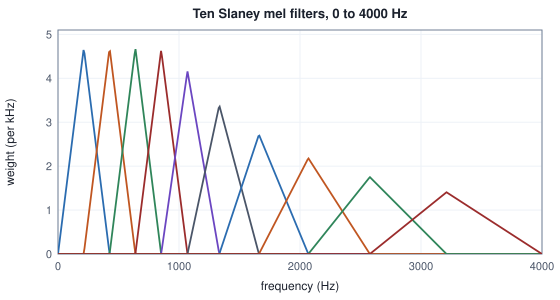

<!-- SPDX-License-Identifier: CC-BY-4.0 -->
<!-- Copyright (c) 2026 Martin Schröder <info@swedishembedded.com> -->

# Spectrograms and the Mel Scale

*How do we see which frequencies are present at each moment, the way an ear does?*

Two sounds, each made of the same two notes. In the first a tone of 1000 Hz plays for 32 samples and is followed by a tone of 2000 Hz for 32 samples, at a sampling rate of 8000 Hz, so the pitch rises. The second is the first played backwards, so the pitch falls. Anyone would hear the difference. Take the DFT of all 64 samples of each, as Volume I taught, and compare the strength of the frequencies the transform finds.

<!-- worked: spectrograms.reversal_spectra -->
x[n] = cos(2 pi 1000 n / 8000) for n = 0 .. 31 and cos(2 pi 2000 n / 8000) for n = 32 .. 63, and y[n] = x[63 - n]. Amplitude estimate 2 abs(X[k]) / 64 of the 64-point DFT of each.

| bin k | Hz | x, 1000 Hz then 2000 Hz | y, 2000 Hz then 1000 Hz |
|---|---:|---:|---:|
| 5 | 625 | 0.0676 | 0.0676 |
| 7 | 875 | 0.2752 | 0.2752 |
| 8 | 1000 | 0.5000 | 0.5000 |
| 9 | 1125 | 0.3703 | 0.3703 |
| 11 | 1375 | 0.1754 | 0.1754 |
| 13 | 1625 | 0.1748 | 0.1748 |
| 15 | 1875 | 0.3683 | 0.3683 |
| 16 | 2000 | 0.5000 | 0.5000 |
| 17 | 2125 | 0.2787 | 0.2787 |
| 19 | 2375 | 0.0730 | 0.0730 |

Largest difference of abs(X[k]) and abs(Y[k]) over all 64 bins: below 1e-12.
<!-- /worked -->

The two columns are the same. This is not a coincidence of the numbers chosen. Reverse a real signal, $y[n] = x[N-1-n]$, and substitute into the definition of the DFT: $Y[k] = e^{-2\pi\mathrm{i}k(N-1)/N}\,\overline{X[k]}$, a conjugate and a rotation, and a rotation leaves the length of a complex number as it was. A whole-signal transform spends every one of its bins on the question of which frequencies are present, and the question of when has been folded into the phases, where a model reading amplitudes never looks. Rising and falling pitch, a word and the same word reversed, a chirp and its mirror image all have one magnitude spectrum.

The remedy is to ask the question over and over for short stretches. Cut the signal into frames of 32 samples that start 8 samples apart, and transform each frame on its own.

<!-- worked: spectrograms.reversal_frames -->
The same two signals cut into frames of N = 32 samples at hop 8, rectangular window. With N = 32 at 8000 Hz a bin is 250 Hz wide, so 1000 Hz is bin 4 and 2000 Hz is bin 8. Power abs(X_t[k])^2 in those two bins.

| frame t | first sample | x, bin 4 | x, bin 8 | y, bin 4 | y, bin 8 |
|---|---:|---:|---:|---:|---:|
| 0 | 0 | 256.0 | 0.0 | 0.0 | 256.0 |
| 1 | 8 | 144.0 | 16.0 | 16.0 | 144.0 |
| 2 | 16 | 64.0 | 64.0 | 64.0 | 64.0 |
| 3 | 24 | 16.0 | 144.0 | 144.0 | 16.0 |
| 4 | 32 | 0.0 | 256.0 | 256.0 | 0.0 |
<!-- /worked -->

Now the two signals differ in every row. In the rising sound the power moves from bin 4 to bin 8 as the frames move forward, in the falling sound from bin 8 to bin 4, and the middle frame, which holds half of each tone, shows both. An array of such spectra, one row per frame, is a picture of the sound in which time runs one way and frequency the other. That picture is the subject of this chapter, and the rest of the chapter is what has to be decided to make it a number a model can be trained on, which turns out to be a long list. The same second of speech goes through at least six different recipes in one engine, and a model that was trained on one will misread another.

Four ideas from earlier volumes are needed before the frames are described properly.

1. (Volume IX, [Chapter 1](01-sound.md), waveform and sampling rate.) At 16 kHz and at 24 kHz, how many samples are there in 25 milliseconds, and how many in a step of 10 milliseconds?
2. (Volume I, [Chapter 14](../v01-mathematics/14-fourier.md), the discrete Fourier transform.) A frame of $N$ real samples is taken at rate $f_s$. What frequency does bin $k$ stand for, and how many bins carry independent information?
3. (Volume I, [Chapter 14](../v01-mathematics/14-fourier.md), the fast Fourier transform.) How many complex multiplications does a DFT of $N = 512$ points need by its definition, and how many does the radix-2 FFT need?
4. (Volume I, [Chapter 1](../v01-mathematics/01-numbers.md), logarithm.) What is $\log_{10} 1000$, and what does multiplying a positive number by 100 do to its logarithm to base 10 and to its natural logarithm?

## Cutting a sound into frames

Call $N$ consecutive samples a **frame**, and the number of samples between the starts of two neighbouring frames the **hop** $H$. With $x[n]$ the signal and $w[n]$ a weight for each position inside the frame (for now $w[n] = 1$ for every $n$), the transform of frame $t$ is

$$
X_t[k] = \sum_{n=0}^{N-1} w[n]\,x[tH + n]\,e^{-2\pi\mathrm{i}kn/N}, \qquad k = 0, 1, \dots, N/2,
$$

and the array of all of them, $t = 0, 1, \dots, T-1$, is the **short-time Fourier transform** (STFT). Only bins $0$ to $N/2$ are kept, the $N/2 + 1$ of them that Volume I showed to carry everything for a real signal, and what a model usually reads is the power $P_t[k] = |X_t[k]|^2$, a real array of shape $[T, N/2+1]$. Bin $k$ stands for the frequency $k f_s/N$.

Two numbers decide what the array can show. A frame lasts $N/f_s$ seconds, so two events closer in time than that land in the same row. The bins are $f_s/N$ hertz apart, so two tones closer in frequency than that land in the same column. The product of the two is 1, whatever $N$ is: a longer frame buys a finer frequency axis exactly at the price of a coarser time axis. The hop is separate. It sets how often a new row is written, and any hop smaller than the frame makes neighbouring frames overlap, so that a moment that falls near the edge of one frame is seen nearer the middle of the next.

Here is the opening signal again, in frames of $N = 32$ at hop $H = 8$, with the power in bins 2 to 10 of the 17 that a 32-point real frame has. The bin spacing is $8000/32 = 250$ Hz, so 1000 Hz is bin 4 and 2000 Hz is bin 8.

<!-- worked: spectrograms.stft_frames -->
Power abs(X_t[k])^2 of x (1000 Hz then 2000 Hz) for frames of N = 32 samples at hop H = 8, rectangular window, bins k = 2 .. 10 of 0 .. 16.

| t | k=2 | k=3 | k=4 | k=5 | k=6 | k=7 | k=8 | k=9 | k=10 |
|---|---:|---:|---:|---:|---:|---:|---:|---:|---:|
| 0 | 0.0 | 0.0 | 256.0 | 0.0 | 0.0 | 0.0 | 0.0 | 0.0 | 0.0 |
| 1 | 1.8 | 7.2 | 144.0 | 24.4 | 27.7 | 24.1 | 16.0 | 7.8 | 2.5 |
| 2 | 0.0 | 14.4 | 64.0 | 48.8 | 0.0 | 48.2 | 64.0 | 15.5 | 0.0 |
| 3 | 1.8 | 7.2 | 16.0 | 24.4 | 27.7 | 24.1 | 144.0 | 7.8 | 2.5 |
| 4 | 0.0 | 0.0 | 0.0 | 0.0 | 0.0 | 0.0 | 256.0 | 0.0 | 0.0 |
<!-- /worked -->

Frames 0 and 4 hold one tone each, and all their power, 256, sits in one bin: a tone that completes a whole number of cycles in the frame (4 cycles of 1000 Hz in 32 samples, 8 cycles of 2000 Hz) falls exactly on a bin and touches no other. Frame 2 holds 16 samples of each tone and shows 64 in each of the two bins, a quarter of 256, because the amplitude of each tone as the frame sees it is halved and power is the square of amplitude. But frame 2 also shows power in bins 3, 5, 7 and 9, where there is no tone. The tone did not stop at a whole number of cycles inside the frame, it was cut off, and a cut costs energy spread over its neighbours. This is the leakage of Volume I's chapter on the Fourier transform, there a curiosity of a tone between two bins and here the normal condition of every frame of real sound, which almost never contains a whole number of cycles of anything. Taming it was left for the audio volumes.

## Giving each frame a shape

Leakage comes from a frame's hard edges. The DFT treats the $N$ samples as one period of a signal that repeats forever, so the last sample is followed by the first, and when the frame does not hold a whole number of cycles the join is a jump. A jump has energy at every frequency. The cure is to multiply the frame by a **window function**, a list of $N$ weights that falls to zero at both ends, so that the join is smooth. The window that brain's front ends use, with one exception noted below, is the Hann window,

$$
w[n] = \frac12 - \frac12\cos\frac{2\pi n}{d}, \qquad n = 0, 1, \dots, N-1,
$$

and here a detail that costs people months. The denominator $d$ can be $N$ or $N - 1$. With $d = N$ the window is **periodic**: its $N$ samples are the first $N$ of a cosine that would return to zero at sample $N$, so a periodic Hann window is exactly what the DFT's own picture of a repeating signal asks for. With $d = N - 1$ it is **symmetric**: it reaches zero at sample $N - 1$ as well, the shape one draws on a page. Here are the two for eight samples, with two others for comparison, the rectangular window of no weights at all and the symmetric Hann window raised to the power 0.85.

<!-- worked: spectrograms.window_shapes -->
Windows of N = 8 samples.

| i | rectangular | Hann periodic | Hann symmetric | symmetric Hann ^ 0.85 |
|---|---:|---:|---:|---:|
| 0 | 1.0000 | 0.0000 | 0.0000 | 0.0000 |
| 1 | 1.0000 | 0.1464 | 0.1883 | 0.2418 |
| 2 | 1.0000 | 0.5000 | 0.6113 | 0.6581 |
| 3 | 1.0000 | 0.8536 | 0.9505 | 0.9578 |
| 4 | 1.0000 | 1.0000 | 0.9505 | 0.9578 |
| 5 | 1.0000 | 0.8536 | 0.6113 | 0.6581 |
| 6 | 1.0000 | 0.5000 | 0.1883 | 0.2418 |
| 7 | 1.0000 | 0.1464 | 0.0000 | 0.0000 |
<!-- /worked -->

The periodic window has one sample at 1.0, the symmetric one has two samples at 0.9505 and a zero at each end. The two differ by up to 0.11 of a weight, at sample 2. What it does to a spectrum is easiest to see on a tone placed between two bins. A cosine with 4.5 cycles in a frame of 32 samples is as badly placed as a tone can be, and the three windows treat it like this.

<!-- worked: spectrograms.window_leakage -->
Power in decibels, 10 log10(P[k] / P_max), of a cosine with 4.5 cycles in N = 32 samples, bins 1 .. 15 (bins 0 and 16 are omitted: for the periodic Hann window they are zero up to rounding).

| k | rectangular | Hann periodic | Hann symmetric |
|---|---:|---:|---:|
| 1 | -19.3 | -42.9 | -41.3 |
| 2 | -16.1 | -31.3 | -30.5 |
| 3 | -11.0 | -14.0 | -12.9 |
| 4 | -0.7 | 0.0 | 0.0 |
| 5 | 0.0 | 0.0 | 0.0 |
| 6 | -8.9 | -14.0 | -12.9 |
| 7 | -12.7 | -30.8 | -30.3 |
| 8 | -15.1 | -40.3 | -40.1 |
| 9 | -16.7 | -47.1 | -47.4 |
| 10 | -17.9 | -52.5 | -53.3 |
| 11 | -18.8 | -57.1 | -58.3 |
| 12 | -19.4 | -61.2 | -62.9 |
| 13 | -19.9 | -65.4 | -67.1 |
| 14 | -20.2 | -70.0 | -70.9 |
| 15 | -20.4 | -76.6 | -73.9 |
<!-- /worked -->

The rectangular window leaves bin 1 and bin 15, far from the tone, at 19.3 and 20.4 decibels below the top, and the level barely falls with distance. The periodic Hann window cuts bin 1 to 42.9 decibels below the top and bin 15 to 76.6 decibels below. The price is the width of the main lobe: the nulls on either side of a tone are one bin away for the rectangular window and two bins away for the Hann window, so two tones that a rectangular window can still tell apart may merge under Hann. The window trades the width of a peak for the depth of its skirts. The symmetric window stays within 3 decibels of the periodic one in every bin of the table, which is not enough to choose between them. What does choose is another property.

A signal cut into overlapping frames and weighted by a window can be put back together by adding the frames, and the sum of the window over all frames that cover one sample is then the factor by which the signal comes back scaled. If that sum is the same constant at every sample the window is said to overlap-add to a constant, and a signal can be rebuilt without knowing where the frames began.

<!-- worked: spectrograms.window_overlap -->
The sum over frames of the window at hop H, N = 16, for the samples that every frame position covers (positions 16 .. 79 of a signal of 96).

| hop H | periodic Hann | symmetric Hann |
|---:|---|---|
| 8 | 1.0000 to 1.0000 | 0.8978 to 0.9891 |
| 4 | 2.0000 to 2.0000 | 1.8632 to 1.8868 |
| 2 | 4.0000 to 4.0000 | 3.7500 to 3.7500 |
<!-- /worked -->

The periodic Hann window adds up to exactly 1, 2 and 4 at hops of a half, a quarter and an eighth of the frame. The symmetric window does not: at half-frame hops its sum swings between 0.8978 and 0.9891 and at quarter-frame hops between 1.8632 and 1.8868, so a signal rebuilt from it is faintly modulated at the hop rate. Only at an eighth, where the sum is a constant 3.75 and not 4, does it settle, and then to the wrong gain. That is the property that makes the periodic window the natural choice wherever a signal has to be rebuilt. The inverse transform of brain, in `crates/audio/src/istft.rs`, does not rely on it: it divides the overlapped output by the sum of the squared window at each sample, wherever that sum is not negligible, and the division is exact for any window. The front ends of the next sections never invert anything, so for them the choice is only a convention, and the convention was fixed by whoever trained the model. One recogniser front end in brain uses the symmetric window and others the periodic one, and a third family of front ends, written for toolkits of speech recognition and speaker verification, uses the symmetric Hann window raised to the power 0.85 (the last column of the table), which is larger than Hann at every interior sample and leaves the ends at zero.

A window may also be shorter than the transform, and that is a separate choice. The DFT's length does not have to be a power of two, a point Volume I's chapter could mention only briefly: a 25 millisecond frame at 16 kHz has 400 samples, and $400 = 2^4 \cdot 5^2$. Engines either pad each frame with zeros up to the next power of two, 512, or run a transform of length 400 by a method that reduces any length to a power-of-two computation. A window of 400 inside a transform of 512 can sit in the middle or at the start, and that is one more convention on which the front ends below disagree.

## Where the first frame begins

A signal of $L$ samples cut into frames of $N$ at hop $H$ has $1 + \lfloor (L - N)/H \rfloor$ frames, if it has at least $N$ samples. The last few samples that do not fill a whole frame are dropped. That is convenient and it has two awkward consequences. The first frame is centred $N/2$ samples into the signal, so the first $N/2$ samples are never at the centre of anything, and a clip shorter than a frame has no frames at all. Most front ends therefore pad the signal at both ends before framing, and they disagree about how much and with what.

Three conventions appear in brain's front ends. No padding at all. Padding $N/2$ samples on each side, which puts the centre of frame $t$ on sample $tH$ of the original signal. And padding $(N - H)/2$ on each side, which puts the centre of frame $t$ half a hop later, on $tH + H/2$. For $N = 400$ and $H = 160$ they give these counts.

<!-- worked: spectrograms.frame_counts -->
Frames of N = 400 samples at hop H = 160 for a signal of L samples, counted from the length of the padded signal as 1 + floor((padded length - N) / H) (0 if it is shorter than N).

| L | no padding | pad 200 | pad 120 |
|---|---:|---:|---:|
| 159 | 0 | 1 | 0 |
| 160 | 0 | 2 | 1 |
| 399 | 0 | 3 | 2 |
| 400 | 1 | 3 | 2 |
| 16,000 | 98 | 101 | 100 |
| 16,001 | 98 | 101 | 100 |
| 16,160 | 99 | 102 | 101 |

Centre of frame t, in samples of the original signal, for N = 400, H = 160:

| padding | centre of frame t |
|---|---|
| no padding | 160 t + 200 |
| pad N/2 = 200 each side | 160 t |
| pad (N - H)/2 = 120 each side | 160 t + 80 |
<!-- /worked -->

A second of audio at 16 kHz is 98 frames, 101 frames or 100, depending on the convention. The padding of $N/2$ gives $1 + \lfloor L/H \rfloor$, one more than the number of whole hops, because the first frame is centred on the first sample, and the frames after it follow at each hop until the last one that fits. The padding of $(N - H)/2$ gives $\lfloor L/H \rfloor$, exactly one frame per hop, which is the property a model that expects a fixed number of frames per second wants. A front end with padding $N/2$ can recover it by dropping the last frame, and one that brain implements does: its own test pads one second of silence to three seconds and finds 300 frames. The other way to the same count is to compute every frame and then zero the one the encoder should not read, which is what a second front end of brain does with the last frame.

The three also place their frames differently in time, as the second table shows, and the second and third differ by half a hop, 80 samples or five milliseconds at 16 kHz. A model trained on one and fed the other sees every spectral event half a frame earlier or later than it was taught: a small shift, but a systematic one, in a quantity that models are asked to align to within a frame.

What fills the padding is the other choice. Reflection mirrors the signal about its first and last samples without repeating them: the padded sample just before the start is $x[1]$, the one before that $x[2]$, and so on, and the same at the far end. Constant padding writes zeros. Brain's own test of the first (`power_spectrogram_center_false_pins_frames_and_matches_hand_computed` in `crates/audio/src/mel.rs`) is small enough to do by hand and is reproduced here: the signal $(1, 3)$ with $N = 4$ and $H = 2$ is padded by $(N - H)/2 = 1$ to $(3, 1, 3, 1)$, which is one frame; a periodic Hann window of four samples is $(0, 0.5, 1, 0.5)$, so the windowed frame is $(0, 0.5, 3, 0.5)$, and its DFT has the power in bins 0, 1, 2 that the next block prints.

<!-- worked: spectrograms.padding_by_hand -->
Signal (1, 3), N = 4, H = 2, periodic Hann window (0.0, 0.5, 1.0, 0.5), padded by (N - H)/2 = 1 on each side by reflection: the padded signal is (3, 1, 3, 1), one frame, whose power in bins 0, 1, 2 is 16.0, 9.0, 4.0.
<!-- /worked -->

Reflection and zeros differ at the two ends of the signal and nowhere else, and the difference is large there.

<!-- worked: spectrograms.padding_edges -->
Signal (1, 3, 5, 2, 4, 6), N = 4, H = 2, pad N/2 = 2 on each side, periodic Hann window (0, 0.5, 1, 0.5); 4 frames, of which the first and the last are listed (the two middle frames are the same under both paddings).

| padding | frame t | samples | P[0] | P[1] | P[2] |
|---|---:|---|---:|---:|---:|
| reflect | 0 | (5, 3, 1, 3) | 16.00 | 1.00 | 4.00 |
| reflect | 3 | (4, 6, 4, 2) | 64.00 | 20.00 | 0.00 |
| constant 0 | 0 | (0, 0, 1, 3) | 6.25 | 3.25 | 0.25 |
| constant 0 | 3 | (4, 6, 0, 0) | 9.00 | 9.00 | 9.00 |
<!-- /worked -->

Reflection gives the first frame the power of a signal that continues in a mirror, while zeros give it the power of a signal that begins abruptly out of silence, and the transform reports that jump as broadband energy: at the last frame the zeros put 9.00 into every bin, where reflection has 64.00, 20.00 and 0.00. For a signal shorter than the padding, reflection has nothing to copy. Brain's implementation then writes zeros for the outermost padded samples, which have no mirror image, and does not fail.

## A scale made from listening

A spectrum is on a linear axis, bins 40 Hz apart, and a listener is not. A step of 100 Hz from 200 Hz to 300 Hz is 0.585 of an octave, a large leap in pitch, and the same step from 4000 Hz to 4100 Hz is 0.036 of an octave, a barely audible change. Listening experiments that asked people to judge pitch, for example to set one tone to half the pitch of another, gave a scale that is nearly linear in frequency below about 1000 Hz and nearly logarithmic above it, and the unit of that scale is the **mel**. A **mel scale** is a function $\mathrm{mel}(f)$ that turns a frequency in hertz into a pitch in mels, built to be that fit, so that equal steps in mels sound like equal steps in pitch. There are two in use, and the front ends of one engine use both.

The first is $\mathrm{mel}(f) = 2595\log_{10}(1 + f/700)$, called the HTK form after the speech recognition toolkit that popularised it. At low frequencies its slope is $2595/(700 \ln 10) \approx 1.61$ mels per hertz, and at high ones it is logarithmic; it was calibrated so that 1000 Hz is 1000 mels. The second, the Slaney form, named after the auditory toolbox it comes from, cuts the curve in two. Below 1000 Hz it is a straight line of $200/3$ hertz per mel, so 1000 Hz is 15 mels. Above 1000 Hz it is a logarithm that goes up by a constant factor of frequency per mel: $\mathrm{mel}(f) = 15 + \ln(f/1000)/s$ with $s = \ln(6.4)/27 \approx 0.06875$, which means that 27 mels above the knee the frequency has grown by a factor of 6.4, to 6400 Hz. Both are in the table, and both are inverted exactly by the formulas that go the other way.

<!-- worked: spectrograms.mel_scales -->
The two mel scales at the same frequencies. HTK: 2595 log10(1 + f/700). Slaney: f / (200/3) below 1000 Hz, and 15 + ln(f / 1000) / (ln(6.4)/27) from 1000 Hz up. Each inverse returns f to within 1e-9.

| f (Hz) | HTK mel | Slaney mel |
|---|---:|---:|
| 0 | 0.00 | 0.00 |
| 100 | 150.49 | 1.50 |
| 200 | 283.23 | 3.00 |
| 500 | 607.45 | 7.50 |
| 1000 | 999.99 | 15.00 |
| 2000 | 1521.36 | 25.08 |
| 4000 | 2146.06 | 35.16 |
| 8000 | 2840.02 | 45.25 |
<!-- /worked -->

The units differ, 2840 mels against 45 for 8000 Hz, and that does not matter. A mel scale is not used to say how many mels a tone is. It is used to place points: pick a lowest and a highest frequency, convert both to mels, space $M + 2$ points evenly between them, and convert the points back to hertz. The shape of the scale shows in where those points land, and here the two scales disagree by hundreds of hertz.

<!-- worked: spectrograms.mel_edges -->
The 10 band edges of an 8-filter bank from 0 to 8000 Hz, equally spaced in mel, as hertz. Filter m uses edges m, m+1, m+2.

| edge i | HTK (Hz) | Slaney (Hz) |
|---|---:|---:|
| 0 | 0.0 | 0.0 |
| 1 | 226.2 | 335.2 |
| 2 | 525.5 | 670.3 |
| 3 | 921.5 | 1005.6 |
| 4 | 1445.4 | 1420.9 |
| 5 | 2138.6 | 2007.5 |
| 6 | 3055.9 | 2836.4 |
| 7 | 4269.5 | 4007.5 |
| 8 | 5875.3 | 5662.2 |
| 9 | 8000.0 | 8000.0 |
<!-- /worked -->

The first edge above zero is at 226.2 Hz on the HTK scale and at 335.2 Hz on the Slaney scale, and the Slaney edges up to 1000 Hz are evenly spaced (335 Hz apart) because that part of the scale is a straight line. From the fourth edge on the Slaney edges are the lower ones: 1420.9 Hz against 1445.4 Hz, and further up 2836.4 Hz against 3055.9 Hz, and 4007.5 against 4269.5. A bank built on one scale puts its resolution where the other would not, and the picture below shows it for a bank of 40 filters over 0 to 8000 Hz: the width of each filter, measured from the edge on its left to the edge on its right, against its centre.


## Triangles laid along the mel axis

A spectrum has a value in each of $N/2 + 1$ bins, and what a model wants is one value for each of $M$ bands of the mel axis, a hundred or so numbers that do not depend on the length of the frame. A **mel filterbank** does it with $M$ triangles. Take the $M + 2$ edge frequencies $e_0 < e_1 < \dots < e_{M+1}$ from the scale (evenly spaced in mel, as above, from a lowest frequency $f_{\min}$ to a highest $f_{\max}$). Triangle $m$ rises from zero at $e_m$ to one at $e_{m+1}$ and falls to zero at $e_{m+2}$: it is centred on one edge and reaches as far as the neighbours, so each triangle overlaps half of each of the two next to it. The weight of triangle $m$ in bin $k$, whose frequency is $k f_s/N$, is

$$
F_m[k] = \max\Bigl(0,\ \min\Bigl(\frac{f_k - e_m}{e_{m+1} - e_m},\ \frac{e_{m+2} - f_k}{e_{m+2} - e_{m+1}}\Bigr)\Bigr), \qquad f_k = \frac{k f_s}{N},
$$

and the mel energy of frame $t$ in band $m$ is the weighted sum $E_t[m] = \sum_k F_m[k]\,P_t[k]$, a matrix product of the power spectrogram with the transpose of the filterbank. Here is a bank small enough to read, six filters for 8000 Hz audio with $N = 32$, written weight by weight, so that the 17 bins are 250 Hz apart and the highest frequency is 4000 Hz.

<!-- worked: spectrograms.filterbank_small -->
A filterbank for 8000 Hz audio with N = 32 (17 bins, 250 Hz apart), 6 filters from 0 to 4000 Hz, Slaney scale. Left, centre and right edges in Hz; the nonzero weights of the unnormalised triangle as bin: weight; and the area factor 2 / (right - left) in 1/Hz.

| m | left | centre | right | nonzero weights (bin: weight) | 2/(right-left) |
|---:|---:|---:|---:|---|---:|
| 0 | 0.0 | 334.9 | 669.8 | 1: 0.7465, 2: 0.5070 | 0.00299 |
| 1 | 334.9 | 669.8 | 1004.8 | 2: 0.4930, 3: 0.7606, 4: 0.0144 | 0.00299 |
| 2 | 669.8 | 1004.8 | 1419.3 | 3: 0.2394, 4: 0.9856, 5: 0.4085 | 0.00267 |
| 3 | 1004.8 | 1419.3 | 2004.8 | 5: 0.5915, 6: 0.8622, 7: 0.4352, 8: 0.0083 | 0.00200 |
| 4 | 1419.3 | 2004.8 | 2831.8 | 6: 0.1378, 7: 0.5648, 8: 0.9917, 9: 0.7035, 10: 0.4013, 11: 0.0990 | 0.00142 |
| 5 | 2004.8 | 2831.8 | 4000.0 | 9: 0.2965, 10: 0.5987, 11: 0.9010, 12: 0.8560, 13: 0.6420, 14: 0.4280, 15: 0.2140 | 0.00100 |
<!-- /worked -->

Filter 0 has weights on two bins only, and the last has weights on seven. Neighbouring filters share bins: bin 3 carries 0.7606 of filter 1 and 0.2394 of filter 2, and the two sum to 1, because the falling side of one triangle and the rising side of the next run over the same interval of frequencies. The picture below draws ten such filters.



The triangles in the figure are not of equal height. The factor $2/(e_{m+2} - e_m)$ in the last column of the table is the **area normalisation** of the Slaney form of the filterbank: it multiplies each triangle so that its area is 1, whatever its width. It decides what a flat spectrum looks like. If every bin has a power of 1, a triangle of height 1 collects its own width and the higher filters, which are wider, report more; the normalised triangles all collect the same.

<!-- worked: spectrograms.white_spectrum -->
Mel energy of a flat power spectrum (P[b] = 1 for every bin) through the bank above, filter by filter.

| m | unit-height triangles | area-normalised triangles |
|---|---:|---:|
| 0 | 1.2535 | 0.00374 |
| 1 | 1.2680 | 0.00379 |
| 2 | 1.6335 | 0.00436 |
| 3 | 1.8972 | 0.00379 |
| 4 | 2.8980 | 0.00410 |
| 5 | 3.9364 | 0.00395 |
<!-- /worked -->

With unit heights the six numbers grow from 1.2535 to 3.9364, a factor of 3.1, and with the area normalisation they stay between 0.00374 and 0.00436, a factor of 1.2. A flat spectrum comes out nearly flat. Without the normalisation, a spectrum that is flat in hertz is seen as one that rises towards the top, and a speech spectrum, which falls with frequency, is partly compensated. Whichever is chosen, a trained model has learned it, and in the logarithm the two differ by a different constant for every filter, not by one overall gain.

The triangle itself also has two forms. Brain's own filters are straight lines in hertz between the edges, as the formula above. The speech toolkit convention that `crates/audio/src/kaldi_fbank.rs` ports measures the distance to each edge in mels, and the triangle is straight in the mel value of the bin. The two agree at the centre and at the edges and differ between.

<!-- worked: spectrograms.shape_difference -->
Filter 3 of a 6-filter HTK bank over 0 to 4000 Hz (N = 32, 8000 Hz): edges 883.2, 1378.1, 2027.8 Hz. The weight of each bin under a triangle that is linear in hertz and under one that is linear in the mel value of the bin; both reach 1 at the centre frequency.

| bin b | Hz | linear in Hz | linear in mel |
|---|---:|---:|---:|
| 4 | 1000 | 0.2361 | 0.2617 |
| 5 | 1250 | 0.7412 | 0.7661 |
| 6 | 1500 | 0.8124 | 0.7905 |
| 7 | 1750 | 0.4276 | 0.3948 |
| 8 | 2000 | 0.0428 | 0.0377 |
<!-- /worked -->

The weights differ in the second decimal, 0.2361 against 0.2617 at 1000 Hz, and 0.8124 against 0.7905 at 1500 Hz. It is a small difference, but an engine that mixes the two shapes cannot reproduce a trained front end to the printed digit.

A bank with many filters has a limit that the triangles make plain: the bank cannot resolve more than the transform does. The bin spacing is $f_s/N$, and at the low end of the scale the filters are narrower than that. For 128 filters over 0 to 8000 Hz at 16 kHz the Slaney scale puts the edges below 1000 Hz 23.4 Hz apart, and a 400-point transform has bins 40 Hz apart.

<!-- worked: spectrograms.low_band -->
Slaney scale, area-normalised triangles. Width of the first filter (right edge minus left edge), the number of filters with no, with exactly one and with at most two nonzero weights, and the nonzero weights of the whole bank against its size.

| bank | bin spacing (Hz) | first filter width (Hz) | empty | one bin | at most two | nonzero weights | all weights |
|---|---:|---:|---:|---:|---:|---:|---:|
| 40-filter bank, 16 kHz, N = 400 | 40.00 | 147.1 | 0 | 0 | 0 | 383 | 8040 |
| 128 filters, 16 kHz, N = 400 | 40.00 | 46.8 | 0 | 45 | 72 | 394 | 25728 |
| 128 filters, 16 kHz, N = 512 | 31.25 | 46.8 | 0 | 25 | 61 | 504 | 32896 |
| 128 filters, 24 kHz, N = 1024, to 12 kHz | 23.44 | 52.9 | 0 | 0 | 32 | 1008 | 65664 |
| 80 filters, 24 kHz, N = 1920, to 8 kHz | 12.50 | 74.5 | 0 | 0 | 0 | 1252 | 76880 |

In the 128-filter bank with N = 400, the 41 filters whose right edge is at or below 1000 Hz read 24 different bins between them.
<!-- /worked -->

In the 128-filter bank with $N = 400$ the first filter is 46.8 Hz wide with bins 40 Hz apart, and 45 of the 128 filters have a nonzero weight on exactly one bin, 72 on at most two. A filter with one bin outputs that bin's power times a fixed weight, so in the logarithm it is that bin's log power plus a constant: the 41 filters up to 1000 Hz are computed from 24 bins, and they cannot hold more than 24 independent measurements. The same bank with $N = 512$ has 25 filters of one bin, a bank of 128 filters at 24 kHz with $N = 1024$ has none and 32 with at most two, and the 80-filter bank with $N = 1920$ has none at all, at the price of a frame 80 milliseconds long. The table also counts nonzero weights against all weights. A bank of 128 filters over 201 bins has 25,728 weights, of which 394 are not zero, because each bin lies inside at most two triangles. The same question returns whenever a model reads these channels as if each were a fresh piece of evidence.

The chirp below is a signal whose frequency rises from 100 to 3500 Hz in 0.4 seconds, drawn in both views with the same frames: on the left the power in each of 65 bins of a transform of 128 samples at 8000 Hz, on the right the energy in 24 Slaney mel filters.


The straight line of the linear view is the chirp's frequency, rising at a constant rate. In the mel view the same chirp bends over, since each step upward in frequency is a smaller step in the mel scale the higher it goes. The right-hand picture is also 24 rows high where the left-hand one is 65, and the rows near the top carry far more bandwidth than the rows near the bottom.

## Compressing by logarithm

The mel energies of speech cover many orders of magnitude, a shout against a whisper, a vowel against the fricative next to it. A model fed raw energies would be dominated by the loudest cells, and a recording made twice as close to the microphone would look like a different recording. The logarithm that Volume I introduced does two things here. It compresses the range, and it turns a gain into a shift: multiplying the signal by a gain $\gamma$ multiplies every power by $\gamma^2$ and so adds $2\ln\gamma$ to every log energy, a constant that the rest of the model can learn to ignore. The array a model reads is therefore the **log-mel spectrogram**, $G_t[m] = \mathrm{compress}(E_t[m])$, with $\mathrm{compress}$ close to a logarithm.

The word "close" carries the content of this section. A logarithm cannot take zero, and a mel energy of zero is not a rare event: it is what digital silence gives, what a padded tail gives, and where a filter has no weight at all it is the permanent value. Every front end therefore adds a guard or clamps from below, and they do it differently. Writing $E$ for one mel energy, the five recipes in brain are these.

- A: $\ln(E + 10^{-6})$, a small constant added to the energy.
- B: $\ln(E + 2^{-24})$, a guard of about $6 \times 10^{-8}$.
- C: $\ln(\max(E, 10^{-5}))$, a clamp from below, applied to energies that come from the magnitude of the spectrum and not its power.
- D: $\ln(\max(E, 2^{-23}))$, the clamp at the smallest increment of a 32-bit number above 1.
- E: $\bigl(\max(\log_{10}(\max(E, 10^{-10})),\ g - 8) + 4\bigr)/4$, where $g$ is the largest $\log_{10}$ energy found anywhere in the clip: the logarithm to base 10 with a clamp, then a floor 8 decades below the loudest cell of the clip, then a shift and a scale.

<!-- worked: spectrograms.compression_table -->
Five compressions of the same mel energy E. A: ln(E + 1e-6). B: ln(E + 2^-24). C: ln(max(E, 1e-5)). D: ln(max(E, 2^-23)). E: (max(log10(max(E, 1e-10)), g - 8) + 4) / 4 with g = 2, the largest log10 energy of the clip (the cell with E = 100).

| energy E | A | B | C | D | E |
|---|---:|---:|---:|---:|---:|
| 0 | -13.8155 | -16.6355 | -11.5129 | -15.9424 | -0.5000 |
| 1.00e-09 | -13.8145 | -16.6189 | -11.5129 | -15.9424 | -0.5000 |
| 1.00e-06 | -13.1224 | -13.7576 | -11.5129 | -13.8155 | -0.5000 |
| 0.001 | -6.9068 | -6.9077 | -6.9078 | -6.9078 | 0.2500 |
| 1 | 0.0000 | 0.0000 | 0.0000 | 0.0000 | 1.0000 |
| 100 | 4.6052 | 4.6052 | 4.6052 | 4.6052 | 1.5000 |
<!-- /worked -->

The same silent cell, $E = 0$, comes out as -13.8155, -16.6355, -11.5129, -15.9424 and -0.5. For a cell with energy 1 the first four agree on 0 and E gives 1, and for a cell of 100 all four agree on $\ln E$ to four decimals: the guards are for the bottom of the range and make no difference above it. Between the extremes, at $10^{-6}$, the first four give -13.1224, -13.7576, -11.5129 and -13.8155. A model trained on recipe C has never seen a value below -11.5129 and one trained on A has never seen a value below -13.8155, so each is shown the other's silence as a value it was never trained on.

What a gain does shows the difference in kind between the recipes. Make the signal ten times larger, so that every energy is multiplied by 100 and every log energy should rise by $\ln 100 = 4.6052$.

<!-- worked: spectrograms.gain_table -->
The change of each output when the signal is made 10 times larger (every energy times 100, ln 100 = 4.6052; for E the clip's largest log10 energy goes from g = 0 to g = 2).

| energy E | A | B | C | D | E |
|---|---:|---:|---:|---:|---:|
| 1.00e-08 | 0.6832 | 2.7228 | 0.0000 | 2.1269 | 0.5000 |
| 1.00e-06 | 3.9220 | 4.5479 | 2.3026 | 4.6052 | 0.5000 |
| 0.0001 | 4.5953 | 4.6046 | 4.6052 | 4.6052 | 0.5000 |
| 0.01 | 4.6051 | 4.6052 | 4.6052 | 4.6052 | 0.5000 |
| 1 | 4.6052 | 4.6052 | 4.6052 | 4.6052 | 0.5000 |
<!-- /worked -->

At energies of $10^{-4}$ and above, A to D rise by 4.6 or very nearly (A by 4.5953 at $10^{-4}$, 4.6051 at $10^{-2}$). Near the floor they do not: C at $10^{-8}$ does not change at all (0.0000), because both the original and the amplified value are below the clamp, and A at $10^{-6}$ rises by 3.9220. Near the floor the amplified recording is not a shifted copy of the original. Recipe E rises by exactly 0.5 in every row, which is $2/4$: each $\log_{10}$ goes up by 2 as does $g$, so the floor moves with them. A recording made louder or quieter shifts the whole of E's output uniformly, and the floor is not a fixed level but a distance below the loudest cell.

That relative floor has a cost, and it is that a cell's value depends on every other cell of the clip. One loud click is enough.

<!-- worked: spectrograms.click_floor -->
Convention E on six cells with log10 energies -4 .. 1. Left: the clip as it is, largest log10 energy g = 1. Right: the same cells in a clip that also holds one loud click whose cell has log10 energy 6 (g = 6, floor g - 8 = -2).

| log10 of the energy | output, g = 1 | output, g = 6 |
|---|---:|---:|
| -4 | 0.000 | 0.500 |
| -3 | 0.250 | 0.500 |
| -2 | 0.500 | 0.500 |
| -1 | 0.750 | 0.750 |
| 0 | 1.000 | 1.000 |
| 1 | 1.250 | 1.250 |
<!-- /worked -->

In the clip as it is, the six cells are spread over five decades and the outputs run from 0.000 to 1.250, all distinct. In a clip that also holds a click with $\log_{10} E = 6$ the floor is $-2$, and the three lowest cells come out as 0.500 together. The quiet end of the clip has been flattened by something that did not happen in it. A front end that does this normalises each clip to its own loudest moment, at the price that two recordings of the same speech, with and without a cough, are different inputs in their quiet frames. It also explains why a short clip padded with zeros to a fixed window gets a definite value in the padding: the padded region lands on the floor.

Collected in pseudocode, with the helper functions that the sections above defined in words, the whole path from samples to a log-mel spectrogram is this.

```text
function reflect_pad(x: array<real>[L], p: int) -> array<real>[L + 2 * p]:
    require p >= 0 and p < L
    out = zeros(real, [L + 2 * p])
    for i in 0 .. L:
        out[p + i] = x[i]
    for i in 0 .. p:
        out[p - 1 - i] = x[i + 1]
        out[p + L + i] = x[L - 2 - i]
    return out

function stft_power(xp: array<real>[P], N: int, H: int, w: array<real>[N]) -> array<real>[T, N // 2 + 1]:
    require N >= 2 and H >= 1 and P >= N
    T = 1 + (P - N) // H
    out = zeros(real, [T, N // 2 + 1])
    for t in 0 .. T:
        for k in 0 ..= N // 2:
            acc = complex(0.0, 0.0)
            for n in 0 .. N:
                acc = acc + xp[t * H + n] * w[n] * exp(-2.0 * pi * ((k * n) mod N) / N * 1i)
            out[t, k] = abs(acc) ^ 2
    return out

function hz_to_mel(f: real, slaney: bool) -> real:
    if not slaney:
        return 2595.0 * log10(1.0 + f / 700.0)
    if f < 1000.0:
        return f / (200.0 / 3.0)
    return 15.0 + log(f / 1000.0) / (log(6.4) / 27.0)

function mel_to_hz(m: real, slaney: bool) -> real:
    if not slaney:
        return 700.0 * (10.0 ^ (m / 2595.0) - 1.0)
    if m < 15.0:
        return m * (200.0 / 3.0)
    return 1000.0 * exp((m - 15.0) * (log(6.4) / 27.0))

function mel_filterbank(rate: real, N: int, M: int, f_min: real, f_max: real,
                        slaney: bool, normalise: bool) -> array<real>[M, N // 2 + 1]:
    require 0.0 <= f_min and f_min < f_max and f_max <= rate / 2 and M >= 1
    lo = hz_to_mel(f_min, slaney)
    hi = hz_to_mel(f_max, slaney)
    edge = zeros(real, [M + 2])
    for i in 0 .. M + 2:
        edge[i] = mel_to_hz(lo + (hi - lo) * i / (M + 1), slaney)
    F = zeros(real, [M, N // 2 + 1])
    for m in 0 .. M:
        for k in 0 ..= N // 2:
            f = k * rate / N
            up = (f - edge[m]) / (edge[m + 1] - edge[m])
            down = (edge[m + 2] - f) / (edge[m + 2] - edge[m + 1])
            F[m, k] = max(0.0, min(up, down))
            if normalise:
                F[m, k] = F[m, k] * 2.0 / (edge[m + 2] - edge[m])
    return F

function log_mel_spectrogram(x: array<real>[L], N: int, H: int, w: array<real>[N], pad: int,
                             F: array<real>[M, N // 2 + 1],
                             compress: function(real) -> real) -> array<real>[T, M]:
    P = stft_power(reflect_pad(x, pad), N, H, w)
    G = zeros(real, [len(P), M])
    for t in 0 .. len(P):
        for m in 0 .. M:
            e = 0.0
            for k in 0 ..= N // 2:
                e = e + F[m, k] * P[t, k]
            G[t, m] = compress(e)
    return G
```

`stft_power` is the definition of the transform, $O(N^2)$ per frame; an engine replaces its inner two loops by an FFT and nothing else changes. The order of the sums, $n$ upward in the transform and $k$ upward in the mel energy, is the order of the digits printed in this chapter. In `mel_filterbank` the booleans are kept apart, `slaney` for the scale and `normalise` for the area, although the engine's own configuration ties them together: its single flag chooses the Slaney scale with normalised triangles, or the HTK scale with triangles of unit height, so a bank that pairs the HTK scale with normalisation cannot be configured there.

## One clip, six changes

All the choices of the chapter so far can be put to work on one fully specified signal. The clip has 8000 samples at 16000 Hz, half a second, and is the sum of three things, with $t = n/16000$: a chirp $0.5\sin(2\pi(200\,t + 3200\,t^2))$ whose frequency rises from 200 Hz to 3400 Hz, a steady tone $0.1\sin(2\pi\,6000\,t)$, and noise $0.01(2u_n - 1)$ where $u_n$ is the $n$-th draw of the book's `uniform()` from the generator seeded by `bookrng.seed_of("spectrograms.clip")`, one draw for each $n = 0, 1, \dots$ in order. The noise keeps every mel energy far above the floors, so that the numbers below depend on the conventions and on nothing else.

<!-- worked: spectrograms.clip_check -->
The clip: 8000 samples at 16000 Hz, seed 6749870757344927309, one `uniform()` draw per sample in order of n. Check values:

| n | x[n] |
|---|---:|
| 0 | -0.003976 |
| 1 | 0.113327 |
| 2 | -0.019941 |
| 3 | 0.180510 |
| 4000 | -0.006834 |
| 7999 | -0.565834 |
<!-- /worked -->

Pre-emphasis, which one variant uses, is a first-order high-pass step applied to the samples before framing: $y[0] = x[0]$ and $y[n] = x[n] - a\,x[n-1]$ for $n \ge 1$, with $a = 0.97$ here. It lifts the high frequencies relative to the low, because a slowly varying signal almost cancels against its predecessor. The baseline is the recipe the 25 millisecond frame suggests: $N = 400$, $H = 160$, a periodic Hann window, reflection of 200 on each side, 40 Slaney filters with area normalisation from 0 to 8000 Hz, power, and $\ln(\max(E, 10^{-10}))$. It gives 51 frames of 40 numbers. Six variants each change one thing.

<!-- worked: spectrograms.variants -->
The clip through one baseline front end and through six variants that each change one thing. Baseline: N = 400, H = 160, periodic Hann window, reflect padding of 200 on each side (51 frames), 40 Slaney filters with area normalisation from 0 to 8000 Hz, power, ln(max(E, 1e-10)). Pre-emphasis 0.97 means y[0] = x[0] and y[n] = x[n] - 0.97 x[n-1] for n >= 1 on the whole clip, before the padding. Over the frames both versions have (all 40 cells of every frame, so 40 x frames cells), each row counts the cells that differ from the baseline by more than 0.01 and gives the largest and the mean absolute difference over all of those 40 x frames cells, in nats.

| change | frames | cells differing by > 0.01 | largest difference | mean difference |
|---|---:|---:|---:|---:|
| symmetric Hann window | 51 | 222 | 0.052 | 0.0046 |
| constant zero padding | 51 | 140 | 4.111 | 0.0658 |
| HTK scale, unit-height triangles | 51 | 2037 | 15.092 | 5.1142 |
| magnitude in place of power | 51 | 2039 | 3.976 | 2.5138 |
| pre-emphasis 0.97 | 51 | 2036 | 6.964 | 1.7570 |
| pad 120 instead of 200 | 50 | 1891 | 3.011 | 0.5032 |

With constant padding the largest difference over the first two and the last two frames, the four that the padding touches, is 4.111.
<!-- /worked -->

The symmetric window is the mildest change: the largest difference in any cell is 0.052, the mean 0.0046, and only 222 of the 2040 cells differ by more than 0.01. Constant padding changes only the frames the padding touches, the first two and the last two, 140 cells in all; but in them the largest difference is 4.111 nats, a factor of 61 in energy. The four changes after it touch nearly every cell. The HTK scale with unit-height triangles moves the mean by 5.1142, the magnitude in place of the power by 2.5138, the pre-emphasis of 0.97 by 1.7570, and a pad of 120 in place of 200 shifts every frame by half a hop and moves the mean by 0.5032, over the 50 frames that both versions have. These are the sizes of the mismatches that a trained model suffers when it is given features from a front end that differs from its own in one convention. Nothing in the data says which front end a model was trained with, and no shape complains: a mean difference of half a nat is a factor of 1.65 in energy on average, and the model has no way to know that the recipe changed and not the speaker.

Two complete re-implementations from the descriptions in brain's source, written for this chapter, give the other kind of difference, that between whole front ends. The first is the one of `crates/audio/src/asr_frontend.rs` for the Qwen3-ASR model, which pads the clip with zeros to a whole number of seconds, takes a periodic Hann window of 400 with reflection of 200, 128 Slaney filters, drops the last frame, and finishes with recipe E; the second is the one for the Nemotron model, with pre-emphasis 0.97, a symmetric Hann window of 400 centred in a transform of 512 samples, zero padding of 256, 128 Slaney filters, recipe B and the frames from $\lfloor L/H \rfloor$ on set to zero.

<!-- worked: spectrograms.recogniser_outputs -->
The half-second clip through both front ends (the first padded with zeros to one whole second, as that front end does), 128 filters each: output shape, smallest and largest value over the cells the encoder reads (for the first, the 100 frames of the padded second; for the second, the 50 valid frames), and the value in any cell of a tenth of a second of digital silence. The Nemotron style applies the pre-emphasis y[0] = x[0], y[n] = x[n] - 0.97 x[n-1] to the whole clip first, then pads 256 zeros on each side, then cuts frames of 512 whose weights are zero except samples 56 .. 455, which carry the 400-sample symmetric Hann window (centred: 56 zeros on each side of it); the frames from floor(L / 160) on, with L the clip length, are set to zero.

| front end | shape | smallest | largest | value for silence |
|---|---|---:|---:|---:|
| Qwen3-ASR style | [128, 100] | -0.525 | 1.475 | -1.500 |
| Nemotron style | [51, 128], last row zero | -16.623 | 4.067 | -16.636 |
<!-- /worked -->

Both read the same clip. The first has shape $[128, 100]$, filters first, and its values lie between -0.525 and 1.475; the second has shape $[51, 128]$, frames first, with a row of zeros at the end, and values between -16.623 and 4.067. Silence is -1.500 in one and -16.636 in the other. The smallest value of the first, -0.525, is the floor of the clip, where the zero-padded second half sits, and it moves with the loudest cell. Neither is wrong, and each is correct only for the encoder that was trained on it.

## Seven front ends in one engine

Brain's audio crate has grown by the demands of models, one front end at a time, and its history is the list of conventions of this chapter. Commit `538615b1d` (28 June 2026) created the crate for the speech synthesis stack with a first mel module in `crates/audio/src/mel.rs`: a radix-2 FFT, a power spectrogram with reflection of $N/2$, a Slaney or HTK filterbank and a log with a guard (recipe A of the chapter), in 32-bit floating point and configurable by a `MelConfig` of eight fields, so that matching a reference model would be, in the words of the module header, a config change and not a rewrite. The first speech recognisers needed more than that configuration allowed: a window inside a larger transform, pre-emphasis and a second compression. Commit `91a20b963` (28 July 2026) added `crates/audio/src/asr_frontend.rs`, which computes in 64-bit floating point and reproduces the two feature extractors step for step: its tests compare the filterbanks with the reference matrices to $10^{-6}$ and the whole log-mel with the reference output to $2 \times 10^{-3}$, and skip themselves when the reference files are not present. That commit also added the transform of any length by the chirp method, because 400 is not a power of two.

A day later, commit `45bc9ce6a` (29 July 2026) made the Nemotron front end streaming. A mel frame centred on sample $tH$ needs samples up to $tH + 255$, so the streaming front end emits frame $t$ as soon as those have arrived, a delay of 256 samples, 16 milliseconds, and carries over the last raw sample for the pre-emphasis. What the commit message claims, that the streamed frames equal the offline ones bit for bit, is true by construction and checked: both paths call the same `nemotron_frame` function, and a test pushes a signal in ragged pieces and compares every frame with `==`. The design is the answer to the question of how to stream a front end that was defined offline: do not write a second implementation, extract the per-frame function and let the buffering be the only new code.

Commit `dc9315c44` (21 August 2026) added two conventions to `mel.rs`. A speech synthesiser's prompt mel needs $N = 1920 = 2^7 \cdot 3 \cdot 5$, so the module gained the chirp-method transform; and it needs the padding of $(N - H)/2$, so `MelConfig` gained its `center` field. Both are gated by tests that do not depend on a reference: the transform is compared with the $O(N^2)$ definition at sizes that include 1920, and the padding by the hand computation reproduced above. A day later commit `5139936e9` (22 August 2026) added `kaldi_fbank.rs`, the toolkit convention of 25 millisecond frames, mean removal, pre-emphasis of 0.97, a window of the Hann power 0.85, no padding at all, 80 filters triangular in mel from 20 Hz and the compression D. Its module header says that no captured reference output exists to compare it with digit for digit, and the code bears that out: its tests check the frame count, the window and that a tone gives finite numbers. The conventions it implements are those of the table.

The knowledge base holds the cost of getting a front end wrong. In knowledge #211 the Qwen3-ASR front end returned `(mel, n_mels, n_frames)`, three positional values of which two are integers, and three call sites read it as `(mel, valid, _n)`. The encoder was told it had 128 frames, the number of filters, whatever the clip, so it heard the first 1.28 seconds of every utterance, and the transcripts stopped after the first few words. The entry gives the symptoms (the word error rate of a round trip through the recogniser of 0.78 against 0.038 for the other recogniser), and its remedy is the one in commit `b0ec7fa7c` (9 October 2026): `qwen_logmel` now returns a `LogMel` with named fields. The lesson is that a front end has a layout as well as a recipe: the output of that one is channels first, $[128, T]$, and the other is frames first, as the shape column of the table of the two recognisers shows, and neither the values nor the types complain when the wrong axis is read as the count.

The seven front ends that the engine configures differ in the way the tables below set out; the first gives the geometry, the second what happens to the signal before the transform and the third what happens after.

<!-- worked: spectrograms.front_end_geometry -->
Frame geometry of the front ends, and the number of values one second of audio becomes: frames per second rate / H times filters, against the samples per second.

| front end | rate (Hz) | N / H | filters | range (Hz) | hop (milliseconds) | frames per second | values per second | values per sample |
|---|---:|---:|---:|---:|---:|---:|---:|---:|
| qwen3asr | 16,000 | 400 / 160 | 128 | 0 to 8,000 | 10.00 | 100.00 | 12,800 | 0.800 |
| nemotronasr | 16,000 | 512 / 160 | 128 | 0 to 8,000 | 10.00 | 100.00 | 12,800 | 0.800 |
| ecapatdnn | 24,000 | 1024 / 256 | 128 | 0 to 12,000 | 10.67 | 93.75 | 12,000 | 0.500 |
| cosyvoice prompt | 24,000 | 1920 / 480 | 80 | 0 to 8,000 | 20.00 | 50.00 | 4,000 | 0.167 |
| ltxv audio | 16,000 | 1024 / 160 | 64 | 0 to 8,000 | 10.00 | 100.00 | 6,400 | 0.400 |
| x-vector filterbank | 16,000 | 512 / 160 | 80 | 20 to 8,000 | 10.00 | 100.00 | 8,000 | 0.500 |
| evaluation | 24,000 | 1024 / 256 | 128 | 0 to 12,000 | 10.67 | 93.75 | 12,000 | 0.500 |
<!-- /worked -->

The last column is the one to look at. One second of 16 kHz audio is 16,000 numbers, and a log-mel spectrogram with 128 filters at 100 frames per second is 12,800: 0.8 as many. The spectrogram is not a compression of the waveform in the sense of fewer numbers. What it gives is a different representation, one in which the quantities a model needs, which frequencies and when, are read off, and in which a gain is a shift. The count falls when the hop grows or the filters shrink: 0.167 for the prompt mel of 80 filters at one frame in 20 milliseconds, which is the speech synthesis front end that will be needed in the chapter on synthesis.

<!-- worked: spectrograms.front_end_signal_path -->
| front end | window | padding | before the transform |
|---|---|---|---|
| qwen3asr | periodic Hann 400 | reflect 200, last frame dropped | none |
| nemotronasr | symmetric Hann 400 centred in 512 | zeros 256 | pre-emphasis 0.97 |
| ecapatdnn | periodic Hann 1024 | reflect 384 | none |
| cosyvoice prompt | periodic Hann 1920 | reflect 720 | none |
| ltxv audio | periodic Hann 1024 | reflect 512 | none |
| x-vector filterbank | symmetric Hann 400, power 0.85, in 512 | none (frames that fit) | mean removed per frame, pre-emphasis 0.97 |
| evaluation | periodic Hann 1024 | reflect 512 | none |
<!-- /worked -->

In the x-vector row of the signal-path table, "mean removed per frame" means that the mean of the frame's own 400 samples is subtracted from each of them, frame by frame, before anything else; the pre-emphasis then acts inside each frame, with $y[0] = 0.03\,x[0]$ and $y[n] = x[n] - 0.97\,x[n-1]$, which is the toolkit's convention and differs from the whole-signal rule of the other pre-emphasis only in the first sample of each frame.

<!-- worked: spectrograms.front_end_features -->
| front end | mel filters | spectrum | compression |
|---|---|---|---|
| qwen3asr | Slaney, area-normalised | power | log10, clamp 1e-10, max - 8, (v + 4)/4 |
| nemotronasr | Slaney, area-normalised | power | ln(E + 2^-24) |
| ecapatdnn | Slaney, area-normalised | magnitude sqrt(p + 1e-9) | ln(max(E, 1e-5)) |
| cosyvoice prompt | Slaney, area-normalised | magnitude sqrt(p + 1e-9) | ln(max(E, 1e-5)) |
| ltxv audio | Slaney, area-normalised | magnitude | ln(max(E, 1e-5)) |
| x-vector filterbank | 1127 ln(1 + f/700), unit height, linear in mel | power | ln(max(E, 2^-23)) |
| evaluation | Slaney, area-normalised | power | ln(E + 1e-6) |
<!-- /worked -->

The rows are four families. The two recognisers of `crates/qwen3asr` and `crates/nemotronasr` follow the references of their own models. The speaker encoder of `crates/ecapatdnn`, the prompt mel of `crates/cosyvoice` and the audio autoencoder of `crates/ltxv` use the magnitude and a clamp at $10^{-5}$ (the first two add $10^{-9}$ to the power before the square root). The toolkit filterbank of the x-vector row feeds the speaker model of `crates/campplus` and the evaluation row, `MelConfig::default_24k`, is the configuration that the metrics of `crates/eval/src/tts.rs` and a codec test in `crates/mimi/tests/it/decode.rs` compare waveforms with. The metric needs no reference model, so its front end is free to be anything, and it is the only row whose compression is recipe A.

What the front end costs is a small amount of arithmetic, and counting it takes the same steps as the recipe. A complex FFT of $N$ points, for $N$ a power of two, takes $5N\log_2 N$ real operations, from $(N/2)\log_2 N$ butterflies of one complex multiplication (six operations) and two complex additions (four). For other $N$ the engine uses the chirp method, three transforms of length $m$, the next power of two above $2N - 1$, and $2N + m$ complex multiplications. The power takes three operations per bin and the mel step two per weight, over all $M(N/2+1)$ weights as the engine does it, or only over the nonzero ones.

<!-- worked: spectrograms.work_counts -->
Real operations per frame and per second of audio. FFT: 5 N log2 N for a power of two, otherwise the chirp method of three FFTs of length m (the next power of two above 2N - 1) and 2N + m complex multiplications of 6 operations. Power: 3 per bin. Mel: 2 per weight, over all weights (dense) or over the nonzero weights only (sparse); the last two columns add the FFT, the power and the mel step, times frames per second.

| front end | FFT per frame | mel dense per frame | mel sparse per frame | millions of operations per second, dense | millions of operations per second, sparse |
|---|---:|---:|---:|---:|---:|
| qwen3asr | 164,544 | 51,456 | 788 | 21.7 | 16.6 |
| nemotronasr | 23,040 | 65,792 | 1,008 | 9.0 | 2.5 |
| ecapatdnn | 51,200 | 131,328 | 2,016 | 17.3 | 5.1 |
| cosyvoice prompt | 784,896 | 153,760 | 2,504 | 47.1 | 39.5 |
| ltxv audio | 51,200 | 65,664 | 1,994 | 11.8 | 5.5 |
| x-vector filterbank | 23,040 | 41,120 | 1,002 | 6.5 | 2.5 |
| evaluation | 51,200 | 131,328 | 2,016 | 17.3 | 5.1 |
<!-- /worked -->

For the Qwen3-ASR front end, whose $N = 400$ is not a power of two, the FFT is 164,544 operations a frame, three transforms of 1024 points, against 51,456 for the dense mel step, which is about a quarter of the frame; with only the nonzero weights the mel step would be 788. For the prompt mel the FFT of 1920 points is 784,896, because the length 4096 that the chirp method needs is large. The totals are between 6.5 and 47.1 million operations per second of audio. The ratio matters more than the totals: the nonzero weights are about 1.5 percent of all weights in the 128-filter banks, so a front end that stored its filters as sparse rows would do about one sixty-fifth of the mel arithmetic and give the same numbers, since the terms it skips are zero.

## Check your understanding

1. **Find the error.** "The DFT of a whole recording tells which words were said, since the words are made of frequencies." Use the two sounds of the opening to say what the whole-signal transform loses, and what cutting into frames recovers.
2. **Predict.** A tone of 1000 Hz at 8000 Hz sampling is analysed with $N = 32$ and with $N = 36$, a rectangular window in both. In which of the two is all the power in one bin, and why?
3. **Explain.** A model trained on a front end with the periodic Hann window is run on features computed with the symmetric window. The variants table gives the mean difference of the log-mel cells as 0.0046. Why is that a reason not to worry, and what would make the same table worth worrying about for the padding?
4. **Find the error.** "Both mel scales put 1000 Hz at 1000 mels, so the filterbanks they give are the same." Use the table of edges.
5. **Predict.** A front end with the area normalisation is run on pink noise, whose power per hertz falls as $1/f$. Do its filters read the same number in every band above 1000 Hz? In which direction do they depart, and what would triangles of unit height read there?
6. **Explain.** Why does the dynamic-range floor of recipe E make the output of a quiet utterance depend on a single loud sound in the same clip, while recipe C does not?
7. **Predict.** A front end with $N = 400$, $H = 160$ and padding $N/2$ receives 3.2 seconds of 16 kHz audio. How many frames does it compute, how many does it hand on if it drops the last one, and how many does a front end with padding $(N - H)/2$ compute?

## Summary

A whole-signal transform keeps which frequencies are present and loses when; the short-time Fourier transform cuts the signal into frames of $N$ samples every $H$ samples, weights each by a window function, and transforms each, giving an array of power of shape $[T, N/2+1]$ in which the frequency resolution $f_s/N$ and the time span $N/f_s$ trade against each other exactly. The window removes the jump at a frame's edges, at the cost of a wider peak, and its periodic and symmetric forms differ in whether overlapping copies add up to a constant. The count and the position of the frames depend on the padding, $0$, $N/2$ or $(N - H)/2$ samples, zeros or reflection, and the choice moves every frame by up to half a hop and makes the edges differ by factors of tens in energy. A mel scale spaces frequencies as pitch is heard, nearly linearly below 1000 Hz and logarithmically above, in an HTK form and a Slaney form that place the band edges hundreds of hertz apart; a mel filterbank of $M$ overlapping triangles over those edges, with unit height or unit area, reduces a spectrum to $M$ numbers per frame, and at the low end of a fine bank those triangles read fewer bins than the filters there are. A logarithm with a guard or a floor, one of at least five recipes that agree above the floor and disagree below it, gives the log-mel spectrogram; one of the five measures its floor from the loudest cell of the clip. All of these are conventions, none is implied by the data, and the table of front ends of one engine shows every one in use.

The spectrogram is a fixed recipe, chosen by hand, and it is lossy: the phase of each bin is discarded, and with it the exact waveform, so that a signal cannot be recovered from a log-mel spectrogram without another model to supply what is missing. The next chapter turns to representations that are learned instead of designed, a neural codec that encodes the waveform into a short sequence of discrete codes and decodes it back, and so gives a language model something it can predict, token by token.

## References

- S. S. Stevens, J. Volkmann and E. B. Newman, *A scale for the measurement of the psychological magnitude pitch*, 1937. The listening experiments from which the mel scale was fitted.
- S. B. Davis and P. Mermelstein, *Comparison of parametric representations for monosyllabic word recognition in continuously spoken sentences*, 1980. Filterbank features on the mel scale for speech recognition.
- D. O'Shaughnessy, *Speech Communication: Human and Machine*, 1987. The logarithmic formula $2595\log_{10}(1 + f/700)$.
- M. Slaney, *Auditory Toolbox: Version 2*, 1998. The linear-then-logarithmic mel scale and the area-normalised triangular filters.
- F. J. Harris, *On the use of windows for harmonic analysis with the discrete Fourier transform*, 1978. Windows and their leakage.

## Exercises

1. **[Calculate]** How many frames do a front end with $N = 1024$ and $H = 256$ give for a clip of 24,000 samples with no padding, with padding $N/2$ and with padding $(N - H)/2$? Give the centre of the first frame of each in samples of the original clip.
2. **[Calculate]** Compute by hand the power of bins 0, 1 and 2 of the frame $(1, 1, 1, 1)$ weighted by the periodic Hann window of four samples, and say why bin 2 is zero.
3. **[Calculate]** Give $\mathrm{mel}(3000)$ on the HTK scale and on the Slaney scale, and the frequency whose Slaney mel value is 30.
4. **[Calculate]** Find the five band edges of a bank of three Slaney filters between 0 and 4000 Hz, and the Hz-linear weight of each filter at 1000 Hz and 2000 Hz when no normalisation is applied.
5. **[Calculate]** Recipe E has a clip whose largest log energy is $g = 3$. What is its output for a cell of energy $10^{-7}$, and what would the same cell give in a clip with $g = 0$?
6. **[Calculate]** Count the operations of a complex FFT of 1024 points and the operations per second of audio at a hop of 256 samples at 24 kHz, and compare with a 1920-point transform computed by the chirp method.
7. **[Implement]** Reproduce `spectrograms.reversal_spectra`, `spectrograms.reversal_frames` and `spectrograms.stft_frames` with your own transform by the definition.
8. **[Implement]** Reproduce `spectrograms.window_leakage`, `spectrograms.window_overlap`, `spectrograms.frame_counts` and `spectrograms.padding_edges`: both Hann windows, the three paddings and the first and last frames under reflection and zeros.
9. **[Implement]** Reproduce `spectrograms.mel_scales`, `spectrograms.mel_edges`, `spectrograms.filterbank_small`, `spectrograms.white_spectrum` and `spectrograms.low_band`: both scales and their inverses, the six-filter bank and the count of nonzero weights.
10. **[Implement]** Reproduce `spectrograms.compression_table`, `spectrograms.gain_table` and `spectrograms.click_floor`, then `spectrograms.clip_check` and `spectrograms.variants` with the book's generator, and report the row of the variants table that is most sensitive to your summation order.
11. **[Investigate]** For the 128-filter bank at 16 kHz, count the filters that read exactly one bin and at most two for $N = 400, 512, 800$ and 1024. What $N$ removes the filters that read one bin, and what does it cost in the length of a frame?
12. **[Investigate]** Compute the Qwen3-ASR-style front end of `spectrograms.recogniser_outputs` on the clip with 100.0 added to the sample at $n = 4000$, and again with 1.0 added. Which cells change, how far, and what does that say about recipe E?

## Key terms

- **short-time Fourier transform**: the array of Fourier transforms of the frames of a signal, frames of $N$ samples taken every $H$ samples, each weighted by a window, so that time and frequency are both visible. <!-- concept: short-time-fourier-transform -->
- **window function**: a list of weights applied to the samples of a frame before it is transformed, falling to zero at the ends so that the frame's edges do not leak energy into every frequency. <!-- concept: window-function -->
- **mel scale**: a function from frequency to pitch, nearly linear below 1000 Hz and logarithmic above, fitted to listening experiments, in an HTK form and a Slaney form. <!-- concept: mel-scale -->
- **mel filterbank**: a set of overlapping triangular weights whose edges are equally spaced on the mel scale, which turns a spectrum into one energy for each band. <!-- concept: mel-filterbank -->
- **log-mel spectrogram**: the array of mel energies of every frame after a logarithm with a guard or a floor, the input of most speech models. <!-- concept: log-mel-spectrogram -->

## Answers

**Recall questions.**

1. At 16 kHz, 25 milliseconds are 400 samples and 10 milliseconds are 160 samples; at 24 kHz they are 600 and 240.
2. Bin $k$ stands for the frequency $k f_s/N$; bins $0, \dots, N/2$ carry the information, $N/2 + 1$ of them (bins 0 and $N/2$ are real).
3. By the definition $N^2 = 262{,}144$ complex multiplications; the FFT needs $(N/2)\log_2 N = 256 \cdot 9 = 2304$, about 114 times fewer.
4. $\log_{10} 1000 = 3$. Multiplying by 100 adds 2 to the base-10 logarithm and $\ln 100 = 4.6052$ to the natural one, because a logarithm turns a product into a sum.

**Check your understanding.**

1. The whole-signal transform keeps which frequencies are present and folds when into the phases: a reversed signal has $|Y[k]| = |X[k]|$, so a word and its reverse look alike. It cannot identify words from frequency content alone, since order is lost. Frames recover the order, because each frame has its own spectrum, and a model reading the rows in sequence sees the pitch rise or fall.
2. With $N = 32$ a bin is 250 Hz and 1000 Hz is bin 4 exactly: 4 whole cycles in the frame, and all the power is in one bin. With $N = 36$ the frame holds $36 \cdot 1000/8000 = 4.5$ cycles, so the tone falls between bins 4 and 5 and leaks into every bin.
3. The mean difference is 0.0046 nats, a ratio of about half a percent in energy, and only 222 of 2040 cells differ by more than 0.01. Padding is worth worrying about at the edges: the largest difference there is 4.111 nats, and a model for which the first and last frames matter, such as one that detects speech onset, sees a different input.
4. HTK puts 1000 Hz at 999.99 mels and Slaney puts it at 15, so the numbers are in different units, and what matters is where the equal steps of the scale fall in hertz. The table of edges shows the first edge at 226.2 Hz on one and 335.2 Hz on the other, and 4269.5 against 4007.5 Hz for the edge near 4000 Hz. The two banks have different filters.
5. No. An area-normalised filter reads roughly the average power per hertz over its band, so on a spectrum falling as $1/f$ the energies fall with the band index, roughly as $1/f$ above 1000 Hz. A triangle of unit height reads the power per hertz times its width, and above 1000 Hz the width grows in proportion to $f$, so those would read about the same number in every band.
6. Recipe E floors every cell at $g - 8$, with $g$ the largest log energy over the whole clip, so a click raises $g$ and with it the floor of every cell. Recipe C clamps each cell at the fixed level $10^{-5}$, independently of all the others.
7. 3.2 seconds are 51,200 samples. With padding $N/2$ it computes $1 + \lfloor 51200/160 \rfloor = 321$ frames and hands on 320 if it drops the last. With padding $(N - H)/2$ it computes $\lfloor 51200/160 \rfloor = 320$ frames.

**Exercises.**

1. No padding: $1 + \lfloor (24000 - 1024)/256 \rfloor = 90$ frames, the first centred on sample 512. Padding $N/2 = 512$: $1 + \lfloor 24000/256 \rfloor = 94$ frames, the first centred on sample 0. Padding $(N - H)/2 = 384$: $\lfloor 24000/256 \rfloor = 93$ frames, the first centred on sample 128 ($= H/2$).
2. The windowed frame is $(0, 0.5, 1, 0.5)$, with sum 2, so bin 0 has power 4; bin 1 has $0 + 0.5(-\mathrm{i}) + 1(-1) + 0.5(\mathrm{i}) = -1$, power 1; bin 2 is $0 - 0.5 + 1 - 0.5 = 0$. Bin 2 is zero because the even-numbered weights (0 and 1) sum to 1 and the odd-numbered ones (0.5 and 0.5) also sum to 1, and bin 2 of a constant signal is the difference of the two sums.
3. HTK: $2595\log_{10}(1 + 3000/700) = 1876.45$. Slaney: $15 + \ln 3 / 0.068752 = 30.98$. The frequency at 30 Slaney mels is $1000\exp(0.068752 \cdot 15) = 2804.6$ Hz.
4. $\mathrm{mel}(4000) = 35.164$, a quarter of it is 8.791 mels, so the edges are the frequencies of 0, 8.791, 17.582, 26.373 and 35.164 mels: 0, 586.1, 1194.2, 2185.6 and 4000 Hz. Filter 0 has edges 0, 586.1, 1194.2; its weight at 1000 Hz is $(1194.2 - 1000)/(1194.2 - 586.1) = 0.3194$ and at 2000 Hz it is 0. Filter 1 has edges 586.1, 1194.2, 2185.6: at 1000 Hz $(1000 - 586.1)/(1194.2 - 586.1) = 0.6806$, at 2000 Hz $(2185.6 - 2000)/(2185.6 - 1194.2) = 0.1872$. Filter 2 has edges 1194.2, 2185.6, 4000: 0 at 1000 Hz, and at 2000 Hz $(2000 - 1194.2)/(2185.6 - 1194.2) = 0.8128$.
5. With $g = 3$ the floor is $-5$ and $\log_{10} 10^{-7} = -7$ is below it, so the output is $(-5 + 4)/4 = -0.25$. With $g = 0$ the floor is $-8$, the cell is above it, and the output is $(-7 + 4)/4 = -0.75$.
6. $5 \cdot 1024 \cdot 10 = 51{,}200$ operations; at 24 kHz and a hop of 256 there are 93.75 frames per second, so $51{,}200 \cdot 93.75 = 4.8$ million operations per second. A 1920-point transform needs three transforms of 4096 and $2 \cdot 1920 + 4096 = 7936$ complex multiplications: $3 \cdot 5 \cdot 4096 \cdot 12 + 6 \cdot 7936 = 784{,}896$ operations, about 15 times as many for 1.9 times the length.
7. to 10. Match the printed tables to the printed digits. If a cell disagrees, check first the order of the sums, which the worked module states, and for the variants table that every cell is a logarithm of a sum of products, so a difference in the order of the additions shows first in the cells with the smallest energies.
11. One-bin filters: 45 at $N = 400$, 25 at 512, 0 at 800 and 0 at 1024; filters with at most two bins: 72, 61, 32 and 1. A frame of 800 samples, 50 milliseconds at 16 kHz, is the first of these sizes with no filter on a single bin, at twice the length of the frame of 400.
12. With 100.0 added at $n = 4000$ the sample lies in frames 24, 25 and 26 only. Its energy in the mel cells of those frames exceeds the loudest cell of the original clip, so $g$ rises and the floor $g - 8$ rises from -0.5253 to -0.3449 in the output; the cells that were on the floor, most of them in the zero-padded second half, move up with it, and 6587 of the 12,800 cells change by more than 0.01, the largest change being 2.022. With 1.0 instead of 100.0 the click does not exceed the loudest cell and only the three frames change.
