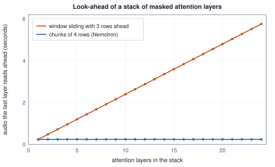

<!-- SPDX-License-Identifier: CC-BY-4.0 -->
<!-- Copyright (c) 2026 Martin Schröder <info@swedishembedded.com> -->

# Speech Recognition

*How does a model turn speech into text when it does not know where each word starts?*

Someone says "the cat sat". It takes 1.2 seconds, the log-mel front end of the last chapter turns it into 120 frames, and the transcript is eleven characters, nine letters and two spaces. That pair is the whole training example. Nothing in it says which frames are the sound of the first letter, how long the second one lasts, or where the silence before the last word begins, and the speaker did not talk at a steady pace, so no rule could say it for every recording. A model that has to write the eleven characters has to relate them to the 120 frames in some way, and the first thing worth doing is to count how many ways there are.

<!-- worked: speech_recognition.alignment_counts -->
The transcript `the cat sat` has U = 11 characters (letters and spaces; no two neighbours are equal). Column 3: the ways to give each character one or more consecutive frames and leave no frame without a character, C(T - 1, U - 1). Column 4: the sequences of T symbols over a blank and the 27 characters that remove to the transcript after merging repeats and deleting blanks, counted on the lattice of the chapter with every path weighing 1 (checked against enumeration of all 3^6 = 729 sequences for the label `aba` over a blank and two letters in 6 frames).

| clip | frames T | no blanks, every frame labelled | with blanks |
|---|---:|---:|---:|
| 1.2 seconds at 100 frames a second | 120 | 1.06 x 10^14 | 5.22 x 10^24 |
| 1.2 seconds at 12.5 rows a second | 15 | 1,001 | 14,950 |
<!-- /worked -->

If every frame must belong to one character, there are $10^{14}$ ways to cut the 120 frames into eleven runs, and when a frame is also allowed to belong to no character at all, which real speech needs for its pauses, there are $5 \times 10^{24}$. Even on the coarse grid of 15 rows that this chapter reaches for, 14,950 ways remain. The recording does not say which is right, and a model trained on one of them, chosen by hand, would learn the hand's habits.

There are three ways out, and brain runs two of them (the engines are drawn in the figure below). The first sums over every way: the model writes, for every frame, a probability for each symbol, and the probability of the transcript is the total of the probabilities of all the alignments that produce it. That is **connectionist temporal classification**, and the next section builds it. The second keeps the sum but lets what has already been written influence what comes next, by adding a small network that reads the transcript so far; that is the **transducer**, and it is how the Nemotron recogniser of `crates/nemotronasr` works. The third does not sum at all. It gives a language model the audio as part of its prompt and lets its attention find the places, which is what the Qwen3-ASR recogniser of `crates/qwen3asr` does. All three need the audio first made into something shorter than 100 frames a second, and what the two engines do for that, and for the context that each row of the shorter sequence carries, takes the second half of the chapter.

![Two pipelines on one grid: Qwen3-ASR takes log-mel frames at 100 a second through three strided convolutions to 13 rows a second of width 1024, 24 windowed blocks and a projector to width 2048, and hands the rows to a 28-layer decoder that writes the text; Nemotron takes the same frames through three strided convolutions to 12.5 rows a second of width 1024, 24 Conformer blocks over chunks of 4 rows and projectors to width 640, and a predictor with a joint network that writes a blank or a piece at each row.](img/asr-pipelines.svg)

Speech recognition draws on six earlier ideas.

1. ([Volume IX, Chapter 2](02-spectrograms.md), front ends.) A clip of 16,000 samples goes through a front end with a 512-point frame at a hop of 160 samples and zero padding of 256 on each side. How many frames does it make, and how many of them does the Nemotron encoder read as valid?
2. ([Volume VII, Chapter 2](../v07-vision/02-convolution.md), receptive field.) A convolution of kernel 3, stride 2 and padding 1 reads 100 positions. How many does it write, and what are the receptive field and the jump after three such layers on top of one another?
3. ([Volume V, Chapter 5](../v05-sequences/05-recurrent-networks.md), the LSTM.) Which two vectors does an LSTM layer carry from one step to the next, and which gate decides how much of the old cell content survives?
4. ([Volume V, Chapter 6](../v05-sequences/06-seq2seq.md), encoder-decoder.) A decoder writes $T_y$ tokens and attends over $T_x$ encoder rows. How many query-key pairs does one cross-attention layer score for one head?
5. ([Volume V, Chapter 7](../v05-sequences/07-self-attention.md), multi-head attention.) At width $d$, how many weights do the four projection matrices of one layer hold when they have no biases, and how many pairs does self-attention over $T$ rows score per head?
6. ([Volume I, Chapter 15](../v01-mathematics/15-floating-point.md), log-sum-exp.) How is $\ln(e^{-1000} + e^{-1001})$ computed without underflow, and what is it?

## Summing over every alignment

A recogniser of the first kind reads the $T$ rows of its encoder and writes, for each row, a probability for every symbol of a vocabulary of $V$ symbols plus one more, the **blank**, which means that this row writes nothing. Call the table of probabilities $P[t][k]$, a softmax over $V + 1$ entries in each row $t$. A sequence $\mathbf{a} = (a_0, \dots, a_{T-1})$ with one symbol for each row is an **alignment path**, and its probability is taken to be the product $\prod_t P[t][a_t]$, which says that the rows are independent given the audio (all of the context reached each row through the encoder, so this is an assumption about the output, not about the input). A path is turned into a transcript by the rule **collapse**: first merge every run of equal neighbours into one symbol, then delete the blanks. The path `aa-abb` becomes `a-ab` and then `aab`. The blank between the two runs of `a` is what allows a transcript to contain the same letter twice in a row, and a pause is a run of blanks.

Many paths collapse to one transcript $\mathbf{y} = (y_1, \dots, y_U)$, and the probability of the transcript is the sum over them:

$$
P(\mathbf{y}) = \sum_{\mathbf{a}\,:\,\mathrm{collapse}(\mathbf{a}) = \mathbf{y}} \;\prod_{t=0}^{T-1} P[t][a_t].
\tag{1}
$$

Training minimises $-\ln P(\mathbf{y})$. This is **connectionist temporal classification** (CTC): a cross-entropy in which the label of every row is a hidden quantity summed out instead of a given one. The small case of this section has a vocabulary of two letters, `a` and `b`, and a blank written `-`, four rows, and a table of probabilities chosen so that every number can be checked by hand.

<!-- worked: speech_recognition.ctc_paths -->
Per-frame probabilities over blank `-`, `a` and `b` for T = 4 frames (each row sums to 1):

| frame t | `-` | `a` | `b` |
|---|---:|---:|---:|
| 0 | 0.25 | 0.60 | 0.15 |
| 1 | 0.15 | 0.45 | 0.40 |
| 2 | 0.30 | 0.50 | 0.20 |
| 3 | 0.15 | 0.50 | 0.35 |

All 3^4 = 81 paths, of which 15 collapse to `ab`. A path's probability is the product of its four entries, multiplied in frame order.

| path | t=0 | t=1 | t=2 | t=3 | product |
|---|---:|---:|---:|---:|---:|
| `--ab` | 0.25 | 0.15 | 0.50 | 0.35 | 0.00656250 |
| `-a-b` | 0.25 | 0.45 | 0.30 | 0.35 | 0.01181250 |
| `-aab` | 0.25 | 0.45 | 0.50 | 0.35 | 0.01968750 |
| `-ab-` | 0.25 | 0.45 | 0.20 | 0.15 | 0.00337500 |
| `-abb` | 0.25 | 0.45 | 0.20 | 0.35 | 0.00787500 |
| `a--b` | 0.60 | 0.15 | 0.30 | 0.35 | 0.00945000 |
| `a-b-` | 0.60 | 0.15 | 0.20 | 0.15 | 0.00270000 |
| `a-bb` | 0.60 | 0.15 | 0.20 | 0.35 | 0.00630000 |
| `aa-b` | 0.60 | 0.45 | 0.30 | 0.35 | 0.02835000 |
| `aaab` | 0.60 | 0.45 | 0.50 | 0.35 | 0.04725000 |
| `aab-` | 0.60 | 0.45 | 0.20 | 0.15 | 0.00810000 |
| `aabb` | 0.60 | 0.45 | 0.20 | 0.35 | 0.01890000 |
| `ab--` | 0.60 | 0.40 | 0.30 | 0.15 | 0.01080000 |
| `abb-` | 0.60 | 0.40 | 0.20 | 0.15 | 0.00720000 |
| `abbb` | 0.60 | 0.40 | 0.20 | 0.35 | 0.01680000 |

Sum of the 15 products: 0.20516250, the probability of the label `ab`, so a loss of -ln 0.20516250 = 1.5840.
<!-- /worked -->

Fifteen of the 81 paths write `ab`, and their products add up to $0.2051625$, so the loss of the transcript `ab` is $1.5840$. Enumeration is possible here because the example has $3^4$ paths. For the eleven characters of the opening there are $5 \times 10^{24}$, and the sum has to be organised.

It is organised by a lattice. Write the transcript with a blank before, between and after its letters, $\mathbf{y}' = (\mathrm{blank}, y_1, \mathrm{blank}, y_2, \dots, y_U, \mathrm{blank})$, which has $2U + 1$ entries, and call the position in it a state $s$. A path of the original problem is a walk through these states, one state for each row, and the rules that make the walk collapse to $\mathbf{y}$ are three: it may stay in a state, it may step to the next state, and it may jump over a blank from one letter to the next when the two letters differ (when they are equal the blank between them must be visited, or the collapse would merge them). It starts in state 0 or state 1 and ends in the last or the last but one. Let $\alpha_t(s)$ be the summed probability of all walks that are in state $s$ after row $t$:

$$
\alpha_t(s) = \bigl(\alpha_{t-1}(s) + \alpha_{t-1}(s-1) + [\,y'_s \ne \mathrm{blank} \text{ and } y'_s \ne y'_{s-2}\,]\;\alpha_{t-1}(s-2)\bigr)\,P[t][y'_s],
\tag{2}
$$

with $\alpha_0(0) = P[0][y'_0]$, $\alpha_0(1) = P[0][y'_1]$ and every other $\alpha_0$ zero, and $P(\mathbf{y}) = \alpha_{T-1}(2U) + \alpha_{T-1}(2U - 1)$. The table is that recursion on the example, and the picture draws it, keeping only the states that lie on some path that writes `ab`.

<!-- worked: speech_recognition.ctc_lattice -->
Forward lattice for the label `ab`, extended to `-a-b-` (states 0 to 4). alpha[t][s] is the summed probability of the paths that are in state s after frame t. Frame 0 can only be in state 0 or state 1, so alpha[0][0] = P[0][`-`], alpha[0][1] = P[0][`a`] and the other states are 0. For t >= 1, alpha[t][s] = (alpha[t-1][s] + alpha[t-1][s-1] + alpha[t-1][s-2] if state s is a letter that differs from the letter of state s-2, which here is state 3 only) times P[t][symbol of s], the terms that do not exist being 0.

| state s | symbol | t=0 | t=1 | t=2 | t=3 |
|---|---:|---:|---:|---:|---:|
| 0 | `-` | 0.25000000 | 0.03750000 | 0.01125000 | 0.00168750 |
| 1 | `a` | 0.60000000 | 0.38250000 | 0.21000000 | 0.11062500 |
| 2 | `-` | 0.00000000 | 0.09000000 | 0.14175000 | 0.05276250 |
| 3 | `b` | 0.00000000 | 0.24000000 | 0.14250000 | 0.17298750 |
| 4 | `-` | 0.00000000 | 0.00000000 | 0.07200000 | 0.03217500 |

P(`ab`) = alpha[3][4] + alpha[3][3] = 0.03217500 + 0.17298750 = 0.20516250. The sum over the paths of the previous table is 0.20516250; the backward lattice (beta) gives beta[0][0] + beta[0][1] = 0.20516250. The three agree to within 1e-15.
<!-- /worked -->


The sum over the 15 paths, the forward lattice and a backward lattice $\beta_t(s)$ that runs from the end of the utterance (the same recursion in the other direction) agree: $P(\mathbf{y}) = 0.2051625$ three ways, to within $10^{-15}$. The lattice needs $T(2U + 1)$ entries, 2,760 for the opening's 120 frames and eleven characters, instead of $5 \times 10^{24}$ paths. This is the book's pseudocode for the collapse and for the forward sum, in probabilities for brevity; the implementations that train models do the same in logarithms.

```text
function ctc_collapse(a: list<int>, blank: int) -> list<int>:
    y = []
    previous = -1
    for t in 0 .. len(a):
        if a[t] != previous and a[t] != blank:
            append a[t] to y
        previous = a[t]
    return y

function ctc_forward(P: array<real>[T, K], y: list<int>, blank: int) -> real:
    yp = [blank]
    for u in 0 .. len(y):
        append y[u] to yp
        append blank to yp
    S = len(yp)
    alpha = zeros(real, [T, S])
    alpha[0, 0] = P[0, yp[0]]
    alpha[0, 1] = P[0, yp[1]]
    for t in 1 .. T:
        for s in 0 .. S:
            a = alpha[t - 1, s]
            if s >= 1:
                a = a + alpha[t - 1, s - 1]
            if s >= 2 and yp[s] != blank and yp[s] != yp[s - 2]:
                a = a + alpha[t - 1, s - 2]
            alpha[t, s] = a * P[t, yp[s]]
    return alpha[T - 1, S - 1] + alpha[T - 1, S - 2]
```

(The symbols are non-negative integers, so `-1` is a value no symbol takes, and the routine requires $y$ not empty.)

Training needs more than the loss: it needs the gradient with respect to the logits that produced $P$. The lattice gives it almost for free. For a state $s$ and a row $t$ the product $\alpha_t(s)\beta_t(s)$ divided by $P[t][y'_s]$ is the summed probability of the paths that pass through that state at that row, because both $\alpha$ and $\beta$ include the row's own emission and the division removes the double count. Add this over the states that emit symbol $k$ and divide by $P(\mathbf{y})$ and the result is $\gamma_t(k)$: among the paths that write the transcript, the share that has symbol $k$ in row $t$. It is a **soft alignment**, computed and not chosen, and the gradient of the loss with respect to the logit $z_{t,k}$ is $P[t][k] - \gamma_t(k)$, the form of Volume III's softmax cross-entropy with the one-hot label replaced by the soft alignment.

<!-- worked: speech_recognition.ctc_gradient -->
The soft alignment of the label `ab` in the example: gamma[t][k] = (sum over the states s that emit k of alpha[t][s] beta[t][s] / P[t][k]) / P(`ab`), the probability, among the paths that write `ab`, that frame t holds symbol k. The gradient of the loss -ln P(`ab`) with respect to the logits z[t][k] of frame t, taking the logits to be the logarithms of the table, is P[t][k] - gamma[t][k].

| frame t | gamma `-` | gamma `a` | gamma `b` | grad `-` | grad `a` | grad `b` |
|---|---:|---:|---:|---:|---:|---:|
| 0 | 0.2404 | 0.7596 | 0.0000 | +0.0096 | -0.1596 | +0.1500 |
| 1 | 0.1219 | 0.7085 | 0.1696 | +0.0281 | -0.2585 | +0.2304 |
| 2 | 0.2945 | 0.3583 | 0.3473 | +0.0055 | +0.1417 | -0.1473 |
| 3 | 0.1568 | 0.0000 | 0.8432 | -0.0068 | +0.5000 | -0.4932 |

Every row of gamma sums to 1 and every gradient row to 0, each to within 1e-15. Central differences of the loss with step 1e-6 on each of the 12 logits agree with these gradients to below 1e-8.
<!-- /worked -->

The soft alignment reads as an alignment: the first row is mostly `a` (0.7596), the last mostly `b` (0.8432), and the two between are undecided between `a`, `b` and waiting. A positive entry of the gradient means that the loss falls when that logit falls. In row 0 the model gave `b` a probability of 0.15, and no path that writes `ab` has `b` in its first row, so the gradient of `b` there is +0.1500 and the update lowers it; in the last row `a` has a probability of 0.50 that no path to `ab` can use (+0.5000, lowered) and `b` is raised (-0.4932). When the model's rows equal their soft alignments the gradient is zero, which is the sense in which the model has put all its probability on alignments of the transcript.

One more consequence of the lattice is a hard limit. A transcript of $U$ letters needs $U$ rows plus one for every pair of equal neighbours, because each pair needs a blank between its letters. With fewer rows no path exists, the sum is zero and the loss is infinite.

<!-- worked: speech_recognition.ctc_minimum_frames -->
Fewest frames in which a label sequence can be written, U plus the number of neighbouring equal labels (each pair needs a blank between), and the number of alignments in one frame fewer, in exactly that many, and in one and two more.

| label | U | equal neighbours | fewest frames | alignments, one fewer | at the minimum | one more | two more |
|---|---:|---:|---:|---:|---:|---:|---:|
| `a` | 1 | 0 | 1 | 0 | 1 | 3 | 6 |
| `ab` | 2 | 0 | 2 | 0 | 1 | 5 | 15 |
| `aa` | 2 | 1 | 3 | 0 | 1 | 5 | 15 |
| `aab` | 3 | 1 | 4 | 0 | 1 | 7 | 28 |
| `abba` | 4 | 1 | 5 | 0 | 1 | 9 | 45 |
<!-- /worked -->

The transcript of the opening has eleven characters and no equal neighbours, so it needs at least 11 rows and the 15 rows of the coarse grid suffice, in the 14,950 ways counted there. A speaker who produces sixteen characters a second cannot be written at 12.5 rows a second at all, whatever the model. That is the reason the encoders of this chapter hand a CTC or transducer loss rows that are far fewer than frames and yet not too few, and a reason for vocabularies of word pieces and not letters: the Nemotron recogniser's table has 13,088 outputs, the blank among them, and the symbols to be written each second are few compared with 12.5.

Brain has one CTC implementation, and it belongs to neither recogniser: `crates/mirage/src/train/loss.rs` is a loss term (`crates/mirage/src/train/objective.rs` weights it) for the line reader of a compact visual perception model. It works in logarithms, adding two log-probabilities with the log-sum-exp of Volume I (the function that the sixth recall question asks for), keeps the blank as class 0, and gives a transcript that the rows are too few for a loss of zero and no gradient, where the lattice would give infinity. Its test `ctc_matches_a_brute_force_alignment_sum_and_flags_infeasible_targets` in `crates/mirage/tests/it/train_ops.rs` is this section's table made executable: three rows over three classes, all 27 paths enumerated, collapsed and summed, compared with the lattice to $10^{-10}$, and the feasibility rule checked on two equal letters in 2 and in 3 rows. It arrived with commit `ac77aa2a2` (10 November 2026), together with finite-difference checks of the gradient.

## Reading off the best transcript

A trained CTC model gives a table $P$ for a recording, and what is wanted is a transcript. The cheapest decoding takes the largest symbol of each row and collapses the result. It is not the most probable transcript, because the most probable path and the most probable transcript are different things, and the example shows how.

<!-- worked: speech_recognition.ctc_decoding -->
The same four frames. The 15 different label sequences that some path writes have probabilities that sum to 1.00000000 (summed in order of decreasing probability). The six most probable:

| label | probability |
|---|---:|
| `ab` | 0.20516250 |
| `aba` | 0.18525000 |
| `a` | 0.16338750 |
| `ba` | 0.13141250 |
| `aa` | 0.10012500 |
| `bab` | 0.05758750 |

Greedy decoding takes the largest entry of each frame, `aaaa`, and collapses it to `a`, whose probability is 0.16338750. The most probable label is `ab` with 0.20516250. Prefix beam search keeps the `width` prefixes of highest total probability after each frame (a prefix's probability split into the part that ends in a blank and the part that ends in a letter, ties broken by the order of the prefixes as tuples of symbol ids); the probability it reports is the total of the two parts of that prefix after the last frame, the mass of the paths that were never discarded, so it is a lower bound.

| beam width | best prefix at the end | mass kept for it |
|---|---:|---:|
| 1 | `a` | 0.10395000 |
| 2 | `ab` | 0.19860000 |
| 3 | `ab` | 0.19860000 |
| 4 | `ab` | 0.19860000 |
<!-- /worked -->

The best single path overall is `aaaa`, row by row the largest entry, and it spells `a`; the best single path of `ab` is `aaab` with 0.04725000, less than that. But `ab` collects its 15 paths into 0.20516250, more than any other transcript. A transcript that needs more than four rows, such as `aaa` (two equal neighbours, five rows), has probability zero, and the fifteen transcripts that some path spells account for the whole probability, to the digit.

Beam search keeps several candidates. For CTC the candidate is a prefix of the transcript, and its probability must be tracked in two parts, the paths that end in a blank and those that end in a letter, because the next row treats them differently: a letter equal to the last one extends the prefix only after a blank and merely continues it otherwise. After each row the best `width` prefixes are kept; written out, with the blank an id like any other and a prefix a tuple of ids:

```text
function ctc_prefix_beam(P: array<real>[T, K], blank: int, width: int) -> map<tuple, real>:
    require T >= 1 and width >= 1
    pb = map of tuple to real, empty
    pnb = map of tuple to real, empty
    pb[()] = 1.0
    pnb[()] = 0.0
    for t in 0 .. T:
        nb = map of tuple to real, empty
        nn = map of tuple to real, empty
        for pre in keys(pb):
            total = pb[pre] + pnb[pre]
            nb[pre] = get(nb, pre, 0.0) + total * P[t, blank]
            nn[pre] = get(nn, pre, 0.0)
            for k in 0 .. K:
                if k != blank:
                    ext = pre + (k,)
                    nb[ext] = get(nb, ext, 0.0)
                    if len(pre) > 0 and pre[len(pre) - 1] == k:
                        nn[ext] = get(nn, ext, 0.0) + pb[pre] * P[t, k]
                        nn[pre] = nn[pre] + pnb[pre] * P[t, k]
                    else:
                        nn[ext] = get(nn, ext, 0.0) + total * P[t, k]
        ranked = []
        for pre in keys(nb):
            append (-(nb[pre] + nn[pre]), pre) to ranked
        sort ranked ascending
        pb = map of tuple to real, empty
        pnb = map of tuple to real, empty
        for i in 0 .. min(width, len(ranked)):
            pre = ranked[i][1]
            pb[pre] = nb[pre]
            pnb[pre] = nn[pre]
    result = map of tuple to real, empty
    for pre in keys(pb):
        result[pre] = pb[pre] + pnb[pre]
    return result
```

Equal prefixes reached by different paths merge, because their mass is added into the same entry of `nb` and `nn`; the start is the empty prefix with probability 1, entirely in the blank part; ranking is by the total of the two parts, largest first, ties to the smaller tuple; and the "mass kept" of a prefix in the table is its value in `result` after the last row. The beam of width 2 finds `ab` here, with 0.19860000 of the 0.20516250 (the rest went to paths that fell off the beam). Brain's two recognisers decode greedily: the transducer takes the largest symbol of its joint distribution at each step, and Qwen3-ASR takes the largest token of its head. Both loops are the plain greedy decoding of Volume V, Chapter 11, and the table above is what is given up by it.

## Letting the letters written so far speak

CTC has a limit that the table makes plain. Each row's distribution is computed from the audio alone. Whether a row writes `a` cannot depend on whether the previous row did, except through the encoder's own guess, so a model that has already written "the cat" has no way of preferring "sat" to "sad" by what it has written. A second network can supply what is missing. The **transducer** (more exactly the recurrent neural network transducer, RNN-T) has three parts. The encoder gives a row $\mathbf{e}_t$ for each frame as before. A **predictor** reads the labels written so far, $y_1, \dots, y_u$, and gives a vector $\mathbf{g}_u$; in brain's recogniser it is an embedding of the last label, two LSTM layers of width 640 and a projection, and it starts from the blank as if the blank had been written. A **joint** network combines one row and one predictor vector into a distribution over the symbols and the blank, $\mathrm{softmax}(\mathbf{W}\,\mathrm{relu}(\mathbf{e}_t + \mathbf{g}_u) + \mathbf{b})$, with the head $\mathbf{W}$ of shape $[V + 1, 640]$. The joint is evaluated at every pair $(t, u)$ that the decoding visits, a node $(t, u)$ stands for "row $t$ is being read, $u$ labels have been written".

What the joint says at a node has a different meaning from CTC's. A blank moves to the next row, $(t, u) \to (t + 1, u)$. A label, $y_{u+1}$ in training, writes it and stays on the same row, $(t, u) \to (t, u + 1)$. The transcript ends when the last row's blank has been emitted after the last label. So one row can write any number of labels, and a path is an order of $T$ blanks and $U$ labels that ends in a blank, $\binom{T + U - 1}{U}$ of them. Writing $q_{\mathrm{b}}(t, u)$ and $q_{\mathrm{y}}(t, u)$ for the probabilities of the blank and of $y_{u+1}$ at a node, the recursion is

$$
\begin{aligned}
\alpha(t, u) &= \alpha(t-1, u)\,q_{\mathrm{b}}(t-1, u) + \alpha(t, u-1)\,q_{\mathrm{y}}(t, u-1), \\
P(\mathbf{y}) &= \alpha(T-1, U)\,q_{\mathrm{b}}(T-1, U),
\end{aligned}
\tag{3}
$$

with $\alpha(0, 0) = 1$. Here is a lattice small enough to follow: two letters again, three rows, a joint network of width 2 whose every weight is printed, and the predictor replaced by a table of one vector for each last symbol, which keeps the numbers readable and changes nothing about the lattice.

<!-- worked: speech_recognition.transducer_paths -->
The joint network of the example has width 2 and reads the encoder row of frame t and the predictor output after the last symbol written (nothing yet, `a`, `b`): the three probabilities are softmax(head relu(enc[t] + pred[last]) + bias).

enc = [[1.5, 1.0], [1.0, 0.0], [1.0, -0.5]], pred (rows: start, a, b) = [[-1.0, 1.0], [1.5, 0.5], [0.5, 1.5]], head (rows: blank, a, b) = [[0.0, 0.0], [-2.0, 2.0], [1.0, -2.0]], bias = [1.0, 0.0, 0.0].

| frame t | labels written u | last symbol | P(`-`) | P(`a`) | P(`b`) |
|---|---:|---:|---:|---:|---:|
| 0 | 0 | start | 0.1190 | 0.8796 | 0.0013 |
| 0 | 1 | a | 0.7214 | 0.0132 | 0.2654 |
| 0 | 2 | b | 0.4955 | 0.4955 | 0.0091 |
| 1 | 0 | start | 0.2654 | 0.7214 | 0.0132 |
| 1 | 1 | a | 0.3766 | 0.0025 | 0.6209 |
| 1 | 2 | b | 0.6897 | 0.2537 | 0.0566 |
| 2 | 0 | start | 0.4683 | 0.4683 | 0.0634 |
| 2 | 1 | a | 0.1823 | 0.0005 | 0.8172 |
| 2 | 2 | b | 0.7361 | 0.0996 | 0.1643 |

For the label `ab` in T = 3 frames a path is an order of T = 3 blanks and U = 2 letters whose last move is the blank that closes the last frame: C(T + U - 1, U) = 6 paths.

| path (moves) | probability |
|---|---:|
| `ab---` | 0.058720 |
| `a-b--` | 0.200022 |
| `a--b-` | 0.143754 |
| `-ab--` | 0.027070 |
| `-a-b-` | 0.019455 |
| `--ab-` | 0.008900 |

Their sum is 0.457922. The forward lattice, alpha[t][u] = alpha[t-1][u] P(`-` | t-1, u) + alpha[t][u-1] P(label u | t, u-1), with alpha[0][0] = 1:

| frame t | u=0 | u=1 | u=2 |
|---|---:|---:|---:|
| 0 | 1.000000 | 0.879632 | 0.233444 |
| 1 | 0.119045 | 0.720445 | 0.562973 |
| 2 | 0.031593 | 0.286103 | 0.622071 |

P(`ab`) = alpha[2][2] P(`-` | 2, 2) = 0.457922; the backward sum from the start is 0.457922. All three agree to within 1e-15; the loss is 0.7811.
<!-- /worked -->

The loss is $0.7811$, and the six paths agree with the lattice and with the backward sum. Like CTC's, this sum is computed with $\alpha$ and $\beta$ in the implementation that trains, and the gradient with respect to the logits has the same form.

```text
function rnnt_forward(qb: array<real>[T, W], qy: array<real>[T, W]) -> real:
    U = W - 1
    alpha = zeros(real, [T, W])
    alpha[0, 0] = 1.0
    for t in 0 .. T:
        for u in 0 .. W:
            if t > 0:
                alpha[t, u] = alpha[t, u] + alpha[t - 1, u] * qb[t - 1, u]
            if u > 0:
                alpha[t, u] = alpha[t, u] + alpha[t, u - 1] * qy[t, u - 1]
    return alpha[T - 1, U] * qb[T - 1, U]
```

Decoding walks the lattice instead of summing it. At node $(t, u)$ take the largest probability: a blank moves to the next row, a label is written and run through the predictor, and the walk ends after the last row. brain's loop adds one guard, `max_symbols_per_step` of 10: after ten labels on one row the row is left whatever the joint says, so that a joint stuck on a label cannot write forever (the loop of the code is the same one for a whole recording and for the pieces of a stream, which is what makes the streaming result identical by construction).

```text
function rnnt_greedy(enc: array<real>[T, D], state0, predictor_step, joint, blank: int, max_symbols: int) -> list<int>:
    y = []
    (state, g) = predictor_step(state0, blank)
    t = 0
    symbols = 0
    while t < T:
        k = argmax(joint(enc[t, :], g))
        if k == blank or symbols >= max_symbols:
            t = t + 1
            symbols = 0
        else:
            append k to y
            (state, g) = predictor_step(state, k)
            symbols = symbols + 1
    return y
```

(`predictor_step(state, token)` returns the new predictor state and the vector $\mathbf{g}$ for it, and `joint(e, g)` the distribution over the symbols and the blank.)

<!-- worked: speech_recognition.transducer_greedy -->
Greedy transducer decoding on the same joint network: at frame t take the largest of the three probabilities given the last symbol written; a blank moves to the next frame, a letter is written and the predictor is run on it, and after at most 10 letters on one frame the frame is left whatever the joint says (the guard of the code, here never reached).

| step | frame t | last symbol | P(`-`) | P(`a`) | P(`b`) | largest | action |
|---|---:|---:|---:|---:|---:|---:|---:|
| 1 | 0 | start | 0.1190 | 0.8796 | 0.0013 | a | write `a` |
| 2 | 0 | a | 0.7214 | 0.0132 | 0.2654 | - | next frame |
| 3 | 1 | a | 0.3766 | 0.0025 | 0.6209 | b | write `b` |
| 4 | 1 | b | 0.6897 | 0.2537 | 0.0566 | - | next frame |
| 5 | 2 | b | 0.7361 | 0.0996 | 0.1643 | - | next frame |

Output `ab` after 5 joint evaluations (T + U = 5); the path it followed has probability 0.200022 of the label's 0.457922.
<!-- /worked -->

The walk uses $T + U$ evaluations of the joint, five here, and ends on `ab` by the most probable of the six paths, `a-b--` with 0.200022. That path holds 0.200022 of the label's 0.457922: greedy decoding follows one path and not the sum, and a transducer has no prefix trick like CTC's to recover the sum, because the future of a node depends on the whole history through the predictor.

The price of the transducer is paid in the training loss. CTC needs the logits of every row, $T \times V$ numbers. The transducer needs the joint evaluated at every node of the lattice, $T \times (U + 1) \times V$.

<!-- worked: speech_recognition.transducer_memory -->
Logits a loss must hold: a connectionist loss needs T x V values, a transducer T x (U + 1) x V, for V = 13,088 outputs (the blank is one of them) and T rows at 12.5 a second (f32, 4 bytes each; the column 'three transducer arrays' counts the three arrays of that size that the reference loss of brain keeps, logits, log-softmax and gradient); the last column is the joint head applied once to every cell of the lattice, T x (U + 1) x 640 x 13,088 multiply-adds.

| utterance | T | U | CTC values | transducer values | CTC MB | transducer MB | three transducer arrays, MB | head multiply-adds, billions |
|---|---:|---:|---:|---:|---:|---:|---:|---:|
| 10 seconds, 40 tokens | 125 | 40 | 1,636,000 | 67,076,000 | 6.5 | 268.3 | 804.9 | 42.9 |
| 30 seconds, 120 tokens | 375 | 120 | 4,908,000 | 593,868,000 | 19.6 | 2,375.5 | 7,126.4 | 380.1 |

One joint evaluation at decoding time reads the head, 640 x 13,088 = 8,376,320 weights, 33.5 MB in f32, for 16.8 MFLOP: 0.5 FLOP per byte.
<!-- /worked -->

An utterance of ten seconds with 40 pieces needs 67 million logits where CTC would need 1.6 million, 268 MB in 32-bit floating point and three times that when the reference loss keeps the logits, their log-softmax and the gradient together. The size of the vocabulary multiplies the cost, and a vocabulary of letters would make the arrays smaller. Brain's trainable transducer is a reference and does not economise: `crates/nemotronasr/src/reference.rs` holds `rnnt_loss`, added with the predictor's backward pass in commit `583698347` (29 July 2026), with the gradient of the logits checked against central differences on a lattice of four rows, two labels and five symbols, and `crates/nemotronasr/src/train.rs` wraps the predictor, the joint and the loss (commit `4972b4756`) and then the whole acoustic model (commit `04c6da657`) as models that brain's generic gradient checker perturbs in every parameter. The decoding path of the same crate is where the recogniser is used, and the next sections turn to it and to the other recogniser.

## From a hundred frames a second to a dozen rows

The rows that the three methods read are not frames. A frame of the front end is 10 milliseconds from the next, a hundred a second, and the lattice of the last two sections is as long as the sequence it is given, so both recognisers shorten the sequence by a factor of about 8 before anything long-range happens, and call the result rows. The part of a recogniser that does this and then builds a context for each row is its **speech encoder**: the stack between the log-mel frames and whatever alignment machinery follows, which turns $T_{\mathrm{frames}}$ frames into fewer rows, each of the same width, each already informed by its neighbours. Both brain encoders begin with three strided convolutions over the log-mel picture, treated as an image with time and frequency axes, as Volume VII taught, and they differ in how they pad.

<!-- worked: speech_recognition.subsampling_stages -->
Shapes after each of the three strided convolutions, for 100 valid mel frames (one second at the hop of 160 samples). Qwen3-ASR: kernel 3, stride 2, padding 1 on both axes, length n -> (n - 1) // 2 + 1, 480 channels, on a chunk of 100 frames. Nemotron: kernel 3, stride 2, padding (k - 1, s - 1) = (2, 1) at the start and the end of each axis, length n -> (n + 2 + 1 - 3) // 2 + 1 = n // 2 + 1, 256 channels.

Qwen3-ASR

| stage | frequency | time | channels | values |
|---|---:|---:|---:|---:|
| input | 128 | 100 | 1 | 12,800 |
| conv 1 | 64 | 50 | 480 | 1,536,000 |
| conv 2 | 32 | 25 | 480 | 384,000 |
| conv 3 | 16 | 13 | 480 | 99,840 |

The rows handed to the linear map are 13 time positions of width 480 x 16 = 7,680 (to 1024).

Nemotron

| stage | frequency | time | channels | values |
|---|---:|---:|---:|---:|
| input | 128 | 100 | 1 | 12,800 |
| stage 1 | 65 | 51 | 256 | 848,640 |
| stage 2 | 33 | 26 | 256 | 219,648 |
| stage 3 | 17 | 14 | 256 | 60,928 |

The rows handed to the linear map are 14 time positions of width 256 x 17 = 4,352 (to 1024).
<!-- /worked -->

The frequency axis is not kept as an axis. After the third convolution the channels and the remaining frequencies are flattened into one vector for each time position, 480 channels times 16 frequencies in the first engine and 256 times 17 in the second, and a linear map takes it to a row of width 1024. That is how a time axis of 100 positions becomes a sequence of 13 or 14 rows while no information about frequency is discarded early.

The two paddings give different counts, and the difference is visible in the table. Qwen3-ASR pads symmetrically, one position on each side, and cuts the mel frames into chunks of 100, one second each, before the convolutions; a chunk of 100 frames gives 13 rows because three halvings that round up take 100 to 50, 25 and 13. Nemotron's convolutions are causal: they pad $(k - 1, s - 1) = (2, 1)$, so that an output position never reads a later frame, and the length rule $n \mapsto \lfloor n/2 \rfloor + 1$ gives 51, 26 and 14 rows.

<!-- worked: speech_recognition.subsampling_rows -->
Rows the encoder produces for a clip of L samples at 16 kHz, from the valid mel frames floor(L / 160): Qwen3-ASR cuts the frames into chunks of 100 and takes 13 rows from a full chunk (7 from 50 frames); Nemotron applies n -> n // 2 + 1 three times to all the frames.

| seconds | samples L | valid frames | Qwen3-ASR rows | Nemotron rows | Nemotron rows per second |
|---|---:|---:|---:|---:|---:|
| 0.5 | 8,000 | 50 | 7 | 8 | 16.00 |
| 1 | 16,000 | 100 | 13 | 14 | 14.00 |
| 1.5 | 24,000 | 150 | 20 | 20 | 13.33 |
| 2 | 32,000 | 200 | 26 | 26 | 13.00 |
| 3 | 48,000 | 300 | 39 | 39 | 13.00 |
| 10 | 160,000 | 1000 | 130 | 126 | 12.60 |
| 30 | 480,000 | 3000 | 390 | 376 | 12.53 |
| 35 | 560,000 | 3500 | 455 | 439 | 12.54 |
<!-- /worked -->

The first engine's rows are a function of its chunks, 13 a full chunk and fewer for a partial one, so a clip of $L$ samples gives 13 rows for each full second and a few more for the remainder, and the same engine's first commit (`6c070940b`, 28 July 2026) quotes a clip of two seconds becoming 26 audio tokens, the table's 26; a later commit, `d4a8873d2` (9 October 2026), puts it as thirteen rows a second. The second engine's rows approach 12.5 a second from above, 14 for the first second and 126 for ten, because each of the three stages adds one row. In both cases the receptive field of a row is that of three stacked convolutions of kernel 3 and stride 2.

<!-- worked: speech_recognition.receptive_fields -->
Three convolutions of kernel 3 and stride 2 on mel frames 10 milliseconds apart (Volume VII, Chapter 2): receptive field r in frames and jump j between neighbouring outputs, then in milliseconds (a frame's window of 400 samples adds 15 milliseconds beyond the first and last centres).

| convolution | field r (frames) | jump j (frames) | field (ms) | jump (ms) |
|---|---:|---:|---:|---:|
| 1 | 3 | 2 | 45 | 20 |
| 2 | 7 | 4 | 85 | 40 |
| 3 | 15 | 8 | 165 | 80 |

The field after the third is 15 frames, 2640 samples = 165.0 milliseconds of audio; the jump is 8 frames = 80 milliseconds.
<!-- /worked -->

A row sees 15 frames, 165 milliseconds of audio, and the next row is 80 milliseconds further on, so neighbouring rows overlap by about half. That is the grain at which the layers that follow work: about 12.5 rows a second, each a summary of 165 milliseconds.

## An encoder that attends inside windows

Qwen3-ASR's encoder is the simplest of the two. After the convolutions and a linear map from 7,680 values to 1024 it adds a sinusoidal position to each row, a table of 13 rows that restarts with every chunk, so the model knows where a row sits inside its second and nothing else about the position, and runs 24 pre-normalised transformer blocks of the ordinary kind (width 1024, 16 heads, a feed-forward of 4096 with GELU, biases in every projection, no rotary position and no query-key normalisation) in which attention is cut into windows. The window is `n_window_infer` of 800 mel frames, which is eight chunks, 104 rows, and a row attends to the rows of its own window and no other. The windows are laid end to end over the rows of the clip, the last one shorter.

<!-- worked: speech_recognition.qwen_windows -->
Attention windows of the Qwen3-ASR encoder: n_window_infer = 800 mel frames is 8 chunks of 13 rows, a window of 104 rows, and every layer attends inside windows only, row by row, with no position beyond a window's edge visible. Query-key pairs of one layer per head, with the windows against one dense attention over all rows.

| clip (s) | rows | window | spans | pairs, windows | pairs, dense | dense / windows |
|---|---:|---:|---:|---:|---:|---:|
| 2 | 26 | 104 | 26 | 676 | 676 | 1.00 |
| 10 | 130 | 104 | 104+26 | 11,492 | 16,900 | 1.47 |
| 30 | 390 | 104 | 104+104+104+78 | 38,532 | 152,100 | 3.95 |
<!-- /worked -->

A clip of 30 seconds is 390 rows in four windows, and the windows score 38,532 pairs where one dense attention over all rows would score 152,100, 3.95 times as many; a clip shorter than eight seconds is a single window and loses nothing. The windows do not move with the row, they are a fixed partition, so a word that straddles a window boundary has its two halves in different windows, and nothing at the boundary carries information across. The encoder then ends in a layer normalisation and a two-layer projector (1024 to 1024, GELU, 1024 to 2048) that gives each row the width of the decoder's embeddings, 2048. The sums of the work and of the parameters are in the last section, because the decoder that reads these rows needs describing first, and a decoder that reads rows is a design the reader has met under two other names: Volume V's decoder that attends to an encoder through cross-attention, and Volume VII's vision-language models that splice a projector's rows into a prompt.

## What a speech encoder keeps in one block

Nemotron's encoder keeps more context in each block, and it needs to, because it will be asked to run without ever seeing the end of the utterance. It is a **conformer**: a transformer block in which one more thing has been added next to attention, a convolution that works on neighbouring rows, and in which the feed-forward sublayer has been split into two halves, one before the attention and one after. Attention relates any two rows, whatever their distance, at a cost that grows with the square of the number of rows. A convolution relates rows that are close, at a cost that grows with their number, and what a speech row needs next to itself is mostly local (the end of one sound and the start of the next). The conformer pays for both.

The block of brain's FastConformer, in the order of the code, with $\mathbf{h}$ the rows:

$$
\begin{aligned}
\mathbf{h} &\leftarrow \mathbf{h} + \tfrac12\,\mathrm{FF}_1(\mathrm{LN}(\mathbf{h})), \\
\mathbf{h} &\leftarrow \mathbf{h} + \mathrm{Attn}(\mathrm{LN}(\mathbf{h})), \\
\mathbf{h} &\leftarrow \mathbf{h} + \mathrm{Conv}(\mathrm{LN}(\mathbf{h})), \\
\mathbf{h} &\leftarrow \mathbf{h} + \tfrac12\,\mathrm{FF}_2(\mathrm{LN}(\mathbf{h})), \\
\mathbf{h} &\leftarrow \mathrm{LN}(\mathbf{h}).
\end{aligned}
\tag{4}
$$

The two feed-forwards each add half of their output (this arrangement is called macaron, after the sandwich of two pieces around a filling), each with Linear(1024 to 4096), SiLU, Linear(4096 to 1024) and no biases. The attention has 8 heads of width 128 and a relative-position term: the score of a pair is $\bigl((\mathbf{q}_i + \mathbf{u})\cdot\mathbf{k}_j + (\mathbf{q}_i + \mathbf{v})\cdot\mathbf{r}_{i-j}\bigr)/\sqrt{128}$, where $\mathbf{r}_{i-j}$ is a vector projected from a sinusoid of the offset $i - j$ (a fifth matrix of the layer) and $\mathbf{u}$, $\mathbf{v}$ are learned biases. The convolution module expands the width to 2048 with a pointwise map, halves it again with a gate, GLU, that multiplies one half by the sigmoid of the other, convolves each channel along time with its own 9 taps and no mixing between channels (a depthwise convolution), normalises, applies SiLU and mixes the channels back with a second pointwise map.

<!-- worked: speech_recognition.block_counts -->
Parameters of one encoder block at width 1024, by part. The Conformer's feed-forward column is two half-step feed-forwards, each with two matrices of 1024 x 4096 and no bias; its attention has a fifth matrix for relative positions and two bias vectors of 1024 (u and v).

| block | attention | convolution module | feed-forward | normalisation | block total |
|---|---:|---:|---:|---:|---:|
| Qwen3-ASR transformer block | 4,198,400 | - | 8,393,728 | 4,096 | 12,596,224 |
| FastConformer block | 5,244,928 | 3,156,992 | 16,777,216 | 10,240 | 25,189,376 |
<!-- /worked -->

The conformer block holds twice the parameters of the transformer block at the same width, and 24 of them make the 604.5 million that dominate the recogniser. The part to look at closely is the depthwise convolution, which is **causal**: output row $t$ reads rows $t - 8$ to $t$ and nothing later. That is the property that lets a stream be computed in pieces.

<!-- worked: speech_recognition.causal_conv_toy -->
A causal depthwise convolution of kernel 3: output row t of channel c is the sum over taps kk = 0, 1, 2 of w[c][kk] x x[t - 2 + kk][c], with rows before the start read as zero. Taps for channel 0: (0.5, 0.25, 0.25); for channel 1: (1, -1, 0.5).

| row t | input (c0, c1) | output (c0, c1) |
|---|---:|---:|
| 0 | (1, 2) | (0.25, 1) |
| 1 | (3, 1) | (1, -1.5) |
| 2 | (2, 0) | (1.75, 1) |
| 3 | (0, 4) | (2, 3) |
| 4 | (1, 1) | (1.25, -3.5) |
| 5 | (2, 3) | (0.75, 4.5) |

Computed in two pieces, rows 0 to 2 and then rows 3 to 5 with the last 2 rows of the first piece carried over, the outputs are identical. Adding 10 to channel 0 of row 4 changes the outputs at rows 4, 5 only: a row never reads the future.
<!-- /worked -->

Computed in two pieces with the last $k - 1$ rows carried over, the output is the same as in one piece, and a change to a row alters only that row and later ones. Everything that makes the Nemotron encoder streamable is some version of this: a state of the right size and a rule that never looks ahead further than the state can hold.

## Attention in chunks

Attention is the part of the block that can look ahead, so it is the part that is masked. The sliding window that is the obvious choice, each row reading 56 rows back and 3 ahead, has a defect that the depth of the stack finds: layer two reads the outputs of layer one, which have already read three rows ahead, so a row of the output of layer two depends on rows six ahead of it, and 24 layers reach 72 rows, 5.76 seconds. Nemotron's mask does something else. The rows are cut into chunks of $3 + 1 = 4$ rows (the look-ahead of 3 is the chunk size less one), and a query reads every key in its own chunk and every key of the 14 chunks before it, none after.

<!-- worked: speech_recognition.chunk_mask_toy -->
The chunked mask: query row i may read key row j when floor(i / chunk) - floor(j / chunk) lies between 0 and the number of left chunks. Twelve rows, chunk 4 (three rows of look-ahead), two left chunks; x marks an allowed pair.

| query i | 0 | 1 | 2 | 3 | 4 | 5 | 6 | 7 | 8 | 9 | 10 | 11 | keys |
|---:|---|---|---|---|---|---|---|---|---|---|---|---|---:|
| 0 | x | x | x | x | . | . | . | . | . | . | . | . | 4 |
| 1 | x | x | x | x | . | . | . | . | . | . | . | . | 4 |
| 2 | x | x | x | x | . | . | . | . | . | . | . | . | 4 |
| 3 | x | x | x | x | . | . | . | . | . | . | . | . | 4 |
| 4 | x | x | x | x | x | x | x | x | . | . | . | . | 8 |
| 5 | x | x | x | x | x | x | x | x | . | . | . | . | 8 |
| 6 | x | x | x | x | x | x | x | x | . | . | . | . | 8 |
| 7 | x | x | x | x | x | x | x | x | . | . | . | . | 8 |
| 8 | x | x | x | x | x | x | x | x | x | x | x | x | 12 |
| 9 | x | x | x | x | x | x | x | x | x | x | x | x | 12 |
| 10 | x | x | x | x | x | x | x | x | x | x | x | x | 12 |
| 11 | x | x | x | x | x | x | x | x | x | x | x | x | 12 |

Nemotron: sliding_window 57 gives 56 rows of left context, so left chunks = 56 // 4 = 14 and every query in steady state reads (14 + 1) x 4 = 60 keys. The offset i - j runs from -3 (the first row of a chunk reads the last row of its own chunk) to 59 = 14 x 4 + 3 (the last row of a chunk reads back to the start of the oldest chunk): 63 offsets, the 63 rows of the relative-position table of the streaming path.
<!-- /worked -->

A row in the middle of a chunk therefore reads everything in its chunk and a row at its end reads nothing from the future, but all four read the same keys, 60 in steady state. And it is the property of the picture, not of the code, that the future that any row sees is at most the three rows of its own chunk, however many layers there are, because a chunk's outputs depend on the chunks before it and itself and never on the next. The table composes the masks layer by layer and reports the reach.

<!-- worked: speech_recognition.lookahead -->
How far ahead of a row the output of a stack of attention layers can depend on, from the dependency sets of the masks composed layer by layer (rows are 80 milliseconds apart; 3,000 rows, measured in the interior at row 1,700): a window that slides, 56 rows back and 3 ahead for every row, against the chunked mask (chunks of 4, 14 chunks back). For the chunked mask the worst row of a chunk is reported.

| layers | sliding: rows ahead | sliding: ms ahead | chunked: rows ahead | chunked: ms ahead | chunked: rows back | chunked: seconds back |
|---|---:|---:|---:|---:|---:|---:|
| 1 | 3 | 240 | 3 | 240 | 59 | 4.7 |
| 2 | 6 | 480 | 3 | 240 | 115 | 9.2 |
| 4 | 12 | 960 | 3 | 240 | 227 | 18.2 |
| 6 | 18 | 1,440 | 3 | 240 | 339 | 27.1 |
| 12 | 36 | 2,880 | 3 | 240 | 675 | 54.0 |
| 24 | 72 | 5,760 | 3 | 240 | 1,347 | 107.8 |
<!-- /worked -->



The sliding window's look-ahead grows by 240 milliseconds with every layer; the chunked mask stays at 240 milliseconds at 1 layer and at 24. What it gives up is that the reach into the past grows without bound (1,347 rows, 107.8 seconds, through 24 layers), but the past can be remembered, and the next section's cache holds only the 56 rows that each layer's attention needs.

Streaming is then a matter of bookkeeping, and a toy checks that the bookkeeping is exact before anything that is big is built.

<!-- worked: speech_recognition.chunk_attention_toy -->
A two-layer toy of the streaming identity: 16 rows of width 4, one head per layer, the residual form y = x + attention(x) (no normalisation, no relative positions, queries, keys and values from the layer's input), scores q . k / 2 over the allowed keys, softmax with the maximum subtracted, sums left to right. Draws from the book's `Generator(seed_of("speech_recognition.chunk_attention"))` (`seed_of` of the pseudocode page, here 7429612239339004284, the generator's starting state): first the 64 values of x as normals, row by row, then six 4 x 4 matrices (Wq, Wk, Wv of layer 1, then of layer 2), each row by row and each value 0.5 times a normal. Chunk 4, two chunks of left context.

Streamed chunk by chunk with a cache of at most 2 chunks of each layer's own keys and values, against the whole-sequence masked computation: largest difference of any output value below 1e-12; rows kept in each layer's cache after the last chunk, for a further chunk to read: 8 (rows 8 to 15, the last 2 chunks of the 16 rows), while the last chunk itself read 12 keys (its own 4 rows and the 2 chunks before it).

Add 1.0 to the first value of input row 9 (the second row of chunk 2). Output rows of the two-layer stack that change by more than 1e-12:

| mask | output rows that change |
|---|---|
| chunked mask, chunk 4 | 8, 9, 10, 11, 12, 13, 14, 15 |
| sliding window, 8 back and 3 ahead | 3, 4, 5, 6, 7, 8, 9, 10, 11, 12, 13, 14, 15 |
<!-- /worked -->

Two layers of the toy, one with chunked attention computed chunk by chunk with a cache of the last two chunks of keys and values, agree with the whole-sequence computation to within $10^{-12}$, and a change in row 9 reaches only rows 8 to 15 through the chunked mask and rows 3 to 15 through a sliding window of the same reach: row 3 depends on a row six ahead of it, and a system that streams a sliding-window stack has to wait for it.

## A recogniser that streams

The real encoder is the same bookkeeping at width 1024. This is `crates/nemotronasr/src/stream.rs`, added with commit `a9b0021e5` (29 July 2026). It carries, for each stream, the last 56 projected key and value rows of every layer (the attention band), the last 8 rows of the convolution module's gated activations in every layer (the causal depthwise convolution's window), the last 2 rows each of the three convolution stages (the causal paddings' history), and the transducer's predictor state. The mel front end is streamed by the same design, one function for a frame that the offline and the streaming paths both call, and Chapter 2 told how that front end emits a frame when the samples it needs have arrived.

<!-- worked: speech_recognition.stream_state -->
What one stream of the Nemotron recogniser carries between pushes, in f32 (the decoder's LSTM state, two layers of 2 x 640 values, is 10,240 bytes more, and the front end's last 512 samples a few kilobytes).

| part | bytes |
|---|---:|
| attention band: 24 layers x (K and V) x 56 rows x 1024 x 4 bytes | 11,010,048 |
| causal convolution: 24 layers x 8 rows x 1024 x 4 bytes | 786,432 |
| subsampling: the last 2 input rows of each of 3 stages (128, 256 x 65 and 256 x 33 values a row) | 201,728 |
| rows waiting for a chunk to fill: at most 3 x 1024 x 4 bytes | 12,288 |
| total at a chunk boundary | 12,010,496 |

The serving path refuses a 257th open stream: 256 x 12,010,496 = 3,074,686,976 bytes, 3.07 GB, bounds the state.
<!-- /worked -->

A stream's state is 12,010,496 bytes, and the serving crate refuses a 257th open stream (`MAX_SESSIONS` in `crates/nemotronasr/src/caps.rs`), so the state is bounded at 3.07 GB; a stream idle for 600 seconds is dropped at the next step. Commit `2be2e79b7` (6 November 2026) keys each session by the caller's own scope and an id the caller chose, so a caller can neither read nor advance another caller's stream by naming it, and the bound refuses a new stream and never makes room by evicting an old one (the code's comment gives the reason: evicting an idle stream would let one caller end everyone else's). Rows pass through the blocks in whole chunks of four, 320 milliseconds of audio, because a chunk's queries read their whole chunk; the text appears chunk by chunk, and what is left at the end of the recording is flushed by feeding the zero rows that the offline mask would supply.

One detail of the commit deserves to be read twice. The relative-position term needs a vector for each offset $i - j$ that a query and a key can have, and the offsets are not those of a window of 56 rows. A query at the start of a chunk reads the last row of its own chunk, offset $-3$, and a query at its end reads back to the start of the oldest of its 14 chunks, offset $14 \times 4 + 3 = 59$, so the band of the code is a table of 63 projected rows for each layer, built once. The commit message says that the reach to $+59$ is real and was caught by the end-to-end test on the real checkpoint, which this book could not run; what it can check is the arithmetic of the mask table above, and `band_offsets` in the code, which agree.

The streamed result is the same as the offline one, and the way that the crate makes sure is worth noting. A test (`streaming_matches_offline` in `crates/nemotronasr/src/stream.rs`) runs a small random-weight model, 521 frames, in ragged pushes of 1, 7, 32, 3, 64, ... rows, flushes it and compares the tokens with the offline ones exactly and every row of the encoder output within a tolerance that is zero when the backend's kernels are shape-invariant; a second test steps two streams as one batch and compares each with its own alone, bit for bit. The offline path does more work than the streaming one, for a reason visible in the code: its attention computes all $T \times (2T - 1)$ relative-position scores of every head and masks them afterwards, where the streaming path scores 60 keys for each query.

The text is then detokenised for the caller. A streaming session returns the new text of each push, and for a while the code decoded the whole transcript again at every push; commit `22857460d` (29 October 2026) changed that to decode each window's new tokens once and to trim the transcript's leading blank once, so the work grows with the new tokens and not with the length of the recording. The tokenizer's test checks that the pieces of the chunked decode concatenate to the decode of the whole, at every split of a short id list.

## A language model that reads the rows

The other recogniser has no alignment machinery of its own. Qwen3-ASR gives the 13 rows of each second to a language model, the Qwen3 decoder of Volume VI (28 layers, width 2048, 16 query and 8 key-value heads of width 128, a feed-forward of 6144, a vocabulary of 151,936 whose embedding table is also its output head), as part of its prompt. The prompt of `crates/qwen3asr/src/caps.rs` is a chat template. Ten fixed ids come first, ending at the start-of-audio marker, then one placeholder id for each row of the encoder, then six fixed ids, among them the end-of-audio marker and the start of the assistant's turn. The decoder embeds every id but replaces the embeddings of the placeholders by the encoder's projected rows (the splice that Volume VII's vision-language chapter built for pictures), prefills the prompt in one pass, and then writes greedily, the largest token each step, until it emits an end token or the budget of new tokens is spent. The text it writes begins with a preamble, `language English<asr_text>`, and the transcript is what follows the last marker.

No row is aligned to any word by the programmer. Where a word starts is something the decoder's attention finds when it writes the word, over rows about 80 milliseconds apart that the encoder has already made aware of their neighbours. That is the third answer to the chapter's question, and it is paid for in a way the other two are not: the decoder reads every row as a token, in every one of 28 layers, and keeps it in a cache.

<!-- worked: speech_recognition.qwen_prompt -->
The prompt of the Qwen3-ASR decoder is 10 fixed ids (the chat template up to the start-of-audio marker), one placeholder id per encoder row, then 6 fixed ids; the audio rows replace the placeholders' embeddings. Bytes of the key-value cache of the prompt in f32, 28 layers x 2 x 8 key-value heads x 128 x 4 bytes per token.

| audio rows | prompt tokens | cache bytes per token | cache bytes | cache MB |
|---|---:|---:|---:|---:|
| 26 | 42 | 229,376 | 9,633,792 | 9.6 |
| 390 | 406 | 229,376 | 93,126,656 | 93.1 |

The tied embedding and output head, 151,936 x 2,048 in f32, is 1,244,659,712 bytes (1.24 GB).
<!-- /worked -->

Each token of the prompt costs 229,376 bytes of key-value cache in 32-bit floats; for a prompt with the rows of a 30-second window, 406 tokens, that is 93.1 MB, and the tied embedding and head matrix is 1.24 GB, which is read once for every token written.

It also decides how the recogniser is served. The decoder is assembled for a fixed number of placeholders, so the serving path of `crates/qwen3asr/src/caps.rs` loads the model for a window (30 seconds unless `BRAIN_QWEN3ASR_WINDOW` says otherwise), probes the encoder with a window of silence to learn how many rows that is, builds the prompt for exactly that many, and pads every clip with silence to the window or cuts it at the window's end; a clip longer than the window is transcribed only as far as the window, and the action reports that loudly in a warning and in a `truncated` field of its outcome. The encoder is told that all the frames of the window are valid, so it does the whole window's work.

<!-- worked: speech_recognition.fixed_window -->
A clip through the serving path of Qwen3-ASR, which assembles the decoder for a fixed window of 30 seconds (3,000 frames, 390 rows, a prompt of 10 + 390 + 6 tokens) and pads every clip to it, against a clip that is encoded at its own length (13 rows a second, a prompt of 10 + rows + 6). GFLOP of the encoder, and of the decoder's prefill (the 28 layers' matrices, 50,331,648 multiply-adds a token with no norms, plus the attention of the causal prompt: T (T + 1) / 2 pairs for T prompt tokens, each pair 2 x 2048 multiply-adds per layer, one product for the score and one for the weighted value; no generated tokens), 2 per multiply-add.

| clip (s) | rows at its own length | rows in the window | encoder, own length | encoder, window | prefill, own length | prefill, window | window / own length, total |
|---|---:|---:|---:|---:|---:|---:|---:|
| 2 | 26 | 390 | 24.8 | 374.2 | 118.6 | 1,163.3 | 10.73 |
| 10 | 130 | 390 | 124.6 | 374.2 | 414.0 | 1,163.3 | 2.85 |
| 30 | 390 | 390 | 374.2 | 374.2 | 1,163.3 | 1,163.3 | 1.00 |
<!-- /worked -->

A clip of two seconds costs 10.73 times what it would cost at its own length, and the ratio falls to 1 only at the full window. The conv stem and the decoder's prefill are paid on silence. This is a design decision and not a defect, the same as any fixed shape in a graph that is built once; and the crate has a second path for callers that need the cost of the clip itself: `features` (commit `d4a8873d2`, 9 October 2026) pads to whole seconds, tells the encoder only that `len / 160` frames are valid and returns the rows, which a caller splices into a language model of its own, with no decode window.

Two commits in the history of this crate are of the kind that every serving path collects. The first is the bug of Chapter 2, knowledge #211: the front end returned a tuple of the mel values, the number of filters and the number of frames, three call sites read the second as the third, and every transcript stopped at the first 1.28 seconds; commit `50dd2bc51` (8 October 2026) took the frame count from one helper, and commit `b0ec7fa7c` (9 October 2026) gave the result named fields. The second is commit `f5663bcec` (10 October 2026). The message says that each transcription uploaded the whole audio tower again, ran the encoder on the host, read the 1.2 GB vocabulary matrix back to take the logits there, and prefilled the prompt token by token with a read-back each time, and that after the change the tower is uploaded once, the encoder runs on the ambient device, the prompt is one batched prefill and the head runs on the device. The code agrees on every point (`features_many` builds the encoder once, `transcribe` calls `prefill` on the whole input list and `decode_logits` on the device), and the 1.2 GB is the matrix of the table above, 1,244,659,712 bytes.

<!-- perf-number: historical measurement, commit f5663bcec -->
The message adds that the transcripts of 20 clips were identical and that a take went from about ten seconds to under one second; that is one observation on a machine the message does not describe, and the next section counts what the same change means in work.

## What the two recognisers cost

Both recognisers are about the same size where it counts, and very different in where the size is.

<!-- worked: speech_recognition.layout -->
The layers behind the counts below: widths, heads, kernels and which tensors carry a bias or a norm.

Qwen3-ASR

| part | layout | biases and norms |
|---|---|---|
| three strided convolutions | 1 -> 480, 480 -> 480, 480 -> 480, each 3 x 3 over time and frequency | weight and bias, dense (no groups); conv_out has no bias |
| 24 transformer blocks | width 1024; 16 heads of width 64; q, k, v, o matrices of 1024 x 1024; feed-forward 1024 -> 4096 -> 1024 | a bias on all six matrices; two LayerNorms (weight and bias) |
| final norm and projector | LayerNorm, 1024 -> 1024, 1024 -> 2048 | LayerNorm weight and bias; both matrices biased |
| decoder layer, 28 of them | width 2048; 16 query heads and 8 key-value heads of width 128; q and o of 2048 x 2048, k and v of 2048 x 1024; gated feed-forward, three matrices of 2048 x 6144 | no biases; two RMSNorms of 2048 (weight only), and a q norm and a k norm of 128 each (weight only) per layer: 4,352 numbers |

Nemotron 3.5 ASR Streaming

| part | layout | biases and norms |
|---|---|---|
| subsampling | stage 1: dense 3 x 3, 1 -> 256; stages 2 and 3: a depthwise 3 x 3 (one filter per channel) then a pointwise 256 -> 256; flatten 256 channels x 17 frequencies = 4,352, linear 4,352 -> 1024 | weight and bias on every convolution (depthwise and pointwise included) and on the linear map |
| 24 Conformer blocks | width 1024; two feed-forwards 1024 -> 4096 -> 1024; attention of 8 heads of width 128 with q, k, v, o and a position matrix (all 1024 x 1024); convolution module: pointwise 1024 -> 2048, GLU, depthwise k 9 along time, norm, SiLU, pointwise 1024 -> 1024 | no biases on matrices or convolutions; two vectors u, v of 1024 in attention; five block norms (before each feed-forward, attention and convolution module, and at the end of the block) and the norm inside the convolution module, every norm with weight and shift |
| language-prompt projector | the row (1024) and a one-hot language prompt of 128 entries side by side, 1152 -> 2048, ReLU, 2048 -> 1024 | both matrices biased |
| encoder projector | 1024 -> 640 | biased |
| predictor | embedding 13,088 x 640; 2 LSTM layers of width 640 (input and recurrent matrices of 640 x 2560, four gates); projector 640 -> 640 | embedding without bias; each LSTM layer has both bias vectors (input and recurrent), 2 x 4 x 640; the projector is biased |
| joint head | 640 -> 13,088 | biased |
<!-- /worked -->

<!-- worked: speech_recognition.parameters -->
Parameters counted from the configurations of the two recognisers (weights and biases that exist, from the shapes the loaders read). The decoder layer's count includes its q and k norm weights (2 x 128), which the operation counts of the work tables below leave out, as they leave out every norm and bias.

Qwen3-ASR

| part | parameters |
|---|---:|
| three strided convolutions (480 channels) | 4,152,960 |
| conv_out, 7680 -> 1024, no bias | 7,864,320 |
| 24 transformer blocks of 12,596,224 | 302,309,376 |
| final norm, projector (1024 -> 1024 -> 2048) | 3,150,848 |
| audio tower | 317,477,504 |
| decoder: 28 layers of 50,336,000 | 1,409,408,000 |
| decoder: embedding (also the output head) | 311,164,928 |
| decoder: final norm | 2,048 |
| Qwen3-ASR in all | 2,038,052,480 |

Nemotron 3.5 ASR Streaming

| part | parameters |
|---|---:|
| subsampling (3 convolutions, linear 4352 -> 1024) | 4,596,736 |
| 24 Conformer blocks of 25,189,376 | 604,545,024 |
| language-prompt projector | 4,459,520 |
| encoder projector 1024 -> 640 | 656,000 |
| encoder | 614,257,280 |
| predictor: embedding | 8,376,320 |
| predictor: 2 LSTM layers of width 640 | 6,563,840 |
| predictor: projector | 410,240 |
| joint head 640 -> 13,088 with bias | 8,389,408 |
| transducer | 23,739,808 |
| Nemotron in all | 637,997,088 |
<!-- /worked -->

Qwen3-ASR's 2.04 billion parameters are 15.6 percent audio tower and the rest the decoder, whose 1.41 billion in layers and 311 million in the embedding are 84.4 percent; the shapes of the audio tower and of the decoder sum to the counts that the released checkpoint's tensor headers carry (317,477,504 and 1,720,574,976), and the checkpoint also stores a separate copy of the head, 311,164,928 more, which the loader never reads because the embedding is tied. Nemotron's 638 million are 96 percent encoder, and its predictor and joint together hold 23.7 million. The counts of Nemotron come from the shapes the code reads, and the checkpoint was not available to compare against.

Work is another matter, because a parameter of the decoder is applied to a row for every row and a parameter of the encoder at a fixed rate.

<!-- worked: speech_recognition.qwen_work -->
GFLOP of Qwen3-ASR for one second of audio (one full chunk of 100 frames, 13 rows), counted as 2 per multiply-add from the shapes of the layers; normalisations (the decoder's q and k norms too), activations, softmaxes and biases are left out. The last line is what the decoder spends reading the same 13 rows as prompt tokens (the weight matrices of its 28 layers: 28 x 50,331,648 multiply-adds a token, without the attention over the cache and without the head).

| stage | GFLOP |
|---|---:|
| conv 1 (1 -> 480) | 0.028 |
| conv 2 (480 -> 480) | 3.318 |
| conv 3 (480 -> 480) | 0.863 |
| conv_out (7680 -> 1024, on all 13 rows) | 0.204 |
| 24 blocks, dense parts of the 13 valid rows | 7.852 |
| 24 blocks, attention scores and weighted sums (13 keys) | 0.017 |
| projector | 0.082 |
| audio tower in all | 12.363 |
| decoder prefill of the 13 rows (weights only) | 36.641 |
<!-- /worked -->

Of the 12.36 billion operations the audio tower spends on a second of audio, 4.41 billion are the three convolutions and the map after them, more than a third, because the second convolution applies 480 by 480 by 9 weights at 800 positions; the 24 blocks add 7.87 billion. The decoder's weights applied to the same 13 rows as tokens cost 36.64 billion, three times the encoder.

<!-- worked: speech_recognition.nemotron_work -->
MFLOP of Nemotron per encoder row (80 milliseconds of audio, steady state of the streaming path) and GFLOP per second at 12.5 rows a second, counted as 2 per multiply-add from the shapes (normalisations, activations, softmaxes and biases left out; the relative-position table, 63 rows through each layer's matrix, is built once per layer: 132.1 MFLOP each). One encoder row is 8 input frames: the three subsampling stages produce 4, 2 and 1 time positions of it, at 65, 33 and 17 frequencies, and the linear map is applied once; the projector row is the three matrices 1152 x 2048, 2048 x 1024 and 1024 x 640 of the layout table; a layer's convolution module is its three matrices and the depthwise filter, and its attention projections are q, k, v, o (the position matrix is the once-per-layer table).

| stage | MFLOP per row | GFLOP per second |
|---|---:|---:|
| subsampling (3 convolutions and the linear map) | 21.4 | 0.267 |
| 24 blocks: two feed-forwards | 805.3 | 10.066 |
| 24 blocks: attention projections q, k, v, o | 201.3 | 2.517 |
| 24 blocks: scores, relative scores and weighted sum (60 keys) | 8.8 | 0.111 |
| 24 blocks: convolution module | 151.4 | 1.893 |
| prompt and encoder projectors | 10.2 | 0.128 |
| encoder in all | 1,198.5 | 14.981 |

The transducer, per step:

| step | MFLOP |
|---|---:|
| joint head at every evaluation | 16.75 |
| predictor step (2 LSTM layers and the projector), per letter written | 13.93 |
<!-- /worked -->

Nemotron's encoder spends 14.98 billion operations a second, mostly in the feed-forwards, which are two thirds of it; the attention scores are under 1 percent, because each query reads 60 keys. The head of the joint is the other half of the story: one evaluation reads 33.5 MB of weights for 16.8 million operations, half an operation for every byte read, and every row pays it.

<!-- worked: speech_recognition.cost_summary -->
Billions of floating-point operations (GFLOP) for one second of audio and for one written token, 2 per multiply-add, by the counting rule of the two tables above. Qwen3-ASR: the audio tower for 13 rows, the 28-layer decoder's weights applied to the same 13 rows as prompt tokens, and per generated token the 28 layers' weights plus the 151,936-way head. Nemotron: the encoder at 12.5 rows a second, one joint evaluation for each row (the blank that moves on), and per written token one more joint evaluation and one predictor step.

| recogniser | encoder, per second of audio | after the encoder, per second of audio | per written token |
|---|---:|---:|---:|
| Qwen3-ASR | 12.36 | reading 13 rows: 36.64 | 3.441 |
| Nemotron | 14.98 | one joint step a row: 0.21 | 0.031 |

Per second of audio the two sum to 49.00 and 15.19, a ratio of 3.2; per written token the ratio is 112.
<!-- /worked -->

By these counts the language-model route costs 3.2 times what the transducer does per second of audio, and 112 times per written token, since a token for Qwen3-ASR is a pass through 28 layers and a 151,936-way head, and a letter for the transducer is a pass through a 640-wide predictor and a 13,088-way head. The counts say nothing about accuracy, which this chapter has not measured; what they fix is the unit a reader should think in. A recogniser that is to listen to a person while they are speaking is paid for in encoder operations at a rate fixed by the clock, and in joint evaluations; one that waits for the end of the utterance and then reads it is paid for in prefill, and the cost is per token of text.

## Scoring a transcript

A transcript is checked against a reference by counting what would have to be edited. The **word error rate** is that count over the number of reference words, and Volume VII's chapter on documents defined it and computed the table of prefixes by which the count is found. A speech recogniser has two more needs from it: to say what kind of error it made, and to combine utterances.

<!-- worked: speech_recognition.wer_alignment -->
Reference: turn the lights off in the kitchen (7 words). Hypothesis: turn the light off the kitchen please. The table of prefixes is filled as in Volume VII, Chapter 10; the alignment is read back from the last cell, preferring a match or substitution, then a deletion, then an insertion when several steps are optimal.

| position | reference | hypothesis | operation |
|---:|---|---|---|
| 0 | turn | turn | ok |
| 1 | the | the | ok |
| 2 | lights | light | sub |
| 3 | off | off | ok |
| 4 | in | - | del |
| 5 | the | the | ok |
| 6 | kitchen | kitchen | ok |
| 7 | - | please | ins |

Substitutions S = 1, deletions D = 1, insertions I = 1: the edit distance is 3 = S + D + I, and the word error rate (S + D + I) / N = 3 / 7 = 0.4286.
<!-- /worked -->

The alignment is read from the last cell of the table back to the first, and the rule that picks among equally good steps matters only to the counts of the three kinds, not to the total. The corpus rate is the second need: the mean of per-utterance rates would give the two-word utterance the same weight as the eight-word one.

<!-- worked: speech_recognition.wer_corpus -->
Two utterances, scored one by one and together.

| reference | hypothesis | reference words | edits | rate |
|---|---|---:|---:|---:|
| `a b` | `a` | 2 | 1 | 0.5000 |
| `a b c d e f g h` | `a b c d e f g x` | 8 | 1 | 0.1250 |

The mean of the two rates is 0.3125. The corpus rate, total edits over total reference words, is 2 / 10 = 0.2000: a long utterance weighs by its words.
<!-- /worked -->

Brain's own function for this is in `crates/eval/src/asr.rs`, from commit `f8d8ec872` (8 October 2026): the same table in two rows of storage, a normaliser that strips case and punctuation, an empty reference scored as 0 or 1, and a corpus rate of total edits over total reference words. Its test uses exactly the two utterances above, and it exists to judge whether a sentence that was synthesised and then recognised came back, so the recogniser and the synthesiser of Chapter 6 are measured with one ruler.

## Check your understanding

1. **Find the error.** "The CTC loss of a transcript is the negative logarithm of the probability of its most probable path." Use the example of this chapter to say which number the loss really uses, and what the two differ by.
2. **Explain.** Why can one row of a transducer write several letters when one row of a CTC model writes at most one, and what stops the transducer's greedy decoder from writing forever?
3. **Predict.** A conformer stack of 12 layers uses a sliding window of 3 rows ahead in place of the chunked mask. How far ahead of a row does its output depend, and what would a streaming system have to wait for?
4. **Find the error.** "The Qwen3-ASR recogniser costs the same for every clip of 10 seconds or less, because the window is fixed, so it is cheap to serve short clips." State what is true of the cost of a 2-second clip, in the table's numbers.
5. **Explain.** Why does a CTC model with a vocabulary of letters at 12.5 rows a second fail on a fast speaker, and what two choices of this chapter avoid it?
6. **Find the error.** "A stream of the Nemotron recogniser carries 12 MB, so 256 streams fit in 256 MB." Correct it.
7. **Predict.** Reference "a b c d" and hypothesis "a b c d e f g h i j". What are S, D, I and the word error rate, and what does the number say about a recogniser that writes more than it hears?

## Summary

A recogniser has to relate eleven characters to 120 frames with no timing in the data, and it does so by summing over all alignments, by summing over them with a predictor of what was written, or by a language model that finds its own places. Connectionist temporal classification writes a distribution over the vocabulary and a blank for every row, defines the probability of a transcript as the total over the paths that collapse to it, and computes it on a lattice of $2U + 1$ states with a backward pass that yields a soft alignment and the gradient; it needs at least $U$ plus the number of equal neighbours rows. The transducer adds a predictor over the labels written so far and a joint network, lets a row write several labels, and pays $T \times (U + 1) \times V$ logits for it in training. Both recognisers shorten a hundred frames a second to about 12.5 rows with three strided convolutions, differing in their padding, and the resulting stack is the speech encoder. Qwen3-ASR's encoder is a transformer with attention windows of 104 rows, and its rows become part of a 28-layer decoder's prompt, which makes the decoder the larger part of the work and the fixed window the unit of the serving cost. Nemotron's encoder is a 24-layer conformer whose chunked mask reads at most three rows ahead at any depth, so that its stream is the offline computation, carried in 12 MB of state per stream, and its decoder is a loop that spends one joint evaluation per row and per letter.

What both recognisers produce is text for one voice, and the question of whose voice it was, which neither answers, is the next chapter: how a model captures the identity of a speaker in one vector.

## References

- A. Graves, S. Fernandez, F. Gomez and J. Schmidhuber, *Connectionist temporal classification: labelling unsegmented sequence data with recurrent neural networks*, 2006. The sum over alignments with a blank, and its forward-backward computation.
- A. Graves, *Sequence transduction with recurrent neural networks*, 2012. The transducer: a predictor network over the labels so far and a joint over every node of the lattice.
- A. Gulati, J. Qin, C.-C. Chiu and others, *Conformer: convolution-augmented transformer for speech recognition*, 2020. The block of two half-step feed-forwards around attention and a convolution module.
- D. Rekesh, N. R. Koluguri and others, *Fast Conformer with linearly scalable attention for efficient speech recognition*, 2023. The eight-fold depthwise-separable subsampling that gives the conformer its 12.5 rows a second.
- Z. Dai, Z. Yang, Y. Yang, J. Carbonell, Q. V. Le and R. Salakhutdinov, *Transformer-XL: attentive language models beyond a fixed-length context*, 2019. The relative-position term in the attention score.
- Y. N. Dauphin, A. Fan, M. Auli and D. Grangier, *Language modeling with gated convolutional networks*, 2017. The gated linear unit used inside the convolution module.
- A. Radford, J. W. Kim, T. Xu, G. Brockman, C. McLeavey and I. Sutskever, *Robust speech recognition via large-scale weak supervision*, 2022. A recogniser built as an audio encoder with a text decoder over large weakly supervised data.

## Exercises

1. **[Calculate]** For the label `aab` over blank, `a` and `b`, give the fewest frames in which it can be written and the number of paths in exactly that many frames, in one more and in two more, using the lattice recursion.
2. **[Calculate]** With the table of probabilities of `ctc_paths`, find the probability of the label `b` and of the empty label (every frame blank), and say which of the fifteen labels they come between in the ranking.
3. **[Calculate]** A clip of 116,800 samples at 16 kHz goes through both encoders. Give the valid frames, the rows of the Qwen3-ASR encoder (full chunks and a partial one) and of the Nemotron encoder.
4. **[Calculate]** For $T = 5$ rows and $U = 3$ labels, give the number of paths of the transducer lattice and the number of alignments that a CTC lattice has for the label `abc` in 5 rows. Which is larger?
5. **[Calculate]** How many bytes does the attention band and the convolution window of a stream hold if the number of left chunks of the mask were 8 instead of 14 (chunk 4, 24 layers, width 1024, 32-bit floats)?
6. **[Calculate]** Reference "she sells sea shells", hypothesis "she sell see shell now": give the alignment, S, D, I and the rate.
7. **[Implement]** Reproduce `speech_recognition.alignment_counts`, `speech_recognition.ctc_paths` and `speech_recognition.ctc_lattice`: the exact count of alignments on the lattice, the enumeration of the 81 paths and the forward table. Check the forward total against the enumeration to $10^{-15}$.
8. **[Implement]** Reproduce `speech_recognition.ctc_gradient` and `speech_recognition.ctc_decoding`: the backward lattice, the soft alignment and gradient with a central-difference check of every logit, and the prefix beam search with its two-part probabilities, reporting the best label for widths 1 to 4.
9. **[Implement]** Reproduce `speech_recognition.transducer_paths` and `speech_recognition.transducer_greedy`: the nine joint distributions, the six path probabilities, the forward and backward sums and the greedy walk.
10. **[Implement]** Reproduce `speech_recognition.subsampling_rows`, `speech_recognition.chunk_mask_toy`, `speech_recognition.lookahead` and `speech_recognition.chunk_attention_toy`, the last with the generator named in the chapter and its draw order, reporting the agreement of the streamed and the whole computation as a bound and not as digits.
11. **[Investigate]** In which clip length does the fixed window of Qwen3-ASR cost within a factor of 1.5 of the clip's own length, in the total of encoder and prefill of `speech_recognition.fixed_window`? Is it the encoder or the prefill that dominates the surplus?
12. **[Investigate]** Change the table of probabilities of the CTC example so that the greedy transcript and the most probable transcript agree, and then so that the beam of width 2 misses the best one. What is the smallest change you find in each case?

## Key terms

- **connectionist temporal classification**: a loss and a decoding rule for a model that writes a distribution over a vocabulary and a blank at every row, scoring a transcript by the total probability of all the paths that collapse to it. <!-- concept: connectionist-temporal-classification -->
- **transducer**: a recogniser with an encoder, a predictor over the labels written so far and a joint network over every node of the lattice of rows and labels, in which a blank moves to the next row and a label is written on the same row. <!-- concept: transducer -->
- **conformer**: an encoder block in which attention and a convolution module sit between two half-step feed-forwards, so that it relates both distant rows and close ones. <!-- concept: conformer -->
- **speech encoder**: the stack that turns the frames of a log-mel spectrogram into fewer rows of one width, each informed by its neighbours, ready for an alignment loss or a decoder. <!-- concept: speech-encoder -->

## Answers

**Recall questions.**

1. The padded length is $16000 + 512 = 16512$, so $1 + \lfloor (16512 - 512)/160 \rfloor = 101$ frames, of which $\lfloor 16000/160 \rfloor = 100$ are valid; the last is zeroed.
2. 50 positions. The receptive field is 3, then 7, then 15 frames, and the jump 2, 4, 8.
3. The hidden vector $\mathbf{h}$ and the cell vector $\mathbf{c}$; the forget gate multiplies the old cell content.
4. $T_x T_y$.
5. $4d^2$, and $T^2$ per head (causal attention scores $T(T+1)/2$).
6. Factor out the larger term: $-1000 + \ln(1 + e^{-1}) = -999.6867$.

**Check your understanding.**

1. The loss uses the sum over all paths that collapse to the transcript. For `ab` that is 0.20516250 and a loss of 1.5840; the best single path of `ab`, `aaab`, has 0.04725000, a loss of 3.0523, and the model's greedy path `aaaa` does not even spell `ab`. The sum is 4.3 times the best path here.
2. In the transducer a label does not advance the row; a blank does, so any number of labels can be written at a row. The guard of `max_symbols_per_step` of 10 forces the row on after ten labels. CTC writes one symbol per row by construction.
3. $12 \times 3 = 36$ rows, 2.88 seconds; a system would have to wait for them before the output of row $i$ is final. The chunked mask needs 3 rows, 240 milliseconds, at any depth.
4. A 2-second clip costs 10.73 times its own length in encoder and prefill together (374.2 against 24.8 billion operations in the encoder, 1,163.3 against 118.6 in the prefill), because the window is 30 seconds. The cost is the same for every clip up to 30 seconds, and it is the cost of the full window.
5. 12.5 rows a second cannot write 16 characters a second, because a transcript needs at least as many rows as letters. The two choices are a vocabulary of word pieces (13,088 in Nemotron's), so that fewer symbols a second are needed, and a transducer, whose row may write several labels.
6. 12,010,496 bytes each, 3.07 GB for 256 streams.
7. S = 0, D = 0, I = 6, so 6/4 = 1.5. A rate above 1 means the recogniser wrote more insertions than the reference had words; invented text is worse than silence on this score.

**Exercises.**

1. Fewest frames 4 (3 letters and one pair of equal neighbours); 1 path at 4 frames, 7 at 5, 28 at 6.
2. $P(\mathtt{b}) = 0.0319$ and $P(\text{empty}) = 0.0016875$. In the ranking of the fifteen labels `b` is eighth, between `abab` (0.042) and `abb` (0.0252), and the empty label is the least probable.
3. 730 valid frames. Qwen3-ASR: 7 full chunks of 13 rows plus the 30 frames of a partial one, which give 4 rows ($30 \to 15 \to 8 \to 4$), 95 rows. Nemotron: $730 \to 366 \to 184 \to 93$ rows.
4. $\binom{7}{3} = 35$ transducer paths; CTC has 28 alignments of `abc` in 5 rows. The transducer's is larger: it allows several labels in one row.
5. Left chunks 8 means $8 \times 4 = 32$ rows: $24 \times 2 \times 32 \times 1024 \times 4 = 6{,}291{,}456$ bytes for K and V plus 786,432 for the convolution window, 7,077,888 bytes.
6. Reference words 4: she sells sea shells. Aligned with she, sell, see, shell, now: she = she; sells to sell (S); sea to see (S); shells to shell (S); now is inserted (I). S = 3, D = 0, I = 1, rate 4/4 = 1.0.
7. to 10. Match the printed tables to the digits. In 7, 15 paths for `ab` and 0.2051625 three ways; in 8 the rows of the soft alignment sum to 1 and the gradient rows to 0; in 9 the loss is 0.7811 and the greedy path has probability 0.200022; in 10 the bound is $10^{-12}$ and the changed rows are 8 to 15 for the chunked mask and 3 to 15 for the sliding window.
11. At 15 seconds the total ratio is 1.95 and at 17 seconds 1.73; the ratio falls below 1.5 at 20 seconds (1.48), and the prefill dominates the surplus (the decoder's prefill of the window costs about 3 times its encoder).
12. For the first part, make `b` the largest entry of row 3 by moving 0.15 from `a` to `b` there (row 3 becomes 0.15, 0.35, 0.50): the greedy path is then `aaab`, which spells `ab`, and `ab` is also the most probable label, with 0.2793. For the second, the beam of width 2 misses the best label when its prefix is not among the two best prefixes after some row; search by changing one row at a time and report the table you change and the labels that the beam and the enumeration return.
