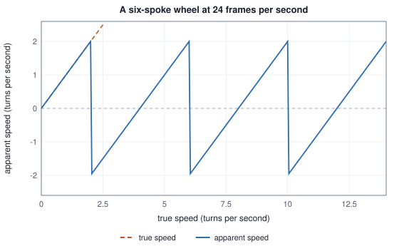
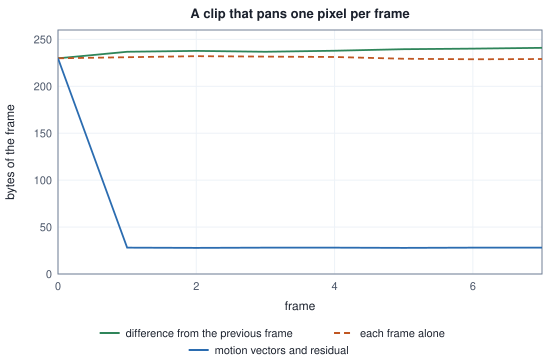

<!-- SPDX-License-Identifier: CC-BY-4.0 -->
<!-- Copyright (c) 2026 Martin Schröder <info@swedishembedded.com> -->

# Video as Data

*How do we represent and compress a sequence of frames?*

A minute of video at 24 frames per second and 1024 by 512 pixels is 1440 pictures, and written the way an image is written, three bytes a pixel, it is 2 264 924 160 bytes. The coded file that holds the same minute is more than a thousand times smaller. Nobody was careless about the first number and nobody was clever about the second: a clip is not 1440 unrelated pictures, and almost everything in frame 700 can be found in frame 699. Two ways of exploiting that relation serve two different readers. A **video codec** exploits it for a person or a player: it stores a clip in the fewest bytes that still look the same. A **video autoencoder** exploits it for a model: it turns a clip into a small grid of numbers that a network can read and write. The two are built on the same observation, that most of a frame is already known from the frames before it, and they differ in what they do with it.

Before either, there is the matter of what a clip is as a piece of data: a **frame sequence**, an ordered list of pictures of one size, each with a time at which it is shown. The pictures are the images of Volume VII. The times are new, and so are the ways in which they go wrong. Getting the times right, and then shrinking the frames, leans on five ideas from earlier volumes:

1. (Volume VII, [Chapter 1](../v07-vision/01-images.md), colour spaces.) A 640 by 480 frame is held as RGB and as planar 4:2:0 luma and chroma. How many bytes is each, and what do $Y$, $C_b$ and $C_r$ stand for?
2. (Volume IX, [Chapter 1](../v09-audio/01-sound.md), aliasing.) A cosine of 10 kHz is sampled 16 000 times a second. At what frequency does the list of samples say it is?
3. (Volume VII, [Chapter 2](../v07-vision/02-convolution.md), convolution and receptive field.) A $3 \times 3$ convolution with stride 1 and one pixel of zero padding runs over an $H \times W$ image. What shape does it return, and how many input pixels along one axis can one output of two stacked such layers see?
4. (Volume VIII, [Chapter 2](../v08-image-generation/02-vae.md), variational autoencoders.) What does the encoder of a variational autoencoder return for one input, and what does the decoder receive?
5. (Volume I, [Chapter 13](../v01-mathematics/13-information-theory.md), entropy.) What is the entropy of a distribution over a list of values, in bits, and what does it say about the shortest average code for values drawn from it?

## The time of a frame

A frame has an index $i = 0, 1, 2, \dots$ and a frame rate $\rho$ in frames per second, and it is shown at $t_i = i/\rho$. That is the whole definition, and the trouble is in writing $\rho$ down. Most clips run at 24, 25 or 30 frames per second, and a large family of television clips run at $30000/1001$ and $60000/1001$, a rate that broadcast television fixed so that colour and sound would not interfere. Written as a decimal, $30000/1001$ is $29.97002997\ldots$, and a decimal cannot be exact, so a file format that wants frame $i$ to land where it should stores the rate as a fraction $\mathrm{num}/\mathrm{den}$ and computes $t_i = i\,\mathrm{den}/\mathrm{num}$ with whole numbers.

A writer must get from the number a caller gives it to such a fraction. `fps_rational` in `crates/videocodec/src/lib.rs` does it with three rules, in this order: a number within $10^{-9}$ of a whole number is that number over 1; otherwise, if multiplying by $1001/1000$ lands within $10^{-6}$ of a whole number $n$, the rate is $1000n/1001$; otherwise the rate is $\mathrm{round}(1000\rho)$ over 1000, reduced to lowest terms, with the rounding half away from zero. The table runs the rule on seven inputs.

<!-- worked: video.rate_rule -->
The rule: an integer within 1e-9 is that integer over 1; else if the rate * 1001 / 1000 is within 1e-6 of a whole number n it is n * 1000 / 1001; else it is round(1000 * rate) / 1000 reduced to lowest terms. Column 2 is the input as a 64-bit number.

| input | as a number | fraction | fraction as a number |
|---|---:|---:|---:|
| 24 | 24.00000000 | 24 / 1 | 24.00000000 |
| 25 | 25.00000000 | 25 / 1 | 25.00000000 |
| 30000 / 1001 | 29.97002997 | 30000 / 1001 | 29.97002997 |
| 60000 / 1001 | 59.94005994 | 60000 / 1001 | 59.94005994 |
| 29.97 | 29.97000000 | 2997 / 100 | 29.97000000 |
| 23.976 | 23.97600000 | 2997 / 125 | 23.97600000 |
| 12.5 | 12.50000000 | 25 / 2 | 12.50000000 |

After 107892 frames (one hour at 30000 / 1001) the time is 3599.9964 seconds at 30000 / 1001 and 3600.0000 seconds at 2997 / 100: the two differ by 3.6 thousandths of a second.
<!-- /worked -->

The fifth and sixth rows show where the rule draws its line: a rate that is $n \cdot 1000/1001$ for an integer $n$ (23.976..., 29.97..., 59.94...) becomes that fraction, and the test is that the rate times $1.001$ is within $10^{-6}$ of an integer. A caller who writes the decimal 29.97 gets $2997/100$, because multiplying 29.97 by 1.001 gives 29.99997, which is $3 \times 10^{-5}$ from 30: a typed 29.97 is legitimately a different rate from the television one, and the rule recognizes the television rate when it is already the fraction's value to about seven digits, as it is when it was computed as 30000 divided by 1001. The difference between the two rates is small, one part in a million, but it is the kind that arrives late: after an hour of frames the two clocks differ by a few thousandths of a second, which is a fraction of a frame and enough to move a cut relative to its sound. A rate read back from a file meets the television rate, because `snap_fps`, below, returns it as $n/1.001$, which passes the test; only a decimal typed by hand takes the other row.

Whole-number arithmetic is also what the file formats do. An MP4 file gives each track a clock of its own, and the writer in `crates/videocodec/src/mp4.rs` sets the video track's clock to tick $\mathrm{num}$ times a second with every frame lasting $\mathrm{den}$ ticks, so frame $i$ is at tick $i\,\mathrm{den}$ and its time is exact. A Matroska or WebM file has one clock for the whole segment, by default a millisecond, and the writer in `crates/videocodec/src/webm.rs` stores each frame's start as whole nanoseconds, $\lfloor i \cdot 10^9\, \mathrm{den}/\mathrm{num} \rfloor$, and then as whole milliseconds by dividing again with the fraction dropped. The pseudocode of the second step is two integer divisions.

```text
function frame_start_ms(i: int, num: int, den: int) -> int:
    require i >= 0 and num > 0 and den > 0
    ns = (i * 1000000000 * den) // num
    return ns // 1000000
```

<!-- worked: video.timestamp_table -->
Frame i starts at i * den / num seconds. A Matroska writer with a clock of thousandths of a second stores floor(floor(i * 10^9 * den / num) / 10^6), whole nanoseconds first, whole milliseconds second; an MP4 track whose clock ticks num times a second and whose frames last den ticks stores i * den, which is exact.

| rate | i | exact time (thousandths of a second) | stored (thousandths) | lost (thousandths) |
|---|---:|---:|---:|---:|
| 24 | 1 | 41.6667 | 41 | 0.6667 |
| 24 | 2 | 83.3333 | 83 | 0.3333 |
| 24 | 3 | 125.0000 | 125 | 0.0000 |
| 24 | 5 | 208.3333 | 208 | 0.3333 |
| 24 | 10 | 416.6667 | 416 | 0.6667 |
| 24 | 100 | 4166.6667 | 4166 | 0.6667 |
| 30000 / 1001 | 1 | 33.3667 | 33 | 0.3667 |
| 30000 / 1001 | 2 | 66.7333 | 66 | 0.7333 |
| 30000 / 1001 | 3 | 100.1000 | 100 | 0.1000 |
| 30000 / 1001 | 5 | 166.8333 | 166 | 0.8333 |
| 30000 / 1001 | 10 | 333.6667 | 333 | 0.6667 |
| 30000 / 1001 | 100 | 3336.6667 | 3336 | 0.6667 |

The frame duration a Matroska track declares is floor(10^9 den / num) ns: 41666666 for 24 and 33366666 for 30000 / 1001. Read back as 10^9 / duration these are 24.0000004 and 29.9700306, and the snap rule (an integer, or n / 1.001 with n an integer, when within a millionth) returns 24 and 29.97002997.
<!-- /worked -->

The error is at most one millisecond and always in the same direction, because the clock rounds down. It never accumulates (frame 100 is as far off as frame 10), and it is invisible to a viewer. It is not invisible to a program that decides which frame a given moment belongs to, and selecting frames by time has to allow for it. The last paragraph of the table is a second small consequence: a Matroska track declares its frame duration as a whole number of nanoseconds, so a reader that recomputes the rate from it gets 24.0000004 for a 24-frame clip, and `snap_fps` in `crates/videocodec/src/lib.rs` turns that back into 24 when it lies within a millionth of an integer or of an integer over 1.001.

## A wheel that turns the wrong way

Film supplied the first example of what a frame rate does to motion, and it is the example every reader has seen: the spokes of a wagon wheel in a western turn slowly backwards while the wagon speeds forwards. It is the aliasing of Volume IX's first chapter with the roles changed. Sound was sampled in time and the trouble was a tone too fast for the rate. A film is sampled in time too, at $\rho$ frames per second, and a wheel is a periodic signal: a wheel with $S$ identical spokes looks the same after each $1/S$ of a turn, so at $u$ turns per second it presents a spoke at a fixed point $Su$ times a second, and the frames cannot tell that rate from any other that differs from it by a multiple of $\rho$, or by a reflection.

Apply the folding rule of that chapter to $Su$ with sampling rate $\rho$. The apparent rate $a$ is $Su$ shifted by a whole multiple of $\rho$ into $(-\rho/2, \rho/2]$, positive meaning the wheel appears to turn the way it does and negative the other way, and the apparent speed is $a/S$ turns per second. For six spokes and 24 frames per second the highest rate that can be shown faithfully is 12 spoke passes a second, 2 turns a second.

<!-- worked: video.wheel_table -->
A wheel of 6 equal spokes looks the same after every 60 degrees, so a wheel at f turns per second passes 6 f spokes per second past a fixed point. The camera samples at 24 frames per second; the folding rule of the sound chapter gives the spoke passes per second that the film shows, positive when the wheel seems to turn the way it does.

| true turns / s | spoke passes / s | apparent passes / s | apparent turns / s | looks |
|---|---:|---:|---:|---|
| 0.5 | 3 | +3 | +0.5 | forward |
| 1 | 6 | +6 | +1 | forward |
| 2 | 12 | +12 | +2 | either way |
| 3 | 18 | -6 | -1 | backward |
| 3.5 | 21 | -3 | -0.5 | backward |
| 4 | 24 | +0 | +0 | still |
| 4.5 | 27 | +3 | +0.5 | forward |
| 5 | 30 | +6 | +1 | forward |
| 6 | 36 | +12 | +2 | either way |
| 7.5 | 45 | -3 | -0.5 | backward |
| 8 | 48 | +0 | +0 | still |
| 11 | 66 | -6 | -1 | backward |

At 3.5 turns per second the wheel advances 52.5 degrees per frame, and the marked spoke is seen, folded into (-30, 30] degrees, at 0, -7.5, -15, -22.5 degrees on frames 0 to 3.

At 4.5 turns per second the wheel advances 67.5 degrees per frame, and the marked spoke is seen, folded into (-30, 30] degrees, at 0, 7.5, 15, 22.5 degrees on frames 0 to 3.
<!-- /worked -->

At 3.5 turns per second a spoke advances 52.5 degrees per frame, and because the pattern repeats every 60 degrees that is the same as $-7.5$ degrees: the wheel looks as if it turns backwards at half a turn per second. At 4 turns per second it advances exactly one spoke spacing per frame and stands still. The row at 2 turns per second is the sampling theorem's boundary: the spoke moves half the distance to its neighbour every frame and, with no spoke distinguishable from its neighbour, either direction explains the film equally well, which is why the table says so and not a sign.



The wheel is a clean case, but the rule is general and it matters to anything that reads video in a model. A system that samples a clip at one frame per second, as the default frame selection in brain's video reader does for a multimodal prompt, sees any pattern that repeats faster than half a hertz with a speed and a direction that have nothing to do with the truth: a flashing light, a ceiling fan, a turntable. A film camera or a sensor has a defence the sound chapter's recorder lacked, which is that the shutter stays open for a fraction of each frame and blurs fast motion, which is a crude low-pass filter. A program that picks frames out of a decoded clip has no such defence. It has to either accept the aliasing, or average the frames between the instants it keeps, which is what resampling an audio signal did with its kernel and what brain's frame selection does not do.

## The planes of a frame

Volume VII's first chapter taught the pixel formats a camera sends, and a video codec uses the same arrangement for a stronger reason: a coded stream is far smaller when the brightness of a picture is coded at full resolution and its colour at a quarter of it. The writer in `crates/videocodec/src/color.rs` fixes every choice a reader would otherwise have to guess. Frames are converted with the BT.709 matrix, $K_r = 0.2126$ and $K_b = 0.0722$, at **limited range**: luma $Y = 16 + 219L$ so that black is 16 and white 235, and chroma $128 + 224C$. The three planes are stored separately, $Y$ at the size of the frame, $U$ and $V$ at $\lceil W/2 \rceil \times \lceil H/2 \rceil$, each chroma sample the mean over its $2 \times 2$ block, and a block at an odd edge averages the pixels it has. Reading back takes the chroma sample of the block that holds the pixel, the nearest sample, with no smoothing.

A frame of 5 by 3 pixels is the smallest one that shows every one of those rules at work, since 5 and 3 are both odd. It also shows the price of the layout, because the picture is made of a red patch beside a blue one and the boundary falls inside a block.

<!-- worked: video.planes_table -->
The 5 by 3 frame has pixels (R, G, B), row by row: (200, 40, 40) (210, 50, 30) (190, 60, 50) (30, 40, 200) (20, 50, 210); (200, 120, 40) (180, 140, 60) (60, 150, 80) (40, 60, 190) (30, 70, 200); (90, 90, 90) (100, 100, 100) (120, 130, 140) (50, 80, 180) (60, 90, 170).

BT.709 (K_r = 0.2126, K_b = 0.0722), limited range: Y = round(16 + 219 L), U = round(128 + 224 C_b), V = round(128 + 224 C_r), with L, C_b, C_r computed from R / 255, G / 255, B / 255, the chroma as the mean over the 2 by 2 block (an edge block averages the pixels it has), and round() half away from zero.

```text
Y plane, 5 x 3 = 15 bytes
     80  87  91  58  63
    129 139 124  72  77
     93 102 126  85  93
U plane, 3 x 2 = 6 bytes
     97 151 195
    128 154 166
V plane, 3 x 2 = 6 bytes
    178 127 107
    128 117 112
```

Decoding takes the chroma sample of the block that holds the pixel (the nearest sample), L = (Y - 16) / 219, C = (U - 128) / 224, then R = L + 2 (1 - K_r) C_r, B = L + 2 (1 - K_b) C_b, G = (L - K_r R - K_b B) / K_g, each times 255 and rounded half away from zero, clamped to 0 .. 255.

| pixel (x, y) | original | decoded | largest error |
|---|---|---:|---:|
| (0, 0) | (200, 40, 40) | (164, 54, 9) | 36 |
| (1, 0) | (210, 50, 30) | (172, 63, 17) | 38 |
| (2, 0) | (190, 60, 50) | (86, 83, 136) | 104 |
| (3, 0) | (30, 40, 200) | (47, 45, 97) | 103 |
| (4, 0) | (20, 50, 210) | (17, 52, 196) | 14 |
| (0, 1) | (200, 120, 40) | (221, 112, 66) | 26 |
| (1, 1) | (180, 140, 60) | (233, 123, 78) | 53 |
| (2, 1) | (60, 150, 80) | (124, 121, 174) | 94 |
| (3, 1) | (40, 60, 190) | (63, 61, 114) | 76 |
| (4, 1) | (30, 70, 200) | (33, 68, 213) | 13 |
| (0, 2) | (90, 90, 90) | (90, 90, 90) | 0 |
| (1, 2) | (100, 100, 100) | (100, 100, 100) | 0 |
| (2, 2) | (120, 130, 140) | (108, 128, 183) | 43 |
| (3, 2) | (50, 80, 180) | (61, 81, 135) | 45 |
| (4, 2) | (60, 90, 170) | (61, 90, 170) | 1 |

The frame is 45 bytes as RGB and 27 bytes in these planes.
<!-- /worked -->

The frame goes from 45 bytes to 27 and loses nothing where the picture is grey: the pixels at $(0, 2)$ and $(1, 2)$ are grey and come back exactly. A colour edge inside a $2 \times 2$ block does not come back. Pixel $(2, 0)$ is red and its neighbour $(3, 0)$ is blue; they share one chroma sample, the average of their block, and both are decoded as a muddy mixture, with a largest error of 104 and 103 codes. The pixels at the right edge of the frame, whose blocks are one pixel wide and so average only what is there, come back within 14 codes. A codec accepts that cost for photographs, where colour edges are soft and almost always coincide with edges of brightness, which the full-resolution luma still carries; it is the reason that a one-pixel red line on blue looks wrong on video, and why synthetic test patterns are a poor judge of a video format.

That the matrix is a choice written in a header, and not a fact of the data, is the same lesson as Volume VII's wrong-matrix table. The decoder in `crates/videocodec/src/av1.rs` reads the matrix and the range from the stream's own sequence header, falls back on the usual reading of a stream that declares nothing (BT.709 if it is at least 720 lines tall, BT.601 otherwise), and supports 4:2:0, 4:2:2, 4:4:4 and monochrome at 8, 10 or 12 bits, widening each plane to 16-bit samples before it applies the matrix.

## What a minute costs

Planar layout halves a frame and does nothing about the other dimension, time. A minute of 24 frames per second is 1440 frames, and every size is a multiple of the frame.

<!-- worked: video.minute_costs -->
A minute is 24 * 60 = 1440 frames at 24 frames per second. RGB has 3 bytes per pixel; the planar 4:2:0 layout has one luma byte per pixel and two chroma bytes per 2 by 2 block, 1.5 bytes per pixel for even sizes.

| size | bytes per RGB frame | bytes per minute, RGB | bytes per minute, 4:2:0 |
|---|---:|---:|---:|
| 640 x 360 | 691,200 | 995,328,000 | 497,664,000 |
| 1024 x 512 | 1,572,864 | 2,264,924,160 | 1,132,462,080 |
| 1280 x 720 | 2,764,800 | 3,981,312,000 | 1,990,656,000 |
| 1920 x 1080 | 6,220,800 | 8,957,952,000 | 4,478,976,000 |

A coded stream of 220,000 bits per second holds a minute in 1,650,000 bytes, 686.3 times fewer than the 4:2:0 minute of 1024 x 512 (1,132,462,080 bytes) and 1372.7 times fewer than its RGB minute (2,264,924,160 bytes).
<!-- /worked -->

<!-- perf-number: historical measurement, commit 343a0f950 -->
The last line carries a number worth stopping at. The default AV1 settings of `crates/videocodec/src/av1.rs`, quantizer 80 and speed 10, were recorded on 4 November 2026 as holding a panning 1024 by 512 photograph at about 220 kilobits a second, a dated observation of one clip and one setup and not a promise about any other; a minute at that rate is 1 650 000 bytes, about 686 times fewer than the planar minute. Three orders of magnitude between the raw and the coded stream is not unusual, and it is the reason every video that anyone transmits is coded. The factor has two sources worth understanding separately: prediction between frames, and the coding of what prediction leaves, which is the work of a codec's transform and entropy coder.

## Predicting a frame from the last

Take the simplest clip that has the property. A texture of random integers is panned past a window: 16 rows and 24 columns of numbers from 0 to 255, drawn once, and the picture at time $t$ shows columns $t, \dots, t + 15$. The window sees the scene moving one pixel to the left per frame. There are eight frames of 16 by 16 pixels, no colour, and the scene is as unpredictable as a scene can be within a frame, so that any saving has to come from between frames.

A code length needs a model of the symbols, and the cheapest honest one is the frequency of the values in the list itself. For a list of $n$ values in which value $v$ occurs $c_v$ times, the plug-in entropy is $H = -\sum_v (c_v/n)\log_2(c_v/n)$ bits per value, and $nH$ is the length of an ideal code for the list in bits (the shortest average, as Volume I showed, ignoring the cost of telling the decoder the frequencies). It is what a coder that knew the list would be allowed to spend, and it is the number that prediction lowers.

Three ways of coding frame $t \ge 1$ are compared. **Alone:** every pixel minus 128, which is what an intra-coded frame does, here without any prediction inside the frame at all. **Difference:** every pixel minus the pixel in the same place of the previous frame, the simplest **inter** prediction. **Motion:** the frame is cut into 16 blocks of 4 by 4, each block is predicted from a block of the previous frame displaced by a **motion vector** $(d_x, d_y)$ with both components in $\{-2, \dots, 2\}$, the block of values subtracted, and the vector itself paid for at $\log_2 25$ bits. The prediction of a pixel that falls outside the previous frame takes the nearest pixel inside it. A vector is chosen by the least sum of absolute differences over the block, and the ties are resolved by a fixed order so that the result is reproducible.

```text
function best_vector(cur: array<int>[16, 16], prev: array<int>[16, 16], bx: int, by: int) -> (int, int):
    best = 1000000
    result = (0, 0)
    for (dx, dy) in C:
        sad = 0
        for j in 0 .. 4:
            for i in 0 .. 4:
                px = min(max(bx + i + dx, 0), 15)
                py = min(max(by + j + dy, 0), 15)
                sad = sad + abs(cur[by + j, bx + i] - prev[py, px])
        if sad < best:
            best = sad
            result = (dx, dy)
    return result
```

where `C` is the list of the 25 pairs ordered by increasing $|d_x| + |d_y|$, then by increasing $d_y$, then by increasing $d_x$, so that the first of equal candidates in the loop is the one with the smallest displacement. The block corner $(b_x, b_y)$ runs over multiples of 4. Frame 0 has no previous frame and is coded alone in all three columns.

<!-- worked: video.toy_table -->
The scene is a texture of 16 rows and 24 columns of integers 0 .. 255, drawn by the book's SplitMix64 from the stream `video.toy_scene` (seed 17677821292879074499) with `integer(256)`, row by row (row 0 first, the columns of a row left to right); its first row is [58, 64, 176, 98, 128, 46, 188, 143, 248, 61, 188, 181, 247, 89, 205, 13, 54, 35, 103, 38, 162, 242, 43, 166]. Frame t shows columns t .. t + 15, so the picture pans one pixel to the left per frame; there are 8 frames. Each frame is cut into 16 blocks of 4 by 4. The cost of a list of values is n times their plug-in entropy -sum p log2 p (p the share of each distinct value in the list), in bits. 'Alone': values minus 128. 'Difference': minus the previous frame's pixel at the same place. 'Motion': minus the previous frame's pixel at the place the block's vector points to (clamped to the frame), with one vector per block from -2 .. 2 in each direction (25 choices, log2 25 = 4.644 bits each), picked by the least sum of absolute differences, ties to the smaller |dx| + |dy|, then dy, then dx. Frame 0 has no previous frame and is coded alone in all three.

| frame | alone (bits) | difference (bits) | motion (bits) | non-zero residuals | vectors (dx, dy) |
|---|---:|---:|---:|---:|---|
| 0 | 1838.8 | 1838.8 | 1838.8 | 255 | - |
| 1 | 1847.9 | 1894.5 | 224.6 | 16 | all (1, 0) |
| 2 | 1856.9 | 1902.0 | 222.6 | 16 | all (1, 0) |
| 3 | 1853.2 | 1894.5 | 224.6 | 16 | all (1, 0) |
| 4 | 1849.9 | 1903.2 | 224.6 | 16 | all (1, 0) |
| 5 | 1834.9 | 1916.5 | 222.6 | 16 | all (1, 0) |
| 6 | 1830.5 | 1921.2 | 224.6 | 16 | all (1, 0) |
| 7 | 1832.5 | 1928.0 | 224.6 | 16 | all (1, 0) |
| total bits | 14744.7 | 15198.5 | 3407.3 |  |  |
| total bytes | 1843.1 | 1899.8 | 425.9 |  |  |
<!-- /worked -->



Coding each frame alone costs the same every frame, since each frame is as random as the last. The difference makes things worse, not better: the difference of two unrelated values has a wider spread than either, and the table's third column is above the second in every row after the first. Motion makes the clip cheap. Every block finds the vector $(1, 0)$, which says that its content came from one pixel to the right in the previous frame, and every pixel then has a residual of zero except the 16 pixels of the right-hand column, which were not in the previous frame at all. The frame costs the 16 vectors, the residuals, and a sliver of entropy for the many zeros: about 28 bytes against 230.

That is the whole mechanism of a video codec's inter prediction, and also its limit. Prediction helps by exactly as much as the previous frame explains. A scene cut explains nothing, and the codec codes the first frame after it alone. Real video is not made of random texture, so coding a frame alone is not 230 bytes of 256 in a real codec, which predicts a block from its neighbours inside the same frame and codes the leftover with a transform; those are the parts that the toy leaves out, and a real stream's reduction is smaller on a smooth clip and larger on a still one. What the toy preserves is the structure: a block of the new frame is a block of the old frame, moved, plus a correction.

### Why the encoder must follow the decoder

The toy so far was lossless: the decoder could rebuild every frame exactly. A real codec is lossy: it replaces each residual by a coarser one, and then a trap opens. Replace each residual $r$ by $\Delta q(r)$, with $\Delta = 8$ and $q(r) = \mathrm{sign}(r)\lfloor |r|/\Delta + 1/2 \rfloor$, so that the error of one pixel is at most $\Delta/2 = 4$. The question is which previous frame the encoder subtracts: the original, or the one the decoder will have after its own rounding. The first is **open loop** and the second **closed loop**. The decoder in both predicts from its own previous frame, so only in the second does the encoder's residual correct what the decoder actually has.

<!-- worked: video.loop_table -->
The same clip, with every residual replaced by 8 times its quantized value, q(r) = sign(r) floor(|r| / 8 + 1/2) (ties away from zero), and every rebuilt pixel clamped to 0 .. 255. Frame 0 is coded alone with prediction 128. The vectors are those of the table above, found on the original frames. Closed loop: the residual is taken against the decoder's previous frame. Open loop: against the original previous frame, while the decoder still predicts from its own.

| frame | largest error, closed loop | largest error, open loop |
|---|---:|---:|
| 0 | 4 | 4 |
| 1 | 4 | 6 |
| 2 | 4 | 10 |
| 3 | 4 | 10 |
| 4 | 4 | 12 |
| 5 | 4 | 14 |
| 6 | 4 | 14 |
| 7 | 4 | 16 |
<!-- /worked -->

In the closed loop the error of each frame is at most 4, whatever the length of the clip, because each frame's error is only its own rounding. In the open loop each frame inherits the previous frame's error through the prediction and adds its own, and the largest error climbs from 4 at frame 0 to 16 at frame 7; it would go on climbing, which is the **drift** that a real encoder avoids by running a copy of the decoder inside itself. The principle matters beyond codecs: wherever a prediction is built from earlier output and an error is introduced at each step, the error accumulates unless the correction is computed against what the receiver actually has.

### Key frames and random access

Prediction makes frame $t$ depend on frame $t - 1$, which depends on frame $t - 2$, and so on to a frame coded alone, an **intra frame** or key frame. A decoder that wants frame 100 cannot start at 100; it starts at the last key frame at or before it and decodes forward. That is the whole case for inserting key frames at regular intervals, and `key_frame_interval` in `EncodeSettings` is brain's setting for it, 120 frames by default.

<!-- worked: video.access_table -->
To show frame 100 a decoder starts at the last key frame at or before it. With key frames every G frames that is frame G floor(100 / G), and it decodes 100 - G floor(100 / G) + 1 frames. The last column prices a frame at the toy's costs: 229.9 bytes alone and 28.0 bytes on average for frames 1 to 7 with motion; a group of G costs (alone + (G - 1) motion) / G per frame.

| G | frames decoded for frame 100 | toy bytes per frame |
|---|---:|---:|
| 1 | 1 | 229.9 |
| 8 | 5 | 53.2 |
| 24 | 5 | 36.4 |
| 120 | 101 | 29.7 |
<!-- /worked -->

A key frame every frame wastes the saving, and one every 120 frames makes a seek to frame 100 decode 101 frames; the middle is a choice. The table prices the choice at the toy's costs, and brain's own reader takes the benefit. Both containers mark their random-access points, Matroska by a flag on the block and MP4 by its sync-sample table (a stream whose table is absent counts every sample as one), and the reader's samples carry that flag. `decode_from` in `crates/videocodec/src/lib.rs` reads a stream from a first frame index: it holds the coded units since the last key frame until the read reaches that index, decodes from the key frame once it does, and hands out frames from the index on, with the stream's sequence header put in front of a key unit that lacks one so that a decoder started there knows the parameters. `decode_frames_at` in `crates/imaging/src/video.rs`, which reads a list of specific frames, starts at the smallest index it was asked for and stops after the largest (commits `08f898d61` and `52ce261df`, 13 November 2026). The test reads from six start frames in WebM and MP4 and requires that the frames equal those of the whole decode bit for bit and that the decoder handles fewer than one key interval of units before the first frame asked for, the bound the formula above gives.

## One file, two clocks

A clip with sound is two streams, and each has its own idea of when it starts. Video is a list of frames at $1/\rho$ apart. Audio, in the form brain writes it, is Opus: packets of 960 samples at a clock of 48 000 samples a second, so every packet is a twentieth of a second. The video's frame times are in general not multiples of that (at 24 frames per second the frames are at 0, 41.67 and 83.33 thousandths of a second), and a container's job is to let a player put each frame and each packet on one timeline.

Opus adds one more offset. The encoder reports a **pre-skip**, the number of samples at the start of its output that a decoder must discard because they are produced from the encoder's look-ahead and not from the signal. `crates/videocodec/src/mux.rs` takes the value from the encoder and appends that many extra samples to the signal so that dropping them at the start does not cut the end. A value of 312 is used below as a stated input of the example; the encoder in use determines the real one. A sound given at another rate is first brought to 48 000 Hz by linear interpolation (`resample_linear`), and, as the previous volume showed, that interpolation does not remove frequencies a lower rate cannot carry. A sound brought up to 48 000 Hz, such as speech at 16 kHz or music at 44.1 kHz, has no such frequencies to lose; a sound brought down from a higher rate would fold whatever lay above 24 kHz back into the band.

<!-- worked: video.av_table -->
One second of mono sound at 16 000 Hz and 24 video frames. The sound is brought to 48 000 Hz by linear interpolation (ceil(16 000 * 48 000 / 16 000) = 48000 samples), Opus codes packets of 960 samples (a twentieth of a second) and its encoder reports a look-ahead, here taken as 312 samples, which is appended as 312 more samples of coding so that dropping it keeps the end: 48312 samples, 51 packets (ceil(48312 / 960)).

A WebM file writes every block of both tracks in the order of (time in thousandths of a second, track), track 1 the video, track 2 the sound; the first 14:

| time (ms) | track | block |
|---:|---:|---|
| 0 | 1 | video frame 0 |
| 0 | 2 | audio packet 0 |
| 20 | 2 | audio packet 1 |
| 40 | 2 | audio packet 2 |
| 41 | 1 | video frame 1 |
| 60 | 2 | audio packet 3 |
| 80 | 2 | audio packet 4 |
| 83 | 1 | video frame 2 |
| 100 | 2 | audio packet 5 |
| 120 | 2 | audio packet 6 |
| 125 | 1 | video frame 3 |
| 140 | 2 | audio packet 7 |
| 160 | 2 | audio packet 8 |
| 166 | 1 | video frame 4 |

Video frame i is at floor(i 10^9 / 24 / 10^6) thousandths of a second and audio packet j at 20 j. The file's duration, in the same unit, is the later of the two ends: video 1000, audio 1020 (51 packets of 20), so 1020. An MP4 file keeps each track on its own clock instead: the video track ticks 24 times a second with every frame lasting 1 tick, the sound track ticks 48 000 times a second with every packet lasting 960 ticks, and an edit list starts the sound at tick 312. Its duration is the later of video 1000 and sound (51 * 960 - 312) * 1000 / 48 000 = 1013 (whole thousandths, rounded down), so 1013. A player that ignored the 312 samples would play the sound 6.5 thousandths of a second late, 0.156 of a frame.
<!-- /worked -->

The first fourteen blocks show the whole rule of order in a WebM file: the blocks of both tracks are sorted by time, the video first at equal times, so a player reading from the start meets the frames and the packets in about the order it needs them. A new cluster opens at every video key frame, or after 30 seconds, because a block's time is stored as a signed 16-bit offset in milliseconds from the cluster's start. The MP4 file keeps the same facts differently, each track in its own clock with a table of durations, and says in an **edit list** that the sound starts at tick 312.

The two files do not report the same duration for the same content. The WebM writer takes the later of the video's end and the audio's end, counting every packet including the padding that the pre-skip makes necessary, and gets 1020 thousandths of a second; the MP4 writer subtracts the pre-skip from the sound's length and gets 1013. The WebM figure is advisory and the one that makes sense to a player is the sound's real end, at 1013.5, so neither is wrong in a way that matters; but it is a reminder that a number labelled duration is a convention of its container.

The unit test of these files, `crates/videocodec/tests/roundtrip.rs`, writes a 30-frame clip at 24 frames per second in each container, probes it, decodes every frame, and requires the count, the size, the frame rate within a millionth, each frame's time within two thousandths of a second of $i/24$, and a peak signal-to-noise ratio of at least 34 dB against the frame as 4:2:0 alone would return it. That allowance is the one the Matroska clock needs, and the file for a clip with sound is additionally handed to an external probe where one is installed, which has to find an AV1 video stream and an Opus audio stream. The commit that introduced the crate (commit `343a0f950`, 4 November 2026) says that a reference decoder reads what the crate writes frame for frame, with the sound sample-aligned. That is a claim about a tool outside the repository, and the test above does not establish it: against the external probe it compares stream types, and its own decoder is the one that checks the pictures.

## Choosing frames by time

A model does not read 1440 frames; it reads a few dozen, chosen from the clip. How they are chosen is a use of the timestamps, and it is where the one-millisecond clock of the Matroska file shows. `crates/imaging/src/video.rs` selects frames from the stream's own timestamps. For a requested rate $r$ the output instants are $s_j = t_{\mathrm{first}} + j/r$, and the output at $s_j$ takes the source frame whose time is nearest to it. Between two frames the boundary is the midpoint of their times, and an instant at the midpoint belongs to the earlier frame; to the precision of the container's clock, in fact, an instant within a millisecond above the midpoint belongs to the earlier frame, because the stored times are the true times rounded down by up to a millisecond. After the last frame an instant is still covered if it falls within one more frame interval of that frame's time.

A clip of 30 frames per second asked for 12 frames per second shows the need. Every output is 2.5 source frames from the next, so every second output instant falls exactly on a midpoint.

<!-- worked: video.frame_pick -->
A clip of 30 frames at 30 frames per second in a Matroska file, whose stored times, in thousandths of a second, are floor(i * 10^9 / 30 / 10^6) (0, 33, 66, 100, 133, 166, 200, 233, ...). Asked for 12 frames per second, output j is the instant (stored time of frame 0) + j / 12 and takes the source frame whose time is nearest, a tie to the earlier frame, where 'tie' means at most a thousandth of a second above the midpoint of two stored times (an instant below the midpoint is the earlier frame's anyway).

| j | instant (thousandths) | position in frames | frame, with the tie rule | frame, strict midpoint |
|---|---:|---:|---:|---:|
| 0 | 0.000 | 0 | 0 | 0 |
| 1 | 83.333 | 2.5 | 2 | 3 |
| 2 | 166.667 | 5 | 5 | 5 |
| 3 | 250.000 | 7.5 | 7 | 8 |
| 4 | 333.333 | 10 | 10 | 10 |
| 5 | 416.667 | 12.5 | 12 | 13 |
| 6 | 500.000 | 15 | 15 | 15 |
| 7 | 583.333 | 17.5 | 17 | 18 |
| 8 | 666.667 | 20 | 20 | 20 |
| 9 | 750.000 | 22.5 | 22 | 23 |
| 10 | 833.333 | 25 | 25 | 25 |
| 11 | 916.667 | 27.5 | 27 | 28 |

Eight frames spread over a clip of 48 frames at 24 frames per second: the clip's duration is the last stored time minus the first plus 1 / 24 of a second = 1.999667 seconds, and asking for n = 8 frames sets the rate to (n - 1/2) / duration = 3.75063 per second, which makes exactly n instants fall inside the clip: instants j / rate for j = 0 .. 7 are before the end (the last at 1.8664 seconds) and the next, 2.1330 seconds, is after 1.9997 seconds.

| j | instant (thousandths) | source frame |
|---:|---:|---:|
| 0 | 0.000 | 0 |
| 1 | 266.622 | 6 |
| 2 | 533.244 | 13 |
| 3 | 799.867 | 19 |
| 4 | 1066.489 | 26 |
| 5 | 1333.111 | 32 |
| 6 | 1599.733 | 38 |
| 7 | 1866.356 | 45 |
<!-- /worked -->

The strict column assigns the instants at 83.333 and 250 thousandths of a second to frame 3 and frame 8, because the stored times are 33, 66, 100 and the midpoint of 66 and 100 is 83, below 83.333; the true times are 33.33, 66.67 and 100, whose midpoint is 83.33, and the tie goes to the earlier frame. A tolerance of a thousandth of a second restores that. `Picker::push` in `crates/imaging/src/video.rs` judges a tie in this way, to the precision of the coarsest common container clock, and that is the reason the same clip gives the same frames whether it is stored in MP4, whose times are exact, or in Matroska, whose are not.

The second table is the other selection mode, `spread`: about $n$ frames evenly across the whole clip. The rate it asks for is $(n - 1/2)/d$ for a clip of duration $d$, and the half is not decoration. With a rate of $n/d$ the instant $j = n$ would fall exactly at the end of the clip, outside it or on its boundary depending on rounding. With the half taken off, the instants $j/\mathrm{rate}$ for $j = 0, \dots, n - 1$ all fall strictly inside, since $(n - 1)d/(n - 1/2) < d$, and the next, $n d/(n - 1/2)$, falls outside, so exactly $n$ frames are produced. The clip's duration is itself computed, for a Matroska file, as the last stored time minus the first plus one frame interval, since the container does not say.

## A convolution that cannot see the future

The frames are now selected, and for a model they must become a tensor. A video model's first problem is size. The 121-frame clip of 768 by 512 pixels that brain's video model generates by default with its full checkpoint is 142 737 408 values as RGB, and 71 368 704 even as 4:2:0 planes. A transformer that read the clip a value at a time would have 142 million positions, so a network has to shrink the clip first, and it does so with a network that learns the shrinking: an autoencoder, whose encoder turns the clip into a small grid and whose decoder turns the grid back. Volume VIII's variational autoencoder did this to pictures; the question here is what changes when the picture has a time axis.

The tool for reading a time axis is the one the second chapter of Volume VII built for space. A convolution with a kernel of three taps along time slides over the frames the way a $3 \times 3$ convolution slid over the pixels, and a three-dimensional convolution has a $3 \times 3 \times 3$ kernel that reads a pixel's neighbours in both directions at once. The new question is what a tap along time reads at the first and last frames, where a neighbour does not exist, and the answer defines a **causal 3D convolution**. In a causal convolution the output at time $t$ may use only frames at times up to $t$. The kernel's three taps look at frames $t - 2$, $t - 1$ and $t$, and for the first frames, where those do not exist, the missing frames are supplied by repeating the first frame, as many copies as are missing: two for a kernel of three.

The point of the arrangement is a property of the output and not of the arithmetic. Changing a later frame cannot change an earlier output, so the encoding of a clip's first 3 frames is the same whether those 3 frames are the whole clip or the beginning of a longer one, and a clip can be encoded as it arrives. A symmetric convolution, which reads $t - 1$, $t$ and $t + 1$ and repeats the first frame before and the last after, has no such property, since the last output reads a padded copy of the last frame, and its neighbour depends on a frame that may change.

<!-- worked: video.causal_table -->
One pixel's history over six frames, x = [8.0, 16.0, 4.0, 12.0, 20.0, 24.0], and a temporal kernel of three taps w = [0.125, 0.25, 0.5], y[t] = w[0] p[t] + w[1] p[t + 1] + w[2] p[t + 2] for the padded sequence p (sums in tap order). Causal padding puts two copies of x[0] before the sequence (so y[t] reads frames t - 2, t - 1, t); symmetric padding puts one copy of x[0] before and one of x[5] after (frames t - 1, t, t + 1). The second row of each pair changes only the last frame.

| padding | input | y[0] | y[1] | y[2] | y[3] | y[4] | y[5] |
|---|---|---:|---:|---:|---:|---:|---:|
| causal | x ending 24 | 7 | 11 | 7 | 9 | 13.5 | 18.5 |
| causal | x ending 100 | 7 | 11 | 7 | 9 | 13.5 | 56.5 |
| symmetric | x ending 24 | 11 | 7 | 9 | 13.5 | 18.5 | 20.5 |
| symmetric | x ending 100 | 11 | 7 | 9 | 13.5 | 56.5 | 77.5 |

Causal padding on the first three frames alone gives ['7', '11', '7'], the first three outputs of the full clip ['7', '11', '7'].
<!-- /worked -->

The table shows both. One pixel's history over six frames is filtered with the same three taps. Changing only the last frame from 24 to 100 changes one output of the causal convolution, the last, and two of the symmetric one, the last and the one before it. And the causal outputs for the first three frames alone are the first three outputs of the full clip. The receptive field along time grows by 2 frames for every causal layer of three taps, so $L$ layers see $2L + 1$ frames, the current one and the $2L$ before it, the way Volume VII's receptive field grows over space.

The checkpoint that brain ports mixes the two cases, and `causal_conv3` in `crates/ltxv/src/vae3d.rs` implements both. The encoder's convolutions pad in time by repeating the first frame twice before the clip. The decoder's convolutions, in the checkpoint with the convolutional decoder, are not causal: they repeat the first frame once before and the last frame once after. Along height and width every convolution pads with zeros, as an image convolution does, because the checkpoint's configuration sets the padding mode to zeros explicitly; the reference implementation's own default is reflection, which would apply only to a configuration that omitted the field.

## What a video autoencoder keeps

The encoder of the video autoencoder that brain implements is a stack of such convolutions with resampling between them, and its shape is easiest to read from the shapes of the tensors. The clip is cut into $4 \times 4$ patches of pixels at the outer boundary, each patch laid out as 16 values per colour channel, 48 channels in all, so a frame of 512 by 768 is a $128 \times 192$ grid of 48-channel vectors; a convolution brings 48 channels to 128. Then four down blocks resample: the first halves height and width, the second halves time, the third and fourth halve all three. A halving is not a strided convolution. Each block's convolution produces a fraction of the channels it needs, and a space-to-depth step moves each neighbourhood of values into the channels, doubling or keeping the channel count as the block specifies, so a halving of an axis moves its values into channels instead of dropping them; and a parameter-free group mean of the same rearranged input is added as a shortcut. Between the down blocks sit residual blocks of two convolutions with a normalization that has no learned gain and a sigmoid-weighted activation, 4, 6, 4, 2 and 2 of them. Nothing in their shape matters for the arithmetic below.

A block that halves time must see an even number of frames, so it first repeats frame 0 once, which is the first of two places where the first frame is special.

<!-- worked: video.shape_table -->
A clip of 121 frames of 512 rows and 768 columns. The encoder: patchify cuts every 4 by 4 patch of the 3 colour channels into 48 channels at a quarter of the height and width, and a convolution brings them to 128; four down blocks follow (the others, the residual blocks, keep the shape). A down block that halves time first repeats frame 0 once so the count is even; its output channels are the channels times 2, 2, 2, 1 for the four blocks. The final convolution writes 128 channels of means and one of spread.

| after | channels | frames | height | width | values |
|---|---:|---:|---:|---:|---:|
| pixels | 3 | 121 | 512 | 768 | 142,737,408 |
| patchify 4 x 4, conv_in | 128 | 121 | 128 | 192 | 380,633,088 |
| down: space | 256 | 121 | 64 | 96 | 190,316,544 |
| down: time | 512 | 61 | 64 | 96 | 191,889,408 |
| down: all | 1024 | 31 | 32 | 48 | 48,758,784 |
| down: all | 1024 | 16 | 16 | 24 | 6,291,456 |
| conv_out: 128 means + 1 spread | 129 | 16 | 16 | 24 | 792,576 |

The decoder's three time-doubling blocks take 16 latent frames to 31, 61 and 121 frames: each doubles the count and drops the first frame of the result, 2 n - 1.
<!-- /worked -->


Space shrinks by a factor of 32 in each direction, 4 from the patches and $2 \times 2 \times 2$ from the down blocks; time shrinks by 8, three halvings. A latent has 128 channels per position, so a position stands for $8 \times 32 \times 32 \times 3 = 24\,576$ pixel values and carries 128 numbers. The final convolution writes 129 channels, 128 of means and one of spread (a single log-variance channel, the checkpoint's `uniform` setting, in place of Volume VIII's one per latent value), but brain's encoder returns the means alone, as the reference encoder's forward pass does. The scheme is variational in the sense of that chapter, an encoder that returns a distribution, and in use it is only a deterministic compressor; the training that made its weights is not something brain contains.

### The number of frames

The temporal arithmetic has a consequence that a user of the model meets immediately. Three halvings, each applied after repeating frame 0, map $F$ frames to $F'$ latent frames with $(F + 1)/2$ at each step, which requires $F$ to be odd at each step. Starting from $F = 1 + 8k$ the steps give $4k + 1$, $2k + 1$ and $k + 1$, all odd until the last; any other $F$ has an even count at some step and is refused. The first frame therefore has a latent frame of its own, and each later latent frame stands for eight pixel frames: $F' = 1 + (F - 1)/8$.

<!-- worked: video.frame_rule_table -->
Latent frames for a clip of F frames: 1 + (F - 1) / 8 when F - 1 is a multiple of 8, otherwise no clip. 24 frames, a second at 24 frames per second, is not allowed; 25 is.

| F | latent frames |
|---|---:|
| 1 | 1 |
| 8 | not allowed |
| 9 | 2 |
| 16 | not allowed |
| 17 | 3 |
| 24 | not allowed |
| 25 | 4 |
| 97 | 13 |
| 121 | 16 |
| 122 | not allowed |
<!-- /worked -->

A second of video at 24 frames per second is 24 frames, which is not allowed; 25 is, and gives 4 latent frames. `LtxVaeConfig::latent_frames` in `crates/ltxv/src/vae3d.rs` returns a latent frame count only for $F = 1 + 8k$ and nothing for any other count, and `GenOpts::frames` in `crates/ltxv/src/pipeline.rs` carries the same requirement. The sizes obey the other half: heights and widths must be multiples of 32.

Which frames does each latent frame stand for? The decoder gives the answer when it runs the arithmetic backwards. Each of its three time-doubling blocks doubles the frame count and then drops the first frame of the result, $n \to 2n - 1$, which takes 16 latent frames to 31, 61 and 121. The first latent frame is then exactly pixel frame 0 and each later one a window of 8 pixel frames ending with frame $8k$. The generator's position encoding uses these windows in seconds: `real_pixel_positions` in `crates/ltxv/src/pipeline.rs` gives latent frame $k$ the interval from $\max(0, 8k - 7)$ to $\max(0, 8k + 1)$ frames, divided by the frame rate.

<!-- worked: video.window_table -->
For the 25-frame clip at 24 frames per second, latent frame k covers the pixel frames lo .. hi - 1 with lo = max(0, 8k - 7) and hi = max(0, 8(k + 1) - 7), that is the half-open time window from lo / 24 to hi / 24 seconds.

| k | pixel frames | how many | from (s) | to (s) |
|---|---:|---:|---:|---:|
| 0 | 0 .. 0 | 1 | 0.0000 | 0.0417 |
| 1 | 1 .. 8 | 8 | 0.0417 | 0.3750 |
| 2 | 9 .. 16 | 8 | 0.3750 | 0.7083 |
| 3 | 17 .. 24 | 8 | 0.7083 | 1.0417 |
<!-- /worked -->

The first latent frame covers one pixel frame, the rest eight, and together they tile the clip: 1, 8, 8 and 8 frames make 25. The frame rate enters only through the division that turns frames into seconds, so a model told that a clip runs at 24 frames per second and one told 12 place the same latent grid at different times.

### What a latent saves

The point of the construction is to give an attention layer, in the next chapter, fewer positions to attend over. The table counts what a clip is as pixel values, as planar values and as latent values, and how many positions the latent has.

<!-- worked: video.saving_table -->
Values of the pixels (3 per pixel), of the 4:2:0 planes (1.5 per pixel) and of the latent (128 per position), and the number of latent positions (latent frames * height / 32 * width / 32, where latent frames = 1 + (F - 1) / 8 for F video frames), and the square of that number, the pairs of positions an attention layer would score.

| clip | RGB values | 4:2:0 values | latent values | latent positions | pairs of positions | RGB / latent | 4:2:0 / latent |
|---|---:|---:|---:|---:|---:|---:|---:|
| 768 x 512, 121 frames | 142,737,408 | 71,368,704 | 786,432 | 6,144 | 37,748,736 | 181.5 | 90.8 |
| 1024 x 512, 1441 frames (60.04 seconds) | 2,266,497,024 | 1,133,248,512 | 11,862,016 | 92,672 | 8,588,099,584 | 191.1 | 95.5 |
<!-- /worked -->

The latent is about 181 times smaller than the RGB values and about 91 times smaller than the planar ones, for the 121-frame clip, and about 191 and 95 times for a minute at 1024 by 512 pixels. In positions the saving is much larger, since a position stands for 24 576 pixel values; the 6144 positions of the first clip are a size a transformer can read, and the 92 672 positions of the second are 8.6 billion pairs, which is why a longer clip is a different problem from a longer sentence. The saving is in values and is not a saving in bytes against a codec: stored as 16-bit numbers the minute's latent is 23.7 million bytes, 14 times the 1.65 million bytes of the coded file. A codec and an autoencoder both reduce redundancy; the codec spends the saving on a short file, and the autoencoder on a representation that a network can compute with.

### Which channel comes first

A last detail of the front end is one of those conventions a reader would be unlikely to guess and could not do without. The outer cut of 4 by 4 patches into channels can order the 16 values of a patch by height first or by width first, and the model has seen only one. brain's `patchify` in `crates/ltxv/src/patchify.rs` orders them with the width offset as the outer index and the height offset as the inner one. A small example with patches of 2 by 2 on a frame of the numbers 0 to 15 shows what that means.

<!-- worked: video.patch_order -->
The 4 by 4 frame of the numbers 0 .. 15, row by row, cut into 2 by 2 patches (patch size 2 for the example). Channel number c = iw * 2 + ih holds the pixel at offset (ih, iw) of every patch, with the patches in row-major order:

| channel | offset (ih, iw) | values of the 4 patches |
|---|---|---|
| 0 | (0, 0) | [0, 2, 8, 10] |
| 1 | (1, 0) | [4, 6, 12, 14] |
| 2 | (0, 1) | [1, 3, 9, 11] |
| 3 | (1, 1) | [5, 7, 13, 15] |
<!-- /worked -->

The internal down and up blocks use the opposite order, height first, and the same convention is not shared between them: they come from two different functions of the reference implementation. The unit test `channel_grouping_is_c_outer_then_width_then_height` pins the order on this exact example, and `patchify_and_unpatchify_round_trip_bit_exactly` pins that the pair inverts. The history is in commit `2bf69a4c3` (17 August 2026), which ported the whole autoencoder. According to its message two real bugs were found while it was built: the first-frame repeat of a down block was applied twice instead of once, which the divisibility check of the resampling step caught at once, and the patch order was confused with the internal one, an error under which every internal tap still matched its reference bit for bit and which showed only as a cosine similarity of 0.982 between the final picture and the reference's. The second is the lesson. A wrong channel order permutes every pixel consistently, so the output is a picture of the right size and nearly the right content, and nothing errors. The check that finds it is one that compares an intermediate result where the error is large, here a small hand-computed example; the same case Volume VII made for preprocessing.

## Decoding a clip in pieces

An autoencoder that decodes the whole latent in one graph holds its activations for the whole clip, and the number that decides whether it fits is the pixel volume of the output, frames times height times width. The commit that added tiled decoding, commit `676c223a6` (21 August 2026), reported from a sweep on one 24 GiB card that the peak memory of a decode tracked that volume and was almost blind to how it split between frames and size; three shapes near 35 megapixels with very different frame counts peaked within 500 MiB of each other. The measured memory is a dated observation of that card. The policy it produced, `WHOLE_DECODE_MAX_PIXELS` in `crates/ltxv/src/vae3d.rs`, is arithmetic: a decode takes the whole path when the volume is at most 24 000 000 pixels and goes through overlapping tiles, blended with trapezoidal masks, above it.

<!-- worked: video.tile_policy -->
The output pixel volume of a decode is frames x height x width. A decode goes through the whole clip in one graph when the volume is at most 24,000,000 and through overlapping tiles above it.

| frames x height x width | pixels | megapixels | decode |
|---|---:|---:|---|
| 9 x 1088 x 1920 | 18,800,640 | 18.8 | whole |
| 25 x 704 x 1280 | 22,528,000 | 22.5 | whole |
| 25 x 1088 x 1920 | 52,224,000 | 52.2 | tiled |
| 49 x 704 x 1280 | 44,154,880 | 44.2 | tiled |
| 121 x 512 x 768 | 47,579,136 | 47.6 | tiled |
<!-- /worked -->

`should_tile` is that comparison, and its test pins four of the shapes in the table (the 1080p rows are 1088 rows tall, the height the model's multiple of 32 makes of it): 9 frames at 1080p and 25 frames at 720p stay whole, 25 frames at 1080p and 49 frames at 720p are tiled. The 121-frame clip of this chapter, 47.6 megapixels, is above the threshold and is decoded in tiles. The point is the unit: memory follows frames times height times width, so a longer clip and a larger picture spend from the same budget.

## The container is a client's file

One more use of the container arithmetic needs saying, because a video file is read from places the program does not control. The reader at first trusted its input, and commit `e73f050b3` (6 November 2026) records what that cost: a 64-bit box size near $2^{64}$ wrapped a sum past the bound and sent the walk of an MP4 file's boxes back to the start, where it ran forever allocating, so that a file of a few dozen bytes was enough to exhaust the process; a sample table's declared count, up to $2^{32}$, sized an allocation before anything checked it against the file; and a video could declare a frame of 65 536 by 65 536 pixels in a few header bytes. The code now shows each repair. `children` in `crates/videocodec/src/mp4.rs` adds with a checked sum and refuses a box that overruns its parent, a table's count is bounded by the length of the file, a run of times stops at the samples there are, and the decoder is given `MAX_FRAME_PIXELS`, 36 000 000, a little above an 8K frame's 33 177 600, which it checks before it allocates the frame. Each has a test in `mp4.rs` that builds the bad file by hand: `a_box_size_that_wraps_is_refused`, `sample_counts_beyond_the_file_are_refused` and `a_time_run_longer_than_the_track_is_cut_at_its_samples`.

The lesson for data is general and cheap to state. Every number in a container is a claim by whoever wrote the file, and none of them may size an allocation or end a loop until it has been checked against something the reader knows for itself, the length of the file or a bound it chose.

## Check your understanding

1. **Find the error.** "The frames of a 30000/1001 clip are at $i/29.97$ seconds, so storing the rate as 2997/100 changes nothing." Compute what changes after $107\,892$ frames.
2. **Predict.** A wheel with 8 spokes turns at 3.5 turns per second and is filmed at 24 frames per second. What does the film show, and at what speed?
3. **Explain.** Why does the table of the toy clip show the difference column above the alone column, and what would change if the scene panned by half a pixel per frame?
4. **Find the error.** "Open-loop prediction is worse only because its residuals are larger." What is true, and what does the table's second column show?
5. **Predict.** A decoder is asked for frame 250 of a stream with a key frame every 100 frames. Which frames does it decode, and how many?
6. **Explain.** Why does the first latent frame of the video autoencoder stand for a single pixel frame and each later one for eight, and what do 17 frames give?
7. **Find the error.** "The latent is 181 times smaller than the pixels, so it is 181 times smaller than the coded file." Correct it with the numbers of the saving table.

## Summary

A clip is a frame sequence: a list of pictures with times, where the times are fractions $i\,\mathrm{den}/\mathrm{num}$ that a container stores on a clock of its own, exactly in an MP4 file and to a millisecond, rounded down, in a Matroska one. Sampling in time aliases like sampling in sound: a six-spoke wheel at 24 frames per second turns backwards at 3.5 turns per second and stands still at 4. A video frame is held in planes (limited-range luma and half-size chroma), which cuts a frame to half its RGB size and loses the colour inside any $2 \times 2$ block that straddles an edge. A minute of raw video is hundreds to thousands of times what a coded stream needs, and prediction is where the saving starts: a block of a frame is a block of the previous frame, moved by a vector, plus a small correction; in the toy the saving is a factor of about eight, and a lossy codec keeps the error bounded only if its encoder predicts from what its decoder has. Key frames bound how far a decoder must go back. A file puts the sound and the pictures on one timeline by their times and an edit list for the codec's start-up samples, and a program that selects frames from a file reads those times with a tolerance for the container's clock.

A model needs something smaller than a clip and different from a file. A causal 3D convolution reads only the past in time, which lets it encode a clip as it arrives, and a stack of them with space-to-depth resampling is a video autoencoder: for brain's it takes $F = 1 + 8k$ frames of a $32m \times 32n$ picture to $1 + k$ latent frames of $m \times n$ positions of 128 numbers, a saving of 181 to 191 times in values and far more in positions. The next chapter generates in that latent grid: it needs attention that can see across space and time, a way to say which latent frame is at which second, and a decoder to bring the result back to pixels.

## References

- ITU-T Rec. H.264 and H.265 and the AV1 specification (Alliance for Open Media, 2019). The structure of intra and predicted frames, motion-compensated prediction and temporal units.
- ITU-R Recommendation BT.709 and BT.601. The luma weights and ranges used for conversion between RGB and Y'CbCr.
- Matroska and WebM specifications, and ISO/IEC 14496-12. The timestamp clocks, clusters, sample tables and edit lists of the two container families.
- IETF RFC 7845. The Opus identification header and its pre-skip.
- Yoav HaCohen and others, *LTX-Video: Realtime Video Latent Diffusion*, 2024. The video autoencoder with a very high compression ratio whose latent grid brain implements.

## Exercises

1. **[Calculate]** For each of 25, $60000/1001$, 29.97 and 12.5 frames per second give the fraction $\mathrm{num}/\mathrm{den}$ that the rate rule produces, and the stored millisecond of frames 1, 2, 3 and 10 in a Matroska file.
2. **[Calculate]** A wheel with 5 spokes is filmed at 30 frames per second. Give the apparent speed, with its direction, at 2, 5, 6.5 and 9 turns per second, and the speed at which it first looks still.
3. **[Calculate]** A $9 \times 7$ frame is stored as 4:2:0 planes. Give the size of each plane, the total in bytes and the ratio to RGB, and say which chroma samples average fewer than four pixels.
4. **[Calculate]** For the toy clip, a block moves $(+3, 0)$ per frame. What range of vectors does the search need, how many bits does one vector cost then, and what happens to the 4 by 4 blocks at the right edge of a frame?
5. **[Calculate]** Key frames every $G = 30$ frames: how many frames does a decoder decode to reach frame 100, 119 and 120?
6. **[Calculate]** For $F = 33, 49$ and $65$ frames at 768 by 512 give the latent grid (channels, frames, height, width), the number of latent values and positions, and for each the pixel frames of the last latent frame.
7. **[Implement]** Reproduce `video.rate_rule` and `video.timestamp_table` with your own fraction rule and your own integer clock.
8. **[Implement]** Reproduce `video.wheel_table` with the folding rule, then check one row against the angles of the marked spoke frame by frame.
9. **[Implement]** Reproduce `video.planes_table`: the limited-range BT.709 planes with 2 by 2 chroma means and the nearest-sample decode of the 5 by 3 frame.
10. **[Implement]** Reproduce `video.toy_table` and `video.loop_table` from the SplitMix64 stream the chapter names: the scene, the eight frames, the vector search with its tie order, the plug-in entropy and the two quantized loops.
11. **[Implement]** Reproduce `video.frame_pick`, both selections, with the one-millisecond tolerance, and then remove the tolerance and say which output frames change.
12. **[Investigate]** Change the toy clip's pan to two pixels per frame and then to a pan of a different speed for the top and bottom halves of the frame. Which search range does the first need, and what does the second do to the cost of the 16 blocks?

## Key terms

- **frame sequence**: a video as an ordered list of pictures of one size, each shown at its own time, usually at a fixed rate in frames per second. <!-- concept: frame-sequence -->
- **video codec**: a method that stores a clip in few bytes by predicting each frame from earlier ones, coding the prediction error coarsely, and decoding by repeating the same prediction. <!-- concept: video-codec -->
- **causal 3D convolution**: a convolution over height, width and time whose output at one time uses only that time and earlier ones, the missing earlier frames at the start of a clip being copies of the first. <!-- concept: causal-3d-convolution -->
- **video autoencoder**: an encoder that turns a clip into a short grid of numbers, smaller in space and in time, and a decoder that turns the grid back into frames. <!-- concept: video-autoencoder -->

## Answers

**Recall questions.**

1. RGB is $640 \cdot 480 \cdot 3 = 921\,600$ bytes and planar 4:2:0 is $640 \cdot 480 + 2 \cdot 320 \cdot 240 = 460\,800$. $Y$ is luma, the weighted brightness, $C_b$ the blue minus luma and $C_r$ the red minus luma, each scaled to fit the range.
2. $10\,000 - 16\,000 = -6000$, a cosine at 6 kHz.
3. The output is $H \times W$. One layer sees 3 pixels along an axis and two see $3 + 2 = 5$.
4. A mean and a log-variance for each latent value, from which a sample is drawn; the decoder receives that sample.
5. $H = -\sum_v p_v \log_2 p_v$ bits; no code can have a shorter average length for values drawn from the distribution, and a good code comes within a bit of it.

**Check your understanding.**

1. At 2997/100 frame $i$ is at $100 i/2997$ seconds and at 30000/1001 at $1001 i/30000$. For $i = 107\,892$ these are 3600.0000 and 3599.9964 seconds, 3.6 thousandths of a second apart. The rates are different numbers and a decimal 29.97 is not the television rate.
2. A spoke passes $8 \cdot 3.5 = 28$ times a second; 28 folds to $28 - 24 = 4$, so the film shows the wheel turning forwards at $4/8 = 0.5$ turns a second.
3. A difference of two unrelated values spreads over twice the range, so the symbols are more varied and the entropy is higher than that of the values themselves. A half-pixel pan is not a shift by a whole number of pixels, so no integer vector finds a block of the previous frame equal to the current one: the residual would no longer be zero away from the edge, and the motion column would cost much more than 28 bytes a frame.
4. What is true is that open-loop residuals are computed against the wrong frame, the original, while the decoder predicts from its own frame; the residual does not correct the decoder's error. The second column shows the effect: the error grows from 4 at frame 0 to 16 at frame 7, while the closed-loop error stays at 4.
5. The last key frame at or before 250 is frame 200; the decoder decodes frames 200 to 250, 51 frames.
6. Each time halving repeats frame 0 once, so after the three halvings the first output is made from frame 0 alone and each later one from 8 further frames. 17 frames give $1 + 16/8 = 3$ latent frames, covering pixel frame 0, frames 1 to 8 and frames 9 to 16.
7. The coded file is smaller than the latent: the minute's latent is 11 862 016 values, 23.7 million bytes at 16 bits, against a coded file of about 1.65 million. The saving of a latent is in positions and values for a network, not in bytes against a codec.

**Exercises** (calculation answers).

1. 25 gives $25/1$; $60000/1001$ gives $60000/1001$; 29.97 gives $2997/100$; 12.5 gives $25/2$. For 25 frames per second the stored milliseconds of frames 1, 2, 3 and 10 are 40, 80, 120 and 400. For $60000/1001$, $\lfloor i \cdot 10^9 \cdot 1001/60000\rfloor$ ns gives 16 683 333, 33 366 666, 50 050 000 and 166 833 333 ns, so 16, 33, 50 and 166 thousandths of a second. For $2997/100$ the nanoseconds are $i \cdot 10^{11}/2997$: 33 366 700, 66 733 400, 100 100 100 and 333 667 000 (floors), so 33, 66, 100 and 333. For $25/2$ they are $i \cdot 8 \cdot 10^{7}$: 80, 160, 240 and 800.
2. For $S = 5$ and $\rho = 30$ the Nyquist rate is 15 passes, 3 turns a second. At 2 turns per second: 10 passes, $+10$, $+2$ turns forward. At 5: 25 passes, $25 - 30 = -5$, $-1$ turn, backward. At 6.5: 32.5 passes, $2.5$, $+0.5$ turns, forward. At 9: 45 passes, $45 - 30 = 15$, which is the Nyquist rate, so either direction at 3 turns. The wheel first looks still when $5u = 30$, at $u = 6$ turns per second.
3. $Y$ is $9 \cdot 7 = 63$ bytes, $U$ and $V$ are $5 \cdot 4 = 20$ each, total 103 bytes against 189 for RGB, a ratio of 1.83. The chroma samples in the last column (blocks 1 pixel wide and 2 tall) and in the last row (blocks 2 wide and 1 tall) average 2 pixels, and the corner sample, at pixel $(8, 6)$, averages 1.
4. The search must reach $\pm 3$ in $x$, so a range of 3 and 49 vectors, $\log_2 49 = 5.615$ bits each. With a range of 2 the block cannot find its match and the search returns the nearest displacement, leaving a large residual on every block. At the right edge the blocks still have a 3-pixel strip not in the previous frame, which has to be coded as residual.
5. The last key frame at or before 100 is 90, so 11 frames; for 119 it is 90 and 30 frames; for 120 it is 120 and 1 frame.
6. For $F = 33$: $1 + 32/8 = 5$ latent frames at $16 \times 24$ positions, $128 \cdot 5 \cdot 384 = 245\,760$ values and 1920 positions, the last latent frame covering pixel frames 25 to 32. For 49: 7 latent frames, $344\,064$ values, 2688 positions, last frames 41 to 48. For 65: 9, $442\,368$ values, 3456 positions, last frames 57 to 64.
