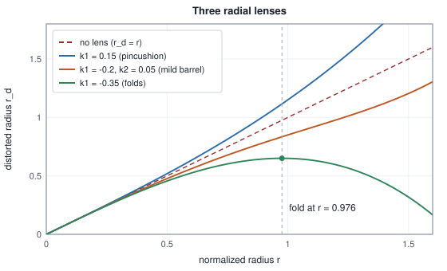

<!-- SPDX-License-Identifier: CC-BY-4.0 -->
<!-- Copyright (c) 2026 Martin Schröder <info@swedishembedded.com> -->

# Cameras and Projective Geometry

*How does a 3D point become a pixel, and how do we undo that?*

Pick one pixel of a photograph, say column 400 and row 300 of a 640 by 480 image, and ask where in the world it came from. The honest answer is "somewhere on a line". A camera that has focal length 500 pixels and its optical axis through pixel (320, 240) sends a point $(X, Y, Z)$ in front of it to the pixel $(320 + 500X/Z,\ 240 + 500Y/Z)$, and the pixel (400, 300) is where every point of the form $Z \cdot (0.16, 0.12, 1)$ lands, for every depth $Z > 0$. A point at half a metre, one at twenty metres and one at the far side of the moon all fill the same pixel and give it the same colour. Nothing in a single photograph says which.

This chapter is about that line, and about the machine that draws it. The forward direction, from a point to a pixel, is a short computation with one division in it. The backward direction, from a pixel to the world, has no unique answer, and the shape of the non-uniqueness is the most useful fact in the whole of three-dimensional vision: the pixel fixes a ray, and everything the next chapters do (recovering depth from two photographs, from a hundred, from a network that has learned what rooms look like) is a way of choosing a point on that ray. To use the ray we must be able to write it down exactly, which means getting right everything between the world and the pixel: where the camera is, which way it faces, how its lens bends the ray, and where on the sensor the picture begins. Each of these is a handful of numbers, each has a convention that can be chosen two ways, and a wrong choice of convention produces pictures that are plausible and wrong by half a pixel, or by a mirror image, or by the length of the camera's own arm.

Five ideas from earlier volumes are needed first; the answers are at the end.

1. (Volume I, [Chapter 4](../v01-mathematics/04-matrices.md), matrix-vector products.) The matrix with rows $(500, 0, 320)$, $(0, 500, 240)$ and $(0, 0, 1)$ is applied to the vector $(1, 2, 4)$. What is the result, and what are the three entries of it made of in terms of the columns of the matrix?
2. (Volume I, [Chapter 6](../v01-mathematics/06-decompositions.md), rotation matrices.) What do $\mathbf{R}^\top \mathbf{R}$ and $\det\mathbf{R}$ equal for a rotation matrix $\mathbf{R}$ of three-dimensional space, what is $\mathbf{R}^{-1}$, and where does the quarter turn about the $z$ axis send $(1, 0, 0)$?
3. (Volume I, [Chapter 6](../v01-mathematics/06-decompositions.md), the singular value decomposition.) A matrix $\mathbf{A}$ has more rows than columns. Which unit vector $\mathbf{v}$ makes $\lVert\mathbf{A}\mathbf{v}\rVert$ smallest, in terms of the decomposition, and what is the smallest value?
4. (Volume I, [Chapter 8](../v01-mathematics/08-multivariable-calculus.md), the Jacobian.) What is the Jacobian of $\mathbf{f}(x, y) = (x^2,\ xy)$ at $(1, 2)$, and what does it say about $\mathbf{f}(1 + a, 2 + b)$ for small $a$ and $b$?
5. (Volume VII, [Chapter 5](../v07-vision/05-dense-prediction.md), the scale ambiguity.) A box one metre away is imaged by a camera. Where does the same box land when the whole scene is made twice as large about the camera, and what can a network that sees only the picture still say about depth?

## The pinhole and its four numbers

The simplest camera is a dark box with a hole. Light travels in straight lines, so each point of the scene sends one ray through the hole, and the ray lands on the back wall at one place. Put the origin at the hole, the $z$ axis along the line from the hole at right angles to the back wall, and let the back wall (or, equivalently, an image plane mirrored in front of the hole) be at distance $f$. By similar triangles a point $(x, y, z)$ with $z > 0$ lands on that plane at $(f x / z,\ f y / z)$: the ratio of the lateral offset to the depth is the same for the point and for its image. This is the **pinhole camera**, and everything else in the chapter is a correction to it or a bookkeeping device for it. A pinhole camera is a function that divides by depth, and a division by depth throws away exactly one number per point, the depth. That is the line of the opening, seen from the camera's side.

A sensor does not measure in metres. Its pixels have a size, and the image is read as a grid whose columns and rows are numbered. Two choices turn the image-plane coordinates into pixel coordinates $(u, v)$. First, the unit: a focal length of $f$ metres is $f/p_x$ pixels if the pixels are $p_x$ metres wide, and a sensor whose pixels are not square has a different number $f_y = f/p_y$ in the other direction. Second, the origin: the point where the optical axis meets the image, the **principal point** $(c_x, c_y)$, is near the middle of the sensor but is a manufacturing detail, not the geometric centre. Together,

$$
u = f_x \frac{X}{Z} + c_x, \qquad v = f_y \frac{Y}{Z} + c_y . \tag{1}
$$

The four numbers $f_x, f_y, c_x, c_y$ are the **camera intrinsics**: they belong to the camera and not to the scene or to where the camera stands, and they hold for every photograph the camera takes, as long as the image keeps its size. A cheaper way to read them: $f_x$ is the number of pixels the image moves when a point at unit depth moves one unit sideways, $c_x$ is the column of the point straight ahead.

<!-- worked: camera_geometry.pixel_ray -->
The pixel (u, v) = (400, 300) of a camera with f_x = f_y = 500 and principal point (320, 240). Its ray is the set of points Z (x, y, 1) with x = (u - c_x) / f_x and y = (v - c_y) / f_y; the table projects five of them with u = c_x + f_x X / Z, v = c_y + f_y Y / Z.

| Z | (X, Y, Z) | projects to |
|---|---:|---:|
| 0.5 | (0.08, 0.06, 0.5) | (400.000000, 300.000000) |
| 1 | (0.16, 0.12, 1) | (400.000000, 300.000000) |
| 2 | (0.32, 0.24, 2) | (400.000000, 300.000000) |
| 5 | (0.8, 0.6, 5) | (400.000000, 300.000000) |
| 20 | (3.2, 2.4, 20) | (400.000000, 300.000000) |

The ray direction is (x, y, 1) = (0.16, 0.12, 1); its length is 1.019804, so the unit ray is (0.156893, 0.11767, 0.980581).

The image is 640 by 480, so the angle between the rays through the left and right edges, 2 atan(320 / 500), is 65.24 degrees, and 2 atan(240 / 500) = 51.28 degrees from top to bottom.
<!-- /worked -->

The table is the opening of the chapter as a computation. Every point on the ray lands on the pixel, to the last printed digit, and the ray has a direction that depends only on the pixel and the intrinsics: $\bigl((u - c_x)/f_x,\ (v - c_y)/f_y,\ 1\bigr)$. Dividing it by its length gives the unit direction that the rest of the chapter calls the **ray** of the pixel. A distance along that unit direction is a range, the Euclidean distance from the camera, and a range, unlike a depth $Z$, means the same thing for a camera that sees more than 90 degrees to either side, where there is no plane at distance $f$ for the ray to hit. The code of brain returns unit rays from its unprojection for that reason.

The focal length decides how much of the world the picture holds. With the half-width of the image $W/2$ in pixels, the rays through its edges are $2\arctan(W/(2 f_x))$ apart, and the table gives 65.24 degrees across and 51.28 degrees down for the camera above. A longer focal length is a narrower view. It also decides how much a mistake costs. A focal length that is wrong by ten percent scales every pixel offset from the principal point by ten percent, so a point 1024 pixels from the centre lands about 102 pixels away from where it should. That is why a guessed focal length is dangerous for a reconstruction: knowledge #159 records that a seed reconstruction built through a focal length ten percent off is a projectively distorted scene, that later photographs stop registering onto it, and that bundle adjustment creeps out of the distortion by only about one percent per round. The next chapter returns to it.

A camera alone does not give metric depth from one photograph, the point of Volume VII, [Chapter 5](../v07-vision/05-dense-prediction.md): the scene made twice as large about the camera has the same pixels. Equation (1) shows why at once, since $X/Z$ is unchanged when $X$ and $Z$ are both doubled. The ray is all that a pixel contains.

## Division as a matrix: homogeneous coordinates

Equation (1) is almost linear. The numerators are linear in $(X, Y, Z)$ and the denominator is a different linear function of the same point, and a map with a division in it cannot be a matrix, and cannot be composed with other maps by multiplying matrices. That matters, because a point reaches the pixel through several stages (a change of frame, a projection, a change of pixel units) and one would like their product to be one matrix. The remedy is old and simple: keep the numerator and the denominator as separate numbers and divide at the very end.

**Homogeneous coordinates** do this. A point $(u, v)$ of the plane is written as any triple $(a, b, w)$ with $w \neq 0$ and $(a/w, b/w) = (u, v)$, so $(400, 300, 1)$, $(800, 600, 2)$ and $(-40, -30, -0.1)$ all name the pixel (400, 300), and the representation is defined only up to a nonzero factor. A point of three-dimensional space is written as four numbers in the same way. The division is the last step, and everything before it is linear. For the pinhole of equation (1), applying the matrix

$$
\mathbf{K} = \begin{pmatrix} f_x & 0 & c_x \\ 0 & f_y & c_y \\ 0 & 0 & 1 \end{pmatrix}
$$

to the camera-frame point $(X, Y, Z)$ gives $(f_x X + c_x Z,\ f_y Y + c_y Z,\ Z)$, whose first two entries divided by the third are exactly $(u, v)$ of equation (1). The third entry is the depth.

<!-- worked: camera_geometry.homogeneous_projection -->
The matrix K = [[500, 0, 320], [0, 500, 240], [0, 0, 1]] applied to camera-frame points. Column 3 is the third entry, which equals Z; column 4 is the first two entries divided by it.

| (X, Y, Z) | K (X, Y, Z) | third entry | pixel (u, v) |
|---|---:|---:|---:|
| (0, 0, 4) | (1280, 960, 4) | 4 | (320.0000, 240.0000) |
| (0.8, -0.4, 2) | (1040, 280, 2) | 2 | (520.0000, 140.0000) |
| (-1, 0.5, 5) | (1100, 1450, 5) | 5 | (220.0000, 290.0000) |
| (0.16, 0.12, 1) | (400, 300, 1) | 1 | (400.0000, 300.0000) |

A direction d = (0, 0, 1) of the world, seen by a camera whose rotation is R = turn by 30 degrees about the y axis (R = [[cos, 0, sin], [0, 1, 0], [-sin, 0, cos]] with cos = cos 30 degrees and sin = sin 30 degrees), is the point (d, 0) at infinity. Then K R d = (527.128, 207.846, 0.866025), whose third entry is cos 30 degrees = 0.866025, so the pixel is (608.6751, 240.0000) = (c_x + f tan 30 degrees, c_y) with f tan 30 degrees = 288.6751.
<!-- /worked -->

The second paragraph of the table shows what the extra coordinate buys that is not merely tidiness. A **direction** (a point infinitely far along a line) has no pixel in the sense of equation (1), since its depth is infinite. Written as a homogeneous point with last coordinate 0, a direction $\mathbf{d}$ is $(\mathbf{d}, 0)$, and it passes through the same matrices as any other point, and when the last coordinate of the result is not zero the result is a finite pixel: the pixel where the direction's own line, followed to infinity, appears to end, which is its **vanishing point**. The railway lines of a photograph meet there, and the table's 30 degree example puts it $f \tan 30^\circ$ pixels to one side of the principal point. A point infinitely far away is a perfectly good element of the algebra, and an algebra without it would need an exception wherever parallel lines are involved.

Homogeneous coordinates are also the device that lets a translation be a matrix. The map $\mathbf{x} \mapsto \mathbf{R}\mathbf{x} + \mathbf{t}$ is affine and not linear in $\mathbb{R}^3$ (Volume I, Chapter 4 wrote the same trick for a bias, $\tilde{\mathbf{x}} = (\mathbf{x}, 1)$), but with a 1 appended it is a $4 \times 4$ matrix times a four-vector. The tilde of that chapter is used here for the same purpose: $\tilde{\mathbf{x}}$ is a point with a 1 appended, or any nonzero multiple of it. The next section uses it for the camera's pose.

## Which half pixel

Before the camera is put anywhere, there is a convention in the intrinsics that is worth settling, since it is the one that is wrong by a constant and so is easy to miss. If $u$ counts columns, which number does the centre of the first column have: 0 or 0.5? Both conventions are in use. If the image is a grid of samples, the first sample is at 0 and the pixel at index $i$ is centred on $u = i$. If the image is a grid of squares, the first square covers $[0, 1)$ and its centre is 0.5, and the pixel at index $i$ covers $[i, i + 1)$ and is centred on $i + 0.5$.

brain uses the second, the convention of squares, with the origin at the top-left corner of the image: "pixel $(i, j)$ covers $[i, i+1) \times [j, j+1)$ and its centre is $(i + 0.5, j + 0.5)$", in the words of the module comment at the top of `crates/camera/src/lib.rs`. The consequence that earns the choice a test (`resizing_scales_every_pixel_coordinate_exactly` in `crates/camera/tests/lens.rs`) is what happens when an image is resampled. A picture shrunk to half the width maps the left edge to the left edge and the right edge to the right edge, so every coordinate measured from the left edge is halved, and under the squares convention, in which the coordinate really is a position along the image, $u' = s u$ exactly, with no offset. The intrinsics follow: $f_x, f_y, c_x, c_y$ are all multiplied by $s$. Under the samples convention a coordinate is an index, the edge of the image is at $-0.5$, and the rule becomes $u' = s(u + 0.5) - 0.5$. Applying the first rule to a camera described in the second convention is a mistake with no visible symptom except a systematic offset.

<!-- worked: camera_geometry.resize_table -->
The principal point of a 640-pixel-wide camera is 322.5 when pixel i covers [i, i + 1) and is centred on i + 1/2 (the corner convention); in the convention where pixel i is centred on i it is 322.0. The image is resampled by a factor s. Columns: the corner rule c' = s c; the centre rule c' = s (c + 1/2) - 1/2; the corner rule applied to the centre-convention number 322.0 by mistake; that mistaken number read back in the corner convention (+ 1/2); and its error in pixels of the new image.

| s | corner rule | centre rule | mistake (centre number, corner rule) | mistake in corner terms | error |
|---|---:|---:|---:|---:|---:|
| 0.5 | 161.2500 | 160.7500 | 161.0000 | 161.5000 | +0.2500 |
| 0.25 | 80.6250 | 80.1250 | 80.5000 | 81.0000 | +0.3750 |
| 2 | 645.0000 | 644.5000 | 644.0000 | 644.5000 | -0.5000 |
<!-- /worked -->

The error is $\tfrac{1}{2}(1 - s)$ pixels of the new image, a quarter of a pixel at half size and a half pixel at double size (with the sign reversed): small enough to pass every visual check and large enough to be a noticeable fraction of a feature's matching error. Pixel centres also show in the code that consumes the rays: when the optimiser in `crates/splat/src/opt.rs` unprojects pixel number $p$ of an image, it asks for the ray through $(p \bmod w) + 0.5$ and $\lfloor p/w \rfloor + 0.5$, the centre of the square and not its corner.

## Where the camera is

The camera frame has three axes. brain's convention, shared by the camera crate and the reconstruction code built on it, is the one equation (1) already assumed: $+x$ to the right of the image, $+y$ down the image, and $+z$ forward, out of the lens. A world point reaches the camera frame by a rigid motion, a rotation and a translation, and these six numbers are the **camera extrinsics**: they say where this camera stood and which way it faced when it took this photograph, and they change with every photograph while the intrinsics do not. If the world point is $\mathbf{x}_w$ and the same point in the camera frame is $\mathbf{x}_c$,

$$
\mathbf{x}_c = \mathbf{R}\,\mathbf{x}_w + \mathbf{t}, \tag{2}
$$

with $\mathbf{R}$ a rotation matrix and $\mathbf{t}$ a vector. Both have a meaning that is easy to get backwards. The rows of $\mathbf{R}$ are the camera's right, down and forward axes written in world coordinates, since each entry of $\mathbf{R}\mathbf{x}_w$ is the dot product of $\mathbf{x}_w$ with one of those axes. The vector $\mathbf{t}$ is not where the camera is. The camera's own origin is the point that equation (2) sends to $\mathbf{x}_c = \mathbf{0}$, so the centre of the camera in world coordinates is $\mathbf{C} = -\mathbf{R}^\top \mathbf{t}$, using $\mathbf{R}^{-1} = \mathbf{R}^\top$ (Volume I, Chapter 6). Putting (2) and the intrinsics together,

$$
\lambda \begin{pmatrix} u \\ v \\ 1 \end{pmatrix} = \mathbf{K}\,[\,\mathbf{R} \mid \mathbf{t}\,]\begin{pmatrix} \mathbf{x}_w \\ 1 \end{pmatrix}, \tag{3}
$$

where $[\mathbf{R} \mid \mathbf{t}]$ is the $3 \times 4$ matrix with $\mathbf{t}$ as a fourth column, $\lambda$ is the nonzero factor that the homogeneous representation allows (it turns out to be the depth $z$), and the product $\mathbf{P} = \mathbf{K}[\mathbf{R} \mid \mathbf{t}]$ is the whole camera as one $3 \times 4$ matrix. The figure shows the chain with the number of parameters each stage owns.


The lens stage between the division and the intrinsics is the subject of two sections ahead; with an ideal pinhole it is the identity, and the figure collapses to equation (3).

To place a camera, one rarely has $\mathbf{R}$ in hand. One has an eye position, a point to look at, and a direction that is up in the world. The three axes follow from those: forward is the unit vector from the eye to the target, right is perpendicular to both forward and the world's up, and down is perpendicular to the first two. With the cross product $\mathbf{a} \times \mathbf{b}$ (the vector at right angles to both, of length $\lVert\mathbf{a}\rVert\lVert\mathbf{b}\rVert\sin\theta$, pointing the way a right-handed screw turns from $\mathbf{a}$ to $\mathbf{b}$, with components $(a_2 b_3 - a_3 b_2,\ a_3 b_1 - a_1 b_3,\ a_1 b_2 - a_2 b_1)$ for 1-based indices), a camera looking along $\mathbf{f}$ with the world's up $\mathbf{u}$ has right the unit vector in the direction of $\mathbf{f} \times \mathbf{u}$ and down the unit vector in the direction of $\mathbf{f} \times \text{right}$ (the normalization to unit length is that of Volume I, Chapter 3).

```text
function look_at(eye: array<real>[3], target: array<real>[3], up: array<real>[3])
        -> (array<real>[3, 3], array<real>[3]):
    require norm(target - eye) > 0 and norm(cross(target - eye, up)) > 0
    f = unit(target - eye)
    r = unit(cross(f, up))
    d = unit(cross(f, r))
    R = zeros(real, [3, 3])
    R[0, :] = r
    R[1, :] = d
    R[2, :] = f
    t = -matmul(R, eye)
    return (R, t)
```

Take a camera with $f_x = f_y = 800$ and principal point (320, 240), standing at $(4, -3, 2.5)$ in a world whose $z$ axis points up, looking at $(0.2, 0.1, 0.4)$. Placing it, projecting four points, and recovering its centre from $\mathbf{t}$ gives:

<!-- worked: camera_geometry.extrinsics_table -->
A camera with f_x = f_y = 800 and principal point (320, 240), at the world point (4, -3, 2.5) looking at (0.2, 0.1, 0.4), with the world's z axis up. The rows of R are the camera's right, down and forward axes written in world coordinates; t = -R C.

R = [0.632127, 0.774865, 0; 0.30502, -0.248832, -0.919264; -0.712305, 0.581091, -0.393642]
t = (-0.203912, 0.331585, 5.5766)
det R = 1.000000; largest entry of R R^T - I: below 1e-15 (true).
The centre recovered as -R^T t is (4, -3, 2.5).

| point | world (X, Y, Z) | camera (x, y, z) | pixel (u, v) | pixel with R^T used instead of R |
|---|---|---:|---:|---:|
| origin | (0, 0, 0) | (-0.2039, 0.3316, 5.577) | (290.748, 287.568) | (290.7, 287.6) |
| x = 1 | (1, 0, 0) | (0.4282, 0.6366, 4.864) | (390.426, 344.698) | (381.4, 398.7) |
| x = y = 1 | (1, 1, 0) | (1.203, 0.3878, 5.445) | (496.749, 296.969) | (445.9, 387.3) |
| top of the post | (0, 0, 1) | (-0.2039, -0.5877, 5.183) | (288.526, 149.291) | (178.6, 380.9) |
<!-- /worked -->

The last column is the mistake that this section exists to make visible. A pose is stored one of two ways, world to camera (the pair $(\mathbf{R}, \mathbf{t})$ of equation (2)) or camera to world (the pair $(\mathbf{R}^\top, \mathbf{C})$), and a file or a function that does not say which is half of a camera. Using $\mathbf{R}^\top$ where $\mathbf{R}$ belongs gives a rotation that is exactly the opposite one, so the world origin, which $\mathbf{R}$ multiplies by zero, projects correctly by luck of the arithmetic, and every other point lands somewhere that is quite wrong (the top of the post at (178.6, 380.9) against (288.5, 149.3)), plausibly inside the image, with nothing to say that it is the wrong place. The same mistake, made in the other direction, mirrors the scene.

The code of brain keeps the conventions in one doc comment and one data structure. In `crates/splat/src/types.rs` a `Camera` stores `c2w`, the camera-to-world pose as a row-major $4 \times 4$ matrix whose last row is $(0, 0, 0, 1)$, so its last column is the camera's eye (`Camera::eye` reads it directly), and `Camera::viewmat` returns the $3 \times 4$ world-to-camera rows that the rasterizer consumes: the transpose of the rotation, and $-\mathbf{R}^\top\mathbf{t}$ for the translation, which is the formula of the section above run in the other direction. `Camera::look_at` builds the pose from an eye and a target with exactly the recipe above ("right = forward x up, down = forward x right"), and its `up` argument is a direction in the world that is up, which in a world with $y$ down (the world that the module's own `auto_camera_from_bounds` passes) is $(0, -1, 0)$, and in a world with $y$ up would be $(0, 1, 0)$. Both choices produce a proper rotation, a determinant of $+1$, and a picture the right way up; the one that looks tempting and is wrong is to pass the same $(0, 1, 0)$ for a world that has $y$ down, which turns the scene upside down.

## One rotation, four ways to write it

The rotation of equation (2) has three degrees of freedom: the set of rotations of three-dimensional space is a three-parameter family, and a $3 \times 3$ matrix has nine entries, six of which are fixed by the conditions $\mathbf{R}^\top \mathbf{R} = \mathbf{I}$ and $\det\mathbf{R} = +1$. A matrix is the right form for applying a rotation and for composing two (a product), and the wrong form for estimating one, since an optimiser stepping the nine entries immediately leaves the set of rotations. The other representations exist because each makes one job easy.

A rotation by the angle $\theta$ about the unit axis $\hat{\mathbf{a}}$ is written by its **rotation vector** $\mathbf{w} = \theta\hat{\mathbf{a}}$ (axis and angle in three numbers, the angle being the length). Rodrigues' formula turns it into a matrix: with $\mathbf{S}_a$ the matrix of the cross product with $\hat{\mathbf{a}}$ ($\mathbf{S}_a \mathbf{x} = \hat{\mathbf{a}} \times \mathbf{x}$),

$$
\mathbf{R} = \mathbf{I} + \sin\theta\,\mathbf{S}_a + (1 - \cos\theta)\,\mathbf{S}_a^2 . \tag{4}
$$

The formula resolves a vector into its part along the axis, which does not move, and its part across the axis, which turns in the plane at right angles to the axis by $\theta$, and the two terms with $\mathbf{S}_a$ are the two directions in that plane. Taking the matrix back to a rotation vector uses the part of $\mathbf{R}$ that is antisymmetric: $\mathbf{R} - \mathbf{R}^\top = 2\sin\theta\,\mathbf{S}_a$, so the vector $\mathbf{s} = (R_{32} - R_{23},\ R_{13} - R_{31},\ R_{21} - R_{12})$ (1-based) equals $2\sin\theta\,\hat{\mathbf{a}}$, and $\cos\theta = (\mathrm{tr}\,\mathbf{R} - 1)/2$. A rotation vector is the natural variable for an optimiser, since small changes of $\mathbf{w}$ are small rotations, and it is what the bundle adjustment of the next chapter will step; it is also the form that rolling-shutter cameras use for their motion (`Camera::shutter` of `crates/splat/src/types.rs` is a twist whose angular part is a rotation vector per frame height).

A **quaternion** $(q_w, q_x, q_y, q_z) = (\cos\tfrac{\theta}{2},\ \sin\tfrac{\theta}{2}\,\hat{\mathbf{a}})$ is a unit four-vector, and it makes composition cheap and, unlike a rotation vector, free of any special angle: the product of two rotations is the Hamilton product of two quaternions,

$$
\mathbf{p}\mathbf{q} = \bigl(p_w q_w - \mathbf{p}_v\!\cdot\!\mathbf{q}_v,\ \ p_w \mathbf{q}_v + q_w \mathbf{p}_v + \mathbf{p}_v \times \mathbf{q}_v\bigr), \tag{5}
$$

with $\mathbf{p}_v$ the last three entries, and the product acts right factor first, like a matrix product. The matrix of the unit quaternion $(w, x, y, z)$ has entries such as $R_{11} = 1 - 2(y^2 + z^2)$ and $R_{21} = 2(xy + wz)$, and the code of brain (`axis` in `crates/splat/src/geometry.rs`, which returns a column of that matrix for a Gaussian's orientation) uses exactly this convention, with the scalar first, so that a quaternion in the order $(w, x, y, z)$ from another source needs reordering before use. The sign is free: $\mathbf{q}$ and $-\mathbf{q}$ are one rotation, since $\theta + 2\pi$ turns the half-angle by $\pi$. Going from a matrix to a quaternion has a numerical trap that Shepperd's method avoids: the four candidates $w^2, x^2, y^2, z^2$ are each recoverable from the diagonal of $\mathbf{R}$, and the largest is far from zero, so the method takes the square root of the largest and divides the others by it, whereas taking $w$ from the trace alone divides by almost zero for a rotation near a half turn. `quat_of` in `crates/splat/src/orient.rs` is a version of this: it uses the trace when it is positive and the largest diagonal entry otherwise.

<!-- worked: camera_geometry.rotation_forms -->
Each rotation is given as a rotation vector w (angle |w| about w / |w|). The matrix is Rodrigues' formula I + sin(th) S + (1 - cos(th)) S^2 with S the cross-product matrix of the unit axis; the quaternion is (cos(th/2), sin(th/2) axis); the matrix is taken back to a quaternion by the largest-component rule and to a rotation vector by the formula of the chapter. The last column is the largest entry-wise difference between the original matrix and the matrix rebuilt from each recovered form.

| rotation | matrix | quaternion (w, x, y, z) | rotation vector back | quaternion back | round trip |
|---|---:|---:|---:|---:|---:|
| 120 degrees about (1, 1, 1) | [0, 0, 1; 1, 0, 0; 0, 1, 0] | (0.5, 0.5, 0.5, 0.5) | (1.2092, 1.2092, 1.2092) | (0.5, 0.5, 0.5, 0.5) | 4.4e-16 |
| 150 degrees about (1, 2, 2) | [-0.65869, 0.081339, 0.74801; 0.74801, -0.036681, 0.66268; 0.081339, 0.99601, -0.036681] | (0.25882, 0.32198, 0.64395, 0.64395) | (0.87266, 1.7453, 1.7453) | (0.25882, 0.32198, 0.64395, 0.64395) | 4.4e-16 |
| 179.9999 degrees about z | [-1, -1.7453e-06, 0; 1.7453e-06, -1, 0; 0, 0, 1] | (8.7266e-07, 0, 0, 1) | (0, 0, 3.1416) | (8.7266e-07, 0, 0, 1) | 4.4e-16 |

The quaternion (-0.5, -0.5, -0.5, -0.5) (every sign flipped) gives the same matrix: largest difference 0.0e+00.
<!-- /worked -->

The first row is a rotation that everyone can check by hand: 120 degrees about the diagonal $(1, 1, 1)$ carries the $x$ axis to the $y$ axis, the $y$ axis to the $z$ axis and the $z$ axis back, a cyclic permutation of the columns, and its quaternion is $(\tfrac12, \tfrac12, \tfrac12, \tfrac12)$. The third row is the one that is difficult for a conversion: a rotation one ten-thousandth of a degree short of a half turn. The accuracy depends on how the angle is taken out of the matrix.

<!-- worked: camera_geometry.half_turn_loss -->
Rotations of angle pi - delta about the axis (1, 2, 2) / 3, built by Rodrigues' formula and read back. The error is the length of the difference between the recovered and the original rotation vector. 'acos' takes the angle as acos((tr R - 1) / 2) and, within 1e-6 of pi, the axis from the diagonal; 'atan2' takes it as atan2(|w| / 2, (tr R - 1) / 2) with w the skew part of R.

| delta | error with acos | error with atan2 |
|---|---:|---:|
| 1.0e-01 | 2.5e-13 | 6.7e-16 |
| 1.0e-02 | 4.2e-13 | 1.7e-14 |
| 1.0e-03 | 2.5e-11 | 1.6e-13 |
| 1.0e-04 | 8.2e-09 | 8.2e-13 |
| 1.0e-05 | 1.3e-07 | 8.2e-12 |
| 5.0e-06 | 1.3e-07 | 0.0e+00 |
| 2.0e-06 | 3.5e-05 | 0.0e+00 |
| 1.5e-06 | 9.5e-04 | 5.5e-11 |
| 1.0e-06 | 1.8e-06 | 8.2e-11 |
<!-- /worked -->

Taking the angle as $\arccos\bigl((\mathrm{tr}\,\mathbf{R} - 1)/2\bigr)$ looks harmless and is not. The cosine of an angle near $\pi$ is near $-1$, where the cosine is flat, so a rounding error of $10^{-16}$ in the cosine becomes an error of $10^{-16}/(\pi - \theta)$ in the angle, and the vector's length $\theta/(2\sin\theta)\,|\mathbf{s}|$ divides that by $\sin\theta$ once more. The table shows the cost. The error of the rotation vector is $8.2 \times 10^{-9}$ at $10^{-4}$ from a half turn, $1.3 \times 10^{-7}$ at $10^{-5}$, and between $3.5 \times 10^{-5}$ and $9.5 \times 10^{-4}$ at 2.0 and 1.5 millionths, just outside the band of $10^{-6}$ within which this version switches to taking the axis from the diagonal of $\mathbf{R}$ (and there the error is about $\pi - \theta$ itself, $1.8 \times 10^{-6}$, since the off-diagonal entries still carry the antisymmetric part). The remedy is to use both pieces of the formula that one already has: the angle is $\mathrm{atan2}(\lVert\mathbf{s}\rVert/2,\ (\mathrm{tr}\,\mathbf{R} - 1)/2)$, the sine and the cosine together, which is accurate at every angle, because $\mathrm{atan2}$ has no flat region. At a true half turn the sine is zero and the axis comes from the diagonal ($\mathbf{R} = 2\hat{\mathbf{a}}\hat{\mathbf{a}}^\top - \mathbf{I}$).

```text
function rotation_vector_of(R: array<real>[3, 3]) -> array<real>[3]:
    require norm(matmul(transpose(R), R) - identity(3)) < 1e-9
    s = [R[2, 1] - R[1, 2], R[0, 2] - R[2, 0], R[1, 0] - R[0, 1]]
    sin_th = norm(s) / 2
    cos_th = (R[0, 0] + R[1, 1] + R[2, 2] - 1) / 2
    theta = atan2(sin_th, cos_th)
    if sin_th < 1e-9 and cos_th > 0:
        return 0.5 * s
    if sin_th < 1e-9:
        d = [(R[i, i] + 1) / 2 for i in 0 .. 3]
        i = argmax(d)
        a = zeros(real, [3])
        a[i] = sqrt(d[i])
        for j in 0 .. 3:
            if j != i:
                a[j] = R[i, j] / (2 * a[i])
        return theta * a / norm(a)
    return (theta / (2 * sin_th)) * s
```

brain has this conversion in `log_so3` of `crates/sfm/src/linalg.rs`, next to `exp_so3`, which is equation (4), and next to its own `svd3` and a `nearest_rotation` that projects a noisy matrix onto the rotations. When this chapter was written, `log_so3` took the angle from `acos` and switched to the diagonal only within $10^{-6}$ of $\pi$, the table's "acos" column, and its only test checked a rotation vector of length 1.3, where that formula is accurate. Writing the table found the loss near a half turn, and commit `5b829e65e` changed the function to the atan2 form, took the near-half-turn axis from the symmetric part with its sign from the skew part, and added a test that round-trips rotations from $10^{-7}$ to $10^{-3}$ short of $\pi$.

The fourth representation is the one that people write down: three **Euler angles**, a yaw, a pitch and a roll, with $\mathbf{R} = \mathbf{R}_z(\text{yaw})\,\mathbf{R}_y(\text{pitch})\,\mathbf{R}_x(\text{roll})$ in the order the table of the next block assumes, the roll applied first. It is readable and has a defect that is built into the geometry. When the pitch is a quarter turn, the first and last rotations turn about the same axis, and only the difference of yaw and roll can matter.

<!-- worked: camera_geometry.gimbal_lock -->
R = R_z(yaw) R_y(pitch) R_x(roll), angles in degrees. At a pitch of 90 degrees only yaw - roll reaches the matrix; three (yaw, roll) pairs with the same difference of 20 degrees are tried at 89 and at 90 degrees, and the entries R[0][1], R[1][1] and R[2][2] are shown.

| pitch | (yaw, roll) | yaw - roll | R[0][1] | R[1][1] | R[2][2] |
|---|---:|---:|---:|---:|---:|
| 89 | (30, 10) | 20 | -0.342043 | 0.939679 | 0.017187 |
| 89 | (35, 15) | 20 | -0.342052 | 0.939670 | 0.016858 |
| 89 | (40, 20) | 20 | -0.342060 | 0.939659 | 0.016400 |
| 90 | (30, 10) | 20 | -0.342020 | 0.939693 | 0.000000 |
| 90 | (35, 15) | 20 | -0.342020 | 0.939693 | 0.000000 |
| 90 | (40, 20) | 20 | -0.342020 | 0.939693 | 0.000000 |

At pitch 90 degrees, (yaw, roll) = (30, 10) and (40, 20) give matrices that differ by 5.6e-17. Reading the angles back from that matrix gives (yaw, pitch, roll) = (0.0000, 90.0000, -20.0000) degrees, with the yaw set to 0 by the rule of the chapter.
<!-- /worked -->

At 89 degrees the three entries change in the sixth decimal; at 90 they do not change at all, and the matrices of $(30, 10)$ and $(40, 20)$ are one matrix. The loss is of a degree of freedom, called **gimbal lock** after the mechanical device that has it: near the lock, a small change in the rotation needs a large change in one angle, and at the lock a whole line of angle triples is the same rotation, so an optimiser on Euler angles stalls and a conversion back from the matrix has to invent a convention (the worked reader sets the yaw to zero). The matrix, the rotation vector and the quaternion have no such point, which is why the geometry code of brain does not use Euler angles internally.

Rotations do not commute, and the order matters in the pose of a camera as much as anywhere. The two quarter turns of the next table, applied in the two orders, are different rotations, and the quaternion product reproduces the matrix product in each order.

<!-- worked: camera_geometry.rotation_order -->
R_z and R_x are quarter turns about the z and the x axis. 'z then x' applies R_z first: the matrix is R_x R_z and the quaternion is q_x q_z (Hamilton product, the right factor acts first).

| order | matrix | quaternion | image of (1, 0, 0) | image of (0, 0, 1) |
|---|---:|---:|---:|---:|
| z then x | [0, -1, 0; 0, 0, -1; 1, 0, 0] | (0.5, 0.5, -0.5, 0.5) | (0, 0, 1) | (0, -1, 0) |
| x then z | [0, 0, 1; 1, 0, 0; 0, 1, 0] | (0.5, 0.5, 0.5, 0.5) | (0, 1, 0) | (1, 0, 0) |

Matrix from the quaternion product against the product of matrices: 1.6e-16 and 1.6e-16.
<!-- /worked -->

## The lens bends the ray

A real lens does not obey equation (1). A glass element deflects rays, and the result, for a camera with a wide field of view, is a picture in which straight lines bend and the edges are squeezed or stretched. **Lens distortion** is that deviation from the pinhole, modelled as a correction applied to the normalized point $(x, y) = (X/Z, Y/Z)$ before the intrinsics, and each model answers the same question with different parameters: what is the point where the pinhole says the ray lands, and where does the lens actually put it?

The standard model is the Brown-Conrady model. Its main term is radial, since a lens is symmetric about its axis and its error is mostly a function of the distance from the axis. With $r^2 = x^2 + y^2$ it multiplies the point by $1 + k_1 r^2 + k_2 r^4$ (a barrel lens has negative $k_1$, which pulls the outer points inward, and a pincushion lens a positive one). Two more terms, $p_1$ and $p_2$, model a lens whose elements are slightly off the common axis, the decentring or tangential terms. In full,

$$
\begin{aligned}
x_d &= x\,(1 + k_1 r^2 + k_2 r^4) + 2 p_1 x y + p_2 (r^2 + 2x^2),\\
y_d &= y\,(1 + k_1 r^2 + k_2 r^4) + p_1 (r^2 + 2y^2) + 2 p_2 x y,
\end{aligned} \tag{6}
$$

and the pixel is $(f_x x_d + c_x,\ f_y y_d + c_y)$. The model of `crates/camera/src/lib.rs` is the full one: the radial factor is a ratio of two polynomials (the rational form, $k_1 \ldots k_3$ over $k_4 \ldots k_6$), and four thin-prism terms $s_1 \ldots s_4$ are added, but the equations above are its first and most used part, and the rest is the same idea with more coefficients.

The radial factor has a danger. It is a polynomial, and a polynomial can do things that a lens cannot.

<!-- worked: camera_geometry.radial_table -->
The radial map r_d = r (1 + k_1 r^2) with k_1 = -0.35 and k_2 = 0. Its slope is 1 + 3 k_1 r^2 and vanishes at r = 1 / sqrt(3 * 0.35) = 0.975900, where r_d reaches its largest value 0.650600.

| r | r_d | slope d r_d / d r |  |
|---:|---:|---:|---|
| 0.2500 | 0.2445 | +0.9344 |  |
| 0.5000 | 0.4562 | +0.7375 |  |
| 0.7500 | 0.6023 | +0.4094 |  |
| 0.9000 | 0.6448 | +0.1495 |  |
| 0.9759 | 0.6506 | +0.0000 | peak |
| 1.1000 | 0.6342 | -0.2705 | folded |
| 1.3000 | 0.5311 | -0.7745 | folded |
| 1.6000 | 0.1664 | -1.6880 | folded |
<!-- /worked -->



For the strong barrel lens the map $r \mapsto r(1 - 0.35 r^2)$ rises, peaks at $r = 1/\sqrt{3 \cdot 0.35} = 0.9759$ and falls. Beyond the peak, points further from the axis land closer to the centre. No real lens does this, and a polynomial fitted to a real lens does it as soon as it is evaluated far outside the range of the data it was fitted to. The consequence is geometric and bad.

<!-- worked: camera_geometry.fold_projection -->
A pinhole with f = 400 behind the lens k_1 = -0.35 (k_2 = 0). A point (X, 0, 1) lands at u - c_x = f r (1 + k_1 r^2) with r = X. Past the fold X = 0.9759 the pixel offset decreases again, so (1.3, 0, 1) would land closer to the centre than (0.9, 0, 1).

| X (at Z = 1) | offset without the lens (pixels) | offset with the lens (pixels) |
|---|---:|---:|
| 0.5 | 200.00 | 182.50 |
| 0.9 | 360.00 | 257.94 |
| 0.9759 | 390.36 | 260.24 |
| 1.1 | 440.00 | 253.66 |
| 1.3 | 520.00 | 212.42 |
<!-- /worked -->

With $f = 400$ the point $(1.3, 0, 1)$ projects 212 pixels from the centre, closer than $(0.9, 0, 1)$ at 258, so the image of a feature far outside the field of view lands in the middle of the picture and looks like geometry. A reconstruction that trusts it explains an outlier with a false structure. The code of brain therefore refuses: `Intrinsics::valid_radius` walks out from the axis in 512 equal steps to a normalized radius of 4 (76 degrees off axis, as the comment says, since $\arctan 4 = 75.96^\circ$) until the radial map stops increasing, bisects the interval 40 times, and `project` returns `None` for any point past that radius. The test `a_folding_lens_refuses_what_lies_past_its_fold` constructs exactly the lens of the table, checks that the fold is found at $1/\sqrt{1.05}$ to $10^{-6}$ (the same number as $1/\sqrt{3 \cdot 0.35}$), accepts a point at $0.9$ of it and refuses one at $1.1$. The answer is cached per thread for the last eight lenses (`memo_fold`), because a projection asks for it for every point while a bundle adjustment changes the lens once per iteration.

A lens that sees past 90 degrees is not a perturbed pinhole at all. The pinhole radius $f\tan\theta$ grows without bound as the ray approaches a right angle from the axis, and a ray at 100 degrees has no image on any plane. Fisheye lenses are built by other principles, and are modelled by the radius as a function of the angle $\theta$ of the ray from the axis rather than as a correction to the pinhole. The **equidistant** model has the radius proportional to the angle, $r = f\theta$, and the Kannala-Brandt model multiplies the angle by an odd polynomial, $\theta_d = \theta(1 + k_1\theta^2 + k_2\theta^4 + k_3\theta^6 + k_4\theta^8)$, with the pixel at $f\theta_d$ along the ray's azimuth. The full sphere is covered by the fourth model of the crate, equirectangular projection, in which the pixel column is $c_x + f_x\cdot\text{longitude}$ and the row is $c_y + f_y\cdot\text{latitude}$ (latitude positive downward), the map of a 360 degree panorama.

<!-- worked: camera_geometry.pinhole_vs_fisheye -->
Radius in pixels of a ray at angle theta from the optical axis, with f = 200: the pinhole f tan(theta), the equidistant fisheye f theta, and the Kannala-Brandt polynomial with k = (0.02, -0.01, 0.003, -0.0005). The last two columns are the pixels per radian (geometric mean of the radial rate d r / d theta and the tangential rate r / sin(theta)) of the pinhole and of the equidistant model. The slope of the Kannala-Brandt polynomial is positive up to theta = 126.4494 degrees, found by walking out in 512 equal steps from 0 to pi and bisecting the first step that ends non-positive 60 times; beyond it the model is not a lens.

| theta (degrees) | pinhole | equidistant | Kannala-Brandt | pinhole pixels/rad | equidistant pixels/rad |
|---|---:|---:|---:|---:|---:|
| 10 | 35.27 | 34.91 | 34.93 | 204.65 | 200.51 |
| 30 | 115.47 | 104.72 | 105.22 | 248.16 | 204.67 |
| 60 | 346.41 | 209.44 | 212.19 | 565.69 | 219.93 |
| 80 | 1134.26 | 279.25 | 283.72 | 2763.91 | 238.14 |
| 89 | 11457.99 | 310.67 | 315.40 | 86745.51 | 249.29 |
| 100 | none | 349.07 | 352.51 | none | 266.25 |
| 150 | none | 523.60 | 277.43 (past the fold) | none | 457.65 |
<!-- /worked -->


Two readings of the table are worth having. The first is the sampling rate of the lens, the number of pixels per radian of angle, which is what a footprint measured in pixels has to be divided by to become an angle. The pinhole samples the periphery more finely than the centre by a factor of $\sec^{3/2}\theta$ (about 565 pixels per radian at 60 degrees against 200 on the axis), a stretch of the periphery; the equidistant lens keeps the rate nearly flat (220 at 60 degrees). `Intrinsics::pixels_per_radian` computes it as the geometric mean of the two singular values of the Jacobian of the projection restricted to the plane across the ray, and its test (`sampling_rate_is_the_focal_length_on_axis`) checks that it is the focal length on the axis and larger off axis for a pinhole. The second reading is the end of the table: a Kannala-Brandt polynomial is only a lens inside the angle where its own slope is positive, here 126.4494 degrees, and the 150 degree row is the same folded map as before, in angle instead of radius. The same walk-and-bisect finds it (`valid_radius` for `Lens::Fisheye` returns an angle), so the one safeguard covers both models.

## Undoing a lens

The forward direction, equation (6), is a formula. The backward direction is the one a reconstruction needs: given a pixel of a photograph, find the ray, which means finding the undistorted normalized point $(x, y)$ whose distortion is the observed $(x_d, y_d) = ((u - c_x)/f_x,\ (v - c_y)/f_y)$. There is no closed form, since equation (6) is a polynomial of degree five in two unknowns that are mixed together by the tangential terms. The inverse is solved by iteration, and two iterations are in common use.

The first is the fixed-point iteration. Move everything but the radial part to the other side, $x = (x_d - T_x(x, y))/(1 + k_1 r^2 + k_2 r^4)$, with $T$ the tangential part, and iterate from $(x_d, y_d)$. Each step costs one evaluation of the radial factor, and the error shrinks by a roughly constant factor each time, a factor that grows with the strength of the distortion: it converges linearly. The second is Newton's method, which replaces the map by its tangent. With the Jacobian $\mathbf{J}$ of the distortion at the current iterate (a $2 \times 2$ matrix, Volume I, Chapter 8) and $\mathbf{e} = \mathbf{d}(x, y) - (x_d, y_d)$ the residual, the Newton step solves $\mathbf{J}\,\boldsymbol{\delta} = \mathbf{e}$ and subtracts $\boldsymbol{\delta}$ (Volume I, Chapter 7 gave the one-dimensional case, $x \leftarrow x - f/f'$). The Jacobian of equation (6), with $g = 1 + k_1 r^2 + k_2 r^4$ and $g' = k_1 + 2k_2 r^2$ its derivative with respect to $r^2$, is

$$
\mathbf{J} = \begin{pmatrix}
g + 2x^2 g' + 2p_1 y + 6 p_2 x & 2xy\,g' + 2p_1 x + 2p_2 y \\
2xy\,g' + 2p_1 x + 2p_2 y & g + 2y^2 g' + 6 p_1 y + 2 p_2 x
\end{pmatrix}. \tag{7}
$$

```text
function undistort(xd: array<real>[2], k1: real, k2: real, p1: real, p2: real, steps: int)
        -> array<real>[2]:
    x = copy(xd)
    for i in 0 .. steps:
        e = distort(x, k1, k2, p1, p2) - xd
        x = x - solve(jacobian(x, k1, k2, p1, p2), e, true)
    return x
```

Here `distort` is equation (6) and `jacobian` is equation (7). The two iterations on a lens with $k_1 = -0.2$, $k_2 = 0.05$, $p_1 = 0.002$, $p_2 = -0.001$, for a point at radius 0.75:

<!-- worked: camera_geometry.inversion_table -->
The lens k_1 = -0.2, k_2 = 0.05, p_1 = 0.002, p_2 = -0.001 applied to the normalized point (0.6, -0.45), whose radius is 0.75, gives the distorted point (0.539629688, -0.404019141). Both inversions start at the distorted point and report the distance of the iterate from (0.6, -0.45). Fixed point: x <- (x_d - T(x)) / (1 + k_1 r^2 + k_2 r^4), T the tangential part. Newton: x <- x - J^{-1} (distort(x) - x_d) with the analytic 2 by 2 Jacobian. Errors are printed to two digits; 'below 1e-14' is rounding noise.

| iteration | fixed-point error | Newton error |
|---|---:|---:|
| 0 (start at the distorted point) | 7.6e-02 | 7.6e-02 |
| 1 | 1.4e-02 | 1.9e-03 |
| 2 | 2.6e-03 | 1.2e-06 |
| 3 | 4.9e-04 | 4.9e-13 |
| 4 | 9.3e-05 | below 1e-14 |
| 5 | 1.8e-05 | below 1e-14 |
| 6 | 3.3e-06 |  |
| 7 | 6.3e-07 |  |
| 8 | 1.2e-07 |  |
| 9 | 2.2e-08 |  |
| 10 | 4.2e-09 |  |
| 11 | 8.0e-10 |  |
| 12 | 1.5e-10 |  |
<!-- /worked -->

Both converge, and the difference is the rate. The error of the fixed point falls by a factor of about 0.19 an iteration, which takes it to $1.5 \times 10^{-10}$ after 12 steps and, extrapolating, to rounding in about 20, and the error of Newton's method is squared at each step ($1.9 \times 10^{-3}$, $1.2 \times 10^{-6}$, $4.9 \times 10^{-13}$) and is at rounding noise in four. A step costs more, since it forms the Jacobian and solves a $2 \times 2$ system, a few dozen operations instead of a few, and the trade is a good one for a lens that is going to be inverted millions of times with a tight tolerance. The gap widens as the lens gets stronger.

<!-- worked: camera_geometry.inversion_strength -->
The lens of the previous table with every coefficient multiplied by m, the same point (0.6, -0.45), both iterations started at the distorted point. The slope is that of the radial map at r = 0.75, 1 + 3 k_1 r^2 + 5 k_2 r^4; the counts are the first iteration whose error is below 1e-10.

| m | radial slope at r = 0.75 | error at the start | fixed-point iterations | Newton iterations |
|---|---:|---:|---:|---:|
| 1 | 0.7416 | 0.076 | 13 | 3 |
| 2 | 0.4832 | 0.152 | 25 | 4 |
| 3 | 0.2248 | 0.228 | 64 | 5 |
<!-- /worked -->

The fixed-point count grows from 13 to 25 to 64 as the lens becomes two and three times as strong, while the count of Newton's method moves from 3 to 5. The radial slope at the point, which falls toward zero as the lens approaches its fold, is what slows the first: where the map is nearly flat, a small change of the output is a large change of the input, and the fixed point, which treats the radial factor as a constant on each step, takes small steps. Newton's method has one danger that the fixed point does not: a step from a poor start can leave the region where the lens is a lens, or meet a Jacobian that is nearly singular.

`Intrinsics::unproject` in `crates/camera/src/lib.rs` is Newton's method on the Brown map, with the safeguards the previous section built. It starts at $(x_d, y_d)$, takes at most 40 steps, stops when both components of the residual are below $10^{-14}$, returns `None` if the Jacobian's determinant is below $10^{-18}$ in magnitude, and damps each step by halving it while the proposed point would leave the valid radius of the lens. At the end it checks its own answer: the residual must be below $10^{-9}$ and the point inside the valid radius, or the pixel has no ray and the function says so with `None`, since a pixel past the fold is a pixel that no ray from the lens lands on. A fisheye is inverted in the one variable that matters, Newton on $\theta(1 + k_1\theta^2 + \ldots) = r_d$ with the iterate clamped to $[0, \theta_{\max}]$, and the result is the unit ray $(\sin\theta\,x_d/r_d,\ \sin\theta\,y_d/r_d,\ \cos\theta)$. Every model returns a unit ray, so a caller can treat a pixel of a pinhole, a Brown lens, a fisheye and a panorama alike.

The test of the pair, `projection_inverts_unprojection_across_the_frame`, is the property one wants of an inverse. Over a grid of 99 pixels for each of five lenses (a pinhole, a mild radial lens, a full Brown lens with tangential and thin-prism terms, a Kannala-Brandt fisheye and a panorama), every pixel that unprojects does so to a unit vector (to $10^{-12}$), projects back to the pixel it came from to within $10^{-7}$ pixel, and more than 80 of the 99 pixels of each lens must unproject at all (a refusal is allowed, a silent degradation is not). A second family of tests compares every Jacobian of the crate, the $2 \times 3$ derivative of the pixel with respect to the point, the derivative with respect to each calibration parameter, and the derivative of a ray with respect to the calibration, against central differences at $10^{-6}$, to a relative tolerance of $10^{-4}$. Those derivatives are how a calibration is refined from photographs (the next chapter), and a derivative that is wrong by a sign in one lens term does not fail loudly: it makes the fit converge slowly to a worse answer.

## A plane seen through a camera

One configuration is simple enough to calibrate from a printed sheet: a set of points that all lie on one plane. Let the plane be $Z = 0$ in the world (the sheet's own coordinates, $X$ and $Y$ along its edges), and put it through equation (3). The third column of $[\mathbf{R}\mid\mathbf{t}]$ multiplies $Z = 0$ and drops out, leaving

$$
\lambda\begin{pmatrix} u \\ v \\ 1 \end{pmatrix} = \mathbf{K}\,[\,\mathbf{r}_1\ \mathbf{r}_2\ \mathbf{t}\,]\begin{pmatrix} X \\ Y \\ 1 \end{pmatrix} = \mathbf{H}\begin{pmatrix} X \\ Y \\ 1 \end{pmatrix}, \tag{8}
$$

with $\mathbf{r}_1, \mathbf{r}_2$ the first two columns of $\mathbf{R}$. The $3 \times 3$ matrix $\mathbf{H}$ is a **homography**: a map of the plane to the image that is linear in homogeneous coordinates and has eight degrees of freedom (nine entries, one factor free). It takes straight lines to straight lines, and it is a map between two planes, which is why it works for any two views of a plane, and not only a plane and an image.

A homography is estimated from correspondences, pairs $(X_i, Y_i) \leftrightarrow (u_i, v_i)$ of points on the sheet and in the image. Each pair gives two equations that are linear in the nine entries $\mathbf{h}$ of $\mathbf{H}$. Write $\mathbf{a} = (X, Y, 1)$ and $\mathbf{h}_1, \mathbf{h}_2, \mathbf{h}_3$ for the rows of $\mathbf{H}$. Equation (8) says $u = \mathbf{h}_1\!\cdot\!\mathbf{a}/\mathbf{h}_3\!\cdot\!\mathbf{a}$ and $v = \mathbf{h}_2\!\cdot\!\mathbf{a}/\mathbf{h}_3\!\cdot\!\mathbf{a}$, which cross-multiplied are $\mathbf{h}_1\!\cdot\!\mathbf{a} - u\,\mathbf{h}_3\!\cdot\!\mathbf{a} = 0$ and $\mathbf{h}_2\!\cdot\!\mathbf{a} - v\,\mathbf{h}_3\!\cdot\!\mathbf{a} = 0$. With four pairs there are eight equations in nine unknowns, a homogeneous system $\mathbf{A}\mathbf{h} = \mathbf{0}$ whose solution is defined only up to a factor, and with more pairs (or noise) the system has no exact solution and the best we can do is the unit vector that makes $\lVert\mathbf{A}\mathbf{h}\rVert$ smallest: the right singular vector of the smallest singular value, the answer to the third recall question. This is the **direct linear transform**. It is a least-squares method, but it minimises an algebraic quantity, the size of the cross-multiplied equations, which is not the distance in pixels one cares about, and the two agree well only when the problem is scaled sensibly.

That caveat is not academic. Pixel coordinates are in the hundreds and the plane's coordinates are fractions of a metre, so the columns of $\mathbf{A}$ differ in size by five orders of magnitude, and the smallest singular value is then not clearly separated from the second smallest. The standard cure, due to Hartley, is to normalize first: move each point set so that its centroid is the origin and scale it so that the mean distance from the origin is $\sqrt{2}$, solve in the normalized coordinates, and undo the two similarity transforms $\mathbf{T}_s$ and $\mathbf{T}_d$ afterwards, $\mathbf{H} = \mathbf{T}_d^{-1}\mathbf{H}_n \mathbf{T}_s$.

```text
function hartley(P: array<real>[n, 2]) -> array<real>[3, 3]:
    m = mean(P, 0)
    s = sqrt(2) / mean([norm(P[i, :] - m) for i in 0 .. n])
    return [[s, 0, -s * m[0]], [0, s, -s * m[1]], [0, 0, 1]]

function homography(src: array<real>[n, 2], dst: array<real>[n, 2]) -> array<real>[3, 3]:
    require n >= 4
    Ts = hartley(src)
    Td = hartley(dst)
    rows = []
    for i in 0 .. n:
        a = matmul(Ts, [src[i, 0], src[i, 1], 1])
        b = matmul(Td, [dst[i, 0], dst[i, 1], 1])
        append [0, 0, 0, -a[0], -a[1], -a[2], b[1] * a[0], b[1] * a[1], b[1] * a[2]] to rows
        append [a[0], a[1], a[2], 0, 0, 0, -b[0] * a[0], -b[0] * a[1], -b[0] * a[2]] to rows
    h = null_vector(rows)
    Hn = [h[0:3], h[3:6], h[6:9]]
    return matmul(inverse(Td), matmul(Hn, Ts))
```

Here `null_vector` returns the right singular vector of the smallest singular value of the matrix whose rows are given, and `inverse` is the matrix inverse of Volume I, Chapter 4; with fewer rows than columns (four pairs give 8 rows for 9 columns) the matrix is padded with zero rows to be square, which changes no singular vector. The twelve points of a $4 \times 3$ grid on the sheet, spacing 0.1 metre, seen by the camera of the previous example:

<!-- worked: camera_geometry.homography_table -->
The twelve points of a 4 by 3 grid with spacing 0.1 on the plane Z = 0, imaged by the camera of the extrinsics example (so that H = K [r_1 r_2 t]).

| plane point (X, Y) | pixel (u, v) |
|---|---:|
| (0.0, 0.0) | (290.748, 287.568) |
| (0.1, 0.0) | (299.555, 292.616) |
| (0.2, 0.0) | (308.593, 297.796) |
| (0.3, 0.0) | (317.871, 303.114) |
| (0.0, 0.1) | (302.050, 283.545) |
| (0.1, 0.1) | (310.910, 288.488) |
| (0.2, 0.1) | (320.000, 293.560) |
| (0.3, 0.1) | (329.329, 298.765) |
| (0.0, 0.2) | (313.123, 279.603) |
| (0.1, 0.2) | (322.031, 284.446) |
| (0.2, 0.2) | (331.169, 289.413) |
| (0.3, 0.2) | (340.543, 294.509) |

H = K [r_1 r_2 t], scaled to unit Frobenius norm with a positive last entry:

`[0.114006, 0.330751, 0.665483; 0.0299879, -0.0244638, 0.658206; -0.00029236, 0.000238504, 0.00228887]`

|  | singular values of the 24 by 9 matrix: sigma_1, sigma_8, sigma_9 | sigma_1 / sigma_8 | largest entry error of H |
|---|---:|---:|---:|
| raw coordinates | 1514, 0.007691, below 1e-6 | 1.968e+05 | 2.2e-14 |
| Hartley-normalized | 8.568, 2.496, below 1e-6 | 3.433 | 1.3e-14 |
<!-- /worked -->

On exact data both recover the homography to rounding (the largest entry error of $\mathbf{H}$ is at the $10^{-14}$ level), and the singular values show what normalization is for. Without it the ratio of the largest singular value to the eighth is about $2 \times 10^5$: the eighth singular value, the first that is not zero, is small enough to be of the size of what noise does to $\mathbf{A}$. With it the ratio is 3.4, and the null direction stands clear. Noise decides how much that matters.

<!-- worked: camera_geometry.homography_noise -->
The twelve grid pixels of the previous table with Gaussian noise of standard deviation sigma added to each coordinate, 20 trials. The generator is `bookrng.generator("camera_geometry.homography_noise")` (seed 14060465292947582985); trial by trial, 24 draws of `normal()`, in the order of the grid, u before v, are taken once and multiplied by sigma for each row. The error of a trial is the root mean square, over the twelve grid points, of the distance in pixels between H applied to the grid point and the noise-free pixel; the table gives the median (mean of the 10th and 11th smallest) and the largest of the 20 trials.

| sigma (pixels) | raw: median | raw: largest | normalized: median | normalized: largest |
|---|---:|---:|---:|---:|
| 0.25 | 0.219 | 0.379 | 0.209 | 0.377 |
| 1 | 1.922 | 272 | 0.842 | 1.51 |
<!-- /worked -->

At a quarter of a pixel of noise the two are nearly the same, and normalization is a refinement. At one pixel the raw problem has a median error of 1.9 pixels and, in its worst trial, an error of more than a hundred, since the two smallest singular values of $\mathbf{A}$ come within a factor of 1.5 of each other (noise has lifted the ninth, which is zero on exact data, to the size of the eighth) and the data no longer single out the right direction, while the normalized problem keeps its median at 0.84 pixel and its worst trial at 1.5. This is why the pseudocode normalizes, and why a reader's implementation must as well to reproduce the numbers of the next section.

## Calibrating from a printed grid

If $\mathbf{H}$ is known, can $\mathbf{K}$ be found? Equation (8) says $\mathbf{H} = [\mathbf{h}_1\ \mathbf{h}_2\ \mathbf{h}_3] = \lambda\mathbf{K}[\mathbf{r}_1\ \mathbf{r}_2\ \mathbf{t}]$, so $\mathbf{K}^{-1}\mathbf{h}_1 = \lambda'\mathbf{r}_1$ and $\mathbf{K}^{-1}\mathbf{h}_2 = \lambda'\mathbf{r}_2$ with $\lambda' = 1/\lambda$. Two columns of a rotation are orthogonal and have equal length, which gives two equations that involve $\mathbf{K}$ and nothing about the pose:

$$
\mathbf{h}_1^\top \mathbf{B}\,\mathbf{h}_2 = 0, \qquad \mathbf{h}_1^\top \mathbf{B}\,\mathbf{h}_1 = \mathbf{h}_2^\top \mathbf{B}\,\mathbf{h}_2, \qquad \mathbf{B} = \mathbf{K}^{-\top}\mathbf{K}^{-1}. \tag{9}
$$

The matrix $\mathbf{B}$ is symmetric and positive definite, with six distinct entries $\mathbf{b} = (B_{11}, B_{12}, B_{22}, B_{13}, B_{23}, B_{33})$. For a camera without skew, $\mathbf{B}$ has entries $1/f_x^2$, $0$, $1/f_y^2$, $-c_x/f_x^2$, $-c_y/f_y^2$ and $c_x^2/f_x^2 + c_y^2/f_y^2 + 1$, and with a skew term, $\gamma$ in the position $K_{12}$, it has the more general form of the pseudocode below. Since $\mathbf{h}_i^\top\mathbf{B}\mathbf{h}_j$ is linear in $\mathbf{b}$, each of the two equations (9) is one row $\mathbf{v}\cdot\mathbf{b} = 0$, with $\mathbf{v}_{ij}$ built from the entries of the two columns, and each view of the sheet contributes two rows. Five unknowns remain after the free scale, so three views of the sheet at different angles are enough, and with more views the system is overdetermined and the answer is again the singular vector of the smallest singular value. From $\mathbf{b}$ the intrinsics follow by solving the six equations $\mathbf{B} \propto \mathbf{K}^{-\top}\mathbf{K}^{-1}$ for $f_x, f_y, c_x, c_y$ and the skew, which has a closed form, and with $\mathbf{K}$ known each view's pose follows from the same equation, $\mathbf{r}_1 = \lambda'\mathbf{K}^{-1}\mathbf{h}_1$, $\mathbf{r}_2 = \lambda'\mathbf{K}^{-1}\mathbf{h}_2$, $\mathbf{r}_3 = \mathbf{r}_1 \times \mathbf{r}_2$ and $\mathbf{t} = \lambda'\mathbf{K}^{-1}\mathbf{h}_3$.

```text
function planar_intrinsics(Hs: list<array<real>[3, 3]>) -> array<real>[3, 3]:
    require len(Hs) >= 3
    rows = []
    for n in 0 .. len(Hs):
        append v_row(Hs[n], 0, 1) to rows
        append v_row(Hs[n], 0, 0) - v_row(Hs[n], 1, 1) to rows
    b = null_vector(rows)
    if b[0] < 0:
        b = -b
    v0 = (b[1] * b[3] - b[0] * b[4]) / (b[0] * b[2] - b[1] ^ 2)
    lam = b[5] - (b[3] ^ 2 + v0 * (b[1] * b[3] - b[0] * b[4])) / b[0]
    fx = sqrt(lam / b[0])
    fy = sqrt(lam * b[0] / (b[0] * b[2] - b[1] ^ 2))
    skew = -b[1] * fx ^ 2 * fy / lam
    cx = skew * v0 / fy - b[3] * fx ^ 2 / lam
    return [[fx, skew, cx], [0, fy, v0], [0, 0, 1]]
```

The helper `v_row(H, i, j)` is the vector with $\mathbf{h}_i^\top\mathbf{B}\mathbf{h}_j = \mathbf{v}\cdot\mathbf{b}$: with $h_{ik}$ the $k$th entry of the $i$th column of $\mathbf{H}$ (0-indexed here, so the entries are `H[k, i]`), it is $(h_{i0}h_{j0},\ h_{i0}h_{j1} + h_{i1}h_{j0},\ h_{i1}h_{j1},\ h_{i2}h_{j0} + h_{i0}h_{j2},\ h_{i2}h_{j1} + h_{i1}h_{j2},\ h_{i2}h_{j2})$. The sign of $\mathbf{b}$ is free, and the condition $B_{11} > 0$ fixes it, since $B_{11}$ is the squared length of the first column of $\mathbf{K}^{-1}$. Each homography is first scaled to unit Frobenius norm with a positive last entry: the null vector of $\mathbf{V}$ minimises $\lVert\mathbf{V}\mathbf{b}\rVert$, which depends on how each view's $\mathbf{H}$ is scaled, so the scale is part of the recipe.

The experiment is a printed board of $7 \times 5$ corners, spacing 0.04 metre, seen in five views by a camera with $f_x = 820$, $f_y = 815$ and principal point (322.5, 238), the principal point of the crate's own lens tests. Each pose is given by a rotation vector (a rotation of up to 0.5 radians) and a translation in front of the camera.

<!-- worked: camera_geometry.calibration_exact -->
The board: 7 by 5 corners with spacing 0.04 m on Z = 0, seen in 5 views by the camera f_x = 820, f_y = 815, (c_x, c_y) = (322.5, 238), no skew, no noise. View v has rotation vector w_v (radians) and translation t_v below (the pose maps board coordinates to camera coordinates, x_c = R x_w + t).

| view | w (radians) | t (metres) |
|---|---:|---:|
| 0 | (-0.3, 0.2, 0.1) | (-0.12, -0.08, 0.6) |
| 1 | (0.4, -0.25, 0.05) | (-0.1, -0.06, 0.55) |
| 2 | (-0.2, -0.45, -0.15) | (-0.14, -0.07, 0.65) |
| 3 | (0.35, 0.3, 0.2) | (-0.11, -0.09, 0.58) |
| 4 | (0, 0.5, -0.1) | (-0.13, -0.05, 0.62) |

Intrinsics recovered by the closed form, from the singular values of the 10 by 6 constraint matrix:

| parameter | true | recovered |
|---|---:|---:|
| f_x | 820 | 820.000000 |
| f_y | 815 | 815.000000 |
| c_x | 322.5 | 322.500000 |
| c_y | 238 | 238.000000 |
| skew | 0 | 9.55e-14 |

The singular values of the constraint matrix are 1.509, 1.148, 0.2878, 0.0009916, 0.0004945 and a last one below 1e-9. The reprojection RMS of the recovered parameters is 1.00e-13 pixels.

Recovered poses (translation, and the angle in degrees of the rotation that takes the true R to the recovered one):

| view | true t | recovered t | rotation error (degrees) |
|---|---:|---:|---:|
| 0 | (-0.12, -0.08, 0.6) | (-0.12, -0.08, 0.6) | 4.99e-14 |
| 1 | (-0.1, -0.06, 0.55) | (-0.1, -0.06, 0.55) | 9.08e-14 |
| 2 | (-0.14, -0.07, 0.65) | (-0.14, -0.07, 0.65) | 2.13e-14 |
| 3 | (-0.11, -0.09, 0.58) | (-0.11, -0.09, 0.58) | 2.05e-14 |
| 4 | (-0.13, -0.05, 0.62) | (-0.13, -0.05, 0.62) | 3.21e-14 |
<!-- /worked -->

On exact corners the closed form recovers the camera, every pose and a reprojection error at the level of $10^{-13}$ pixels: the geometry is right, and the algorithm has no bias of its own. **Reprojection error** is the quantity that every later chapter uses to say how well a model of cameras and points explains the photographs: for each observed pixel, project the model's point through the model's camera and measure the distance in pixels to the observed pixel; the RMS is the square root of the mean of the squared distances. It is measured in the image, where the noise is, and not in the world, where the error depends on how far away things are.

Real corners are not exact. The next table adds Gaussian noise of standard deviation 0.25 pixel to every coordinate of every corner, from the book's generator, and runs the same algorithm.

<!-- worked: camera_geometry.calibration_noisy -->
The same five views with Gaussian noise of standard deviation 0.25 pixel added to every corner coordinate. The generator is `bookrng.generator("camera_geometry.calibration_noise")` (seed 14097954219934708612); the draws are taken view by view, corner by corner in the order of the board (row by row, the column index fastest), the u coordinate before the v coordinate, one `normal()` call each (70 a view, 350 in all). Values are printed to two decimals; the runs of the closed form are stable to that.

| parameter | true | closed form |
|---|---:|---:|
| f_x | 820 | 827.18 |
| f_y | 815 | 821.12 |
| c_x | 322.5 | 322.09 |
| c_y | 238 | 237.57 |
| skew | 0 | -0.23 |

Reprojection RMS over the 175 corners: 0.3742 pixels for the recovered parameters and 0.3725 pixels for the true parameters on the same noisy corners (the noise floor: 0.25 sqrt(2) = 0.3536 for the expectation).
<!-- /worked -->

Two readings. The closed form recovers the principal point to half a pixel and the focal lengths to about 0.8 percent (7.18 pixels in $f_x$, 6.12 in $f_y$), and its reprojection RMS is 0.3742 against 0.3725 for the true parameters on the same corners: the two explain the photographs almost equally well, 0.0017 pixel apart, while differing by 7 pixels in the focal length. That is the flat valley of focal-length estimation. A focal length error can be compensated by a small change in the apparent distance of the target, so the data say little about it, which fits knowledge #159, where a focal length chosen by a two-view consistency count came out at the bottom of its search range on a real capture, and is why the principal point and the skew, which are the least constrained, are the first parameters a calibration should hold fixed or regularise when it has few views. The second reading is the gap between the algebraic and the geometric minimum. The closed form minimises $\lVert\mathbf{V}\mathbf{b}\rVert$, not the reprojection error, so its answer is not the best the data allow; the usual next step is to polish it by minimising the reprojection error over the intrinsics and all the poses with Gauss-Newton or Levenberg-Marquardt, which needs the Jacobians of the projection, and which is the bundle adjustment of the next chapter run on a calibration target.

## One lens model for three consumers

The crate behind all of this is `crates/camera`, and its history is short and instructive. It was written as one commit, `commit 09002b401` (September 2026), whose message gives its purpose: "one lens model for SfM, stereo and the renderer". Three stages of the reconstruction pipeline reason about the same lens: structure from motion calibrates it, multi-view stereo walks rays through it, and the splat renderer projects Gaussians through it and composites along the ray of each pixel. A lens fitted by one stage has to be the lens the others use, and structure from motion had carried a private struct of a focal length and two coefficients, which a later commit deletes. The commit message lists the contents, which the code confirms: a pinhole, the full Brown model, the Kannala-Brandt fisheye and the equirectangular projection, each with analytic Jacobians in the direction and in the calibration parameters, a Newton inversion to unit rays, an implicit Jacobian of the ray with respect to the calibration, and the validity bound. Three more commits of the same day moved the consumers onto it. `commit 0cb4b2c8d` has structure from motion calibrate each camera through `camera::Intrinsics`, refine it by bundle adjustment through `project_param_jac` (`crates/sfm/src/ba.rs`), convert between lens candidates by fitting their radial maps, and choose among a pinhole, a radial, a Brown and a Kannala-Brandt model by the Bayesian information criterion on the robust cost (`crates/sfm/src/lens.rs`); it reports, for one capture of 16 phone photographs, an RMS reprojection error of 0.775 pixel for the pinhole and 0.626 for the fisheye; the photographs are not in the repository, so these are the commit's figures and are not reproduced here. `commit 472c764a5` has the splat renderer evaluate each Gaussian along each pixel's own ray, so that a lens "only has to say where a pixel looks", and gates it against a double-precision oracle through every lens. `commit 82f9435eb` then moves the packing of the device's `Lens` record, which had lived inline in the renderer, next to the model it describes.

That last commit shows a convention that the earlier sections only hint at: a model that runs on a GPU has a second representation, a flat record of 32-bit words that a shader reads, and two copies of the packing are two chances to disagree. `Intrinsics::device_lens` returns 20 words: the lens code (0 to 3), the validity bound as `f32` bits (the value $-1$ meaning unbounded), two padding words, the four linear parameters, and the twelve coefficient slots in the order $k_1 \ldots k_6, p_1, p_2, s_1 \ldots s_4$ for a Brown lens or $k_1 \ldots k_4$ for a fisheye, zero filled. The struct `Lens` in `crates/kernels/wgsl/lib/camera.wgsl` has the matching fields in the matching order ($u32$ code, $f32$ bound, two $u32$ pads and four four-vectors), field for field, and the stereo and renderer code both pack through the one function (`crates/mvs/src/stereo.rs`, `crates/splat/src/renderer.rs`). The rule it exemplifies is the one of the whole chapter: a camera is a bundle of conventions, and a convention should be written down in one place.

The crate also has limits that a reader of its name might not expect. It holds the intrinsics and the lens, and no pose: the world-to-camera pair of equation (2) lives in `sfm::camera::Pose` (a rotation and a translation, with `project` calling `k.project(pose.to_cam(x))`) and the camera-to-world matrix in the splat `Camera`, which wraps the intrinsics together with a pose and a shutter model. Its parsing was permissive in one place where a strict reader is better: `Intrinsics::from_json` read each coefficient with `unwrap_or(0.0)`, so a coefficient written as a string, or as `null`, loaded silently as zero and the camera as undistorted, and the splat crate's `cameras_from_json` did the same for pose entries. Commit `68fa4fd57` makes each a refusal that names the field and the entry.

## Check your understanding

1. A colleague says that the pixel $(400, 300)$ of the first camera of this chapter sees the point $(0.16, 0.12, 1)$ and a second pixel $(400, 300)$ in a different photograph from the same camera sees $(0.32, 0.24, 2)$, "so the two photographs disagree about the scene". What is wrong with the argument?
2. A camera has extrinsics $\mathbf{R}$ and $\mathbf{t}$ with $\mathbf{t} \neq \mathbf{0}$. A point $s\,\mathbf{d}$ slides away along the world direction $\mathbf{d}$ as $s \to \infty$. Where does its pixel go, and how does the homogeneous point $(\mathbf{d}, 0)$ say so without a limit?
3. A pose file lists the $\mathbf{R}$ and $\mathbf{t}$ of equation (2), and a program reads them as a camera-to-world pair. For $\mathbf{R} = \mathbf{I}$ and $\mathbf{t} = (0, 0, 2)$, where does the program put the eye, and where is the camera really?
4. An optimiser steps the nine entries of a rotation matrix by gradient descent. Give two reasons it fails, and say which of the representations of this chapter avoids each.
5. A student inverts a distorted point with the fixed-point iteration and finds that it needs 13 steps for one lens and 64 for a lens three times as strong, from the same starting rule. Explain it with the slope of the radial map, and say what Newton's method does differently.
6. In a table, the focal length found by calibration changes by 7 pixels between two runs on the same corners while the reprojection RMS changes by 0.002 pixel. Does that mean the calibration is accurate? What does a second set of views at a different distance add?
7. An image is resampled to half size and a program multiplies $c_x$ and $c_y$ by $1/2$, but the camera was described with pixel centres at integers, not at half-integers. What is the error in pixels of the new image, in which direction does the principal point move, and does the error bend the rays?

## Summary

A pixel is a ray, and the camera is the function that turns the ray into the pixel. It is built from three stages with a handful of numbers each: the extrinsic pose (equation 2), the division by depth that makes the map projective and is written as a matrix with the help of homogeneous coordinates (equation 3), the lens that bends the ray (equation 6, or the angle polynomial of a fisheye) and the intrinsic matrix that turns metres into pixels with its origin at a corner of the image. Each stage has a convention that can be chosen two ways, and the rule is to write it down once: axes $x$ right, $y$ down and $z$ forward, a pose stored in one named direction, pixel centres at half-integers, quaternions in the order $(w, x, y, z)$. A rotation is a matrix to apply, a rotation vector to optimise and a quaternion to compose, and the conversions are accurate only when they take their angle from an arctangent and not from an arccosine. The lens map has no closed-form inverse, and Newton's method with a validity radius is the inverse that works. A plane gives a homography, three or more of them give the intrinsics in closed form, and the reprojection error is the distance in pixels that every model is judged by.

What the chapter does not give is depth. A single camera sends a point to a pixel and a pixel to a ray, and the ray's length is the one thing it cannot know. The next chapter, on structure from motion and multi-view stereo, uses two cameras and the geometry of their pair of rays to place the point where the rays meet, and uses many photographs to recover the cameras themselves.

## References

- Brown, *Decentering Distortion of Lenses*, 1966.
- Conrady, *Decentred Lens-Systems*, 1919.
- Kannala and Brandt, *A Generic Camera Model and Calibration Method for Conventional, Wide-Angle, and Fish-Eye Lenses*, 2006.
- Zhang, *A Flexible New Technique for Camera Calibration*, 2000.
- Hartley, *In Defense of the Eight-Point Algorithm*, 1997.
- Hartley and Zisserman, *Multiple View Geometry in Computer Vision*, 2003.
- Shepperd, *Quaternion from Rotation Matrix*, 1978.

## Exercises

1. **[Calculate]** For the camera with $f_x = f_y = 500$ and principal point (320, 240), find the pixel of the point $(-0.6, 0.3, 3)$ and the unit ray of the pixel $(100, 400)$. Check against the method of `camera_geometry.pixel_ray`.
2. **[Calculate]** A camera has $\mathbf{R} = \mathbf{I}$ and $\mathbf{t} = (0, 0, 2)$. Where is its centre $\mathbf{C}$, and what pixel does the world origin land on for $f = 500$ and principal point (320, 240)? Then give the same camera in the camera-to-world convention.
3. **[Calculate]** Convert a rotation of 90 degrees about $(0, 1, 0)$ to a matrix, a quaternion and, from the matrix, back to a rotation vector with the pseudocode of the chapter, by hand.
4. **[Implement]** Reproduce `camera_geometry.rotation_forms` and `camera_geometry.half_turn_loss`: implement equation (4), the quaternion conversions in both directions and `rotation_vector_of` with the arctangent, and measure the error of the arccosine version for angles within $10^{-5}$ of a half turn.
5. **[Calculate]** For $k_1 = -0.2$, $k_2 = 0.05$ and no tangential terms, find the radius $r_d$ for $r = 0.5$, 1, 1.5, and decide from the slope whether the radial map has a fold in $(0, 1.6]$.
6. **[Implement]** Reproduce `camera_geometry.inversion_table`: implement `distort` and `jacobian` from equations (6) and (7), then the fixed-point iteration and Newton's method from the starting point $(x_d, y_d)$, and print the error at each iteration to two digits.
7. **[Calculate]** The $640 \times 480$ camera with $f = 500$ and centre $(320, 240)$ in the corner convention is resampled to $320 \times 240$ and, separately, to $1280 \times 960$. Give the new intrinsics, and the pixel of each new image that sees the ray of the pixel $(400, 300)$ of the original.
8. **[Implement]** Reproduce `camera_geometry.homography_table`: the homography of the twelve grid points by `homography` of the chapter, with and without the normalization, and report the singular values and the entry error.
9. **[Implement]** Reproduce `camera_geometry.calibration_exact` and `camera_geometry.calibration_noisy`: implement `planar_intrinsics`, the poses by $\mathbf{r}_1 = \lambda'\mathbf{K}^{-1}\mathbf{h}_1$ and the rest, the nearest rotation by the singular value decomposition, and the reprojection RMS. Use the stream name and seed of the chapter and its draw order.
10. **[Investigate]** Repeat the noisy calibration with noise of 0.05, 0.25 and 1 pixel and with three, five and ten views at the poses of the table plus more of your own. How do the errors of $f_x$ and of $c_x$ scale with the noise and the number of views?
11. **[Investigate]** The Kannala-Brandt polynomial of the chapter folds at 126.4494 degrees. Find a set of coefficients with a fold at 90 degrees or less, and describe what a calibration that selects it would do to a ray at 100 degrees.
12. **[Investigate]** With $\mathbf{R} = \mathbf{R}_z(30^\circ)\mathbf{R}_y(\text{pitch})\mathbf{R}_x(10^\circ)$, form the $9 \times 3$ Jacobian of the nine entries of $\mathbf{R}$ with respect to the three Euler angles by central differences with step $10^{-6}$, and print its singular values for pitches of 0, 60, 85, 89, 89.9 and 90 degrees. Compare the smallest with $\cos(\text{pitch})$ and say what it means for an optimiser that steps the angles.

## Key terms

- **pinhole camera**: the camera that sends each point of the world along a straight ray through one point, the pinhole, to the image, so that the image position is the ratio of the lateral offset to the depth and the depth itself is lost. <!-- concept: pinhole-camera -->
- **camera intrinsics**: the numbers that belong to the camera itself and hold for every photograph it takes: the focal lengths in pixels along the two image axes and the principal point, collected in the matrix $\mathbf{K}$, together with the lens coefficients that bend the ray. <!-- concept: camera-intrinsics -->
- **camera extrinsics**: the rotation and translation that carry a world point into the camera's own frame, six numbers that say where the camera stood and which way it faced for one photograph. <!-- concept: camera-extrinsics -->
- **homogeneous coordinates**: a representation of a point by one more number than it has coordinates, defined up to a nonzero factor, in which a division by depth, a translation and a point at infinity become matrix products. <!-- concept: homogeneous-coordinates -->
- **lens distortion**: the departure of a real lens from the pinhole, modelled as a correction of the normalized image point (a radial polynomial and tangential terms) or as a polynomial in the angle of the ray, valid only where the polynomial still increases with the distance from the axis. <!-- concept: lens-distortion -->

## Answers

**Recall questions.**

1. $(500\cdot 1 + 0\cdot 2 + 320\cdot 4,\ 0\cdot 1 + 500\cdot 2 + 240\cdot 4,\ 4) = (1780, 1960, 4)$. The result is $1\cdot$ column 1 $+ 2\cdot$ column 2 $+ 4\cdot$ column 3: a weighted sum of the columns, weights the entries of the vector.
2. $\mathbf{R}^\top\mathbf{R} = \mathbf{I}$ and $\det\mathbf{R} = +1$; $\mathbf{R}^{-1} = \mathbf{R}^\top$; the quarter turn about $z$ sends $(1, 0, 0)$ to $(0, 1, 0)$.
3. The last right singular vector, that of the smallest singular value $\sigma_{\min}$, and the smallest value of $\lVert\mathbf{A}\mathbf{v}\rVert$ is $\sigma_{\min}$.
4. $\mathbf{J} = \begin{pmatrix} 2x & 0 \\ y & x\end{pmatrix} = \begin{pmatrix} 2 & 0 \\ 2 & 1\end{pmatrix}$ at $(1, 2)$, and $\mathbf{f}(1 + a, 2 + b) \approx (1, 2) + (2a,\ 2a + b)$.
5. The same pixel, since $X/Z$ and $Y/Z$ are unchanged. The picture fixes depth only up to a common factor, and a network can still say the order of the depths and, from what it has learned about how large objects are, a plausible scale.

**Check your understanding.**

1. The two points are on the same ray, and one pixel fixes only the ray. Nothing disagrees: two photographs that put different depths on the ray are both consistent with the pixel, and a second view from another position, which is what the next chapter uses, is what would separate them.
2. The camera-frame point is $s\mathbf{R}\mathbf{d} + \mathbf{t}$, whose homogeneous image is $s\,\mathbf{K}\mathbf{R}\mathbf{d} + \mathbf{K}\mathbf{t}$. Dividing by $s$, the second term vanishes as $s \to \infty$ and the pixel tends to the one of $\mathbf{K}\mathbf{R}\mathbf{d}$, the vanishing point of $\mathbf{d}$. The homogeneous point $(\mathbf{d}, 0)$ multiplies $\mathbf{t}$ by zero, so $[\mathbf{R}\mid\mathbf{t}]\,(\mathbf{d}, 0) = \mathbf{R}\mathbf{d}$ already is that limit.
3. The program puts the eye at $\mathbf{t} = (0, 0, 2)$, the last column of what it believes is the camera-to-world matrix. The camera really is at $\mathbf{C} = -\mathbf{R}^\top\mathbf{t} = (0, 0, -2)$, on the other side of the origin: the two readings put the camera at mirror-image places, and the scene is seen from the wrong side.
4. The nine entries leave the set of rotations after the first step (the matrix stops being orthogonal), and the three degrees of freedom are hidden in nine numbers with six constraints. The rotation vector has exactly three free numbers, and a quaternion with its length restored has four with one constraint that is easy to renormalize.
5. The slope of the radial map at the point falls from 0.74 to 0.22, and where the map is flatter the fixed point, which freezes the radial factor on each step, corrects the error by a smaller fraction, so it needs more steps (13 against 64). Newton's method uses the Jacobian, which contains the slope, so each step accounts for it, its error is squared at each step near the root, and it needs 3 and 5 steps; it needs a safeguard (damping, a validity radius) when the start is poor.
6. No. It says the reprojection error is nearly flat in $f$ along that direction: the data barely constrain it. A second set of views at a different distance (or at a different rotation) adds constraints that break the compensation between focal length and apparent distance, and the error of $f$ then drops.
7. The error is $\tfrac12(1 - s) = 0.25$ pixel in each axis (the table's first row), with the principal point too far to the right and down. It does not bend the rays: it shifts every ray by the same $0.25/f'$ radians ($f' = 250$ for $f = 500$ at half size), about 0.057 degrees, a constant offset of the whole image.

**Exercises.**

1. $u = 320 + 500(-0.6)/3 = 220$, $v = 240 + 500(0.3)/3 = 290$. The ray of $(100, 400)$ is proportional to $((100 - 320)/500, (400 - 240)/500, 1) = (-0.44, 0.32, 1)$ of length $\sqrt{1.2960} = 1.1384$, so the unit ray is $(-0.3865, 0.2811, 0.8784)$.
2. $\mathbf{C} = -\mathbf{R}^\top\mathbf{t} = (0, 0, -2)$, two metres behind the origin on the $z$ axis; the origin is at camera depth 2 on the axis and lands on the principal point (320, 240). In camera-to-world form the pair is $(\mathbf{R}^\top, \mathbf{C}) = (\mathbf{I}, (0, 0, -2))$.
3. $\theta = \pi/2$, $\hat{\mathbf{a}} = (0, 1, 0)$: $\mathbf{R} = \begin{pmatrix} 0 & 0 & 1 \\ 0 & 1 & 0 \\ -1 & 0 & 0\end{pmatrix}$, quaternion $(\cos 45^\circ, 0, \sin 45^\circ, 0) = (0.7071, 0, 0.7071, 0)$. Back: $\mathbf{s} = (0, 2, 0)$, $\sin\theta = 1$, $\cos\theta = 0$, $\theta = \pi/2$, and $(\theta/(2\sin\theta))\mathbf{s} = (0, \pi/2, 0)$.
4. See the tables of the two blocks; the arccosine version at $10^{-5}$ from a half turn has an error near $10^{-7}$, and the arctangent version stays at the $10^{-11}$ level.
5. $r_d = 0.5(1 - 0.05 + 0.003125) = 0.4766$ at $r = 0.5$ (i.e. $0.5\cdot 0.953125$); at $r = 1$: $1 - 0.2 + 0.05 = 0.85$; at $r = 1.5$: $1.5(1 - 0.45 + 0.253125) = 1.2047$. The slope $d r_d/dr = 1 + 3k_1 r^2 + 5k_2 r^4 = 1 - 0.6 r^2 + 0.25 r^4$ is positive on $(0, 1.6]$ (its smallest value is at $r^2 = 1.2$, $1 - 0.72 + 0.36 = 0.64$), so there is no fold.
6. The table of the block; the fixed-point factor is about 0.19 per iteration and Newton's errors are $1.9\times10^{-3}$, $1.2\times10^{-6}$, $4.9\times10^{-13}$.
7. At half size the intrinsics are $f = 250$, centre $(160, 120)$, and the pixel $(200, 150)$ sees $((200 - 160)/250, (150 - 120)/250, 1) = (0.16, 0.12, 1)$, the ray of the original pixel $(400, 300)$. At double size $f = 1000$, centre $(640, 480)$, and the pixel is $(800, 600)$.
8. The table of the block: without the normalization the singular-value ratio $\sigma_1/\sigma_8$ is about $2.0\times10^5$, with it 3.4.
9. The tables of the two blocks: the exact intrinsics are recovered to $10^{-6}$ or better, and the noisy ones to the values printed with the seed of the stream.
10. In a trial of ten noise draws per setting with this board and its first three or five poses, the root mean square error of $f_x$ grew roughly in proportion to the noise, was larger than the error of $c_x$ by a factor of about two to three, and fell only slowly from three views to five. The numbers depend on the poses, and a reader's own poses will give different ones; the lesson to look for is the proportionality and the weak determination of the focal length.
11. A coefficient set whose slope $1 + 3k_1\theta^2 + 5k_2\theta^4 + \ldots$ reaches zero at $\pi/2$: for example one with only $k_1$ negative, $k_1 = -1/(3 (\pi/2)^2) = -0.1351$. The model refuses a ray at 100 degrees (past the fold), so a calibration that selects it cannot represent that ray and `project` returns `None`.
12. The largest singular value is 1.414 at pitch 0 and approaches 2.0, the middle one stays at 1.414, and the smallest is 1.414, 0.518, 0.0872, 0.01745, 0.001745 and about $10^{-11}$ at the pitches listed; from 85 degrees on it is within a fraction of a percent of $\cos(\text{pitch})$, which is 0.0872, 0.01745, 0.001745 and 0. At 90 degrees one direction of angle change moves no entry of the matrix, so a gradient step along it changes nothing and the optimiser stalls; near 90 degrees a given rotation about that direction needs an angle change about $1/\cos(\text{pitch})$ times larger, and the steps blow up.
