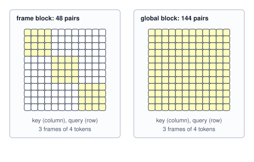

<!-- SPDX-License-Identifier: CC-BY-4.0 -->
<!-- Copyright (c) 2026 Martin Schröder <info@swedishembedded.com> -->

# Learning 3D Directly

*Can one network look at a few images and output the scene's geometry in a single pass?*

Count the numbers that made the pipeline of the last chapter work. A RANSAC threshold of 1.5 pixels, and a confidence of 0.999 for its iteration bound. A Huber threshold of 2 pixels in the adjustment. Twenty correspondences before a camera may be registered, three degrees of parallax before a pair may seed the reconstruction, and a gate of 0.1 on the residual before one chunk of a capture may be joined to another. None of these is a law of nature. Each is a scar: a place where one stage of the chain had to decide, without being told, which pixel of one photograph is the same pixel of another, and where the decision was made by proposing something and letting the data vote. The chain is a machine for turning a question that has no answer from two pixels (which point of space is this?) into one that has a good answer from many, and the thresholds are how it knows when the vote is clear.

A person looking at four photographs of a room does not vote. The floor is flat, the wall is vertical, the corner of the ceiling is where three planes meet, and the chair in front of the table is nearer than the table. A great deal of what the pipeline recovers from parallax, a person recovers from having seen rooms. If a network has seen enough of them, it could be asked for the answer directly: four photographs in, and out come the geometry of each (a depth for every pixel, the point of space it shows) and the cameras that took them. The proposal is worth taking seriously because it is deployed: brain has such a model, a transformer of 1.26 billion parameters that turns a handful of unposed photographs into a splat scene in one forward pass. What matters is exactly what comes out of such a model, what it is scored against, what it costs, and how it fits against the chain of Chapter 4: as a replacement for the whole of it, or as a start for its last stage.

A network that outputs geometry inherits the vocabulary of patches, alignment, rays and gauges; five questions bring it back.

1. (Volume VII, [Chapter 6](../v07-vision/06-vision-transformers.md), vision transformers.) An image of 518 by 518 pixels is cut into patches of 14 by 14. How many patch tokens is that, and how many (query, key) pairs does one attention head score over them?
2. (Volume VII, [Chapter 5](../v07-vision/05-dense-prediction.md), monocular depth.) A network predicts inverse depth $\hat\nu = 0.5\,\nu + 0.1$ at three pixels whose true inverse depths are $\nu = 0.2, 0.5, 0.8$. Which scale and shift, found by the alignment of that chapter, bring the prediction back onto the truth?
3. ([Chapter 3](03-camera-geometry.md), camera intrinsics.) A camera has $f_x = f_y = 500$ and principal point $(320, 240)$. What is the unit ray of pixel $(400, 300)$, and which of the two pixel conventions (pixel $i$ covers $[i, i+1)$, or is centred on $i$) does the book use?
4. ([Chapter 4](04-structure-from-motion.md), the gauge.) Photographs alone fix a reconstruction only up to how many numbers, and which?
5. (Chapter 4, triangulation.) Why does the depth error of a triangulated point fall as the baseline grows, and what does the error of a point seen by cameras 2 centimetres apart look like along the ray?

## A map of points instead of a map of depths

Chapter 4 asked each stage to produce one kind of object: matches, then a relative pose, then points and absolute poses, then a refined everything. A network asked for the scene has to be given a single kind of target, one that can be written as an array the size of the image so that a dense prediction head (Volume VII, Chapter 5) can regress it. The pointmap models of the references make the following choice.

For frame $i$, with pixel $(u, v)$ centred at $(u + \tfrac12, v + \tfrac12)$ in the convention of Chapter 3, define the **pointmap** $\mathsf{X}_i$: an array of $H \times W \times 3$ numbers whose entry at pixel $(u, v)$ is the world point that the pixel sees. The world is the frame of the first camera, so a point in $\mathsf{X}_i$ and a point in $\mathsf{X}_j$ are written in the same coordinates and can be compared. With camera centre $\mathbf{C}_i$, rotation $\mathbf{R}_i$ (world to camera) and depth $z_i[v, u]$ of the pixel,

$$
\mathsf{X}_i[v, u] = \mathbf{C}_i + z_i[v, u]\;\mathbf{R}_i^\top \mathbf{K}_i^{-1}\begin{pmatrix} u + \tfrac12 \\ v + \tfrac12 \\ 1 \end{pmatrix}. \tag{1}
$$

The right side is the pixel's ray of Chapter 3 moved into the world and walked $z_i$ along it. A pointmap is therefore a depth map and a camera written as one thing: it holds a ray's origin, direction and length per pixel, composed. Nothing about it is a new geometric idea. What is new is the use: there is no matrix $\mathbf{K}$ or pose in the target, only points, so a network that outputs it never has to be told or to say what its camera is. The camera can be read back from the points afterwards, and so can the matches, because two pixels of two images that see the same surface point have the same entry. A room small enough to write down shows both.

<!-- worked: feed_forward_3d.pointmap_toy -->
A room seen by three cameras with f = 36 pixels, principal point (24, 18) and a 48 by 36 image. The floor is the plane y = 1, the back wall z = 6, and a sphere of radius 0.7 is centred at (0.4, 0.3, 3.5) (metres, x right, y down, z forward, in the frame of camera 0). Camera 0 is the identity; cameras 1 and 2 are placed with `look_at` of Chapter 3 at the eyes (0.5, 0.05, 0) and (-0.5, 0, 0.1), both looking at (0.2, 0.3, 3.5) with up = (0, -1, 0). The ray of pixel (i, j) is ((i + 0.5 - c_x) / f, (j + 0.5 - c_y) / f, 1); the pointmap entry is the nearest hit of the room along it (the floor, then the wall, then the sphere, whichever is closest), in the frame of camera 0.

Five pixels of camera 0, the world point their pointmap entry holds, where that point lands in camera 1, and the pixel of camera 1 whose pointmap entry is nearest to it in space (with the distance in metres, next to the width z / f of the pixel's footprint at that depth):

| pixel (i, j) | surface | depth z | pointmap entry (X, Y, Z) | lands in camera 1 at | nearest entry of camera 1 | distance | z / f |
|---|---|---:|---|---:|---:|---:|---:|
| (9, 6) | wall | 6.0000 | (-2.417, -1.917, 6) | (9.81, 3.75) | (9, 3) | 0.0676 | 0.1667 |
| (24, 15) | sphere | 3.1984 | (0.04442, -0.2221, 3.198) | (21.97, 12.37) | (21, 12) | 0.0779 | 0.0888 |
| (18, 27) | floor | 3.7895 | (-0.5789, 1, 3.789) | (17.11, 24.17) | (16, 24) | 0.1470 | 0.1053 |
| (36, 24) | floor | 5.5385 | (1.923, 1, 5.538) | (36.49, 21.73) | (36, 21) | 0.2185 | 0.1538 |
| (39, 9) | wall | 6.0000 | (2.583, -1.417, 6) | (40.40, 6.12) | (40, 6) | 0.0614 | 0.1667 |

Over all 1728 pixels of camera 0, 1461 are seen by camera 1 (they land inside the image and the depth stored there agrees to 5 percent); for 1461 of them the pointmap entry of camera 1 that is nearest in space is within one pixel of the pixel the geometry says they land in.
<!-- /worked -->

The exact pointmap of camera 0 is the ray of each pixel times its depth, since camera 0 is the identity, and the pointmaps of cameras 1 and 2 are the same room in the same coordinates. Take the first pixel of the table: the wall point $(-2.417, -1.917, 6)$ lands at pixel $(9.81, 3.75)$ of camera 1, and the entry of camera 1 nearest to it in space belongs to pixel $(9, 3)$, the pixel it lands in, 0.0676 metres away. The distance is not zero for a reason that matters later: a pixel is an area, and its entry is the point at the area's centre, which is of the order of one footprint $z/f$ from any other point of the same surface (on the floor, seen at a grazing angle, a pixel covers more ground than $z/f$, and the distance is about 1.4 footprints). Over all 1,728 pixels of camera 0, 1,461 are seen by camera 1, and for every one of those the entry of camera 1 that is nearest in space is within a pixel of the projection. A pointmap pair therefore contains a dense set of correspondences for free, found by a nearest-neighbour search in space where Chapter 4 searched in descriptor space and then voted.

What the network has been asked to do is now clear, and so is what it has been spared. It need not estimate an epipolar geometry, count inliers or triangulate: the geometry is in its output. It need not run a bundle adjustment, since the points come out consistent across views, to the extent that the network has learned to make them so. It need only do, for every pixel, what a person does for the floor: say where in the room the thing the pixel shows is. A **feed-forward reconstruction** is the recovery of cameras and scene geometry from images by a single evaluation of a trained network, with no optimization over the images at the time of use. Training is the optimization, and it has already been paid for.

## Cameras hidden in the points

A model that outputs only points has not thrown the cameras away; it has stored them in a form that needs to be read. The first thing to read is the intrinsics. In the frame of camera $i$, the pointmap entry of pixel $(u, v)$ is a point $(X, Y, Z)$ that satisfies $u + \tfrac12 = c_x + f_x X/Z$ by equation (1) of Chapter 3, a straight line in $X/Z$. The slope is the focal length and the intercept is the principal point, and an ordinary least-squares fit of pixel coordinate on $X/Z$ (Volume II, Chapter 2) finds both. An error along the ray does not move $X/Z$ at all, so it is invisible to this fit; only an error across the ray is not, and the fit measures exactly that.

The second is the pose. The camera-frame points $z_i[v, u]\,(x, y, 1)$ (a depth map and the intrinsics) and the world points $\mathsf{X}_i[v, u]$ describe the same surface in two frames, and the rigid motion between the frames is the camera's pose. Finding it is the problem of fitting a similarity to two clouds of points with known correspondence, which has a closed form. Let $\mathbf{A}$ and $\mathbf{B}$ be the two clouds of $n$ points, with centroids $\bar{\mathbf{a}}$ and $\bar{\mathbf{b}}$, and let

$$
\mathbf{S} = \frac{1}{n}\sum_{p}(\mathbf{b}_p - \bar{\mathbf{b}})(\mathbf{a}_p - \bar{\mathbf{a}})^\top .
$$

The rotation that carries $\mathbf{A}$ onto $\mathbf{B}$ best, in the least-squares sense, is the rotation nearest to $\mathbf{S}$: with $\mathbf{S} = \mathbf{U}\,\mathrm{diag}(\boldsymbol\sigma)\,\mathbf{V}^\top$ it is $\mathbf{R} = \mathbf{U}\mathbf{V}^\top$, with the last column of $\mathbf{U}$ negated if the determinant came out $-1$ (a reflection can fit better than any rotation, and no camera moves by one). The scale is $a = \mathrm{trace}(\mathbf{R}^\top\mathbf{S}) / \bigl(\tfrac1n\sum_p \lVert\mathbf{a}_p - \bar{\mathbf{a}}\rVert^2\bigr)$, or $a = 1$ if the clouds are already the same size, and the translation is $\mathbf{t} = \bar{\mathbf{b}} - a\mathbf{R}\bar{\mathbf{a}}$. This is the similarity fit of Umeyama (1991). Chapter 4 solved the same problem to join the chunks of a capture, with camera centres and axes as the corresponding points.

```text
function align_similarity(A: array<real>[n, 3], B: array<real>[n, 3], with_scale: bool)
        -> (real, array<real>[3, 3], array<real>[3]):
    require n >= 3
    abar = mean(A, axis=0)
    bbar = mean(B, axis=0)
    S = zeros(real, [3, 3])
    var = 0.0
    for p in 0 .. n:
        da = A[p, :] - abar
        db = B[p, :] - bbar
        for r in 0 .. 3:
            for c in 0 .. 3:
                S[r, c] = S[r, c] + db[r] * da[c] / n
        var = var + dot(da, da) / n
    require var > 0.0
    R = nearest_rotation(S)
    a = 1.0
    if with_scale:
        a = trace(matmul(transpose(R), S)) / var
    t = bbar - a * matmul(R, abar)
    return (a, R, t)
```

The camera-to-world pose of frame $i$ is then $(\mathbf{R}, \mathbf{t})$ from `align_similarity(A, B, false)`, with the camera-frame points as $\mathbf{A}$ and the pointmap as $\mathbf{B}$, and its centre is $\mathbf{t}$. The example below does it for the room, first from exact maps and then from the outputs of a **stand-in** for a network. A model of a billion parameters cannot be trained inside a textbook, and what these examples need is the shape of its outputs and the way they go wrong, so a seeded generator makes outputs with the errors such a model makes: a scale the world has no unit for (the stand-in's world is 0.37 of the room's metres), for each view a smooth bias along the ray in the depth head and in the pointmap head separately, noise of 1 percent per pixel (3 percent on a silhouette, a pixel whose depth differs from a neighbour's by more than half of the smaller), and a scatter of 0.4 percent of the depth in each coordinate of the pointmap. The first worked block below prints the complete recipe: the distributions, the bias function, the draw order and the confidence. The sizes are chosen near the one to two percent by which real depth maps disagree (the commit `1fe049d1d`, below, measures about 1 percent on a real capture). The stand-in is a way to measure the machinery around the model; it is not a measurement of brain's model, and nothing below should be read as one.

<!-- worked: feed_forward_3d.camera_from_pointmap -->
Camera v = 1 and 2 of the room. A camera-frame point is z (x, y, 1) with (x, y) = ((i + 0.5 - c_x) / f, (j + 0.5 - c_y) / f); the pose (R, C) is the rigid map from these points to the pointmap entries over all 1728 pixels (the Umeyama fit with the scale held at 1; the pointmap of the stand-in is in the stand-in's units, so its centre error is divided by the scale 0.37 to read in metres). Columns: the rotation error in degrees and the centre error in metres of the pose from exact maps, and of the pose from the stand-in's depth head and pointmap head (`feed_forward_3d.standin`, seed 9090303255190359577).

The stand-in (`bookrng.generator("feed_forward_3d.standin")`, seed 9090303255190359577) is built as follows. Let z be the true camera depth of a pixel, (x, y) = ((i + 0.5 - c_x) / f, (j + 0.5 - c_y) / f) its normalized coordinates, s = 0.37 the scale of its world, and a pixel *hard* when its true depth differs from that of a 4-neighbour by more than 0.5 of the smaller of the two (the silhouettes: 176 of the 5184 pixels). For camera v = 0, 1, 2 in turn, six `normal()` draws are scaled by the standard deviations (0.02, 0.01, 0.01) to give the biases (b0, bx, by) of the depth head, and the next six likewise the biases (b0', bx', by') of the pointmap head. Then for every pixel in row-major order (row j from 0, column i from 0), five `normal()` draws in this order: e for the depth head and e' for the pointmap head, each scaled by sigma = 0.01 (0.03 on a hard pixel), and three lateral errors scaled by 0.004 z, one for each world axis. The depth head's output is s z (1 + b0 + bx x + by y + e). The pointmap head's is s (C + z (1 + b0' + bx' x + by' y + e') r + lateral), where C is the camera centre and r = R_c (x, y, 1) with R_c the camera-to-world rotation, so that C + z r is the exact world point; the lateral errors are added in world axes before the scale s. Both heads give the confidence 1 + exp(raw) with raw = -2 ln(sigma / 0.01), which is 2 on an easy pixel and 1 + 1/9 on a hard one. The sizes are chosen, not measured.

| camera | rotation error, exact (deg) | centre error, exact (m) | rotation error, stand-in (deg) | centre error, stand-in (m) |
|---:|---:|---:|---:|---:|
| 1 | below 1e-4 | below 1e-12 | 1.200 | 0.1273 |
| 2 | below 1e-4 | below 1e-12 | 0.178 | 0.0314 |

The intrinsics read back from the exact camera-frame points of camera 1 by the line u = c_x + f (X / Z) are f_x = 36.000000, c_x = 24.000000, f_y = 36.000000, c_y = 18.000000 (true: 36, 24, 36, 18); applied to the stand-in's pointmap of camera 1 carried into that camera's frame by its true pose, the same fit gives f_x = 36.0077, c_x = 24.0032, f_y = 35.9944, c_y = 18.0048.
<!-- /worked -->

From exact maps the fit returns the camera to rounding. From the stand-in's maps, with errors of 1 to 3 percent in each depth, the rotation of camera 1 is out by 1.2 degrees and its centre by 0.127 metres on a baseline of 0.5; camera 2, whose view of the room is better conditioned, is out by 0.18 degrees and 0.031 metres. These are the errors of a start, not of an answer, and the end of the pipeline uses them as one. The intrinsics come out almost exactly: 36.0077 against 36, because most of what the stand-in gets wrong is along the ray, which the fit cannot see.

## A scale the pictures do not contain

A network that outputs points must put them in some units, and it cannot have learned the right ones, because no photograph contains them. Volume VII, Chapter 5 met this for one image: a box twice as large at twice the distance makes the same picture, so monocular depth is known up to a scale and shift in inverse depth, and the metric that scores it must remove that ambiguity first, by the closed-form fit of its equation (8). For many views the ambiguity changes shape. All the views share one world, so the ambiguity is one similarity and not one scale and shift per image, and the model is free to pick the world's frame by convention. brain's model picks the first camera: the world is the frame of camera 0, with its rotation the identity and its centre at the origin, and the first frame is marked as the reference by carrying its own learned camera and register tokens, different from those of every other frame. Only the scale is then left unfixed. That is what the stand-in has, a global factor of 0.37 on everything.

Scoring such output is where the choice of alignment decides what is measured. The table aligns the stand-in's depth head with the truth in four ways.

<!-- worked: feed_forward_3d.scale_alignment -->
The depth head of the stand-in (`feed_forward_3d.standin`, seed 9090303255190359577) is 0.37 of the true depth on average, with a smooth bias per view and noise. AbsRel = mean |prediction - truth| / truth over the 1728 pixels of each view, under four ways of aligning it with the truth first. 'One scale for all three' is the median over all 5184 pixels of truth / prediction; 'one scale per view' is the same median per view; the last row fits scale and shift to the inverse depth of each view separately by the closed form of Volume VII, Chapter 5.

| alignment | numbers fitted | view 0 | view 1 | view 2 | mean |
|---|---:|---:|---:|---:|---:|
| none | 0 | 0.6404 | 0.6356 | 0.6353 | 0.6371 |
| one scale for all three (median ratio 2.7567) | 1 | 0.0116 | 0.0150 | 0.0104 | 0.0123 |
| one scale per view (2.7811, 2.7443, 2.7419) | 3 | 0.0091 | 0.0145 | 0.0093 | 0.0110 |
| scale and shift in inverse depth per view | 6 | 0.0090 | 0.0135 | 0.0090 | 0.0105 |

The biases that the stand-in gave the depth head at the image centre are -0.0289 (view 0), -0.0153 (view 1), -0.0140 (view 2). A scale per view cannot tell such a bias from a different size of the room, so it removes them, and the row says the model is better than the single scale says.

The pointmap head's 5184 points, scored against the true points (relative RMS: the RMS distance of the aligned point to the true one divided by the RMS distance of the true points from their centroid, 2.8600 m). 'Rotated and shifted' carries the stand-in's points by the rotation vector (0.2, -0.4, 0.1) and the translation (1, -2, 3), as a model that did not fix its world to the first camera would leave them. The one-scale fit puts the centroid of the points on that of the truth and the spread on the spread; the similarity is the Umeyama fit.

| points | alignment | scale found (true: 1 / 0.37 = 2.7027) | relative RMS |
|---|---|---:|---:|
| frame of camera 0 | none | - | 1.2038 |
| frame of camera 0 | one scale (spread ratio) | s = 2.7537 | 0.0338 |
| frame of camera 0 | similarity, 7 numbers | s = 2.7521 | 0.0336 |
| rotated and shifted | none | - | 1.0449 |
| rotated and shifted | one scale (spread ratio) | s = 2.7537 | 0.3749 |
| rotated and shifted | similarity, 7 numbers | s = 2.7521 | 0.0336 |

The rotation the similarity fit finds undoes the frame change to 0.243 degrees.
<!-- /worked -->

The first row is the model scored against a unit it never saw, and says only that the unit is not the room's metre. A single scale for all three views, taken as the median of the ratios as the synthetic-geometry gate of brain's model does (`crates/worldmirror2/tests/it/t16_synthetic_geometry.rs`, whose header says that anything fitted more freely "would absorb the error being measured"), gives an AbsRel of 0.0123. Letting each view have its own scale reduces it to 0.0110, and a scale and shift in inverse depth per view to 0.0105: the 11 and 15 percent that these two alignments take off are not accuracy but disagreement between views, which the per-view fit has absorbed by calling it a different size of room. The biases that the stand-in gave the depth head at the centre of the three views are $-0.0289$, $-0.0153$ and $-0.0140$; views 1 and 2 are nearly alike and view 0 is not, and a scale per view lets view 0 look as good as the others. A multi-view model is meant to give geometry in which the views agree, so it is scored with the alignment that does not forgive their disagreeing: one scale for the whole batch when the frame is fixed, one similarity when it is not.

The second table is that case. The stand-in's points are carried by a rotation and a translation, as the output of a model that had not fixed its world to its first camera would be, and scored three ways. A scalar fit that is right when the frame is fixed (0.0338, relative to the spread of the scene) is badly wrong when the frame is not (0.3749), and the similarity of `align_similarity` is right in both (0.0336), recovering the frame change to 0.243 degrees. The scale it finds, 2.7521, is close to the 1/0.37 = 2.7027 that was put in, and the median ratio of the depths in the first table, 2.7567, is 2 percent above it for a reason worth seeing: the three biases at the centre of the views are all negative, so the depth head is on average about 2 percent too small, and a scale cannot tell a biased model from a world of a different size.

## Telling the network which camera is which

A transformer has no notion of "this image" or "the first image": it sees tokens. For frames to be recognized as views of one scene, and for one of them to define the world, something in the input has to say so. brain's model does this with seven special tokens in front of the patches of every frame (`PATCH_START` in `crates/worldmirror2/src/model.rs`): one camera token, four register tokens, a pose token and an intrinsics token. The camera token is the slot in which the model will gather what it knows about this frame's camera, and the registers are spare slots that attention can use as scratch space (Darcet et al., 2024, found that vision transformers learn to hide global information in a few low-content patches unless such slots are given). The camera and register tokens are learned vectors, and frame 0 has its own copy of them (`cam_token` and `reg_token` have shape $[1, 2, \cdot, d]$, entry 0 for the first frame and entry 1 for every later one): the model is told which frame is the reference by what it is wearing.

The pose and intrinsics tokens are the model's way of taking cameras as input. A capture rig often knows its poses or its lens. If the model can be told, it should be, and brain's model accepts it (`crates/worldmirror2/src/priors.rs`): the pose token is a small network applied to the 7-vector of a camera, the quaternion of its camera-to-world rotation (scalar last, $(x, y, z, w)$, where Chapter 3 and Chapter 6 write $(w, x, y, z)$) followed by its centre, and the intrinsics token to the 4-vector $(f_x/w, f_y/h, c_x/w, c_y/h)$. Both small networks are a linear map, a GELU and a linear map to width $d$, run on the host, since a sequence of cameras is a few million multiply-adds. Their design has two consequences worth checking.

First, the pose vector cannot hold absolute positions. A reconstruction is defined only up to scale, so a prior in metres would carry a unit the model has no way to honour. The centres are therefore normalized across the sequence: subtract their centroid, divide by the largest distance of a centre from it. The same rig in millimetres, anywhere in the world, gives the same tokens, and the furthest camera sits at distance 1. It also means that the priors of a sequence must be encoded together, since a frame's token depends on where the others are. Second, the intrinsics are divided by the image size, so the token says how wide the lens is and not how many pixels the sensor has: the same camera at half the resolution has the same token.

<!-- worked: feed_forward_3d.camera_tokens -->
The room's three cameras as pose tokens: the camera-to-world rotation as a quaternion (x, y, z, w) and the centre, minus the centroid of the three centres and divided by the largest distance from it.

| camera | quaternion (x, y, z, w) | normalized centre |
|---|---|---|
| 0 | (0, 0, 0, 1) | (0, -0.03302, -0.06605) |
| 1 | (-0.03548, -0.04271, -0.001518, 0.9985) | (0.9907, 0.06605, -0.06605) |
| 2 | (-0.04287, 0.1013, 0.004367, 0.9939) | (-0.9907, -0.03302, 0.1321) |

The same three cameras with every centre multiplied by 1000 and moved by (500, -300, 70) give tokens that differ from these by less than 1e-12 in any entry. The furthest camera sits at distance 1 from the centroid by construction.

Intrinsics tokens (f_x / w, f_y / h, c_x / w, c_y / h) and what the field-of-view output decodes back to (f_x from 0.5 w / tan(fov_u / 2), with the principal point placed at the middle of the image):

| camera | intrinsics token | field of view across, down (deg) | decoded f_x | c_x - w / 2 lost (px) |
|---|---:|---:|---:|---:|
| the room's camera (48 by 36) | (0.75, 1, 0.5, 0.5) | 67.380, 53.130 | 36.0000 | +0.0 |
| Chapter 3's camera (640 by 480) | (0.78125, 1.0417, 0.5, 0.5) | 65.238, 51.282 | 500.0000 | +0.0 |
| the same camera at 320 by 240 | (0.78125, 1.0417, 0.5, 0.5) | 65.238, 51.282 | 250.0000 | +0.0 |
| a principal point 0.4 pixel off centre (48 by 36) | (0.75, 1, 0.50833, 0.5) | 67.380, 53.130 | 36.0000 | +0.4 |

A rotation of -150 degrees about y has the scalar-last quaternion (0, 0.9659, 0, -0.2588) by the branch rule of the pose token, and the rotation of +150 degrees (0, 0.9659, 0, 0.2588): the second has w = 0.2588, the first -0.2588, a sign that follows from the branch and not from the rotation.

A ray map for a barrel lens (k1 = -0.15, 48 by 36 pixels, f = 36, the radial model of Chapter 3 inverted by 12 Newton steps) is 1728 unit directions. The pinhole line u = c + f' (x / z) is fitted to the 1728 pairs of the pixel-centre column u = i + 0.5 and x / z of its ray by least squares, in u alone (v is not used), and has f' = 33.7472, c = 24.0000; it misses the pixel column it was made from by 0.403 px RMS and 1.875 px at the worst, in u; the ray map itself has no such error, since it lists the ray of every pixel.
<!-- /worked -->

Absent priors leave the pose and intrinsics rows zero. That is not a fallback, because of how the reference model was trained: as an "any-prior" model, with each prior withheld independently, with probability 0.5, by zeroing exactly these rows (the port's documentation of the reference records the rule; brain has no training code for the model). The all-zero row is therefore an input the model met throughout training, and the unconditioned path is a different corner of the same input space. Commit `0fd41ffe3` (September 2026) is the history of it: the checkpoint had carried the embedders `pose_embed` and `ray_embed` since the port was written, and nothing had ever called them. The commit also records why the capability matters beyond accuracy: handing the model the cameras is the only way to ask whether a failed reconstruction failed in camera prediction or in depth. A companion, `0e23faf95`, found a caution: back-projecting the depths through the supplied cameras instead of the predicted ones, on a turntable clip with approximate synthesized poses, made the result worse, because the supplied poses were less accurate than the predicted ones, and a geometry built on a camera inherits every error of it. A prior that is worse than the model's own estimate is not help.

The other direction is the model's output. A camera head reads the camera token of the last tapped level of the trunk and, in four refinement steps over all frames' tokens together, regresses a 9-vector per frame: the translation, a quaternion, and two fields of view (across and down), the last two passed through a ReLU. The camera is decoded to a focal length by $f = \tfrac12 w/\tan(\mathrm{fov}/2)$ with the principal point put at the middle of the image (`decode_cameras` in `crates/worldmirror2/src/gaussians.rs`). The table shows what that decoding keeps: the focal length, exactly, and nothing of an off-centre principal point (a camera whose principal point is 0.4 pixel off centre comes back centred). The pose token's quaternion has one more property that the table makes visible. The branch of the conversion from a matrix to a quaternion is chosen by the trace and then by the largest diagonal entry, and the sign of the scalar part is whatever the branch gives, so that the same rotation can have either sign of $w$: rotations of $-150^\circ$ and $+150^\circ$ about $y$ come out with $w = -0.2588$ and $+0.2588$ and the same $y$ component. For rotations up to $120^\circ$ the trace is positive and $w \ge 0$; beyond it the sign is not canonical.

A pointmap is not the only way to give a network a camera in an array. A **ray map** gives, for every pixel, the origin and unit direction of its ray in the world: six numbers a pixel, or three when all rays of a frame share an origin. It is the camera written out as a table with no formula in it, and its virtue is that it needs none. A pinhole's rays are the normalized $(x, y, 1)$ with $x$ and $y$ linear in the pixel coordinates; a lens that bends them is a table that is simply different. For a barrel lens of the model of Chapter 3 (k1 = -0.15), a pinhole line fitted to the rays misses the pixels they came from by 0.40 pixel RMS and 1.9 pixels at the worst, while the ray map has no such error, since it lists the ray of every pixel. The model in brain does not use ray maps: its "ray" token is the 4-vector of intrinsics, and its camera output is the 9-vector with two fields of view. They matter here as what the pointmap idea grows into when the lens is not a pinhole.

## Frames that look at each other

The patches of a frame become tokens and a transformer reads them (Volume VII, Chapter 6). What is new in a multi-view model is the question of what a token may read: only the tokens of its own frame, or all of them. If only its own, the frames can never be related; if all, the attention matrix of $S$ frames of $n$ tokens is $Sn$ on a side. The model alternates. A **frame block** attends within each frame separately: every token of frame $i$ sees only the tokens of frame $i$, so the pairs scored are $S n^2$ for $S$ frames. A **global block** attends over every token of every frame at once, $(Sn)^2$ pairs. The trunk of the model is 24 repetitions of one frame block and one global block. The first block of each pair refines what a frame knows about itself, and the second lets it consult the others.



The picture is the whole of the idea. Two details make it work. The first is position. A token's place in its frame (its row and column in the grid of patches) is given to attention by a rotary embedding in two dimensions: the angles of the rotation are $2\pi$ times a coordinate divided by a period, one set of periods for the row and one for the column, with the coordinates normalized to $[-1, 1]$ by $2(v + \tfrac12)/n - 1$ so that they do not depend on the size of the grid (`crates/worldmirror2/src/rope2d.rs`). The special tokens sit at coordinate $(0, 0)$ of a grid that is one larger on each side, and the patches are shifted by one. The same table is used in every frame, so the position of a token says where in its picture it is and nothing about which picture it belongs to: in a global block, patch $(3, 4)$ of frame 0 and of frame 5 are rotated alike. The model tells frames apart by their content and by their camera tokens, never by an index. That is also why one trained model runs at any grid size and any number of frames (the positional embedding of the encoder, which is not rotary, is resampled when the grid is not the native one).

The second is cost. The pairs and the arithmetic of a block follow from the shapes. A block over a span of $N_{\mathrm{span}}$ tokens scores $N_{\mathrm{span}}^2$ pairs per head, and across all heads, scoring a pair is $d$ multiply-adds and weighting a value another $d$, which is $4d$ FLOPs a pair; the four matrix products of a block (queries, keys and values together $3d^2$, the output $d^2$, and the two feed-forward layers $4d^2$ each) are $12 d^2$ multiply-adds, or $24 d^2$ FLOPs, a token. Per token the attention is $4 d N_{\mathrm{span}}$ and the matrix products $24 d^2$, so the two are equal at

$$
N_{\mathrm{span}} = 6d = 6144 \quad (d = 1024). \tag{2}
$$

Below that span, a block is a matrix-product machine, as the transformers of Volume V were; above it, attention dominates and the cost grows with the square of what is attended. A frame block's span is one frame, $n = 1376$ tokens (1,369 patches of a 518 pixel frame and 7 special tokens), well below. A global block's span is the whole pass, $Sn$, and reaches 6144 at $S = 6144/1376 = 4.46$ frames.

<!-- worked: feed_forward_3d.trunk_attention -->
Frames of 518 by 518 pixels: 37 by 37 = 1369 patches, plus 7 special tokens, so n = 1376 tokens a frame. For S frames, a frame block scores S n^2 pairs per head and a global block (S n)^2. A block's attention costs 4 d pairs FLOPs (scores and weighted sum, d = 1024 over all heads) and its four matrix products 24 d^2 FLOPs a token; the ratio column divides the FLOPs of the attention of a global block by those of its matrix products, and the share column the FLOPs of all 24 global attentions by those of the whole trunk (48 blocks). The two cost the same where the attended span is 6 d = 6,144 tokens.

| frames S | tokens S n | pairs, frame block | pairs, global block | global attention / its matrix products | trunk TFLOP | share in global attention |
|---:|---:|---:|---:|---:|---:|---:|
| 1 | 1,376 | 1,893,376 | 1,893,376 | 0.22 | 2.0 | 0.09 |
| 2 | 2,752 | 3,786,752 | 7,573,504 | 0.45 | 4.4 | 0.17 |
| 4 | 5,504 | 7,573,504 | 30,294,016 | 0.90 | 10.4 | 0.29 |
| 8 | 11,008 | 15,147,008 | 121,176,064 | 1.79 | 26.7 | 0.45 |
| 10 | 13,760 | 18,933,760 | 189,337,600 | 2.24 | 37.1 | 0.50 |
| 16 | 22,016 | 30,294,016 | 484,704,256 | 3.58 | 77.2 | 0.62 |
| 24 | 33,024 | 45,441,024 | 1,090,584,576 | 5.38 | 151.6 | 0.71 |
<!-- /worked -->


Past five frames the global blocks are attention-dominated, and from there the pass is quadratic in what it carries: at 10 frames the 24 global attentions alone are half of the trunk's FLOPs, at 24 frames 71 percent. Frame blocks cost only $S n^2$, which is $S$ times fewer pairs than the global ones; that ratio is the price of letting every frame see every other. Chapter 2 priced the same choice for the frames of a generated clip and found the same shape, attention over space and time together against space then time. The difference is that a clip's frames are a sequence in which neighbours matter most, and there are factorizations to exploit; here the frames are an unordered set from unknown viewpoints, and any frame may need any other, so the global block stays global and the model pays for it.

## The model, counted

The trunk is the middle of a pipeline that starts with an encoder and ends with heads, and the figure puts them in one place.

![A left-to-right block diagram: S photographs with no poses or calibration feed a patch encoder of 24 blocks run one frame at a time, giving 1,369 tokens; a token assembly adds a camera token, 4 registers, a pose token and an intrinsics token, 1,376 tokens a frame; known cameras, optional, enter the token assembly by a dashed arrow; the trunk, 24 times a frame block then a global block, with taps after levels 4, 11, 17 and 23, fans out to five heads (camera, depth, pointmap, normal, gaussian), which all feed an assembly box, then a gaussian scene with S cameras.](img/feed-forward-pass.svg)

The encoder is a vision transformer in the sense of Volume VII, Chapter 6, at the size called large: patch 14, width $d = 1024$, 16 heads, 24 blocks, one class token and four registers, applied to each frame alone, with the image first normalized by the means and standard deviations of ImageNet inside the model. Its output patch tokens, after a final layer norm, become the patches of the trunk. Every block carries a learned scale on each residual branch (layer scale), and the trunk's blocks also normalize each head's queries and keys before the scores are formed and rotate them by the two-dimensional embedding above. After blocks 4, 11, 17 and 23 (counting from 0) the trunk saves two things, the tokens after the frame block and the tokens after the global block, side by side, a width of $2d = 2048$ per token, and the heads read these four taps.

A dense head needs a full-resolution map from tokens on a grid 14 times coarser. The heads in brain are dense prediction transformer (DPT) heads, the kind introduced for depth by Ranftl et al. (2021): the patch tokens of each tap are normalized, projected by a $1 \times 1$ convolution to 256, 512, 1024 and 1024 channels, resampled to scales of 4, 2, 1 and $\tfrac12$ times the patch grid (two transposed convolutions, nothing, and a stride-2 convolution), brought to 256 channels, and fused from the coarsest to the finest by four refinement blocks of residual convolutions with a bilinear doubling between them. A convolution, a bilinear resize to the image's size and two more convolutions take the fused map to the output channels. The camera head reads only the camera token of the last tap. There are four dense heads of this kind, and they predict a depth map with a confidence and a validity mask, a pointmap with its own confidence, surface normals with a confidence, and a depth with twelve more numbers per pixel for the Gaussian of the scene (a rotation, three scales, an opacity, three colour residuals and a weight). The last head also takes the RGB frame through a $7 \times 7$ convolution and adds it to its fused features, so that colour detail the tokens have blurred is put back.

Every number of this can be counted from the configuration, and an independent count is a check on the port. The table is computed from the description above and from nothing in brain's code; it is then compared with the header of the released checkpoint, committed as a fixture of the crate.

<!-- worked: feed_forward_3d.model_counts -->
The model of the chapter, from its configuration: width d = 1024, 16 heads of 64, MLP width 4 d, patch 14, native size 518 (a grid of 37 by 37 patches), 4 register tokens, an encoder of 24 blocks, a trunk of 24 frame blocks and 24 global blocks, DPT heads of width 256, and a camera head of 4 blocks at width 2 d = 2048. Each block has two layer norms, a fused query-key-value matrix, an output matrix, a feed-forward pair and two layer-scale vectors; a trunk block adds layer norms over the head width for queries and keys. Values are 4-byte floats; MiB is 2^20 bytes.

| group | tensors | values | MiB |
|---|---:|---:|---:|
| trunk tokens and prior encoders | 14 | 7,124,992 | 27.2 |
| DINOv2 patch encoder | 344 | 304,372,736 | 1,161.1 |
| 24 frame blocks | 433 | 302,364,688 | 1,153.4 |
| 24 global blocks | 432 | 302,364,672 | 1,153.4 |
| camera head | 69 | 216,174,610 | 824.6 |
| depth head (DPT) | 62 | 32,654,595 | 124.6 |
| pointmap head (DPT) | 62 | 32,654,628 | 124.6 |
| normal head (DPT) | 62 | 32,654,628 | 124.6 |
| gaussian depth head (DPT) and input merger | 64 | 32,673,539 | 124.6 |
| gaussian parameter convolutions | 3 | 297,996 | 1.1 |
| total | 1,545 | 1,263,337,084 | 4,819.2 |

The tensor shapes of the released checkpoint's header (the committed fixture `crates/worldmirror2/tests/golden/header.json`) number 1,545 and hold 1,263,337,084 values; grouped by the prefix of their names into the seven groups `visual_geometry_transformer`, `cam_head`, `depth_head`, `pts_head`, `norm_head`, `gs_head`, `gs_renderer`, every group's count equals the count above (all seven agree).

The groups, component by component (the encoder and trunk blocks are 24 of the block below; the 16-value table of rotary periods is stored once, in the first frame block, and is the reason the frame blocks have one tensor and 16 values more than the global blocks, which are otherwise identical: 24 x 18 = 432 tensors):

| group | component | tensors | values |
|---|---|---:|---:|
| trunk tokens and prior encoders | camera token, one copy for frame 0 and one for the others | 1 | 2,048 |
| trunk tokens and prior encoders | register tokens, same two copies of 4 | 1 | 8,192 |
| trunk tokens and prior encoders | pose embedder: linear 7 to d, GELU, linear d to d | 4 | 1,057,792 |
| trunk tokens and prior encoders | intrinsics embedder: linear 4 to d, GELU, linear d to d | 4 | 1,054,720 |
| trunk tokens and prior encoders | depth embedder: the 14 by 14 values of a depth patch (196) through linear 196 to 4 d, GELU, linear 4 d to d | 4 | 5,002,240 |
| DINOv2 patch encoder | class token | 1 | 1,024 |
| DINOv2 patch encoder | register tokens | 1 | 4,096 |
| DINOv2 patch encoder | mask token (unused at inference) | 1 | 1,024 |
| DINOv2 patch encoder | position embedding, 1 + 37 * 37 = 1370 positions | 1 | 1,402,880 |
| DINOv2 patch encoder | patch projection, a 14 by 14 convolution of 3 channels to d, with bias | 2 | 603,136 |
| DINOv2 patch encoder | 24 blocks of width d (block table below, 14 tensors each) | 336 | 302,358,528 |
| DINOv2 patch encoder | final layer norm | 2 | 2,048 |
| 24 frame blocks | 24 blocks of width d with query-key norms (block table below, 18 tensors each) | 432 | 302,364,672 |
| 24 frame blocks | the one stored table of rotary periods, head width / 4 = 16 values, shared by all 48 trunk blocks | 1 | 16 |
| 24 global blocks | 24 blocks of width d with query-key norms (block table below, 18 tensors each) | 432 | 302,364,672 |
| camera head | initial camera 9-vector | 1 | 9 |
| camera head | parameter embedding: linear 9 to 2 d | 2 | 20,480 |
| camera head | token norm and output norm over 2 d | 4 | 8,192 |
| camera head | modulation generator: linear 2 d to 6 d (read at each of the 4 refinement iterations) | 2 | 12,589,056 |
| camera head | 4 refinement blocks at width 2 d (block table below, 14 tensors each) | 56 | 201,449,472 |
| camera head | predictor: linear 2 d to d, then linear d to 9 | 4 | 2,107,401 |
| depth head (DPT) | DPT head with 3 output channels (head table below) | 62 | 32,654,595 |
| pointmap head (DPT) | DPT head with 4 output channels (head table below) | 62 | 32,654,628 |
| normal head (DPT) | DPT head with 4 output channels (head table below) | 62 | 32,654,628 |
| gaussian depth head (DPT) and input merger | DPT head with 3 output channels and the 7 by 7 input merger (head table below) | 64 | 32,673,539 |
| gaussian parameter convolutions | 3 by 3 convolution 128 to 256 without bias, 1 by 1 convolution 256 to 12 with bias | 3 | 297,996 |

A block of width d, tensors in checkpoint order (the encoder's and the camera head's blocks have no query-key vectors; the trunk's have them, 4 tensors of d/16 = 64 values):

| tensor | shape | values at d = 1024 |
|---|---|---:|
| norm 1 weight, bias | 2 x d | 2,048 |
| fused query-key-value weight | 3d x d | 3,145,728 |
| fused query-key-value bias | 3d | 3,072 |
| (trunk blocks only) query norm weight and bias, key norm weight and bias | 4 x d/16 | 256 |
| output weight | d x d | 1,048,576 |
| output bias | d | 1,024 |
| layer scale 1 | d | 1,024 |
| norm 2 weight, bias | 2 x d | 2,048 |
| feed-forward weight 1 | 4d x d | 4,194,304 |
| feed-forward bias 1 | 4d | 4,096 |
| feed-forward weight 2 | d x 4d | 4,194,304 |
| feed-forward bias 2 | d | 1,024 |
| layer scale 2 | d | 1,024 |

A block without the query-key vectors has 14 tensors and 12,598,272 values at d = 1024, and one with them 18 tensors and 12,598,528. At d = 2048, the camera head's width, a block has 50,362,368 values.

A DPT head has one body for all four dense heads, which differ only in the output channels of the last convolution (depth 3: log depth, confidence and validity logit; pointmap 4: x, y, z and confidence; normals 4: a vector and its confidence; Gaussian depth 3, with the input merger). Its tensors, in checkpoint order, for the 3-channel head:

| part of a DPT head | tensors | values |
|---|---:|---:|
| token norm over the 2 d = 2048 channels of a tap (weight, bias) | 2 | 4,096 |
| projections, 1 by 1 convolutions from 2048 to 256, 512, 1024, 1024 channels, with bias | 8 | 5,769,984 |
| resize 0: transposed convolution 256 to 256, kernel 4, stride 4, with bias | 2 | 1,048,832 |
| resize 1: transposed convolution 512 to 512, kernel 2, stride 2, with bias | 2 | 1,049,088 |
| resize 2: none (the patch grid itself) | 0 | 0 |
| resize 3: convolution 1024 to 1024, kernel 3, stride 2, with bias | 2 | 9,438,208 |
| fusion inputs, 3 by 3 convolutions from 256, 512, 1024, 1024 to 256 channels, no bias | 4 | 6,488,064 |
| refinement block 1: 2 residual units of two 3 by 3 convolutions 256 to 256 with bias, then a 1 by 1 convolution 256 to 256 with bias | 10 | 2,426,112 |
| refinement block 2: 2 residual units of two 3 by 3 convolutions 256 to 256 with bias, then a 1 by 1 convolution 256 to 256 with bias | 10 | 2,426,112 |
| refinement block 3: 2 residual units of two 3 by 3 convolutions 256 to 256 with bias, then a 1 by 1 convolution 256 to 256 with bias | 10 | 2,426,112 |
| refinement block 4: 1 residual unit of two 3 by 3 convolutions 256 to 256 with bias, then a 1 by 1 convolution 256 to 256 with bias | 6 | 1,245,952 |
| output convolution 1: 3 by 3, 256 to 128, with bias | 2 | 295,040 |
| output convolution 2: 3 by 3, 128 to 32, with bias | 2 | 36,896 |
| output convolution 3: 1 by 1, 32 to the output channels (3, 4, 4 or 3), with bias | 2 | 99 |
| input merger (gaussian head only): 7 by 7 convolution from the 3 colour channels to 128, with bias | 2 | 18,944 |

The 4-channel heads add 33 values (32 weights and 1 bias for the extra channel), and the input merger is the last row, which only the Gaussian depth head has, so that the 3-channel head without it has 62 tensors and the Gaussian depth head 64.
<!-- /worked -->

The count equals the checkpoint's: 1,545 tensors and 1,263,337,084 values, which is the "1.26 billion", and in four-byte floats 4,819 MiB, a little under 5 GiB that has to be resident before the first photograph. The three counts the table makes visible are worth reading. The encoder and the two halves of the trunk have almost the same size (302 to 304 million values each), since each is 24 blocks of width 1024 and a block has $12 d^2 \approx 12.6$ million. The camera head, which predicts nine numbers per frame, has 216 million values: its four blocks run at width 2048, where a block has four times as many weights as at 1024, and a 2048-to-6144 modulation layer is read at every one of its four iterations. And each dense head is 32.7 million, small beside the trunk but not beside its job, because the arithmetic of a head is spent at image resolution.

<!-- worked: feed_forward_3d.counts_per_pass -->
FLOPs of one forward pass (TFLOP, 2 per multiply-add) at 518 by 518 pixels, by stage: the 24-block encoder, the matrix products of the 48 trunk blocks, the attention of the frame blocks and of the global blocks, the camera head (4 iterations of 4 blocks over the S camera tokens) and the four dense heads, each run on every frame. Normalizations, activations, softmax and the resampling are not counted. The encoder works on 1 + 4 + 1369 = 1374 tokens a frame (class token, four registers and the patches), the trunk on 7 + 1369 = 1376 (the seven special tokens and the patches), and the attention of each is counted at its own token count.

| frames | encoder | trunk matrix products | frame attention | global attention | camera head | dense heads | total |
|---:|---:|---:|---:|---:|---:|---:|---:|
| 1 | 1.02 | 1.66 | 0.19 | 0.19 | 0.00 | 1.36 | 4.4 |
| 4 | 4.07 | 6.65 | 0.74 | 2.98 | 0.01 | 5.46 | 19.9 |
| 10 | 10.17 | 16.62 | 1.86 | 18.61 | 0.02 | 13.64 | 60.9 |

One dense head on one frame costs, in multiply-adds: depth 149.3 G, points 149.3 G, normals 149.3 G, gaussians 234.3 G. The encoder and the heads grow linearly with S; the trunk's global attention grows with S squared.
<!-- /worked -->

A single frame costs $4.4$ TFLOP, of which the heads are 1.36. Four frames cost $19.9$ TFLOP; ten cost 60.9, of which the global attention is 18.6. The number to remember about the heads is that they are linear in the frames and independent of one another (each runs on one frame at a time, because the intermediate maps of one head at full resolution are the memory peak of the pass), and that the Gaussian head, with its $7 \times 7$ and $3 \times 3$ convolutions at the full resolution, is the most expensive of the four. The trunk's matrix products are linear in the frames too. Only the global attention is not, and it decides how many frames one pass may hold.

Two stories from the history of the crate say where the work was. The first is the port itself (commit `4f4256c6b`, 20 July 2026): the model was written for the engine and imported without translation, each of the 1,545 tensors under the checkpoint's own name, and checked stage by stage against values dumped from the reference. The commit reports the tolerances, exact for the layout and for the preprocessing, two parts in ten thousand for the encoder, three in a thousand for the trunk and five in a thousand for the heads and camera. It also names two quirks that the stage-by-stage check flushed out. One is still visible in the code: the residual unit of the dense head applies its ReLU in place, so the skip connection adds $\mathrm{relu}(x)$ and not $x$ (`rcu` in `crates/worldmirror2/src/dpt.rs`). Anyone implementing the head from a diagram would write the other.

The second is a bug that no run of the real model could have found (commit `d26dd7bf1`, 17 August 2026). The camera head dispatched its blocks with the head count and feed-forward width hardcoded to the reference configuration, while the weights were sized from the configuration's own numbers. At the reference configuration the two coincide, and nothing was wrong. At a smaller test configuration the block read past the end of its weight buffer and produced a NaN whose appearance depended on whatever lay next to it in memory. The commit's remedy is the lesson: the block's shape is now derived by one function (`cam_shape` in `crates/worldmirror2/src/cam.rs`) from the same numbers that size the weights, and a test that needs no device compares the two. A disagreement between what is dispatched and what is allocated is arithmetic and can be checked as arithmetic.

## Five opinions about one surface

The model predicts the scene several times over: a depth from the depth head, a world point for every pixel from the pointmap head, a normal, a depth and a Gaussian from the last head, and a camera from the camera head, all from the same trunk. Commit `fb24a98e7` makes the observation in its message: "the model predicts this scene five ways and assembly read two of them". They are not redundant. They are five errors, and an error in one is not the error of the others, so that comparing them is information and not noise. Using it needs three pieces: how a head's raw output becomes a number, what it means for the outputs to agree, and how much to trust each.

The raw outputs are not depths. The depth head's first channel is the logarithm of the depth, and the depth is its exponential, so that the network cannot predict a negative one; its second channel is a confidence and its third a validity logit for a sigmoid (`frame_maps` in `crates/worldmirror2/src/gaussians.rs`). The pointmap head's coordinates are in a signed-exponential encoding, $x \mapsto \mathrm{sign}(x)(e^{|x|} - 1)$, that gives a point far from the origin without a large raw value. The confidence of each is

$$
c = 1 + e^{\ell}, \tag{3}
$$

where $\ell$ is the raw channel (the **confidence map** is the array of these values over a frame), so that $c > 1$ and the confidence is positive however negative the network's raw value is. Why a network would output a number that means "how much to trust my other outputs" is a question about training, and the answer is a loss. Suppose each pixel's loss is $c\,e - \beta\ln c$ for an error $e$ and a fixed $\beta > 0$ (the form used in the pointmap papers; Wang et al., 2024). For a given error the loss is minimized over $c$ where $e - \beta/c = 0$, that is at $c^\star = \beta/e$: the network is paid for claiming confidence only to the extent that its error is small, and the logarithm stops it from claiming infinite confidence everywhere. Confidence comes out inversely proportional to the error, which is the weight that a weighted average wants: the minimum-variance combination of estimates weights each by the reciprocal of its variance. The crate in brain applies equation (3) and does not train the model, so the loss explains what the number is for; it is not something the crate computes.

The offset of 1 in (3) is a design choice with a visible effect. Three views estimate the same depth, 4 m, as 4.04, 3.97 and 4.80, and the network flags the third as a guess, with raw confidences 2, 2 and $-3$:

<!-- worked: feed_forward_3d.confidence_weights -->
Three views estimate the same depth, truth 4 m: 4.04, 3.97 and 4.80, with raw confidences 2, 2 and -3 (the third view is flagged as a guess). exp(raw) = (7.389, 7.389, 0.04979), so 1 + exp(raw) = (8.389, 8.389, 1.05).

| weights | share of each view | fused depth | error |
|---|---:|---:|---:|
| flat | (0.3333, 0.3333, 0.3333) | 4.2700 | 0.2700 |
| 1 + exp(raw) | (0.4706, 0.4706, 0.05888) | 4.0518 | 0.0518 |
| exp(raw) alone | (0.4983, 0.4983, 0.003358) | 4.0077 | 0.0077 |
<!-- /worked -->

A flat mean is pulled 0.27 m off by the bad view. Weighting by $1 + e^{\ell}$ cuts the error to 0.0518 and weighting by $e^{\ell}$ alone to 0.0077: with the offset, the view the network calls a guess still carries 5.9 percent of the weight, because its confidence cannot fall below 1. The offset is a floor, and on views the network is sure about it costs nothing; on views it is not sure about, it keeps them from being ignored. Whether that is wise depends on how well calibrated the raw values are, which is a property of the model that the weights do not tell you.

The second piece is agreement. Each view's depth is individually good, and the views disagree, by one or two percent of the depth. The disagreement is in the one direction a view cannot see itself: moving a point along its own ray does not change where it lands in its own image, so the view that made the error sees nothing wrong, and from any other view the error is parallax. The commit that added the cross-view fusion (`1fe049d1d`, September 2026) measured a real capture: the cameras were essentially right, registering one frame's geometry on another's needed a rotation of 2.14 degrees, and what remained was a median surface residual of 5.3 pixels. Stack a dozen such surfaces and every pixel is an average over a dozen disagreeing opinions, which is what looked like smearing. A fit afterwards cannot fix it either, because the gradient of an image loss with respect to a Gaussian's position is orthogonal to its own viewing ray (a Gaussian moved along its ray lands on the same pixels); the error has to be settled before the depths become geometry.

The fusion is one routine. For pixel $(p_x, p_y)$ of view $i$ with depth $z > 0$, form the world point $\mathbf{p} = \mathbf{C}_i + z\,\mathbf{r}$ along its ray $\mathbf{r}$. Project it into every other view $j$; if it lands inside the image with a positive depth $z_j$, read the depth $d_j$ stored at the pixel it lands in. If $d_j$ and $z_j$ agree to a relative tolerance, $|d_j - z_j|/z_j \le \tau_{\mathrm{r}}$, view $j$ is looking at the same surface, and its opinion is the point $\mathbf{q}$ at depth $d_j$ along the ray through the landing position, written as the distance $\zeta_{ij}$ along $\mathbf{r}$ at which it lies, $\zeta_{ij} = (\mathbf{q} - \mathbf{C}_i)\cdot\mathbf{r}\,/\,\mathbf{r}\cdot\mathbf{r}$. If they disagree by more than $\tau_{\mathrm{r}}$, view $j$ sees a different surface, one that occludes this one or is occluded by it, and averaging with it would invent a surface that is in neither. The fused depth is the confidence-weighted mean over the pixel's own depth and the agreeing opinions $\mathcal{A}_i$:

$$
\hat z = \frac{c_i z + \sum_{j \in \mathcal{A}_i} c_j\,\zeta_{ij}}{c_i + \sum_{j \in \mathcal{A}_i} c_j}. \tag{4}
$$

The pixel keeps its own direction, and only its distance changes. The number $|\mathcal{A}_i|$ is a by-product that turns out to matter: a pixel that several views agree about is a surface, and one that stands alone is a guess.

```text
function fuse_pixel(i: int, px: int, py: int, depth, conf, cams, rtol: real) -> (real, int):
    z = depth[i][py, px]
    require z > 0.0
    r = world_ray(cams[i], px + 0.5, py + 0.5)
    p = centre(cams[i]) + z * r
    acc = conf[i][py, px] * z
    wsum = conf[i][py, px]
    agree = 0
    for j in 0 .. len(cams):
        if j == i:
            continue
        (u, v, zj) = project(cams[j], p)
        if zj <= 1.0e-6 or u < 0.0 or v < 0.0 or u >= W or v >= H:
            continue
        kx = floor(u)
        ky = floor(v)
        dj = depth[j][ky, kx]
        if dj <= 0.0 or abs(dj - zj) / zj > rtol:
            continue
        q = centre(cams[j]) + dj * world_ray(cams[j], u, v)
        cand = dot(q - centre(cams[i]), r) / dot(r, r)
        if cand <= 0.0:
            continue
        acc = acc + conf[j][ky, kx] * cand
        wsum = wsum + conf[j][ky, kx]
        agree = agree + 1
    return (acc / wsum, agree)
```

On the room, with the three cameras known and the stand-in's depth head scaled by the single scale of the alignment table, the tolerance decides what the routine does.

<!-- worked: feed_forward_3d.fusion_table -->
The stand-in's depth head scaled by the single scale 2.7567 (so the three views share the room's units), fused across the three views by the rule described in the text with the known cameras. 176 of the 5184 pixels are silhouette pixels (a depth more than 1.5 times a neighbour's). Columns: the share of pixels with at least one agreeing other view, the mean number of agreeing views, the mean relative disagreement |c - z| / z over the agreeing pairs before fusing, and AbsRel against the true depth over all pixels and over the silhouette pixels after fusing.

| fusion | share supported | mean support | disagreement | AbsRel, all | AbsRel, silhouettes |
|---|---:|---:|---:|---:|---:|
| none (the aligned depth head) | - | - | - | 0.0123 | 0.0230 |
| 1 + exp(raw), rtol 0.005 | 0.217 | 0.234 | 0.0024 | 0.0123 | 0.0231 |
| 1 + exp(raw), rtol 0.02 | 0.642 | 0.882 | 0.0094 | 0.0118 | 0.0227 |
| 1 + exp(raw), rtol 0.05 | 0.880 | 1.522 | 0.0185 | 0.0097 | 0.0183 |
| 1 + exp(raw), rtol 0.2 | 0.906 | 1.626 | 0.0216 | 0.0097 | 0.0144 |
| 1 + exp(raw), rtol 0.5 | 0.913 | 1.652 | 0.0282 | 0.0134 | 0.0549 |

Supported views at rtol 0.05: 620 pixels have none, 1239 one, 3325 two. Weights, at rtol 0.05:

| weights | AbsRel, all | AbsRel, silhouettes |
|---|---:|---:|
| flat weights (all 1) | 0.0098 | 0.0188 |
| 1 + exp(raw) | 0.0097 | 0.0183 |
| exp(raw) alone | 0.0097 | 0.0178 |

The second head. The pointmap head's points (times the same scale) written as the depth along the camera's forward axis, z = f . (X - C) with f the third row of R; its confidence equals the depth head's here, so the blend is their mean:

| source of the depth | AbsRel, all | AbsRel, silhouettes |
|---|---:|---:|
| depth head | 0.0123 | 0.0230 |
| pointmap head, kept as a depth | 0.0137 | 0.0296 |
| confidence-weighted blend | 0.0101 | 0.0192 |
| blend, then fused across views | 0.0079 | 0.0146 |
<!-- /worked -->

A tolerance of 0.5 percent is below the stand-in's own disagreement (the disagreement column reads 0.0024 for the pairs it keeps): only 22 percent of pixels find a supporter, and the result is the input. A tolerance of 5 percent keeps 88 percent of the pixels supported and takes AbsRel from 0.0123 to 0.0097. At 20 percent the silhouette error improves further, to 0.0144, since a point near a boundary often lands in a neighbouring pixel whose depth differs by more than 5 percent without being a different surface, and those pairs are now admitted; and at 50 percent the routine has stopped refusing anything: the silhouette error is 0.0549, worse than the 0.0230 of the unfused input, because at a silhouette the depth of a different surface is now an opinion, and the mean of two surfaces is neither. Commit `d9b169ecc` made the by-product usable (`AssembleOpts::min_support` drops pixels that fewer than a given number of other views agreed about), and the crate's tests check the two behaviours at the extremes: that fusion pulls disagreeing views onto one surface, and that it refuses to average across an occlusion (`crates/worldmirror2/tests/it/t14_depth_fusion.rs`). The weights, in the second table, matter little on this stand-in, since its confidence is informative on only about 3 percent of the pixels; that is a property of the stand-in. The one-pixel example above is the case in which they matter.

The same reasoning applies across heads. The pointmap head is a second estimate of every pixel's position, produced by a different head, and brain's assembly can use it (`PositionSource::Blend`, commit `fb24a98e7`) after one step that looks like waste: it converts the point back into a depth along the camera's forward axis and throws the rest away. The reason is that the component of the point across the ray is a disagreement with the camera the scene is being built on, and honouring it would put a Gaussian where its own pixel does not look; what the second head is worth having for is its opinion about distance. The last table shows what that is worth on the stand-in: the pointmap head alone, kept as a depth, has an AbsRel of 0.0137 against the depth head's 0.0123; the confidence-weighted blend of the two, 0.0101; and the blend then fused across views, 0.0079. The crate's default is the Gaussian head's own depth, and the commit leaves the choice between sources to a measurement on real captures.

## Two channels and half a pixel

Two bugs in the assembly of the scene are worth telling, because both were invisible to every test that looked at the model and both were decided by one constant.

A Gaussian takes its opacity from the twelve channels of the last head. Two of them look like opacities: channel 7, a raw opacity, and channel 11, a learned merge weight. The reference's assembly uses the weight. For two months the port's did not, because the weight was substituted only inside an optional size-reducing step (a voxel merge) that was off by default. Commit `870595af4` (19 September 2026) found it from a symptom, a milky, washed-out scene, and measured it on a six-photograph capture: rendered from the camera that the model recovered, the scene built from channel 7 scored a peak signal-to-noise ratio (PSNR) of 12.48 dB against the photograph and carried 7.1 percent of its fine detail; from channel 11, 22.47 dB and 47.3 percent. The code now reads `sigmoid(gsp[11 * hw + i])`, and the gate that holds it, `t11_assembled_opacity`, is a test that needs no checkpoint: with nothing filtered out, every Gaussian's opacity must equal the merge weight that assembly returns for it. The numbers are one capture, measured on one day, and the lesson does not need them: a label such as "opacity" is not a specification, and where two outputs have the same name, a test must say which is which.

The second is the half pixel of Chapter 3. A Gaussian's position is a depth unprojected through a pixel, and the rasterizer that consumes it samples pixel $n$ at $n + \tfrac12$; the assembly unprojected pixel $n$ as $n$. Every Gaussian of every reconstruction was half a pixel up and left of the detail it came from, 0.7 pixels on the diagonal against a median splat standard deviation of 0.46. Commit `69a4363c6` (21 September 2026) records why it survived: rendered through its own cameras with the dilation off, a correct scene should be close to exact and the offset one was 11.5 dB worse; but at the renderer's default dilation (which blurs by the amount that hides small detail) the offset scene scored higher than the correct one, because a half-pixel diagonal shift spreads each pixel evenly over four neighbours, a $2 \times 2$ box blur, and PSNR prefers blur once the detail that would tell them apart has been dilated away. A check run at the default would have called the bug an improvement, so the test is pinned to low dilation. The code now reads `px as f32 + 0.5`. The reference unprojects integer pixel indices, and on a real capture the two conventions give the same cross-view disagreement within its noise, so the port keeps the convention that is right for the rasterizer that consumes the points.

The module comment at the top of `gaussians.rs` went on describing the means as back-projected through a pixel-index grid with no half pixel added, and calling that the reference convention, after the code below it had stopped doing so: the commit changed the code and left the sentence behind, the kind of thing that Chapter 4 noted of an earlier commit message, a statement true on the day it was written. The code is the one to trust; commit `5dbf36608` brought the comment into line.

## How many photographs one pass may hold

A pass costs $S$ frames of the encoder and heads and an $S^2$ of global attention; a capture of 200 photographs is not one pass at any size. The model that plans what a pass can take is a plain function of its configuration, and `crates/worldmirror2/src/recon_impl.rs` holds it: the grid a frame is run at, and the number of frames a pass may hold.

The grid follows the reference's preprocessing: the longest side becomes the smaller of its length and a cap, floored to a multiple of 14, and the other side is scaled by the same factor and rounded to a multiple of 14, so that the grid is a whole number of patches. The normalized rotary positions are why the cap need not be the 518 of the checkpoint; the default of brain's command line is 952, which gives a square frame 3.4 times the samples. The frame budget then follows from the cost of attention. One pass may hold 14,336 patch tokens in all, the frame count falls out as that number divided by a frame's patches, and it is held between 6 and 24: below 6 the plan is mostly overlap between chunks, and above 24 the host-side assembly of the pass's output, not the pass itself, is what runs out first.

<!-- worked: feed_forward_3d.frame_budget_table -->
The grid and the frame budget for sources of several sizes under a longest-edge cap of 518 (the model's native size) and of 952. A frame has (grid width / 14) (grid height / 14) patches; the budget is 14336 divided by that, rounded down, then raised to 6 if lower and cut to 24 if higher (there is no device limit here). The grid is made as follows: the longest side becomes min(longest side, cap) rounded down to a multiple of 14 (at least 28), and the other side is multiplied by the same ratio (new longest / old longest) and rounded half up to a multiple of 14. 'Patches in the pass' is frames times the patches of a frame and does not count the seven special tokens a frame adds; 'pairs' is the number of (query, key) pairs a global block scores per head at the budget, in millions, and does count them: (frames x (patches a frame + 7))^2. The last column is the largest single buffer in GiB: the larger of 2^30 bytes, one frame's scores in all 16 heads, the fused query-key-value buffer and the feed-forward hidden buffer, in 4-byte floats.

| source | cap | grid | patches a frame | frames | patches in the pass | pairs, global block (M) | largest buffer (GiB) |
|---|---:|---:|---:|---:|---:|---:|---:|
| 1920 by 1080 | 518 | 518 by 294 | 777 | 18 | 13,986 | 199 | 1.00 |
| 640 by 480 | 518 | 518 by 392 | 1036 | 13 | 13,468 | 184 | 1.00 |
| 1080 by 1920 | 518 | 294 by 518 | 777 | 18 | 13,986 | 199 | 1.00 |
| 518 by 518 | 518 | 518 by 518 | 1369 | 10 | 13,690 | 189 | 1.00 |
| 1920 by 1080 | 952 | 952 by 532 | 2584 | 6 | 15,504 | 242 | 1.00 |
| 800 by 600 | 952 | 798 by 602 | 2451 | 6 | 14,706 | 218 | 1.00 |
| 4000 by 3000 | 952 | 952 by 714 | 3468 | 6 | 20,808 | 435 | 1.00 |
| 640 by 480 | 224 | 224 by 168 | 192 | 24 | 4,608 | 23 | 1.00 |
<!-- /worked -->

The first row reads: a 1920 by 1080 frame at the native cap becomes 518 by 294, which is $37 \times 21 = 777$ patches, so a pass holds 18 frames and 13,986 patches, and a global block scores 199 million pairs a head. The rows at 952 show the floor of 6 overriding the arithmetic: six frames of 2,584 patches are 15,504 tokens, above the 14,336 the planner meant, because a plan with fewer frames than that would be all seams. The last column is constant by construction. The largest single buffer of a pass is the larger of a fixed 1 GiB (the budget the chunked global scores are held under, so the $S^2$ scores matrix is never materialized in full) and the feed-forward and query-key-value buffers, which stay below it for every shape in the table: frame count enters the memory of the pass linearly, not quadratically, and what grows with its square is the arithmetic. A device that cannot bind that buffer lowers the budget further, down to the floor; below the floor the pass reports that it does not fit rather than starting.

Commit `84521a0f2` (September 2026) is the loop that uses this. `crates/recon` knows no model: it ingests a capture, selects sharp and non-redundant frames, plans overlapping chunks from the model's answers to the two questions above, reconstructs each chunk, registers it onto the world of the earlier ones by the similarity of the cameras they share, and refuses a chunk whose shared cameras are not one similarity of the ones already placed. The gate on that residual is the one of Chapter 4's chunk registration. It is normalized by the shared cameras' spread because, in the message's words, "a feed-forward world carries no unit, so an absolute tolerance would mean a different thing in every capture." That is the missing scale again, turned into a gate: the unit of each chunk is the unit the network happened to choose, and joining chunks means finding a similarity. The pipeline is behind a trait, `ReconstructionModel`, which `MirrorRecon` implements for this model (`recon_impl.rs`); the dependency points one way, since `brain-recon` must not know a model.

## A start for the pipeline, or its replacement

The two routes can now be compared on the scene of Chapter 4: 60 points in a box, four cameras, half a pixel of noise, the classical chain run on it with its numbers (52 points and 172 observations after matching, rotation errors of 0.52, 0.60 and 0.78 degrees and centre errors of 0.025, 0.047 and 0.083 metres after the adjustment). The stand-in is applied to the same scene, at the 60 keypoints. Everything the network is allowed to supply, it supplies. Matches come from the pointmaps: a keypoint of view 0 is matched to the keypoint of view $v$ whose entry is nearest in space, if the two are mutual nearest neighbours. Cameras come from the rigid fit of each view's depth head to its pointmap, one per view. Points are the mean of a track's entries. Then the adjustment of Chapter 4, unchanged, takes it from there.

<!-- worked: feed_forward_3d.seed_or_replace -->
The sparse scene of Chapter 4 (seed 18033376832500173267 for the points, 8282942143422244089 for the pixel noise) with the stand-in's pointmaps at the 60 keypoints (`feed_forward_3d.sparse`, seed 4353048558362900194). The sparse stand-in follows the rule of the room's (the first worked block of the section on cameras), with the 60 projections of the noise-free pixels in place of a pixel grid: for view v = 0 to 3 in turn, six `normal()` draws for the biases of the depth head and the pointmap head (standard deviations 0.02, 0.01, 0.01), then for each point j = 0 to 59 five `normal()` draws (e, e' with sigma 0.01, three lateral errors with 0.004 z), where (x, y) are the normalized coordinates of the exact projection of the point in the view, z its true camera depth and no point is hard. Its outputs are in the same units, 0.37 of a metre. Observed pixels are the noisy ones of Chapter 4. Tracks: a keypoint of view 0 is matched to the keypoint of view v whose pointmap entry is nearest in space, if the two are mutual nearest neighbours; 223 of the 240 possible entries land in tracks, 5 matches are wrong. Cameras: for each view v > 0, the rigid fit of its camera-frame points d (x, y, 1) (the depth head and the observed pixel) to its pointmap entries; camera 0 is the identity. Points: the mean of the track's pointmap entries. Both are divided by the distance of camera 1 from camera 0, so the baseline is 1 as in Chapter 4's gauge. Errors are those of Chapter 4's table (rotation in degrees, centre in metres after the true baseline is restored) for cameras 1, 2 and 3.

| path | points / observations | rotation error (deg) | centre error (m) | RMS reprojection (px) |
|---|---:|---:|---:|---:|
| Chapter 4, before its adjustment | 52 / 172 | 2.52 / 5.16 / 7.84 | 0.034 / 0.083 / 0.407 | 0.6255 |
| Chapter 4, after its adjustment | 52 / 172 | 0.52 / 0.60 / 0.78 | 0.025 / 0.047 / 0.083 | 0.4708 |
| network only: cameras and points from the pointmaps | 60 / 223 | 0.90 / 0.29 / 0.50 | 0.131 / 0.170 / 0.282 | 3.4745 |
| network, then the adjustment of Chapter 4 | 60 / 223 | 0.19 / 0.13 / 0.15 | 0.018 / 0.026 / 0.048 | 2.0981 |
| network, adjustment, drop residuals above 4 px (7), adjust again | 58 / 216 | 0.19 / 0.15 / 0.24 | 0.011 / 0.013 / 0.027 | 0.5349 |
| reference: true cameras and points, all 240 true observations | 60 / 240 | 0.17 / 0.19 / 0.32 | 0.011 / 0.014 / 0.030 | 0.5470 |

The last row is the floor: the half pixel of noise alone, with no matching, RANSAC or network involved.
<!-- /worked -->

The classical chain begins its adjustment 2.5, 5.2 and 7.8 degrees from the truth and ends at 0.5 to 0.8 degrees, with the centre of camera 3 83 millimetres off. The network alone starts closer in rotation (0.90, 0.29 and 0.50 degrees) and is worse in the centres (0.13, 0.17 and 0.28 metres, of a baseline up to 2 metres) and in the reprojection error, 3.5 pixels, which is what a start that has not seen the pixels looks like. Of the 240 possible entries, 223 land in tracks, and 5 matches are wrong. From that start the adjustment reaches 0.19, 0.13 and 0.15 degrees and 0.018, 0.026 and 0.048 metres; dropping the seven observations whose residual is above 4 pixels and adjusting once more gives 0.19, 0.15 and 0.24 degrees, 0.011, 0.013 and 0.027 metres and a reprojection error of 0.5349 pixel. The last row is the floor, the same adjustment on all 240 true observations from the true start: 0.17, 0.19 and 0.32 degrees, 0.011, 0.014 and 0.030 metres, 0.5470 pixel. The network-seeded adjustment lands on the floor: no rotation more than 0.02 degrees above it, and every centre within 3 millimetres of it.

What this establishes is narrow, and it should not be stretched. The stand-in's error sizes were chosen, so the table says nothing about how accurate brain's model is; it says that a start with the interface of a pointmap model, errors of one to three percent in depth and no tracks from descriptors, is a start from which the adjustment of Chapter 4 converges to the floor. The classical chain ended two to three and a half times above the floor, and Chapter 4 showed that the same adjustment started at the truth on its own observations lands where it landed: the difference is which observations it had, 172 where 240 were available and two of them wrong, not where it started. The network gave a more complete set of tracks, because nearest-neighbour search in space over 60 candidates is an easier problem than the ratio test over 100 noisy descriptors. With real images, where the candidates are a hundred thousand pixels and the surfaces are repetitive, that advantage is not to be assumed.

The cost side is as stark in the opposite direction.

<!-- worked: feed_forward_3d.work_comparison -->
Work in FLOPs (2 per multiply-add) and the bytes of the large operand, from the counts of Chapter 4 for a bundle adjustment of 4 cameras and 60 points seen 4 times each (the normal-equation matrix, 8 bytes a value) and from the counts of this chapter for the model (its 4-byte weights, each read at least once).

| computation | FLOPs | bytes |
|---|---:|---:|
| one Levenberg-Marquardt step of the toy, dense normal equations | 2.55e+06 | 3.10e+05 |
| the same step by the Schur complement | 2.35e+05 | 6.63e+03 |
| one forward pass of the model, 4 frames of 518 by 518 | 1.99e+13 | 5.05e+09 |

The pass needs 8.5e+07 times the arithmetic of the Schur-complement step (7.8e+06 times that of the dense step), and performs 3,939 FLOPs for every byte of weights it reads.
<!-- /worked -->

A single pass of the model is nearly eight orders of magnitude more arithmetic than a Levenberg-Marquardt step of the toy solved by the Schur complement (a factor of $8.5 \times 10^7$; against the dense step of the same toy, $7.8 \times 10^6$), and reads five gigabytes of weights to do it. The comparison is not fair, since the classical chain runs the step dozens of times and thousands of RANSAC iterations around it, and it is not meant to be: it says that the trade the network offers is arithmetic, regular and parallel, for logic, branching and thresholds. A pass is dense matrix products at nearly four thousand FLOPs for every byte of weights it reads, the shape of work that a GPU is built for (Volume IV), where a bundle adjustment is a sparse, irregular, sequential solve. For a hundred frames of a room it is the matrix products that win. For a calibrated rig, for a capture with a known scale, or for anything the network was not trained on, they need not.

The traffic runs both ways, and the history shows where each direction was built. Known cameras can be given to the model (commits `0fd41ffe3` and `0e23faf95` above), and the model's output can be given to the fit. Commit `558d44164` (September 2026) is the second: `ChunkScene` and `Reconstruction` in `crates/recon` now carry a per-frame `DepthPrior`, the depth the model predicted for every pixel with a confidence, so that the optimization of [Chapter 6](06-gaussian-splatting.md), whose image loss is blind to distance, has something to be pulled toward. What the model puts there is the fused depth of equation (4) and the agreement count as the confidence (`depth_prior` in `recon_impl.rs`), not any single view's depth, for the reason of the last section. The commit's message reports a measurement on analytic ground truth, a scene slid 5.7 percent along every ray that an image-only fit left at 6.21 percent and the supervised fit brought back to 0.08 percent. The numbers are the commit's; the structural reason is the one given above, that a splat's image-plane gradient is orthogonal to its own ray.

Two limits remain. The model assumes one rigid scene and a moving camera. A turntable gives it the opposite, a rotating object in front of a static background, and the crate's documentation says what to do: mask the background away, so that what remains is exactly a camera orbiting a still object. And what it predicts for pixels that are not surfaces is confident and wrong: sky passes the validity mask because it is a confident prediction of something infinitely far away, and arrives as a shell of huge pale Gaussians wrapped round the scene. `max_depth` exists for it (commit `ebe1e7932`). What the model knows, it learned from its training scenes; wherever the scene is not like them, the pipeline of Chapter 4, which assumes only geometry, is the one to ask.

## Check your understanding

1. A paper reports the depth error of a multi-view model after fitting a scale and shift to each view's inverse depth. A reviewer asks for the error after one global scale. Which number would you expect to be larger, why, and what does the difference measure?
2. The intrinsics fit of this chapter reads $f_x = 36.0077$ from the stand-in's pointmap, whose depths are off by one to three percent. Explain why such errors barely move it, and which kind of error would.
3. A student says that two pixels of two frames are the same pixel if their pointmap entries are equal. Find what is wrong, and say what the right test is and what it needs.
4. Doubling the frames of a pass from 10 to 20 at the native 518 pixel size: by what factors do the frame-block pairs, the global-block pairs, the encoder FLOPs and the heads' FLOPs change?
5. Fusion with $\tau_{\mathrm r} = 0.5$ supports 91 percent of pixels and with $\tau_{\mathrm r} = 0.05$ 88 percent. Why is the first worse on silhouette pixels, and what does the second do that the first does not?
6. A colleague wants to correct the depth of every Gaussian in the fit by gradient descent on the photographs after assembly, so that fusion becomes unnecessary. What stops this?
7. A model's confidence is $c = 1 + e^{\ell}$. A pixel it is hopeless about has $\ell = -10$. What weight does it get in (4), relative to a pixel with $\ell = 0$, and how would the answer differ without the 1?

## Summary

A feed-forward reconstruction recovers cameras and geometry from a few unposed images in one evaluation of a trained network, and the target that makes it possible is the pointmap: for each pixel, the world point it sees, in the frame of the first camera, so that a depth map and a camera are one array and matches are nearest neighbours in space. Cameras can be read back from it, intrinsics by a line fit and a pose by the similarity fit of Umeyama. The scale of the world is not in any photograph, so a multi-view model is scored after one similarity (or one scale, when the frame is fixed) for the whole batch, never one alignment per view, which hides the views' disagreement. The frames are tied together by special tokens, of which the first frame's is different, and by a trunk that alternates attention within each frame and across all of them; its arithmetic, $4 d N_{\mathrm{span}}$ per token for attention against $24 d^2$ for the matrix products, puts the balance at 6,144 tokens of span, so past about five frames at 518 pixels the pass is quadratic. The model in brain is 1,263,337,084 values in 1,545 tensors, $4.4$ TFLOP for one frame and 60.9 for ten. Its five heads are five estimates of one scene that fail differently and carry confidences, and the work of assembly is reconciling them: fusion across views along each pixel's own ray, with a tolerance that must refuse occlusions, and a blend of heads. The histories of the opacity channel and the half pixel say where the work of making the output a scene went wrong. On the toy of Chapter 4 a stand-in with the interface of the model gives a start from which the adjustment reaches the noise floor; what it cannot say is how good the real model is on real captures.

What the model leaves is a cloud of per-pixel Gaussians and cameras: the geometry, in a representation nobody asked for. A Gaussian per pixel is wasteful and unrefined, and its colours and shapes are a guess the photographs have not checked. The next chapter takes that representation and asks the question it was made to answer: how do millions of small differentiable blobs render a photorealistic scene, and how are they fitted to the photographs?

## References

- Wang, Leroy, Cabon, Chidlovskii and Revaud, *DUSt3R: Geometric 3D Vision Made Easy*, 2024.
- Wang, Chen, Karaev, Vedaldi, Rupprecht and Novotny, *VGGT: Visual Geometry Grounded Transformer*, 2025.
- Oquab et al., *DINOv2: Learning Robust Visual Features without Supervision*, 2023.
- Darcet, Oquab, Mairal and Bojanowski, *Vision Transformers Need Registers*, 2024.
- Ranftl, Bochkovskiy and Koltun, *Vision Transformers for Dense Prediction*, 2021.
- Ranftl, Lasinger, Hafner, Schindler and Koltun, *Towards Robust Monocular Depth Estimation: Mixing Datasets for Zero-shot Cross-dataset Transfer*, 2020.
- Su, Lu, Pan, Murtadha, Wen and Liu, *RoFormer: Enhanced Transformer with Rotary Position Embedding*, 2021.
- Umeyama, *Least-Squares Estimation of Transformation Parameters Between Two Point Patterns*, 1991.

## Exercises

1. **[Calculate]** Pixel $(9, 6)$ of camera 0 of the room has depth 6. Write its pointmap entry from equation (1) (camera 0 is the identity, $f = 36$, principal point $(24, 18)$), and its distance from the camera centre. Check against `feed_forward_3d.pointmap_toy`.
2. **[Calculate]** For a frame of 68 columns and 38 rows of patches (the 952 by 532 grid of the budget table) find the tokens per frame, the pairs a frame block and a global block score per head at a budget of 6 frames, and the number of frames at which the span of a global block reaches $6d = 6144$ tokens.
3. **[Calculate]** Three cameras have identity rotations and centres $(0, 0, 0)$, $(1, 0, 0)$ and $(0, 2, 0)$. Compute their pose-token translations (the normalized centres), and check that the furthest has distance 1.
4. **[Calculate]** Three views estimate a depth as 4.04, 3.97 and 4.80 m with raw confidences $2$, $2$ and $-3$. Compute the fused depths by flat, $1 + e^{\ell}$ and $e^{\ell}$ weights by hand and check against `feed_forward_3d.confidence_weights`.
5. **[Implement]** Reproduce `feed_forward_3d.pointmap_toy` and `feed_forward_3d.camera_from_pointmap`: cast the rays of the room (floor, wall, sphere), build the three pointmaps, find the nearest entries, and implement `align_similarity` with an SVD-based nearest rotation; recover the poses from the exact maps.
6. **[Implement]** Reproduce `feed_forward_3d.scale_alignment`: generate the stand-in with the stated generator and draw order, and score the depth head with the four alignments and the pointmaps with the three.
7. **[Implement]** Reproduce `feed_forward_3d.fusion_table` with `fuse_pixel` as written, and check that the tolerance 0.005 gives a support share of 0.217 and the tolerance 0.5 an error on the silhouette pixels above that of the unfused input.
8. **[Implement]** Reproduce `feed_forward_3d.model_counts`: build the tensor shapes of the 1,545 tensors from the description of the encoder, trunk, camera head and heads, and sum them by group.
9. **[Investigate]** Suppose a global block let every token attend to its own frame and to the first frame only. How many pairs does it score for $S$ frames of $n$ tokens, how does it compare with $(Sn)^2$ at $S = 10$ and $n = 1376$, and what does a frame lose?
10. **[Investigate]** The scalar part of the pose token's quaternion has no fixed sign. For which rotation angles can it be negative under the branch rule, and what would you change in the code to make the token canonical?
11. **[Investigate]** Repeat `feed_forward_3d.seed_or_replace` with the stand-in's noise doubled. At what multiple does the matching of tracks fail, and what does the adjustment of Chapter 4 do with a start in which the network's matches are half wrong?

## Key terms

- **pointmap**: an array with one world point per pixel of an image, the point the pixel sees, written in the coordinates of one shared frame (the first camera's), so that a depth map and the camera that took it are one object and two pixels of two images that see the same surface hold the same point. <!-- concept: pointmap -->
- **feed-forward reconstruction**: recovering cameras and scene geometry from images by one evaluation of a trained network, with no optimization over the images at the time of use, in place of the matching, robust estimation and adjustment of structure from motion. <!-- concept: feed-forward-reconstruction -->

## Answers

**Recall questions.**

1. $518/14 = 37$, so $37 \times 37 = 1369$ patch tokens, and a head scores $1369^2 = 1{,}874{,}161$ pairs.
2. The true value is $\nu = 2\hat\nu - 0.2$: for the three predictions $0.2, 0.35, 0.5$ it gives $0.2, 0.5, 0.8$. The alignment finds $a = 2$ and $b = -0.2$.
3. The ray is $(0.16, 0.12, 1)/1.019804 = (0.156893, 0.11767, 0.980581)$. The book's convention is that pixel $i$ covers $[i, i + 1)$ and is centred on $i + \tfrac12$.
4. Seven numbers: a rotation (3), a translation (3) and a scale (1), a similarity of space.
5. A larger baseline makes the angle between the rays larger, and the depth error falls as $\sqrt2\,\sigma Z^2/(fB)$, in inverse proportion to the baseline $B$. With cameras 2 cm apart the rays are nearly parallel, the error is large and it lies almost entirely along the ray, since a small movement along it changes the pixel by little.

**Check your understanding.**

1. The per-view number is the smaller (0.0105 against 0.0123 in the example). Each view's own scale and shift absorb whatever size and offset it has, including differences between views, so the difference measures how much the views disagree about the scale of the world. A model scored per view can have views that do not fit together at all and still score well.
2. Depth errors along the ray leave $X/Z$ unchanged, and $X/Z$ is all the fit uses; it measures an error across the ray, which here is the scatter of 0.4 percent of the depth. A wrong focal length in the points themselves, or a distortion of the lens, would move it.
3. The entries are points of continuous space, and the entry of a pixel is the point at the pixel's centre; the same surface point seen from a second camera falls somewhere inside a pixel, not at its centre, so the two entries differ by of the order of a footprint $z/f$, and in the presence of noise by several. The right test is nearest in space within a tolerance of the order of that footprint (and mutual), and it needs both pointmaps in one frame, which is the reason the model outputs them in the first camera's.
4. Frame-block pairs, $S n^2$: 2 times. Global-block pairs, $(Sn)^2$: 4 times. The encoder and the dense heads are linear in the frames: 2 times each.
5. At 0.5 the routine admits the depth stored in a pixel on a different surface as agreement, so at a silhouette it averages the foreground and the background, and the result is a depth that belongs to neither (0.0549 against 0.0230 unfused). At 0.05 it refuses pairs that differ by more than 5 percent, so that an occlusion is not averaged, and keeps the pairs that differ by the model's own error.
6. The gradient of an image loss with respect to a Gaussian's position is orthogonal to its own viewing ray, since moving the Gaussian along the ray does not change where it lands in the images it is fitted to. The optimizer therefore has no signal along the one axis in which the views disagree, and a depth error of one or two percent survives the fit.
7. $e^{-10} = 4.5 \times 10^{-5}$, so the weight is $1.0000454$ against $2$ for $\ell = 0$, one half. Without the 1 the weights would be $4.5 \times 10^{-5}$ and $1$, a ratio of 22,000. The offset means that a hopeless pixel is never ignored, only discounted by up to a factor $1/(1 + e^{\ell_{\max}})$.

**Exercises.**

1. The ray is $((9.5 - 24)/36,\ (6.5 - 18)/36,\ 1) = (-0.402778, -0.319444, 1)$, and the entry is $6\cdot$ that, $(-2.4167, -1.9167, 6)$. The distance is $\sqrt{5.8403 + 3.6736 + 36} = 6.7464$ m.
2. $n = 7 + 38\cdot68 = 2591$ tokens a frame (the table's grid is 952 wide and 532 high, so 68 columns and 38 rows). A frame block scores $n^2 = 6{,}713{,}281$ pairs a head, per frame; a global block of 6 frames scores $(6\cdot2591)^2 = 241{,}678{,}116$. The span reaches 6144 at $6144/2591 = 2.37$ frames, so with the third.
3. The centroid is $(1/3, 2/3, 0)$. The distances from it are $\sqrt5/3 = 0.7454$, $\sqrt8/3 = 0.9428$ and $\sqrt{17}/3 = 1.3744$, so the divisor is 1.3744 and the centres become $(-0.2425, -0.4851, 0)$, $(0.4851, -0.4851, 0)$ and $(-0.2425, 0.9701, 0)$; the last has norm 1.
4. Flat: $4.2700$. With $1 + e^{\ell}$: weights $8.389, 8.389, 1.0498$ give $4.0518$. With $e^\ell$: $7.389, 7.389, 0.04979$ give $4.0077$.
5. See the worked blocks. A reader's implementation must reproduce the five rows of the table and the counts 1,728 and 1,461.
6. Check the first and last rows of each table; the rotation recovered by the similarity fit undoes the frame change to 0.243 degrees.
7. At $\tau_{\mathrm{r}} = 0.005$ the share of supported pixels is 0.217, and at 0.5 the silhouette AbsRel is 0.0549.
8. The groups sum to 1,263,337,084 values in 1,545 tensors; the encoder's tensors are 344 and its values 304,372,736.
9. A token of frame $f \ne 0$ scores $n$ keys of its own frame and $n$ of the first, $2n$ in all, and a token of frame 0 only $n$: $(S - 1)\,n\cdot 2n + n\cdot n = (2S - 1)\,n^2$ pairs. At $S = 10$, $n = 1376$ that is $19 \cdot 1{,}893{,}376 = 35{,}974{,}144$ against $189{,}337{,}600$ for the full block, a fifth, and linear in $S$. What it loses is the direct view between two frames that are neither the first: they can relate only through frame 0, the way the frame 0 of this model already defines the world, and any pair of later views that overlap more with each other than with the first loses its direct evidence.
10. In the branch rule, the trace is $1 + 2\cos\theta$, so it is positive for $\theta < 120^\circ$, where $w = s/4 > 0$. For $\theta \ge 120^\circ$ the trace is not positive and a branch on a diagonal entry gives the component of the largest axis a positive sign, so $w$ takes either sign according to the rotation's axis. Negating $q$ whenever $w < 0$ makes the token canonical, at the cost of a discontinuity at $w = 0$, which is $\theta = 180^\circ$, the half turn that has two quaternions of its own.
11. Matching fails when the pointmap error reaches the spacing between candidate points, about 0.4 m for 60 points in this box. With every size of the stand-in (the three bias sigmas, the pixel noise and the scatter) doubled, 129 of the 180 candidate matches of views 1 to 3 are mutual nearest neighbours and 27 of them are wrong (21 percent), against 163 and 5 (3 percent) in the table; at four times, 88 and 65 (74 percent). The Huber loss and the 4 pixel rule remove a small share of wrong observations but cannot repair a start whose matches are mostly wrong: a track that two views place at different points cannot be averaged into one.
