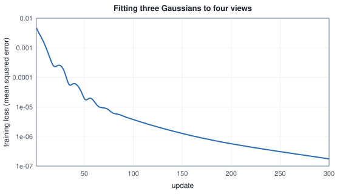
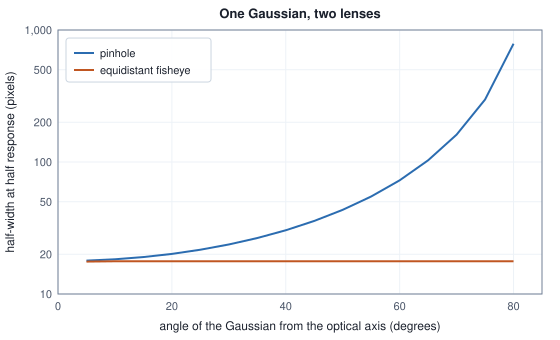

<!-- SPDX-License-Identifier: CC-BY-4.0 -->
<!-- Copyright (c) 2026 Martin Schröder <info@swedishembedded.com> -->

# 3D Gaussian Splatting

*How do millions of small, differentiable blobs render a photorealistic scene?*

A million points is a lot of points, and it is not enough to draw a picture. Take a 1920 by 1080 frame, which has 2,073,600 pixels, and a cloud of $10^6$ points like the ones the last two chapters produced, each projected to the pixel where the pinhole of Chapter 3 puts it. A point has no size, so it lights one pixel and no other. At best the cloud touches 48 percent of the frame, and at random positions it touches $1 - e^{-10^6/2{,}073{,}600} = 38$ percent: the rest is holes, and the holes do not go away by adding points, only by adding them in the numbers of the pixels themselves. The usual repair is to give each point a disc of some radius. That fills the frame, and invents a new problem, because two discs that overlap have to be combined by some rule, and a disc has a hard edge that jumps from one pixel to the next as the camera moves.

Gaussian splatting keeps the point and gives it exactly what it lacks: a size, a shape, an opacity and a colour, all of them smooth. A **Gaussian primitive** (a blob, informally) is a three-dimensional bell with a position, three radii along three axes, an opacity and a colour, and a picture is made by dropping every blob onto the image, ordering them by depth and letting each one cover what is behind it by its opacity. Everything in that sentence is differentiable, which is the point: the render is a function of the blobs' numbers, so the numbers can be fitted to photographs by the optimizers of Volume III, and a scene that nobody modelled appears from a few hundred pictures. Making it work means saying exactly what each blob is, how it lands on the image, how a million of them are ordered and combined fast enough to turn into a picture, how the picture's error becomes a gradient on each blob's numbers, and how the population of blobs is grown and thinned during the fit; and, for a lens that is not a pinhole, the question turns from where a blob lands to what a pixel sees.

The blob is a covariance, its image a projection, its order a sort, its fit a backward pass and an optimizer, and each of these was built in an earlier volume; five questions bring them back.

1. (Volume I, [Chapter 11](../v01-mathematics/11-distributions.md), the multivariate Gaussian.) A vector is drawn as $\boldsymbol\mu + \mathbf{A}\mathbf{z}$ with $\mathbf{z}$ standard. What is its covariance, and what shape do the contours of its density have when $\mathbf{A} = \mathbf{R}\,\mathrm{diag}(s_0, s_1, s_2)$ for a rotation $\mathbf{R}$?
2. ([Chapter 3](03-camera-geometry.md), the pinhole camera.) A camera with $f_x = f_y = 100$ and principal point $(32, 24)$ sees the camera-frame point $(0.5, -0.2, 4)$. Where does it land, and which entries of the Jacobian of the map at that point are not zero?
3. (Volume IV, [Chapter 7](../v04-computation/07-reductions.md), radix sort.) A radix sort orders 32-bit keys in four passes of 8 bits, least significant digit first. Why must each pass be stable, and what happens to two equal keys carrying the values $a$ then $b$?
4. (Volume III, [Chapter 4](../v03-neural-networks/04-backpropagation.md), the backward pass.) A scalar loss depends on $y = f(g(x))$. What does the backward pass multiply together to reach $\partial\mathcal{L}/\partial x$, and what must the forward pass have kept for it?
5. (Volume III, [Chapter 7](../v03-neural-networks/07-optimizers.md), Adam.) With bias correction, how far does Adam move a parameter on its very first step, whatever the size of the gradient, and why does that make one learning rate for all parameters a poor idea when they have different units?

## A point with a size and a shape

The Gaussian of splatting is the function of a point $\mathbf{x}$ of space

$$
G(\mathbf{x}) = \exp\!\Bigl(-\tfrac12(\mathbf{x} - \boldsymbol\mu)^\top \boldsymbol\Sigma^{-1}(\mathbf{x} - \boldsymbol\mu)\Bigr), \tag{1}
$$

the bell of Volume I without its normalizing constant, so that its peak value is 1. The matrix $\boldsymbol\Sigma$ is a covariance, which is to say symmetric and positive definite; its eigenvectors are the axes of the ellipsoid on which $G$ equals $e^{-1/2}$, and the square roots of its eigenvalues are the radii. A free symmetric matrix has six numbers, and an optimizer that nudged them directly would, sooner or later, step to a matrix that is not positive definite, for which the formula means nothing. The way out is the one the first recall question points to. Write the matrix as a product that is positive definite by construction, the rotation $\mathbf{R}_q$ of a unit quaternion $\mathbf{q}$ (Chapter 3) and three positive scales $\mathbf{s}$,

$$
\boldsymbol\Sigma = \mathbf{R}_q\,\mathrm{diag}(s_0^2, s_1^2, s_2^2)\,\mathbf{R}_q^\top = \sum_{k=0}^{2} s_k^2\,\mathbf{r}_k \mathbf{r}_k^\top, \tag{2}
$$

where $\mathbf{r}_k$ is the $k$-th column of $\mathbf{R}_q$. Any such $\boldsymbol\Sigma$ is positive definite, since for a nonzero $\mathbf{v}$ the form $\mathbf{v}^\top\boldsymbol\Sigma\mathbf{v} = \sum_k s_k^2(\mathbf{r}_k\cdot\mathbf{v})^2$ is a sum of squares that cannot vanish, and every positive definite matrix has this form (its eigendecomposition). The number of free values is the same, six, so nothing is lost: three scales and three for the rotation (a quaternion has four numbers and one redundant scale, which is why it is normalized on use). A Gaussian primitive is then fourteen numbers: the mean $\boldsymbol\mu$ (3), the logarithms of the scales (3), the raw quaternion (4), the opacity as a logit (1) and the colour (3). The renderer reads the linear scales, the opacity in $(0, 1)$ and the colour; the optimizer holds the logarithm and the logit. Chapter 3's habit of keeping a rotation as a quaternion and building the matrix on demand is the same habit.

<!-- worked: gaussian_splatting.covariance_from_scale_rotation -->
A Gaussian with quaternion (w, x, y, z) = (1/3, 2/3, 0, 2/3) and scales s = (0.30, 0.10, 0.05). The matrix is that of the unit quaternion of Chapter 3, R = [[1 - 2(y^2 + z^2), 2(xy - wz), 2(xz + wy)], [2(xy + wz), 1 - 2(x^2 + z^2), 2(yz - wx)], [2(xz - wy), 2(yz + wx), 1 - 2(x^2 + y^2)]] after dividing the quaternion by its length, and each entry of Sigma is the sum over k = 0, 1, 2 of s_k^2 R[i][k] R[j][k], added in that order.

| row | R column 0 | R column 1 | R column 2 | Sigma column 0 | Sigma column 1 | Sigma column 2 |
|---|---:|---:|---:|---:|---:|---:|
| 0 | 0.111111 | -0.444444 | 0.888889 | 0.00506173 | 0.00691358 | 0.00716049 |
| 1 | 0.444444 | -0.777778 | -0.444444 | 0.00691358 | 0.024321 | 0.0319753 |
| 2 | 0.888889 | 0.444444 | 0.111111 | 0.00716049 | 0.0319753 | 0.0731173 |

Checks, each with the criterion that the largest difference is below 1e-15 (64-bit arithmetic): R^T R against I passes; Sigma against its transpose passes; Sigma against (R diag(s))(R diag(s))^T, the same matrix by another route, passes. The trace of Sigma is 0.102500 = 0.09 + 0.01 + 0.0025 = 0.102500 and its determinant 2.250000e-06 = (0.30 * 0.10 * 0.05)^2 = 2.250000e-06. Along the three columns of R the quadratic form v^T Sigma v is (0.09, 0.01, 0.0025), the squares of the scales. The leading minors 0.005062 and 7.530864e-05 and the determinant are all positive, so Sigma is positive definite.
<!-- /worked -->

The quaternion $(1/3, 2/3, 0, 2/3)$ was chosen because it is a unit quaternion whose rotation matrix has rational entries: its first column is $(1, 4, 8)/9$, its second $(-4, -7, 4)/9$ and its third $(8, -4, 1)/9$. The matrix $\boldsymbol\Sigma$ built from it has the trace $0.09 + 0.01 + 0.0025$ and the determinant $(0.3 \cdot 0.1 \cdot 0.05)^2$, exactly the sum and the product of the squared scales, as eigenvalues of $\boldsymbol\Sigma$ must give, and the form $\mathbf{v}^\top\boldsymbol\Sigma\mathbf{v}$ along each column of $\mathbf{R}_q$ returns the square of its scale. The Gaussian is a pancake: radii 0.3, 0.1 and 0.05 along three directions that point somewhere unremarkable. A real scene is a million of them.

The two scalars that remain are what turn a bell into a thing that can be seen. The **opacity** $o \in (0, 1)$ is the largest fraction of the light behind the Gaussian that it can hide, reached at its centre; the colour $\mathbf{c}$ is what it contributes. Why parametrize them as a logit and as a log? Because an optimizer changes a parameter by about its learning rate per step (the answer to the fifth recall question), and a step in a logit cannot take the opacity out of $(0, 1)$, while a step in a logarithm is a relative change of size: a step of 0.1 changes a disc a millimetre thick by a tenth of a millimetre and one a metre wide by ten centimetres. The optimizer of brain does exactly this, steps $\log s$ and the logit in a single per-Gaussian kernel (`crates/kernels/wgsl/splat_adam.wgsl`), and holds the opacity inside $(10^{-4}, 1 - 10^{-4})$, a logit of about $\pm 9.2$, because past that the slope of the logistic function is gone and a Gaussian cannot come back (`crates/splat/src/train.rs`).

## Dropping a blob onto the image

To draw a Gaussian one has to say what it looks like from a camera. The camera of Chapter 3 maps a camera-frame point $\mathbf{m} = (x, y, z)$ to the pixel $u = f_x x/z + c_x$, $v = f_y y/z + c_y$, which is not linear, so the image of a Gaussian is not exactly a Gaussian. The practical resolution is to linearize the map where the Gaussian is, which is where the Jacobian of Chapter 3 comes in. With $\mathbf{m} = \mathbf{R}\boldsymbol\mu + \mathbf{t}$ the mean in the camera's frame and

$$
\mathbf{J} = \begin{pmatrix} f_x/z & 0 & -f_x x/z^2 \\ 0 & f_y/z & -f_y y/z^2 \end{pmatrix} \tag{3}
$$

the derivative of $(u, v)$ with respect to the camera-frame point at $\mathbf{m}$, a small displacement $\mathbf{d}$ of the Gaussian's points from its mean moves the pixel by $\mathbf{J}\mathbf{d}$ to first order. A random vector with covariance $\boldsymbol\Sigma$ in the world has, in the camera's frame, the covariance $\mathbf{R}\boldsymbol\Sigma\mathbf{R}^\top$, and a linear map $\mathbf{J}$ turns a covariance $\boldsymbol\Sigma_c$ into $\mathbf{J}\boldsymbol\Sigma_c\mathbf{J}^\top$. So the footprint of the Gaussian on the image is the two-dimensional Gaussian with the mean $(u, v)$ and the covariance

$$
\boldsymbol\Sigma_{\mathrm s} = (\mathbf{J}\mathbf{R})\,\boldsymbol\Sigma\,(\mathbf{J}\mathbf{R})^\top + \epsilon_{\mathrm s}\mathbf{I}, \tag{4}
$$

a $2 \times 2$ matrix. This is the projection of the Gaussian, called **splat projection** here after the way the picture is drawn (Zwicker and colleagues' elliptical weighted average splatting, 2002, is where the linearization comes from). The term $\epsilon_{\mathrm s}\mathbf{I}$ with $\epsilon_{\mathrm s} = 0.3$ pixel$^2$ is a dilation, a small amount of blur added so that a Gaussian smaller than a pixel still reaches the centres of the pixels around it.

<!-- worked: gaussian_splatting.projection_footprint -->
The Gaussian of the previous block (quaternion (1/3, 2/3, 0, 2/3), scales (0.30, 0.10, 0.05)) moved to the mean (0.5, -0.2, 4.0) and given opacity 0.8, seen by the camera at the origin looking along +z (R = I, t = 0) with f_x = f_y = 100, principal point (32, 24), a 64 by 48 image. J is the Jacobian of the perspective map at the mean, S2 = (J R) Sigma (J R)^T with R = I. The first seven rows leave out the dilation; the rest add 0.3 pixel^2 to both diagonal entries. Matrix products are summed over the inner index in increasing order.

| quantity | value |
|---|---:|
| camera-frame mean m | (0.5, -0.2, 4) |
| pixel (u, v) = (100 x / z + 32, 100 y / z + 24) | (44.5, 19) |
| J row 0 (100 / z, 0, -100 x / z^2) | (25, 0, -3.125) |
| J row 1 (0, 100 / z, -100 y / z^2) | (0, 25, 1.25) |
| S2 = J Sigma J^T, entries (00, 01, 11) | (2.75879, 1.76107, 17.3133) |
| one-sigma semi-axes (square roots of the eigenvalues) | (4.1861, 1.5965) |
| direction of the long axis, degrees from the u axis | 83.198 |
| S2 + 0.3 I, entries (00, 01, 11) | (3.05879, 1.76107, 17.6133) |
| conic (S2 + 0.3 I)^-1, entries (a, b, c) | (0.346896, -0.0346844, 0.0602431) |
| extend = min(3.33, sqrt(2 ln(255 * 0.8))) | 3.26132 |
| radius (rx, ry) = ceil(extend sqrt(S2 + 0.3 I diagonal)) | (6, 14) |
| opacity compensation sqrt(det S2 / det(S2 + 0.3 I)), not applied by default | 0.937886 |

The product S2 (S2^-1) (without the dilation) equals I to below 1e-12. Both radii are rounded up to whole pixels so that a box of that half-width contains the ellipse at which the Gaussian's opacity falls to 1/255.
<!-- /worked -->

The pixel $(44.5, 19)$ is the answer to the second recall question, and the Jacobian has its four non-zero entries where the recall question put them: the focal terms $f/z$ of its first two columns and the two entries of the third, which are the dependence of the pixel on distance and on how far the point is from the axis. The footprint of the pancake is a thin ellipse, with one-sigma semi-axes 4.19 and 1.60 pixels, its long axis 83 degrees from the $u$ axis, nearly vertical. What the compositing needs of the footprint is not the covariance but its inverse, the **conic** $\boldsymbol\Lambda = \boldsymbol\Sigma_{\mathrm s}^{-1}$ (stored as three numbers $a, b, c$), since the exponent of the Gaussian at a pixel at offset $\mathbf{d}$ from the centre is

$$
\kappa = \tfrac12\mathbf{d}^\top\boldsymbol\Lambda\mathbf{d} = \tfrac12(a\,d_u^2 + c\,d_v^2) + b\,d_u d_v \tag{5}
$$

with no inversion per pixel. The last two items of the table are what lets a renderer visit only the pixels that matter. A Gaussian of opacity $o$ contributes less than 1/255, which an 8-bit image cannot show, wherever $o\,e^{-\kappa} < 1/255$, that is outside the ellipse $2\kappa = 2\ln(255\,o)$. Define $\mathrm{ext} = \min(3.33, \sqrt{2\ln(255\,o)})$; the cap is only the value of the square root at $o = 1$, 3.329. The ellipse $2\kappa = \mathrm{ext}^2$ lies inside the axis-aligned box of half-widths $r_x = \lceil \mathrm{ext}\sqrt{\Sigma_{\mathrm s,00}}\rceil$ and $r_y = \lceil \mathrm{ext}\sqrt{\Sigma_{\mathrm s,11}}\rceil$ (the extent of an ellipse along an axis is $\mathrm{ext}$ times the square root of the corresponding diagonal entry of its covariance, whatever the tilt), here $(6, 14)$ pixels. A Gaussian is dropped (culled) when it is behind the near plane, when its screen covariance is degenerate, when $o < 1/255$, or when the box lies entirely outside the image. In brain this is `crates/kernels/wgsl/splat_project.wgsl`, one invocation per Gaussian; it also clamps $x/z$ and $y/z$ in the Jacobian to a margin of 30 percent of the half field of view beyond the image's edge, so that a Gaussian far outside the frame, whose linearization would be wild, cannot reach into it with a huge footprint. The pseudocode below and the worked examples of this chapter leave the clamp out: every Gaussian they project lies well inside the field of view, where the clamp does nothing.

```text
function project_gaussian(mu: array<real>[3], s: array<real>[3], Rq: array<real>[3, 3], o: real,
        R: array<real>[3, 3], t: array<real>[3], fx: real, fy: real, cx: real, cy: real,
        W: int, H: int, eps: real)
        -> (bool, real, real, real, array<real>[3], real, int, int):
    m = matmul(R, mu) + t
    if m[2] <= 0.01 or 255 * o <= 1:
        return (false, 0.0, 0.0, 0.0, zeros(real, [3]), 0.0, 0, 0)
    Sigma = zeros(real, [3, 3])
    for k in 0 .. 3:
        for i in 0 .. 3:
            for j in 0 .. 3:
                Sigma[i, j] = Sigma[i, j] + s[k] * s[k] * Rq[i, k] * Rq[j, k]
    J = [[fx / m[2], 0.0, -fx * m[0] / m[2]^2],
         [0.0, fy / m[2], -fy * m[1] / m[2]^2]]
    A = matmul(J, R)
    S = matmul(matmul(A, Sigma), transpose(A)) + eps * identity(2)
    det = S[0, 0] * S[1, 1] - S[0, 1]^2
    if det <= 0.0:
        return (false, 0.0, 0.0, 0.0, zeros(real, [3]), 0.0, 0, 0)
    u = fx * m[0] / m[2] + cx
    v = fy * m[1] / m[2] + cy
    ext = min(3.33, sqrt(2 * log(255 * o)))
    rx = ceil(ext * sqrt(S[0, 0]))
    ry = ceil(ext * sqrt(S[1, 1]))
    if u + rx <= 0 or u - rx >= W or v + ry <= 0 or v - ry >= H:
        return (false, 0.0, 0.0, 0.0, zeros(real, [3]), 0.0, 0, 0)
    conic = [S[1, 1] / det, -S[0, 1] / det, S[0, 0] / det]
    return (true, u, v, m[2], conic, o, rx, ry)
```

The routine returns the pixel, the depth, the conic, the opacity and the box, which is all the later stages read. Everything about a Gaussian that depends on the viewpoint is now in nine numbers, and the cost of getting there is a few hundred FLOPs per Gaussian, independent of the image.

## Front to back, with an early exit

Now a pixel at the centre $(p_u, p_v)$ sees some of the projected Gaussians. Each one has, at this pixel, the exponent $\kappa_i$ of (5) and so the opacity it presents here,

$$
\alpha_i = \min\bigl(0.99,\; o_i\,e^{-\kappa_i}\bigr). \tag{6}
$$

Order them by depth, nearest first. The light that reaches the pixel is the colour of the nearest Gaussian times $\alpha_1$, plus what gets past it, which is the fraction $1 - \alpha_1$, times the colour of the second times $\alpha_2$, and so on. Define the **transmittance** before Gaussian $i$ as the fraction of light that has survived the ones in front, $T_1 = 1$ and $T_{i+1} = T_i(1 - \alpha_i)$. The pixel's colour is the sum

$$
\mathbf{y} = \sum_{i=1}^{N} \mathbf{c}_i\,\alpha_i\,T_i + T_{N+1}\,\mathbf{b}, \qquad w_i = \alpha_i T_i, \tag{7}
$$

with $\mathbf{b}$ the background colour behind everything. This is **alpha compositing**, the rule that combines translucent layers: each layer's contribution is its colour weighted by its opacity and by what the layers in front have left. The weights satisfy a telescoping identity, $\sum_i w_i = 1 - T_{N+1}$, since each step moves $\alpha_i T_i$ from the transmitted to the absorbed share; so (7) is a convex combination of the colours and the background, and a pixel cannot come out brighter than its brightest ingredient. The rule is not commutative: swap two layers and the colour changes, so the order matters and has to be sorted.

Three details turn the formula into the loop that is run, and each is a decision worth knowing because the gradients inherit it. A Gaussian whose alpha is below $1/255$ is skipped: it would change an 8-bit pixel by less than one level, and skipping it is what makes the box of the last section safe. The cap 0.99 keeps a single Gaussian from making a pixel completely opaque (a transmittance of exactly zero would make the divisions of the backward pass singular). And the loop stops when the next Gaussian would take the transmittance to $10^{-4}$ or below, without adding that Gaussian: the pixel is 99.99 percent covered, nothing behind can show, and the stop saves visiting the rest of a long list.

```text
function composite_pixel(px: real, py: real, list: array<int>[K], u: array<real>[N], v: array<real>[N],
        conic: array<real>[N, 3], o: array<real>[N], c: array<real>[N, 3], bg: array<real>[3])
        -> (array<real>[3], real):
    T = 1.0
    y = zeros(real, [3])
    for k in 0 .. K:
        i = list[k]
        dx = u[i] - px
        dy = v[i] - py
        kappa = 0.5 * (conic[i, 0] * dx * dx + conic[i, 2] * dy * dy) + conic[i, 1] * dx * dy
        if kappa < 0.0:
            continue
        alpha = min(0.99, o[i] * exp(-kappa))
        if alpha < 1 / 255:
            continue
        if T * (1 - alpha) <= 0.0001:
            break
        y = y + (alpha * T) * c[i, :]
        T = T * (1 - alpha)
    return (y + T * bg, T)
```

The test `kappa < 0.0` is for a conic that rounding has made slightly indefinite; it never fires for a valid one. Seven Gaussians along one pixel's ray show every branch.

<!-- worked: gaussian_splatting.compositing_pixel -->
One pixel; seven Gaussians in depth order, with kappa (the exponent of the Gaussian at this pixel) 0, 0, 6.5, 0, 0, 0, 0, peak opacities 0.995, 0.8, 0.9, 0.7, 0.6, 0.5, 0.3, colours red, green, blue, yellow, cyan, magenta, white, and background (0.2, 0.2, 0.2). The raw alpha is opacity * exp(-kappa), capped at 0.99; a pair below 1/255 is skipped; the walk stops before a Gaussian that would take T to 1e-4 or below. T is the transmittance before the row, w = alpha T.

| i | kappa | opacity * exp(-kappa) | alpha | T before | w = alpha T | accumulated colour / note |
|---:|---:|---:|---:|---:|---:|---|
| 0 | 0 | 0.995 | 0.99 (capped) | 1 | 0.99 | (0.99, 0, 0) |
| 1 | 0 | 0.8 | 0.8 | 0.01 | 0.008 | (0.99, 0.008, 0) |
| 2 | 6.5 | 0.0013531 | skipped (below 1/255) |  |  |  |
| 3 | 0 | 0.7 | 0.7 | 0.002 | 0.0014 | (0.9914, 0.0094, 0) |
| 4 | 0 | 0.6 | 0.6 | 0.0006 | 0.00036 | (0.9914, 0.00976, 0.00036) |
| 5 | 0 | 0.5 | 0.5 | 0.00024 | 0.00012 | (0.99152, 0.00976, 0.00048) |
| 6 | 0 | 0.3 | 0.3 | 0.00012 | - | stops: T would be 8.4e-05, at most 1e-4; not added |

The walk stops at Gaussian 6. The pixel is the accumulated colour plus T * background = (0.991544, 0.009784, 0.000504) with T = 0.00012. The weights of the 5 Gaussians used sum to 0.99988 = 1 - T = 0.99988. Composited in the reverse order (the same 5 Gaussians, last used first, each with its own alpha, no stop), the same Gaussians give (0.651904, 0.488024, 0.800024): compositing is not commutative, which is why the order is sorted by depth.
<!-- /worked -->

The first Gaussian is capped at 0.99 though its opacity times $e^{-0}$ is 0.995, so after one layer 1 percent of the light is left, and each later one hides most of what remains of that. Gaussian 2 is skipped: at an exponent of 6.5 its alpha is 0.0014, below $1/255 = 0.0039$. The last Gaussian, which would take $T$ from 0.00012 to $8.4 \times 10^{-5}$, is where the loop stops and does not add it. The telescoping identity holds on the weights that were used, $0.99988 = 1 - 0.00012$, and the same five Gaussians in the reverse order give the pale blue-violet pixel $(0.652, 0.488, 0.800)$ instead of the red one, which is why the Gaussians must be sorted.

The loop also gives a depth for free. The weights $w_i$ sum to $A = 1 - T$, the pixel's coverage, so $D = \sum_i w_i z_i / A$ is the expected depth along the pixel and is written out with every colour (a fit that is supervised by depth needs both for the same frame). Whatever makes the loop fast, and whatever differentiates it, has to leave the colour of (7), with these three conventions, unchanged.

## Sorting a million blobs for ten thousand tiles

The loop of the last section runs once per pixel, and a pixel only sees the few Gaussians whose boxes contain it. The obvious organization is the wrong way round: for each Gaussian, find its pixels, and add its contribution into each; but the sum is not a plain sum, since it needs the order and the transmittance, so a Gaussian cannot add into a pixel without knowing which Gaussians are in front of it. The organization that works is to give every pixel a list of the Gaussians that touch it, sorted by depth, and to walk the list. A list per pixel is too much memory and too much sorting (two million lists), and a list per Gaussian is no use; the compromise is a list per **tile**, a square of $16 \times 16$ pixels, shared by its 256 pixels. Neighbouring pixels meet nearly the same Gaussians, so one list can serve the 256 pixels of a tile, and a pixel that a listed Gaussian does not reach simply finds its alpha below $1/255$ and moves on.

This organization is **tiled rasterization**, and it is the part of the algorithm that is about computers rather than about Gaussians. Its stages are those of Volume IV, chained. After projection, each Gaussian knows its box, hence the range of tile columns and rows it meets, clamped to the grid: $c_0 = \lfloor (u - r_x)/16\rfloor$ to $c_1 = \lfloor (u + r_x)/16\rfloor$, and the same for rows. The count $n_i = (c_1 - c_0 + 1)(r_1 - r_0 + 1)$ of tiles is the number of **instances** of the Gaussian, one per tile it meets. An exclusive scan of the counts (Volume IV, Chapter 7) gives each Gaussian its offset into one big array, and each Gaussian writes its instances there with no collision and no atomic. The key of an instance is a 32-bit integer built so that sorting the keys gives, tile by tile, the Gaussians in front-to-back order: the high bits are the tile number, the low bits are the depth. A positive floating-point number's 32 bits, read as an integer, increase with the number (Volume IV, Chapter 1), so the bits of the depth are a sort key; to make room for the tile number the depth keeps only its top $32 - b$ bits, where $b$ is the number of bits needed for tile numbers. One stable radix sort of the keys with the instance's emission index as the value, four passes of 8 bits, lays out every tile's list contiguously, and the start and end of each tile's range are found by comparing each key's tile with its neighbours', in parallel and without any search.

```text
function build_tile_lists(u: array<real>[N], v: array<real>[N], z: array<real>[N],
        rx: array<int>[N], ry: array<int>[N], live: array<bool>[N], W: int, H: int)
        -> (array<int>[T, 2], array<int>[M]):
    tx = (W + 15) // 16
    ty = (H + 15) // 16
    b = 1
    while 2^b < tx * ty:
        b = b + 1
    span = zeros(int, [N, 4])                         # first and last tile column, first and last tile row
    counts = zeros(int, [N])
    for i in 0 .. N:
        if live[i]:
            span[i, 0] = clamp_int(floor((u[i] - rx[i]) / 16), 0, tx - 1)
            span[i, 1] = clamp_int(floor((u[i] + rx[i]) / 16), 0, tx - 1)
            span[i, 2] = clamp_int(floor((v[i] - ry[i]) / 16), 0, ty - 1)
            span[i, 3] = clamp_int(floor((v[i] + ry[i]) / 16), 0, ty - 1)
            counts[i] = (span[i, 1] - span[i, 0] + 1) * (span[i, 3] - span[i, 2] + 1)
    offset = exclusive_scan(counts)
    M = sum(counts)
    keys = zeros(u32, [M])
    ids = zeros(int, [M])
    for i in 0 .. N:                                  # one invocation per Gaussian
        if live[i]:
            dq = bits(z[i]) >> b                      # the depth's top 32 - b bits
            pos = offset[i]
            for row in span[i, 2] .. span[i, 3] + 1:
                for col in span[i, 0] .. span[i, 1] + 1:
                    keys[pos] = (u32(row * tx + col) << (32 - b)) or dq
                    ids[pos] = i
                    pos = pos + 1
    (skeys, order) = radix_sort_pairs(keys, arange(M))
    ranges = zeros(int, [tx * ty, 2])                 # empty tiles keep (0, 0)
    for k in 0 .. M:
        tile = int(skeys[k] >> (32 - b))
        if k == 0 or tile != int(skeys[k - 1] >> (32 - b)):
            ranges[tile, 0] = k
        if k == M - 1 or tile != int(skeys[k + 1] >> (32 - b)):
            ranges[tile, 1] = k + 1
    return (ranges, [ids[order[k]] for k in 0 .. M])
```

Here `bits(z)` is the 32-bit pattern of the depth as a binary32 number, and the returned list holds the Gaussian of every sorted instance. A small scene shows every stage: six Gaussians on a 48 by 32 image, with its three tile columns and two tile rows.

<!-- worked: gaussian_splatting.tile_binning -->
The scene `gaussian_splatting.TILE_SCENE`: six Gaussians, the whole of its input, given by the mean, the three scales, the quaternion (w, x, y, z; it is normalized on use), the opacity and the colour (the background is black, the Gaussians are projected by the formulas of this section, with the 0.3 dilation):

| i | mean (x, y, z) | scales | quaternion | opacity | colour |
|---:|---|---|---|---:|---|
| 0 | (-0.5, -0.2, 3) | (0.2, 0.2, 0.2) | (1, 0, 0, 0) | 0.9 | (0.9, 0.2, 0.2) |
| 1 | (0.6, 0.3, 2) | (0.25, 0.15, 0.15) | (0.9238795325, 0, 0, 0.3826834324) | 0.8 | (0.2, 0.7, 0.3) |
| 2 | (0.1, -0.3, 6) | (0.6, 0.3, 0.3) | (1, 0, 0, 0) | 0.7 | (0.2, 0.3, 0.9) |
| 3 | (-0.2, 0.5, 4) | (0.1, 0.1, 0.1) | (1, 0, 0, 0) | 0.95 | (0.9, 0.8, 0.1) |
| 4 | (0.5, -0.4, 5) | (0.3, 0.1, 0.1) | (1, 0, 0, 0) | 0.6 | (0.8, 0.3, 0.8) |
| 5 | (-0.9, 0.35, 7) | (0.4, 0.4, 0.4) | (1, 0, 0, 0) | 0.5 | (0.1, 0.7, 0.8) |

They are seen by the camera at the origin (R = I) with f = 40 and principal point (24, 16) in a 48 by 32 image. A tile is 16 by 16 pixels, so the grid is 3 by 2 = 6 tiles, tile numbers need ceil(log2 6) = 3 bits and the depth keeps the top 29 bits of its binary32 pattern. Each Gaussian covers the tiles its box u +- rx, v +- ry touches (clamped to the grid).

| i | (u, v) | depth z | bits of z | (rx, ry) | tile columns x rows | count | scanned offset |
|---:|---:|---:|---:|---:|---:|---:|---:|
| 0 | (17.33, 13.33) | 3.0 | 0x40400000 | (10, 9) | 0..1 x 0..1 | 4 | 0 |
| 1 | (36.00, 22.00) | 2.0 | 0x40000000 | (14, 14) | 1..2 x 0..1 | 4 | 4 |
| 2 | (24.67, 14.00) | 6.0 | 0x40c00000 | (14, 7) | 0..2 x 0..1 | 6 | 8 |
| 3 | (22.00, 21.00) | 4.0 | 0x40800000 | (4, 4) | 1..1 x 1..1 | 1 | 14 |
| 4 | (28.00, 12.80) | 5.0 | 0x40a00000 | (8, 4) | 1..2 x 0..1 | 4 | 15 |
| 5 | (18.86, 18.00) | 7.0 | 0x40e00000 | (8, 8) | 0..1 x 0..1 | 4 | 19 |

The counts sum to 23 instances. The key of an instance is the tile number shifted left by 29 or the depth's top 29 bits (`bits(z) >> 3`); the table lists the instances after the stable radix sort (four passes of 8-bit digits, least significant first) with the Gaussian each came from:

| rank | key | tile | depth part | Gaussian |
|---:|---:|---:|---:|---:|
| 0 | 0x08080000 | 0 (col 0, row 0) | 134742016 | 0 |
| 1 | 0x08180000 | 0 (col 0, row 0) | 135790592 | 2 |
| 2 | 0x081c0000 | 0 (col 0, row 0) | 136052736 | 5 |
| 3 | 0x28000000 | 1 (col 1, row 0) | 134217728 | 1 |
| 4 | 0x28080000 | 1 (col 1, row 0) | 134742016 | 0 |
| 5 | 0x28140000 | 1 (col 1, row 0) | 135528448 | 4 |
| 6 | 0x28180000 | 1 (col 1, row 0) | 135790592 | 2 |
| 7 | 0x281c0000 | 1 (col 1, row 0) | 136052736 | 5 |
| 8 | 0x48000000 | 2 (col 2, row 0) | 134217728 | 1 |
| 9 | 0x48140000 | 2 (col 2, row 0) | 135528448 | 4 |
| 10 | 0x48180000 | 2 (col 2, row 0) | 135790592 | 2 |
| 11 | 0x68080000 | 3 (col 0, row 1) | 134742016 | 0 |
| 12 | 0x68180000 | 3 (col 0, row 1) | 135790592 | 2 |
| 13 | 0x681c0000 | 3 (col 0, row 1) | 136052736 | 5 |
| 14 | 0x88000000 | 4 (col 1, row 1) | 134217728 | 1 |
| 15 | 0x88080000 | 4 (col 1, row 1) | 134742016 | 0 |
| 16 | 0x88100000 | 4 (col 1, row 1) | 135266304 | 3 |
| 17 | 0x88140000 | 4 (col 1, row 1) | 135528448 | 4 |
| 18 | 0x88180000 | 4 (col 1, row 1) | 135790592 | 2 |
| 19 | 0x881c0000 | 4 (col 1, row 1) | 136052736 | 5 |
| 20 | 0xa8000000 | 5 (col 2, row 1) | 134217728 | 1 |
| 21 | 0xa8140000 | 5 (col 2, row 1) | 135528448 | 4 |
| 22 | 0xa8180000 | 5 (col 2, row 1) | 135790592 | 2 |

The range of each tile in the sorted array (neighbour comparison: a range starts where the tile number differs from the previous key's and ends where it differs from the next one's), and the Gaussians in it, nearest first:

| tile | start | end | Gaussians front to back |
|---:|---:|---:|---|
| 0 | 0 | 3 | 0, 2, 5 |
| 1 | 3 | 8 | 1, 0, 4, 2, 5 |
| 2 | 8 | 11 | 1, 4, 2 |
| 3 | 11 | 14 | 0, 2, 5 |
| 4 | 14 | 20 | 1, 0, 3, 4, 2, 5 |
| 5 | 20 | 23 | 1, 4, 2 |

Compositing every pixel from its own tile's list gives the same image as compositing all six Gaussians in depth order at every pixel: the largest difference over the 1,536 pixels and three channels is 0 (criterion: below 1e-12). The tiled pass looked at 5,888 (pixel, instance) pairs, against the bound 23 x 256 = 5,888 (every pixel of a tile looks at every instance of it) and the 9,216 of the untiled walk (every Gaussian at every pixel); no walk stopped early in this scene.

Truncating the depth: the binary32 patterns of 2.0 and of 2.0 plus 1, 8 and 16 units in the last place keep the depth parts [134217728, 134217728, 134217729, 134217730] out of 2^29; the last 3 bits are dropped, so two depths that differ only in those bits (a bucket 8 units in the last place wide, under 1e-6 of the depth) tie, and a tie keeps the order in which the instances were emitted, because the sort is stable.
<!-- /worked -->


Look at the table against the figure. Gaussian 3 is small, and its box lies inside a single tile, so it has one instance; Gaussian 1, the nearest, is large and has four; the six Gaussians together have 23 instances, and tile 4 (column 1, row 1) holds six of them, in the order of their depths 2, 3, 4, 5, 6, 7. The key's depth part is the same for every tile, so the instances of one Gaussian in different tiles carry the same low bits and differ only in the top three. The sort's four passes touch every key four times, each pass counting digits and then scattering in the order of arrival, which is what stability is for: the second pass, on the next 8 bits, preserves the order the first produced among equal digits (the third recall question), so after the fourth the keys are in numeric order and keys that are equal stay in the order in which they were emitted. That is the case when two depths differ only in the three bits that were dropped, as the last paragraph of the block shows for depths within one bucket of 8 units in the last place.

The last claim of the table is the one that licenses all of this: compositing each pixel from its tile's list gives the same image as compositing all six Gaussians at every pixel. The difference is zero, for a reason that is not an accident of the example. A Gaussian that is not on a tile's list has a box that does not meet the tile, and outside the box its alpha is below $1/255$ and the pixel skips it anyway; so the lists lose nothing the loop would have used. Tiling is an organization of the same arithmetic, not an approximation to it.

What it buys is arithmetic. Compositing every pixel against every Gaussian costs $N P$ pairs for $P$ pixels. With tiles each instance is looked at by 256 pixels, so the work is at most $256 M$ pairs, where $M$ is the number of instances, which depends on how big the Gaussians are on screen and not on how many there are in the scene.

<!-- worked: gaussian_splatting.work_budget -->
One million Gaussians in a 1920 by 1080 frame: 8,160 tiles of 16 by 16 pixels. Projection costs about 260 FLOPs per Gaussian (a hand count of the lines of the projection), 2.60e+08 in all, whatever the image. The instances are N (2r/16 + 1)^2 for boxes of half-width r pixels (the expected number of tiles a box meets, at random positions). The sort moves 80 bytes per instance (four passes; each reads the key to count it, then reads and writes a 4-byte key and a 4-byte value), and the compositing looks at each instance with every one of the 256 pixels of its tile: at most 256 pairs per instance, each costing 21 FLOPs and one exponential. The last column is how many times fewer pairs this is than the 2.07e+12 of looking at every Gaussian from every pixel.

| r (pixels) | tiles per Gaussian | instances | sort bytes | pairs (at most) | pair FLOPs | untiled pairs / tiled pairs |
|---:|---:|---:|---:|---:|---:|---:|
| 2 | 1.56 | 1.562e+06 | 1.25e+08 | 4.00e+08 | 8.40e+09 | 5184 |
| 4 | 2.25 | 2.250e+06 | 1.80e+08 | 5.76e+08 | 1.21e+10 | 3600 |
| 8 | 4.00 | 4.000e+06 | 3.20e+08 | 1.02e+09 | 2.15e+10 | 2025 |
| 16 | 9.00 | 9.000e+06 | 7.20e+08 | 2.30e+09 | 4.84e+10 | 900 |

The backward pass of the same frame writes, for every instance, 11 partial derivatives for each of the 256 pixels of its tile (a slot grid of 11 * 256 * 4 = 11,264 bytes per instance), reads the grid back to sum the pixels of the instance into one record of 11 words (44 bytes), and sums an instance's record into its Gaussian's gradient:

| r (pixels) | instances | slot grid written (bytes) | written and read (bytes) | records (bytes) |
|---:|---:|---:|---:|---:|
| 2 | 1.562e+06 | 1.76e+10 | 3.52e+10 | 6.88e+07 |
| 4 | 2.250e+06 | 2.53e+10 | 5.07e+10 | 9.90e+07 |
| 8 | 4.000e+06 | 4.51e+10 | 9.01e+10 | 1.76e+08 |
| 16 | 9.000e+06 | 1.01e+11 | 2.03e+11 | 3.96e+08 |

The same scene drawn at a fraction of the window (the viewer's quality levels), boxes of half-width 8 pixels at full size and half as many at each halving:

| render size | pixels | tiles | r | instances | pairs (at most) | pairs / full-size pairs |
|---:|---:|---:|---:|---:|---:|---:|
| 1/1 | 1920 x 1080 | 8160 | 8 | 4.000e+06 | 1.024e+09 | 1.000 |
| 1/2 | 960 x 540 | 2040 | 4 | 2.250e+06 | 5.760e+08 | 0.562 |
| 1/4 | 480 x 270 | 510 | 2 | 1.562e+06 | 4.000e+08 | 0.391 |
<!-- /worked -->

A pair costs 21 FLOPs and one exponential: the offsets (2), the exponent of (5) (9), the alpha of (6) (1), the transmittance (2), the weight (1) and the colour (6). For a million Gaussians whose boxes are 8 pixels in half-width, so 4 tiles each on average, that is $1.02 \times 10^9$ pairs, 2,025 times fewer than looking at every Gaussian from every pixel. The table also contains the cost that does not shrink: the sort moves 80 bytes per instance (four passes; the histogram reads a key, the scatter reads and writes a key and a value, 4 bytes each), and a frame in which the Gaussians are bigger on screen has more instances, $N(2r/16 + 1)^2$ of them in expectation, so a close-up costs far more than a distant view of the same scene. The last table is the viewer's. A viewer that renders at a quarter of the window's width and height has a sixteenth of the pixels, and one might hope for a sixteenth of the work; the tile grid, whose size is fixed in pixels, shrinks with the image, and the number of instances does not shrink as fast, since a Gaussian cannot meet fewer than one tile, so the pairs fall to 0.39 of the full-size count. The cost of a frame is paid in instances more than in pixels, and the quality knob of `brain splat view` (`samples/models/splat/src/view.rs`, render sizes 1, 1/2 and 1/4 of the window, with the window stretched back up) buys less than its pixel count suggests for scenes of many small Gaussians.

This whole chain is what `crates/splat/src/renderer.rs` assembles: project, tile count, scan, emit keys, radix sort, gather ids, tile ranges, per-tile compositing, pack to 8 bits. Every stage is an atomic-free, barrier-free WGSL kernel, one 64-invocation workgroup to a tile with four pixels per invocation, so the same source runs on a GPU through wgpu and on the CPU JIT that Volume IV described, and a pure-Rust reference renderer (`crates/splat/src/reference.rs`) is the oracle the tests hold the kernels to. The scan and the sort live in `crates/gpu-core/src/sort.rs`, not in the splat crate; they are brain's generic ones, and the first commit of the splat crate, `db67daa6d` (July 2026), already carries the property that a tiled render matches a straightforward per-pixel reference to within one level of 8 bits and is bit-identical when the input order of the Gaussians is shuffled, which is the stability of the sort seen from outside.


## Colour that depends on where you look from

So far a Gaussian has one colour. A glossy surface does not: the highlight on a wet road moves as the camera moves, and a splat scene that cannot move it will fit each view with a different set of blobs, which fall apart between the views. The standard repair is to let the colour depend on the direction $\mathbf{d}$ from the camera to the Gaussian, as a short expansion in **spherical harmonics**, the functions on the sphere that play the role of Fourier modes (Volume I, Chapter 14) for directions. Degree 0 is a constant, degree 1 has three functions linear in the components of $\mathbf{d}$, degree 2 has five quadratic ones; the colour in each channel is

$$
c = \max\Bigl(0,\; C_0\,\mathrm{dc} + \tfrac12 + \sum_{t} Y_t(\mathbf{d})\,h_t\Bigr), \tag{8}
$$

with $C_0 = 1/(2\sqrt\pi) = 0.2821$, $\mathrm{dc}$ the base coefficient (the one the optimizer steps as the Gaussian's colour), $h_t$ the harmonic coefficients and $Y_t$ the real harmonics in the sign convention of the polygon file (PLY) layout that scenes of this kind are exchanged in (the three degree-1 functions are $-C_1 d_y$, $C_1 d_z$ and $-C_1 d_x$ with $C_1 = \sqrt{3/(4\pi)} = 0.4886$, and the five degree-2 functions are $C_{2,0}\,d_x d_y$, $-C_{2,0}\,d_y d_z$, $C_{2,1}(2d_z^2 - d_x^2 - d_y^2)$, $-C_{2,0}\,d_x d_z$ and $C_{2,2}(d_x^2 - d_y^2)$ with $C_{2,0} = \sqrt{15/(4\pi)} = 1.0925$, $C_{2,1} = \sqrt{5/(16\pi)} = 0.3154$ and $C_{2,2} = \sqrt{15/(16\pi)} = 0.5463$, in that order). Evaluation is per Gaussian per view, not per pixel, so it costs one small dot product per Gaussian and the compositing loop reads a plain colour array whether or not the scene has harmonics; brain does it on the host in `crates/splat/src/sh.rs` and on the device in `splat_sh.wgsl`, with a test holding the two together.

<!-- worked: gaussian_splatting.spherical_harmonics -->
Check of the basis: the nine functions (the constant C0 = 0.28209479177387814 and the eight of degrees 1 and 2) integrated against one another over the sphere by the midpoint rule with 90 equal steps in the polar angle theta and 180 in the azimuth phi (weight sin(theta) d theta d phi). The largest entry of |Gram - I| is below 1e-3 (criterion 1e-3; the rule is second-order accurate).

The eight functions, for the unit direction d = (d_x, d_y, d_z) and C1 = 0.4886025119029199, C2 = (1.0925484305920792, 0.31539156525252005, 0.5462742152960396) = (sqrt(15 / (4 pi)), sqrt(5 / (16 pi)), sqrt(15 / (16 pi))), in the order of the coefficients: degree 1: -C1 d_y, C1 d_z, -C1 d_x; degree 2: C2[0] d_x d_y, -C2[0] d_y d_z, C2[1] (2 d_z^2 - d_x^2 - d_y^2), -C2[0] d_x d_z, C2[2] (d_x^2 - d_y^2).

A Gaussian at the mean (0, 0, 4) with base coefficients dc = (0.8, -0.6, -1.4), so that the flat colour C0 dc + 0.5 is (0.72568, 0.33074, 0.10507), and harmonic coefficients: red 0.30 on the first degree-1 function, green 0.25 on the third degree-2 function, blue -0.5 on the first degree-1 function, all others 0. Colour = max(0, flat + sum Y_t(d) coefficient_t), d the unit vector from the eye to the mean.

| eye | direction d | colour |
|---|---:|---:|
| (0, 0, 0) | (0, 0, 1) | (0.72568, 0.48844, 0.10507) |
| (2, 0, 0) | (-0.44721, 0, 0.89443) | (0.72568, 0.44113, 0.10507) |
| (0, -3, 1) | (0, 0.70711, 0.70711) | (0.62203, 0.37017, 0.27781) |
| (0, 3, 1) | (0, -0.70711, 0.70711) | (0.82932, 0.37017, 0) |

The first degree-1 function is -C1 d_y, so red and blue change only with the height of the eye: looking from the origin (d_y = 0) leaves the flat colour; from above (the eye at y = -3, the y axis points down) d_y is positive and red falls while blue rises, clipped at zero where the sum goes negative.

Degree for a capture of V views: the largest d from 0 to 3 with 8 (d + 1)^2 <= V (the degree is capped at 3, which the rule alone would exceed from V = 200):

| views V | degree |
|---:|---:|
| 8 | 0 |
| 16 | 0 |
| 31 | 0 |
| 32 | 1 |
| 71 | 1 |
| 72 | 2 |
| 127 | 2 |
| 128 | 3 |
| 500 | 3 |
<!-- /worked -->

The Gram matrix check is what makes the $Y_t$ worth calling a basis: integrated against one another over the sphere they are orthonormal, to the accuracy of the quadrature. Moving the eye sideways (so that $d_y$ stays 0) leaves red and blue where they were and changes green through its degree-2 term; moving it above or below changes red and blue through the degree-1 term, and in the last row blue is clipped at zero, which is what the $\max$ of (8) is for and a reminder that colour cannot be negative.

How many coefficients can a Gaussian have? A degree-$d$ expansion has $(d+1)^2$ coefficients per channel, and each view gives one sample of the colour per Gaussian, so a capture that has few views cannot determine them: with fewer than about eight views per coefficient the fit memorizes the views instead of describing the surface. The rule in brain, in `crates/splat/src/opt.rs`, is that the degree for a capture of $V$ views is the largest $d$ from 0 to 3 with $8(d+1)^2 \le V$ (the table's last block; the cap at 3 is brain's, since the rule alone would give 6 at 500 views): flat colour below 32 views, degree 1 from 32, degree 2 from 72, and full degree 3 from 128. Per Gaussian it is stricter (`supported_coefficients` in `sh.rs`): the views that see this Gaussian must also be spread over at least $30d$ degrees as seen from it, since views bunched in one direction cannot separate a band from the flat colour however many there are. And the bands switch on one at a time over the first part of the fit (`sh_ramp`), as the original method does, so that a harmonic cannot explain away an error that geometry has not yet had the chance to fix; the higher bands also step at a twentieth of the base colour's rate (`train.rs`). All of this is a rule of thumb from measurement, and the constants are brain's.

## Running the renderer backwards

A render that is a smooth function of fourteen numbers per Gaussian is **differentiable rendering**: given the derivative of a loss with respect to every pixel it returns the derivative with respect to every number. The tools are those of Volume III, Chapter 4, applied to a pipeline that is not a network. The pipeline is project, composite; the loss sees only the composite; so the backward pass runs the two in reverse, with the composite first.

Take one pixel and a loss gradient $\bar{\mathbf{y}} = \partial\mathcal{L}/\partial\mathbf{y}$. The colour (7) is linear in the $\mathbf{c}_i$, so $\partial\mathbf{y}/\partial\mathbf{c}_i = w_i$ and the gradient with respect to a colour is $w_i\bar{\mathbf{y}}$. The opacities are less direct, because changing $\alpha_i$ changes the light that gets behind it. Writing the pixel as everything in front of $i$, then $i$, then what is behind it,

$$
\mathbf{y} = (\ldots) + T_i\alpha_i\mathbf{c}_i + T_i(1 - \alpha_i)\,\mathbf{b}_{i+1}, \qquad \mathbf{b}_{i+1} = \frac{1}{T_{i+1}}\Bigl(\sum_{j > i} w_j\mathbf{c}_j + T_{N+1}\mathbf{b}\Bigr),
$$

with $\mathbf{b}_{i+1}$ the colour seen through $i$, the derivative is

$$
\frac{\partial\mathbf{y}}{\partial\alpha_i} = T_i\bigl(\mathbf{c}_i - \mathbf{b}_{i+1}\bigr) = T_i\mathbf{c}_i - \frac{\mathbf{B}_i}{1 - \alpha_i}, \qquad \mathbf{B}_i = \sum_{j > i} w_j\mathbf{c}_j + T_{N+1}\mathbf{b}. \tag{9}
$$

Making a layer more opaque brightens the pixel by its own colour, and darkens it by what it hides. The suffix sum $\mathbf{B}_i$ is what the backward walk carries. It can be had by walking from the back of the used list to the front, starting at $T_{N+1}\mathbf{b}$, the background that survived, which means the walk has to know where the forward walk stopped; brain's kernel (`splat_bwd_slots.wgsl`) instead walks forward again from the front, having accumulated the whole colour first, and subtracts each Gaussian's contribution as it passes it, so that the pixel is replayed from the same list with the same stopping rule; where the cap 0.99 was active the derivative through $\alpha_i = o_i e^{-\kappa_i}$ is zero, since the cap does not depend on the parameters.

From $\partial\mathcal{L}/\partial\alpha_i$ the chain continues through $\alpha_i = o_i e^{-\kappa_i}$: $\partial\alpha_i/\partial o_i = e^{-\kappa_i}$ and $\partial\alpha_i/\partial\kappa_i = -\alpha_i$, and then through the exponent (5), $\kappa = \tfrac12\mathbf{d}^\top\boldsymbol\Lambda\mathbf{d}$ with $\mathbf{d} = (u - p_u, v - p_v)$: $\partial\kappa/\partial(u, v) = \boldsymbol\Lambda\mathbf{d}$ and $\partial\kappa/\partial\boldsymbol\Lambda = \tfrac12\mathbf{d}\mathbf{d}^\top$. Each pixel of the Gaussian's box adds its partials to the Gaussian's: that is the sum over pixels, and it is the only place in the whole backward where many writers want the same number. The reference implementation of the method does this with atomic additions on the GPU, which are non-deterministic in their order and a bottleneck. The engine in brain had to run on a CPU JIT that has no atomics and chose the opposite organization, which commit `db67daa6d` records as inverting the one atomic of the original: write each pixel's partials where the forward pass put the instance (one slot per instance, per pixel of its tile), reduce the 256 pixels of an instance in one fixed-order pass, and then add the instances of one Gaussian, which the emit stage left contiguous at its scanned offset. The order of every sum is fixed by the layout, so no sum depends on how the threads happen to be scheduled.

The projection's backward is the chain rule through Chapter 3's map and the matrix formulas of (2), (3) and (4). The inverse of the screen covariance gives, for a symmetric $\mathbf{G}_\Lambda = \partial\mathcal{L}/\partial\boldsymbol\Lambda$, $\mathbf{G}_{\Sigma_{\mathrm s}} = -\boldsymbol\Lambda\,\mathbf{G}_\Lambda\,\boldsymbol\Lambda$ (the derivative of a matrix inverse is $-\mathbf{X}^{-1}\,d\mathbf{X}\,\mathbf{X}^{-1}$). With $\mathbf{T} = \mathbf{J}\mathbf{R}$ and $\boldsymbol\Sigma_{\mathrm s} = \mathbf{T}\boldsymbol\Sigma\mathbf{T}^\top + \epsilon_{\mathrm s}\mathbf{I}$ this gives $\mathbf{G}_\Sigma = \mathbf{T}^\top\mathbf{G}_{\Sigma_{\mathrm s}}\mathbf{T}$ and $\mathbf{G}_T = 2\,\mathbf{G}_{\Sigma_{\mathrm s}}\mathbf{T}\boldsymbol\Sigma$. The matrix $\mathbf{J}$ depends on the camera-frame mean, so $\mathbf{G}_T$ reaches the mean through it, and the pixel $(u, v)$ reaches it directly; the mean is therefore moved by the footprint's position and by its size. From (2) the scales receive $\partial\mathcal{L}/\partial\log s_k = 2 s_k^2\,\mathbf{r}_k^\top\mathbf{G}_\Sigma\mathbf{r}_k$, and each column of the rotation $\partial\mathcal{L}/\partial\mathbf{r}_k = 2 s_k^2\,\mathbf{G}_\Sigma\mathbf{r}_k$, which reaches the quaternion through the entries of the rotation matrix and through its normalization (the raw quaternion matters only through its direction, so its gradient is orthogonal to it). The kernel `splat_project_bwd.wgsl` produces exactly these three gradients (the mean, the linear scale and the raw quaternion), recomputing the forward quantities of its Gaussian rather than saving them; the worked module computes the same derivatives in a different arrangement. Whether they are right is what the gradient check of Volume III is for.

<!-- worked: gaussian_splatting.gradient_check -->
A frame of 8 by 8 pixels from the camera at (0.3, -0.2, -1) looking at (0, 0, 3) with up = (0, -1, 0) and f = 9 (`make_camera`, the `look_at` of Chapter 3; principal point (4, 4)), background (0.1, 0.15, 0.2), and three Gaussians, the whole scene (quaternions are normalized on use):

| i | mean | scales | quaternion (w, x, y, z) | opacity | colour |
|---:|---|---|---|---:|---|
| 0 | (0.35, -0.25, 3) | (0.45, 0.3, 0.2) | (0.9, 0.3, -0.2, 0.25) | 0.7 | (0.9, 0.3, 0.2) |
| 1 | (-0.4, 0.3, 3.8) | (0.4, 0.5, 0.3) | (0.7, -0.4, 0.5, 0.1) | 0.6 | (0.2, 0.8, 0.3) |
| 2 | (0, 0.1, 5) | (0.9, 0.7, 0.5) | (0.8, 0.1, 0.1, -0.5) | 0.5 | (0.3, 0.3, 0.9) |

The loss is L = sum over pixels and channels of W C, with 192 weights W drawn in order (pixel row, pixel column, channel) from `normal()` of the generator `gaussian_splatting.gradient_check`, seed 8531412674099688319, so dL/dC = W exactly. L = 0.82860445. The analytic gradient is compared with the central difference (L(theta + h) - L(theta - h)) / 2h, h = 1e-6, for each of the 42 numbers; an entry passes when |analytic - difference| <= 1e-6 max(|analytic|, 1).

| Gaussian | parameters | analytic gradient | against central differences |
|---|---|---:|---|
| 0 | mean | 0.0763801, 0.177422, -0.128637 | below 1e-6 |
| 0 | log scale | 0.458065, 0.010945, 0.0505917 | below 1e-6 |
| 0 | quaternion | 0.103476, -0.161839, 0.46898, 0.196878 | below 1e-6 |
| 0 | opacity logit | 0.14164 | below 1e-6 |
| 0 | colour | 0.842788, 0.031706, 0.18318 | below 1e-6 |
| 1 | mean | 0.788133, 0.923474, 0.0388924 | below 1e-6 |
| 1 | log scale | 0.000366265, 0.0349644, -0.132058 | below 1e-6 |
| 1 | quaternion | 0.00535001, 0.0347208, 0.0259254, -0.0281938 | below 1e-6 |
| 1 | opacity logit | -0.0173904 | below 1e-6 |
| 1 | colour | -0.710312, -0.213626, -0.719014 | below 1e-6 |
| 2 | mean | 0.888905, 0.778534, 0.0355171 | below 1e-6 |
| 2 | log scale | 0.0256938, -0.205488, -0.000196715 | below 1e-6 |
| 2 | quaternion | 0.0426535, 0.0337175, -0.0327019, 0.0684487 | below 1e-6 |
| 2 | opacity logit | -0.00557182 | below 1e-6 |
| 2 | colour | 0.00116139, -0.0418443, -0.00728465 | below 1e-6 |

All 42 entries pass. The raw quaternion only enters through its direction, so its gradient is orthogonal to it: |q . dL/dq| is below 1e-12 for all three. The frame stays away from every discontinuity of the render: the nearest pair is 1.2e-04 from the 1/255 cut-off in alpha, the nearest to the cap 0.99 is 0.3 away, the nearest transmittance to the stop 1.4e-01 away and neighbouring depths 0.88 apart, and for each of the 84 displaced scenes the depth order, the pairs composited at every pixel, the capped pairs and the end of every walk are the same as in the undisplaced one.
<!-- /worked -->

The check reaches every parameter of every Gaussian: the mean through the Jacobian, the scales through the covariance, the quaternion through the rotation and its normalization, the opacity through the logit, the colour. The frame it runs on is chosen so that it is differentiable, since the render is only piecewise smooth. Four things are discontinuous: the cut-off of $1/255$, the cap 0.99, the stop at $10^{-4}$ and the depth order. A frame stays valid for a central difference only if none of them changes within the step, and the block verifies the stronger statement that for all 84 displaced scenes the order, the composited pairs, the capped pairs and the end of each walk are those of the undisplaced scene.

When one of them does change, the finite difference is not a bad estimate of the derivative but an estimate of a different quantity.

<!-- worked: gaussian_splatting.cutoff_jump -->
One pixel (a 1 by 1 image, f = 10, camera at the origin looking along +z, so R = I, with the principal point at the pixel's own centre (0.5, 0.5) and the pixel sampled at that centre), one Gaussian of opacity 0.5, isotropic scale 0.4 (quaternion (1, 0, 0, 0)), at (x, 0, 4), colour (1, 0.5, 0.25), background black. Its screen covariance is the full J Sigma J^T of the projection section, with the z column of J (the mean moves in x, so J changes with it), plus the 0.3 dilation, and the alpha is opacity times exp(-kappa) at the pixel centre. Its mean x is moved until the alpha at the pixel is 1.001 times 1/255 (bisection of 200 halvings on [0, 6]; x = 1.4942755). The derivative of the red channel with respect to the mean x is -0.022998 analytically, and the table shows the central difference of the render for five steps h.

| step h | central difference | relative error |
|---|---:|---:|
| 1e-01 | -0.03483 | 0.514 |
| 1e-02 | -0.2081 | 8.05 |
| 1e-03 | -1.974 | 84.8 |
| 1e-04 | -0.023 | below 1e-6 |
| 1e-05 | -0.023 | below 1e-6 |

The render jumps by 1/255 times the colour where alpha crosses the cut-off; a step that straddles it adds that jump divided by 2h to the difference, an error that grows as the step shrinks until the step is smaller than the distance to the cut-off.
<!-- /worked -->

The render drops by $c/255$ at the cut-off, so a difference whose step straddles it contains the term $(c/255)/(2h)$, which grows as the step shrinks until the step is below the distance to the cut-off; at $h = 10^{-3}$ the difference is about 86 times the derivative, and at $10^{-4}$ it is right again. No step is good from both directions on a frame that has many pixels near cut-offs, and a real scene has thousands. This is why the first commit of the splat crate, `db67daa6d`, did not use finite differences as its gradient gate. Its test (`crates/splat/tests/it/s5_bwd_fit.rs`) compares the analytic gradient with a committed golden produced by an automatic-differentiation framework in double precision on the identical scene and loss (`tools/goldens/splat_dump_gradcheck.py`), and says why in its header: the cut-offs make central differences biased for the scale and mean gradients, and the autograd values agree with the analytic ones where the differences are off by a factor of two. Later the ray renderer's tests (`s23_ray_renderer.rs`) went back to central differences with a mechanism for the problem, detecting the entries whose probes straddle the cut-off and excluding them (commit `472c764a5`, September 2026), the same device as the block's structure check. The lesson is the general one of Volume III: a gradient check is as good as the frame it is run on.

The backward pass of a frame is also a bill of traffic, and the work table above has its terms. If each instance wrote 11 partials for each of the 256 pixels of its tile into a grid, and a second kernel read the grid back to sum each instance's pixels, the grid is $11 \times 256 \times 4 = 11{,}264$ bytes per instance, written once and read once, against a 44-byte record that comes out; for $4 \times 10^6$ instances that is $9.0 \times 10^{10}$ bytes moved to produce $1.8 \times 10^8$. That is the layout brain's pixel-per-instance backward has (`slot_bytes_per_instance` in `renderer.rs`), processed in bands of tiles so the grid stays bounded, and it is the reason the ray renderer's backward later got a tile-cooperative kernel that reduces each instance in workgroup memory and writes only the record (knowledge #165, whose own arithmetic for a 500,000-Gaussian view is 35 GB written and read for 68 bytes an instance). The history of this stage also shows the pipeline's shape being found by counting. Before commit `bf7bf13a3` the backward emitted one record per (pixel, contributing Gaussian), 16 to 30 million records a view on the scene it profiled, and sorted them by Gaussian; the per-instance reduction replaced that with 1.48 million records, one for each instance and only these sorted: 11 to 20 times fewer, on the commit's own measurement.

## Fitting a scene to renders

Now the optimizer. A scene is a list of Gaussians, a loss compares renders with photographs, and Adam (Volume III, Chapter 7) steps the fourteen numbers of each. The loss that the method is defined with is $(1-\lambda)\,\mathrm{L1} + \lambda\,(1 - \mathrm{SSIM})$ with $\lambda = 0.2$, L1 the mean absolute error and SSIM the structural similarity index, computed over an 11 by 11 Gaussian window of standard deviation 1.5 (Wang and colleagues, 2004); brain's `PixelLoss::gaussian_splatting()` is that, and mean squared error is the default of its lower-level `fit`. For the toy here the loss is the mean squared error over pixels and channels, so that the upstream gradient is simply $2(\mathbf{y} - \mathbf{y}^\star)/3P$ for $P$ pixels and the interest stays in the rest of the pipeline.

The fit of the next block starts from a scene made of three Gaussians, a target, which four cameras render. The starting scene is the target with each Gaussian's mean, scales and quaternion disturbed, every opacity set to a half and every colour to grey. After 300 full-batch Adam updates, the loss on the four training views and, to check that something general was learnt, the error on a fifth view that no update saw.

<!-- worked: gaussian_splatting.fit_toy -->
The target is three Gaussians, the whole of it (quaternions normalized on use):

| i | mean | scales | quaternion (w, x, y, z) | opacity | colour |
|---:|---|---|---|---:|---|
| 0 | (0.5, 0.1, 0) | (0.45, 0.3, 0.25) | (0.9, 0.2, -0.3, 0.2) | 0.9 | (0.9, 0.3, 0.2) |
| 1 | (-0.5, -0.2, 0.3) | (0.35, 0.4, 0.3) | (0.8, -0.3, 0.4, 0.1) | 0.8 | (0.2, 0.8, 0.3) |
| 2 | (0, 0.4, -0.5) | (0.3, 0.3, 0.4) | (0.7, 0.3, 0.1, -0.5) | 0.85 | (0.3, 0.4, 0.9) |

It is rendered at 16 by 16 pixels, f = 18, background (0.05, 0.05, 0.08), by four training cameras at (4 sin a, h, -4 cos a) for the azimuths a = 0, 90, 180, 270 degrees with the heights h = -1.2, -1.5, -1.0, -1.7, and one held-out camera at (2.8, -2.6, -2.6), all looking at the origin with up = (0, -1, 0) (`make_camera`, principal point at the middle of the image). The start disturbs the target: for each Gaussian in turn, 3 mean numbers by 0.15 z, 3 log scales by 0.2 z and 4 quaternion numbers by 0.15 z, with z the next `normal()` of the generator `gaussian_splatting.fit_start` (seed 3604467551231653846), in that order, then every opacity is set to 0.5 and every colour to (0.5, 0.5, 0.5). Full-batch Adam (beta_1 = 0.9, beta_2 = 0.999, epsilon = 1e-8, bias correction) with the rates mean 0.02, log scale 0.03, quaternion 0.01, opacity logit 0.1, colour 0.03; the loss of an update is the mean over the four training views of the mean squared error over pixels and channels; 300 updates. The held-out column is the same error on the fifth camera, which no update saw. Under the stable-digits rule the run is repeated with the first mean number of the start changed by +1e-12, -1e-12, +3e-12 and -3e-12, and a number is printed with only the digits that are the same in the run and in the four copies: in full if all agree on it, as 'about x' with the leading digits on which all agree, or as 'unstable' when not even one digit survives.

| updates | training loss | held-out error |
|---:|---:|---:|
| 0 | 5.5532e-03 | 6.0628e-03 |
| 10 | 1.1660e-03 | 9.5604e-04 |
| 50 | 1.9177e-05 | 1.8232e-05 |
| 100 | 3.7446e-06 | 3.2757e-06 |
| 200 | 5.7074e-07 | 7.5630e-07 |
| 300 | 1.7557e-07 | 2.1129e-07 |

After 300 updates the distance of each fitted mean from the target's is 1.580e-03, 9.376e-04 and 5.086e-04 (0.15 z draws started them at 0.4161, 0.2400, 0.1205), and the fitted opacities are 0.8898, 0.7989, 0.8117 against 0.9, 0.8 and 0.85.
<!-- /worked -->



The scene is recovered to within two thousandths of a unit of position, and the held-out error follows the training loss, 6.1e-3 falling to 2.1e-7. The digits are all printed because they all survived: the run is a smooth descent and not a chaotic one, and the nudged copies of the start (the stable-digits rule of this book) agree to every printed place. The dip and wiggle of the first hundred updates in the figure are the momentum of Adam overshooting and returning. The opacity of the third Gaussian has not reached its target by the end (0.8117 against 0.85): its colour and its opacity are partly interchangeable where it is mostly behind the others, and a gradient along an almost flat direction takes more updates than the loss shows.

Two things a real fit has that this one does not. The first is a start: a scene of Gaussians has to begin somewhere, and the natural place is the point cloud that structure from motion produced (Chapter 4). The module `crates/splat/src/init.rs` implements the initialization of the original paper: one isotropic Gaussian per point, with a scale equal to the mean distance to its three nearest neighbours (found through a hash grid sized from the cloud's own spacing, so the cost is linear in the number of points), a low opacity so that the optimizer decides what is solid, and the point's colour. The second is the cameras: the poses of Chapter 4 are not exact, and a pose error blurs the scene because Gaussians compromise between rays that disagree. The fit can refine poses and then intrinsics (`CameraRefine`), each after its own warm-up, late on purpose, since a pose refined against a scene that is still a cloud of blobs follows the blobs.

## Where to add detail and where to take it away

A fit that only moves and resizes the Gaussians it started with has one way to cover a region that is under-represented: make some of them bigger. A test of the crate (`s8_densification.rs`) records what that looks like on a real six-photograph reconstruction: fitting drove the median projected size of a Gaussian down while the 99th percentile went up from 3.3 to 8.7 pixels, a tail of blobs growing precisely where detail should have been added. The remedy is **densification**: during the fit, add Gaussians where the picture is wrong, and remove those that carry nothing.

The rule of the original method decides from the gradient. A Gaussian whose centre keeps being pulled hard across the image is in a place where its footprint cannot reproduce what is there. Accumulate the size of the positional gradient over a window, then refine the Gaussians with the largest values: a refined Gaussian that is already large is **split** into two smaller ones, a refined small one is **cloned** into two copies, and one whose opacity has fallen below a threshold (0.02 in brain) is **pruned**. In brain's heuristic (`densify` in `crates/splat/src/opt.rs`) the fraction refined per round is a parameter rather than an absolute gradient threshold (the loss is normalized per pixel and per view, so no absolute threshold transfers between scenes); "large" is a size at or above the 80th percentile of the largest scales; a split puts two children at $\pm 0.5\,s$ along the parent's longest axis with every scale divided by 1.6; a clone is two identical copies.

<!-- worked: gaussian_splatting.densify_rules -->
Eight Gaussians whose largest axis is their x axis, with the scales, opacities and accumulated gradient magnitudes of the table (the gradient column is what the backward pass accumulated). One round with refinement fraction 0.25, pruning below opacity 0.02 and no cap on the population: the 2 Gaussians with the largest gradient are refined; the largest scales sorted are 0.08, 0.1, 0.12, 0.14, 0.16, 0.18, 0.3, 0.5, and the size threshold is the entry at index floor(0.8 * 8) = 6, which is 0.3.

| id | largest scale | other scales | opacity | gradient | outcome |
|---:|---:|---:|---:|---:|---|
| 0 | 0.08 | (0.08, 0.08) | 0.8 | 0.2 | kept |
| 1 | 0.1 | (0.1, 0.06) | 0.9 | 0.9 | cloned |
| 2 | 0.12 | (0.12, 0.12) | 0.7 | 0.1 | kept |
| 3 | 0.14 | (0.1, 0.1) | 0.01 | 0.05 | pruned |
| 4 | 0.16 | (0.16, 0.12) | 0.85 | 0.3 | kept |
| 5 | 0.18 | (0.18, 0.18) | 0.6 | 0.7 | kept |
| 6 | 0.3 | (0.3, 0.1) | 0.75 | 1.2 | split |
| 7 | 0.5 | (0.2, 0.2) | 0.65 | 0.4 | kept |

The new population has 9 Gaussians (8 - 1 pruned + 1 for the split + 1 for the clone), in order:

| new id | from | kind | x offset | scale factor | opacity |
|---:|---:|---|---:|---:|---:|
| 0 | 0 | kept | 0 | 1 | 0.8 |
| 1 | 1 | clone | 0 | 1 | 0.9 |
| 2 | 1 | clone | 0 | 1 | 0.9 |
| 3 | 2 | kept | 0 | 1 | 0.7 |
| 4 | 4 | kept | 0 | 1 | 0.85 |
| 5 | 5 | kept | 0 | 1 | 0.6 |
| 6 | 6 | split | 0.15 | 0.625 | 0.75 |
| 7 | 6 | split | -0.15 | 0.625 | 0.75 |
| 8 | 7 | kept | 0 | 1 | 0.65 |

A split replaces a Gaussian of variance 1 (in units of its own, along its axis) by two of variance (1/1.6)^2 = 0.3906 whose centres lie half the old scale to each side of the old centre: the pair has variance 0.3906 + 0.25 = 0.6406 along the axis and 0.3906 across it, so it covers a smaller region than the parent did; the optimizer is expected to finish the job.
<!-- /worked -->

Read the last paragraph of the block as an engineer reads a rule: by what it conserves. A split replaces a Gaussian by a pair that is, along the axis, narrower than the parent: the variance of the mixture is $0.6406$ of the parent's, not 1, and across the axis it is $0.3906$. The pair covers a smaller region, and the optimizer is expected to finish the job. A clone is worse in one respect, since two identical Gaussians of opacity $o$ composite to $1 - (1-o)^2$ at the peak, not $o$: the render has changed at the moment of cloning.

<!-- worked: gaussian_splatting.split_clone_relocate -->
The alpha along a line through the common centre of a Gaussian's pixels, in units of its sigma: parent opacity 0.8. The area is the integral over x in [-12, 12] by the trapezoid rule with 24,000 steps; the peak is the largest value on a grid of step 0.001 on [-3, 3]. Two Gaussians at the same depth composite to 1 - (1 - a_1)(1 - a_2).

| profile | peak alpha | area | area / parent's |
|---|---:|---:|---:|
| the parent, opacity 0.8, sigma 1 | 0.80000 | 2.00530 | 1.00000 |
| split: two children, opacity 0.8, sigma 1/1.6, centres at -0.5 and +0.5 | 0.84947 | 2.13279 | 1.06357 |
| clone: two copies of the parent | 0.96000 | 2.87623 | 1.43431 |
| relocated pair: opacity 0.55279, sigma 0.89938 each | 0.80000 | 2.00530 | 1.00000 |

The correction for n Gaussians sharing one site, opacity 0.8: o' = 1 - (1 - 0.8)^(1/n) and c = 0.8 / sum_{k=1..n} (-1)^(k+1) C(n, k) o'^k / sqrt(k), applied to all n.

| n | opacity o' | scale factor c |
|---:|---:|---:|
| 2 | 0.55279 | 0.89938 |
| 3 | 0.41520 | 0.86841 |
| 4 | 0.33126 | 0.85342 |
| 5 | 0.27522 | 0.84458 |
<!-- /worked -->

A parent of opacity 0.8 has a peak alpha of 0.8 and an area (the integral of its alpha across its centre line, in units of its $\sigma$) of $0.8\sqrt{2\pi} = 2.0053$. The split's children, composited, have a peak of 0.8495 and 1.064 times the area; the clone's pair has a peak of 0.96 and 1.434 times the area. Neither preserves the render. The remedy that makes a duplication image-preserving is the correction of 3D Gaussian splatting as Markov chain Monte Carlo (Kheradmand and colleagues, 2024), which commit `1483722ba` (September 2026) implemented in `crates/splat/src/mcmc.rs`. When $n$ Gaussians share a site they get an opacity $o' = 1 - (1 - o)^{1/n}$, chosen so that the peak of their composite is the old $o$, and a scale multiplier $c = o\big/\sum_{k=1}^{n}(-1)^{k+1}\binom{n}{k}o'^k/\sqrt{k}$, chosen so that the area is the old area. The derivation is one line: the composite of $n$ equal Gaussians along their common line is $1 - (1 - o'e^{-t^2/2\sigma'^2})^n$, whose integral expands by the binomial theorem into $\sigma'\sqrt{2\pi}\sum_k \binom{n}{k}(-1)^{k+1}o'^k/\sqrt{k}$, and equating it with $o\,\sigma\sqrt{2\pi}$ gives $c = \sigma'/\sigma$. For two copies of 0.8 the opacity is 0.5528 and the scale 0.8994, and the table shows the pair has the parent's peak and area to five decimals. In the MCMC method this correction is what makes a *relocation* legitimate: a Gaussian that has become transparent is moved onto an opaque one, both are corrected, and the render does not change at the moment of the move, so the optimizer is not handed an edit to undo. Nothing is thresholded and nothing is deleted, which removes the knobs of the rule above.

The rule has a blind spot, and a commit message tells the story. Density control read the magnitude of the summed positional gradient, and a Gaussian large enough to straddle an edge is pulled one way by the pixels on one side and the other way by the pixels on the other; the pulls cancel, the criterion reports the blurriest Gaussian in the scene as converged, and it is never split. Commit `884916347` (September 2026) changed the reduction to also accumulate the sum of per-pixel gradient magnitudes, which cannot cancel; the kernel that does it (`splat_bwd_slots.wgsl`, channel 10, summed by `splat_grad_reduce.wgsl`) carries the magnitude of each pixel's position partial and sums those, and the summed-vector version is still accumulated beside it so that the difference is a measurement. The commit's own demonstration is one Gaussian under a uniform image gradient, where every pixel's pull is the exact negative of its mirror: the summed criterion reads $5 \times 10^{-4}$ of the criterion that adds magnitudes. The idea is that of the AbsGS paper (2024), and the commit also found a second defect on the way, that the criterion had been computed from the three-dimensional mean gradient where the original takes the screen-space one, so that a Gaussian's depth gradient was entering a decision about screen detail.

The most developed controller in brain, the `Hybrid` strategy of `crates/splat/src/density.rs`, replaces the gradient with credit assignment. The colour gradient of the backward pass is $\sum_p T_{p,i}\alpha_{p,i}\,\partial\mathcal{L}/\partial\mathbf{y}_p$, a sum over pixels of each Gaussian's weight times whatever per-pixel quantity is passed in as the upstream gradient. Pass in the pixel's photometric residual and the result is, for every Gaussian, the share of the residual it is responsible for; pass in the residual times the edge strength and it is the share that sits on edges; no new kernel is needed, only one more backward per view. The Gaussians are scored by the ranks of those shares and of the AbsGS magnitude (ranks, not thresholds, since an absolute threshold means something different at every image size), a budget for the population follows a schedule, and starved Gaussians are suppressed and then reclaimed. The schedule is a smoothstep from the starting population to the cap, reached after two thirds of the density rounds and held:

<!-- worked: gaussian_splatting.population_schedule -->
A budgeted fit that starts with 1,000 Gaussians, may hold 10,000 and runs 20 density rounds reaches the cap after ceil(2 * 20 / 3) = 14 rounds. With t = min(1, (round + 1) / 14) the aim is the smoothstep start + (cap - start) t^2 (3 - 2t), truncated to a whole number (rounds are numbered from 0).

| round | t | population aimed for |
|---:|---:|---:|
| 0 | 0.0714 | 1,131 |
| 2 | 0.2143 | 2,062 |
| 5 | 0.4286 | 4,542 |
| 9 | 0.7143 | 8,215 |
| 12 | 0.9286 | 9,868 |
| 13 | 1.0000 | 10,000 |
| 14 | 1.0000 | 10,000 |
| 19 | 1.0000 | 10,000 |
<!-- /worked -->

The history around this controller is a list of ways a plausible rule fails on a real capture, and two knowledge entries record the instructive ones. Splitting a coarse blob by its own three-dimensional density puts about half the children behind the surface, where the front layers have already saturated the transmittance in every view; they composite nothing, receive no gradient and are reclaimed a round later, so a population that the schedule wanted to grow tenfold shrank for three rounds (knowledge #161). And a preset that composed subsystems, each of which had passing tests, turned a sparse start into grey fog because its position learning rate was raw, in units of the scene, while the Gaussians of the subject were 0.002 to 0.01 of the scene's extent: Adam's step is about its rate whatever the gradient (the fifth recall question again), so the rate has to be relative to each Gaussian's own size (knowledge #162). Both are failures of the interaction between parts, and neither would have shown in the unit tests of the parts.

## Evaluating a Gaussian along a ray

Everything so far rests on the linearization of equation (3), and the linearization is a statement about a camera. It assumes that the image of a Gaussian is the image of its centre plus the Jacobian times the displacement, and that the camera is a pinhole. Both are approximations of the same kind, and both fail in the same places: for a Gaussian that is big compared with its distance, and for a camera that is not a pinhole.

The exact answer to "what does this pixel see" does not need a footprint. A pixel has a ray, $\mathbf{o} + t\mathbf{d}$ with $\mathbf{o}$ the camera centre and $\mathbf{d}$ the unit direction its lens assigns to the pixel (Chapter 3's unprojection); a Gaussian responds along that ray with $\exp(-\tfrac12 q(t))$, $q(t) = (\mathbf{o} + t\mathbf{d} - \mathbf{m})^\top\boldsymbol\Lambda_3(\mathbf{o} + t\mathbf{d} - \mathbf{m})$, where $\boldsymbol\Lambda_3 = \boldsymbol\Sigma^{-1}$ is the three-dimensional precision. Take the largest response along the ray, at $t^\star = \mathbf{d}^\top\boldsymbol\Lambda_3(\mathbf{m} - \mathbf{o})/\mathbf{d}^\top\boldsymbol\Lambda_3\mathbf{d}$, where $q$ has its minimum (a quadratic in $t$); in terms of the closest-point offset $\mathbf{e} = \mathbf{m} - \mathbf{o} - t^\star\mathbf{d}$ the minimum is $q^\star = \mathbf{e}^\top\boldsymbol\Lambda_3\mathbf{e}$, and the alpha at the pixel is $\min(0.99,\; o\,e^{-q^\star/2})$ with the range $t^\star$ playing the role of the depth. That is the Gaussian marginalized onto the plane across the ray, evaluated at the point where the ray crosses it, with no linearization, no assumption about the lens, and nothing to do with $\mathbf{J}$. The sorting, the tiles, the compositing and the stop are unchanged; only the function of a (pixel, Gaussian) pair changed.

<!-- worked: gaussian_splatting.ewa_vs_ray -->
An isotropic Gaussian of standard deviation 0.5 (opacity 1, no dilation) whose mean is at camera-frame direction (0.25, 0.1, 1) times z, seen by a pinhole camera with f = 100; z is the distance along the axis. The ray column evaluates the exact maximum response along each pixel's ray (`ray_response`, with the ray (u/f, v/f, 1) for the pixel centre at offset (u, v) from the principal point); the linearized column is exp(-q/2) of the Gaussian whose covariance is J Sigma J^T with J taken at the mean (the full 2 by 3 Jacobian including its z column). The principal point is the origin of the pixel offsets (u, v), so a pixel centre is a half-integer offset: with (c_u, c_v) = (f x / z, f y / z) the projected mean, the centres tried are (floor(c_u) + d_u + 1/2, floor(c_v) + d_v + 1/2) for the integers d_u, d_v in [-h, h], a square, with h = the integer part of min(3.5 projected sigma, 150). The error is the largest absolute difference over those pixels, with the pixel where it occurs given as (d_u, d_v) relative to the pixel containing the projected mean. The last column is the trace of the covariance of six sigma points m +- sqrt(3) sigma e_k projected through the same pinhole map, each squared offset taken about the projection of m itself (not about the mean of the projected points) and divided by 6, over the trace of J Sigma J^T.

| z | sigma / z | projected sigma (pixels) | largest difference | at pixel | sigma-point trace / linearized trace |
|---:|---:|---:|---:|---:|---:|
| 16 | 0.0312 | 3.125 | 0.0103 | (+5, +1) | 1.00031 |
| 8 | 0.0625 | 6.25 | 0.0224 | (+10, +4) | 1.00125 |
| 4 | 0.125 | 12.5 | 0.0521 | (+22, +9) | 1.00533 |
| 2 | 0.25 | 25 | 0.1308 | (+49, +19) | 1.02794 |
| 1 | 0.5 | 50 | 0.3346 | (+116, +46) | 1.94451 |
<!-- /worked -->

The linearized footprint is accurate when the Gaussian is far: for a projected sigma of 3 pixels the largest difference in alpha over the footprint is 0.01, and the six-point (sigma-point) estimate of the screen covariance (the unscented transform brain uses to bound tiles under any lens) matches the linearization to 3 parts in $10^4$. As the Gaussian approaches, with the same size and direction, the difference grows, to 0.13 at a projected sigma of 25 pixels and 0.33 at 50, and the unscented trace, which sees the curvature the Jacobian does not, becomes 1.94 times the linearized one. The linearization places the footprint correctly at the centre and misplaces its tails, and the tails are what the compositing sums over thousands of pixels.

A lens is where the exact evaluation pays for itself. A pinhole maps a ray's angle $\theta$ from the axis to the radius $f\tan\theta$ from the principal point; the equidistant fisheye of Chapter 3 maps it to $f\theta$. Evaluating along the ray needs only the lens's unprojection, which Chapter 3 inverted, and so a fisheye renders with no change to the compositing. The linear footprint cannot do it, since its $\mathbf{J}$ is the Jacobian of the pinhole and a fisheye's differs everywhere.

<!-- worked: gaussian_splatting.lens_rays -->
An isotropic Gaussian of standard deviation 0.3, opacity 1, at distance 4 from the camera, in the plane of the row through the principal point at angle theta from the optical axis. Two cameras with f = 200: a pinhole (a pixel at distance r from the principal point looks along (r/f, 0, 1)) and an equidistant fisheye ((sin(r/f), 0, cos(r/f))). The response of the Gaussian at each pixel of the row is the exact ray response (`ray_response`), tried every 0.05 pixel outward and inward from the pixel of the Gaussian's centre until it falls below one half; the half-width is the mean of the two distances. The last column is 1 / cos^2(theta), the ratio of the radial rates of the two lenses (f / cos^2 theta against f).

| theta (degrees) | centre radius, fisheye f theta | centre radius, pinhole f tan theta | half-width at one half, fisheye | half-width at one half, pinhole | ratio pinhole / fisheye | 1 / cos^2 theta |
|---:|---:|---:|---:|---:|---:|---:|
| 10 | 34.91 | 35.27 | 17.70 | 18.32 | 1.035 | 1.031 |
| 40 | 139.63 | 167.82 | 17.70 | 30.40 | 1.718 | 1.704 |
| 70 | 244.35 | 549.50 | 17.70 | 161.15 | 9.105 | 8.549 |
| 80 | 279.25 | 1134.26 | 17.70 | 786.95 | 44.460 | 33.163 |
<!-- /worked -->



The same Gaussian, the same size and distance, subtends the same angle wherever it is, and the equidistant lens maps equal angles to equal lengths: its half-width is 17.70 pixels at every angle. The pinhole stretches it with the radial rate $f/\cos^2\theta$, 1.035 times at 10 degrees (the last column's 1.031 is the rate at the centre), 1.72 at 40 degrees, 9.1 at 70 and 44 at 80, the divergence of the pinhole near 90 degrees being the reason wide-angle lenses are not pinholes. The measured ratio departs from $1/\cos^2\theta$ at large angles for the reason of the previous table: the rate changes across the footprint. A linearized splatter that must render this scene through a fisheye has to resample the photographs to a pinhole first, which is to throw away the periphery.

The ray renderer in brain is `splat_ray_project.wgsl` and `splat_ray_rasterize.wgsl`, selected by `RenderOpts::ray` and forced for any camera that is not a plain pinhole (`Camera::is_pinhole`). Projection only has to decide which tiles a Gaussian can touch, and does it with the unscented transform: the six points $\mathbf{m} \pm \sqrt{3}\,s_k\mathbf{r}_k$ are pushed through the real lens and their image covariance gives the box. (For a linear map this reproduces $\mathbf{J}\boldsymbol\Sigma\mathbf{J}^\top$ exactly, since the six points have the covariance $\boldsymbol\Sigma$; for the lens it is correct to second order.) The camera model is the one of Chapter 3's last section, pinhole, a Brown lens, a Kannala-Brandt fisheye and an equirectangular projection, with a rolling shutter on top, and the commit that added all of it (`472c764a5`) gates the result against a double-precision oracle through every lens, against the linearized splat for small distant Gaussians (where they must agree, as the table says they do), and by central differences for every Gaussian and camera parameter, so that a fit can optimize through the photograph's real lens without ever resampling it.

One more consequence of per-pixel evaluation: the order. A tile's list is sorted by the depth of its Gaussians' centres, which is one order for 256 pixels, while the light a pixel sees meets the Gaussians in order of $t^\star$ along its own ray, and where Gaussians overlap or intersect the two orders disagree on part of the overlap, and the disagreement flips for a whole region at once as the camera moves, so the picture pops. Commit `9d50b6d48` (September 2026) made every pixel composite in its own range order, in the manner of the sorted splatting of Radl and colleagues (2024): each tile's list is sorted once by the range along the ray nearest each Gaussian's projected centre, and each pixel refines that order through a window of its six nearest pending hits, a fixed compare-exchange network, composited nearest first when the window overflows and drained at the end. The forward and both backward kernels walk the window through the same functions, so the backward replays the order the forward used. The commit's test is the kind that earns trust: a quarter-degree orbit over intersecting discs changes no pixel by more than 0.2 where the centre order changes 163 pixels, and gradients on that scene match central differences while a backward composited in list order misses by 195 percent. The window holds six hits, a size chosen by measuring a trained scene against the registers each slot costs.

## What the blur costs, and a window on the result

The dilation of (4) deserves its own paragraph, because for a while nobody had measured what it costs. A reconstruction looked blurry, and there were two candidate causes that nothing distinguished: the scene did not hold the detail, or the renderer did not put it on screen. Commit `8de58db43` (September 2026) settled it by construction instead of argument: a scene of one Gaussian per output pixel, on a plane at a known depth, coloured from a source image, is a perfect representation of that image, so what comes back is the renderer's own ceiling. The test that grew from it (`s7_rasterizer_fidelity.rs`) asserts that with the dilation off the sharpness of the render is above 0.90 of the source's and its peak signal-to-noise ratio above 35 dB, and that at the default $\epsilon_{\mathrm s} = 0.3$ it falls to between 0.20 and 0.45 (0.298 when it was written). The dilation is the reference convention, and it exists because splats smaller than a pixel alias on a moving camera, but it is a low-pass filter that removes most of the fine detail of a scene whose splats are a pixel across, which is where a one-Gaussian-per-pixel reconstruction lives. The instructive part of the story is how it went unnoticed: blurring a slightly wrong scene improves its mean squared error, so every check that measured accuracy preferred the blurrier picture, and only a sharpness measure saw it. The default was kept, because the reference value is what the scenes of the format are fitted under and rendered at, and the test gates both bounds, one against the rasterizer getting blurrier and one against the dilation quietly changing, which would change every render the repository produces. The Mip filter of Yu and colleagues (2024), which scales the opacity back by $\sqrt{\det\boldsymbol\Sigma/\det(\boldsymbol\Sigma + \epsilon_{\mathrm s}\mathbf{I})}$ (0.938 for the Gaussian of the projection block), is available as `RenderOpts::antialiased` and is not the default: a feed-forward reconstruction's splats are mostly smaller than half a pixel, where the compensation stops being a correction and becomes most of the opacity, and on a real capture scored on held-out photographs the filter lost to the plain dilation. The consequence for an end user is that a scene must be rendered at the dilation it was fitted under.

A scene that renders is a scene to look at, and the last piece is a window. `brain splat view` opens an interactive viewer on a scene (`View::run` in `samples/models/splat/src/view.rs`): a fly camera with yaw and pitch, a toggle between colour and the expected depth of the compositing section, and the three quality levels of the work table, the render buffer at 1, 1/2 or 1/4 of the window with the window held the same size. The rest of what a sample application needs to show a frame is `crates/viewport`, a separate crate with one rule: the overlay is drawn into the canvas, not composited by the window, so a headless run produces exactly the pixels a person would have seen on a desk, which is what makes a screenshot evidence and lets the visual layer be tested with no display. Its `Canvas` is an RGB8 buffer with the drawing primitives of the imaging crate and a writable `pixels_mut` for an application's own renderer, its `Viewport` opens an SDL (Simple DirectMedia Layer) window when there is one and degrades to a canvas when there is not (recording the reason, so that a run does not silently end up headless), and its `Recorder` codes every presented frame as AV1 on a thread of its own behind a queue of four frames, in process since commit `343a0f950` (November 2026), which removed the dependence on an external encoder. A splat render read back with `read_rgb24` is one `blit_rgb` away from that canvas.

## Check your understanding

1. A fit parametrizes the opacity as a logit and each scale as a logarithm. Explain what goes wrong with a raw opacity and a raw scale for an optimizer whose step is about the learning rate, and which of the two failures cannot be repaired by clamping afterwards.
2. A student argues: "sorting by depth per tile means two Gaussians can never be composited in the wrong order". Find the error, and say what an image does that shows it.
3. The tiled render and the untiled render of a scene agree exactly. Which property of the 1/255 cut-off and of the box makes that so, and what would break it if the radius were computed as $2\sqrt{\Sigma_{\mathrm s,00}}$?
4. The scene of the work table, rendered at twice the width and height with every Gaussian's pixel radius doubled from 8 to 16: by what factor do the instances, the sorted bytes and the compositing pairs change, and by what factor the pixels?
5. A central-difference check of a splat render agrees with the analytic gradient to 1e-9 at 41 of 42 parameters and returns 85 times the analytic value at the 42nd. What do you suspect, what do you do to confirm it, and why is the analytic gradient probably right?
6. Why does a large Gaussian that straddles a sharp edge fail to be split by a criterion that sums its positional gradients over pixels, and what does summing magnitudes change?
7. Two clones of a Gaussian of opacity 0.5 are supposed to leave the render unchanged. Compute the peak alpha of the pair and the correction that restores it, and say what the correction does to the scale.
8. A viewer renders a scene at one quarter of the window's width and height and the frame takes much more than a sixteenth of the full-size work. Give the reason in terms of instances.

## Summary

A scene of Gaussians is a set of fourteen-number primitives whose covariance is $\mathbf{R}_q\,\mathrm{diag}(s^2)\,\mathbf{R}_q^\top$, positive definite by construction. A render projects each one to a screen ellipse through the Jacobian of the camera (plus a dilation), sorts instances of Gaussians per 16 by 16 tile by a 32-bit key of tile number over the depth's float bits with a four-pass radix sort, and composites each pixel front to back with the cap 0.99, the cut-off 1/255 and the stop at $10^{-4}$. Tiling changes the arithmetic from $NP$ pairs to at most $256M$ for $M$ instances, the cost the sort and the backward's slot traffic follow, and gives an image identical to the untiled one. The backward pass walks the same list, carries the light behind each layer as a suffix sum, and reaches the 14 numbers through the chain rule through the covariance, the Jacobian and the rotation; it is verified against central differences on a frame whose discontinuities (the cut-off, the cap, the stop, the order) the step does not cross, and not on frames where it does. A fit is Adam on log scales and logits, started from the structure-from-motion cloud, and its population is managed by density control: split, clone and prune by the accumulated gradient magnitude (magnitudes, because summed gradients cancel), relocation with the image-preserving correction for $n$ Gaussians at a site, or credit assigned from the residual and a smoothstep budget. Evaluating each Gaussian along the pixel's own ray removes the linearization and with it the restriction to a pinhole, and makes the order per pixel.

Everything here reconstructs a static scene. The picture that a splat scene renders is of one instant, and what it cannot say is what happens next: if the door is pushed, if the car moves. The next chapter keeps the idea that a scene is something a network can render from a few numbers, and asks for the one thing that is missing, a model that predicts how the next frame depends on what is done.

## References

- Kerbl, Kopanas, Leimkühler and Drettakis, *3D Gaussian Splatting for Real-Time Radiance Field Rendering*, 2023.
- Zwicker, Pfister, van Baar and Gross, *EWA Splatting*, 2002.
- Kheradmand et al., *3D Gaussian Splatting as Markov Chain Monte Carlo*, 2024.
- Ye et al., *AbsGS: Recovering Fine Details for 3D Gaussian Splatting*, 2024.
- Yu, Chen, Huang, Sattler and Geiger, *Mip-Splatting: Alias-free 3D Gaussian Splatting*, 2024.
- Radl et al., *StopThePop: Sorted Gaussian Splatting for View-Consistent Real-time Rendering*, 2024.
- Wu et al., *3DGUT: Enabling Distorted Cameras and Secondary Rays in Gaussian Splatting*, 2025.
- Wang, Bovik, Sheikh and Simoncelli, *Image Quality Assessment: From Error Visibility to Structural Similarity*, 2004.
- Kingma and Ba, *Adam: A Method for Stochastic Optimization*, 2015.

## Exercises

1. **[Calculate]** A Gaussian has scales $(0.3, 0.1, 0.05)$ and the quaternion $(\sqrt{1/2}, 0, 0, \sqrt{1/2})$, a quarter turn about the $z$ axis. Write $\mathbf{R}_q$ and $\boldsymbol\Sigma$ from (2), and check the trace and the determinant against `gaussian_splatting.covariance_from_scale_rotation`'s relations.
2. **[Calculate]** For the camera-frame mean $(0.5, -0.2, 4)$, $f_x = f_y = 100$ and the isotropic covariance $0.04\,\mathbf{I}$ (radius 0.2), write $\mathbf{J}$ and the screen covariance $\mathbf{J}\boldsymbol\Sigma\mathbf{J}^\top$ of (4) without the dilation, and the semi-axes of its one-sigma ellipse.
3. **[Calculate]** Three Gaussians front to back have alphas $0.5$, $0.4$, $0.3$ at a pixel, colours red, green and blue, and the background is black. Find the transmittances, the weights, the colour and the coverage $A$, and then the colour when the order is reversed.
4. **[Calculate]** On a 64 by 48 image a Gaussian has its centre at $(30, 10)$, box half-widths $(9, 5)$ and depth 2.5. Which tiles does it meet, how many bits does a tile number need, and what are the 32-bit keys of its instances (use the binary32 pattern of 2.5, `0x40200000`)?
5. **[Implement]** Reproduce `gaussian_splatting.compositing_pixel` and `gaussian_splatting.tile_binning`: the seven-Gaussian pixel (with its skip, its cap and its stop), and the binning of the six-Gaussian scene with the radix sort written by you, the offsets, the keys in hexadecimal and the ranges; and check that tiled and untiled compositing give the same image.
6. **[Implement]** Reproduce `gaussian_splatting.gradient_check`: implement the compositing backward (9) and the projection backward of this chapter, the generator `gaussian_splatting.gradient_check` and the 42 central differences, and report the criterion; then reproduce `gaussian_splatting.cutoff_jump`.
7. **[Implement]** Reproduce `gaussian_splatting.fit_toy`: the starting scene from `gaussian_splatting.fit_start`, Adam with the stated rates, and the loss at updates 0, 10, 50, 100, 200 and 300 to the digits that survive the nudges.
8. **[Implement]** Reproduce `gaussian_splatting.split_clone_relocate`: the four profiles on a grid fine enough for five decimals, and the correction for $n = 2, 3, 4, 5$ at opacity 0.8.
9. **[Investigate]** The pairs bound $256M$ assumes tiles of 16 by 16. For tiles of $T \times T$ the instances are $N(2r/T + 1)^2$ and the pairs per instance $T^2$. For $r = 8$ and $T = 8, 16, 32$ compute the pairs and the sort bytes ($80M$), and say which $T$ minimizes each and why a single tile size is a compromise.
10. **[Investigate]** Use `gaussian_splatting.ewa_vs_ray` and bisect on $z$ to find the distance at which the largest alpha difference reaches 0.05 for $\sigma = 0.5$, $f = 100$ and the direction $(0.25, 0.1, 1)$. Express it as the ratio of the Gaussian's size to its distance, and discuss when a renderer may use the linearization.
11. **[Investigate]** In the table of `gaussian_splatting.lens_rays` the pinhole's half-width departs from $1/\cos^2\theta$ times the fisheye's at large angles. Derive the half-width at one half exactly for the pinhole at 80 degrees by solving $q(r) = 2\ln 2$ along the row, and compare it with the table.

## Key terms

- **Gaussian primitive**: a three-dimensional bell $\exp(-\frac12(\mathbf{x}-\boldsymbol\mu)^\top\boldsymbol\Sigma^{-1}(\mathbf{x}-\boldsymbol\mu))$ with a position, a covariance built from a rotation and three scales so that it is positive definite, an opacity and a colour, fourteen numbers in all as the optimizer holds them. <!-- concept: gaussian-primitive -->
- **splat projection**: the map of a three-dimensional Gaussian to a two-dimensional one on the image, with the pixel of its centre and the covariance $\mathbf{J}\mathbf{R}\boldsymbol\Sigma\mathbf{R}^\top\mathbf{J}^\top$ of the camera's Jacobian, plus a small dilation; its inverse, the conic, gives the exponent at any pixel. <!-- concept: splat-projection -->
- **tiled rasterization**: drawing the Gaussians of a frame by giving each square tile of the image the list of the Gaussians that touch it, built by counting, a scan and one radix sort of keys that hold the tile number and the depth, so that every pixel walks a depth-sorted list shared with its tile. <!-- concept: tiled-rasterization -->
- **alpha compositing**: combining translucent layers front to back, each contributing its colour weighted by its opacity and by the fraction of light the layers in front have let through, so that the weights add up to the pixel's coverage. <!-- concept: alpha-compositing -->
- **differentiable rendering**: a renderer whose image is a smooth function of the scene's parameters, with a backward pass that turns the gradient of a loss on the pixels into gradients on every parameter, so that a scene can be fitted to photographs by gradient descent. <!-- concept: differentiable-rendering -->
- **densification**: changing the number of primitives during a fit by adding them where the image error is concentrated (splitting a large one, cloning a small one, relocating a transparent one onto an opaque one) and removing those that carry nothing. <!-- concept: densification -->

## Answers

**Recall questions.**

1. The covariance is $\mathbf{A}\mathbf{A}^\top$, which for $\mathbf{A} = \mathbf{R}\,\mathrm{diag}(s)$ is $\mathbf{R}\,\mathrm{diag}(s^2)\,\mathbf{R}^\top$. The contours of the density are ellipsoids, with their axes along the columns of $\mathbf{R}$ and their radii proportional to $s_0, s_1, s_2$.
2. It lands at $(100 \cdot 0.5/4 + 32,\ 100 \cdot (-0.2)/4 + 24) = (44.5, 19)$. The Jacobian has the entries $f_x/z$ and $-f_x x/z^2$ in its first row and $f_y/z$ and $-f_y y/z^2$ in its second, so four of its six entries are not zero: $(25, 0, -3.125)$ and $(0, 25, 1.25)$.
3. Each pass sorts by one digit only; for the sort to be right in the end, the pass on a higher digit must keep the order that the lower digits produced among equal digits, which is what stability means. Two equal keys with values $a$ then $b$ come out in the order $a$, $b$, because a stable pass never reorders equal digits.
4. The backward pass multiplies the Jacobians, from the loss inwards: $\partial\mathcal{L}/\partial x = (\partial\mathcal{L}/\partial y)(\partial f/\partial g)(\partial g/\partial x)$, each factor evaluated at the forward pass's values, so the forward pass must have kept the intermediate values (the saved activations) that the factors depend on.
5. About the learning rate, $\eta$, since the bias-corrected first step is $\eta\,g/(|g| + \epsilon)$, close to $\eta\,\mathrm{sign}(g)$, whatever the size of the gradient. When parameters have different units (a position in metres, a scale of a few millimetres), one $\eta$ is a large relative step for the small ones and a small relative step for the large ones.

**Check your understanding.**

1. A step of the size of the learning rate on a raw opacity can take it below 0 or above 1, where the render has no meaning, and a raw scale can be stepped to zero or negative, where the covariance is singular; a step of the same absolute size is also a huge relative change for a small Gaussian and an invisible one for a large Gaussian. The first can be clamped afterwards, at the price of a gradient that is zero where the clamp binds (a clamped opacity never comes back); the scale's failure of relative size cannot be repaired by clamping, since the clamp has no idea what the right size of step is, which is why it is a logarithm.
2. The sort is by the depth of the centre, one order per tile, while the light at a pixel meets the Gaussians in the order of the range along its own ray. Where Gaussians overlap or intersect the two disagree on part of the overlap, and the disagreement flips for a whole region as the camera moves: the image pops. An orbit over two intersecting discs shows it.
3. A Gaussian that is not on a tile's list has a box that does not meet the tile; outside the box its alpha is below $1/255$ and the compositing skips it. With the radius $2\sqrt{\Sigma_{\mathrm s,00}}$ the box would be smaller than the ellipse at which the alpha falls to $1/255$ (3.3 sigma for an opaque Gaussian), tiles at the ellipse's edge would lose Gaussians whose alpha there is above $1/255$, and the images would differ at the edges of footprints.
4. The instances go from $N(2\cdot 8/16 + 1)^2 = 4N$ to $N(2\cdot 16/16 + 1)^2 = 9N$, a factor of 2.25; the sorted bytes (80 per instance) and the pairs ($256$ per instance) change by the same factor, 2.25; the pixels change by 4.
5. A discontinuity within the step: a pair whose alpha crosses $1/255$ (or the cap, or the stop, or two depths crossing) between $\theta - h$ and $\theta + h$. The difference then contains a jump divided by $2h$. Confirm by shrinking and enlarging the step, or by checking that the structure of the render (the order, the composited pairs and the end of each walk) is the same at $\theta \pm h$. The analytic gradient agrees with the central difference at every other parameter to 1e-9, and an error in a formula would not choose one parameter; the one that disagrees is the one whose probe straddles a cut-off.
6. The Gaussian is pushed one way by the pixels on one side of the edge and the other way by the pixels on the other, so the positional gradients cancel in the sum and the criterion reads the blurriest Gaussian as converged. The sum of magnitudes of each pixel's gradient cannot cancel, and it grows with the area the Gaussian covers.
7. Two clones composite to a peak of $1 - (1 - 0.5)^2 = 0.75$. The correction for $n = 2$ uses $o' = 1 - \sqrt{0.5} = 0.2929$, so that the peak is $1 - (1 - 0.2929)^2 = 0.5$; the scale multiplier is $c = 0.5/(2o' - o'^2/\sqrt{2}) = 0.5/(0.5858 - 0.0607) = 0.9522$, a reduction of the scale to 95 percent: at the same scale the flat-topped pair would have 5 percent more area than the single Gaussian, and it must be made narrower to have the same area.
8. A Gaussian cannot touch fewer than one tile, and the tile size is fixed in pixels, so at a quarter of the size the Gaussians' boxes are small and most of them meet one tile, 1.56 instances each instead of 4 in the work table; the pairs, 256 per instance, fall only to 0.39 of the full-size count, not to 1/16.

**Exercises.**

1. The matrix is $\mathbf{R}_q = \begin{pmatrix}0 & -1 & 0\\ 1 & 0 & 0\\ 0 & 0 & 1\end{pmatrix}$, whose columns are $(0, 1, 0)$, $(-1, 0, 0)$ and $(0, 0, 1)$, so the first scale lies along $y$ and the second along $x$: $\boldsymbol\Sigma = \mathrm{diag}(s_1^2, s_0^2, s_2^2) = \mathrm{diag}(0.01, 0.09, 0.0025)$. The trace is 0.1025 and the determinant $2.25 \times 10^{-6}$, as in the table.
2. $\mathbf{J}$ has the rows $(25, 0, -3.125)$ and $(0, 25, 1.25)$. $\mathbf{J}\boldsymbol\Sigma\mathbf{J}^\top = 0.04\,\mathbf{J}\mathbf{J}^\top$ has the entries $0.04 \cdot 634.765625 = 25.3906$, $0.04 \cdot (-3.90625) = -0.15625$ and $0.04 \cdot 626.5625 = 25.0625$. The eigenvalues are $25.2266 \pm \sqrt{0.1641^2 + 0.15625^2} = 25.2266 \pm 0.2266$, so 25.4531 and 25.0000, and the semi-axes 5.0451 and 5.0000.
3. $T = (1, 0.5, 0.3, 0.21)$ before each layer and after the third; $w = (0.5, 0.2, 0.09)$; the colour is $(0.5, 0.2, 0.09)$ and the coverage $A = 0.79 = 1 - 0.21$. Reversed (blue first): $\alpha = (0.3, 0.4, 0.5)$, $T = (1, 0.7, 0.42)$, $w = (0.3, 0.28, 0.21)$ for blue, green and red, so the colour is (red, green, blue) $= (0.21, 0.28, 0.3)$ with the same coverage 0.79.
4. Tile columns: $\lfloor (30-9)/16\rfloor = 1$ to $\lfloor 39/16\rfloor = 2$; tile rows: $\lfloor 5/16\rfloor = 0$ to $\lfloor 15/16\rfloor = 0$; so tiles 1 and 2 of a grid of 4 columns and 3 rows, 12 tiles, which need $\lceil\log_2 12\rceil = 4$ bits; the depth keeps 28 bits, $\mathtt{0x40200000} \gg 4 = \mathtt{0x04020000}$, and the keys are $\mathtt{0x14020000}$ and $\mathtt{0x24020000}$.
5. The reader's tables must reproduce the seven rows, the 23 instances with their keys and the ranges of the six tiles (0..3, 3..8, 8..11, 11..14, 14..20, 20..23).
6. The criterion is that all 42 entries agree to $10^{-6}\max(|g|, 1)$, and that for $h$ in the second table the relative errors are 0.514, 8.05, 84.8 and then below $10^{-6}$.
7. The loss at update 0 is $5.5532 \times 10^{-3}$ and at update 300 $1.7557 \times 10^{-7}$.
8. The areas relative to the parent's are 1, 1.06357, 1.43431 and 1.00000, and the opacity and scale corrections for $n = 2$ to 5 are $(0.55279, 0.89938)$, $(0.41520, 0.86841)$, $(0.33126, 0.85342)$ and $(0.27522, 0.84458)$.
9. For $r = 8$: $T = 8$ has $9N$ instances, $9N \cdot 64 = 576N$ pairs and $720N$ sort bytes; $T = 16$ has $4N$, $1024N$ pairs and $320N$ bytes; $T = 32$ has $2.25N$, $2304N$ pairs and $180N$ bytes. Pairs are least with the smallest tile and sort bytes with the largest; a single tile size balances them (and the memory of the lists, the number of pixels a workgroup shares and the registers), which is why it is a constant of the design and not a law.
10. The block's rows put the difference at 0.0224 for $\sigma/z = 0.0625$ ($z = 8$) and 0.0521 for 0.125 ($z = 4$); bisection puts the crossing of 0.05 at $z = 4.13$, that is $\sigma/z = 0.121$, a projected sigma of 12.1 pixels in this camera. For a Gaussian smaller than a tenth of its distance the linearization is below 0.05 in alpha; nearer, use the ray evaluation.
11. Solving $q(r) = 2\ln 2$ along the row for the pinhole gives the table's 786.95 pixels half-width at 80 degrees to the resolution of the 0.05 pixel scan; the departure from $1/\cos^2\theta$, 44.46 against 33.16, comes from the rate changing across the 787-pixel-wide footprint.
