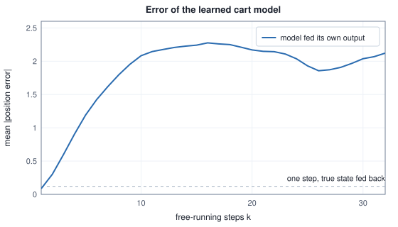
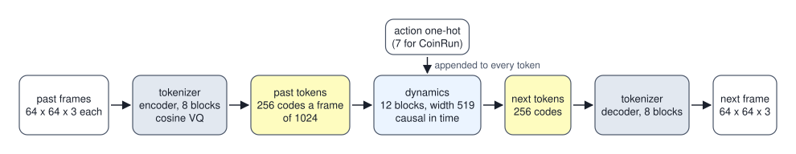
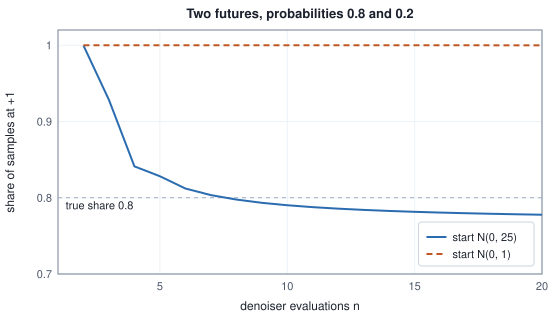
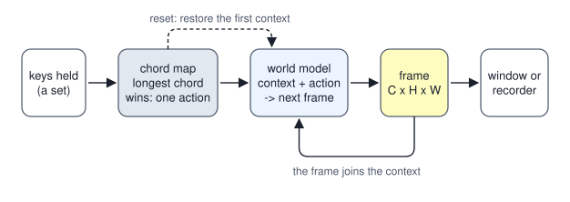

<!-- SPDX-License-Identifier: CC-BY-4.0 -->
<!-- Copyright (c) 2026 Martin Schröder <info@swedishembedded.com> -->

# World Models

*Can a network learn to simulate an environment well enough to be played?*

Press D and a square moves one cell to the right. Behind the key press is a rule that says what the next picture is, and the simplest playable world is one whose rule is written down. One such world ships with brain for testing, and it is worth reading before any learned one, because it is exact. It keeps two integers, the column and the row of an 8 by 8 square on a 64 by 64 torus, and a frame is a pure function of them: red is a ramp left to right, green a ramp top to bottom, blue the constant $0.25$, and inside the square all three channels are $1.0$, so that the blue channel is $1.0$ exactly on the square and the square can be read back out of any frame. A step takes an action, moves the square (the actions are no-op, up, left, down and right, numbered 0 to 4), and draws. Where the square starts is decided by hashing the context the model was reset with.

<!-- worked: world_models.fake_model_start -->
The context bytes hashed by FNV-1a (offset 0xcbf29ce484222325, prime 0x100000001b3, 64-bit wrap-around): the number of frame values as 8 bytes little endian, then the 4 bytes of each frame value's float32 pattern, then the number of actions as 8 bytes, then each action as 4 bytes little endian. The square's left column is the low six bits of the hash, its top row the six bits above bit 32.

| context | hash | column px | row py |
|---|---:|---:|---:|
| empty context | 0x88201fb960ff6465 | 37 | 57 |
| no frame, actions 3 3 | 0xa2ce1a650839aad7 | 23 | 37 |
| no frame, actions 3 4 | 0x42f3662aacc182e0 | 32 | 42 |

Walks on the 64 by 64 torus (a step moves the square one cell, mod 64). First from the start of the empty context:

| after | action | (px, py) |
|---|---|---|
| start | - | (37, 57) |
| step 1 | 4 (right) | (38, 57) |
| step 2 | 4 (right) | (39, 57) |
| step 3 | 1 (up) | (39, 56) |
| step 4 | 1 (up) | (39, 55) |
| step 5 | 2 (left) | (38, 55) |
| step 6 | 3 (down) | (38, 56) |
| step 7 | 0 (noop) | (38, 56) |
| step 8 | 1 (up) | (38, 55) |

and from the corner (0, 0), where the wrap shows:

| after | action | (px, py) |
|---|---|---|
| start | - | (0, 0) |
| step 1 | 1 (up) | (0, 63) |
| step 2 | 2 (left) | (63, 63) |
| step 3 | 4 (right) | (0, 63) |
| step 4 | 3 (down) | (0, 0) |
<!-- /worked -->

The hash of an empty context is the hash of sixteen zero bytes, and the crate's own specification test pins that value, `0x88201fb960ff6465` (`crates/wm-core/tests/it/worldmodel_trait.rs`); an independent implementation of the rule in the first paragraph gives the same first row. The model is `FakeWorldModel` in `crates/wm-core/src/lib.rs`, and it exists so that everything around a world model, the key handling, the window, the recorder, the replay, can be tested without weights and without a device (commit fcc9e01e2, which introduced the crate and the trait on 15 July 2026).

What it implements is the general interface. A **world model** is a function that holds some context, receives an action, and returns the next observation, so that repeating the call is a simulation of a world that can be played: one frame, one action, one frame. In brain the interface is the `WorldModel` trait. It names the shape of a frame, the number of actions, a `reset` from a context of frames and actions, a `step` from one action to one frame, a `set_nfe` that lets a model trade quality for work by setting its number of function evaluations (NFE, the passes of the denoiser network made per frame), and a `reset_initial` that returns to the exact state the last reset produced. The fake model is the one world model that can be written down. Every other one has to be learned from recordings of a world whose rule nobody has, and the question is what a learned model has to be, and what it costs, for a person with a keyboard to be unable to tell that the rule is missing.

Earlier chapters supply most of the parts, and six of them are worth recalling before they are put together.

1. ([Chapter 1](01-video.md), the video autoencoder.) A video autoencoder with a temporal stride of 8 receives 121 frames. How many latent frames does it return, and why does the first frame stand alone?
2. (Volume VIII, [Chapter 3](../v08-image-generation/03-vector-quantization.md), the codebook.) A frame becomes a $16 \times 16$ grid of indices into a codebook of 1024 entries. How many bits is the grid, and how is the index of one position chosen?
3. (Volume VIII, [Chapter 5](../v08-image-generation/05-diffusion.md), the denoising objective.) A network is trained with squared error to return the clean value from a noisy one. What function of the noisy input does it learn, if it is trained to the minimum?
4. (Volume VIII, [Chapter 7](../v08-image-generation/07-samplers-and-guidance.md), Euler steps.) A denoiser gives a guess $\hat x_0$ at noise level $\sigma_t$ in the variable $y = x_0 + \sigma_t\varepsilon$. How does one Euler step reach the lower level $\sigma_{t'}$?
5. (Volume V, [Chapter 9](../v05-sequences/09-transformer-block.md), the transformer block.) What is added to the residual stream in each of the two halves of a pre-norm block, and what does a causal mask hide from a token?
6. (Volume II, [Chapter 2](../v02-learning/02-linear-regression.md), least squares.) What equations does the weight vector of a least-squares fit solve, and what do they say about the residuals?

## A cart, a wall, and a model that has never seen the wall

Before pixels, a world small enough to hold in the head. A cart rolls on a track from $0$ to $10$. Its state is a position $x$ and a velocity $v$, an action $a$ is $-1$, $0$ or $+1$ (push left, nothing, push right), and one step is $v' = 0.9\,v + 0.5\,a$ and $x' = x + v'$. When $x'$ would leave the track, the wall stops the cart: $x'$ is clamped to the end and $v'$ is set to $0$. Away from the walls the world is linear, and with the walls it is not.

A world model of the cart is a function from $(x, v, a)$ to $(x', v')$ that has been learned from recordings. The simplest one is the linear function that minimizes squared error, the least-squares fit of Volume II on the features $(x, v, a, 1)$, one fit for each output, solved directly so that every printed digit is reproducible. The recordings are two thousand transitions from random starts under random actions, about one in ten of which ends on a wall. What the fit finds is in the first table, and what it does when it runs alone is in the second.

<!-- worked: world_models.track_fit -->
The real cart: v' = 0.9 v + 0.5 a, x' = x + v' on a track [0, 10], and a wall stops it (when x' < 0 the cart is put at x' = 0, and when x' > 10 at 10, with v' = 0 in both cases). Data: 2000 transitions from the stream `world_models.track_data` (seed 0x45f2945bf1d995af); for each, in order, x = 10 u, v = -2 + 4 u (two `uniform()` draws) and a = `integer(3)` - 1; 202 of the 2000 end on a wall. The model is the least-squares solution of the normal equations (Gauss-Jordan, partial pivoting) for x' and for v' on the features (x, v, a, 1); each sum runs over the transitions in order.

| output | w on x | w on v | w on a | bias | true x | true v | true a | true bias |
|---|---:|---:|---:|---:|---:|---:|---:|---:|
| x' | 0.9666 | 0.8412 | 0.4611 | 0.1645 | 1 | 1 | 0.5 | 0 |
| v' | -0.0666 | 0.7695 | 0.4065 | 0.3342 | 0 | 0.9 | 0.5 | 0 |

The 2 by 2 matrix of the weights on (x, v) has trace 1.7360 and determinant 0.7997, so its eigenvalues are the pair 0.8680 +- 0.2152 i, of modulus 0.8943; the real cart's are 1 and 0.9.

Free-running error: 200 rollouts of 32 steps from the stream `world_models.track_rollouts` (seed 0x153f176a94e56454); for each rollout, in order, x = 10 u (v starts at 0), then for each step a = `integer(3)` - 1. The real cart and the model take the same actions; the model is fed its own output and is never clamped (it knows no walls), and 'off the track' counts the model rollouts whose position is below 0 or above 10 at step k. The error is |x_model - x_real|, averaged over the rollouts. Fed the true state at every step instead, the model's mean one-step position error over all 6400 steps is 0.120.

| step k | mean position error | model rollouts off the track |
|---|---:|---:|
| 1 | 0.086 | 2.0% |
| 2 | 0.301 | 1.5% |
| 4 | 0.906 | 0.5% |
| 8 | 1.798 | 1.0% |
| 16 | 2.276 | 4.5% |
| 32 | 2.122 | 7.0% |
<!-- /worked -->



Read the first table before the second. The model is not close to the truth in its coefficients: it has invented a restoring force ($-0.0666$ on $x$ in the velocity update), a push that is too weak ($0.41$ for $0.5$) and a drag that is too strong ($0.77$ for $0.9$), and a constant drift. All of that is an honest compromise. The wall transitions, in which the cart's velocity is set to zero whatever it was, are in the data, and a linear function can only absorb them by bending the whole surface a little. Where the cart is far from a wall the fit is therefore wrong by a small amount everywhere, instead of right in most places and badly wrong in a few.

A small error per step is the whole of the one-step column, and it is the number a training loss measures. The second table is about what happens to it when the model is fed its own output. After one step the error is $0.086$; after four it is $0.906$; after eight, $1.798$. The error after eight free-running steps is fifteen times the one-step error of the same model fed the truth ($0.120$ on average over all steps), and nothing in training saw it. The mechanism is the one the two matrices explain. Write the error vector after $k$ steps as $\mathbf{e}_k$. A model whose update is wrong by a vector $\boldsymbol\delta$ per step and whose linear part is $\hat{\mathbf{A}}$ moves its error by $\mathbf{e}_{k+1} = \hat{\mathbf{A}}\,\mathbf{e}_k + \boldsymbol\delta$ (to first order, where the real dynamics are locally linear), so that $\mathbf{e}_k = \sum_{j<k}\hat{\mathbf{A}}^j\boldsymbol\delta$: errors accumulate, and they accumulate by the model's own dynamics, in directions nobody put into the data. The real cart integrates velocity into position and so does the model, and a velocity that is too small by a constant makes a position that is wrong by a constant per step. The learned matrix has complex eigenvalues of modulus $0.894$, so it does not blow up; it spirals into a fixed point of its own that the real cart does not have. The error therefore stops growing near the size of the track and wanders there (the curve flattens at about two units, a fifth of the track), but that bound is a property of this toy's walls and not a comfort: in a world with no walls, such as a long video, nothing bounds it.

The distinction has a name from Volume V, exposure bias, met where a sequence model was trained with the true previous token as input (teacher forcing) and run with its own: the training distribution is the states that the world visits, and the running distribution is the states the model visits, and they separate as the rollout grows. Every learned world model that follows is trained one step at a time on recordings and played free-running, and the tokens, noise levels and costs below are all ways of keeping its own output close enough to the recordings for the next step to remain meaningful. The cart tells us what to measure, not how to fix it. A fix has two forms in this family: make the one-step model so good that its small errors stay inside the region it was trained on, which is the effort of the next two sections, or train it on its own rollouts, which none of brain's world-model trainers does.

## Frames as codes: a tokenizer and a predictor

A frame of $64 \times 64$ pixels in three colours is $12{,}288$ numbers. Predicting the next one directly is possible and is what the diffusion model of a later section does, but there is a cheaper route which the discrete codes of Volume VIII open: compress each frame once, with a tokenizer, into a short grid of indices, and predict the grid. The tokenizer carries the image detail, and the predictor only has to learn how a small grid of symbols changes when an action is taken, which is closer to the sequence modelling of Volume V than to image synthesis.



The crate `crates/genieredux` imports a model of this kind: the two networks of a released checkpoint for a platform game, a tokenizer and a dynamics model. The tokenizer cuts a frame into $4 \times 4$ patches, so that a $64 \times 64$ frame is a grid of $16 \times 16 = 256$ positions, embeds each patch to 512 numbers, runs the clip through eight blocks of a transformer, projects to 32 numbers, and replaces each position by the index of the nearest of 1024 codebook entries. The quantizer is the cosine form of Volume VIII's nearest-code rule: the projected vector is normalized to unit length, and the index is the codebook row with the largest dot product. A frame is then $256 \times 10 = 2{,}560$ bits, against the $98{,}304$ of the 8-bit frame, a factor of $38.4$. The decoder is a second stack of eight blocks that turns codes back to patches. The blocks are of a particular kind, a space-time (ST) block: each has a depthwise three-dimensional convolution, then attention over the positions of one frame, then a feed-forward layer, and the same three again with attention over the frames at one position, a causal one so that a frame never sees a later one. That choice is the one that keeps the cost of video attention tractable, and the tables below count it.

<!-- worked: world_models.genie_counts -->
Parameters of the two networks of the GenieRedux checkpoints brain imports, counted from their shapes: width 512 (519 in the dynamics: 512 plus 7 action channels), 8 heads of width 64, feed-forward inner width 1365 (1384), a 3 by 3 by 3 depthwise convolution (PEG, for positional encoding generator) and an attention and a feed-forward in each of the spatial and temporal halves of a block. The attention has no biases; the tensors the importer reads and discards (the unused context norm and the quantizer's exponential-moving-average (EMA) buffers) are counted because they are in the file. A block is two halves (spatial, then temporal) of the same shape. A half holds a depthwise 3 by 3 by 3 convolution over the channels (PEG: 27 weights and a bias per channel, 14,336 at width 512); an attention (1,050,752: two vectors of 64 per-head-dimension scales for the queries and keys (2 * 64), a norm gain and its unused bias buffer and the unused context-norm gain and bias buffer (4 * 512), a query matrix 512 to 512, a fused key-value matrix 512 to 2 * 512, and an output matrix 512 to 512, none with a bias); and a gated feed-forward (2,097,664: a norm gain and bias buffer (2 * 512), an input matrix 512 to 2 * 1365 whose two halves are the value and the gate of a GEGLU, and an output matrix 1365 to 512, without biases). That is 3,162,752 for a half, 6,325,504 for a block, and 15 tensors a half (2 for the PEG, 9 for the attention, 4 for the feed-forward). The output gain of a stack is a gain and a bias buffer (2 * width). A position-bias MLP maps a 2-vector to the width h, then h to h, then h to 8 heads, each linear with a bias. A patch embedding is a norm over the 48 values of a 4 by 4 patch of 3 channels (gain and bias), a linear layer 48 to 512 with a bias and a norm over 512 (gain and bias); a pixel head is a linear layer 512 to 48 with a bias. The quantizer is a linear layer 512 to 32 with a bias, a codebook of 1024 vectors of 32, a linear layer 32 to 512 with a bias, and the buffers the importer reads: one initialized flag, 1024 cluster counts and 1024 vectors of 32 for the moving average. The dynamics works at width 519 (512 plus 7 action channels) with feed-forward width 1384; its token embedding has 1025 rows of 512 (1024 codes and a mask), its position embedding 4000 rows of 512, and its logits are a linear layer 519 to 1024 with a bias.

| part | parameters |
|---|---:|
| tokenizer: encoder: 8 blocks and output gain | 50,605,056 |
| tokenizer: decoder: 8 blocks and output gain | 50,605,056 |
| tokenizer: spatial position-bias MLP | 268,296 |
| tokenizer: patch embeddings (first frame, rest) | 52,416 |
| tokenizer: pixel heads (first frame, rest) | 49,248 |
| tokenizer: quantizer (in, codebook, out, EMA buffers) | 99,873 |
| tokenizer total | 101,679,945 |
| dynamics: 12 blocks and output gain | 77,654,814 |
| dynamics: token embedding (1024 codes and a mask) | 524,800 |
| dynamics: position embedding (4000 positions) | 2,048,000 |
| dynamics: spatial position-bias MLP | 4,872 |
| dynamics: logits | 532,480 |
| dynamics total | 80,764,966 |

Tensors per checkpoint: 372 in the dynamics (12 blocks of 30, 2 output-gain tensors, the two embeddings, 6 for the position-bias MLP, 2 for the logits).
<!-- /worked -->

The counts are from the shapes the importer reads (`crates/genieredux/src/import.rs`), and they come out where the checkpoints' names put them: a tokenizer of $101.7$ million parameters (the file is called a 100 million model) and a dynamics model of $80.8$ million (called 80). The count of tensors, 372 for the dynamics, is also the number the commit that imported it reports (commit 55f9af461). The dynamics model works on the codes. It embeds each index through a learned table, adds to that a projection of the tokenizer's own codebook vector for the index multiplied by 10 (a detail of the released model that the importer has to reproduce for the logits to agree), adds a learned position embedding, appends to every token of a frame a one-hot vector of that frame's action (so the width grows from 512 to 519, with seven actions), runs 12 ST blocks and produces, for every position, a score for each of the 1024 codes. It predicts the codes of the next frame from the codes of the ones before. The action enters by being appended to every token, which is the simplest conditioning there is: the action is part of the input the network sees at every position, and the network learns what to do with it.

Tokens also change what the context costs. A causal transformer over every token of a clip scores $n(n+1)/2$ pairs for $n = 256t$ tokens in $t$ frames, and the space-then-time factorization scores $256^2$ pairs in each frame and $t(t+1)/2$ in each of 256 columns.

<!-- worked: world_models.genie_context -->
Token arithmetic of the dynamics, from the importer's constants: a 64 by 64 frame is cut into 4 by 4 patches, so a frame is 16 by 16 = 256 tokens of 10 bits (a codebook of 1024), 2,560 bits against the 98,304 bits of the 8-bit frame. The position embedding has 4000 rows and is indexed by the position of a token in the whole clip of t frames, so t * 256 <= 4000, which is t <= 15 frames in one forward pass (3,840 positions).

Attention pairs scored, per layer: spatial attention over each frame's 256 tokens (t * 256^2) plus causal temporal attention over each of the 256 locations (256 t (t + 1)/2), against causal attention over all t * 256 tokens (n (n + 1)/2):

| frames t | tokens n | pairs, space then time | pairs, one causal sequence | ratio |
|---:|---:|---:|---:|---:|
| 1 | 256 | 65,792 | 32,896 | 0.5 |
| 2 | 512 | 131,840 | 131,328 | 1.0 |
| 4 | 1,024 | 264,704 | 524,800 | 2.0 |
| 8 | 2,048 | 533,504 | 2,098,176 | 3.9 |
| 15 | 3,840 | 1,013,760 | 7,374,720 | 7.3 |

Per token and per block the linear parts are, in multiply-adds and for each of the two halves, a query matrix 519 to 512, a key-value matrix 519 to 1024, an output matrix 512 to 519, a feed-forward input 519 to 2 * 1384, an output 1384 to 519 (three feed-forward matrices of that size in all, counting the gate) and the PEG's 27 per channel (27 * 519). GFLOP of running the 12-block dynamics over a clip of t frames from nothing (the whole clip recomputed, which is what a model without a cache does for every new frame), and of the newest frame alone when the keys and values of the earlier t - 1 frames and the inputs of the PEG's two earlier frames are cached (`crates/genieredux/src/cache.rs`). The count is `cached_forward_flops` of that file: 2 FLOPs per multiply-add; per token the linear layers and PEG above, the token embedding (the 32-number code vector to 512) and the logits head (519 to 1024); spatial attention over the frame's 256 tokens and causal temporal attention over the frames up to and including the token's own, each pair scored costing 4 * 512 FLOPs (scores and weighted sum); the elementwise work is left out. The cached evaluation computes only the 256 new tokens' projections and attends against the cache:

| frames t | GFLOP, whole clip recomputed | GFLOP, newest frame cached | ratio |
|---:|---:|---:|---:|
| 2 | 83.2 | 41.6 | 2.00 |
| 4 | 166.5 | 41.6 | 4.00 |
| 8 | 333.1 | 41.7 | 8.00 |
| 15 | 624.8 | 41.7 | 14.98 |
<!-- /worked -->

The first table is the argument for the ST block: at fifteen frames, the largest clip a forward pass can hold, the factorized attention scores about $1.0$ million pairs a layer where a single causal sequence scores $7.4$ million. The limit itself is a fact about the code. The position embedding has 4000 rows, and the forward pass adds row $p$ to the token at position $p$ of the whole clip (`dynamics_forward` in `crates/genieredux/src/lib.rs`), so a clip of $t$ frames needs $256t \le 4000$, and $t$ is at most 15. The second table is about what a cache saves. To produce one frame the dynamics model has to run over the clip of context, and a causal model's earlier frames cannot depend on later ones, so each layer can keep the keys and values of the frames before, as the cache of Volume V does for text, and only the 256 new tokens are computed: the work of a frame stops growing with the context. The frame cache of `crates/genieredux/src/cache.rs` (commits `2a32f7492` and `4ebe65034`, 13 November 2026) keeps each layer's temporal keys and values and the inputs of the last two frames at each of the two PEG sites, because the causal $3 \times 3 \times 3$ convolution of a PEG reaches two frames back, and it keeps them in device buffers that grow by doubling. The cached output is equal bit for bit to the full recompute, for the dynamics, for the tokenizer's decoder and for a whole session, which is what the tests of `crates/genieredux/tests/it/kv_cache.rs` and `world_model.rs` assert, and the upload of a frame does not grow with the context. In the table, the newest frame costs $41.6$ GFLOP with a 4-frame context against $166.5$ for recomputing the clip, and at fifteen frames $41.7$ against $624.8$, fifteen times less. The cache is valid for a growing prefix: the position embedding is absolute, so when a session's window is full and the oldest frame is dropped, both caches are rebuilt on the next step, and the incremental cost applies while the window grows.

## Actions nobody labelled

So far the action has been given: a number from the platform game's controller, appended to the tokens. For a game this is free, since the program that records the game also records the keys. For video that nobody played, such as a film of a person walking, there is no controller and no list of keys, and the question is whether a world model can be steered at all when the recordings have no actions. The idea that it can is old and simple. Between two frames something changed, and the changes that occur fall into a few kinds; give each kind a name, and the names are actions. A **latent action** is such a name: a discrete code, learned from pairs of consecutive frames with no labels, that stands for what changed between them, so that a model conditioned on the code can be steered by choosing one.

A toy shows the mechanism, and how it fails. A square wanders an 8 by 8 torus under five actions, as in the fake model, but the learner never sees the actions. It sees positions reported by a localizer with some error, takes the difference of two consecutive reports, and clusters the differences with $k$-means, the algorithm of Volume II, into $k$ groups. The group index is the latent action.

<!-- worked: world_models.latent_action_toy -->
A square wanders an 8 by 8 torus for 400 steps under random actions 0 .. 4 (0 noop, 1 up, 2 left, 3 down, 4 right, the order of the first block), drawn as `integer(5)` from the stream `world_models.latent_action.actions` (seed 0x2d2075f14ecf2d2c), starting at (0, 0). A localizer reports each of the 401 positions plus normal noise of the stated spread on both coordinates, two `normal()` draws per position (x then y) from `world_models.latent_action.noise` (seed 0x29d17f7b23757e12). All 400 actions are drawn first, then the noise. An action moves the square by (dx, dy) = noop (0, 0), up (0, -1), left (-1, 0), down (0, +1), right (+1, 0), with the coordinates taken mod 8 (y grows downward). The displacement of a step is the difference of two reports with each coordinate wrapped into [-4, 4) by d - 8 floor(d / 8 + 1/2). The displacements are clustered by k-means with a farthest-point start (the first point and then, k - 1 times, the point farthest from its nearest chosen centre, the first on a tie) and Lloyd rounds (assign each point to the nearest centre, the lowest-numbered on a tie; a centre becomes the mean of its points, an empty cluster keeps its centre) until the assignment is unchanged (at most 100 rounds); codes are numbered in the order the centres were chosen; purity is the fraction of steps whose cluster's most common true action is their own.

| localizer error | codes k | codes used | purity |
|---:|---:|---:|---:|
| 0.05 | 5 | 5 | 1.000 |
| 0.15 | 5 | 5 | 0.983 |
| 0.25 | 5 | 5 | 0.855 |
| 0.35 | 5 | 5 | 0.700 |
| 0.45 | 5 | 5 | 0.600 |
| 0.05 | 3 | 3 | 0.613 |
| 0.05 | 6 | 6 | 1.000 |

The five codes at error 0.05, with the true action each one stands for:

| code | centre (dx, dy) | steps | most common true action |
|---:|---|---:|---|
| 0 | (-1.007, -0.007) | 82 | left (82 of 82) |
| 1 | (+0.991, -0.001) | 74 | right (74 of 74) |
| 2 | (+0.001, -1.006) | 84 | up (84 of 84) |
| 3 | (+0.002, +1.012) | 87 | down (87 of 87) |
| 4 | (+0.012, +0.003) | 73 | noop (73 of 73) |
<!-- /worked -->

With a good localizer the five groups are exactly the five actions, up to a naming that nobody gave: group 0 is the one that moves the square left, and the learner does not know it is called left, only that the frames in group 0 differ by a step to the left. As the localizer's error grows the groups overlap, since neighbouring actions have displacements one cell apart, and at an error of $0.45$ cells only $0.600$ of the steps sit in a group whose majority is their own action. The last two rows of the first table show what a wrong number of codes does. Three codes cannot name five actions and the clusters mix them, with a purity of $0.613$, and six codes, one more than there are actions, buy nothing: the extra code takes a share of one action's steps without changing which action a step belongs to. A learned action space inherits both problems: it cannot be finer than the evidence in the frames, and the number of codes is a choice.

The GenieRedux dynamics that brain imports is conditioned instead on a one-hot vector of seven labelled actions (`num_actions: 7` in `crates/genieredux/src/import.rs`; `dynamics_forward` takes the one-hots as an argument), so the latent action appears here only in the toy, at the scale where it can be checked.

## Filling in a frame by confident guesses

Predicting the codes of a frame, 256 of them, can be done in three ways, and they differ in how much each code is allowed to know about the others. A model that outputs one code after another, left to right, lets each know all earlier ones and needs 256 passes for a frame. A model that outputs all 256 at once, in one pass, needs a single pass and lets none know any other, so that the codes it samples are independent draws from marginals. And a third way, **masked-token prediction**, starts from a frame in which every code is hidden, predicts all of them in parallel, keeps the ones it is most sure of, hides the rest again and predicts a second time with the kept codes visible, so that the later guesses depend on the earlier ones. It takes as many passes as one chooses, between one and 256, and spends them where a dependence has to be resolved.

The reason the middle way is not enough is a dependence in the world itself, and a small world makes it exact. In this world a marker is dropped into one of six slots, uniformly, so a frame is valid when exactly one of its six tokens is on. The best any model can say about a slot, before it knows anything about the others, is that it is on with probability $1/6$. A model that outputs the most likely value of each slot gets six zeros: the frame with no marker, a frame the world never produces. A model that samples each slot from its marginal gets exactly one marker with probability $6 \cdot \tfrac16 \cdot (\tfrac56)^5 = 0.4019$, and zero or two or more markers the rest of the time. A masked model that is exact knows more once some slots are revealed: if a marker has been seen the others are off, and if $u$ slots remain and none has been seen, each is on with probability $1/u$.

<!-- worked: world_models.masked_decoding -->
A world drops one marker into one of six slots, uniformly, so a frame is valid when exactly one of its six tokens is 1. A masked model that is exact gives each masked slot the probability 1/u of being 1, where u is the number of slots still masked and no 1 has been revealed yet, and 0 once a 1 is revealed. The batch of slots revealed in a pass are sampled independently from those probabilities. The probability of ending with a valid frame is exact (rational arithmetic):

| decoding | network passes | P(valid) as a fraction | P(valid) |
|---|---:|---:|---:|
| one pass, sampled | 1 | 3125/7776 | 0.4019 |
| two passes of 3 | 2 | 1175/1944 | 0.6044 |
| three passes of 2 | 3 | 845/1152 | 0.7335 |
| six passes of 1 | 6 | 1/1 | 1.0000 |

Taking the most probable value of each slot instead (argmax) gives 0 for every slot while u > 1, and the single pass produces the all-zero frame with probability 1.
<!-- /worked -->

Two passes of three slots make a valid frame with probability $0.6044$ and three passes of two with probability $0.7335$, and six passes of one slot are certain. The arithmetic is exact, in fractions, and is the whole case for the method: a number of network passes between one and the number of tokens buys a probability of a consistent frame between $0.40$ and $1$, and in a real model the dependence is spread over a frame's 256 codes (an object that has to appear whole, a wall whose two ends must meet). A masked decoder chooses which codes to reveal first by confidence, the probability the model gives its own prediction, and how many to leave hidden at each pass by a schedule. The sampler in brain uses a cosine schedule on the fraction of hidden codes, and the next block counts what it leaves.

<!-- worked: world_models.mask_schedule -->
Tokens still masked at the start of each pass, for the 256 tokens of one frame: the first pass masks all of them; pass s (s = 1, 2, ...) masks floor(max(cos(pi/2 (s + 1)/S), 1e-6) * 256) of them, the least confident, where S is the number of passes.

| passes S | tokens masked at the start of passes 0, 1, 2, ... |
|---:|---|
| 4 | 256, 181, 97, 0 |
| 8 | 256, 236, 212, 181, 142, 97, 49, 0 |
<!-- /worked -->

The sampler is `maskgit_sample` in `crates/genieredux/src/maskgit.rs`, a port of the reference's `Dynamics.sample` whose tests (`crates/genieredux/tests/it/maskgit.rs`) state it rule by rule (commit `2a32f7492`, 13 November 2026). Pass $k$ re-masks the $\lfloor \rho((k+1)/S)\, n \rfloor$ least confident positions, where $S$ is the number of passes and the ratio $\rho$ is clamped to $[10^{-6}, 1]$ and is one of the cosine, uniform, power, log and exp schedules of the reference; the cosine rows of the table are that count. The positions are ranked by a score of one minus the probability the model gives its own prediction (the reference calls it a confidence score, though a high score means low confidence), kept only for the positions that were masked in the pass, and the highest scores are re-masked. Predictions are the argmax of the logits plus Gumbel noise at the temperature $T \cdot (\text{passes left}) / S$, so that the last pass is greedy, and where two scores tie, the lowest positions are re-masked first, which makes the sampler deterministic for a seed. Every pass overwrites every position with its own prediction, the positions that the schedule meant to keep included: the reference's rule that would freeze them is commented out in its source, the port reproduces that behaviour, and a test pins it. The model input is the prime codes followed by the draft with the last frame dropped, so that a frame is predicted from the frame before it, and when the draft is exactly one frame it never enters the network, and later passes see the same input as the first. For the checkpoint's default, a single pass at temperature 1 that is greedy, the commit of the original port reports that the 256 next-frame codes agree with the reference implementation's on all 256 positions, and that the decoded 5-frame clip is finite and of the right shape (commit bb3d6d689); that test needs the checkpoint and a dump made by the reference (`crates/genieredux/tests/it/parity_maskgit.rs`), and the multi-pass behaviour is pinned by the rule tests above.

Two more commits belong to the tokenizer and the dynamics, and both are about what it means to say a port agrees. The tokenizer's commit (commit d17f3f65a) reports all 1280 indices of a test clip agreeing with the reference and a reconstruction that matches to about $10^{-6}$, and it records the last fix: the reference picks the code by the dot product of the normalized input with the stored codebook as it is, and that codebook is only roughly of unit length (its rows are between $0.8$ and $1.0$), so normalizing it too, which the port had been doing, changes which code wins. The code uses the raw codebook, and the documentation of `vq_quantize` and the comment above the assignment say why (commit `b6c795f69` brought the documentation in line with the code). The dynamics commit (commit 55f9af461) reports the predicted code agreeing at 1280 of 1280 positions, with logits that differ by about $4 \times 10^{-5}$. These numbers come from the commit messages and from tests that skip without the checkpoint; what the repository holds, and what a reader can run, is the importer's full-coverage check, which refuses a checkpoint with a missing or an unexpected tensor.

## A frame by denoising, given the past and an action

The tokenizer gives up pixels to make the predictor small, and the quantizer that does it has a price: whatever the codebook cannot say is lost for good. The other route keeps the pixels. A **diffusion world model** predicts the next frame by denoising: it starts from noise, and a denoiser that sees the frames before and the action turns the noise into the next frame, by the sampler of Volume VIII. The model brain carries is the Atari model of DIAMOND (DIffusion As a Model Of eNvironment Dreams), in `crates/diamond`. Its conditioning is the simplest that works: the last four frames are stacked on the colour channels, and the noisy next frame is stacked with them, so the first convolution of a U-Net sees $4 \times 3 + 3 = 15$ channels. The action of each of those four steps enters through an embedding that is added to the embedding of the noise level, and the sum conditions every normalization inside the residual blocks by a scale and a shift.

The step from a denoiser of Volume VIII to this one is a matter of scale. A denoiser sees an input whose size changes by a factor of $2{,}500$ across the schedule, from a noise level of $0.002$ to one of $5$, and its target changes just as much; a network cannot be asked to do both with one set of weights. The answer of EDM (Karras and colleagues' "elucidated" design of diffusion models), which DIAMOND uses, is to wrap the network in conditioners. Write the noisy frame as $x = y + s\,\varepsilon$ for a clean frame $y$ of variance $\sigma_{\mathrm{data}}^2$ and unit noise $\varepsilon$, where $s$ is the noise level the network is told (brain folds a constant offset of $0.3$ into it, $s = \sqrt{\sigma^2 + 0.3^2}$). The network $F$ is fed $c_{\mathrm{in}}\,x$ and asked for a target that makes the denoised frame

$$
D(x, \sigma) = c_{\mathrm{skip}}\,x + c_{\mathrm{out}}\,F(c_{\mathrm{in}}\,x, c_{\mathrm{noise}}). \tag{1}
$$

Each conditioner has a reason. The input $x$ has variance $\sigma_{\mathrm{data}}^2 + s^2$, so $c_{\mathrm{in}} = 1/\sqrt{s^2 + \sigma_{\mathrm{data}}^2}$ gives the network an input of unit variance at every level. The target of $F$ is $(y - c_{\mathrm{skip}}x)/c_{\mathrm{out}}$, and the residual $y - c_{\mathrm{skip}}x = (1 - c_{\mathrm{skip}})y - c_{\mathrm{skip}}s\,\varepsilon$ has variance $(1 - c_{\mathrm{skip}})^2\sigma_{\mathrm{data}}^2 + s^2 c_{\mathrm{skip}}^2$. The skip weight that makes the residual, and so the error the network is responsible for, as small as possible sets the derivative to zero: $c_{\mathrm{skip}} = \sigma_{\mathrm{data}}^2/(s^2 + \sigma_{\mathrm{data}}^2)$, and the residual's variance is then $s^2\sigma_{\mathrm{data}}^2/(s^2 + \sigma_{\mathrm{data}}^2)$. Taking $c_{\mathrm{out}}$ as the square root of that gives the network a target of unit variance, and since $c_{\mathrm{skip}}$ is the fraction of the variance of $x$ that is signal, $c_{\mathrm{out}} = s\sqrt{c_{\mathrm{skip}}}$. The fourth, $c_{\mathrm{noise}} = \tfrac14\ln s$, is only a comfortable scale for the number the network is told. The first block shows the four at the levels of the default sampler, whose three levels come from the same schedule that Volume VIII's chapter on samplers called Karras: $5$, $0.2831$ and $0.002$, then $0$.

<!-- worked: world_models.edm_conditioners -->
The conditioners at the noise levels of the three-step schedule (sigma_max = 5, sigma_min = 0.002, rho = 7: the levels (5^(1/7) + l (0.002^(1/7) - 5^(1/7)))^7 for l = 0, 1/2, 1, then 0), and at sigma = 1. sigma_data = 0.5, offset 0.3, s = sqrt(sigma^2 + 0.3^2); c_in = 1/sqrt(s^2 + sigma_data^2), c_skip = sigma_data^2/(s^2 + sigma_data^2), c_out = s sqrt(c_skip), c_noise = ln(s)/4. The last column is the variance of the scaled network input, which the choice of c_in makes 1.

| sigma | s | c_in | c_skip | c_out | c_noise | input variance |
|---:|---:|---:|---:|---:|---:|---:|
| 5.000000 | 5.008992 | 0.198654 | 0.009866 | 0.497527 | 0.402809 | 1.000000 |
| 0.283082 | 0.412475 | 1.542785 | 0.595046 | 0.318180 | -0.221395 | 1.000000 |
| 0.002000 | 0.300007 | 1.714976 | 0.735285 | 0.257252 | -0.300988 | 1.000000 |
| 1.000000 | 1.044031 | 0.863868 | 0.186567 | 0.450953 | 0.010772 | 1.000000 |
<!-- /worked -->

At the high level, $c_{\mathrm{skip}} = 0.0099$ and the denoised frame is almost entirely the network's output: the input is noise and the network has to say what the frame is. At the low level the skip is $0.735$ and the denoised frame is mostly the noisy input, which is nearly the answer already. The conditioners hand the network a roughly constant job at every level, to return a unit-variance quantity from a unit-variance input.

This also fixes the training loss. With $D$ as in (1), the loss $\|D - y\|^2/c_{\mathrm{out}}^2$, which weights each level by the factor that makes the network's target unit, is the plain squared error of $F$ against its target $(y - c_{\mathrm{skip}}x)/c_{\mathrm{out}}$, and that is what `crates/diamond/src/train.rs` computes. The levels are drawn from $\exp\mathcal{N}(-0.4, 1.2^2)$ clipped to $[0.002, 20]$, so that most of the training sees noise of the sizes the sampler will visit and a minority sees both extremes. The trainer folds the offset into the single noise draw, $x = y + s\,\varepsilon$ with $s$ as above, so that the network is trained at exactly the level it is told.

Sampling is the Euler loop of Volume VIII, run with three evaluations: at each level $\sigma_i$ the denoiser gives $D$, and the next $x$ is $x + (x - D)(\sigma_{i+1} - \sigma_i)/\sigma_i$.

```text
function sample_frame(denoise: function(array<real>[n], real) -> array<real>[n],
        sigmas: array<real>[S + 1], x0: array<real>[n]) -> array<real>[n]:
    require sigmas[S] == 0.0
    x = copy(x0)
    for i in 0 .. S:
        d = denoise(x, sigmas[i])
        for j in 0 .. n:
            x[j] = x[j] + (x[j] - d[j]) / sigmas[i] * (sigmas[i + 1] - sigmas[i])
    return x
```

The loop is `DiamondWorldModel::step` in `crates/diamond/src/play.rs`, with the details that matter for a world that is played. The model keeps a ring of the last four frames and four actions; a step appends the new action, draws the noise, runs the three evaluations and rotates the new frame into the ring, so that its own output becomes context, which is where the cart's lesson applies. After each denoiser output the frame is clamped to $[-1, 1]$ and quantized to a byte, and the quantization truncates, as the reference's byte conversion does: the grey pixel $0$ comes back as $127/255 \cdot 2 - 1 = -0.0039$, and a test pins this (`play_quantize_matches_torch_byte_truncation`). The frames live in $[-1, 1]$ inside and in $[0, 1]$ at the trait's boundary. The starting noise deserves a closer look: the draw is unit normal noise, and is not scaled by the first noise level $\sigma = 5$, as the noise of Volume VIII's samplers is.

A world with one next frame cannot show what that does. A world with two can, and the cleanest one is a single number $y$ that is $+1$ with probability $0.8$ and $-1$ with probability $0.2$: a door that opens or stays shut. For such a world the denoiser can be written exactly, $D(x, s) = \tanh(x/s^2 + \tfrac12\ln 4)$, and the question becomes what the sampler does with it, as a function of the number of evaluations and of the start.

<!-- worked: world_models.diffusion_two_futures -->
The next 'frame' is a single number y: +1 with probability 0.8, -1 with probability 0.2. The denoiser is exact, D(x, s) = tanh(x/s^2 + (1/2) ln 4), and the sampler is the Euler sampler of the chapter with the Karras levels of n evaluations (sigma_max 5, sigma_min 0.002, rho 7): x <- x + (x - D(x, s_i)) (s_(i+1) - s_i)/s_i. The start is x ~ N(0, 25) (unit noise scaled to sigma_max) or x ~ N(0, 1) (unit noise, unscaled). The probabilities are exact integrals of the Gaussian start over the set of starts the sampler maps to the stated place, found by bisection on the (increasing) map. 'Neither' is the probability of ending further than 0.1 from both +1 and -1; 'share of +1' is P(within 0.1 of +1) divided by P(within 0.1 of either), shown when 'neither' is below 1%.

| n | neither, start N(0, 25) | share of +1, N(0, 25) | neither, start N(0, 1) | share of +1, N(0, 1) |
|---:|---:|---:|---:|---:|
| 1 | 100.00% | - | 100.00% | - |
| 2 | 0.00% | 0.9997 | 0.00% | 1.0000 |
| 3 | 0.00% | 0.9283 | 0.00% | 1.0000 |
| 4 | 0.00% | 0.8412 | 0.00% | 1.0000 |
| 6 | 0.00% | 0.8121 | 0.00% | 1.0000 |
| 10 | 0.00% | 0.7902 | 0.00% | 1.0000 |
| 20 | 0.00% | 0.7777 | 0.00% | 0.9999 |

The target share is 0.8000.
<!-- /worked -->



Three things stand out, each with a general reading. With one evaluation the sampler returns the denoiser's own output, the posterior mean $\mathbb{E}[y \mid x]$, which in this world is a number near $0.6$: the frame that is the average of the two futures, and a frame the world never shows, the blur that a squared-error predictor produces for a world that can go two ways. It is the reason a diffusion model is used and not a regression of the next frame. With three evaluations, brain's default, the samples are all sharp, one future or the other, but they pick the likelier one with a share of $0.9283$ for a world whose truth is $0.8000$: the sampler's few large steps are a coarse integral, and the model is overconfident about the more probable future. It takes about ten evaluations to land within $0.01$ of the truth ($0.7902$), and the curve then slides below it, to $0.7777$ at twenty, which is the discretization error of Euler's method moving the other way. And the start matters more than any of that. With unit noise that has not been scaled by $\sigma_{\max}$, the samples choose the likelier future essentially always (the share is $1.0000$ from two to ten evaluations and $0.9999$ at twenty), and the unlikely future almost never occurs; with one evaluation that start does not even reach a future, because the sampler returns the blur.

That last result is an exact statement about the toy and its exact denoiser, and not about DIAMOND's network, which has learned what a first evaluation at $\sigma = 5$ does with unit noise, and whose Atari frames are far more nearly one future than two. What it shows is the mechanism by which a sampler can lose diversity, and so a reason for a world model that is meant to be stochastic to start its noise at the scale of its first level.

The playable wrapper has one more thing a world needs and a loop does not give it: a way back. A reset in an interactive session must return to the first frame, and for a stochastic model that means rewinding the noise as well as the context. The first version of the key did neither, and a user reported it: pressing Enter cleared the context ring to grey and let the random generator carry on, so that a reset produced a fresh dream. The fix added `reset_initial` to the trait, a snapshot of the context taken at each `reset`, and a rewind of the generator's seed (commit 64a4e9da1, 16 July 2026), and `crates/diamond/tests/it/reset.rs` holds it in place by stepping a fixed action sequence, rewinding, and requiring byte-identical frames. The general lesson is that when a model's state includes a random stream, a reset must rewind that stream as well as the visible state.

## What a frame costs

Work comes before any clock. The U-Net of the Atari model has $4.41$ million parameters and is a stack of $3 \times 3$ convolutions, so its work can be counted from its configuration alone.

<!-- worked: world_models.diamond_counts -->
The U-Net of the Atari model, built from its config: 64 by 64 frames of 3 channels, the 4 context frames and the noisy frame stacked on the channels (5 frames of 3 channels: 15 input channels in all), 4 levels of 64 channels with 2 residual blocks a level on the way down and 3 on the way up, the sampling convolutions between levels (stride 2 down, nearest-neighbour doubling and a 3 by 3 convolution up), two residual blocks with self-attention at 8 by 8 in the middle (64 positions, head width 8), conditioning width 256, 4 actions. A convolution costs 2 c_in c_out k^2 per output pixel; attention costs 2 n c (3 c) for the projections, 2 n^2 c for the scores, 2 n^2 c for the weighted sum and 2 n c^2 for the output projection, for n = 64 positions. Inventory of the parameters: a residual block from c_in to c_out channels has two conditioned norms, the first over c_in channels and the second over c_out, each a linear layer from the 256-vector to a scale and a shift per channel (2 c_in * 256 + 2 c_in, and 2 c_out * 256 + 2 c_out); a 3 by 3 convolution c_in to c_out and one c_out to c_out, both with biases; and, only when c_in differs from c_out (the blocks of the way up, whose input is the 64 channels of the path joined to the 64 of the skip connection, 128 to 64), a 1 by 1 shortcut convolution with a bias. The middle's two blocks each add a norm (gain and bias), a 1 by 1 query-key-value convolution 64 to 192 with a bias and a 1 by 1 output convolution with a bias. 'Conditioning' is 384 + 2 * (256 * 256 + 256) = 131,968 parameters: 128 for the noise-level embedding (2 * 64), 256 for the action table (4 actions of 64 values, so that the 4 context frames' actions fill the 256-vector) and two 256 by 256 linear layers with biases. The sampling convolutions are 3 by 3, 64 to 64 with a bias, three down and three up. The FLOP table counts the up blocks' 128 to 64 shortcuts, and each block's first convolution, at the resolution of the block's output; a sampling convolution on the way up runs after the doubling, so at the larger resolution.

| parameters | count | share |
|---|---:|---:|
| residual-block convolutions | 2,166,272 | 0.492 |
| conditioned norms (scale and shift linears) | 1,842,176 | 0.418 |
| down and up sampling convolutions | 221,568 | 0.050 |
| conditioning (noise, actions, MLP) | 131,968 | 0.030 |
| self-attention (norm, qkv, output) | 33,536 | 0.008 |
| input convolution | 8,704 | 0.002 |
| output norm and convolution | 1,859 | 0.000 |
| total | 4,406,083 | 1.000 |

Trainable in the fine-tuning of the chapter (every convolution including the 1 by 1 projections, and the attention projections; the norms and the whole conditioning path stay frozen): 2,431,555 of 4,406,083 parameters. Stored as float32 the weights are 17.62 MB. The scale-and-shift linears of the conditioned norms (1,842,176 parameters, 3.68 MFLOP per evaluation) are applied to one 256-vector, not to an image.

| FLOPs of one forward pass | billions | share |
|---|---:|---:|
| residual-block convolutions | 5.5003 | 0.904 |
| sampling convolutions | 0.4955 | 0.081 |
| input convolution | 0.0708 | 0.012 |
| output convolution | 0.0142 | 0.002 |
| self-attention | 0.0063 | 0.001 |
| total, one pass | 6.0870 | 1.000 |

Work of one generated frame is the pass times the number of evaluations; the last column is the work of one second of play at 15 frames a second, in teraFLOPs (a requirement of the model, not a measurement of any machine).

| evaluations per frame | GFLOP per frame | TFLOP per second of play at 15 frames a second |
|---:|---:|---:|
| 1 | 6.087 | 0.0913 |
| 2 | 12.174 | 0.1826 |
| 3 | 18.261 | 0.2739 |
<!-- /worked -->

One pass is $6.09$ GFLOP, a fraction $0.904$ of it in the residual blocks, and attention, which is at the lowest resolution only, is $0.001$ of it. A frame with three evaluations is $18.3$ GFLOP, and a second of play at 15 frames is $0.274$ TFLOP of work, a requirement that holds whatever machine runs it. The count of parameters tells a second thing: a fraction $0.418$ of the parameters are the scale-and-shift linears of the conditioned norms, which are applied to one 256-vector per evaluation on the host (`crates/diamond/src/cond.rs`) and are a few million FLOP, and what the device does is the remaining $0.582$ of the parameters and almost all of the arithmetic. The weights as float32 are $17.6$ MB in all, of which the host keeps the $7.4$ MB of those linears.

The trainable parameters are the convolutions and the attention projections and nothing else, $2{,}431{,}555$ of them, the "~2.43M params" of the first lines of `crates/diamond/src/train.rs`: counting the 236 tensors of the configuration (the number that a test in `crates/diamond/src/config.rs` pins) with the trainer's own name filter gives exactly that. The fine-tuning loop is small by design: batch 1, AdamW over those convolutions, a sampler of transitions that draws a window of five consecutive frames from a recorded episode and refuses to cross an episode boundary (`crates/data/src/episode.rs`), an action alignment in the served `finetune` of `crates/diamond/src/caps.rs` that follows from how episodes are stored (the action stored with frame $i$ is the one that produced it, so the four actions that condition frames $0$ to $3$ are those stored with frames $1$ to $4$), and a stop without saving if the loss ever stops being finite. The recording side is the same crate that plays: any play session can be tee'd to a recorder with a budget of 2 GiB (gibibytes) that ends a recording gracefully and never fails the session (commit 558cdaa24, 15 July 2026), so that a played world becomes training data for the next fine-tune. Recordings carry no rewards.

For the discrete model of the earlier section the same counts are in the genie tables, and the comparison is worth drawing once. A frame of the dynamics model with its cache costs $41.6$ GFLOP at two frames of context and $41.7$ at fifteen, where recomputing the clip costs $83.2$ and $624.8$, against DIAMOND's $18.3$ GFLOP for three evaluations, and the dynamics model's $256$ codes then still need a tokenizer decoder pass of eight blocks. The numbers are of different models, with different frame contents (a platform game, an Atari game) and different quality, and the comparison is of work required, not of quality delivered.

## The loop that makes it playable

A model that returns a frame is not yet a game. **Interactive generation** is generation in which each frame must be produced within a frame budget, from the user's latest input and the model's own previous output, and it needs something to read the keys, hold the rate, show the frame and survive the model being slower than the rate asked for. `crates/wm-display` is that something, and the play loop in its `lib.rs` is the loop of the figure below.



The input is a set of keys held at the moment of the tick and not a queue of presses, so that a step never consumes a stale action, and a key pressed just after a tick waits at most one frame period for the next one: the delay from a key to its effect is at most one period plus the step itself. The set is mapped to one action by a chord table in which the longest chord contained in the held keys wins, so that W together with Space chooses the W-and-Space action and not W alone, and keys that are not in any chord are ignored (`crates/wm-display/src/keymap.rs`). The keys that control the session, pause, reset, quality and quit, are taken out before the matching and never part of a chord. The frame goes to a sink, an object with one method: the SDL window, a hash of every frame for tests (FNV-1a, the same hash that seeds the fake model), a directory of image files, or a tee of two. A scripted input, one action per step and then quit, together with a hash sink makes a play session a function whose output can be compared byte for byte, and `crates/wm-display/src/lib.rs` tests it: the same script twice gives the same list of hashes.

The window itself has a history that is a lesson in how a display can fail while reporting success. A software renderer over a window whose framebuffer SDL had quietly built on an OpenGL context presented nothing, with no error, on a machine that also held its own GL context for offscreen rendering; the fix asks SDL for the plain shared-memory framebuffer and warns if the window still has the OpenGL flag, because a black window is otherwise the only symptom (commit 28120e4fb, 16 September 2026; the hint and the warning are in `crates/wm-display/src/window.rs`).

The pacer is where work meets the clock, and its arithmetic is in the two tables of one block.

<!-- worked: world_models.pacing_arithmetic -->
The fixed-timestep loop gives a step a budget of 1000 // (frames a second) whole milliseconds (integer division), so the rate it holds is 1000 / budget frames a second:

| target frames a second | budget (ms) | rate held (frames a second) | above the target (fraction) |
|---:|---:|---:|---:|
| 10 | 100 | 10.00 | 0.000 |
| 15 | 66 | 15.15 | 0.010 |
| 24 | 41 | 24.39 | 0.016 |
| 30 | 33 | 30.30 | 0.010 |
| 60 | 16 | 62.50 | 0.042 |

The quality controller: a tick is an overrun when its work exceeds the budget (equal is not an overrun); after 5 overruns in a row the quality code goes down one level (code 0 = 3 evaluations, 1 = 2, 2 or more = 1), after 30 ticks in a row within budget it goes up one; a tick lasts from its start until the later of the end of its work and its deadline (so max(work, budget) when the loop has no slack in hand), and the next deadline is the later of that instant and the old deadline, plus the budget; an overrun resets the count of good ticks and a good tick the count of overruns. A hypothetical machine that takes w milliseconds for each evaluation, a target of 15 frames a second (budget 66 milliseconds), 400 ticks, counted over the last 175 (the first run listed is the tail of a longer one):

| milliseconds an evaluation w | milliseconds at code 0 | overruns in the last 175 ticks | codes in the last 175 ticks (first four runs) | rate over those ticks (frames a second) |
|---:|---:|---:|---|---:|
| 20 | 60 | 0/175 | code 0 x 175 | 15.15 |
| 22 | 66 | 0/175 | code 0 x 175 | 15.15 |
| 23 | 69 | 25/175 | code 1 x 20, code 0 x 5, code 1 x 30, code 0 x 5 | 15.05 |
| 30 | 90 | 25/175 | code 1 x 20, code 0 x 5, code 1 x 30, code 0 x 5 | 14.40 |
| 40 | 120 | 25/175 | code 2 x 25, code 1 x 5, code 2 x 30, code 1 x 5 | 14.71 |
<!-- /worked -->

The first table is about integers. The budget of a step is `1000 // fps` whole milliseconds, so a target of 15 frames a second is held at $66$ milliseconds, which is $15.15$ frames a second, and 60 is held at $16$ milliseconds, $62.5$ a second. The rate is above the target, by up to about four percent, and the rate the loop reports is the one of the period it saw, not the target it was given. This is a small thing, but a frame budget that is derived from a target by integer division is a rate that the user did not ask for, and an interactive model that depends on a given step per second (a physics world driven by the model, a recording with a timestamp) should know it.

The second table is a property of the controller. The controller lowers the quality code after five overruns in a row and raises it after thirty ticks within budget, and an overrun resets the count of good ticks.

```text
function controller_tick(work: int, budget: int, over: int, under: int, level: int)
        -> (int, int, int):
    if work > budget:
        over = over + 1
        under = 0
        if over >= 5:
            level = max(level - 1, -3)
            over = 0
    else:
        under = under + 1
        over = 0
        if under >= 30:
            level = min(level + 1, 0)
            under = 0
    return (over, under, level)
```

If the machine can sustain the best quality, nothing happens. If it can sustain a lower one but not the best, the controller does not settle on it. It descends, spends thirty ticks at the lower quality, raises, overruns for five ticks at the higher one, and descends again, so that in every cycle of 35 ticks five are overruns: at 23 milliseconds an evaluation and 15 frames a second the loop spends $5$ of every $35$ ticks, one in seven, over budget (the table's rows for 23, 30 and 40 show the same pattern at different levels), and the average rate over a cycle is below the rate the machine could hold at the lower quality for its whole length. The five late frames are the price of finding out, every 35 ticks, that the machine has not become faster. The constants are in `crates/wm-display/src/pacing.rs` and the cycle follows from them; the hypothetical machine of the table has a fixed cost per evaluation and is not a measurement of any. A controller that remembers that it was refused would trade the five frames for a longer probe interval after each refusal. For DIAMOND the level becomes what `set_nfe` receives: the level runs from $0$ down to $-3$, its negation is passed as a small integer code, and `DiamondWorldModel::set_nfe` reads $0$ as three evaluations, $1$ as two and anything above as one, so the knob that the trait documents as a number of function evaluations is, in the only model that uses it, a code.

## What the four crates hold

`crates/genieredux` is the discrete world model: the tokenizer and the dynamics of the released CoinRun checkpoints, imported with a full-coverage check, the reference sampler of MaskGIT (the masked generative image transformer, the method of masked-token prediction above), the frame cache of the token-arithmetic block (on the device, equal to recomputing the clip bit for bit, with its FLOP counts in `cached_forward_flops`), and `GenieReduxWorldModel` in `crates/genieredux/src/session.rs`, an implementation of the `WorldModel` trait that `crates/wm-core` defines for the play loop. A session keeps a window of the last frames as tokens with the action taken at each, steps by running the dynamics over the frames the cache has not seen, sampling the next frame's tokens, decoding it with the tokenizer's cached decoder and appending the tokens; its reset is a deterministic function of the context, and `reset_initial` replays the same frames bit for bit, because every step's sampler seed comes from a stream seeded at construction and re-seeded by each reset. The session plays the imported tokenizer and dynamics as they are, and its action space is the seven labelled actions of the checkpoint. What is checked on every run is the part with host references to compare against and no checkpoint to load: the position-bias helpers (`crates/genieredux/src/bias.rs`), the block-by-block tests under `crates/genieredux/tests/it`, the sampler's rule tests and the cache's equality tests.

`crates/diamond` is the diffusion world model that plays: the Atari U-Net recorded as one graph, the EDM conditioners and the Euler loop behind the `WorldModel` trait, and a fine-tuner that trains the convolutions and attention projections one transition at a time on the reference's loss, with no reward or end-of-episode head and no rollout loss. Its forward parity test compares a tiny random-weight UNet with the reference's output within 32-bit tolerance, from fixtures that are not in the repository (`make wm/fixtures` regenerates them) and that skips when they are absent (`crates/diamond/tests/it/parity.rs`). Its path to an Intel NPU (neural processing unit), `crates/diamond/src/npu.rs`, exports the U-Net to an ONNX (Open Neural Network Exchange) graph and keeps the sampler on the host, one device inference for each noise level.

The loop, the display and the trait are `crates/wm-core` and `crates/wm-display`. Training an agent is Volume XII's subject, and a small one closes the account of world models.

## An agent that learns in the dream

The reason to want a world model that can be played by hand is that it can be played by a program. A policy that is improved by rolling it out in the model is trained in a dream, at the price of a rollout, and without a risk or a cost in the real world; and what it learns is only as good as the dream. The cart shows the gap in the most direct form there is.

Take the learned model of the first section as the dream. The task is to bring the cart to $x = 8$ and keep it there for 40 steps from a start at $x = 1$ at rest, with the cost being the mean distance from $8$. A policy with one number $\theta$: push right while $x < \theta$, and after that brake (push left) while the cart still moves right. The number is searched on a grid, once in the dream and once in the real cart, and each result is scored in both worlds.

<!-- worked: world_models.dream_policy -->
A policy with one number, theta: push right (a = +1) while x < theta; after that, push left (a = -1) while v > 0 and otherwise do nothing. The cart starts at (x, v) = (1, 0) and the cost of an episode is the mean of |x - 8| over 40 steps. theta is searched on the grid 0.0, 0.1, ..., 10.0 (101 values; the first minimum wins a tie) once in the learned model of the first block and once in the real cart. Each searched policy is then scored in both.

| theta searched | theta | cost in the model | cost in the real cart |
|---|---:|---:|---:|
| searched in the model | 8.2 | 0.7734 | 2.2266 |
| searched in the real cart | 7.5 | 0.9682 | 0.9059 |

Under the model's choice theta = 8.2, the position after steps 1, 4, 8, 12, 16 and 40 is x = 1.59, 5.94, 9.66, 7.38, 8.03, 7.80 in the model and x = 1.50, 5.52, 10.00, 10.00, 10.00, 10.00 in the real cart.
<!-- /worked -->

In the dream the policy is excellent, with a cost of $0.773$, a little better than the best a policy can do in the real cart ($0.906$): the dream cart overshoots to $9.66$ and then settles near eight, helped by the restoring force and drift that the fit invented and that the real cart does not have. In the real cart the same policy scores $2.227$. The dream believed the drag was greater and the push weaker than they are, so the policy pushes until $8.2$, and the real cart, with less drag and more push, overshoots to the wall at $10$ and stays there, since the policy brakes only while the velocity is positive and the wall has set the velocity to zero. The gap, from a dream cost of $0.773$ to a real cost of $2.227$, is almost three times the dream's, and the policy searched in the real world is better than the dream's by a factor of two and a half in the world that counts. The dream is optimistic because the search finds, among all policies, the one that the model's errors favour most, so that a model with an error that happens to flatter a policy is chosen by the search, an effect that grows with the size of the space searched.

The remedies are the usual ones. Test the policy in the real world, not only the dream, and recompute the dream from the real transitions it visits; keep the policy in the part of the state space the model has been trained on; make the dream stochastic and the policy robust to the spread. The place to learn them is Volume XII, whose policies and value functions give them a precise language.

## Check your understanding

1. In the cart's first table the one-step error of the model is small and in the second table the error after sixteen steps is large. A colleague says that more training data from the same random starts will close the gap. Say what the extra data would and would not change.
2. The learned cart matrix has eigenvalues of modulus $0.894$, less than 1. A colleague concludes that its rollouts cannot go wrong, since they must converge. Find the error in the argument.
3. In the six-slot world, a model decodes the six tokens in six passes of one token each, taking the most probable value each time instead of sampling. What frame does it produce, and why does sampling not produce the same frame each time?
4. A DIAMOND-style sampler is run with one evaluation instead of three, for a world in which a door opens or stays shut. What does the frame look like, and why is it not a frame the world shows?
5. A latent-action learner is trained on video of a car that drives straight, turns left and turns right, with a localizer whose error is a quarter of the distance between the three displacements. Would you choose two, three or six codes, and what would the extra code, if there were one, do?
6. The controller of the play loop is given a machine that holds 15 frames a second at two evaluations and misses it at three. Say how many of every 35 ticks run over budget, and what a user sees.
7. The dynamics model's position embedding has 4000 rows. A user asks for 20 frames of context. What happens, and why is it the code's limit and not the model's?
8. A policy trained in a learned model scores better in the model than the best policy does in the real world. Is that a bug in the search? What would show it to be one?

## Summary

A world model is a function from a context and an action to the next observation, and what makes it a world model, and not a video generator, is that the action has consequences: the exact fake model is two integers, and a learned one is a stand-in for a rule nobody has. A cart on a track showed the central difficulty: a model trained one step at a time is judged free-running, and its small error becomes a large one in states it never saw. A discrete route compresses each frame to a grid of codes and predicts the next grid conditioned on an action, with a masked decoder that spends a chosen number of passes on keeping the codes consistent; a latent action replaces a labelled controller by clusters of frame-to-frame change, and works as far as the evidence in the frames. A continuous route, the diffusion world model, denoises the next frame given the last four and the action, and its few evaluations are a work-for-fidelity dial that an exact denoiser makes visible: one evaluation gives the blurred mean, three give sharp frames with the odds wrong, and a start that skips the first level's scale can lose a future altogether. Interactive generation is the loop around all of these, a frame budget met by a model whose cost is counted in FLOPs, with input sampled once a tick, a quality knob driven by a controller whose constants make it probe upward in a cycle, and a reset that rewinds the model's noise as well as its context.

The case study holds the loop, the display, and two learned models that play, one that denoises the next frame and one that fills in the next frame's codes with a cache. The agent in the dream showed why a model that can be played would matter and what limits it. The next chapter turns from worlds learned from frames to a world given as a wiring diagram, and asks what a body and a nervous system simulated from first principles can show that a learned model cannot.

## References

- Jake Bruce, Michael Dennis, Ashley Edwards, et al., "Genie: Generative Interactive Environments", 2024. The latent action model and the ST transformer that the discrete model follows.
- Eloi Alonso, Adam Jelley, Vincent Micheli, et al., "Diffusion for World Modeling: Visual Details Matter in Atari", 2024. The diffusion world model and its three-step sampler.
- Tero Karras, Miika Aittala, Timo Aila and Samuli Laine, "Elucidating the Design Space of Diffusion-Based Generative Models", 2022. The conditioners $c_{\mathrm{in}}$, $c_{\mathrm{skip}}$, $c_{\mathrm{out}}$, $c_{\mathrm{noise}}$ and the noise levels.
- Huiwen Chang, Han Zhang, Lu Jiang, Ce Liu and William T. Freeman, "MaskGIT: Masked Generative Image Transformer", 2022. Masked-token prediction with a confidence-ordered schedule.
- David Ha and Jürgen Schmidhuber, "World Models", 2018. A learned model as the place an agent trains.

## Exercises

1. **[Calculate]** The fake model is reset with the context of no frames and the two actions $(3, 4)$. From the byte rule of the first block, write down the 24 bytes that are hashed, in order, and say which bits of the hash give the column and which the row of the square.
2. **[Calculate]** A cart model has $\hat{\mathbf{A}} = \begin{pmatrix}1 & 1\\ 0 & 0.8\end{pmatrix}$ and a per-step bias error $\boldsymbol\delta = (0, -0.1)^\top$. Compute $e_k$ for $k = 1, 2, 3$ from $e_{k+1} = \hat{\mathbf{A}}e_k + \boldsymbol\delta$ with $e_0 = \mathbf{0}$, and say what $e_k$ tends to in the velocity and in the position.
3. **[Calculate]** A clip of 12 frames of $16 \times 16$ tokens is given to a space-then-time ST block and to one causal attention over all its tokens. How many pairs does each score? At what number of frames do the two counts first differ by a factor of more than four?
4. **[Calculate]** Use the conditioner table to compute, at $\sigma = 1$, the target of the network for a clean value $y = 0.4$ and a noisy value $x = 0.9$, and the denoised value $D$ if the network outputs exactly that target.
5. **[Implement]** Reproduce `world_models.track_fit` from the stream names and the draw order printed with it: the two-thousand-transition fit (eight coefficients, Gauss-Jordan with partial pivoting), then the two hundred 32-step rollouts, and the mean error after $1, 2, 4, 8, 16, 32$ steps.
6. **[Implement]** Reproduce `world_models.masked_decoding` with exact rational arithmetic, and extend it to the batch plans $(4, 2)$, $(1, 5)$ and $(5, 1)$ slots. Predict before running which is most often valid, and say why.
7. **[Implement]** Reproduce `world_models.diffusion_two_futures` for $n = 3$ and $n = 10$: implement the exact denoiser and the Euler sampler, find by bisection the starts that map to $+0.9$ and $-0.9$, and integrate the normal start over the set between them. Then change the probability of the likelier future to $0.5$ and report the share for the unit-noise start.
8. **[Implement]** Reproduce `world_models.pacing_arithmetic`: the budget table and the controller on a counter clock, for 20, 22, 23, 30 and 40 milliseconds an evaluation, over 400 ticks and counting the last 175.
9. **[Investigate]** In the controller of the play loop, make the number of good ticks needed to raise the quality double after every refusal (an overrun right after a raise) and report, on the hypothetical machine of 30 milliseconds an evaluation, how many ticks of the last 175 are over budget and what the rate is. State what the rule gives up.
10. **[Investigate]** Refit the cart model on data in which the wall transitions are repeated four times, search $\theta$ in it, and score the result in the real cart. Report the dream cost and the real cost, and say whether the gap between them moved and why a linear model can or cannot use the extra wall data.

## Key terms

- **world model**: a function that holds some context, takes an action and returns the next observation, so that repeated calls simulate a world that can be played. <!-- concept: world-model -->
- **latent action**: a discrete code, learned from pairs of consecutive frames with no action labels, that stands for what changed between them and can be chosen to steer a model. <!-- concept: latent-action -->
- **masked-token prediction**: predicting a grid of codes by hiding all of them, predicting all in parallel, keeping the most confident and predicting the rest again with the kept ones visible. <!-- concept: masked-token-prediction -->
- **diffusion world model**: a world model that produces the next frame by denoising noise, given the last frames and the action. <!-- concept: diffusion-world-model -->
- **interactive generation**: generation in which each output is produced within a frame budget from the user's latest input and the model's own previous output. <!-- concept: interactive-generation -->

## Answers

Recall questions.

1. 121 frames give $1 + 120/8 = 16$ latent frames. The first frame stands alone because the causal convolutions have no earlier frame to look at, so it is encoded without a predecessor, and each later latent frame stands for eight pixel frames.
2. $256 \times 10 = 2{,}560$ bits. The index of a position is the codebook row nearest to the encoder's output there, by Euclidean distance in the plain form and by the largest dot product of unit vectors in the cosine form.
3. The conditional mean of the clean value given the noisy input, $\mathbb{E}[x_0 \mid x]$: the minimum of the expected squared error is attained by the posterior mean.
4. The guess implies the noise $\hat\varepsilon = (y - \hat x_0)/\sigma_t$, and the step moves along the line, $y_{t'} = y_t + (\sigma_{t'} - \sigma_t)\hat\varepsilon$, which is $\hat x_0 + \sigma_{t'}\hat\varepsilon$.
5. Attention adds its output to the stream in the first half and the feed-forward network adds its output in the second, each after a normalization of its own input. A causal mask hides all later tokens from a token.
6. The normal equations, $\mathbf{X}^\top\mathbf{X}\mathbf{w} = \mathbf{X}^\top\mathbf{y}$; they say that the residual vector is orthogonal to every column of $\mathbf{X}$.

Check your understanding.

1. More data from the same starts makes the fit of the one-step map slightly better and leaves its structure unchanged: it is still a linear function that has to absorb the wall transitions, so it will still carry a restoring force and a wrong drag. What would change the free-running error is data from the states the model visits (starts near the walls, long pushes) or a model that can represent the wall.
2. A modulus below 1 says the error part does not blow up, not that it is small. The rollout converges to the model's own fixed point, which is not the real cart's trajectory: the error is bounded and not zero (the table shows it near two units, a fifth of the track).
3. With the most probable value taken at every pass the model gives zero for every slot while more than one is hidden, and for the last slot, where the probability of a marker is $1$, it gives a marker: the frame always has its marker in the last revealed slot. Sampling with the same probabilities gives a marker in each slot with probability $1/6$, so the valid frames differ from run to run.
4. The frame is the blend the denoiser returns at the top level, the average of the two futures (about $0.6$ in the toy's units): a door half open, which the world never shows. A squared-error output is the mean of what may happen.
5. Three codes, one for each displacement. Two would merge a pair, as three did for five actions; the extra code of a six-code run would take a share of one action's steps and add no distinction, since the localizer's error blurs the three groups but does not create a fourth kind of change.
6. Five of every 35 ticks run over budget: five at three evaluations before the controller drops, then thirty at two. The user sees a stutter of five late frames in every run of 35, and a picture that changes only in quality between three evaluations and two.
7. The forward pass indexes the position table by the position of a token in the clip, so $20 \times 256 = 5120 > 4000$ would read past the end of the table, and the session refuses to be built with that context and says why (`crates/genieredux/src/session.rs`). It is the code's limit: a different table (a longer one, or rotary positions) would lift it, and the weights of the other layers do not depend on the clip length.
8. Not necessarily, and usually not a bug: a search over many policies finds the one that the model's errors flatter, so its dream score is biased upward. It would be a bug if the same policy also scored better in the real world than the policy searched in the real world, which cannot happen since the latter is the optimum of the real score over the same set.

Exercises, by number.

1. The 24 bytes are $0$ as 8 bytes (the number of frame values), $2$ as 8 bytes, then $3$ and $4$ as 4 bytes each, all little endian: `00 00 00 00 00 00 00 00 | 02 00 00 00 00 00 00 00 | 03 00 00 00 | 04 00 00 00`. The column is the low six bits of the hash (bits 0 to 5), the row bits 32 to 37; the block gives $(32, 42)$.
2. $e_1 = (0, -0.1)$, $e_2 = (-0.1, -0.18)$, $e_3 = (-0.28, -0.244)$. The velocity error tends to $-0.1/(1 - 0.8) = -0.5$ and the position error, which integrates it, is unbounded and falls by about $0.5$ a step.
3. Space then time: $12 \cdot 256^2 + 256 \cdot 12 \cdot 13/2 = 786{,}432 + 19{,}968 = 806{,}400$ pairs. One causal sequence: $n = 3072$, so $3072 \cdot 3073/2 = 4{,}720{,}128$ pairs, $5.85$ times as many. The ratio is $3.93$ at 8 frames (the table of the chapter) and $2{,}655{,}360/601{,}344 = 4.42$ at 9, so the factor first exceeds four at 9 frames.
4. At $\sigma = 1$, $c_{\mathrm{skip}} = 0.186567$ and $c_{\mathrm{out}} = 0.450953$, so the target is $(0.4 - 0.186567 \cdot 0.9)/0.450953 = 0.5147$, and $D = 0.186567 \cdot 0.9 + 0.450953 \cdot 0.5147 = 0.4$, the clean value, as it must be when the network returns exactly its target.
5. The tables of the block: coefficients to four decimals, errors $0.086$, $0.301$, $0.906$, $1.798$, $2.276$, $2.122$.
6. $(5, 1)$ is most often valid, with $3125/3888 = 0.8038$, then $(4, 2)$ with $1625/2592 = 0.6269$, then $(1, 5)$ with $127/250 = 0.508$. A frame fails only when some batch holds two markers or when no marker appears at all, and a last batch of one slot cannot fail, since by then a marker is certain if none was seen. Large batches are the risk, and a large batch is least risky early, while each slot's probability of a marker is still $1/6$ (a late batch of five at $1/5$ each is the worst case).
7. The block's table: $n = 3$ gives $0.9283$ and $n = 10$ gives $0.7902$ for the scaled start, and $1.0000$ for both with the unit start. At probability $0.5$ the denoiser is odd in $x$, the sampler's map is odd, and the Gaussian start is symmetric, so the share is exactly $0.5000$ for every $n$ at which the samples reach a future.
8. The two tables of the block: budgets $100, 66, 41, 33, 16$ milliseconds for $10, 15, 24, 30, 60$ frames a second, and for 20, 22, 23, 30, 40 milliseconds an evaluation the overruns in the last 175 ticks are $0, 0, 25, 25, 25$.
9. With the doubling rule the interval between probes grows, so the overruns of the last 175 ticks should fall (a probe costs five late frames, and there are fewer of them) and the rate should move toward the $15.15$ of the lower quality; the run gives the numbers. What the rule gives up is the ability to notice quickly that the machine has become faster: after several refusals the model stays at the lower quality for a long time after the load has gone.
10. The answer is the pair of numbers the run gives, and what to look for is whether the gap moved and by how much. The extra wall data makes the fit bend further toward the wall's behaviour everywhere, because a linear function cannot make the velocity zero only at a wall; the gap can narrow, but nothing in the fit can close it while the model is linear, and the search keeps finding the policy the remaining error flatters.
