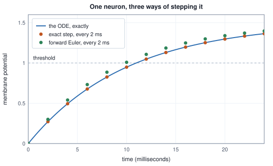

<!-- SPDX-License-Identifier: CC-BY-4.0 -->
<!-- Copyright (c) 2026 Martin Schröder <info@swedishembedded.com> -->

# Simulating Brains and Bodies

*What can we learn by running a real animal's wiring diagram inside a simulated body?*

A published wiring diagram of an animal's nerve cord is two spreadsheets. One has a row for each neuron and the other a row for each pair of neurons and each region of tissue they touch, with the number of synapses between them. Nothing in either file moves, fires or weighs anything. A 12 in the synapse column is a count of contacts that someone saw in an electron microscope, and it is not a current, a conductance or even a sign: whether the contact excites or inhibits is not visible in the image at all. The question of this chapter is what can be learned by putting such a diagram inside a simulated body and letting it run, and the first thing to find out is how much has to be added before it can run at all. What has to be added turns out to be the interesting part. Every number of that kind is a modelling decision with a discretisation behind it, and a simulation of an animal is only as honest as its account of what each of them cost.

Five ideas from earlier chapters are needed first. The answers are at the end.

1. (Volume I, [Chapter 9](../v01-mathematics/09-integrals-and-odes.md), differential equations.) A quantity obeys $dx/dt = -kx$ with $x(0) = x_0$. What is $x(t)$, and why is it the only solution?
2. (Volume I, [Chapter 9](../v01-mathematics/09-integrals-and-odes.md), Euler's method.) One Euler step of size $h$ on that equation multiplies $x$ by what? For which $kh$ does one step cross zero, and for which does the sequence of steps grow in size?
3. (Volume VIII, [Chapter 7](../v08-image-generation/07-samplers-and-guidance.md), Euler steps in a sampler.) The sampler follows an ODE in the noise level by Euler steps. If the number of steps over a fixed span is doubled, what happens to the error of the end point, and what has the method not changed about the ODE it follows?
4. (Volume III, [Chapter 13](../v03-neural-networks/13-first-models.md), the learned controller.) A network is trained to imitate a classical controller of a tank. Which number says that it is a controller, and why is the imitation loss not that number?
5. (Volume X, [Chapter 7](07-world-models.md), a learned simulator.) A learned one-step model of a cart has a small error when it is fed the true state and a large one when it is fed its own output. By what mechanism does the error grow?

## From two files to a graph with signs

The smallest wiring diagram that still has all the features of a real one is four rows long. These are the two files, in the form a published dataset writes them, cut down to the columns this chapter uses (the real header names `Predicted NT type`, `Predicted NT confidence` and `Verified NT type` are shortened to fit the page). They are the fixture of the connectome crate's import test with the other columns taken out (`crates/connectome/tests/it/import.rs`).

```text
Root ID,Super Class,Primary Cell Type,Pred NT,Pred conf,Verified NT
1,descending,DNp01,ACH,0.51,
2,ventral_nerve_cord_intrinsic,IN01,GABA,0.93,
3,motor,MN01,GLUT,0.40,ACH
4,central_brain_intrinsic,"CB,01",,,

pre_root_id,post_root_id,neuropil,syn_count,nt_type
1,3,LegNp_T1,7,ACH
1,3,IntTct,5,ACH
2,3,LegNp_T1,4,GABA
1,2,CV,9,ACH
```

Three things in them are traps. The fourth neuron's cell type is a quoted field that contains a comma, so splitting a line on commas shifts every later column, and a transmitter ends up read from a cell-type column; the import succeeds with plausible nonsense. The pair $(1, 3)$ appears twice, once for each region of tissue in which its synapses lie, and has to become one edge of $7 + 5 = 12$ synapses; left as two, they would be two parallel edges between the same neurons, which the propagation rule sums to the same current at twice the memory and a degree count that no longer matches the published one. And the third neuron is predicted to release glutamate with confidence $0.40$ but is verified to release acetylcholine, and a transmitter that a person has verified has to outrank one a classifier has guessed. The reader in `crates/connectome/src/codex.rs` was written around exactly these three, with columns looked up by name and every input row either kept or rejected with a reason, so that the rows kept plus the rows rejected equal the rows read on both files and an import that lost rows cannot be returned (commit 55be02837, 16 September 2026, which also says why: a connectome that silently drops rows cannot be compared against a published count, and that comparison is the only external check an import gets).

<!-- worked: neural_simulation.connectome_rows -->
The two files as printed above, read by splitting on commas outside double quotes. Neurons keep file order (row index 0 to 3). The believed transmitter is the verified one when there is one, otherwise the predicted one, and the sign is +1 for ACH, -1 for GABA and GLUT, 0 for none.

| row | Root ID | Super Class | Primary Cell Type | predicted | confidence | verified | believed | sign |
|---:|---|---|---|---|---:|---|---|---|
| 0 | 1 | descending | DNp01 | ACH | 0.51 | - | ACH | +1 |
| 1 | 2 | ventral_nerve_cord_intrinsic | IN01 | GABA | 0.93 | - | GABA | -1 |
| 2 | 3 | motor | MN01 | GLUT | 0.40 | ACH | ACH | +1 |
| 3 | 4 | central_brain_intrinsic | CB,01 | - | - | - | - | +0 |

The connection rows (4 rows, 25 synapses) are summed per (pre, post) pair across neuropils and sorted by (post, pre):

| pre | post | neuropil | syn_count |
|---:|---:|---|---:|
| 1 | 3 | LegNp_T1 | 7 |
| 1 | 3 | IntTct | 5 |
| 2 | 3 | LegNp_T1 | 4 |
| 1 | 2 | CV | 9 |

| edge (row index pre -> post) | Root IDs | synapses | sign of pre | signed, scale 0.3 |
|---|---|---:|---:|---:|
| 0 -> 1 | 1 -> 2 | 9 | +1 | +2.7 |
| 0 -> 2 | 1 -> 3 | 12 | +1 | +3.6 |
| 1 -> 2 | 2 -> 3 | 4 | -1 | -1.2 |

Accounting: 4 rows read, 4 kept, 0 rejected; 3 distinct edges; 25 synapses. Sign census over edges: 2 excitatory, 1 inhibitory, 0 with no sign. The graph by columns (neuron `i` owns `indptr[i]` to `indptr[i+1]`-1):

| graph | indptr | pre | w |
|---|---|---|---|
| raw counts | [0, 0, 1, 3, 3] | [0, 0, 1] | [9, 12, 4] |
| signed, scale 0.3 | [0, 0, 1, 3, 3] | [0, 0, 1] | [2.7, 3.6, -1.2] |
| signed, scale 0.3, floor 5 | [0, 0, 1, 2, 2] | [0, 0] | [2.7, 3.6] |
<!-- /worked -->

The last table is the form the engine runs. A neuron owns the contiguous range of its own incoming edges, `indptr[i]` to `indptr[i+1]`, with the source of each edge in `pre` and its weight in `w`: the layout called compressed sparse column, built by a counting sort in `crates/neuro/src/csc.rs`, where the edges of one column keep the order the input gave them. A dense matrix would store all $n^2$ entries, most of them zero; this stores $E$ weights, $E$ sources and $n + 1$ column starts. The reason for storing the graph by receiving neuron and not by sending neuron comes a few sections later; for now it is enough that every question the simulation asks about a neuron is a question about one contiguous slice.

What turns the file into a **connectome model** is what is done to the weights. The sign of an edge belongs to the neuron that sends it, because it is set by the transmitter that neuron releases, and it is a convention that the file does not contain: acetylcholine excites, GABA inhibits, and glutamate, which excites in a mammal, mostly inhibits in the fly through a chloride channel, so that it is the sign most easily got wrong (`Nt::conventional_sign` in `crates/connectome/src/lib.rs`). A neuron with no known transmitter gets the sign $0$, which is not a weak connection but an absent one: it stays in the graph, keeps its in-degree and contributes nothing, and that is a silent deletion that the crate counts rather than hides. The synapse count is multiplied by a scale that the data does not fix, because a count of contacts is not a conductance. The default the fly crate uses is $0.3$ (`Wiring::default` in `crates/fly/src/lib.rs`), chosen by sweeping it and watching the distribution of firing rates, not the mean; in the same default pairs of neurons connected by fewer than 5 synapses are dropped, a floor that exists because reconstructions assign many one- and two-synapse pairs at the limit of what the imaging resolves. A **connectome model** in this chapter is the graph, the sign by sending neuron, the scale and the floor, together with the neuron model that the rest of the chapter builds: the file plus every choice that makes it executable. The choices are where the animal and the simulation part company, and the floor shows how much one of them can matter. The signed edges above are $+2.7$, $+3.6$ and $-1.2$ at scale $0.3$, and a floor of $5$ removes the inhibitory one because it has only $4$ synapses.

## A leaky bucket that spikes

A neuron's membrane stores charge and leaks it. Write $V$ for the membrane potential measured from rest, $\tau_{\mathrm{mb}}$ for the time in which the leak removes a fraction $1 - 1/e$ of any excess, and $R\,I$ for the potential that an injected current $I$ would hold the membrane at if nothing else happened ($R$ is the input resistance, taken as $1$ below). Then

$$
\tau_{\mathrm{mb}}\,\frac{dV}{dt} = -V + R I,
$$

the equation of Volume I with a source. Its solution from $V(0) = V_0$ is $V(t) = V_\infty + (V_0 - V_\infty)e^{-t/\tau_{\mathrm{mb}}}$ with $V_\infty = R I$, an exponential approach to the potential the current asks for. A **spiking neuron** adds the one thing that makes it a neuron and not a filter: when $V$ reaches a threshold $V_{\mathrm{th}}$ it emits a spike, an event with no size, and the membrane is reset to $V_{\mathrm{reset}}$. This is the **leaky integrate-and-fire** (LIF) neuron: it integrates its input, it leaks, and it fires and resets. A constant drive with $V_\infty > V_{\mathrm{th}}$ makes it fire regularly, and the time from reset to threshold follows from the solution,

$$
t^\ast = -\tau_{\mathrm{mb}} \ln\!\Bigl(1 - \frac{V_{\mathrm{th}}}{V_\infty}\Bigr),
$$

which is finite only when $V_\infty > V_{\mathrm{th}}$ (below it the membrane settles under the threshold and never fires) and which falls as the drive grows. A real neuron also rests for a short *refractory period* after a spike, during which it cannot fire; the simulation clamps the membrane to the reset value for that many ticks.

The computer cannot follow the curve. It advances $V$ in steps of $h$, and a step is a rule. Euler's method of Volume I is $V \leftarrow V + h\,(V_\infty - V)/\tau_{\mathrm{mb}}$, which with $z = h/\tau_{\mathrm{mb}}$ multiplies the distance to $V_\infty$ by $1 - z$. The exact solution multiplies it by $e^{-z}$ in the same time. Since the equation is linear and the drive is constant over the step, nothing stops us from using the exact multiplier as the step, so that a neuron with a constant input lands on the true curve at every tick: this is what the engine does, and the next section says why it had to. Both rules are in the first block, for a neuron with $\tau_{\mathrm{mb}} = 10$ milliseconds, a drive that holds $V_\infty = 1.5$, a threshold of $1$ and a step of $2$ milliseconds.

<!-- worked: neural_simulation.lif_spike_times -->
Leaky integrate-and-fire neuron, rest 0, reset 0, threshold 1.0, membrane time constant 10 milliseconds, constant drive with $R I = 1.5$ (so $V_\infty = 1.5$), step $h = 2$ milliseconds, $z = h/\tau_{\mathrm{mb}} = 0.2$, no refractory period, start at $V = 0$.

| tick k | time (milliseconds) | forward Euler | exact step (= the ODE) | difference |
|---:|---:|---:|---:|---:|
| 0 | 0 | 0.0000 | 0.0000 | +0.0000 |
| 1 | 2 | 0.3000 | 0.2719 | +0.0281 |
| 2 | 4 | 0.5400 | 0.4945 | +0.0455 |
| 3 | 6 | 0.7320 | 0.6768 | +0.0552 |
| 4 | 8 | 0.8856 | 0.8260 | +0.0596 |
| 5 | 10 | 1.0085 | 0.9482 | +0.0603 |
| 6 | 12 | 1.1068 | 1.0482 | +0.0586 |
| 7 | 14 | 1.1854 | 1.1301 | +0.0553 |
| 8 | 16 | 1.2483 | 1.1972 | +0.0512 |

The ODE crosses the threshold at $t^\ast = -\tau\ln(1 - V_{\mathrm{th}}/V_\infty) = 10.986$ milliseconds. The exact step first reaches $V \ge 1$ at tick 6 (12 milliseconds, $V = 1.0482$); forward Euler at tick 5 (10 milliseconds, $V = 1.0085$).

| integrator | first spike (milliseconds) | spikes in 100 milliseconds | interval between spikes (ticks) | mean rate (spikes per second) |
|---|---:|---:|---:|---:|
| the ODE, exactly | 10.986 | 9 | 5.493 | 91.0 |
| exact step on the 2-millisecond grid | 12 | 8 | 6 | 83.3 |
| forward Euler on the 2-millisecond grid | 10 | 10 | 5 | 100.0 |
<!-- /worked -->



Read the two curves before the table. Forward Euler's potential is always above the exact one, because it moves along the initial slope for the whole step and the slope falls during it; the two rules cross the threshold on different ticks, the exact step at tick 6 and forward Euler at tick 5. The ODE crosses at $10.986$ milliseconds, between them. Neither tick is right, and they are wrong for different reasons. The exact step has the right membrane and detects the crossing late, because a spike can only be reported at the end of a tick, by up to a whole step. Forward Euler has the wrong membrane, which hurries, and the grid's lateness then cancels part of the error by luck. The count of spikes over a fixed time shows how the two errors compose: in 100 milliseconds the ODE produces $9$ spikes, the exact step on the grid $8$ and forward Euler $10$, and the true mean rate of $91.0$ spikes per second becomes $83.3$ and $100.0$.

A finer grid shrinks both errors, but it does so differently, and the second block shows how.

<!-- worked: neural_simulation.lif_grid_sweep -->
First threshold crossing of the same neuron ($\tau_{\mathrm{mb}} = 10$ milliseconds, $V_\infty = 1.5$, threshold 1.0) on grids of different step $h$. The ODE crosses at 10.986 milliseconds. The error of the exact step is the wait for the next tick, always late by less than $h$; forward Euler's membrane is itself wrong.

| h (milliseconds) | z = h / tau | exact step: spike at | error | forward Euler: spike at | error |
|---:|---:|---:|---:|---:|---:|
| 0.5 | 0.05 | 11 | +0.014 | 11 | +0.014 |
| 1 | 0.1 | 11 | +0.014 | 11 | +0.014 |
| 2 | 0.2 | 12 | +1.014 | 10 | -0.986 |
| 5 | 0.5 | 15 | +4.014 | 10 | -0.986 |
| 10 | 1 | 20 | +9.014 | 10 | -0.986 |
<!-- /worked -->

The error of the exact step is the wait for the next tick, at most $h$ and on average half of it, and it vanishes with $h$. Forward Euler's is two errors, the same wait and a membrane that is wrong by an amount that also shrinks with $h$ but not with the same sign, so that at $h = 2$ milliseconds, where the engine runs, they have partly cancelled and the result is $-0.986$ milliseconds, against the exact step's $+1.014$. The two integrators agree when $z$ is small, $h \le 1$ millisecond here, and at $z = 0.2$ they do not; and a method that is right at $h = 1$ and wrong at $h = 2$ for reasons that cancel is not one to rely on at any step.

A grid has a second, quieter cost: it caps the rate. A neuron under a very strong drive crosses the threshold in a small fraction of a step, but it can spike only once per tick.

<!-- worked: neural_simulation.lif_rates -->
Firing rate against drive for the neuron of the previous block (rest 0, reset 0, threshold 1.0, $\tau_{\mathrm{mb}} = 10$ milliseconds, no refractory period). The ODE's rate is $1/(\tau\ln(V_\infty/(V_\infty - 1)))$; on the grid $h = 2$ milliseconds the interval is a whole number of ticks, the first $k$ with $V_\infty(1 - e^{-zk}) \ge 1$ for the exact step and the first with $V_\infty(1 - (1-z)^k) \ge 1$ for forward Euler. Rates in spikes per second.

| V_inf | the ODE | exact step: ticks | exact step | forward Euler: ticks | forward Euler |
|---:|---:|---:|---:|---:|---:|
| 1.05 | 32.8 | 16 | 31.2 | 14 | 35.7 |
| 1.1 | 41.7 | 12 | 41.7 | 11 | 45.5 |
| 1.25 | 62.1 | 9 | 55.6 | 8 | 62.5 |
| 1.5 | 91.0 | 6 | 83.3 | 5 | 100.0 |
| 2 | 144.3 | 4 | 125.0 | 4 | 125.0 |
| 3 | 246.6 | 3 | 166.7 | 2 | 250.0 |
| 5 | 448.1 | 2 | 250.0 | 2 | 250.0 |
| 20 | 1949.6 | 1 | 500.0 | 1 | 500.0 |
<!-- /worked -->

The two integrators give the same wrong answer at $V_\infty = 20$: one spike per tick is $500$ spikes per second at $h = 2$ milliseconds, where the ODE fires at $1949.6$. Below the cap the picture is the one of the previous blocks. The exact step's rate is quantised to $1/(kh)$ for whole $k$, so it can only take the values $31.2$, $41.7$, $55.6$, $83.3$, $125.0$, $166.7$ and so on, where the ODE's are continuous, and forward Euler sits above the ODE by about a tenth in the middle of the range ($100.0$ against $91.0$ at $V_\infty = 1.5$) as the exact step sits below it ($83.3$). The cord model of `crates/fly` runs at 2 milliseconds a tick and gives each neuron one tick of refractory rest, so its fastest rate is one spike in every second tick, $250$ spikes per second.

The engine's own test of this neuron is small and worth reading as a check on the above (`crates/neuro/tests/it/dynamics.rs`). One neuron, $z = 1$, a drive of $1$ and a threshold of $0.5$, with three refractory ticks, must fire on ticks $0, 4, 8$, once every fourth, and a refractory rule that only forbade the spike and did not clamp the membrane would fire every tick. The book's second implementation of the neuron agrees:

<!-- worked: neural_simulation.crate_gate -->
| configuration ($z = 1$, drive 1, threshold 0.5) | membrane after tick 1 | spike ticks over 12 ticks (counted from 0) |
|---|---:|---|
| exact step, 3 refractory ticks | 0.6321 | [0, 4, 8] |
| forward Euler, 3 refractory ticks | 1.0000 | [0, 4, 8] |
| exact step, no refractory period | 0.6321 | [0, 1, 2, 3, 4, 5, 6, 7, 8, 9, 10, 11] |
<!-- /worked -->

It also shows something the gate's own comment gets wrong. The comment beside the assertion says that $z = 1$ "drives straight to $V_\infty$", which was true of forward Euler, where the step with $z = 1$ lands on $V_\infty$ exactly. The engine's step is the exact one, $e^{-1} = 0.368$ of the distance is left, the membrane after one tick is $0.6321$, and the neuron still fires on tick 0 only because $0.6321 > 0.5$. The test is right and its comment is a leftover from the integrator the engine used first.

## Why the engine stopped using forward Euler

The first commit of the neural runtime (commit 36bee10b7, 16 September 2026) used forward Euler on purpose. Its message says that the update was discretised "specifically" so that a constant input has an exact closed form, $(1 - z)^k$, and so a runtime whose learning rule is local, and so cannot be checked with a gradient check, has an oracle: the membrane against an independently derived formula, to the floating point noise floor and not to a tolerance. The oracle is still there (`LifParams::analytic_v` in `crates/neuro/src/lif.rs`), but it now checks the exact exponential step, and the reason it changed is the one the first section of this chapter ends on.

A real synapse is not a current source. It opens a channel whose ions have an equilibrium potential, the *reversal potential*, and the current it passes is proportional to how far the membrane is from that potential: $g\,(E - V)$, with $g$ the synaptic conductance. Collecting an excitatory conductance $g_{\mathrm{e}}$ with reversal $E_{\mathrm{exc}}$ and an inhibitory one $g_{\mathrm{i}}$ with reversal $E_{\mathrm{inh}}$ into the membrane equation gives

$$
\tau_{\mathrm{mb}}\frac{dV}{dt} = (V_{\mathrm{rest}} - V) + g_{\mathrm{e}}(E_{\mathrm{exc}} - V) + g_{\mathrm{i}}(E_{\mathrm{inh}} - V) + R I = A - bV,
\qquad b = 1 + g_{\mathrm{e}} + g_{\mathrm{i}},
$$

with $A = V_{\mathrm{rest}} + g_{\mathrm{e}}E_{\mathrm{exc}} + g_{\mathrm{i}}E_{\mathrm{inh}} + R I$. It is the same linear equation as before, with a different leak: the leak $b$ grows with the total conductance, and the target $V_\infty = A/b$ is a weighted average of the reversal potentials. Two properties follow that a current source cannot have. Inhibition cannot push the membrane below its reversal potential, because the current it passes goes to zero on arrival; and inhibition divides, because a larger $g_{\mathrm{i}}$ raises $b$ and shrinks the response to everything else. A gain control of this kind is what a mushroom body, the fly's associative centre, uses to keep an odour code sparse.

The cost is in the step. Forward Euler multiplies the distance to $V_\infty$ by $1 - zb$, and $b$ is largest exactly when the input is strongest. The exact step multiplies it by $e^{-zb}$, which is below $1$ for every $b$.

<!-- worked: neural_simulation.conductance_stability -->
A membrane with an excitatory conductance $g$ (reversal $E_{\mathrm{exc}} = 2.8$, rest 0, no other input), $z = h/\tau_{\mathrm{mb}} = 0.2$, started at $V = 0$ and stepped 12 times. The equation is $\tau\,dV/dt = g E_{\mathrm{exc}} - (1+g)V$, so the total leak is $b = 1 + g$. Forward Euler multiplies the distance to $V_\infty$ by $1 - zb$ each tick; the exact step by $e^{-zb}$.

| g | z b | V_inf | forward Euler: factor | after 12 ticks | forward Euler | exact step: factor | after 12 ticks |
|---:|---:|---:|---:|---:|---|---:|---:|
| 0 | 0.2 | 0.0000 | +0.80 | +0.000 | converges | 0.8187 | +0.0000 |
| 1 | 0.4 | 1.4000 | +0.60 | +1.397 | converges | 0.6703 | +1.3885 |
| 4 | 1.0 | 2.2400 | +0.00 | +2.240 | converges | 0.3679 | +2.2400 |
| 5 | 1.2 | 2.3333 | -0.20 | +2.333 | converges, alternating | 0.3012 | +2.3333 |
| 8 | 1.8 | 2.4889 | -0.80 | +2.318 | converges, alternating | 0.1653 | +2.4889 |
| 9 | 2.0 | 2.5200 | -1.00 | +0.000 | does not converge | 0.1353 | +2.5200 |
| 12 | 2.6 | 2.5846 | -1.60 | -724.920 | diverges | 0.0743 | +2.5846 |
<!-- /worked -->

At $g = 4$ forward Euler lands on $V_\infty$ in one step ($zb = 1$); at $g = 5$ and $8$ it overshoots and settles with alternating sign; at $g = 9$ it never converges, and at $g = 12$, which a weight of 40 synapses at scale $0.3$ can easily deliver in a single tick, the distance is multiplied by $-1.6$ every tick, and after 12 ticks the membrane is at $-724.9$ in units where the threshold is $1$. The exact step reaches $2.5846$ and stays. The engine moved to it in commit 3945b43c6 (17 September 2026), whose message states the reasoning in the words above and says that the exact step also kept `analytic_v` an oracle and not an approximation. The kernel carries the comment that the first version "was forward Euler", and `crates/neuro/src/lif.rs` documents `dt_over_tau` and `analytic_v` in the terms of the exact update: `analytic_v` returns $V_\infty + (V_0 - V_\infty)\,e^{-a k}$ after $k$ ticks, the closed form the engine's step reproduces.

The failure that the conductance fixed is a good example of a number that looked like biology, and the history has it in two steps on one day, 17 September 2026. With current-based synapses, the integrated inhibition in a balanced network scales with a neuron's in-degree, and the best-connected cells were driven somewhere they could not return from: on the cord the leg muscle with the most input sat hundreds of threshold-gaps below rest and never fired again. The first step (commit bcddcae8e) put a floor, `v_min`, under the membrane, three threshold-gaps below rest, which the code comments place where a fly's chloride reversal sits against its threshold, and it was a retraction: a headline that "the walking oscillator is in the anatomy", measured with the circuit isolated, a degree-matched shuffle failing and the inhibitory neuron deleted, turned out to need a floor of about twelve threshold-gaps, which in this animal is 84 millivolts below rest and which nothing in a fly reaches. The number was real and the conclusion was a property of the model's missing floor. The second step (commit 3945b43c6, written to deal with the last three failures as symptoms of one cause) was the conductance synapse itself, with its reversal potentials, and it is the one that needed the new integrator.

One more discretisation sits in the synapse, and it is not the same one as in the membrane. A synaptic current that receives an impulse decays over a few milliseconds, and the engine carries it from tick to tick with a keep factor. Its keep factor is $1 - a$, with $a = h/\tau_{\mathrm{syn}}$, which is forward Euler for the decay; the membrane's is the exact step. The two rules are compared in the next block, for the engine's two time constants of 5 milliseconds for excitation and 20 for inhibition.

<!-- worked: neural_simulation.synaptic_filters -->
A synaptic current that receives a unit impulse on tick 0 and then decays by a fixed factor per tick, step $h = 2$ milliseconds. With $a = h/\tau_{\mathrm{syn}}$, one rule keeps the fraction $1 - a$ per tick (the engine's), the other $e^{-a}$ (the exact decay of a filter of time constant $\tau_{\mathrm{syn}}$). The effective time constant of a keep factor $c$ is $-h/\ln c$ milliseconds; the total charge delivered over all ticks is $\sum_k c^k = 1/(1-c)$ times the impulse.

| a | nominal tau | keep 1 - a | effective tau (milliseconds) | keep exp(-a) | total charge, 1 - a | total charge, exp(-a) |
|---:|---|---:|---:|---:|---:|---:|
| 0.1 | inhibitory, 20 milliseconds | 0.9000 | 18.982 | 0.9048 | 10.000 | 10.508 |
| 0.2 | 10 milliseconds | 0.8000 | 8.963 | 0.8187 | 5.000 | 5.517 |
| 0.4 | excitatory, 5 milliseconds | 0.6000 | 3.915 | 0.6703 | 2.500 | 3.033 |
| 0.5 | 4 milliseconds | 0.5000 | 2.885 | 0.6065 | 2.000 | 2.541 |
| 0.8 | 2.5 milliseconds | 0.2000 | 1.243 | 0.4493 | 1.250 | 1.816 |
<!-- /worked -->

At the engine's setting of $a = 0.4$ (excitation) the filter keeps $0.6$ per tick and behaves as a filter of $3.915$ milliseconds, not 5; the inhibitory filter at $a = 0.1$ behaves as one of $18.98$ milliseconds. The test of the engine pins the rule: with `dt_over_tau_syn` set to $0.5$ it asserts that each tick keeps exactly half (`a_synaptic_time_constant_makes_a_spike_outlast_its_tick`). The Rust that fills the gather kernel's decay passes `1.0 - dt_over_tau_syn` (`SpikingNet::step` in `crates/neuro/src/lif.rs`), and the header of the kernel (`crates/kernels/wgsl/syn_gather_csc.wgsl`) says so: the forward-Euler factor, not `exp(-dt / tau_syn)`, with the effective $3.92$ and $18.98$ millisecond time constants of the table. The rule has a virtue that the exact decay lacks: the total charge delivered over all ticks is $1/a = \tau_{\mathrm{syn}}/h$ exactly, so a spike delivers the same integrated current whatever the step. It is a defensible choice. It is a different one from the membrane's, and the model's stated time constants are therefore nominal for the synapses and exact for the membrane.

## Spikes through a sparse graph

Everything so far is one neuron. What the connectome adds is propagation: a spike in neuron $j$ puts a weight $w$ into the input of every neuron that $j$ contacts, and a tick of the whole network is to do that for every spike. The textbook rule is a *scatter*: for each neuron that fired, add its weight to each of its targets. It has to be done atomically on a device where two spiking neurons can target the same one at the same time, and the engine has no atomic add that both of its backends support (the CPU compiler and the CUDA compiler do not lower one, and an atomic kernel would forfeit the CPU backend that parity is gated on). The rule the crate uses is the other one. The graph is stored by receiving neuron, and each neuron *gathers* from its own incoming edges: for neuron $i$,

$$
c_k = w_k\,s_{\mathrm{pre}(k)}\,p_{\mathrm{pre}(k)}, \qquad
\mathrm{acc}^{\mathrm{e}}_i = \sum_{k} \max(c_k, 0), \qquad
\mathrm{acc}^{\mathrm{i}}_i = \sum_{k} \min(c_k, 0),
$$

with the sum over the edges $k$ in `indptr[i]` to `indptr[i+1]`, $s$ the spike vector of the previous tick (1 or 0) and $p$ the vesicle pool of the sending neuron, a number that falls each time a neuron fires and refills slowly, so that a neuron that has been firing hard delivers less per spike. No two neurons ever write the same address, so nothing needs a lock; the two sums, by the sign of the weight, are two conductances with their own time constants; and the order of the sum is the order of the edges in the column, which the counting sort fixed, so that a restored network replays bit for bit. The kernel header records that the sign split was written as a clamp pair and not as a branch because the branch's condition is the transmitter labels in edge order, which is as unpredictable as data gets (see `crates/kernels/wgsl/syn_gather_csc.wgsl`).

The complete tick follows. It is the book's version of the two kernels, and it is what the worked blocks below run.

```text
function gather_tick(indptr: array<int>[n + 1], pre: array<int>[E], w: array<real>[E],
                     spike: array<real>[n], pool: array<real>[n],
                     cur_e: inout array<real>[n], cur_i: inout array<real>[n],
                     a_syn: real, a_inh: real) -> none:
    require indptr[0] == 0 and indptr[n] == E, "the column starts must cover the edge list"
    parallel for i in 0 .. n:
        acc_e = 0.0
        acc_i = 0.0
        for k in indptr[i] .. indptr[i + 1]:
            c = w[k] * spike[pre[k]] * pool[pre[k]]
            acc_e = acc_e + max(c, 0.0)
            acc_i = acc_i + min(c, 0.0)
        cur_e[i] = cur_e[i] * (1.0 - a_syn) + acc_e     # a keep factor of 1 - a per tick
        cur_i[i] = cur_i[i] * (1.0 - a_inh) + acc_i

function neural_tick(S: inout map<text, array<real>[n]>, indptr: array<int>[n + 1],
                     pre: array<int>[E], w: array<real>[E],
                     drive: array<real>[n], p: map<text, real>) -> none:
    # S holds "v", "refrac" (ticks left, stored as reals), "adapt", "pool", "cur_e", "cur_i", "spike"; R = 1
    gather_tick(indptr, pre, w, S["spike"], S["pool"], S["cur_e"], S["cur_i"], p["a_syn"], p["a_inh"])
    new_spike = zeros(real, [n])
    for i in 0 .. n:
        wa = S["adapt"][i] * p["adapt_decay"]
        pl = S["pool"][i] + (1.0 - S["pool"][i]) * p["std_recover"]
        if S["refrac"][i] > 0:
            S["v"][i] = p["v_reset"]
            S["refrac"][i] = S["refrac"][i] - 1
        else:
            g_e = max(S["cur_e"][i], 0.0)
            g_i = max(-S["cur_i"][i], 0.0)
            b = 1.0 + g_e + g_i
            v_inf = (p["v_rest"] + g_e * p["e_exc"] + g_i * p["e_inh"] + drive[i] - wa) / b
            v_new = max(v_inf + (S["v"][i] - v_inf) * exp(-p["z"] * b), p["v_min"])
            if v_new >= p["v_th"]:
                S["v"][i] = p["v_reset"]
                S["refrac"][i] = p["refrac"]
                new_spike[i] = 1.0
                wa = wa + p["adapt_inc"]
                pl = pl * p["std_release"]
            else:
                S["v"][i] = v_new
        S["adapt"][i] = wa
        S["pool"][i] = pl
    S["spike"] = new_spike
```

Two state variables in it have not been introduced. The adaptation current $w_a$ is subtracted from the drive, decays by a fixed fraction per tick and grows by `adapt_inc` at each spike: a cell that fires a lot is pushed down by its own history, which is what lets a pair of mutually inhibiting populations take turns, since without a slow variable the side that wins the first tick wins every tick (`crates/kernels/wgsl/lif_step.wgsl`). The pool $p$ is the short-term depression of the sender. Both are inert at their defaults. The order inside a tick matters: the gather reads the spikes of the previous tick, so a synapse has a delay of one tick, and nothing may be reordered.

The next block runs it on the graph of the first section. Neuron 0 is driven with a current of $2.0$; the others receive only synaptic input. The constants are the fly crate's cord settings (`cord_lif` in `crates/fly/src/lib.rs`, with the membrane time constant of 10 milliseconds and the synaptic time constants of 5 and 20 milliseconds at the tick of 2 milliseconds), which the block prints, and the run is done twice: with every edge and with the floor of 5 synapses.

<!-- worked: neural_simulation.sparse_network -->
The graph of the previous block, signed and scaled by 0.3 (weights $+2.7$, $+3.6$ and $-1.2$ for the rows 0 to 1, 0 to 2 and 1 to 2). Neuron 0 receives the constant drive 2.0 on every tick (units of $R = 1$); no other neuron is driven. Parameters: $z = 0.2$, rest and reset 0, threshold 1, floor $V_{\mathrm{min}} = -3.0$, $E_{\mathrm{exc}} = 2.8$, $E_{\mathrm{inh}} = 0.0$, 1 refractory tick, excitatory keep factor 0.6, inhibitory keep factor 0.9, adaptation decay 0.98 and increment 0.4, pool release 0.85 and refill 0.013333 per tick. 100 ticks, all state at rest at the start (every synaptic pool starts full, at 1.0; the tick numbers below count from 1, so the first tick is 1, unlike the block of the crate's own test earlier in the chapter, which counts from 0). The floor of 5 synapses removes the edge 1 to 2 (4 synapses) and nothing else. Smallest distance of any threshold decision from the threshold, over both runs: 4.4e-04.

| neuron | spikes, all edges | spikes, floor 5 | first spike ticks, all edges | first spike ticks, floor 5 |
|---|---:|---:|---|---|
| DNp01 (row 0) | 7 | 7 | [4, 10, 18, 30, 47, 65, 83] | [4, 10, 18, 30, 47, 65, 83] |
| IN01 (row 1) | 2 | 2 | [6, 12] | [6, 12] |
| MN01 (row 2) | 3 | 3 | [5, 11, 85] | [5, 11, 20] |
| CB,01 (row 3) | 0 | 0 | [] | [] |
<!-- /worked -->

Four neurons show four behaviours. The driven neuron fires $7$ times in $100$ ticks, at ticks $4, 10, 18, 30, 47, 65, 83$, so that its intervals lengthen ($6, 8, 12, 17, 18, 18$ ticks) as adaptation and depression slow it, which a constant drive and a fixed threshold alone would not produce. The interneuron fires at ticks $6$ and $12$, two ticks after the first two of those, and the motor neuron at ticks $5$ and $11$, one tick after them: the one-tick delay of the gather. Then the two graphs part. With the inhibitory edge present the third spike of the motor neuron comes on tick $85$, and with the edge removed on tick $20$, one tick after the third spike of the driven neuron at tick $18$ plus the tick it takes the conductance to build. The inhibition from the interneuron, whose spikes at ticks $6$ and $12$ arrive just after the motor neuron's own, has not changed the count ($3$ in both runs) but it has moved the third spike by $65$ ticks, a result about timing that a spike count would never reveal. The fourth neuron has no edges and no drive and never fires, which is a gate the engine keeps (`an_isolated_neuron_never_fires_whatever_the_population_size`): a cell that fires without input is a bug in the integrator, and a cheap one to rule out. Every threshold decision of both runs is at least $4.4 \times 10^{-4}$ from the threshold, far above the $10^{-7}$ at which 32-bit arithmetic could flip one, so the integer ticks are the digits of any correct implementation.

Whether the gather is the right rule is a question of work, and work is counted. A dense matrix of the weights would multiply the whole $n \times n$ array by the spike vector every tick. The gather touches only the edges that exist, and the one indirect read, $s_{\mathrm{pre}(k)}$, is the connectome's irregularity and cannot be made contiguous. The kernel's own header says that the spike vector is stored as floats and not as a bitmask because a bitmask would save a factor of 32 on a vector that is already the smallest buffer, and the vector is small enough to stay in cache.

<!-- worked: neural_simulation.sparse_cost -->
Work and bytes of one tick of synaptic propagation for $n$ neurons and $E$ edges. A multiply-add is 2 FLOP. The dense layout stores every one of the $n^2$ weights as 4 bytes and reads the $n$-entry spike vector once; the gather stores per edge a 4-byte weight and a 4-byte source index and reads one 4-byte spike value through that index (12 bytes per edge), plus the column starts ($4(n+1)$ bytes) and the spike vector itself ($4n$ bytes).

The graph of this chapter ($n = 4$, $E = 3$):

| representation | multiply-adds per tick | FLOP per tick | bytes read per tick |
|---|---:|---:|---:|
| dense $n \times n$ matrix | 16 | 32 | 80 |
| columns by post (gather over all edges) | 3 | 6 | 72 |

The sizes below are chosen, not measured, except that the second and third rows are the cord sizes quoted in the header of the engine's gather kernel (23,665 neurons and 1.37 million edges at the synapse floor of 5, 5.31 million before it); the first and last are round numbers.

| n | edges E | mean in-degree | dense / sparse work | sparse MFLOP | sparse MB | dense GFLOP | dense GB |
|---:|---:|---:|---:|---:|---:|---:|---:|
| 1,000 | 20,000 | 20.0 | 50 | 0.04 | 0.25 | 0.002 | 0.00 |
| 23,665 | 1,370,000 | 57.9 | 409 | 2.74 | 16.63 | 1.120 | 2.24 |
| 23,665 | 5,310,000 | 224.4 | 105 | 10.62 | 63.91 | 1.120 | 2.24 |
| 100,000 | 5,000,000 | 50.0 | 2000 | 10.00 | 60.80 | 20.000 | 40.00 |

If every neuron fired a fraction $p$ of the time and out-degrees were equal, an event-driven scatter would read $pE$ edges against the gather's $E$:

| fraction of neurons that fired | edges read by an event-driven scatter, as a fraction of the gather's |
|---:|---:|
| 1% | 0.01 |
| 5% | 0.05 |
| 20% | 0.20 |
| 100% | 1.00 |
<!-- /worked -->

For the four-neuron graph the gather reads $72$ bytes against the dense $80$ and does $6$ FLOP against $32$: at that size the indices and the column starts are as large as the matrix they replace, and the advantage is nothing. For the cord it is large. The kernel's header states the size of the nerve cord the engine runs at the synapse floor, $23{,}665$ neurons and $1.37$ million edges, against $5.31$ million before the floor (the neuron count and the unfloored edge count agree with the import gate of commit 55be02837, which was run against the real dataset; the data is not in the repository and the floored count has not been checked here). Those sizes give $n^2/E = 409$, a gather of $2.74$ MFLOP and $16.6$ MB per tick against a dense $1.120$ GFLOP and $2.24$ GB, and an advantage that falls to $105$ at the unfloored edge count: the floor of 5 cuts the work by a factor of $3.9$ besides removing the pairs that are noise. An event-driven scatter would read only the edges of neurons that fired, a fraction $p$ of the gather's. The gather reads every edge on every tick whatever the activity, which is what it pays for having no atomics, and when only a few percent of the cord is active, as the loop test's comments report for the weight scales swept there ($1.1$ to $3.5$ percent), that leaves a factor of tens on the table. The kernel's own measurements of the choice (a one-thread-per-neuron gather against a work-group per neuron) are dated observations of one device and are left in the file.

The engine is checked against three oracles, none of them a gradient. The membrane is compared with the closed form to the floating point noise floor. The gather is compared with a sparse matrix-vector product written on the host from the same arrays; the first version of that test was vacuous, because with an unreachable threshold nothing fired and it compared zero with zero, and it passed with the gather's loop bound deliberately broken (commit 36bee10b7), so the test now asserts that a fraction of the neurons fired before it compares anything. And a snapshot restored mid-run replays the same spikes bit for bit. A check that has never been seen to fail has not been tested.

## A body is a state vector and a step

The simulated animal has a body, and the body is a second simulation of the same kind: a state, a rule that advances it by a small step, and a number of choices that the step makes for us. A **physics simulation** is the integration of the equations of motion of a set of bodies, in small time steps, with contacts between them treated as forces that push bodies apart when they would overlap. The state is the pair of vectors that MuJoCo, the engine brain binds, calls `qpos` and `qvel`: the generalised coordinates of the bodies (a hinge is one angle) and their rates. They are not the same length when a body is free, because a free body has a position and an orientation held as a quaternion, seven numbers, and six velocities, and the same holds for a ball joint (four numbers for three velocities); the difference $n_q - n_v$ is one for each of them, and the binding uses it to find a joint's place in the vector (`Model::joint_qpos` in `crates/mujoco/src/lib.rs`, which answers only when the difference is exactly one and returns nothing otherwise).

Brain does not implement physics. The binding is a thin, run-time-loaded layer over MuJoCo: the crate builds and tests green on a machine that has no MuJoCo, loads the library when it is asked to, and reads and writes the state through MuJoCo's own flat state interface and not through a mirror of its data structures, because a mirror of a structure whose layout depends on compile-time constants fails by reading a physics number from the wrong offset and getting a plausible one (commit d4d4b1206, 16 September 2026). The three size fields it does read directly are checked at load against what MuJoCo reports, so that a layout change is refused with a message instead of simulated. The body of the animal is a published model that is not in the repository, and every test that needs it skips when its location is not set. So everything this chapter says about the stepping rule of the body is a statement about the rule in general, and which integrator the published model uses was not checked here (MuJoCo's own documentation, not this repository, names semi-implicit Euler as its default, and it is the rule used below).

The step is where the stability limit lives. Take the simplest oscillating body, a mass on a spring with unit natural frequency, $x'' = -x$, started at $x = 1$ with zero velocity, so that its energy $E = \frac12 v^2 + \frac12 x^2$ is $\frac12$ for ever. Three rules advance it. Explicit Euler moves the position along the old velocity and the velocity along the old force. Semi-implicit Euler updates the velocity first and then moves the position along the new velocity. Implicit Euler solves for the new values. All three are one line, and they behave completely differently.

<!-- worked: neural_simulation.oscillator_stability -->
The unit oscillator $x'' = -x$ ($\omega = 1$, period $2\pi \approx 6.283$), started at $x = 1$, $v = 0$, so that its energy $E = \frac12 v^2 + \frac12 x^2$ is $\frac12$. Three one-step rules, each applied with the old values on the right: explicit Euler $x \leftarrow x + hv$, $v \leftarrow v - hx$; semi-implicit Euler $v \leftarrow v - hx$, then $x \leftarrow x + hv$ with the new $v$; implicit Euler, which solves $x_{k+1} = x_k + hv_{k+1}$, $v_{k+1} = v_k - hx_{k+1}$ for the new values. After 100 steps the table gives what happened to $E/E_0$: for a rule that keeps it bounded, the smallest and largest value it took over the run; for a rule that grows or decays it every step, the factor per step of the amplitude (the modulus of the eigenvalue of the one-step matrix, computed in closed form; the energy changes by its square).

| h | explicit Euler | semi-implicit Euler | implicit Euler |
|---:|---|---|---|
| 0.05 | amplitude times 1.001 | 0.976 to 1.026 | amplitude times 0.999 |
| 0.5 | amplitude times 1.118 | 0.800 to 1.333 | amplitude times 0.894 |
| 1 | amplitude times 1.414 | 1.000 to 2.000 | amplitude times 0.707 |
| 1.9 | amplitude times 2.147 | 0.513 to 19.999 | amplitude times 0.466 |
| 2 | amplitude times 2.236 | edge: amplitude grows linearly | amplitude times 0.447 |
| 2.1 | amplitude times 2.326 | amplitude times 1.877 | amplitude times 0.430 |
<!-- /worked -->

Explicit Euler multiplies the amplitude by $\sqrt{1 + h^2}$ every step at every $h$: it adds energy, always, and no step size is small enough to stop it, only to slow it. Implicit Euler does the opposite and removes energy at every step: it is stable for every $h$ because it is wrong in the safe direction, and a simulated spring that loses energy to the integrator is a spring with damping that nobody asked for. Semi-implicit Euler lies between them. Its one-step matrix has determinant $1$, so its eigenvalues have modulus $1$ as long as $|2 - h^2| \le 2$, that is $h \le 2$ for a unit frequency, and the energy then does not drift: it wobbles between bounds, $0.976$ to $1.026$ of the true value at $h = 0.05$, and the wobble widens as $h$ grows ($0.800$ to $1.333$ at $0.5$) until at $h = 1.9$ it reaches twenty times the starting energy while the oscillation is still a bounded oscillation. At $h = 2$ the amplitude grows linearly, and above it exponentially, here by $1.877$ per step at $h = 2.1$. The limit is $h\omega < 2$, and the margin below it is not a luxury: near the limit the motion is distorted by an order of one before it is unstable.

A contact is a stiff spring that is on only when two bodies overlap, and so the limit applies to it too, with $\omega$ the stiffness of the contact. The next block drops a body onto a floor modelled in this way, with no damping, so that the ideal bounce returns to the height it started from.

<!-- worked: neural_simulation.bouncing_ball -->
A body of mass 1 dropped from height 1 onto a floor at $z = 0$ with gravity $g = 9.81$. Contact is a spring: while $z < 0$ the floor pushes up with the force $k\,(-z)$, $k/m = 10000$ per second squared, so $\omega = \sqrt{k/m} = 100$ radians per second; there is no damping, so the ideal bounce is perfectly elastic and returns to the height 1. Semi-implicit Euler: $v \leftarrow v + h a(z)$, then $z \leftarrow z + h v$ with the new $v$. The ball reaches the floor at speed $\sqrt{2gz_0} = 4.4294$, penetrates at most $v/\omega \approx 44.29$ millimetres, and one contact lasts $\pi/\omega = 31.42$ milliseconds. The energy $E = mgz + \frac12 mv^2 + \frac12 k\max(0, -z)^2$ starts at 9.81. 3 seconds are simulated, which holds three contacts; an apex is the height of the first grid point where the upward velocity has run out.

| h (seconds) | h * omega | steps per contact | deepest penetration (millimetres) | largest abs(E - E0) / E0 | apex 1 | apex 2 | apex 3 |
|---:|---:|---:|---:|---:|---:|---:|---:|
| 0.01 | 1.000 | 3.1 | 45.13 | 4.45e-01 | 0.9846 | 0.9990 | 0.9846 |
| 0.005 | 0.500 | 6.3 | 45.83 | 2.66e-01 | 0.9862 | 0.9642 | 0.9952 |
| 0.002 | 0.200 | 15.7 | 45.31 | 1.03e-01 | 0.9977 | 0.9948 | 0.9940 |
| 0.001 | 0.100 | 31.4 | 45.34 | 5.23e-02 | 1.0009 | 1.0001 | 0.9992 |
| 0.00025 | 0.025 | 125.7 | 45.29 | 1.25e-02 | 0.9999 | 1.0000 | 0.9999 |

The stability limit $h\omega = 2$ needs a contact that lasts. The same body resting on the floor, at its equilibrium penetration $z_{\mathrm{eq}} = -mg/k = -0.98$ millimetres, nudged by $\epsilon = 0.01$ millimetre ($10^{-5}$) at zero velocity, and stepped at $h = (h\omega)/\omega$ for 3000 steps (the growth per step is the modulus of the larger eigenvalue of the one-step matrix, 1 when the pair is on the unit circle):

| h * omega | growth per step | largest abs(z - z_eq) / epsilon | outcome |
|---:|---:|---:|---|
| 0.5 | 1.000 | 1.03 | stays down for 3000 steps |
| 1 | 1.000 | 1.00 | stays down for 3000 steps |
| 1.5 | 1.000 | 1.51 | stays down for 3000 steps |
| 1.9 | 1.000 | 3.20 | stays down for 3000 steps |
| 1.99 | 1.000 | 10.01 | stays down for 3000 steps |
| 2 | 1.000 | 101.0 | leaves the floor at step 50 |
| 2.01 | 1.221 | 135.0 | leaves the floor at step 16 |
| 2.1 | 1.877 | 330.1 | leaves the floor at step 8 |
| 2.5 | 4.000 | 341.3 | leaves the floor at step 4 |
<!-- /worked -->

With 31 steps in the contact ($h\omega = 0.1$) the rebounds reach $1.0009$, $1.0001$ and $0.9992$ of the dropping height: close to elastic, with the error having no direction. With 3 steps ($h\omega = 1$) the first rebound reaches $0.9846$ and the energy during the contact is out by as much as $44.5$ percent. The largest deviation of the energy during the contact falls roughly in proportion to $h$ ($0.445$ at $h = 0.01$ and $0.0125$ at $0.00025$) because the kinetic and spring terms are evaluated half a step apart, and what lasts after the contact is the rebound height. Note too that the rebounds at coarse steps do not fall monotonically with $h$, since where in a step the ball happens to cross the floor is a matter of phase. The second table shows the limit itself, with the body resting on the floor so that the contact never lets go: at $h\omega = 1.99$ it stays down but a nudge of a hundredth of a millimetre is amplified ten times along the way; at $2.00$ it leaves the floor after 50 steps; at $2.1$ after 8.

That limit is why the fly's floor has the stiffness that it has. The published model integrates at $10^{-4}$ seconds, and brain's scene writer gives the floor the contact time constant of twice the step (`FLOOR_SOLREF_PER_TIMESTEP` in `crates/flybody/src/scene.rs`, from MuJoCo's requirement that the time constant not be smaller than twice the step). A coarser step therefore gets a proportionally softer floor and not an unstable one, and the legs sink further before the floor pushes back (commit 5dce9d94c, 16 September 2026, which introduced the timestep as a dial and said plainly that it is a fidelity dial and not a free one: the cost of the physics per simulated second is the number of steps, and the accuracy of the contact is what is traded for it). The wing is the other place where the step was a modelling decision: a wingbeat at $218$ per second lasts $4.59$ milliseconds, which at the walking model's step is $45.9$ steps, adequate for the stroke and bad for the aerodynamic force on a wing that reverses, and the flight model halves the step (`crates/flybody/src/scene.rs`, which also says the walking model's default fluid forces generate almost no lift from a flapping plate: the four changes that make the published walking body flyable are properties of the model and not of the controller).

## Closing the loop

A nervous system and a body are two simulations that run at two rates, and joining them is where a third kind of discretisation is hidden. **Closed-loop control** is the arrangement in which what the controller does changes what it next senses: the body's state is read, a command is computed, the command acts on the body, and the new state is read. Volume III's controller was judged by the behaviour of the loop it was in and not by its imitation loss, and the rule is stricter here: in the crate's loop nothing is fitted at all (the module's header says that nothing in it learns), so there is no imitation loss to look at, and behaviour is the only evidence there is.

The fly crate's loop is the cycle in the figure, one tick at a time (`Fly::step` in `crates/fly/src/lib.rs`). The joint state is read; the proprioceptors, neurons that fire only if current is injected into them, receive a current proportional to a joint angle; a command is injected into the descending neurons that carry it from the brain; one neural tick runs; the spikes of the motor neurons are summed with a polarity into a per-muscle activation that decays by a fixed factor each control tick, since a muscle is not an impulse; the activation becomes a control signal on the actuators, and the physics runs for twenty steps with that signal held. Three clocks meet: a neural tick of 2 milliseconds (the constants of `cord_lif` are written for it), a control tick of the same 2 milliseconds, and a physics step of $0.1$ milliseconds, and the code derives the number of steps from the timestep (`Timing::substeps`) and refuses a step that does not divide the control period, because the two disagreeing is not a crash but a body that runs faster or slower than the brain driving it, and everything downstream reads as a change of behaviour.


The routine below is that tick for a toy body of one joint. It calls `neural_tick` above and integrates the joint with the semi-implicit rule of the previous section.

```text
function control_tick(S: inout map<text, array<real>[n]>, indptr: array<int>[n + 1],
                      pre: array<int>[E], w: array<real>[E], polarity: array<real>[n],
                      q: inout real, qd: inout real, act: inout real,
                      substeps: int, p: map<text, real>) -> none:
    drive = zeros(real, [n])
    drive[0] = p["command"]                            # the descending command
    drive[1] = p["angle_gain"] * q                     # sense: the angle before this tick
    neural_tick(S, indptr, pre, w, drive, p)           # think: one tick of the network
    act = act * p["act_decay"]                         # a muscle is not an impulse
    for i in 2 .. n:
        act = act + p["act_gain"] * polarity[i] * S["spike"][i]
    u = max(-1.0, min(1.0, act))                       # act: the command, held below
    for s in 0 .. substeps:
        qd = qd + p["h"] * (p["torque_gain"] * u - p["stiffness"] * q - p["damping"] * qd) / p["inertia"]
        q = q + p["h"] * qd
```

The body of the next block is the smallest thing that has the same loop: a joint with the dynamics $I\ddot q = G u - kq - c\dot q$, a command neuron that is driven with a constant current and excites a pool of four extensor motor neurons, and a proprioceptor whose current is the angle times a gain and which excites a pool of four flexor motor neurons. The extensors push the joint one way, the flexors the other, with the same polarity convention the crate uses (`flybody::MuscleAction::polarity`). Three runs are made: the loop intact, the proprioceptor cut, and the proprioceptor connected with a gain of $2$.

<!-- worked: neural_simulation.closed_loop -->
A one-joint body and a ten-neuron nervous system, 1500 control ticks of 2 milliseconds (3 seconds). Neurons: 0 the command cell, driven with the constant current 2.0; 1 the proprioceptor, driven with the current `angle_gain` times the joint angle; 2 to 5 an extensor pool of 4 motor neurons, each excited by neuron 0 with weight 6.0; 6 to 9 a flexor pool of 4, each excited by neuron 1 with weight 6.0. Membrane and synapse parameters as in the previous block. Each control tick: the angle fixes the sensor current, one neural tick runs, the activation is multiplied by 0.8 and then changed by 0.05 for each extensor spike (plus) and each flexor spike (minus), the command is the activation clamped to $[-1, 1]$, and 20 physics steps of $h = 0.0001$ seconds integrate $I\ddot q = 20\,u - 4q - 2\dot q$ ($I = 1$) with semi-implicit Euler ($\dot q$ first, then $q$), holding $u$ constant. Start: $q = \dot q = 0$, all neurons at rest. Smallest distance of any threshold decision from the threshold, over the three runs: 2.1e-04.

| run | command spikes | sensor spikes | extensor spikes (each) | flexor spikes (each) | largest sensor current | peak angle (radians) | angle at the end (radians) |
|---|---:|---:|---:|---:|---:|---:|---:|
| intact loop, gain 10 | 83 | 38 | 83 | 38 | 1.754 | 0.1754 | 0.1409 |
| proprioception cut | 83 | 0 | 83 | 0 | 0.000 | 0.3153 | 0.2691 |
| sensor gain 2, connected | 83 | 0 | 83 | 0 | 0.631 | 0.3153 | 0.2691 |

The cut run and the weak-sensor run have identical angle sequences at every tick: yes. The intact run differs from the cut run by at most 0.1858 radians at a tick.
<!-- /worked -->


The first two rows say what a closed loop is. The curves in the figure coincide until the sensor first fires and then part, and the intact loop settles at half the angle of the open one ($0.1409$ against $0.2691$ radians at the end, $0.1754$ against $0.3153$ at the peak): that is feedback, a flexor that is recruited by the angle it opposes. The difference between the runs is the test that the crate applies to its own loop (`lesioning_proprioception_changes_the_trajectory` in `crates/fly/tests/it/loop_closes.rs`): a loop whose behaviour is the same with its sensing cut is an open loop in a closed loop's clothes.

The third row is the reason the crate has a second assertion. With a gain of $2$ the largest sensor current is $0.631$, below the threshold of $1$ that the membrane can only approach, so the proprioceptor receives current at every tick and never fires, and the run is *identical to the cut run at every tick* ($0.3153$ and $0.2691$ again): the channel is connected, it carries current, and it transmits nothing. This is the first real defect of the fly's loop, as the history records it (commit 4d4565ba8, 16 September 2026): the 304 leg proprioceptors of the real cord, at the first gain the code used, received a peak current of $0.45$ against a threshold of $1$, the cord fired, the body moved, every other test passed and lesioning the sensory channel changed nothing, and the message says that the failing lesion test was correct and that the author twice suspected the test instead. The commit sweeps the gain and finds the transition exactly at the threshold, with no proprioceptor spikes below it and $638$ just above. The fix was a gain of $10$ and an instrument, `proprioceptor_spikes()`, so that a test can assert that a channel *carries* something before it asserts that removing it matters. In the toy the same transition is easy to find, since the sensor first fires between gains of $3.1$ and $3.2$, where $\text{gain} \times q_{\max}$ first reaches $1$ for the peak angle $0.3153$ of the open trajectory.

The same commit found a second channel that carried nothing: the connectome's weights are counts, which are unsigned, and the sign had been computed at import and never applied, so that every synapse excited and nothing inhibited. Both defects are the same defect twice, in the commit's words: a measurement that looks healthy while the thing it measures is not happening.

One discretisation remains, and it is the one that belongs to the loop and to no part of it. The body reads the angle at the start of a control tick and the activation that results acts for the tick that follows, so the loop has a latency of one control tick, 2 milliseconds, and the command is held constant for twenty physics steps, a zero-order hold. The wingbeat shows what it can cost: at $218$ per second a beat is $2.29$ control ticks long, and so the stroke cannot be written once per control tick, since that would sample it barely twice and alias it into a slow wobble. The crate writes it at every physics step (`Fly::step`, the branch with the wingbeat), and the wings are driven through a resonant oscillator that the power motor neurons modulate and do not produce, for a reason that is anatomy: their muscles are stretch-activated and contract many times per motor spike (`crates/fly/src/wing.rs`).

## What a shuffled wiring says

A closed loop that works is not evidence that the wiring does the work. The thing that was meant to be tested, whether the published wiring is doing something that a graph with the same size and the same statistics would not, needs a control, and the crate's control is `Csc::shuffled_sources`: reassign the source of every edge at random, keeping each neuron's in-degree and the multiset of weights, with the signs applied afterwards so that the split into excitatory and inhibitory is the same too (commit 9f1e4d67b, 16 September 2026). If a creature does as well on the shuffle, the wiring was not what mattered. The control destroys every correlation between who a neuron listens to and what it is, and the code's documentation says what it does not keep: out-degree becomes binomial where the real one is heavy-tailed, since preserving both degrees needs an edge-swap walk, and the limitation is recorded beside the function and not left to the reader to discover. The commit's own test asserts that the shuffle is a shuffle, because one that moved nothing would satisfy every other assertion while making the control identical to the experiment.

The smallest circuit with a function that a wiring can have is a lateralised reflex. Two sensors, SL and SR, drive two interneurons, IL and IR; each interneuron excites the motor neuron of its own side and inhibits the other side's, and the stimulus is applied to SL only, so that the left motor neuron ML should fire and the right one MR should not. With six edges in six slots, each slot with a fixed weight and a fixed receiver, a shuffle is an assignment of the six sources to the six slots, and there are only $180$ distinct ones, so that the control can be run exhaustively and not by sampling.

<!-- worked: neural_simulation.lateralisation -->
Six neurons: 0 SL and 1 SR (sensors), 2 IL and 3 IR (interneurons), 4 ML and 5 MR (motor, left and right). The graph has six edges in six column slots, each slot with a fixed weight and a fixed postsynaptic neuron: slot 0 is the input of IL (+6), slot 1 of IR (+6), slot 2 of ML (+6), slot 3 of ML (-3), slot 4 of MR (+6) and slot 5 of MR (-3). The real wiring puts the sources SL, SR, IL, IR, IR, IL in slots 0 to 5: each side's sensor excites its interneuron, which excites its own motor neuron and inhibits the other. Neuron 0 (SL) alone is driven, with current 3.0, for 100 ticks, with the neuron parameters of the previous block. The real wiring gives ML 7 spikes and MR 0. A shuffle assigns the six sources to the six slots in every possible way (180 distinct assignments, since two sources appear twice), keeping every neuron's in-degree and the multiset of weights. Response of ML against MR: lateralisation $(L - R)/(L + R)$ above $+0.5$ is left, below $-0.5$ right, in between mixed; no spike on either is silent. Smallest distance of any threshold decision from the threshold, over all runs: 2.0e-04.

| motor response of the shuffled graph | wirings | share |
|---|---:|---:|
| left | 48 | 26.7 percent |
| right | 48 | 26.7 percent |
| mixed | 18 | 10.0 percent |
| silent | 66 | 36.7 percent |
<!-- /worked -->

The real wiring sends $7$ spikes to ML and none to MR. Among the $180$ assignments, $66$ leave both motor neurons silent, $48$ lateralise to the left and $48$ to the right with the same strength, and $18$ are mixed: a random wiring with the same in-degrees and weights is equally likely to turn the animal away from the stimulus as toward it, and more likely to do neither. The left share, $26.7$ percent, is what the real wiring has to be compared with, and note that it is not a small share. So a single shuffle is a weak control for a single trial, since about a quarter of random wirings route the signal to the left motor neuron by accident, and the strength of the control is in the repetition: the same comparison over many matched episodes with a sign test, which is what the crate's learning experiments do (`crates/promote` carries the sign test and `crates/fly/src/learn.rs` the episodes).

Even this control cannot say what is not in the circuit. The most instructive result in the history of the crate is the one that went the other way. The claim that the nerve cord's walking rhythm is in the wiring (commit d29162e8b, 06:09 on 17 September 2026) held under its two controls and was withdrawn at 09:58 the same day, because the oscillation came from a modelling floor that no neuron has (commit bcddcae8e, quoted above), and the retraction records the lesson that matters for the whole method, in its own words that a spiking port of a rate model is not a reproduction of it. The ledger of this workstream (`.agents/roadmap/fly.md`) carries the lesson in a table of what the animal can do: the legs move and the loop closes, and walking is marked not done, with both earlier claims retracted; flight reaches two thirds of an episode airborne but a degree-matched shuffle reaches 77 percent of that, a share that was about 5 percent after the shorter search and rose when the search was continued, so that optimisation pressure moved the solution off the connectome, since the wingbeat is generated and the nervous system only modulates it and a task scored on staying up does not need the fly's own wiring; exploration has a chain of olfactory neurons that carries end to end and is lateralised, with steering untrained. Those are the ledger's statements as of its last update, and they have not been re-run for this chapter.

## What each step discards

The chapter has listed, one at a time, the places where a continuous system was cut into steps. Collected, with the number each one cost in the chapter's own examples, they are the account that a simulation of an animal owes its reader.

<!-- worked: neural_simulation.discretisation_ledger -->
| discretisation | what it does in this chapter's examples |
|---|---|
| membrane integrator (forward Euler instead of the exact step) | first spike at 10 milliseconds instead of 12; the ODE's 10.986 |
| the tick grid (a spike can only occur on a tick) | 1950 spikes per second at $V_\infty = 20$ becomes 500, one per tick |
| conductance with forward Euler | factor -1.6 per tick at $g = 12$: diverges, where the exact step multiplies by 0.074 |
| synaptic filter that keeps $1 - a$ per tick | a 20-millisecond filter behaves as 18.98 milliseconds, a 5-millisecond one as 3.92 |
| synapse floor of 5 synapses | the third spike of the motor neuron at tick 20 instead of 85 when the 4-synapse inhibitory edge is dropped |
| contact as a spring, $h\omega = 1$ | the first rebound reaches 0.9846 instead of 1 |
| one control tick between sensing and acting | a delay of 2 milliseconds; the command is held for 20 physics steps |
| the wingbeat against the clocks | 45.9 physics steps and 2.29 control ticks per beat of 218 per second |
<!-- /worked -->

Two further layers are not discretisations of a continuous equation but decisions about what the data does not say, and the ledger of the crate keeps them apart in a table of three kinds of learning. A connectome fixes who contacts whom and contains no time constants, no excitabilities and no conductances. Fitting those is *calibration*: the module `crates/fly/src/physiology.rs` shares one parameter across every connection of the same type, so that on the cord about 800 numbers are fitted against 1.4 million synapses, which is its own header's count of the published classes and connection types, and which is the order of magnitude that keeps the fitted model answerable to the anatomy. A free parameter per synapse would make the measured graph a sparsity mask on a fitted recurrent network, and a shuffle would do just as well. Acquiring a *skill*, such as walking, is a search against a behaviour in the physics, and the search is an evolution strategy with mirrored samples (`crates/fly/src/search.rs`), because neither a spike nor MuJoCo is differentiable: the ledger planned a surrogate-gradient path as a ceiling instrument, and what exists instead is a direct search over per-class gains (`GainSearch` in `crates/fly/src/learn.rs`), whose documentation says that a gradient would have to differentiate through MuJoCo, which the binding does not expose. *Lifetime* learning, an association made by an animal during its life, is dopamine-gated plasticity confined to the synapses from Kenyon cells onto the mushroom body's output neurons, a fraction of a percent of the graph by the module's own header, and the rule is judged by an unpaired control, the same odour and the same dopamine separated in time (`crates/fly/src/conditioning.rs`). The rule that keeps these honest is that a lower row may not be used to do a higher row's job: asking a behavioural score to supply the physiology is how an optimiser buys the behaviour by leaving the measured wiring behind.

What the crates do not do is plain from the above and worth putting in a list. The physics engine is MuJoCo and the published fly body is a file that is not in the repository, so the physics is not brain's and neither is its integrator. The connectome data is not in the repository either, and the tests that use the real cord skip when it is absent, so the counts quoted from them are the tests' assertions and were not run here. The proprioceptive load channel is a proxy, the mean speed of the leg's joints, because strain is not reachable through MuJoCo's flat state interface (`Modality::LoadProxy` in `crates/fly/src/sense.rs`). The absolute sense of a muscle's polarity, whether a flexor's contraction is a positive or negative joint displacement in the body's frame, is not established by anything in the flybody crate; what is established, by a test, is that the left and right legs share one convention, which rules out the dangerous per-side error (`MuscleAction::polarity`). The neural clock is tied to 2 milliseconds by the constants of `cord_lif`. And the book's second implementation is in 64-bit floating point where the engine's membrane is 32-bit, so that the integer spike ticks agree only as long as no decision is within the 32-bit noise of the threshold; the blocks print the smallest distance, and none is closer than $2 \times 10^{-4}$.

## Check your understanding

1. A colleague replaces the exact membrane step by forward Euler "because it is the same thing at small $h$" and runs at $z = 0.2$. Using the first table of the chapter, say what changes in a single neuron's spike times and in its spike count over 100 milliseconds, and what changes in a network when the synaptic conductances are large.
2. A synaptic time constant of 20 milliseconds is specified for a model that steps 2 milliseconds at a time and carries the current with a keep factor of $1 - a$. What time constant does the simulated synapse have? Does a spike deliver more or less charge in total than the exact filter would?
3. A model has the proprioceptor wired and the loop closed, and lesioning the sensor changes nothing. List three different causes, and say which measurement in the chapter tells them apart.
4. A shuffled graph keeps every neuron's in-degree and the multiset of weights and still produces a good behaviour. What are the two conclusions this does and does not support, and what in the control's construction limits what it can say?
5. The ball of the chapter is dropped from a greater height, so that it hits the floor at a higher speed, with the same $k$ and $h$. Does the stability limit move? Does the contact error?
6. The statement "the spike count did not change" is made about a run with and without one inhibitory synapse. Find what it overlooks, using the network of the chapter.

## Summary

A connectome is a graph with counts on its edges, and executing it takes a sign for each sending neuron, a scale, a floor, a membrane equation and a time constant for every synapse; each of these is a modelling decision, and the chapter's examples measure what each costs. A leaky integrate-and-fire neuron is an ODE with a threshold, and the choice of step is a choice of where its spikes can fall: forward Euler hurries the membrane and the grid delays the spike, the exact step fixes the first and not the second, and a conductance synapse makes the exact step necessary and not optional. The sparse gather propagates spikes without atomics and with work proportional to the edges and not to the square of the neurons; a body is a state vector and a step with a stability limit of its own, $h\omega < 2$ for the rule the chapter uses, which the contact stiffness and the timestep have to respect together; and a closed loop is two such simulations joined by a hold and a delay whose whole value is in the controls that show it is closed, that the channels carry something, and that the wiring is what mattered. The history of the crate is a record of these controls being added after a result was withdrawn, and the ledger says honestly that walking is not yet achieved. The next chapter, the volume's project, returns to images: it reconstructs a scene from photographs and predicts how it changes, with the checks of this volume as acceptance tests.

## References

- Wulfram Gerstner and Werner Kistler, "Spiking Neuron Models: Single Neurons, Populations, Plasticity", 2002. The integrate-and-fire neuron, its refractory period and synaptic currents.
- Peter Dayan and Larry Abbott, "Theoretical Neuroscience", 2001. Conductance-based membranes and reversal potentials.
- Stefan Rotter and Markus Diesmann, "Exact digital simulation of time-invariant linear systems with applications to neuronal modeling", 1999. The exact step used for the membrane, and why it matters for neuron models.
- Ernst Hairer, Christian Lubich and Gerhard Wanner, "Geometric Numerical Integration", 2006. Semi-implicit (symplectic) Euler, its bounded energy error and its stability limit.
- Emanuel Todorov, Tom Erez and Yuval Tassa, "MuJoCo: A physics engine for model-based control", 2012. The simulator brain binds.
- Roman Vaxenburg and colleagues, "Whole-body physics simulation of fruit fly locomotion", 2025. The published body model.
- Shin-ya Takemura and colleagues, "A connectome of the male Drosophila ventral nerve cord", 2024. The published nerve cord.

## Exercises

1. **[Calculate]** A neuron has $\tau_{\mathrm{mb}} = 20$ milliseconds, rest and reset $0$, threshold $1$, and a drive with $V_\infty = 2$. Find the ODE's time to threshold, and the tick at which the exact step and forward Euler first reach it with $h = 4$ milliseconds.
2. **[Calculate]** A synaptic filter keeps $0.75$ of its current per tick at $h = 2$ milliseconds. What is its effective time constant, and what keep factor gives an effective time constant of 10 milliseconds? What nominal $a = h/\tau_{\mathrm{syn}}$ is that?
3. **[Calculate]** For $n = 1000$ neurons and $E = 30{,}000$ edges, count the FLOP and the bytes of one gather tick and of a dense tick by the rules of `neural_simulation.sparse_cost`, and the fraction of the gather's edge reads an event-driven scatter would make if $2$ percent of the neurons fired.
4. **[Calculate]** A contact has stiffness $k/m = 90{,}000$ per second squared. What is $\omega$, the largest step that semi-implicit Euler is stable at, and how many steps does one contact last at that step?
5. **[Implement]** Reproduce `neural_simulation.lif_spike_times` and `neural_simulation.lif_grid_sweep`: the two steps, the spike ticks, the counts over 100 milliseconds, and the first-spike times at each $h$.
6. **[Implement]** Reproduce `neural_simulation.sparse_network` from the printed constants: the signed, scaled graph in column form with and without the floor, the gather and the neuron update in the order of the pseudocode, and the spike tick lists. Check that no threshold decision is closer than $10^{-6}$ to the threshold.
7. **[Implement]** Reproduce both tables of `neural_simulation.bouncing_ball`, and add explicit Euler as a third rule on the resting body. Say at which $h\omega$ it first fails.
8. **[Implement]** Reproduce the three runs of `neural_simulation.closed_loop` and verify that the cut run and the gain-2 run are identical at every tick.
9. **[Investigate]** Sweep the sensor gain of the toy loop from $2$ to $10$ and report the number of sensor spikes, the peak angle and the final angle. Where does the sensor first fire, and why there?
10. **[Investigate]** Rerun `neural_simulation.lateralisation` with the stimulus on both sensors, and with the inhibitory weight halved. Report the tally of the $180$ wirings in each case and say what a fair comparison with the real wiring is.
11. **[Investigate]** Round every membrane and current value of `neural_simulation.sparse_network` to 32-bit floating point after each operation and compare the spike ticks with the 64-bit run. Report any tick that moves and the distance from threshold at which it did.

## Key terms

- **spiking neuron**: a model neuron whose output is a discrete event, a spike, emitted when its internal state crosses a threshold, after which the state is reset. <!-- concept: spiking-neuron -->
- **leaky integrate-and-fire**: a spiking neuron whose membrane potential integrates its input, leaks back toward rest with a time constant, and fires and resets at a threshold. <!-- concept: leaky-integrate-and-fire -->
- **connectome model**: a measured wiring diagram made executable: its synapse counts become weights with a sign for each sending neuron, a scale and a floor, and every neuron and synapse gets the physiology that the wiring does not contain. <!-- concept: connectome-model -->
- **physics simulation**: the advance of the state of a set of bodies by integrating their equations of motion in small steps, with contacts as forces, so that its accuracy and stability depend on the step. <!-- concept: physics-simulation -->
- **closed-loop control**: an arrangement in which a controller's command acts on a body and the body's resulting state is sensed and fed back to the controller, so that the controller's behaviour is judged by what the loop does. <!-- concept: closed-loop-control -->

## Answers

Recall questions.

1. $x(t) = x_0 e^{-kt}$. It is unique because for any other solution $y$ the product $y(t)e^{kt}$ has derivative $(y' + ky)e^{kt} = 0$, so it is constant and equal to $y(0)$.
2. One step multiplies $x$ by $1 - kh$. It crosses zero when $kh > 1$ (the factor is negative), and the sequence grows in size when $kh > 2$ (the factor is below $-1$).
3. Halving the step size halves the error of the end point, as Euler's method is of order one, and it has not changed the equation: the steps still follow the same ODE, with a smaller discretisation error, so what the sampler computes is still a numerical solution of that ODE and not the ODE's exact solution.
4. Whether the plant under the network's control reaches its target and stays there, the closed-loop behaviour. The imitation loss scores one decision at a time against a controller's choice; a small error in each decision can accumulate through the loop, and the network's own decisions change what it is next shown.
5. The errors accumulate through the model's own dynamics: a small error per step is added to the state, and the next step starts from a state that the model was not trained on, so the model's linear part propagates the error, and the training distribution (states the world visits) and the running distribution (states the model visits) separate.

Check your understanding.

1. The first spike moves from $12$ to $10$ milliseconds ($10.986$ in the ODE), the spike count over 100 milliseconds from $8$ to $10$ (the ODE has $9$), and the mean rate from $83.3$ to $100.0$ spikes per second. A step of $z = 0.2$ is large enough that the two rules differ by a whole tick. With large conductances the difference is not a matter of size but of kind: forward Euler multiplies the distance to the target by $1 - zb$ and diverges for $zb > 2$, as in the table at $g = 12$, where the factor is $-1.6$.
2. The keep factor $1 - a = 0.9$ corresponds to an effective time constant $-2/\ln 0.9 = 18.98$ milliseconds. Total charge is $1/a = 10$ times the impulse for this rule, against $1/(1 - e^{-0.1}) = 10.51$ for the exact filter, so a spike delivers less total charge than the exact filter and the same total charge for any step size.
3. The sensor may fire too little to reach the motor neurons (its current stays under the threshold), the sensor may fire and not be connected to anything that reaches the muscles, or the muscle activation may be clamped or too weak to move the body. The sensor's spike count (`proprioceptor_spikes`) separates the first from the other two, the weights or spikes at the motor neurons separate the second, and the control signal's range separates the third.
4. It supports that the objective, the learning rule or the body is enough to produce the behaviour, and it does not support that the wiring is irrelevant in general. The control preserves in-degree and weights and not out-degree (it becomes binomial), so a feature of the real graph that lives in the heavy tail of out-degree is not tested by this control; and a single trial cannot show a difference, so a sign test over matched episodes is needed.
5. The limit does not move: $h\omega < 2$ depends on the stiffness and the step only. The contact error does, since a faster ball penetrates deeper ($v/\omega$) and covers more distance within each step, so the energy error and the phase error of entering the contact grow with the speed.
6. It overlooks timing. In the network, the third spike of the motor neuron comes on tick $85$ with the inhibitory edge and on tick $20$ without it, so the count is $3$ in both and the dynamics have changed by $65$ ticks.

Exercises, by number.

1. $t^\ast = -20\ln(1 - 1/2) = 20\ln 2 = 13.863$ milliseconds. With $z = 4/20 = 0.2$, the exact step has $V_k = 2(1 - e^{-0.2k})$, which is $0.9024$ at $k = 3$ and $1.1014$ at $k = 4$; forward Euler has $2(1 - 0.8^k)$, which is $0.976$ and $1.1808$. Both first reach the threshold at tick $4$, which is $16$ milliseconds, late by $2.137$ milliseconds.
2. $-2/\ln 0.75 = 6.952$ milliseconds. For $10$ milliseconds the keep factor is $e^{-0.2} = 0.8187$, which is $a = 0.1813$ in the engine's rule, and the nominal time constant that gives it is $2/0.1813 = 11.03$ milliseconds.
3. Dense: $2n^2 = 2{,}000{,}000$ FLOP and $4n^2 + 4n = 4{,}004{,}000$ bytes. Gather: $2E = 60{,}000$ FLOP and $12E + 4(n+1) + 4n = 360{,}000 + 4{,}004 + 4{,}000 = 368{,}004$ bytes. The work ratio is $n^2/E = 33.3$ and the byte ratio $10.9$. An event-driven scatter reads $0.02 \times 30{,}000 = 600$ edges against $30{,}000$.
4. $\omega = 300$ per second; $h < 2/300 = 6.67$ milliseconds. At the limit a contact lasts $\pi/(\omega h) = \pi/2 = 1.57$ steps, which is why a body at that limit cannot bounce in a recognisable way even before it is unstable.
5. The tables of the block: the spike ticks $6$ and $5$, the counts $9$, $8$ and $10$, the first-spike times at $h = 0.5, 1, 2, 5, 10$ milliseconds of $11, 11, 12, 15, 20$ (exact step) and $11, 11, 10, 10, 10$ (forward Euler).
6. The tick lists of the block, with the smallest threshold distance $4.4 \times 10^{-4}$.
7. The two tables of the block. Explicit Euler on the resting body has no stability limit to cross, since it multiplies the amplitude by $\sqrt{1 + (h\omega)^2}$ at every step whatever $h$ is: with the same nudge of $\epsilon = 10^{-5}$ it first leaves the floor at step $942$ for $h\omega = 0.1$, $52$ for $0.5$, $15$ for $1$ and $6$ for $2$, so it fails at every $h\omega$ and only the time it takes changes.
8. The table of the block, and the sequence of 1500 angles of the cut run equals that of the gain-2 run.
9. The sensor first fires between gains $3.1$ and $3.2$ (peak current $0.977$ and $1.002$), which is where gain times the open-loop peak angle $0.3153$ crosses $1$; above it the feedback lowers the peak and final angles, to $0.1754$ and $0.1409$ at a gain of $10$ ($38$ sensor spikes).
10. The tallies are what the run gives. With both sensors driven the motor neurons receive excitation and inhibition from both sides, and the fair comparison is not with the left share but with the share of wirings that respond more to the side that is stimulated more.
11. The run gives the answer. A tick moves only if some decision lies within the 32-bit noise of the threshold, about $10^{-7}$ relative, and with the smallest distance of $4.4 \times 10^{-4}$ none should; if one does, the distance at which it moved is the number to report.
