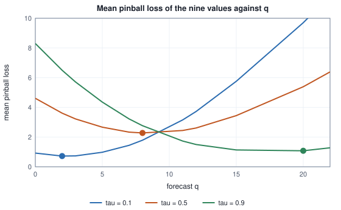

<!-- SPDX-License-Identifier: CC-BY-4.0 -->
<!-- Copyright (c) 2026 Martin Schröder <info@swedishembedded.com> -->

# Probabilistic Forecasts

*How should a forecast express what it does not know?*

A shop sells one perishable product and must place its order before the day's demand is known. An unsold unit costs $1$ to throw away; a customer sent home empty-handed costs $9$ in lost margin and goodwill. Chapter 1 supplied a forecaster for exactly this kind of number, an autoregression on seasonal differences, and the shop trusts it: its forecast of tomorrow is $14.48$. Should it order $14.48$ units?

Ordering the forecast is right only if being short and being long cost the same. Here they do not, and the order that minimises the expected cost is not the middle of the demand but a point well above it, the one demand falls below nine times in ten. To find it the shop needs to know how far demand strays from the forecast, so it takes the spread of the model's one-step training errors as that distance and puts a Gaussian of that width around the forecast. Then it tries both rules on a few hundred days it can check.

<!-- worked: probabilistic_forecasting.newsvendor -->
The 200 series of Chapter 1 (seed 0xc1ab4c4f1389c8c7 (13955331772851538119)), each cut at bar 96. For each series the forecast of bar 96 (horizon 1) is the AR(1) forecast on seasonal differences of Chapter 1, mu; the spread sigma is the root mean square of that model's 83 one-step training residuals (divisor: their number). The demand is the series' value y_96. An order q costs c_over (q - y) when q > y and c_short (y - q) when y > q. 'order mu' is q = mu; 'order the quantile' is q = mu + z_tau sigma with tau = c_short / (c_short + c_over) and z_tau the standard Gaussian quantile (library inverse cumulative distribution). Costs are averaged over the 200 series.

The first of the 200 series of Chapter 1 gives forecast mean 14.484, spread 0.881 and demand y_96 = 15.260.

| c_over | c_short | tau | z_tau | mean cost, order mu | mean cost, order the quantile |
|---|---:|---:|---:|---:|---:|
| 1 | 9 | 0.9 | +1.2816 | 2.591 | 1.534 |
| 1 | 1 | 0.5 | +0.0000 | 0.648 | 0.648 |
| 9 | 1 | 0.1 | -1.2816 | 3.887 | 1.284 |
<!-- /worked -->

For symmetric costs the two rules are the same and cost $0.648$ per day, because the quantile at level one half is the forecast itself. For the shop's real costs, ordering the forecast costs $2.591$ per day and ordering the ninetieth percentile costs $1.534$, about two fifths less, and the mirror-image shop, whose costs are $9$ for a surplus and $1$ for a shortfall, gains in the same way by ordering the tenth percentile. The point forecast was the same in all three rows. What changed was the use that was made of the information it did not carry: how likely demand is to exceed each order.

That is the case for a forecast that is more than a number, and it also hands over the right yardstick. The cost of an order $q$ against a demand $y$ is $c_{\mathrm{over}}(q - y)$ when $q$ exceeds $y$ and $c_{\mathrm{short}}(y - q)$ when it falls short, and, with $\tau = c_{\mathrm{short}}/(c_{\mathrm{short}} + c_{\mathrm{over}})$, that equals $(c_{\mathrm{short}} + c_{\mathrm{over}})$ times a single asymmetric function of $q$ and $y$ that this chapter calls the pinball loss. The cost of a wrong order is a loss function, and the loss function says which statement about the future to make. The chapter follows that thread: from a quantile to the loss that finds it, to a whole distribution trained by likelihood, to a single score for a whole distribution, to the question of whether a forecast's claims are borne out, and to what happens when the claims concern a sum of several bars.

Four ideas from earlier are needed first. Answer them from memory; the answers are at the end of the chapter.

1. (Volume I, Chapter 10, "Probability: Reasoning Under Uncertainty", probability distribution.) A random variable $Y$ has distribution function $F(x) = P(Y \le x)$. Write $P(a < Y \le b)$ in terms of $F$, and say in a sentence what it means that $q$ is the $0.9$-quantile of $Y$.
2. (Volume I, Chapter 11, "The Distributions Machine Learning Uses", the Gaussian.) If $X \sim \mathcal{N}(\mu, \sigma^2)$, which interval $\mu \pm c\,\sigma$ holds $95\%$ of the probability, and what is the probability that $X$ lies more than $1.2816\,\sigma$ above $\mu$?
3. (Volume II, Chapter 6, "Measuring Models: Metrics and Calibration", calibration.) A classifier gives probability $0.8$ to a hundred parts. How many should be defective if it is calibrated, and what does a reliability diagram plot?
4. (Chapter 1 of this volume, time series.) A forecast made at the origin $o$ may use which bars, and why does the spread of the error of an autoregressive forecast grow with the horizon?

## Quantiles, and the loss that finds them

The **quantile** of level $\tau$ of a random variable $Y$ is a value $q_\tau$ with $P(Y \le q_\tau) \ge \tau$ and $P(Y \ge q_\tau) \ge 1 - \tau$: the point below which a share $\tau$ of the probability lies. The median is $q_{0.5}$. A **quantile forecast** gives, for each bar to be forecast, the quantiles of its distribution at a chosen list of levels $\tau_1 < \tau_2 < \dots < \tau_K$, and it asserts that the outcome falls at or below the value at level $\tau_j$ with probability $\tau_j$. A band between two of its levels is a prediction interval: the quantiles at $0.1$ and $0.9$ enclose an $80\%$ interval. Where the point forecast was one column per bar, the quantile forecast is a table of $K$ columns.

How is such a table made from data? The loss of the shop already contains the answer. For a forecast $q$ of an outcome $y$ at level $\tau$, the **pinball loss** is

$$L_\tau(q, y) = \max\bigl(\tau\,(y - q),\ (\tau - 1)(y - q)\bigr),$$

which is $\tau\,(y - q)$ when the outcome is above the forecast and $(1 - \tau)(q - y)$ when it is below. An outcome above the forecast is charged $\tau$ per unit and one below it $1 - \tau$ per unit, so at $\tau = 0.9$ a shortfall costs nine times a surplus, as it did for the shop; at $\tau = 0.5$ both cost one half and the loss is half the absolute error.

```text
function pinball(q: real, y: real, tau: real) -> real:
    require 0.0 < tau and tau < 1.0, "a level is strictly between 0 and 1"
    e = y - q
    return max(tau * e, (tau - 1.0) * e)
```

Why should minimising it deliver the quantile? Take the expected loss of a fixed forecast $q$ against a random outcome $Y$ with a continuous distribution function $F$. Raising $q$ by a small amount $\mathrm{d}q$ lowers the loss on every outcome above $q$ by $\tau\,\mathrm{d}q$ and raises it on every outcome below $q$ by $(1 - \tau)\,\mathrm{d}q$, so

$$\frac{\mathrm{d}}{\mathrm{d}q}\,\mathbb{E}\bigl[L_\tau(q, Y)\bigr] = -\tau\,\bigl(1 - F(q)\bigr) + (1 - \tau)\,F(q) = F(q) - \tau.$$

The slope is negative while $F(q)$ is below $\tau$, positive once it is above, and zero at $F(q) = \tau$: the expected pinball loss is smallest at the quantile of level $\tau$. For a list of $n$ outcomes the same argument counts instead of integrating: the slope of the summed loss at a $q$ with $k$ outcomes below it is $k - n\tau$, so the minimum sits at the first outcome with $k \ge n\tau$ below it.

<!-- worked: probabilistic_forecasting.pinball_minimiser -->
The nine values y = 2, 3, 5, 7, 8, 11, 12, 15, 20. For each candidate q the table gives the mean over the nine values of max(tau (y - q), (tau - 1) (y - q)) at tau = 0.1, 0.5 and 0.9 (divisor 9).

| q | tau = 0.1 | tau = 0.5 | tau = 0.9 |
|---|---:|---:|---:|
| 2 | 0.7222 | 3.6111 | 6.5000 |
| 5 | 0.9778 | 2.6667 | 4.3556 |
| 8 | 1.7889 | 2.2778 | 2.7667 |
| 12 | 3.7222 | 2.6111 | 1.5000 |
| 15 | 5.7556 | 3.4444 | 1.1333 |
| 16 | 6.5444 | 3.8333 | 1.1222 |
| 20 | 9.7000 | 5.3889 | 1.0778 |

The sample quantile of the inverse cumulative distribution (the element at position ceil(9 tau) of the sorted list, counting from 1) is 2, 8 and 20 for tau = 0.1, 0.5, 0.9. The interpolated percentile of the pseudocode chapter (position tau (9 - 1) in the sorted list, counting from 0) is 2.8, 8.0 and 16.0.
<!-- /worked -->

Read the columns. At $\tau = 0.1$ the mean loss is smallest at $q = 2$, the smallest of the nine values; at $\tau = 0.5$ at $q = 8$, the fifth; at $\tau = 0.9$ at $q = 20$, the ninth. Each is the element at position $\lceil 9\tau \rceil$ of the sorted list, which is the sample version of the definition above. The interpolated percentile that the book's pseudocode uses, which puts $\tau = 0.9$ at $16.0$, is not a minimiser: its mean loss, $1.1222$, is higher than the $1.0778$ at $20$, a small difference that vanishes as the sample grows and is the price of a quantile that varies smoothly with $\tau$. The two conventions will both meet us later, in different code.



The curves of the figure are piecewise straight with kinks at the data, steep on the side where the outcomes are scarce and shallow where they are many. A model trained on this loss needs its slope: it is $-\tau$ where the forecast is below the outcome and $1 - \tau$ where it is above, and at the kink itself any value between the two will do, a subgradient, of which one convention takes the midpoint $\tau - 0.5$. The slope is the same constant almost everywhere, which gives it a property the squared error lacks: an outcome that is a hundred times too far away pulls the forecast no harder than one that is merely wrong, so the loss is robust to outliers in the way the median is.

## A distribution as the forecast, fitted by likelihood

A table of quantiles is one way to state a distribution; another is to name a family and say its parameters. A **head** of this kind turns whatever the model has computed about a bar into the parameters of a distribution: a mean and a spread for a Gaussian, a location, a scale and a number of degrees of freedom for a Student-t. Volume II, Chapter 4 showed what trains it. The negative logarithm of the probability the head gave to what happened, the negative log-likelihood, is the loss, and for a Gaussian with a fixed spread it reduces to the squared error. The new thing here is that the spread is learned too, and so the head can say how sure it is.

The data for this section are chosen so that the choice of family matters. They are an autoregression like the remainder of Chapter 1, $x_t = 0.7\,x_{t-1} + 0.6\,e_t$, but the shocks are not Gaussian: one bar in ten receives a shock four times the size of the rest, the occasional jolt that real series carry. The one-step forecast of $x_t$ from $x_{t-1}$ is a line $\mu = a + b\,x_{t-1}$ with a scale $\sigma$ around it. Chapter 1's discipline governs the rows: they are cut chronologically into training, validation and test blocks with one bar dropped at every seam, the gap that a horizon of one bar requires.

The Gaussian head has density $\frac{1}{\sigma\sqrt{2\pi}}\exp(-r^2/2)$ with $r = (y - \mu)/\sigma$, and its negative log-likelihood for one row is $\log\sigma + r^2/2 + \tfrac12\log 2\pi$. The Student-t head with $\nu$ degrees of freedom has the density $\frac{\Gamma((\nu+1)/2)}{\Gamma(\nu/2)\sqrt{\nu\pi}\,\sigma}\,(1 + r^2/\nu)^{-(\nu+1)/2}$, and its negative log-likelihood is

$$\log\sigma + \frac{\nu + 1}{2}\log\!\Bigl(1 + \frac{r^2}{\nu}\Bigr) + \log\Gamma\!\Bigl(\frac{\nu}{2}\Bigr) - \log\Gamma\!\Bigl(\frac{\nu + 1}{2}\Bigr) + \tfrac12\log(\nu\pi).$$

Its tails are polynomial where the Gaussian's are exponential, so a shock of ten scale units, which a Gaussian head treats as nearly impossible, costs it a few units of loss and no more. As $\nu$ grows the Student-t becomes the Gaussian.

What does fitting the Student-t head do differently? Differentiate one row's loss with respect to $r$ to get $w\,r$, with $w = (\nu + 1)/(\nu + r^2)$, and then use $\partial r/\partial\mu = -1/\sigma$ and $\partial r/\partial\log\sigma = -r$. The mean gradients of the loss with respect to $a$, $b$ and $\log\sigma$ are

$$-\frac{1}{n\sigma}\sum_i w_i r_i,\qquad -\frac{1}{n\sigma}\sum_i w_i r_i\,x_i,\qquad 1 - \frac{1}{n}\sum_i w_i r_i^2,$$

with the weight $w_i$ and standardised residual $r_i$ of row $i$. Setting them to zero says that $a$ and $b$ are the weighted least-squares line of the rows with weights $w_i$, and that $\sigma^2$ is the weighted mean square residual, $\sigma^2 = \frac1n\sum_i w_i\,\mathrm{res}_i^2$. The weights depend on the parameters, but the conditions suggest a procedure: compute the weights from the current head, refit the line and the scale by weighted least squares, and repeat. A row whose residual is many scales long gets a weight near $(\nu + 1)/r^2$, near zero, and so stops pulling the line, which is how a heavy-tailed head ignores the jolts that a Gaussian head must accommodate (the row is not discarded: its large residual still enters the scale, with a bounded weight). For the Gaussian head every weight is $1$ and the first round is already the ordinary least-squares line.

```text
function fit_head(x: array<real>[n], y: array<real>[n], nu: real, rounds: int) -> (real, real, real):
    require n >= 3 and nu > 0.0, "need rows, and a positive number of degrees of freedom"
    a = 0.0
    b = 0.0
    var = 1.0                                   # sigma squared
    for _ in 0 .. rounds:
        w = zeros(real, [n])
        for i in 0 .. n:
            r2 = (y[i] - a - b * x[i])^2 / var
            if nu == infinity:
                w[i] = 1.0
            else:
                w[i] = (nu + 1.0) / (nu + r2)
        sw = 0.0
        sx = 0.0
        sy = 0.0
        sxx = 0.0
        sxy = 0.0
        for i in 0 .. n:
            sw = sw + w[i]
            sx = sx + w[i] * x[i]
            sy = sy + w[i] * y[i]
            sxx = sxx + w[i] * x[i] * x[i]
            sxy = sxy + w[i] * x[i] * y[i]
        b = (sw * sxy - sx * sy) / (sw * sxx - sx * sx)
        a = (sy - b * sx) / sw
        var = 0.0
        for i in 0 .. n:
            var = var + w[i] * (y[i] - a - b * x[i])^2
        var = var / n
    return (a, b, sqrt(var))
```

A neural head reaches the same minimum by gradient descent on the same loss, with the same gradients; the fixed point is used here because it needs no step size and lands on the minimum to the printed digits. Which $\nu$? The gradient with respect to the number of degrees of freedom involves the digamma function, which this chapter does not need, so $\nu$ is treated as a choice: the table below fits a grid of values on the training rows and judges them on the validation rows, the data that no fit has seen.

<!-- worked: probabilistic_forecasting.head_fits -->
The data are the 2304 bars x_0 .. x_2303 of x_t = 0.7 x_(t-1) + c_t e_t with x_(-1) = 0, where c_t = 0.6 for t < 1803 and 1.2 from bar 1803 on, and the shock e_t is drawn per bar as uniform() first and then normal(), e_t = normal() when the uniform is at least 0.1 and 4 normal() when it is below. Generator: the book's SplitMix64, seed 0x432a14eb1d706842 (4839703749606795330); a normal() call that finds a held value returns it without drawing. A row is (feature x_(t-1), target x_t). Training rows are t = 1 .. 400 (400 rows), validation rows t = 402 .. 801 (400 rows); bar t = 401 is dropped between them. Each head is mu = a + b x_(t-1) with a scale sigma, the Gaussian N(mu, sigma^2) or the Student-t with the stated nu degrees of freedom, location mu and scale sigma. It is fitted on the training rows by 500 rounds of the fixed point described in the text, started from a = 0, b = 0, sigma = 1 (the stable-digits rule starts four more fits from a = +-1e-12, +-3e-12). 'NLL' is the mean over the rows of -log of the density; the last column is the largest absolute entry of the mean gradient of the NLL with respect to (a, b, log sigma) at the fitted head.

| head | a | b | sigma | training NLL | validation NLL | gradient |
|---|---:|---:|---:|---:|---:|---:|
| Gaussian | +0.036 | +0.725 | 0.839 | 1.2429 | 1.5654 | below 1e-9 |
| Student-t, nu = 2 | -0.009 | +0.714 | 0.485 | 1.1392 | 1.2341 | below 1e-9 |
| Student-t, nu = 4 | +0.004 | +0.708 | 0.564 | 1.1243 | 1.2595 | below 1e-9 |
| Student-t, nu = 6 | +0.010 | +0.707 | 0.608 | 1.1345 | 1.2947 | below 1e-9 |
| Student-t, nu = 8 | +0.015 | +0.707 | 0.638 | 1.1458 | 1.3240 | below 1e-9 |
| Student-t, nu = 12 | +0.021 | +0.708 | 0.678 | 1.1639 | 1.3670 | below 1e-9 |
| Student-t, nu = 16 | +0.024 | +0.710 | 0.704 | 1.1767 | 1.3967 | below 1e-9 |

Bars with the four-times shock, by block of target bars: training 40 of 400, validation 54 of 400, test A 96 of 1000, test B 41 of 500.

A number that comes from a chaotic run is printed with only the digits that are the same in the run and in four copies of it whose first weight is changed by +1e-12, -1e-12, +3e-12 and -3e-12: in full if all agree on it, as 'about x' with the leading digits on which all agree, or as 'unstable' when not even one digit survives; the other digits cannot be reproduced in another implementation.
<!-- /worked -->

Every gradient entry is below $10^{-9}$ at the fitted heads, which is the check that the fixed point is the minimum of the loss. The Gaussian head puts $\sigma = 0.839$ around a line of slope $0.725$, wide because one shock in ten inflates the spread it must explain. The Student-t heads have narrower scales, from $0.485$ at $\nu = 2$ to $0.704$ at $\nu = 16$, and a slope nearer to the true $0.7$ ($0.714$ at $\nu = 2$). On the training rows the best $\nu$ is $4$ (a mean loss of $1.1243$), but on the validation rows the best is $\nu = 2$ ($1.2341$ against $1.2595$ for $\nu = 4$ and $1.5654$ for the Gaussian), and the validation rows are the ones that decide. The validation losses are higher than the training losses for every head, and most for the Gaussian, because the validation block holds more jolts, $54$ of its $400$ bars against $40$ of $400$ in training (the line under the table): a loss on one block is not a prediction for another. The fits are not chaotic. They were repeated from starting values a trillionth away and every printed digit survived, which is the rule printed under the table.

## One score for a whole distribution

A head has been chosen; how good is it? The negative log-likelihood of the test rows is one answer, but it is hard on a distribution that gives a bad outcome almost no probability, and it needs a density, which a quantile table does not have. A score that works for any forecast that is a distribution function $F$ is the **continuous ranked probability score**,

$$\mathrm{CRPS}(F, y) = \int_{-\infty}^{\infty}\bigl(F(x) - \mathbf{1}_{x \ge y}\bigr)^2\,\mathrm{d}x,$$

the squared gap between the forecast's distribution function and the step function that jumps from $0$ to $1$ at the outcome $y$, which is the distribution function of a forecast that is certain and right. It is in the units of the outcome, it is zero only for a perfectly sharp and correct forecast, and for a forecast that puts all its mass on one value $\hat y$, a point forecast, it is the absolute error $|\hat y - y|$. The score of a point forecast is the mean absolute error, so a distribution and a point can be scored on one axis.

Two other forms of the same number are what make it usable. It equals $\mathbb{E}|X - y| - \tfrac12\,\mathbb{E}|X - X'|$ for two independent draws $X$ and $X'$ from $F$: the expected distance to the outcome, reduced by half the expected distance between two draws, which rewards a forecast for being sharp only as far as it is right. And it equals twice the pinball loss integrated over all levels,

$$\mathrm{CRPS}(F, y) = 2\int_0^1 L_\tau\bigl(F^{-1}(\tau), y\bigr)\,\mathrm{d}\tau,$$

where $F^{-1}(\tau)$ is the quantile of level $\tau$. The CRPS is the pinball loss averaged over every quantile the forecast could have been asked for, so a model trained on a grid of pinball losses is trained on a sampled version of the score that judges it. The integral is computed with $K$ midpoint levels $(j + 0.5)/K$:

```text
function crps_from_levels(q: array<real>[K], y: real) -> real:
    require K >= 1, "need at least one level"
    s = 0.0
    for j in 0 .. K:
        s = s + pinball(q[j], y, (j + 0.5) / K)      # q[j] is the quantile at level (j + 0.5) / K
    return 2.0 * s / K
```

<!-- worked: probabilistic_forecasting.crps_levels_check -->
CRPS of N(0, 1) at the observation r. 'closed form' is r (2 Phi(r) - 1) + 2 phi(r) - 1 / sqrt(pi) with the library error function; the other columns are 2 times the mean over the K levels (j + 0.5) / K, j = 0 .. K-1, of the pinball loss at level tau of the standard Gaussian quantile at tau (library inverse cumulative distribution).

| r | closed form | K = 9 | K = 99 | K = 999 |
|---|---:|---:|---:|---:|
| 0 | 0.233695 | 0.232550 | 0.233700 | 0.233695 |
| 1 | 0.602441 | 0.601640 | 0.602488 | 0.602441 |
| 3 | 2.436575 | 2.469814 | 2.437969 | 2.436569 |
<!-- /worked -->

For the standard Gaussian the closed form $r\,(2\Phi(r) - 1) + 2\phi(r) - 1/\sqrt{\pi}$, with $\Phi$ and $\phi$ the distribution function and density of Volume I, agrees with the quantile form: at $r = 1$ the closed form is $0.602441$ and the average over $K = 999$ levels gives the same six digits. With $9$ levels the integral is off by $0.033$ for an outcome at $r = 3$ ($2.469814$ against $2.436575$), because the outermost level, $8.5/9 = 0.944$, cannot see the tail that a point three scales away lives in: a score from a coarse grid inherits the grid's blindness to the tails.

When the forecast is a set of samples, as it is for a model that draws trajectories, the second form is the way to compute it: replace the two expectations by averages over the ensemble. There is a choice in how to average the pairs. Averaging $|X_i - X_j|$ over all $n^2$ ordered pairs includes the $n$ zero distances of a draw with itself, and averaging over the $n(n-1)$ pairs of different draws does not; the first underestimates $\mathbb{E}|X - X'|$ by the factor $(n-1)/n$, and so overstates the score by $\mathbb{E}|X - X'|/(2n)$.

<!-- worked: probabilistic_forecasting.ensemble_table -->
The CRPS of N(0, 1) at r = 0 is 0.2337. An ensemble of n draws of normal() from one generator (seed 0xb27256c8448d6221 (12858435304239751713)), the four ensembles drawn one after the other, is scored with E|X - 0| - 0.5 E|X - X'|: 'divisor n^2' averages |X - X'| over all n^2 ordered pairs, the diagonal included; 'divisor n(n-1)' leaves the diagonal out.

| n | divisor n^2 | divisor n(n-1) |
|---|---:|---:|
| 4 | 0.3027 | 0.1753 |
| 20 | 0.1835 | 0.1612 |
| 200 | 0.2290 | 0.2260 |
| 1000 | 0.2379 | 0.2373 |
<!-- /worked -->

For $\mathcal{N}(0, 1)$, whose $\mathbb{E}|X - X'|$ is $2/\sqrt{\pi} = 1.128$, the bias of the all-pairs form averages $0.564/n$: $0.14$ at $n = 4$ (the single ensemble of the table shows $0.3027 - 0.1753 = 0.127$), $0.003$ at $n = 200$ ($0.0030$ in the table) and $0.0006$ at a thousand ($0.0006$). It is a small effect for a sample of a few hundred and a large one for a handful, and worth knowing which form a score used before comparing two.

The Gaussian and Student-t heads can now be scored on rows neither has seen, the first block of the test rows, the same recipe as the training data.

<!-- worked: probabilistic_forecasting.head_scores -->
The heads of the previous table, scored on the 1000 test rows t = 803 .. 1802 (the same recipe as the training rows; the Student-t head is the grid value nu = 2 with the smallest validation NLL). 'NLL' is the mean negative log-density; 'CRPS' is the mean over the rows of sigma times the standardised CRPS (closed form for the Gaussian; for the Student-t, 2 times the mean pinball loss over the 200 levels (j + 0.5) / 200 of its quantile function, found by bisection on the finite-sum distribution function). '80 percent' and '95 percent' are the shares of rows whose target lies inside the central interval mu +- sigma q, with q the standard quantile at 0.9 and 0.975 of the head's own distribution.

| head | NLL | CRPS | inside the 80 percent interval | inside the 95 percent interval |
|---|---:|---:|---:|---:|
| Gaussian | 1.506 | 0.501 | 0.859 | 0.939 |
| Student-t, nu = 2 | 1.237 | 0.496 | 0.814 | 0.948 |
<!-- /worked -->

The two scores tell different stories, and the difference is informative. The mean negative log-likelihood separates the heads by $0.27$ ($1.506$ against $1.237$): it punishes the Gaussian head for putting almost no probability on the jolts it meets. The CRPS separates them by only $0.005$ ($0.501$ against $0.496$), because it is in units of the outcome and dominated by the many ordinary bars, where both heads are about equally accurate. Neither is wrong. They are asking different questions, one about the probability given to what happened and one about the distance between forecast and outcome, and a claim that one forecaster is better than another should name the score it was judged by.

## Calibration: do the intervals contain the truth as often as they claim?

A score summarises a forecast in one number and hides whether its claims are true. The claims of a distributional forecast are checkable. A calibrated forecast, as Volume II defined the word for probabilities of an event, is one whose stated probabilities match frequencies; for a distribution this becomes **forecast calibration**: if the forecast distribution function at each bar is $F_t$ and the outcome is $y_t$, the values $F_t(y_t)$, the **probability integral transform**, are uniformly distributed on $[0, 1]$. If the distributions are right, the outcome is as likely to fall in the lowest tenth of its own forecast as in any other tenth. Equivalently, every quantile $q_\tau$ of the forecast is exceeded by the outcome a share $1 - \tau$ of the time, and every central interval contains it as often as its nominal level says. The two views are used for different things: the histogram of the transformed values shows the shape of a calibration failure, and the coverage of an interval gives it a number.

<!-- worked: probabilistic_forecasting.pit_table -->
For each test row t = 803 .. 1802 the value u = F(y), F the head's predictive distribution function at the target (library error function for the Gaussian, the finite sum for the Student-t head with nu = 2); the table counts the u in ten equal bins (u = 1 goes into the last). A calibrated head puts 100 of 1000 rows in each bin on average, with a standard deviation of 9.5.

| bin of u | Gaussian | Student-t, nu = 2 |
|---|---:|---:|
| 0.0 .. 0.1 | 82 | 95 |
| 0.1 .. 0.2 | 90 | 115 |
| 0.2 .. 0.3 | 95 | 100 |
| 0.3 .. 0.4 | 97 | 71 |
| 0.4 .. 0.5 | 138 | 92 |
| 0.5 .. 0.6 | 137 | 91 |
| 0.6 .. 0.7 | 117 | 104 |
| 0.7 .. 0.8 | 113 | 103 |
| 0.8 .. 0.9 | 72 | 138 |
| 0.9 .. 1.0 | 59 | 91 |
<!-- /worked -->


The Gaussian head's histogram is a hump: the bins around $0.5$ hold $138$ and $137$ rows against the $100$ a calibrated head would give, and the two outer bins $82$ and $59$. Targets fall near the middle of its distribution more often than a calibrated forecast says they should, which is what a distribution that is too wide in the middle looks like, and the central intervals confirm it: its nominal $80\%$ interval holds $85.9\%$ of the targets and its $95\%$ interval holds $93.9\%$, the first too wide and the second too narrow, the pair of errors a thin-tailed head makes on heavy-tailed data. The Student-t head holds $81.4\%$ and $94.8\%$, within a standard error of both. Its histogram is not flat either, with $138$ rows in the bin $0.8$ to $0.9$ and $71$ in the bin $0.3$ to $0.4$. With a standard deviation of $9.5$ for a count of a thousand independent rows that would be alarming, but the rows are not independent: the series has memory, a jolt sits in several neighbouring rows, and the effective sample is smaller than the count. Calibration, like every evaluation of this volume, is measured on one realisation of a process, and its sampling noise is larger than an independence assumption suggests.

Calibration does not say a forecast is good. The distribution of the whole training block, the same for every bar, is calibrated on average and says nothing about tomorrow in particular. A good forecast is calibrated and as sharp, as narrow, as the data permit, which is what the proper scores of this chapter, the pinball loss, the CRPS and the log-likelihood, jointly reward: each is smallest in expectation for the true distribution, and each, applied to a calibrated but vague forecast, is larger than for a calibrated and sharp one. Calibration is what decides whether the interval can be acted on; sharpness is what makes it worth having.

## Quantile regression, and the quantiles that cross

A quantile forecast can also be fitted without choosing a family. A **quantile regression** fits, for each level $\tau$ separately, the line $q_\tau(x) = a + b\,x$ that minimises the summed pinball loss at that level. The sum of pinball losses of a line is a piecewise-linear convex function of its two coefficients, so its minimum sits at a vertex, a line that passes exactly through two of the rows; trying the line through every pair of rows and keeping the smallest loss therefore finds the exact minimiser, with no learning rate and no iteration to stop.

```text
function fit_quantile_line(x: array<real>[n], y: array<real>[n], tau: real) -> (real, real):
    require n >= 3, "need at least three rows"
    best = infinity
    best_a = 0.0
    best_b = 0.0
    for i in 0 .. n:
        for j in i + 1 .. n:
            if x[i] != x[j]:
                b = (y[j] - y[i]) / (x[j] - x[i])
                a = y[i] - b * x[i]
                loss = 0.0
                for t in 0 .. n:
                    loss = loss + pinball(a + b * x[t], y[t], tau)
                if loss < best:
                    best = loss
                    best_a = a
                    best_b = b
    return (best_a, best_b)
```

Nine such lines, one for each of the levels $0.1, 0.2, \dots, 0.9$, are fitted to a small training set, twenty-one rows, the short history of a new product, and scored on a thousand later rows.

<!-- worked: probabilistic_forecasting.quantile_regression -->
The chain of the previous section: training rows t = 1 .. 21 (21 rows), one line q_tau(x) = a + b x per level tau = 0.1, 0.2, ..., 0.9, each the line that minimises the sum of the pinball losses at its own level (found by trying the line through every pair of rows and keeping the smallest loss; no tie occurs). Scored on the 1000 test rows t = 803 .. 1802: 'share below' is the share of rows whose target is at or below the line, as it comes out of the fit and after the sorting of the nine values of each row into ascending order; 'crossings' counts the test rows at which the line of the next level lies below this one.

| tau | a | b | share below | share below, sorted | crossings with the next level |
|---|---:|---:|---:|---:|---:|
| 0.1 | -0.442 | +0.729 | 0.242 | 0.242 | 23 |
| 0.2 | -0.280 | +0.677 | 0.323 | 0.320 | 12 |
| 0.3 | -0.236 | +0.665 | 0.344 | 0.340 | 68 |
| 0.4 | +0.027 | +0.791 | 0.488 | 0.487 | 0 |
| 0.5 | +0.122 | +0.801 | 0.555 | 0.547 | 244 |
| 0.6 | +0.145 | +0.827 | 0.570 | 0.570 | 244 |
| 0.7 | +0.154 | +0.838 | 0.572 | 0.582 | 65 |
| 0.8 | +0.413 | +0.697 | 0.735 | 0.738 | 7 |
| 0.9 | +3.144 | +0.036 | 0.981 | 0.984 | - |

Test rows with at least one crossing: 309 of 1000. Mean pinball loss over the nine levels and the test rows: 0.2981 as fitted, 0.2966 after sorting; on the training rows 0.2848.

The first test row with a crossing has x = -0.903. Its nine values as fitted: -1.101, -0.891, -0.837, -0.687, -0.601, -0.602, -0.603, -0.216, 3.111; after sorting: -1.101, -0.891, -0.837, -0.687, -0.603, -0.602, -0.601, -0.216, 3.111.
<!-- /worked -->

Each line was fitted on its own, nothing told the line at $0.6$ to stay above the line at $0.5$, and from twenty-one rows the slopes are noisy: they range from $+0.036$ at $\tau = 0.9$ to $+0.838$ at $\tau = 0.7$. Where two lines cross, the model states that the median is above the sixtieth percentile. On $309$ of the $1000$ test rows at least one pair is out of order, and the first of them shows the damage: at $x = -0.903$ the median is $-0.601$, the $0.6$ quantile $-0.602$ and the $0.7$ quantile $-0.603$. Such a table cannot be a quantile function, and it can break what is built from it: a band between two crossed levels has a lower end above its upper end, and a coverage count that tests whether the outcome lies between the two ends records such a row as a miss whatever the outcome.

The standard repair is to sort the values of each row into ascending order, which for a crossing pair simply swaps the two, and it never makes the pinball loss worse. Take two levels $\tau_1 < \tau_2$ whose forecasts are out of order, $q_1 > q_2$, and any outcome $y$, and compare the summed loss as fitted, $L_{\tau_1}(q_1, y) + L_{\tau_2}(q_2, y)$, with the loss after the swap, $L_{\tau_1}(q_2, y) + L_{\tau_2}(q_1, y)$. If $y \ge q_1$ the outcome is above all four forecasts and every loss is $\tau\,(y - q)$, so the fitted sum exceeds the swapped one by $(\tau_2 - \tau_1)(q_1 - q_2)$. If $y \le q_2$ every loss is $(1 - \tau)(q - y)$ and the excess is again $(\tau_2 - \tau_1)(q_1 - q_2)$. If $q_2 < y < q_1$ the excess is $(\tau_2 - \tau_1)(q_1 - y) + (\tau_2 - \tau_1)(y - q_2)$, the same number. Whatever the outcome, sorting lowers the loss of a crossed pair by exactly $(\tau_2 - \tau_1)(q_1 - q_2)$, which is positive, and a sort of a longer row is a sequence of such swaps. The test data show it: the mean loss over nine levels and a thousand rows falls from $0.2981$ as fitted to $0.2966$ sorted, and the share of outcomes at or below the $0.7$ line moves from $0.572$ to $0.582$, nearer its nominal $0.7$. Repairing the crossing is free and has a small benefit; it is also an admission that what the model emits is not yet a distribution.

## Paths, not marginals

Everything so far has judged one bar at a time. A planner does not forecast one bar: a grid operator buys energy for the day, a shop orders for the week, and the number they need is a sum, a maximum, a time above a threshold, each a function of several bars at once. The quantile table of a bar says nothing about how its value relates to the next bar's. If the forecast stores only the distribution of each bar, the **marginals**, any such number has to be built by assuming how the bars relate, and the easy assumption, that they do not, is wrong for any series with memory.

A forecast that keeps the relation is a set of **sample paths**: each sample is a whole trajectory of the horizon, drawn bar after bar so that each bar follows from the previous one, and a statistic of several bars is computed on each trajectory and then summarised over the set. The chapter's autoregressive remainder, $u_t = 0.7\,u_{t-1} + 0.6\,e_t$, can be sampled both ways, and its exact distribution is known, because every bar is Gaussian and the covariance of two bars of the horizon is a closed form. The sum over twelve bars is what is wanted.

<!-- worked: probabilistic_forecasting.paths_vs_marginals -->
The remainder of Chapter 1, u_t = 0.7 u_(t-1) + 0.6 e_t, observed at u_(-1) = 1.5 just before the origin; the 12 bars after it. Forecast of bar h (h = 0 .. 11): Gaussian with mean m_h = 1.5 0.7^(h+1) and variance v_h = 0.36 (1 - 0.49^(h+1)) / (1 - 0.49). 'sample paths': 4000 paths, each drawing its 12 shocks in order from one generator (seed 0x7c6742ba7aef946f (8964206951998133359)), u_h = 0.7 u_(h-1) + 0.6 normal(), and summing the 12 values. 'independent marginals': 4000 samples, each the sum over h of m_h + sqrt(v_h) normal() with the normal() calls in the order h = 0 .. 11 from a second generator (seed 0xe490deb5388c2c6e (16469908707213061230)). The sample standard deviation has divisor 4000 - 1; the 5 and 95 percent values are the interpolated percentile of the pseudocode chapter. The last column is the probability that the sum exceeds 12. 'exact' is the Gaussian with the mean sum_h m_h and the variance sum_(i,j) Cov(u_i, u_j) of the exact covariance 0.36 (1 - 0.49^(min(i,j)+1)) / (1 - 0.49) * 0.7^|i-j|.

| method | mean of the sum | sd of the sum | 5 percent | 95 percent | P(sum > 12) |
|---|---:|---:|---:|---:|---:|
| exact (Gaussian) | 3.452 | 5.782 | -6.059 | 12.962 | 0.0697 |
| sample paths | 3.434 | 5.723 | -5.981 | 12.954 | 0.0698 |
| independent marginals | 3.452 | 2.830 | -1.271 | 8.154 | 0.0013 |

The sum of the 12 variances v_h alone, which is the variance of the sum if the bars were independent, is 7.793 (standard deviation 2.792); the exact variance of the sum is 33.434 (standard deviation 5.782).
<!-- /worked -->

The marginals agree: every bar has the same mean and variance in both samples, and the table's mean of the sum, $3.452$, is the same in the exact and in the independent row. But the spread of the sum is not: the exact standard deviation is $5.782$ and the paths estimate it at $5.723$, while the independent marginals give $2.830$, less than half. The variance of the sum is the sum of all the entries of the covariance matrix of the twelve bars, and the independent version keeps only the diagonal: $7.793$ against the exact $33.434$, because neighbouring bars of this series are positively correlated and the sum of correlated bars varies far more than the sum of independent ones. The consequence for a decision is large. The probability that the twelve-bar total exceeds $12$ is $0.0697$ by the exact calculation and $0.0698$ along paths, and $0.0013$ for independently sampled bars, about fifty times too small: the plan built on it would call an event of one chance in fourteen an event of one chance in about $770$.


Sample paths are not free: each costs a draw per bar and the plan must trust the model's dependence between bars, where a quantile table costs one row per bar. A forecast stated as quantiles can be turned into samples, and the way of doing it matters, because the usual way discards the relation between bars. The usual way draws a uniform number $u$ and reads off the forecast's quantile function at $u$, interpolating between the quantile levels it has and holding the value flat beyond the first and last. Drawn afresh for every bar of every sample, it is the independent-marginals row of the table. It has a second problem even for a single bar: it piles up mass at the ends.

<!-- worked: probabilistic_forecasting.derived_samples -->
The quantile levels of the grid, with the exact standard Gaussian quantiles as values, are turned into 2000 samples by the piecewise-linear inverse cumulative distribution that is flat outside the first and last level (the value at the first level for u at or below it, the value at the last level for u at or above it). The uniforms u_1 .. u_2000 are drawn in order by uniform() from one generator (seed 0x5e396018dc38f4b9 (6789563573127935161)) and the same u are used for all three grids. The grids are 0.1, 0.5, 0.9; 0.1, 0.2, ..., 0.9; and 0.01, 0.05, 0.10, 0.15, ..., 0.90, 0.95, 0.99. Each column scores the ensemble with E|X - r| - 0.5 E|X - X'| (average over the n(n-1) pairs of different draws, evaluated on the sorted ensemble) at the observation r; the first column is the CRPS of N(0, 1).

| observation r | CRPS of N(0, 1) | from 3 levels | from 9 levels | from 21 levels |
|---|---:|---:|---:|---:|
| 0 | 0.2337 | 0.2634 | 0.2291 | 0.2323 |
| 1 | 0.6024 | 0.6056 | 0.6244 | 0.6297 |
| 2 | 1.4528 | 1.5325 | 1.5580 | 1.4888 |
| 3 | 2.4366 | 2.5325 | 2.5580 | 2.4776 |

Share of the samples that sit exactly on the first or last quantile value: 0.181 for the 3-level grid, 0.181 for the 9-level grid and 0.015 for the 21-level grid.
<!-- /worked -->

When the grid is the three levels $0.1, 0.5, 0.9$, a fifth of the samples, $18.1\%$ of this ensemble, sit exactly on the first or last quantile value, and any observation in the tail is scored as if the forecast could not reach it: the CRPS at $r = 3$ comes out as $2.5325$ where the true distribution scores $2.4366$. A $21$-level grid with levels down to $0.01$ and up to $0.99$ puts only $1.5\%$ of the samples on the ends and brings the score at $r = 3$ to $2.4776$. A forecast that is native in quantiles and is turned into samples keeps its marginals roughly and loses its paths entirely, which is why brain marks such samples as derived, as the last section describes.

## Prediction intervals at every horizon, and conformal calibration

A **prediction interval** at level $1 - \alpha$ is a pair of bounds that should contain the outcome with probability $1 - \alpha$: for $\alpha = 0.2$ the quantiles at $0.1$ and $0.9$, or a band around a point forecast. Chapter 1's autoregression on seasonal differences gives the point forecast of a bar; what width should the band have, and does the width depend on how far ahead the bar is? Three answers can be tried on the same many series: the training spread of one-step errors at every horizon, the spread that the fitted model itself implies at each horizon, and a width read from the errors of forecasts at that horizon on other series.

The second needs the algebra of the model's errors. If the difference $z$ follows an AR($1$) with coefficient $\phi$, the error of the forecast of $z$ at step $k$ after the origin is $\sum_{j \le k} \phi^{k-j} e_j$, a sum of the future shocks weighted by powers of $\phi$ whose variance grows with $k$ and settles; the forecast of $y$ adds the forecast of $z$ to the value one season earlier, which is itself a forecast once the horizon passes twelve bars, so the error of $y$ at step $h$ is the sum of the errors of $z$ at $h$, $h - 12$, and so on. The third is the **conformal** idea, in its simplest form: set aside $n$ cases that the model did not train on, record the absolute error of its point forecast on each, and use as the half-width of the band the $k$-th smallest of the $n$ errors with $k = \lceil (n + 1)(1 - \alpha) \rceil$. A new case that is exchangeable with the $n$ set-aside ones, equally likely to be any rank among them, has an error that lands at or below the $k$-th smallest with probability exactly $k/(n+1)$, which is at least $1 - \alpha$, whatever the distribution of the errors and whatever the model.

```text
function conformal_halfwidth(scores: array<real>[n], alpha: real) -> real:
    require n >= 1 and 0.0 < alpha and alpha < 1.0, "need scores and a level"
    k = ceil((n + 1) * (1.0 - alpha))
    require k <= n, "too few calibration scores for this level"
    return sort(scores)[k - 1]
```

<!-- worked: probabilistic_forecasting.interval_coverage -->
1000 series drawn by the recipe of Chapter 1 from one generator (seed 0x66eba1c936238a39 (7416199096964450873)), each with its 120 draws in turn, cut at 96. The point forecast is the AR(1) forecast on seasonal differences of Chapter 1; sigma is the root mean square of the 83 one-step training residuals. 'constant' is the interval point +- 1.2816 sigma at every horizon; 'growing' uses the standard deviation sigma_h of the forecast error of the fitted model, sigma times the root of the sum of squared weights w_j of the shocks e_0 .. e_h in the error, where the error of the difference z at step k is sum_(j<=k) phi^(k-j) e_j with the fitted phi, and the error of y at horizon h + 1 is the sum of the errors of z at steps h, h - 12, h - 24, ... (those that are not negative). 'conformal' uses, at each horizon, the half-width that is the k-th smallest of the absolute errors |y - point| of 1000 other series (the same recipe, from a second generator, seed 0xc9eba5fa8868ea10 (14549905516599503376)), with k = ceil((n + 1)(1 - alpha)) = 801 for n = 1000 and alpha = 0.2. 'constant' and 'growing' use the standard Gaussian quantile 1.2816 at 0.9. All three intervals are nominally 80 percent. The first table gives the share of the 1000 series whose value lies inside the interval at the horizon h (1 = bar 96); the second the mean width of the whole interval.

| horizon h | inside, constant | inside, growing | inside, conformal |
|---|---:|---:|---:|
| 1 | 0.782 | 0.782 | 0.791 |
| 2 | 0.692 | 0.782 | 0.818 |
| 3 | 0.661 | 0.787 | 0.815 |
| 6 | 0.639 | 0.790 | 0.821 |
| 12 | 0.631 | 0.778 | 0.793 |
| 13 | 0.617 | 0.857 | 0.788 |
| 18 | 0.604 | 0.910 | 0.824 |
| 24 | 0.598 | 0.898 | 0.793 |

| horizon h | width, constant | width, growing | width, conformal |
|---|---:|---:|---:|
| 1 | 2.15 | 2.15 | 2.20 |
| 2 | 2.15 | 2.60 | 2.77 |
| 3 | 2.15 | 2.79 | 2.91 |
| 6 | 2.15 | 2.96 | 3.16 |
| 12 | 2.15 | 3.00 | 3.07 |
| 13 | 2.15 | 3.72 | 3.12 |
| 18 | 2.15 | 4.26 | 3.34 |
| 24 | 2.15 | 4.29 | 3.24 |

Over all 24 horizons and 1000 series the shares inside are 0.626 (constant), 0.836 (growing) and 0.809 (conformal). The standard error of a share of 1000 series near 0.8 is 0.013.
<!-- /worked -->


The constant band, one training spread at every horizon, is right at the first bar ($0.782$ against the nominal $0.8$, within a standard error of $0.013$) and then loses ground as the forecast's own uncertainty outgrows it, down to $0.598$ at the twenty-fourth: it claims $80\%$ and delivers $60\%$. The growing band follows the model, and for twelve bars it is the right shape ($0.790$ at horizon $6$). At the thirteenth bar its coverage jumps to $0.857$ and rises past $0.9$. This is the model's mistake showing through. The forecast of $y$ at the thirteenth bar adds a forecast difference to the forecast of the first bar, and the model's algebra adds their errors as if they were independent. They are not: the seasonal difference $z_t = u_t - u_{t-12}$ shares the term $u_{t-12}$, with opposite signs, with $z_{t-12}$, which is the $-0.41$ at lag $12$ that Chapter 1 pointed out as the trace of differencing and an AR($1$) cannot represent. Added, the two differences telescope to $u_t - u_{t-24}$, whose variance is twice that of the remainder, where the model counts four times. A band derived from a wrong error model is wrong in a pattern that is not visible in its first twelve bars. The conformal band sets its widths at each horizon from the errors themselves, wider at the sixth bar ($3.16$ against the growing band's $2.96$) and narrower at the eighteenth ($3.34$ against $4.26$), and it holds near $0.8$ at every horizon, $0.809$ over all twenty-four. It needed a thousand other series from the same recipe to do it.

What does exchangeability ask, and when does it fail? The guarantee is exact and holds for any distribution, which the next table checks with scores drawn as the absolute values of Gaussian numbers, so that the right answer is known.

<!-- worked: probabilistic_forecasting.conformal_finite -->
Calibration scores s_1 .. s_n and one new score are drawn independently as |normal()| from one generator (seed 0xf849d3fc31b8ab71 (17891064074825411441)); in each of 20000 trials the draws are the n calibration scores in order and then the new one, and the new score is 'covered' when it is at most the k-th smallest calibration score (k counted from 1). Nominal level 1 - alpha = 0.9. Exact coverage is k / (n + 1) whatever the distribution (continuous, so no ties).

| n | rule for k | k | exact k / (n + 1) | covered in 20000 trials |
|---|---:|---:|---:|---:|
| 14 | ceil((n + 1)(1 - alpha)) | 14 | 0.9333 | 0.9334 |
| 14 | ceil(n (1 - alpha)) | 13 | 0.8667 | 0.8622 |
| 19 | ceil((n + 1)(1 - alpha)) | 18 | 0.9000 | 0.8985 |
| 99 | ceil((n + 1)(1 - alpha)) | 90 | 0.9000 | 0.8988 |
<!-- /worked -->

The coverage is $k/(n+1)$ and no more is promised: with $n = 14$ and $\alpha = 0.1$ the rank is $14$, the largest score, and the coverage is $0.9333$, which the trials reproduce to $0.9334$. The shortcut $k = \lceil n(1 - \alpha) \rceil = 13$ looks equally reasonable and gives $13/15 = 0.8667$, below the nominal level, as the trials confirm ($0.8622$). For $n = 19$ the corrected rank is $18$ and the coverage is exactly $0.9$. Arithmetic on the rank deserves care: $(n + 1)(1 - \alpha)$ for $n = 19$ and $\alpha = 0.1$ is exactly $18$, but a binary product such as $20 \times 0.9$ can come out a rounding step above $18$, and its ceiling is $19$.

The guarantee is about exchangeable cases, and a series is a sequence in which the next case is not exchangeable with the last. The last table applies the single-series version of the recipe, with the calibration errors taken from the validation rows of the Student-t head, to two test blocks: one from the same process and one after the shock coefficient doubles.

<!-- worked: probabilistic_forecasting.conformal_shift -->
The Student-t head (nu = 2) of the earlier table. Calibration scores are the absolute errors |y - mu| of its mean forecast mu = a + b x on the 400 validation rows t = 402 .. 801; with n = 400 and alpha = 0.2 the rank is k = ceil((n + 1)(1 - alpha)) = 321 and the half-width is the k-th smallest score, 0.908. Test A is the 1000 rows t = 803 .. 1802 of the same recipe; test B is the 500 rows t = 1804 .. 2303, after the shock coefficient doubles from 0.6 to 1.2 at bar 1803. The width is of the whole interval; the last two columns are the share of rows inside it.

| interval | width | inside, test A | inside, test B |
|---|---:|---:|---:|
| conformal around the Student-t mean | 1.815 | 0.810 | 0.522 |
| Student-t head, central 80 percent | 1.829 | 0.814 | 0.522 |
| Gaussian head, central 80 percent | 2.149 | 0.859 | 0.590 |
<!-- /worked -->

On the test block from the same process the conformal band, $1.815$ wide, holds $81.0\%$ of the targets, as promised for the nominal $80\%$, and the Student-t head's own $80\%$ interval, $1.829$ wide, holds $81.4\%$; the Gaussian head, $2.149$ wide, holds $85.9\%$ and is the least sharp of the three. After the shift the two narrow bands hold $52.2\%$ and the Gaussian's $59.0\%$: all three are wrong, because the errors they were calibrated on belong to a process that no longer exists. The conformal guarantee is not broken; its assumption is. No method of this chapter calibrates a forecast against a world that changes, which is why a forecaster's coverage is measured again as time passes, the subject of the chapter on honest evaluation.

## How brain states, derives and scores a forecast

The domain types of brain's forecasting API live in `crates/forecast`, a crate that holds no model: it defines what a forecast request and a forecast are, so that every model, the pretrained ones of the next chapter and the statistical baselines of `crates/fcbench/src/baselines.rs`, answers in the same vocabulary. The vocabulary is the one of this chapter. `Representation` names five ways a forecast can be stated (quantiles, samples, parameters of a distribution, a point path, class probabilities), each with its shape, and `TargetForecast` carries whichever the model emitted. The subsystem arrived with commit `5ce448795` (21 July 2026), together with the leak-safe windowing of Chapter 1.

Its most opinionated piece is `crates/forecast/src/convert.rs`, the honesty layer. A caller may ask for a representation the model did not emit, and the module derives it only where that is sound: empirical quantiles and the mean from samples are exact, quantiles and the mean from the parameters of a Gaussian are exact, and samples from quantiles are interpolated and lossy. Every block it derives carries `derived = true` and the name of the method (`empirical_quantiles`, `gaussian_ppf`, `inverse_cdf_interp`, and so on), so that a caller can refuse to size a position off a sample set that is really an interpolation of five quantiles. A point forecast asked for quantiles is an error: `point_to_quantiles_is_an_error_not_a_fabricated_interval` is the test, and it states the principle of the first section in a line, that a forecast with no stated uncertainty cannot be given a zero-width interval and called a distribution.

The code confirms the two caveats this chapter found about derived samples. In `quantiles_to_samples` and `gaussian_to_samples` the draw of the uniform number sits inside the loop over both the sample and the bar, a fresh $u$ for every bar of every sample, so the derived paths are independent across the horizon, which is the independent-marginals row of the table above. Both outer-level behaviours are in the doc comments, the flat tails ("lossy") and the clipping of `norm_ppf` to $[10^{-6}, 1 - 10^{-6}]$, which caps a derived Gaussian sample at about $4.75$ standard deviations. The `derived` flag and the method name say how a block was made; neither says that the dependence between bars is gone, and a caller that sums derived samples over the horizon will get the wrong spread without a warning.

`crates/forecast/src/metrics.rs` holds the scores. `pinball` and `mean_pinball` are the loss of the first section, averaged over the horizon and the quantile grid; `crps_gaussian` is the closed form, with the error function from a rational approximation accurate to about $1.5 \times 10^{-7}$, plenty for single precision; `crps_ensemble` is the pair-average form and divides the sum of pairs by $n^2$, so it carries the upward bias of the all-pairs form computed above, about $0.564/n$ for a standard Gaussian, $0.003$ at the $200$ samples the benchmark harness asks for; `coverage` counts outcomes inside inclusive bounds. The gradient of the loss has its own history. Commit `9cd5f9edf` (22 July 2026) added `pinball_grad` and `mean_pinball_grad`, the slopes $-\tau$ and $1 - \tau$ with the midpoint subgradient at the kink, for the Chronos-2 backward pass, with tests that compare both against central finite differences. They are the loss of three trainers now: `crates/chronos2/src/train.rs`, `crates/fincast/src/train.rs`, which adds a squared error on the mean, and the fine-tuning of `crates/timesfm3/src/finetune.rs`, which scores a forecast in original units with the pinball loss, maps the gradient back through the same affine map and promotes the fine-tuned weights only if a finite held-out loss is lower than the base model's (`promoted` in `crates/forecast/src/finetune.rs`, a tie is not an improvement).

A story from the same period shows why a distribution needs scoring that sees spread. Commit `74f5dc132` (18 August 2026) changed `brain forecast predict` to default its context to the model's window minus the horizon, because a longer context made the cached rollout slide its attention window mid-way; the commit message adds that this is a bias in the spread of the sampled cloud, not only a loss of bit-exactness, which the parity checks that compare greedy decodes could not see. The code confirms the default (`exact_context`, with a warning when the user asks for more) and that the command now reports, per origin, the mean absolute error, the CRPS, the pinball loss and the coverage of the band beside persistence, drift and seasonal-naive baselines. The numbers in the message are one setup on one day and are not repeated here; the lesson is that a point error cannot detect a distribution that is the wrong width.

Quantile crossing has its own commit. TimesFM-3's output head has no monotonicity constraint, and its adapter sorts each row of quantiles before interpolating to the requested levels, introduced in commit `5a3c6e9d1` (1 September 2026); the same commit message records that its first version sorted only the first horizon rows of a multi-variate buffer, leaving every variate after the first unsorted, and that the wiring test caught it. The module comment now says so too.

Five things in these files did not say or do what they should, found while reading them for this chapter and checked against the code; two were real and are fixed. In `crates/cli/src/forecast_cli.rs` the `crps` column of `brain forecast predict` was computed from the sample ensemble when the model emitted samples and was otherwise the absolute error of the median path, while the doc comment called it the CRPS of the whole predicted distribution and the summary line a "CRPS reduction"; the command asks for quantiles and a point path and no samples, so for TimesFM-3 the column was a mean absolute error. Commit `bf49665ce` reads the CRPS off the quantile grid instead when there is one, as twice the mean pinball loss over the levels, the midpoint estimate of the integral of this chapter, with a test against the exact Gaussian CRPS. And the module comments of the Chronos-2 and FinCast adapters said their quantiles were monotone in level while only the TimesFM-3 adapter sorted them; commit `37aa86988` moved that sort into `forecast::convert` and made all three adapters use it, and corrected the Chronos-2 comment that still described a univariate first phase. Three remain as notes. In `crates/forecast/src/metrics.rs`, `weighted_quantile_loss` sums the pinball loss over every level of the grid before normalising, so its value grows with the number of levels (it is three times the level-average at the three levels `crates/fcbench` uses), which matters when two grids are compared; with one level it is the normalised absolute error, which is what its test checks. `crps_ensemble` divides its pair sum by $n^2$, which biases the score up by about $E|X - X'|/(2n)$. And `convert.rs` marks derived samples as derived without saying that the dependence between bars is gone.

## Check your understanding

1. A shop's costs are $c_{\mathrm{short}} = 3$ and $c_{\mathrm{over}} = 1$ per unit. Which quantile of demand should it order, and what would ordering the median cost relative to ordering the right quantile if demand were uniform on $0$ to $100$?
2. A quantile forecast has levels $0.1$ and $0.9$ and the outcomes fall below the $0.9$ value in $95\%$ of cases and below the $0.1$ value in $2\%$. Is the interval $[q_{0.1}, q_{0.9}]$ an $80\%$ interval? What does the data say about its width and its calibration at each end?
3. Find the error: "Model A's CRPS is $0.50$ and model B's is $0.49$, so B is better calibrated."
4. Two forecasters report the same mean absolute error. One reports a CRPS of $0.8$ times that error, the other a CRPS equal to it. What does each say about its distribution?
5. A planner sums a forecast over a week by summing each day's $95\%$ upper quantile and calls the result the $95\%$ upper quantile of the weekly total. For Gaussian days, when is this exactly right, when is it too high, and what should have been done?
6. A conformal interval is calibrated on a year of daily errors and covers $90\%$ of the next month, and then $70\%$ of the month after a change of regime. Has the method failed?
7. The $0.5$ line of a quantile regression lies above the $0.6$ line in part of the data. A colleague proposes dropping the $0.6$ level. What is lost, and what is the better repair?
8. Why does the Student-t head's fixed point give a row with a very large residual almost no say in the line, and why is that not the same as discarding the row?

## Summary

A forecast that is a number cannot serve a decision whose costs are asymmetric: the shop that orders the point forecast pays $2.591$ a day where one that orders the ninetieth percentile pays $1.534$. The cost of an order is the pinball loss up to a constant, and the pinball loss is minimised by the quantile of its level, so a model trained on it learns exactly the statement the decision needs. A forecast can instead be a family, a Gaussian or a Student-t head fitted by likelihood, and then the family matters: on data with occasional large shocks the Student-t head is better calibrated and scores $0.27$ better in mean log-likelihood, though only $0.005$ better in CRPS.

The CRPS scores any distribution in the units of the outcome, equals the mean absolute error for a point and twice the pinball loss averaged over levels for a forecast known by its quantiles, and computes from samples with a bias that depends on how pairs are averaged. Calibration, read from the probability integral transform and the coverage of intervals, says whether the claims of a forecast are borne out, and is separate from sharpness. Independently fitted quantiles can cross, and sorting them repairs the table at no cost. Sums and other functionals over a horizon need sample paths, because marginal quantiles discard the dependence between bars, and here that was a factor of two in the spread of a twelve-bar sum and fifty in the probability of an exceedance. Intervals need to widen with the horizon in the way the process does, and a conformal calibration set can supply that width at each horizon with a guarantee that holds only while the cases stay exchangeable.

Everything here judges forecasters on data that look like their training data. The next chapter turns to models pretrained on enormous collections of series, which emit exactly the quantile tables of this chapter for series they have never seen, and asks how a series is cut into the patches or tokens they read.

## References

- R. Koenker and G. Bassett, "Regression quantiles", Econometrica, 1978.
- T. Gneiting and A. E. Raftery, "Strictly proper scoring rules, prediction, and estimation", Journal of the American Statistical Association, 2007.
- T. Gneiting, F. Balabdaoui and A. E. Raftery, "Probabilistic forecasts, calibration and sharpness", Journal of the Royal Statistical Society, Series B, 2007.
- V. Chernozhukov, I. Fernandez-Val and A. Galichon, "Quantile and probability curves without crossing", Econometrica, 2010.
- V. Vovk, A. Gammerman and G. Shafer, "Algorithmic Learning in a Random World", 2005 (conformal prediction).
- K. L. Lange, R. J. A. Little and J. M. G. Taylor, "Robust statistical modeling using the t distribution", Journal of the American Statistical Association, 1989.

## Exercises

1. **[Calculate]** For the values $1, 4, 6, 10$ and $\tau = 0.75$ compute the mean pinball loss at $q = 4$, $q = 6$ and $q = 10$ and say which $q$ in the list minimises it. Then give $\lceil n\tau \rceil$ and the element it picks, and the interpolated percentile at position $\tau(n - 1)$.
2. **[Calculate]** A shop has $c_{\mathrm{over}} = 2$ and $c_{\mathrm{short}} = 6$ and a forecast $\mathcal{N}(40, 5^2)$ of demand. Give $\tau$, the best order using $\Phi^{-1}(0.75) = 0.6745$, and the pinball loss of that order against the demands $38$ and $47$, and the cost in the shop's own units.
3. **[Calculate]** Show that for $\tau = 0.5$ the pinball loss is half the absolute error and that its minimiser over a list of an even number of values is any point between the two middle values.
4. **[Calculate]** For the forecast $\mathcal{N}(0, 1)$ and the outcome $y = 1$, evaluate the closed form of the CRPS with $\Phi(1) = 0.841345$ and $\phi(1) = 0.241971$. Then give the CRPS of the ensemble $\{0, 2\}$ at $y = 1$ with both pair conventions.
5. **[Calculate]** Two quantiles are out of order for one row: $q_{0.4} = 10$ and $q_{0.6} = 8$, and the outcome is $9$. Compute the pinball losses before and after sorting and show that sorting lowers the sum.
6. **[Calculate]** A conformal calibration set has the sorted absolute errors $0.2, 0.3, 0.5, 0.6, 0.9, 1.1, 1.4, 1.8, 2.5$. For $\alpha = 0.2$ and for $\alpha = 0.1$ give $k$ and the half-width, or say that the set is too small.
7. **[Calculate]** For the autoregression $u_t = 0.7\,u_{t-1} + 0.6\,e_t$ observed at $u = 1.5$, give the mean and the variance of the forecast of the second bar after the origin, and the covariance of the first and second bars.
8. **[Implement]** Reproduce `probabilistic_forecasting.newsvendor` and `probabilistic_forecasting.pinball_minimiser` from the seeds, the series of Chapter 1 and the rules the blocks print.
9. **[Implement]** Reproduce `probabilistic_forecasting.head_fits` and `probabilistic_forecasting.head_scores`: the generator and its draw order, the fixed-point fit of Gaussian and Student-t heads, and the scores, with the finite-sum distribution function of the Student-t. Check that the gradients are below $10^{-9}$.
10. **[Implement]** Reproduce `probabilistic_forecasting.quantile_regression`: the pair enumeration, the crossing count and the sorted loss.
11. **[Implement]** Reproduce `probabilistic_forecasting.paths_vs_marginals` and `probabilistic_forecasting.interval_coverage`, including the conformal half-width at each horizon.
12. **[Investigate]** The baselines of `crates/fcbench/src/baselines.rs` give the seasonal-naive forecast a spread that is the standard deviation of the seasonal differences times the square root of the number of completed seasons. Apply that spread to the chapter's series and compare the coverage at horizons $1$, $12$, $13$ and $24$ with the table of `probabilistic_forecasting.interval_coverage`. Which of the table's three intervals does it resemble, and why?

## Key terms

- **quantile forecast**: a forecast stated as the values at which the outcome is claimed to fall at or below with a list of stated probabilities, one column per level and one row per bar. <!-- concept: quantile-forecast -->
- **pinball loss**: the asymmetric loss $\max(\tau(y - q), (\tau - 1)(y - q))$ of a forecast $q$ at level $\tau$, which charges $\tau$ per unit of shortfall and $1 - \tau$ per unit of excess and whose expected value is smallest at the quantile of level $\tau$. <!-- concept: pinball-loss -->
- **continuous ranked probability score**: the integral of the squared gap between a forecast's distribution function and the step at the outcome, in the units of the outcome, which equals the absolute error for a point forecast and twice the pinball loss averaged over all levels. <!-- concept: continuous-ranked-probability-score -->
- **forecast calibration**: the property that the probability integral transform of the outcomes under the forecast distributions is uniform, so that each quantile is exceeded and each interval covers as often as it claims. <!-- concept: forecast-calibration -->

## Answers

**Recall questions.**

1. $P(a < Y \le b) = F(b) - F(a)$. That $q$ is the $0.9$-quantile means that $F(q) = 0.9$ (for a continuous $Y$): nine times in ten $Y$ is at or below $q$.
2. The interval $\mu \pm 1.96\,\sigma$ (to two decimals; $1.959964$ exactly) holds $95\%$. The probability that $X$ exceeds $\mu + 1.2816\,\sigma$ is $0.1$, since $\Phi(1.2816) = 0.9$.
3. About eighty of the hundred should be positive, that is defective. A reliability diagram groups the predictions into bins and plots, for each bin, the observed share of positives against the mean prediction, so a calibrated model lies on the diagonal.
4. Only bars $y_0, \dots, y_{o-1}$, those before the origin. The error of an autoregressive forecast grows because each bar further ahead has more unseen shocks between it and the last known value, each carried forward with a geometrically decaying weight, so the variance rises from the one-shock variance at the first bar towards the stationary variance of the series.

**Check your understanding.**

1. $\tau = 3/(3 + 1) = 0.75$, so the $0.75$-quantile, which is $75$ for demand uniform on $0$ to $100$. The expected cost of an order $q$ is $3\,(100 - q)^2/200 + q^2/200$: at $q = 75$ it is $(1875 + 5625)/200 = 37.5$ and at the median $q = 50$ it is $(7500 + 2500)/200 = 50$, a third more.
2. No. It contains $95\% - 2\% = 93\%$ of the outcomes where it claims $80\%$, so it is too wide. The upper end is too high ($95\%$ of outcomes are below it where $90\%$ should be) and the lower end is too low ($2\%$ below where $10\%$ should be), and the lower end is the further off, by $8$ points against $5$.
3. The CRPS scores accuracy and sharpness together and says nothing separately about calibration, and a difference of $0.01$ in a mean score from one sample need not exceed its sampling noise. Calibration is read from the probability integral transform or from the coverage of intervals.
4. A CRPS of $0.8$ times the error says that the spread of the first forecaster's distribution earned it a fifth off the score of a point at the median. A CRPS equal to the error says that the second one's stated uncertainty added nothing on this score: a distribution that is a point mass scores exactly its error.
5. Exactly right only when the days are perfectly correlated, where the quantile of the sum is the sum of the quantiles. For Gaussian days that are less than perfectly correlated the total varies less than the sum of the per-day bands implies, so the sum of the upper quantiles is too high, and the more independent the days the higher it is. The weekly quantile should be taken from sample paths summed over the week, or from the exact variance of the sum.
6. Not necessarily. The guarantee is for exchangeable cases and the month after the change of regime is not exchangeable with the calibration year; the method did what it promises under its assumption, and the drop is the signal that the assumption failed. The remedy is to recalibrate on recent errors, which gives a different and weaker guarantee.
7. Dropping the $0.6$ level loses a point of the forecast's distribution and leaves the other crossings in place. The better repair is to sort each row's values, which keeps every level and lowers the pinball loss of a crossed pair by $(\tau_2 - \tau_1)(q_1 - q_2)$, or to fit the levels jointly under a constraint that keeps them in order.
8. At the fixed point the weight of a row is $(\nu + 1)/(\nu + r^2)$, which falls like $1/r^2$ for a large standardised residual $r$, so the row's contribution $w\,r$ to the weighted sums is bounded instead of growing with $r$. The row is not discarded: its weighted square residual $w\,r^2$ tends to $\nu + 1$, a bounded amount that still enters the scale, so a jolt widens the head modestly where a Gaussian head would let it dominate.

**Exercises.**

1. At $\tau = 0.75$ the mean pinball losses are $1.6875$ at $q = 4$, $1.1875$ at $q = 6$ and $1.1875$ at $q = 10$ (at $q = 4$: $0.75, 0, 1.5, 4.5$; at $q = 6$: $1.25, 0.5, 0, 3$; at $q = 10$: $2.25, 1.5, 1, 0$). Both $6$ and $10$ minimise it, and so does every point between them, because $n\tau = 3$ is a whole number and the slope $k - n\tau$ is zero while exactly three values are below $q$. $\lceil n\tau \rceil = 3$ picks the third element, $6$, and the interpolated percentile at position $0.75 \times 3 = 2.25$ is $6 + 0.25 \times 4 = 7$, inside the flat stretch.
2. $\tau = 6/(6 + 2) = 0.75$ and the order is $40 + 0.6745 \times 5 = 43.3725$. Against $y = 38$ the pinball loss is $0.25 \times 5.3725 = 1.3431$ and the cost $8 \times 1.3431 = 10.745$ ($= 2 \times 5.3725$, the surplus times its cost); against $y = 47$ it is $0.75 \times 3.6275 = 2.7206$ and the cost $21.765$ ($= 6 \times 3.6275$).
3. $L_{0.5}(q, y) = \max(0.5\,(y - q), -0.5\,(y - q)) = 0.5\,|y - q|$. The slope of the summed loss at a $q$ with $k$ of $n$ values below it is $k - n/2$, zero exactly when $k = n/2$, that is for every $q$ between the two middle values of an even-length list.
4. $r\,(2\Phi(r) - 1) + 2\phi(r) - 1/\sqrt{\pi}$ at $r = 1$ is $0.68269 + 0.48388 - 0.56419 = 0.60244$. For $\{0, 2\}$ at $y = 1$: $\mathbb{E}|X - y| = 1$; the all-pairs form gives $\mathbb{E}|X - X'| = (0 + 2 + 2 + 0)/4 = 1$ and a score of $1 - 0.5 = 0.5$; the pairs of different draws give $(2 + 2)/2 = 2$ and a score of $1 - 1 = 0$.
5. Before sorting: $L_{0.4}(10, 9) = 0.6 \times 1 = 0.6$ and $L_{0.6}(8, 9) = 0.6 \times 1 = 0.6$, a sum of $1.2$. After: $L_{0.4}(8, 9) = 0.4$ and $L_{0.6}(10, 9) = 0.4$, a sum of $0.8$. The difference $0.4$ is $(0.6 - 0.4)(10 - 8)$, as the chapter's argument says it must be.
6. For $\alpha = 0.2$, $k = \lceil 10 \times 0.8 \rceil = 8$ and the half-width is the eighth smallest score, $1.8$. For $\alpha = 0.05$, $k = \lceil 10 \times 0.95 \rceil = 10 > 9$: nine scores are too few for a $95\%$ interval.
7. The mean is $1.5 \times 0.7^2 = 0.735$. The variance is $0.36\,(1 + 0.49) = 0.5364$. The covariance of the first and second bars is $0.7 \times 0.36 = 0.252$.
8. to 11. The checks are the tables of the blocks, to the printed digits: the fixed-point heads with gradients below $10^{-9}$, the lines of the quantile regression to three decimals, and the sample-path rows exactly when the generator, the seed and the draw order of the block are used (with another generator they agree only to the sampling error of $4000$ paths).
12. A reader's implementation gives a share inside of about three quarters at all four horizons, that is flat in the horizon, unlike any of the three intervals of the table. The point forecast has no drift and so carries a bias that grows by a season, and the spread doubles its variance in the second season; the two effects work against each other in the share inside, and the exercise is to see them separately by repeating it with the drift added to the point forecast.
