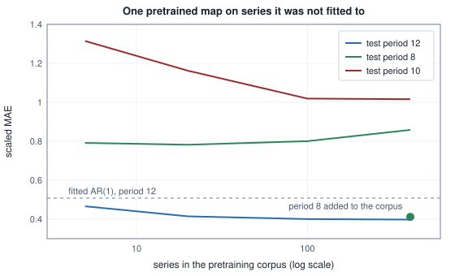
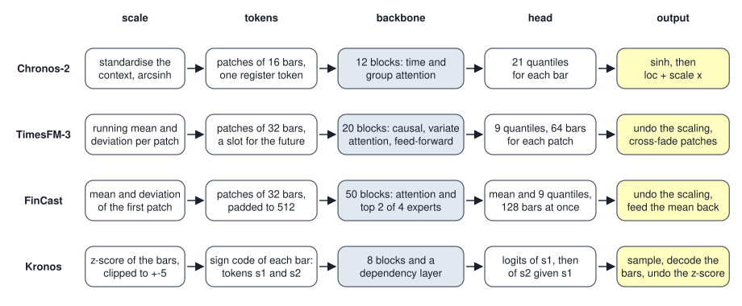
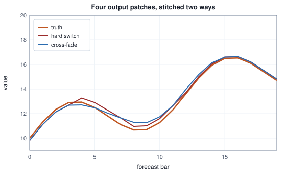

<!-- SPDX-License-Identifier: CC-BY-4.0 -->
<!-- Copyright (c) 2026 Martin Schröder <info@swedishembedded.com> -->

# Foundation Models for Time Series

*Can one pretrained model forecast any series it has never seen?*

A pretrained forecaster such as TimesFM-3 holds $330{,}710{,}976$ numbers, and not one of them was fitted to the series it is asked to forecast. Set that beside Chapter 1. The autoregression on seasonal differences that served as the volume's baseline has two coefficients, fitted by least squares to the 35 pairs of consecutive seasonal differences that a 48-bar context offers, and it forecasts nothing but the series it was fitted to. The pretrained model has a hundred and sixty-five million times as many numbers and has never seen a single one of those 48 bars. It is handed them, scaled, cut into pieces, passed through twenty blocks of attention, and what comes out is a table of quantiles of the kind Chapter 2 built. If that works at all, the numbers must have been fitted somewhere else, to a very large collection of other series, and the claim being made is that a series that was not in the collection can still be forecast by what was learned from the ones that were.

The collections themselves are not part of a model's published weights, and what they contained is not known from the weights alone. What can be asked is what a model has to do for such a claim to be even possible: what it must not be allowed to see about a series, what unit it reads, how it states uncertainty and conditions on more than one series, how it reaches a horizon longer than anything it emits at once, and how someone who did not train it can be sure that the copy they run is the copy that was trained. Four pretrained forecasters give four sets of answers, Chronos-2, TimesFM-3, FinCast and Kronos, and brain ports all four (`crates/chronos2`, `crates/timesfm3`, `crates/fincast` and `crates/kronos`), so their answers can be read against one another in code that runs.

A foundation forecaster reuses six earlier ideas.

1. (Chapter 2 of this volume, quantile forecast.) A forecast gives $8$, $10$ and $15$ for one bar at the levels $0.1$, $0.5$ and $0.9$, and the bar turns out to be $12$. What is the pinball loss at each level?
2. (Volume V, Chapter 9, "The Transformer Block", with Volume V, Chapter 7, causal mask.) In a causal block over four positions, numbered from 0, which keys may position 2 attend to, and what happens to the score of a key it may not attend to before the softmax?
3. (Volume VII, Chapter 6, "Vision Transformers", patch embedding.) A $224 \times 224$ picture with three colour channels is cut into $16 \times 16$ patches. How many tokens does it give, and what does the embedding matrix multiply?
4. (Volume VIII, Chapter 3, "Discrete Latents and Vector Quantization", vector quantization.) A codebook has $1{,}024$ vectors. How many bits does one token carry, and which code does a latent vector receive?
5. (Volume VI, Chapter 2, "Importing Pretrained Models and Proving Parity", parity.) An implementation returns $(1.05, 2.1, 3.15)$ where the reference returns $(1, 2, 3)$. What are the cosine similarity and the relative L2 difference of the two?
6. (Chapter 1 of this volume, leakage.) Why does scaling a window by the mean and deviation of its own context leave the future out, while scaling it by the mean of the whole series does not?

## A map fitted to other series

The cheapest version of the idea needs no attention at all. Take a family of series, the kind Chapter 1 drew: a level, a slope, a season of twelve bars with some amplitude and phase, and a memory in the noise. Scale every window of $48$ bars by its own mean and deviation, exactly as Chapter 1 scaled windows, and fit one linear map from the $48$ scaled bars to the $12$ scaled bars that follow, over every window of a few hundred series. The map has $49 \times 12 = 588$ weights, it is fitted once, and then it is applied to series that were not among those it was fitted to, with nothing refitted. Such a forecaster is **zero-shot**: it forecasts a series it has never been fitted to, by applying a model fitted to others, with no step of fitting on the series itself.

<!-- worked: foundation_forecasters.zero_shot -->
A family of series: y_t = L (1 + s t + a sin(2 pi t / m + phi) + v_t) for t = 0 .. 119, with L = 5 * 100^u, s = -0.002 + 0.010 u, a = 0.05 + 0.25 u, phi = 2 pi u and a shock size c = 0.02 + 0.04 u (each u one uniform() call, in this order), and then for t = 0 .. 119 one normal() call each for v_t = 0.7 v_(t-1) + c normal(), v_(-1) = 0. The period m is 12 in the corpus and in the first test family, 8 in the second test family (and in the second corpus stream) and 10 in the third. Generators (SplitMix64, seeds): corpus: 0x5b0f6b04fdb23e81, corpus8: 0x9513179c759562d7, in: 0x30f4377aabfa9dcd, out: 0x03e2c48293fec4e3, new: 0xba7b0f7c990f191f; the series are drawn one after another from each stream. A window is 48 context bars and 12 target bars; both are scaled by the mean and population standard deviation (plus 1e-5) of the context. The shared map is the ridge regression (penalty 1.0 on every weight but the constant) from [1, the 48 scaled context bars] to the 12 scaled target bars, fitted over every window of every corpus series with its context starting at bar 0 .. 60 (origins 48 .. 108, 61 windows per series), accumulating the normal equations window by window and feature by feature, solved by elimination with partial pivoting. The corpus is the first 5, 20, 100 and 400 series of the first stream (all of period 12); the last row adds 200 series from the second stream to the first 200 of the first. Each test family has 200 fresh series, one window each, context bars 48 .. 95 and target bars 96 .. 107. The two baselines are told the period of the series they forecast. 'scaled MAE' is the mean absolute error over the 12 target bars, in units of the context's standard deviation, averaged over the series.

| forecaster | period 12 | period 8 | period 10 |
|---|---:|---:|---:|
| seasonal naive | 0.587 | 0.559 | 0.554 |
| AR(1) on seasonal differences, fitted to the 48 bars | 0.508 | 0.537 | 0.511 |
| shared map, 5 series | 0.466 | 0.792 | 1.315 |
| shared map, 20 series | 0.415 | 0.782 | 1.162 |
| shared map, 100 series | 0.401 | 0.801 | 1.019 |
| shared map, 400 series | 0.398 | 0.858 | 1.016 |
| shared map, 200 series of period 12 and 200 of period 8 | 0.410 | 0.412 | 1.043 |
<!-- /worked -->



On series of the family it was fitted to, the idea works. A map fitted to five series already forecasts the twelve bars with a scaled error of $0.466$, below the $0.508$ of the autoregression that was fitted to the 48 bars of the very series it forecasts, and with $400$ series the error is $0.398$, about a fifth below the fitted baseline. The seasonal naive forecast, which needs no fitting at all, gives $0.587$. The map has seen $400 \times 61 = 24{,}400$ windows where the autoregression has seen $35$, and that is the whole advantage: the data it learned from is spread over other series, and the series it is asked about only has to resemble them.

Where the resemblance fails, so does the map. Its columns for period $8$ and period $10$ are the same family with a different season, and the map pretrained on period $12$ is far worse there than doing nothing clever: $0.858$ and $1.016$ at $400$ series against $0.559$ and $0.554$ for the seasonal naive forecast. More data of the wrong family does not help: on period $8$ the error is $0.792$, $0.782$, $0.801$ and $0.858$ as the corpus grows from $5$ to $400$ series, with no improvement and the largest corpus the worst, which is what one would expect of a map that is fitted ever more tightly to a season of twelve. Putting $200$ series of period $8$ into the corpus repairs period $8$ ($0.412$) and costs period $12$ almost nothing ($0.410$ for $0.398$), and it does nothing for period $10$, which is between the two and in neither: a linear map fitted to two seasons has learned two seasons, not the idea of a season.

So "any series it has never seen" has to be read as any series like those the model was fitted to, and the claim is only as wide as the collection. Two things follow for a real model. It needs a much richer function than one linear map, so that one set of weights can carry many seasons, many noise structures and many ways of failing to be seasonal at all; the transformer block of Volume V is that function. And it needs the unit it reads to be as free as possible of everything incidental to a series: its scale, its length, its gaps, the number of bars to be forecast. The pretrained forecasters remove these one at a time, beginning with the scale.

## What a shared model must not see: the scale of a series

The map above stood on one decision made without comment: every window is scaled by its own context before the map sees it. Without that, the series of level $5$ and the series of level $500$ would have been two different problems, as the panel of Chapter 1 showed, and a squared error summed over the corpus would have been the error of the largest series. Every pretrained forecaster in brain makes that decision, and each makes it differently, because the decision has parts: what statistics, taken over which bars, how the forecast is returned to the units of the series, and what is done to values that are too large to be typical.

Four scalers, each taken from the code of one of the four crates and each reduced to a few lines, are compared on the first $64$ bars of Chapter 1's series, cut into $8$ patches of $8$.

<!-- worked: foundation_forecasters.scalers -->
The first 64 bars of the series of Chapter 1 (seed 0xbfe805a9e24a1b3c), cut into 8 patches of 8. 'invariance' is the largest absolute difference between the scaled values of the series x and of 10 x + 100. 'earlier values changed' adds 50 to the 8 bars of the last patch and counts how many of the 56 scaled values of the earlier patches then move by more than 1e-12. The arcsinh is the library function; the z-score divides by the population standard deviation plus 1e-5; the first patch uses the population standard deviation, floored at 1e-6; the running scheme merges the statistics of patch p into those of patches 0 .. p - 1 by n = n1 + n2, mu = (n1 mu1 + n2 mu2) / n and n sigma^2 = n1 sigma1^2 + n2 sigma2^2 + n1 (mu1 - mu)^2 + n2 (mu2 - mu)^2, and a standard deviation below 1e-6 is replaced by 1.

| scaler | invariance | earlier values changed |
|---|---:|---:|
| whole context, then arcsinh | below 1e-9 | 56 of 56 |
| z-score and clip to +-5 | 7.65e-06 | 56 of 56 |
| first patch | below 1e-9 | 0 of 56 |
| running, patch by patch | below 1e-9 | 0 of 56 |

The merged running mean and standard deviation after each patch differ from the mean and standard deviation of the whole prefix (each computed in one pass, the sum of the values taken in increasing order, then the sum of the squared deviations from their mean, in double precision) by less than 1e-14, which is rounding.
<!-- /worked -->

Two things can be read from the table. First, every scaler is invariant to the unit of the series, which is the point of it: the series $x$ and the series $10x + 100$ give the same scaled values to below $10^{-9}$ for three of them, and to $7.65 \times 10^{-6}$ for the z-score of `crates/kronos/src/preprocess.rs`, whose $10^{-5}$ is added to the deviation rather than used as its floor, so that rescaling the series changes the divisor by a fraction of that size. Second, the last column separates the scalers by what they let the future do. Adding $50$ to the last patch moves all $56$ scaled values of the earlier patches under whole-context standardisation and under the z-score, because the mean and deviation they divide by include the last patch; it moves none under the first-patch scaler and none under running statistics. The whole-context scaler and the z-score are Chapter 1's per-window scaler applied to a whole context, which is honest as long as the context is all past, but they are not causal inside the context: if a model is trained with a loss on every patch's prediction, as the decoders below are, an early patch has been scaled by statistics that include the patches it is supposed to predict.

The arithmetic of the whole-context scaler of `crates/chronos2/src/preprocess.rs` has a third part that the table does not show, a squash. After subtracting the mean and dividing by the population deviation (and by $10^{-5}$ if the deviation is exactly zero), the values pass through the inverse hyperbolic sine, $\operatorname{arcsinh}(z) = \ln(z + \sqrt{z^2 + 1})$, which is nearly the identity near zero and logarithmic for large $|z|$. It leaves a standardised value of half a deviation almost alone and brings a spike of fifty deviations down to $4.6$, so that one bad bar cannot send the whole input off the range the network was fitted to. The inverse is exact, and the order is the thing to notice: the forecast is returned by $\sinh$ and then by the affine map $\mathrm{loc} + \mathrm{scale} \cdot (\cdot)$, applied to each quantile row separately. An increasing map takes the $\tau$-quantile of a variable to the $\tau$-quantile of its image, so the quantiles of the forecast survive both steps and stay in order; a mean would not survive the $\sinh$, which is one reason a model that emits quantiles can use a squash that a model that emits a mean could not.

<!-- worked: foundation_forecasters.scalers_trend -->
The series y_t = 10.0 + 0.5 t + 0.3 sin(2 pi t / 12) for t = 0 .. 63, cut into patches of 8, scaled by each scheme. The columns give the smallest and the largest scaled value in the last patch and the largest absolute scaled value anywhere.

| scaler | last patch, smallest | last patch, largest | largest anywhere |
|---|---:|---:|---:|
| whole context, then arcsinh | 1.08 | 1.32 | 1.32 |
| z-score and clip to +-5 | 1.30 | 1.74 | 1.74 |
| first patch | 23.63 | 27.34 | 27.34 |
| running, patch by patch | 1.30 | 1.74 | 1.75 |

The squashing of arcsinh (library functions `asinh` and `sinh`) on a standardised value z, and its inverse:

| scaled value z | arcsinh(z) | sinh(arcsinh(z)) |
|---|---:|---:|
| 0.5 | 0.4812 | 0.5000 |
| 2.0 | 1.4436 | 2.0000 |
| 5.0 | 2.3124 | 5.0000 |
| 20.0 | 3.6895 | 20.0000 |
| 50.0 | 4.6053 | 50.0000 |
<!-- /worked -->

The same four scalers on a trending series show what each hands to the network. The whole-context scaler and the running scaler give the last patch values between $1.1$ and $1.7$, whatever the slope. The first-patch scaler of `crates/fincast/src/preprocess.rs`, which takes its mean and deviation from the first patch with at least three observed values, gives the last patch values from $23.6$ to $27.3$, because the first patch is eight bars of a series that then climbs for fifty-six more bars at a slope many times its own spread. That is a design choice, not an error. It is a scale chosen by what comes first rather than by what the whole context holds, it is causal in the sense of the table above, and a model trained under that scaling will have been shown inputs of that size; what a reader of the code can say is that the numbers a FinCast network reads on a trending series are an order of magnitude larger than the numbers a Chronos-2 network reads on the same series, and that the deviation of a short first patch is a noisy basis for a scale, which the code guards against by looking for the first patch with at least three observed values and falling back to the last patch when none has them.

## Running statistics: a scale that never looks ahead

TimesFM-3 takes the causal idea to its end. Patch $p$ is scaled by the mean and deviation of every observed bar in patches $0$ through $p$, written $\mu_p$ and $\sigma_p$, so that no patch is scaled by anything after it. Recomputing the statistics of the whole prefix for every patch would cost $O(n^2/P)$ additions over a context of $n$ bars; they are instead merged one patch at a time. Let a group of $n_1$ values have mean $\mu_1$ and population deviation $\sigma_1$, and a second group of $n_2$ values $\mu_2$ and $\sigma_2$. The merged group has $n = n_1 + n_2$ values and mean $\mu = (n_1\mu_1 + n_2\mu_2)/n$, and its sum of squares about that mean is the sum of the squares of each group about its own mean plus the shift of each mean to the new one:

$$n\sigma^2 = n_1\sigma_1^2 + n_2\sigma_2^2 + n_1(\mu_1 - \mu)^2 + n_2(\mu_2 - \mu)^2,$$

which follows by writing $x - \mu = (x - \mu_g) + (\mu_g - \mu)$ for a value of group $g$ and noticing that the cross terms sum to zero within each group. The routine is a few lines.

```text
function running_scale(y: array<real>[n], P: int, tol: real) -> array<real>[n]:
    require P >= 1 and n >= P and n mod P == 0, "a whole number of patches"
    require tol > 0.0, "a floor below which the deviation counts as one"
    z = zeros(real, [n])
    m = 0                                    # bars merged so far
    mu = 0.0
    sigma = 0.0
    for p in 0 .. n // P:
        mu2 = mean(y[p * P : (p + 1) * P])
        s2 = sqrt(sum((y[p * P + j] - mu2) ^ 2 for j in 0 .. P) / P)
        if m == 0:
            m = P
            mu = mu2
            sigma = s2
        else:
            m_new = m + P
            mu_new = (m * mu + P * mu2) / m_new
            var = (m * sigma ^ 2 + P * s2 ^ 2 + m * (mu - mu_new) ^ 2 + P * (mu2 - mu_new) ^ 2) / m_new
            m = m_new
            mu = mu_new
            sigma = sqrt(var)
        scale = 1.0 if sigma < tol else sigma
        for j in 0 .. P:
            z[p * P + j] = (y[p * P + j] - mu) / scale
    return z
```

The merged statistics after each patch of the $64$-bar context differ from those of the whole prefix by less than $10^{-14}$, which is rounding, and a deviation below $10^{-6}$ is replaced by $1$ rather than clamped up to $10^{-6}$ (the `revin` function of `crates/timesfm3/src/preprocess.rs`), so a constant stretch is shifted but not blown up. The real routine also skips missing bars in the counts, which is how left-padding and gaps leave the statistics alone.

The horizon needs a scale too, because the model's output for a patch is expressed in that patch's scaled units. For a patch beyond the context there is nothing to observe, so TimesFM-3 continues the running statistics through the horizon patches using the model's own median prediction in place of the observations it does not have (`cpm_iterative_revin_refine`), and then reverses the scaling of each output patch with the statistics of the patch that produced it. The routine has an easily missed rule: the stored prediction grid is refreshed at every patch, context patches included, so that when the first horizon patch arrives the grid holds the reconstruction of the last context patch rather than zeros. An implementation that only touches the grid at horizon patches produces the same values for every context patch and then starts the refinement from a stale grid. Commit `64624e4a7` (1 September 2026), which added the whole preprocessing pipeline, records it as one of two bugs, found by isolating the refinement stage against the reference's own tap rather than trusting the end-to-end number alone. A gate on the input of the transformer cannot see it, because the context patches look identical either way.

## Patches: tokens that are short stretches of a series

Scaling decides what a number means; it does not decide how many tokens a series makes. A bar as a token would turn a context of $8{,}192$ bars into $8{,}192$ tokens and a score matrix of $67{,}108{,}864$ entries per head per layer. A **patch tokenization of a series** cuts the scaled series into consecutive, non-overlapping stretches of $P$ bars, padding on the left with missing bars when the length is not a multiple of $P$, and gives each patch, rather than each bar, one token: the patch carries its $P$ values together with a mask that says which of them were observed, and an embedding maps that vector to the width of the model. It is the patch embedding of Volume VII with the picture replaced by a line, and with one addition, the mask, which a picture does not need and a series with gaps and a start that is not on a patch boundary does.

```text
function patchify(y: array<real>[n], P: int) -> array<real>[n_pat, 2 * P]:
    require n >= 1 and P >= 1, "a series and a patch length"
    pad = (P - n mod P) mod P                  # missing bars before the first bar
    n_pat = (n + pad) // P
    X = zeros(real, [n_pat, 2 * P])
    for p in 0 .. n_pat:
        for j in 0 .. P:
            i = p * P + j - pad                # the bar this cell holds; negative means padding
            if i >= 0 and is_finite(y[i]):     # a missing bar is nan in y
                X[p, j] = y[i]
                X[p, P + j] = 1.0              # observed
    return X
```

Cutting into patches changes the cost, and it does it by a factor that can be written down. A context of $C$ bars makes $n = \lceil C/P \rceil$ tokens, and one head of one layer scores $n^2$ pairs, so patches of $P$ bars divide that count by about $P^2$.

<!-- worked: foundation_forecasters.patch_counts -->
Tokens n = ceil(C / P) of a context of C bars cut into patches of P bars, and the n^2 pairs of positions that bidirectional attention scores in one layer for one head. 'ratio' is the pair count at P = 1 divided by the pair count at the row's P.

| context C | patch P | tokens n | pairs n^2 | ratio |
|---|---:|---:|---:|---:|
| 512 | 1 | 512 | 262,144 | 1 |
| 512 | 16 | 32 | 1,024 | 256 |
| 512 | 32 | 16 | 256 | 1024 |
| 8192 | 1 | 8192 | 67,108,864 | 1 |
| 8192 | 16 | 512 | 262,144 | 256 |
| 8192 | 32 | 256 | 65,536 | 1024 |
<!-- /worked -->

The three sizes in the table are the ones in use: Chronos-2 reads patches of $16$ bars (and so $512$ tokens for its $8{,}192$-bar context), TimesFM-3 and FinCast patches of $32$, while Kronos, which comes back below, makes one token per bar and keeps its context at $512$ bars. A model that reads patches of $32$ scores a thousand times fewer pairs than one that reads bars, and the saving is the same whatever the context: it is the $P^2$ of the arithmetic. A longer context still costs the square of its token count, only with $P$ times fewer tokens.

What the embedding sees is easiest to follow on ten bars.

<!-- worked: foundation_forecasters.patching -->
The ten bars 12.0, 12.4, 13.1, 12.8, 13.6, missing, 14.2, 14.0, 14.9, 15.3 (bar 5 was not observed). The observed values have mean 13.5889 and population standard deviation 1.0535; each observed bar is standardised as (y - mean) / sd. The series is padded on the left with 2 missing bars to 12, which are cut into 3 patches of 4. A patch is the vector [4 values, 4 mask bits] with a missing value written as 0 and the mask 1 for an observed bar. The embedding is out = W_out relu(W_hidden x) + W_res x with hidden width 4 and token width 3, no biases. Generator: the book's SplitMix64, seed 0xe041946edd4ce6eb (16159360141862168299). Draws in this order, each entry 0.5 normal(), each matrix row by row: W_hidden (4 by 8), W_res (3 by 8), W_out (3 by 4).

| patch | v0 | v1 | v2 | v3 | m0 | m1 | m2 | m3 |
|---|---:|---:|---:|---:|---:|---:|---:|---:|
| 0 | 0.000 | 0.000 | -1.508 | -1.129 | 0 | 0 | 1 | 1 |
| 1 | -0.464 | -0.749 | 0.011 | 0.000 | 1 | 1 | 1 | 0 |
| 2 | 0.580 | 0.390 | 1.245 | 1.624 | 1 | 1 | 1 | 1 |

| patch | token 0 | token 1 | token 2 |
|---|---:|---:|---:|
| 0 | 0.1681 | 0.0632 | -0.7918 |
| 1 | 0.3958 | -1.1318 | 1.0956 |
| 2 | -0.6774 | -4.4297 | 1.9405 |

The embedding has 68 weights and turns the 10 bars into 3 tokens of 3 numbers. The first patch holds 2 padded bars and 2 observed ones, and its mask bits say which; bar 5 sits inside patch 1, whose mask bit m3 is 0.
<!-- /worked -->

The series was standardised first, over the observed values only, which is why the observed bars have mean zero and the missing bar contributes to nothing. The left padding of two bars sits in patch $0$ with its mask bits at zero, so that the network can tell a padded cell from a bar whose standardised value happens to be $0$; the missing bar $5$ is in patch $1$, mask bit $m_3 = 0$, and its value is written as zero for the same reason. The mask is not an afterthought of the port: for TimesFM-3 the first pipeline, commit `64624e4a7`, asserted a patch-aligned context and assumed every bar observed, and commit `ed1c9dacf` (11 September 2026) made a non-finite value a missing one and left-padded any context, because rounding a context down to a patch boundary silently dropped history. A patch with no observed bar at all would have a vector of zeros and a mask of zeros, and the models treat it differently: Chronos-2 removes any such patch from attention, wherever it is, while TimesFM-3 removes a leading run of them and lets an interior one through. The embedding itself is the residual block of the table, $\mathbf{W}_{\mathrm{out}}\,\mathrm{relu}(\mathbf{W}_{\mathrm{hidden}}\mathbf{x}) + \mathbf{W}_{\mathrm{res}}\mathbf{x}$, a small network with a linear skip rather than the single matrix of a vision transformer, and it is the form all three patch models use for their input, and Chronos-2 and FinCast also use it for their heads. Chronos-2 feeds it $48$ numbers per patch, $[\text{time encoding}\,(16), \text{values}\,(16), \text{mask}\,(16)]$ with the time encoding the bar's offset from the end of the context divided by $8{,}192$; FinCast feeds it $64$ and adds a learned embedding of the series' frequency, one of three buckets; TimesFM-3 feeds it $192$, because each of its patches also carries the next two patches, which is how a covariate's known future reaches the model.

## A decoder over patches, and a head that speaks in quantiles

A row of tokens becomes a forecast through a transformer block of Volume V and a head, and the choice that matters is whether the block may look at the tokens after the one it is working on. A **decoder** is causal: the output at patch $p$ depends on patches $0$ through $p$ and on nothing later. That gives a training signal at every position at once: a context of $N$ patches supervises $N - 1$ predictions in one forward pass, each position being asked for the patch after it, and the quantity trained is the pinball loss of Chapter 2 on the quantile outputs of every position. A model whose attention sees the whole sequence cannot be trained that way, because the answer would be among its inputs; Chronos-2, which is such a model, reads empty patches after its context and its head is applied to those alone. The smallest example is $4$ patches of $2$ bars.

<!-- worked: foundation_forecasters.decoder_toy -->
The eight bars 10.0, 10.8, 11.5, 11.0, 12.2, 12.9, 12.4, 13.6, standardised with their own mean 11.8000 and population standard deviation 1.1147, cut into 4 patches of 2. Each patch is embedded as in the previous example (the vector [2 values, 2 mask bits], all mask bits 1, a column x; out = W_out relu(W_hidden x) + W_res x) by a residual block, giving a row of 4 numbers per patch. Then one pre-norm block of Volume V on these rows, with the row-vector convention of that volume, y = x W with W of shape (fan_in, fan_out): n = RMS norm of x (gain 1, epsilon 1e-6), causal attention of n with 2 heads of width 2, scores q . k / sqrt(2) (the 1 / sqrt(head width) factor is present), a softmax over the allowed keys, no position information, x1 = x + (the concatenated head outputs) W_O, then x1 + SwiGLU(RMS norm of x1) with hidden width 6, SwiGLU(n) = (silu(n W_gate) * (n W_up)) W_down. There is no final norm: the linear head, which maps the row of 4 numbers to 6 outputs per position as the column product W_head h, reads the block's output directly, and is laid out step by step (for each of the 2 output bars the levels 0.1, 0.5, 0.9). Generator: the book's SplitMix64, seed 0x6b8c1f5ce07f264a (7749603542561662538). Draws in this order: W_hidden (4 by 4), W_res (4 by 4) and W_out (4 by 4) of the embedding, each entry 0.5 normal(), each matrix row by row; then the block: W_Q, W_K, W_V, W_O (each 4 by 4), W_gate, W_up (4 by 6) and W_down (6 by 4), each entry normal() / sqrt(fan_in) with fan_in the number of rows of that matrix, drawn row by row; the two RMS gains are 1 and are not drawn; then the head (6 by 4), each entry normal() / sqrt(4), row by row. The 216 weights (48 of the embedding, 136 in the seven matrices of the block, 8 in its two gains, 24 in the head) are random, so the pinball losses below are those of an untrained net and say nothing about skill. Position p predicts the standardised bars of patch p + 1; its pinball loss is the mean over the 6 outputs of the pinball loss of Chapter 2.

| position | target bars | o0 q0.1 | o0 q0.5 | o0 q0.9 | o1 q0.1 | o1 q0.5 | o1 q0.9 | pinball | crossed |
|---|---:|---:|---:|---:|---:|---:|---:|---:|---:|
| 0 | -0.269, -0.718 | 1.104 | 2.577 | -1.926 | 0.336 | 4.224 | -3.218 | 1.6365 | 2 |
| 1 | +0.359, +0.987 | 0.881 | 0.612 | -1.464 | 0.305 | 2.512 | -2.528 | 1.0386 | 2 |
| 2 | +0.538, +1.615 | 1.283 | -0.829 | -1.716 | -0.285 | 1.978 | -3.089 | 1.3314 | 2 |

One pass gives 3 supervised positions from 8 bars; the fourth position predicts the two bars after the context, for which training has no target in this window. Adding 1 to every entry of the last token and running the block again changes the block's output (the residual stream after the block, before the head) at positions 0, 1 and 2 by 0.0, 0.0, 0.0 (largest absolute change over the 4 entries of the row) and at position 3 by 1.394.
<!-- /worked -->

The weights are random, so the pinball losses of the three supervised positions are those of an untrained network, about $1.0$ to $1.6$ in scaled units, and the quantiles of every output bar cross (the column `crossed` counts the bars whose three levels are out of order). The shape is what the example is for. The head emits $P \times K = 6$ numbers per position, step by step, and the last position, which has no target inside the context, is the one whose output is the forecast: the block's output there (the residual stream, before the head) changes when the last token changes, by $1.394$ in this run, while the block's outputs at positions $0$, $1$ and $2$ do not change at all, which is the causal mask doing its work and is the property that lets a single pass train every position.

Output patches in two of the real models are longer than input patches. TimesFM-3 reads patches of $32$ bars and writes $64$ bars at each position, nine quantiles each, through a biased linear head of $64 \times 9 = 576$ outputs; FinCast reads $32$ and writes $128$, a mean and nine quantiles per bar, through a residual block of $1{,}280$ outputs; Chronos-2 reads and writes $16$ and puts $21$ quantiles on every bar, with a head of $21 \times 16 = 336$ outputs. Writing more than one input patch ahead is what makes a long horizon possible without a long autoregression. Separately, no quantile head constrains the order of its levels, so they can cross, and brain's adapters sort them, as Chapter 2 described.

The blocks differ in their details. TimesFM-3's twenty blocks each have three sublayers, every one normalised before and after (RMS norm, sublayer, RMS norm, then the residual): causal attention over the patches of one series, with rotary positions and a separate RMS norm on every head's queries and keys; attention over the variates of the input at the same patch position, bidirectional and without positions; and a ReLU feed-forward network whose hidden width equals the model width, $1{,}280$, rather than a multiple of it. The attention scale of the first sublayer deserves a sentence, because it is easy to port wrongly. The reference multiplies the score by $\sqrt{d_k}$ rather than dividing by it, and scales the query by a learned per-dimension gain (softplus of the stored weight, times $1.442695$) divided by $\sqrt{d_k}$; the two $\sqrt{d_k}$ cancel, and what is left is an elementwise gain on the query, which commutes with the RMS norm that precedes it and is folded into the norm's weight once when the model is loaded (`crates/timesfm3/src/model.rs`). The trainer in `crates/timesfm3/src/train.rs` cannot fold, because both tensors are trained and the saved checkpoint must keep the reference's own tensor names, so it differentiates the unfolded form. Chronos-2 has twelve blocks of a different design, an encoder: bidirectional attention over the context patches, one learned register token and the patches of the horizon, the horizon patches carrying no values (or the known values of a covariate, below), and attention with no $1/\sqrt{d_k}$ at all, which the section on covariates returns to. FinCast's fifty blocks pair a causal attention with a sparse mixture of four experts, of which each token takes the two with the highest router scores (Volume VI, Chapter 4), the experts' weights renormalised to sum to one. Kronos is built around a tokenizer instead, which needs a section of its own.



## Values as words: bins and sign codes

A patch keeps real numbers and lets the network regress them. A **series tokenizer** does the opposite and turns a bar, or a stretch of bars, into one symbol from a finite vocabulary, so that everything a language model does, a softmax over a vocabulary, sampling, cross-entropy, applies unchanged and the forecast is a distribution over symbols rather than a head of numbers. The price is that a symbol is coarser than the value it stands for, and the price has a size that can be computed. The simplest tokenizer scales the context (here by its mean absolute value $s$), cuts the range $[-4, 4]$ of scaled values into $B$ bins of equal width $w = 8/B$, and sends a value $x$ to a token and back:

```text
function bin_token(x: real, s: real, B: int, limit: real) -> int:
    require s > 0.0 and B >= 2 and limit > 0.0, "a positive scale and at least two bins"
    w = 2.0 * limit / B
    return max(0, min(B - 1, floor((x / s + limit) / w)))

function bin_value(k: int, s: real, B: int, limit: real) -> real:
    require 0 <= k and k < B and s > 0.0 and limit > 0.0, "a token of the vocabulary"
    w = 2.0 * limit / B
    return (-limit + (k + 0.5) * w) * s
```

<!-- worked: foundation_forecasters.value_tokens -->
A context of 16 bars y_t = L (1 + 0.25 sin(2 pi t / 12) + 0.004 t), t = 0 .. 15, at the three levels L, scaled by its mean absolute value s and cut into 64 bins of width 0.125 between -4.0 and 4.0: the token of x is clamp(floor((x / s + 4.0) / 0.125), 0, 63), and a token k is read back as the centre (-4.0 + (k + 0.5) 0.125) s of its bin.

| level L | scale s | tokens vs level 5 | largest error | error / s |
|---|---:|---:|---:|---:|
| 5.0 | 5.335 | same | 0.2623 | 0.0492 |
| 50.0 | 53.348 | same | 2.6229 | 0.0492 |
| 500.0 | 533.485 | same | 26.2294 | 0.0492 |

The same code with the last bar of the level-10 context replaced by 12 times the mean of that context (the scale is recomputed from the changed context, and a value beyond 4.0 scales falls into the last bin):

| context | scale s | error of the last bar after the round trip |
|---|---:|---:|
| without the spike | 10.670 | 0.430 |
| last bar replaced by 12 times the mean | 17.853 | 57.739 |

A forecast of the next scaled bar as a categorical distribution over the 64 bins: the probability of bin k is the Gaussian N(0.3, 0.5^2) probability of the interval between its edges (the first and last bins take the tails). Read as quantiles by taking the centre of the first bin whose cumulative probability reaches the level:

| level | first bin with cumulative probability >= level | centre of that bin | exact quantile | difference |
|---|---:|---:|---:|---:|
| 0.1 | 29 | -0.3125 | -0.3408 | 0.0283 |
| 0.5 | 34 | 0.3125 | 0.3000 | 0.0125 |
| 0.9 | 39 | 0.9375 | 0.9408 | 0.0033 |
<!-- /worked -->

Three facts come out of the tables. The scale takes the unit out of the tokens, exactly as it does for patches: the same pattern at levels $5$, $50$ and $500$ gives the same sixteen tokens, and a model fitted on tokens never meets a level. The error that the binning adds is bounded by half a bin, $ws/2$ in the units of the series, so it grows with the scale while the error relative to the scale stays put, here $0.0492$ against the bound $w/2 = 0.0625$; no network can recover what a bin discards, and a forecast read back from tokens has a floor of roughly $ws/\sqrt{12}$ in root mean square. And a spike breaks the scale and is clipped: when the last bar is replaced by twelve times the mean, the scale itself rises to $17.9$, the bar falls into the last bin, and the round trip is wrong by $57.7$. The last table shows the benefit. A categorical distribution over the bins is a forecast of the distribution, and the quantile of Chapter 2 is read from its cumulative sum; the readings sit within the width of a bin of the exact quantiles, $0.0283$, $0.0125$ and $0.0033$ away in scaled units, and the resolution of every quantile this forecaster can state is the bin width.

Kronos tokenizes in the second way, which Volume VIII's vector quantization prepares. Its first stage is an autoencoder over bars of six features (open, high, low, close, volume and turnover), with causal transformer blocks around a bottleneck that is a **binary spherical quantizer**: the encoder produces a latent $\mathbf{z} \in \mathbb{R}^k$, and the code is the corner of the hypercube of the sign pattern, $\operatorname{sign}$ of each coordinate over $\sqrt{k}$, which is a unit vector. Of the $2^k$ unit vectors of that form, the nearest to $\mathbf{z}$ in angle is the one with the entries $(2b_j - 1)/\sqrt{k}$ where $b_j = 1$ exactly when $z_j > 0$, because the dot product $\mathbf{z} \cdot \mathbf{c}$ over such vectors $\mathbf{c}$ is largest when every term has the sign of $z_j$. The codebook of Volume VIII was a matrix of rows that had to be learned and defended from dead codes; here the codebook is implicit, has no weights and cannot die. The sign of exactly $0$ is $-1$ in the quantizer (the bit is $0$), which is a different convention from the `sign` of this book's pseudocode, so the routine below writes the condition out.

```text
function bsq_encode(z: array<real>[k], k1: int) -> (int, int):
    require 1 <= k1 and k1 < len(z), "two groups of bits"
    s1 = 0
    s2 = 0
    for j in 0 .. len(z):
        b = 1 if z[j] > 0.0 else 0             # a coordinate of exactly 0 gives bit 0
        if j < k1:
            s1 = s1 + b * 2 ^ j                # the first bit is the least significant
        else:
            s2 = s2 + b * 2 ^ (j - k1)
    return (s1, s2)

function bsq_decode(s1: int, s2: int, k1: int, k: int) -> array<real>[k]:
    require 1 <= k1 and k1 < k and 0 <= s1 and s1 < 2 ^ k1 and 0 <= s2 and s2 < 2 ^ (k - k1), "tokens of the two groups"
    out = zeros(real, [k])
    for j in 0 .. k:
        src = s1 if j < k1 else s2
        sh = j if j < k1 else j - k1
        bit = (src // 2 ^ sh) mod 2
        out[j] = (2 * bit - 1) / sqrt(k)
    return out
```

<!-- worked: foundation_forecasters.bsq -->
The sign code of a latent z in R^6: bit j is 1 when z_j > 0 and 0 otherwise (so z_j = 0 gives 0), the first 3 bits make the coarse token s1 and the last 3 the fine token s2, each as an integer with bit j worth 2^j (the first bit is the least significant), and the code is read back as the vector with entries (2 bit - 1) / sqrt(6), of length 1. 'cosine, s1 only' keeps the coarse bits and puts 0 where the fine bits were.

| latent z | bits | s1 | s2 | cosine, s1 only | cosine, s1 and s2 |
|---|---:|---:|---:|---:|---:|
| +0.8, -0.3, +1.5, -2.0, +0.1, -0.7 | 101010 | 5 | 2 | 0.549 | 0.806 |
| -1.1, +0.4, -0.2, +0.9, +1.3, -0.5 | 010110 | 2 | 3 | 0.481 | 0.881 |
| +0.2, +0.2, -0.2, -1.5, +0.6, +2.2 | 110011 | 3 | 6 | 0.126 | 0.727 |

How much of a direction survives the sign? For z with independent standard Gaussian entries, the cosine between z and its corner (2 bit - 1) is the sum of |z_j| over sqrt(k) times the length of z. Generator: the book's SplitMix64, seed 0xe98aa861a092b942 (16828448094882543938). For k in 2, 4, 6, 10, 20 in this order, 2000 vectors of k calls of normal() each; the limit for large k is sqrt(2 / pi) = 0.7979.

| bits k | distinct codes 2^k | mean cosine of z with its corner |
|---|---:|---:|
| 2 | 4 | 0.9001 |
| 4 | 16 | 0.8484 |
| 6 | 64 | 0.8310 |
| 10 | 1,024 | 0.8200 |
| 20 | 1,048,576 | 0.8107 |

Rows and weights of the output matrix that maps a hidden state of 512 numbers to the logits over the 20-bit code of the next bar (biases not counted):

| output head over the 20 bits | rows | weights at width 512 |
|---|---:|---:|
| one softmax over all 2^20 codes | 1,048,576 | 536,870,912 |
| s1 and s2, two softmaxes of 2^10 | 2,048 | 1,048,576 |
<!-- /worked -->

The first $k_1$ bits are a coarse token $s_1$ and the rest a fine token $s_2$, and the first table shows what the split buys: keeping only the coarse bits already gives a direction correlated with the latent (cosines $0.549$, $0.481$ and $0.126$ on the three examples, the last being a latent whose large entries are all in the fine bits), and the fine bits finish the job ($0.806$, $0.881$, $0.727$). A single sign pattern is a crude quantizer of a direction, and the second table puts a number on how crude: for a Gaussian latent the cosine between the latent and its corner falls from $0.9001$ at two bits to $0.8107$ at twenty and approaches $\sqrt{2/\pi} = 0.7979$, so about a fifth of the direction is lost however many bits are spent, unless the encoder has learned to put its information where a sign can carry it, which is what training does. Kronos uses $k = 20$ bits, ten in each token, so each bar is one of $2^{20} = 1{,}048{,}576$ codes, spelled as a pair of tokens from vocabularies of $1{,}024$. The pair is not a luxury. A single softmax over a million codes would need a matrix of $1{,}048{,}576 \times 512 = 536{,}870{,}912$ weights at the decoder's width; two softmaxes of $1{,}024$ need $1{,}048{,}576$. The decoder therefore predicts $s_1$ first and then $s_2$ given the sampled $s_1$, through a dependency layer, a cross-attention from the embedding of the sampled coarse token to the context, which turns the factorisation of the distribution into architecture.

The decoder reads each bar as the sum of two things: the two token embeddings, each scaled by $\sqrt{d}$ and fused by a linear map, and five learned calendar tables (minute, hour, weekday, day and month) added to them, so that a bar knows when it happened without a covariate channel. It then runs eight causal blocks with scaled attention, rotary positions, RMS norm at $\epsilon = 10^{-5}$ and a SwiGLU feed-forward network, and samples. The forecast is therefore a set of sample paths of the next bars, not a table of quantiles, and it is read back through the tokenizer: the generated tokens are decoded, with the tokenizer's own causal decoder run over the whole window of context and forecast, and the result is un-scaled by the z-score of the context. The adapter draws at least $16$ paths so that Chapter 2's conversions can derive quantiles and an interval from them.

Three commits record how many ways such a pipeline can be right in its parts and wrong in its whole. Commit `561408796` (17 August 2026) found that the rollout was decoded from the generated tokens alone, while the tokenizer's decoder is causal, so that each bar is a function of every earlier token in the window: handing it the tail alone is a different function, and on identical tokens the difference was $0.311$ in relative L2 (the message's measurement), which the code now avoids by decoding the last window of context and forecast and keeping the tail (`detokenize_tail` in `crates/kronos/src/generate.rs`). Commit `b64ac4b00` (17 August 2026) found that the dependency layer applied rotary positions at inference where the reference, whose cross-attention builds its table from the length of the query (one), applies the identity, so the sampled second token was wrong in 23 of 24 rollout steps (`dep_forward` in `crates/kronos/src/decoder.rs` now applies none). Commit `29e21264f` (18 August 2026) is the instructive one. The dependency layer attends causally in the reference's training mode, and the trainer attended to the whole sequence, so that every position was trained on a future it can never have at inference. "A defect no gradcheck can see", the message says, "since a gradcheck proves the backward matches the forward, not that the forward is the right function"; the trainer in `crates/kronos/src/train.rs` now masks it causally, and the fix was gated by a training-mode golden dumped from the reference. All three were invisible to a test that compares a model with itself, and visible to one that compares it with someone else's.

## Covariates that sit beside the series

A forecast of demand improves when the model is told that tomorrow is a holiday, and the information is a second series: a **covariate**, a series that is observed alongside the target and may carry information about it, in two kinds. A past covariate is known up to the origin, like temperature yesterday; a known-future covariate is known over the horizon as well, like the calendar or a planned promotion. **Covariate conditioning** is the way a model lets the forecast of one series depend on others, and the two pretrained models in brain that accept covariates do it with attention between series rather than with extra columns in a feature table. The question it answers is concrete and has a computable form.

The family of the first section can be given a promotion indicator, a bit per bar that is $1$ with probability $0.2$ and lifts the series by a fraction $d$ of its level when it is set. A forecaster that is told the future bits can use them; one that is not cannot know that they exist.

<!-- worked: foundation_forecasters.covariate_gain -->
The family of the previous example (period 12) with a promotion indicator x_t: each series draws L, s, a, phi, c and d = 0.10 + 0.20 u (six uniform() calls in this order), and then for each of the 120 bars one normal() (the shock of v_t) and one uniform() (a promotion, x_t = 1, when it is below 0.2); y_t = L (1 + s t + a sin(2 pi t / 12 + phi) + v_t + d x_t). Generators (seeds): corpus: 0xa2b52d22740e1e7c, test: 0xc07c28d2efe4c2d3, shuffle: 0x574b9bb3def8626d; the corpus is the first 150 series of its stream, the test is 200 fresh series, and the third stream shuffles the list 0 .. 199 (Fisher-Yates of the book) to pick, for series i, the future promotions of series list[i]. A window is as before, with origins 48, 51, .. 108 for the corpus, so 21 windows per series. The map with a covariate is the ridge regression (penalty 1.0) from [1, 48 scaled context bars, the 48 promotion bits of the context, the 12 promotion bits of the horizon] to the 12 scaled target bars; the map without one uses only the first 49 of these inputs. Test windows are as in the previous example (target bars 96 .. 107); on average a test series has 2.265 promotions among them.

| forecaster | scaled MAE |
|---|---:|
| seasonal naive | 0.697 |
| shared map without covariate | 0.543 |
| with the true future promotions | 0.369 |
| with another series' future promotions | 0.611 |
| with the future promotions set to none | 0.525 |
<!-- /worked -->

The same family of maps, with the $48 + 12 = 60$ promotion bits of the context and horizon added to its inputs, lowers the scaled error from $0.543$ to $0.369$ when it is given the true future bits. The two controls make the result mean something. Given another series' promotions it does worse than not having a covariate at all ($0.611$), so what it uses is the content of the bits, not their presence; and with the future bits set to none it falls back to $0.525$, close to what the covariate-free map gets. It is a linear map, so the covariate acts additively, which a transformer is not limited to, but what is being demonstrated is only that a model which has been pretrained with a covariate in its inputs, and can read it, forecasts better when it is given it.

Chronos-2 does the reading with **group attention**. Each series in a group has its own row of tokens, the encoder's time attention runs along each row as before, and a second sublayer runs across the rows: at every patch position, the tokens of all series in the group attend to one another, with no positions (the position is already the patch position), so that a patch of the target can read the same patch of the covariate. A known-future covariate also carries its values on the horizon patches, with its mask set; the horizon patches of the target are empty. In brain's adapter an item's target and its covariates form one group and each target is forecast separately (`crates/chronos2/src/forecaster.rs`), so that a second target in the same item is not used to forecast the first.

<!-- worked: foundation_forecasters.group_attention -->
Three token states at one patch position, one per series of a group (width 4, one head of width 4): target (0.9, -0.4, 0.2, 1.1); covariate A (1.0, -0.5, 0.1, 1.0); covariate B (-0.8, 0.9, -1.2, 0.1). Each is RMS-normalised (gain 1, epsilon 1e-6), projected by W_Q, W_K and W_V, the three rows of scores q_i . k_j go through a softmax with no position information, the mixed values go through W_O. Generator: the book's SplitMix64, seed 0xa4f8abce6a4568a4 (11887440119478970532). Draws: W_Q, W_K, W_V, W_O in this order, each 4 by 4, each entry 0.7 normal(), row by row. A matrix W acts on a column, the projection of a state x being the product W x with output r the dot product of row r of W with x; q_i = W_Q x_i, and likewise k_i and v_i from the same normalised x_i. The attention weights, once with the scores as they are and once divided by sqrt(4):

| row (query) | to target | to covariate A | to covariate B |
|---|---:|---:|---:|
| target, unscaled | 0.027 | 0.019 | 0.954 |
| covariate A, unscaled | 0.037 | 0.027 | 0.936 |
| covariate B, unscaled | 0.378 | 0.362 | 0.261 |
| target, divided by sqrt(4) | 0.129 | 0.107 | 0.764 |
| covariate A, divided by sqrt(4) | 0.144 | 0.125 | 0.731 |
| covariate B, divided by sqrt(4) | 0.356 | 0.348 | 0.296 |

The update the target token receives from the group sublayer is W_O (sum_j a_0j v_j); the euclidean distance between it and the update of a target alone in its group, W_O v_0, is 2.366; the update with the covariates has length 1.613 and the shortcut's has length 1.937.

| update of the target token | c0 | c1 | c2 | c3 |
|---|---:|---:|---:|---:|
| with the two covariates in the group | -1.340 | -0.224 | -0.439 | -0.751 |
| alone in its group (weight 1 on itself) | -0.975 | -0.674 | 1.404 | 0.616 |

Why the scale of a score matters: for q and three keys with independent standard Gaussian entries of width d_k, the largest of the three weights averaged over 2000 draws. Generator: the book's SplitMix64, seed 0x0358fcfd2165c891 (241220744181565585). Per draw: q (d_k calls of normal()), then the three keys in order, each d_k calls. One generator runs through the three rows in the order printed (d_k = 4, then 16, then 64), never restarted between rows; the scaled column uses the same draws as the unscaled one.

| key width d_k | mean largest weight, unscaled | mean largest weight, divided by sqrt(d_k) |
|---|---:|---:|
| 4 | 0.708 | 0.573 |
| 16 | 0.852 | 0.589 |
| 64 | 0.930 | 0.594 |
<!-- /worked -->

The numbers are those of a random network, so which covariate the target pays attention to means nothing here; the mechanics are the point. Each token is normalised, projected to a query, a key and a value, the target's weights over the three tokens are a softmax of three scores, and the update the target receives is the output projection of the weighted values, which for a series alone in its group collapses to the output projection of its own value, the case the code takes as a shortcut for a single series. With the covariates present the update is a different vector: it is $2.366$ away from the shortcut's, and the two vectors have lengths $1.613$ and $1.937$, so the covariates move the update by more than the length of either. The last table bears on a property of Chronos-2's attention: there is **no** $1/\sqrt{d_k}$ in it. With keys of width $64$ the largest of three weights averages $0.930$ without the factor and $0.594$ with it, so a port that divided by $\sqrt{d_k}$ out of habit would give a flatter attention than the one the weights were fitted for, with every kernel taken alone still correct.

TimesFM-3 conditions differently, and the difference shows in its input, the $192$-wide vector that the patch embedding reads. For each patch, the vector holds the patch's own $32$ values, then the values of the next *two* patches, $64$ numbers, then the mask of each. For a target the second block is always masked and zero. For a known-future covariate it holds what is coming.

<!-- worked: foundation_forecasters.covariate_layout -->
Input patches P = 2, output patches 4 (so 2 input patches ahead), a context of 6 bars and a horizon of 4. The stitched output keeps min(2 P, 4) = 4 bars per forecast patch, so the overlap is 2 bars and the number of forecast patches is max(ceil((4 - 2) / 2), 1) = 1; the model reads 2 = 1 + 2 - 1 patches beyond the 3 of the context, 5 in all. The target is 3, 4, 5, 6, 7, 8; the covariate is 0, 0, 0, 1, 1, 0, 0, 1, 1, 1 over the context and the horizon. Each row is [values of the patch (2) | values of the next 2 patches (4) | mask of the patch | mask of the next patches] with a mask bit of 1 for a value that is missing, a bar beyond the last patch or hidden from a target; values are shown before the standardisation.

| patch | variate | values | next patches | mask | next-patch mask |
|---|---|---|---|---|---|
| 0 | target | 3 4 | 0 0 0 0 | 0 0 | 1 1 1 1 |
| 0 | known-future covariate | 0 0 | 0 1 1 0 | 0 0 | 0 0 0 0 |
| 1 | target | 5 6 | 0 0 0 0 | 0 0 | 1 1 1 1 |
| 1 | known-future covariate | 0 1 | 1 0 0 1 | 0 0 | 0 0 0 0 |
| 2 | target | 7 8 | 0 0 0 0 | 0 0 | 1 1 1 1 |
| 2 | known-future covariate | 1 0 | 0 1 1 1 | 0 0 | 0 0 0 0 |
| 3 | target | 0 0 | 0 0 0 0 | 1 1 | 1 1 1 1 |
| 3 | known-future covariate | 0 1 | 1 1 0 0 | 0 0 | 0 0 1 1 |
| 4 | target | 0 0 | 0 0 0 0 | 1 1 | 1 1 1 1 |
| 4 | known-future covariate | 1 1 | 0 0 0 0 | 0 0 | 1 1 1 1 |
<!-- /worked -->

The horizon patches, beyond the context, are tokens too: the target's are empty and the covariate's carry its known future, so that when the model reads the first horizon token it has the covariate's value there and one patch further on, and where the next two patches would lie past the last patch the cells are masked. A past-only covariate is treated like a target and has its look-ahead masked. The variates of an input interact only through the second attention sublayer, which attends across them at each patch position, bidirectionally, and which is why this model is natively multivariate: every target of an item is forecast in one call and attends to every other (`crates/timesfm3/src/forecaster.rs`). Kronos has no covariate channel except the calendar, which it takes in as the five tables above, and FinCast none at all, only the frequency bucket; the adapters advertise exactly that (`CovariateSupport::CalendarOnly` and `None`), and the default `validate` of the forecasting seam refuses covariates for a model that declares `None`, so a request that carries one to FinCast is an error and not a silent omission.

## Long horizons from short outputs

A forecast of $256$ bars from a model that writes $64$ at a position needs a plan, and the four models have four. Chronos-2 puts as many empty patches after the context as the horizon needs, up to $64$ of them, and reads them in one pass (so a horizon of $1{,}024$ bars is its limit). TimesFM-3 does the same with fewer tokens, because each position writes two input patches ahead, and reconciles the overlapping outputs. FinCast writes $128$ bars at once, appends its own mean forecast to the context and runs again. Kronos has no horizon; it generates one bar at a time and its context slides.

<!-- worked: foundation_forecasters.long_horizon -->
Forward passes (and the tokens each pass reads) to forecast H bars from a context of 448 bars. Chronos-2 reads ceil(448 / 16) context patches, one register token and ceil(H / 16) patches of horizon; TimesFM-3 reads 448 / 32 patches of context and max(ceil((H - 32) / 32), 1) + 1 patches of horizon; FinCast pads or truncates every context to 512 bars (16 patches of 32) and decodes 128 bars per pass; Kronos runs the decoder once over the 448 context tokens and then once per generated bar.

| horizon H | Chronos-2 | TimesFM-3 | FinCast | Kronos |
|---|---:|---:|---:|---:|
| 64 | 1 (33 tokens) | 1 (16 tokens) | 1 (16 tokens each) | 1 prefill and 64 token steps |
| 256 | 1 (45 tokens) | 1 (22 tokens) | 2 (16 tokens each) | 1 prefill and 256 token steps |
| 1024 | 1 (93 tokens) | 1 (46 tokens) | 8 (16 tokens each) | 1 prefill and 1024 token steps |

What feeding the mean back does to the spread. Take a process x_t = 0.99 x_(t-1) + e_t with unit-variance innovations, observed up to t = 0, and a forecaster whose quantiles are exactly the conditional quantiles given what it is shown. For horizons up to 128 it is shown the true past, and the standard deviation at step h is sqrt((1 - 0.99^(2 h)) / (1 - 0.99^2)). For the next 128 bars it is shown the first block's mean path as if it had been observed, so its spread at step h is that of a forecast h - 128 steps ahead of the last bar of that mean path:

| step h | true standard deviation | standard deviation after feeding back the mean | ratio |
|---|---:|---:|---:|
| 1 | 1.000 | 1.000 | 1.000 |
| 64 | 6.031 | 6.031 | 1.000 |
| 128 | 6.813 | 6.813 | 1.000 |
| 129 | 6.819 | 1.000 | 0.147 |
| 192 | 7.014 | 6.031 | 0.860 |
| 256 | 7.068 | 6.813 | 0.964 |
<!-- /worked -->

For TimesFM-3, with input patches of $32$ and outputs of $64$, the first output patch comes from the last context patch and covers bars $0$ to $63$ of the horizon; the first horizon token, one patch later, writes bars $32$ to $95$; and so on. Consecutive output patches therefore overlap in $32$ bars, and the postprocessing keeps the first $32$ bars of the first patch, blends each overlap, and keeps the rest of each later patch. This reconciliation of overlapping outputs is **stitching**. The blend is linear. With an overlap of $o_{\mathrm{v}}$ bars, the earlier patch gets the weight $1 - k/(o_{\mathrm{v}} - 1)$ at step $k = 0, \dots, o_{\mathrm{v}} - 1$ and the later patch the rest, the endpoints included (the reference's `linspace`, so the step is $1/(o_{\mathrm{v}} - 1)$, not $1/o_{\mathrm{v}}$).

```text
function stitch(preds: array<real>[F, E], P: int) -> array<real>[F * P + E - P]:
    require F >= 1 and 1 <= P and P <= E and E <= 2 * P, "forecast patches of E bars, input patches of P bars, an overlap of at most one patch"
    ov = E - P
    if F == 1:
        return preds[0, :]                      # a single patch is returned whole
    out = zeros(real, [F * P + ov])
    out[0 : P] = preds[0, 0 : P]
    for f in 0 .. F - 1:
        for k in 0 .. ov:
            w = 1.0 - k / (max(ov, 2) - 1)
            out[(f + 1) * P + k] = w * preds[f, P + k] + (1.0 - w) * preds[f + 1, k]
        out[(f + 1) * P + ov : (f + 2) * P] = preds[f + 1, ov : P]
    out[F * P : F * P + ov] = preds[F - 1, P : E]   # the overlap tail of the last patch, appended once
    return out
```

The routine requires $E \le 2P$, an overlap of at most one input patch, so that every bar is written by at most two forecast patches and the blend has two weights; TimesFM-3's $E = 64$ and $P = 32$ is the extreme case, and a longer overlap would need a rule for blending three or more patches, which neither the routine nor the code provides. Two details are easy to drop: at exactly one patch the whole patch comes back, not its first $P$ bars, and the last patch's own overlap tail is appended once at the end. Commit `64624e4a7` records them together as the second of its two bugs, and the comment above `stitch_patches` in `crates/timesfm3/src/preprocess.rs` repeats them.

<!-- worked: foundation_forecasters.stitching -->
Output patches of 8 bars from input patches of 4, so consecutive output patches overlap in 4 bars and a horizon of 20 needs max(ceil((20 - 4) / 4), 1) = 4 forecast patches, which together cover 4 * 4 + 4 = 20 bars. Forecast patch f covers bars 4 f .. 4 f + 7. Over its overlap with the next patch the earlier patch gets the weight 1 - k / (4 - 1) at step k = 0 .. 3 and the later patch the rest:

| step k of the overlap | weight of the earlier patch | weight of the later patch |
|---|---:|---:|
| 0 | 1.0000 | 0.0000 |
| 1 | 0.6667 | 0.3333 |
| 2 | 0.3333 | 0.6667 |
| 3 | 0.0000 | 1.0000 |

The truth is y_s = 10 + 0.3 * s + 2 * sin(2 pi s / 12). Each forecast patch is the truth plus its own error a + b j at its j-th bar (j = 0 .. 7), with a = 0.3 normal() and b = 0.05 normal(). Generator: the book's SplitMix64, seed 0x53539276bd13eb15 (6004303766890998549). 400 repetitions; in each, for f = 0 .. 3, a then b. 'hard switch' takes bars 4 f .. 4 f + 3 from patch f and the tail of the last patch. 'jump' is the absolute difference between the step of the stitched output and the step of the truth across a seam, |(out_s - out_(s-1)) - (y_s - y_(s-1))|, averaged over the seams s = 4, 8, 12 (the first bar of each later patch).

| rule | mean squared error | mean jump at the seams |
|---|---:|---:|
| cross-fade | 0.1083 | 0.0389 |
| hard switch | 0.1103 | 0.3489 |
<!-- /worked -->



What the blend buys is read off the experiment, in which every output patch is the truth plus a smooth error of its own: the mean squared error is nearly unchanged ($0.1083$ against $0.1103$), and the step across a seam, compared with the step of the truth, is $0.0389$ against $0.3489$ for a hard switch. The cross-fade is a continuity device. It does not make the forecast more accurate, and with errors of a different structure it could even cost accuracy, which is why the experiment states its error model; what it guarantees is that a path built from several patches does not jump where two of them meet, which matters to anything that differentiates the path or sums it.

FinCast's way has a consequence that a count of passes hides. After the first $128$ bars it appends the *mean* it has just forecast to the context as though it had been observed, and the quantiles of the second pass are conditional on that. Under the idealisation that a model's quantiles are exactly the conditional quantiles given what it is shown, the spread of the second block is that of a forecast made from the end of the first block's mean path, not from the origin, and the uncertainty accumulated in the first block is not carried across. For a slowly mean-reverting process the difference is large, and the last table of the block puts it at one seventh of the true spread on the first bar after the join ($1.000$ against $6.819$ at step $129$). It is a statement about the loop as written under that idealisation, not a measurement of the real checkpoint. It is also why a sampled rollout, which Kronos does, carries uncertainty forward and a deterministic one does not, and why Chapter 2's lesson about sample paths and marginals reaches here: a forecast whose bars after the first block were made from a point estimate of the earlier ones has the wrong spread in them however well the first block is calibrated.

Training does not run the long horizon at all. The trainer of `crates/timesfm3/src/train.rs` restricts an example to a horizon of one output patch, because stitching and the refinement of the horizon statistics hold no learnable parameters and make the map from logits to a forecast affine only when a single patch is read from a context patch; `crates/timesfm3/src/finetune.rs` scores the real postprocessed forecast in original units with the pinball loss and checks its gradient against finite differences of `postprocess` itself, which matters because that map has data-dependent coefficients and a clamp that saturates.

## What the four forecasters weigh and what a forecast costs them

The size of a model is a count, and the counts here can be rebuilt from the configuration alone. The layer inventory below gives every part of every model; the totals are the numbers the crates assert in their own tests ($330{,}710{,}976$, $119{,}477{,}664$, $991{,}436{,}960$) and the two Kronos counts that follow from the lists in `crates/kronos/src/config.rs`.

<!-- worked: foundation_forecasters.parameter_counts -->
The weights of each forecaster by part, from the shapes of its published configuration, which are printed with each table: every linear counts its weight matrix (output width x input width) and its bias where the model has one; every norm its gain vector and, for a layer norm, its bias. 'counted as' is the sum, in numbers of weights, that gives the row; a product axb is a matrix of a rows and b columns.

TimesFM-3: model width 1280, 20 blocks, head width 80, input vector 192 = 2 (32 + 64) numbers per patch, output 64 x 9 = 576 numbers per position. The embedding is a residual block with hidden width 1280 and no biases. A block has a sequence attention, a variate attention and a feed-forward network; each sublayer has a norm gain vector of 1280 before and another after it; an attention has four projections 1280x1280 without bias and three vectors of the head width 80 (query norm, key norm, per-dimension scale); the feed-forward network has two matrices 1280x1280 and no bias. The head is one linear with a bias. The count of the crate's own test is 330,710,976: equal.

| part | counted as | weights |
|---|---|---:|
| patch embedding, input 192 | 1280x192 + 1280x1280 + 1280x192, no biases | 2,129,920 |
| sequence attention, 20 layers | 20 x (4x1280x1280 + 2x1280 + 3x80) | 131,128,000 |
| variate attention, 20 layers | 20 x (4x1280x1280 + 2x1280 + 3x80) | 131,128,000 |
| feed-forward, 20 layers | 20 x (2x1280x1280 + 2x1280) | 65,587,200 |
| output head (weight and bias) | 576x1280 + 576 | 737,856 |
| **total** |  | **330,710,976** |

Chronos-2: model width 768, 12 blocks, feed-forward width 3072, attention inner width 768, patches of 16 bars, input 48 = 3 x 16 numbers per patch, output 21 x 16 = 336 numbers per horizon patch. The embedding and the head are residual blocks with hidden width 3072 and biases. A block has a time attention, a group attention and a feed-forward network; each sublayer has one norm gain vector of 768 (before it) and no other bias or norm; an attention has four projections 768x768 without bias; the feed-forward network has two matrices 768x3072 without bias. One final norm gain, and a table of 2 special tokens. The count of the crate's own test is 119,477,664: equal.

| part | counted as | weights |
|---|---|---:|
| special-token table [PAD], [REG] | 2x768 | 1,536 |
| patch embedding, input 48 | 3072x48 + 768x3072 + 768x48 + 3072 + 2x768 biases | 2,548,224 |
| time attention, 12 layers | 12 x (4x768x768 + 768) | 28,320,768 |
| group attention, 12 layers | 12 x (4x768x768 + 768) | 28,320,768 |
| feed-forward, 12 layers | 12 x (2x768x3072 + 768) | 56,632,320 |
| final norm | 768 | 768 |
| quantile head, output 336 | 3072x768 + 336x3072 + 336x768 + 3072 + 2x336 biases | 3,653,280 |
| **total** |  | **119,477,664** |

FinCast: model width 1280, 50 blocks, 16 heads of width 80 (attention inner width 1280, queries, keys and values all with 16 heads), patches of 32 bars, input 64 = 2 x 32 numbers per patch, output 128 x (1 + 9) = 1280 numbers per position (a mean and 9 quantiles per bar). The embedding and the head are residual blocks with hidden width 1280 and biases; the frequency embedding is a table of 3 rows. A block has an input norm gain of 1280, a causal attention (one fused 3840x1280 projection with a bias, a per-dimension query scale of 80, an output projection 1280x1280 with a bias) and a mixture of 4 experts: a norm gain of 1280, a router matrix 4x1280 without bias, and 4 experts of two linears 1280x1280 with biases and a layer norm (weight and bias, 2x1280). The count of the crate's own test is 991,436,960: equal.

| part | counted as | weights |
|---|---|---:|
| patch embedding, input 64 | 1280x64 + 1280x1280 + 1280x64 + 1280 + 2x1280 biases | 1,806,080 |
| frequency embedding | 3x1280 | 3,840 |
| attention, 50 layers | 50 x (1280 + 80 + 3840x1280 + 3840 + 1280x1280 + 1280) | 328,004,000 |
| experts, 50 layers of 4 | 50 x 4 x (2 (1280x1280 + 1280) + 2x1280) | 656,384,000 |
| gates and norms of the mixture, 50 layers | 50 x (1280 + 4x1280) | 320,000 |
| horizon head, output 1280 | 1280x1280 + 1280x1280 + 1280x1280 + 1280 + 2x1280 biases | 4,919,040 |
| **total** |  | **991,436,960** |

Kronos decoder (small): model width 512, 8 blocks, feed-forward width 1024, two token vocabularies of 1024 = 2^10. A block has four attention projections 512x512 with biases, two norm gains of 512 and a SwiGLU network of three matrices 512x1024 without biases. The fusion linear maps the two token embeddings (1024 numbers) to 512, with a bias; the dependency layer is a cross-attention of four projections 512x512 with biases and one norm gain; the two heads map 512 to 1024 with biases. 

| part | counted as | weights |
|---|---|---:|
| token tables emb_s1, emb_s2 | 2x1024x512 | 1,048,576 |
| fusion projection (weight and bias) | 512x1024 + 512 | 524,800 |
| calendar tables (60, 24, 7, 32, 13 rows) | 136x512 | 69,632 |
| transformer blocks, 8 | 8 x (4 (512x512 + 512) + 2x512 + 3x512x1024) | 20,996,096 |
| final norm | 512 | 512 |
| dependency layer (4 projections with bias, norm) | 4 (512x512 + 512) + 512 | 1,051,136 |
| heads proj_s1, proj_s2 (weights and biases) | 2 (1024x512 + 1024) | 1,050,624 |
| **total** |  | **24,741,376** |

Kronos tokenizer (base): width 256, feed-forward width 512, 6 features per bar, 20 = 2 x 10 bits, 3 encoder and 3 decoder blocks of the same form as the decoder's (four projections 256x256 with biases, two norm gains, three SwiGLU matrices 256x512). 'embed' maps 6 features to 256 and 'head' maps 256 back to 6, both with biases; 'quant_embed' maps 256 to the 20 bits; 'post_quant_embed' maps the 20 bits to 256, and 'post_quant_embed_pre' maps the 10 coarse bits to 256 (both with biases). 

| part | counted as | weights |
|---|---|---:|
| embed and head | 256x6 + 256 + 6x256 + 6 | 3,334 |
| quant_embed | 20x256 + 20 | 5,140 |
| post_quant_embed_pre and post_quant_embed | 256x10 + 256 + 256x20 + 256 | 8,192 |
| encoder blocks, 3 | 3 x (4 (256x256 + 256) + 2x256 + 3x256x512) | 1,970,688 |
| decoder blocks, 3 | 3 x (4 (256x256 + 256) + 2x256 + 3x256x512) | 1,970,688 |
| **total** |  | **3,958,042** |
<!-- /worked -->

TimesFM-3's weight is attention, $262{,}256{,}000$ of its $330{,}710{,}976$ weights in the two attention sublayers, and Chronos-2's is split between its feed-forward networks and its two attentions. FinCast has $991{,}436{,}960$ weights and $656{,}384{,}000$ of them are experts, of which a token uses half: $328{,}192{,}000$ weights are active per token in the experts, and $663{,}244{,}960$ in the whole network. Kronos is small, $24{,}741{,}376$ weights in the decoder and $3{,}958{,}042$ in the tokenizer, because its vocabularies are two tables of $1{,}024$ rows and not one of a million.

A count of weights is not a cost, and the cost of a forecast is a count too. A dense matrix product uses each of its weights twice per token (a multiply and an add), so the matrix FLOPs of a forward pass over $n$ tokens are about twice the weights used times $n$, plus the two products of attention that grow with the pairs of positions scored.

<!-- worked: foundation_forecasters.forecast_work -->
Floating-point operations (a multiply and an add count as 2) of one forecast of 64 bars from a context of 448 bars of one series, counting only matrix products and the two products of attention (scores and weighted sum, 4 d per scored pair of positions), and no norms, activations, softmaxes, table lookups or sampling. A linear of a rows and b columns used on t tokens costs 2 t a b; the widths are those of the layer lists of the previous example. 'tokens' is the length of the longest sequence the backbone reads (for Kronos the context tokens of the prefill); 'pairs' is the number of (query, key) pairs scored, causal pairs counted once, bidirectional ones in both directions. The rules, row by row:

- Chronos-2: n = 28 context patches + 1 [REG] token + 4 horizon patches = 33 tokens. The residual-block embedding is applied to the 32 patch tokens and not to [REG]: 2 x 32 x (48x3072 + 3072x768 + 48x768). Each of the 12 layers costs 2 n (4x768x768 for the time attention, 2x768x768 for the value and output projections of the group sublayer, 2x768x3072 for the feed-forward network). The head is applied to the 4 horizon tokens only: 2 x 4 x (768x3072 + 3072x336 + 768x336). Attention scores all n^2 = 1089 pairs, bidirectionally, in the time attention only, at 4 x 768 per pair per layer.

- TimesFM-3: n = 448 / 32 = 14 context patches + max(ceil((64 - min(2 x 32, 64) + 32) / 32), 1) = 1 forecast patch + 2 - 1 further patches = 16 tokens, all through the embedding (input 192, three linears), the head (1280x576) and every layer: 2 n (8x1280^2 for the 4 projections of both attentions + 2x1280x1280 for the feed-forward network). Scored pairs: the sequence attention is causal, n (n + 1) / 2 = 136, and the variate attention scores 1 pair per token for one variate, n = 16; each pair costs 4 x 1280 per layer.

- FinCast: the context is padded to 512 bars, n = 512 / 32 = 16 tokens through the embedding (input 64), the head (1280x1280, 1280x1280, 1280x1280) and every layer: 2 n (1280x3840 fused projection + 1280x1280 output + 1280x4 router) + 2 n x 2 active experts x 2 x 1280^2 (the two linears of an expert; all 4 experts in the all-experts row). Causal pairs n (n + 1) / 2 = 136, 4 x 1280 per pair per layer.

- Kronos: the tokenizer encoder reads the 448 context bars (448 tokens: 2 x 448 x 6x256 embed, 3 blocks of 2 (4x256^2 + 3x256x512) per token, 2 x 448 x 256x20 quant_embed) and its decoder the window of 512 = min(448 + 64, 512) bars (2 x 512 x 20x256 post_quant_embed, 3 blocks, 2 x 512 x 256x6 head), post_quant_embed_pre being unused on this path. The decoder prefill reads the 448 context tokens, each costing the fusion 2 x 1024x512, 8 blocks of 2 (4x512^2 + 3x512x1024), proj_s1 2x512x1024 and the key and value projections of the dependency layer 2 x 2x512^2. Each of the 64 steps costs the same per-token amount (the new bar's embedding through the 8 blocks, proj_s1 and the dependency key and value) plus the dependency query and output projections 2 x 2x512^2 and proj_s2 2x512x1024. Scored pairs: tokenizer encoder causal 100576, tokenizer decoder causal 131328, decoder prefill causal 100576, the 64 token steps (step i reads 448 + i + 1 keys) 30752 and the 64 dependency steps (step i reads 448 + i keys) 30688; each pair costs 4 x 256 in a tokenizer layer, 4 x 512 in a decoder layer and in the dependency layer.

| forecaster | tokens | pairs scored | matrix FLOPs | attention FLOPs | total FLOPs | per forecast bar |
|---|---:|---:|---:|---:|---:|---:|
| Chronos-2 | 33 | 1,089 | $6.73 \times 10^{9}$ | $4.01 \times 10^{7}$ | $6.77 \times 10^{9}$ | $1.06 \times 10^{8}$ |
| TimesFM-3 | 16 | 152 | $1.06 \times 10^{10}$ | $1.56 \times 10^{7}$ | $1.06 \times 10^{10}$ | $1.66 \times 10^{8}$ |
| FinCast | 16 | 136 | $2.12 \times 10^{10}$ | $3.48 \times 10^{7}$ | $2.12 \times 10^{10}$ | $3.32 \times 10^{8}$ |
| FinCast, all four experts run | 16 | 136 | $3.17 \times 10^{10}$ | $3.48 \times 10^{7}$ | $3.17 \times 10^{10}$ | $4.96 \times 10^{8}$ |
| Kronos | 448 | 393,920 | $2.70 \times 10^{10}$ | $2.93 \times 10^{9}$ | $2.99 \times 10^{10}$ | $4.68 \times 10^{8}$ |
<!-- /worked -->

The rule can be checked on the table. TimesFM-3 reads $n = 16$ tokens through all of its $330{,}710{,}976$ weights, and $2 \times 330{,}710{,}976 \times 16 = 1.06 \times 10^{10}$ FLOPs is its matrix count. FinCast reads $16$ tokens through its $663{,}244{,}960$ active weights and gets $2.12 \times 10^{10}$; running all four experts, which the dense path of its parity test does, would give $3.17 \times 10^{10}$, and the routed implementation of commit `3d6a5fdff` (22 July 2026) saves the difference by having each expert process only the tokens routed to it, $32$ expert-token products per layer instead of $64$ (the commit's counts, and the `dense_moe` branch of `crates/fincast/src/model.rs` that still computes the old way; because every expert operation acts on one row at a time, the two paths compute the same sums, and the test `moe_gather_scatter_matches_dense` gates their difference below $10^{-4}$). Chronos-2 is the smallest model but reads $33$ tokens, because patches of $16$ give a longer row than patches of $32$, and ends at $6.77 \times 10^{9}$. Kronos reads $448$ tokens and then $64$ more one at a time, and its attention is a tenth of its work, $2.93 \times 10^{9}$ of $2.99 \times 10^{10}$ FLOPs, where each patch model's attention is under one percent of its. The lever that patching pulls is therefore not the weights, which a patch model has more of than a token model, but the number of tokens through which every weight is used.

## Proving a port against a reference you cannot retrain

The weights of all four forecasters come from published checkpoints, imported by name, and a reader of the code has no independent way to say what the right answer for a given input is except by running the reference on it. The practice that grew up around the four crates, the one Volume VI, Chapter 2 describes, has stages, and each of the stages has caught something.

The first is the layout gate. The parameter names in `config.rs` of every crate are the checkpoint's own keys, not a renaming, so that the list of names and shapes can be compared with the header of the file before any kernel runs, and the sums above are asserted there. That is how a stale default was caught for FinCast: the reference's configuration says three experts, the shipped weights carry four, and commit `2409b103d` (22 July 2026) builds the model with four and diffs the list against a committed header of the real checkpoint (`crates/fincast/tests/it/t0_param_layout.rs`). One part of the reference is deliberately not reproduced: its routing is stochastic even in evaluation, so brain implements the deterministic top-2 and makes the reference deterministic in its parity dump by driving its threshold to zero.

The second is the numerical gate, which compares an output with a golden dump, and the way it fails shows what a single number hides.

<!-- worked: foundation_forecasters.parity_gates -->
The reference output is (1.0, -2.0, 3.0, 0.5). Cosine is the dot product over the product of lengths, relative L2 is the length of the difference over the length of the reference, and the last column is the largest absolute difference of an entry.

| output under test | cosine | relative L2 | largest absolute difference |
|---|---:|---:|---:|
| 1.05 times the reference | 1.0000 | 0.0500 | 0.150 |
| the reference plus 0.1 on every entry | 0.9988 | 0.0530 | 0.100 |
| the last entry wrong (0.9 for 0.5) | 0.9947 | 0.1060 | 0.400 |
| first two entries exchanged | 0.3684 | 1.1239 | 3.000 |

If the scale is free, a direction that is wrong by the angle t leaves a relative L2 of at least sin t = sqrt(1 - cosine^2):

| cosine | relative L2 that a wrong direction alone can cause |
|---|---:|
| 0.99 | 0.1411 |
| 0.999 | 0.0447 |
| 0.9999 | 0.0141 |

The gates of the three parity tests of the crates:

| gate | criterion |
|---|---|
| TimesFM-3 core | cosine > 0.9999 and relative L2 < 0.01 |
| Chronos-2 forecast | cosine > 0.99, Pearson > 0.99, largest absolute error over the range of the reference < 0.05 |
| FinCast forecast | cosine > 0.99, Pearson > 0.99, relative L2 < 0.02 |

An RMS norm y = x / sqrt(mean(x^2) + epsilon) of four numbers (gain 1) at three epsilons. The same code that cannot be told apart at entries of size 1 differs by a third, or by more than a half, at entries of size 0.001:

| input | epsilon | first output entry | ratio to the output at 1e-6 |
|---|---|---:|---:|
| entries of size 1 | 32-bit machine epsilon, 1.1920929e-7 (TimesFM-3) | 1.0000 | 1.0000 |
| entries of size 1 | 1e-6 (a literal in the kernel) | 1.0000 | 1.0000 |
| entries of size 1 | 1e-5 (Kronos) | 1.0000 | 1.0000 |
| entries of size 0.001 | 32-bit machine epsilon, 1.1920929e-7 (TimesFM-3) | 0.9452 | 1.3368 |
| entries of size 0.001 | 1e-6 (a literal in the kernel) | 0.7071 | 1.0000 |
| entries of size 0.001 | 1e-5 (Kronos) | 0.3015 | 0.4264 |
<!-- /worked -->

A reference scaled by $1.05$ has a cosine of $1.0000$ and a relative L2 difference of $0.05$: cosine alone cannot see a dropped or doubled scale factor, which is why the TimesFM-3 parity test (`crates/timesfm3/tests/it/parity.rs`) requires a cosine above $0.9999$ and a relative L2 below $0.01$ together. The three crates do not hold themselves to the same bar. Cosine above $0.99$ admits a direction that is wrong by $0.1411$ in relative L2 on its own (the second table), so the Chronos-2 and FinCast gates add Pearson correlation, which is blind to scale and offset, and a bound on the size of the error, $0.05$ of the range of the reference for Chronos-2's largest error and $0.02$ for FinCast's relative L2. These are tolerances, not claims of bit equality, and each says what could slip through.

The third is the stage tap: when an end-to-end number agrees, the next question is where the disagreement would hide, and the answer is to compare every stage. The refinement of the horizon statistics was found that way. The fourth guards against a test that does not run. The parity tests read goldens that are regenerated from the checkpoint and not committed, and they skip when the golden is absent; a green run of such a suite may have proved nothing, and `crates/testutil/src/lib.rs` turns a skip into a failure when `BRAIN_REQUIRE_FIXTURES` is set, so that a run which means to prove parity can say so.

The last story is about a constant. Commit `9c7dc7a00` (11 September 2026) found that the RMS norm of TimesFM-3 was registered, on a device that lacks cooperative reductions, as a kernel with a hard-coded epsilon of $10^{-6}$, while the reference normalises at the 32-bit machine epsilon, $1.19 \times 10^{-7}$. On a device with cooperative reductions the kernel read the epsilon from its parameters, so the hardware chose which epsilon was used, and the same weights gave outputs that differed by $1.76 \times 10^{-2}$ against an output scale of $1.76 \times 10^{-1}$ between two backends (the commit's measurement on a three-layer tiny model), an error that grew with depth and surfaced first as a finite-difference gradient check that was clean at one layer and not at three. The last table of the block above is why it hid: at entries of size $1$ the three epsilons give the same output to four places, and only at entries of size $0.001$ do they differ, by a third between $1.19 \times 10^{-7}$ and $10^{-6}$ and by more than a half at the $10^{-5}$ that Kronos declares. Knowledge #173 states the rule, that an architectural constant is a parameter of the kernel and a test of it must use inputs small enough for the constant to move the answer, and commit `382addd08` (29 September 2026) found the same defect in Kronos, whose decoder normalised at $10^{-6}$ while its own configuration said $10^{-5}$.

## What brain's tests claim, and what they decline to

A model that is pretrained for zero-shot use is judged by a forecast of data it was not fitted to, and the first thing the repository learned about that judgement is what not to assert. Commit `691721d8f` (22 July 2026) made the walk-forward backtest of Kronos write its results after every origin and replaced the end-of-run cumulative return with the cross-sectional rank correlation of predicted and realised returns, with its standard error, and with an explicit verdict: on the eleven-week window it had, the fine-tune lowered the held-out next-token loss and generalised to unseen names, yet the rank correlation stayed within noise of zero for the base model and the fine-tune alike, so no edge was demonstrated. Commit `2112bee2a` (18 August 2026) is the same discipline in a test. The gate in `crates/kronos/tests/csv_forecast_e2e.rs` used to assert that the model's mean absolute error beat persistence, which was true of a series with a deterministic cycle in it and cannot be made true of a random walk. It now asserts properties that a regression would break: the rollout is anchored near the last close, the spread is non-degenerate and widens with the horizon, the mean CRPS is below the absolute error of the model's own median (so the spread carries information), and the coverage of the central $80\%$ band lies in a wide range, $0.20$ to $0.98$ over eight disjoint origins, deliberately not at its nominal level because the checkpoint does not reach it. The file says in its own comments what it does not assert, that Kronos beats persistence, and why a gate on that would be a gate on luck. Chapter 4 takes up how skill and luck are separated in general, with walk-forward origins, a skill score and a test of a difference; what can be said here is that the fine-tuning contract of `crates/forecast/src/finetune.rs`, shared by Kronos and TimesFM-3 since commit `65ec2eca4` (24 October 2026), already refuses to promote a fine-tuned model unless a finite held-out loss is lower than the base model's. The low-rank adapters that fine-tune both models, shared since commit `0889f7f6c` (20 October 2026), leave the base frozen. The host trainers of Chronos-2 and FinCast, with their pinball (and, for FinCast, mean squared error on the mean) objectives, are gradient-checked through the input embedding, the blocks and the head, and each crate has a `finetune.rs` on the same contract: `forecast::host_train::finetune_host` takes AdamW steps with a global-norm clip on the mean gradient of a batch of windows, and `promoted` decides on the loss over held-out windows, as for TimesFM-3. They train every weight, on the host and in the model's own standardized space, so a window's loss does not depend on the price level of its series; neither has an adapter, and the FinCast one trains a full context and one forecast patch.

One more property of the adapters bears on Chapter 2's calibration check. When a model's quantile levels are fixed by its head, a level asked for between two of them is interpolated linearly; a level beyond the outermost cannot be, and the adapters once served it with the outermost quantile, flat, under the requested label. TimesFM-3 and FinCast emit nine levels from $0.1$ to $0.9$, so a $90\%$ interval asked for at $0.05$ and $0.95$ came back as the $0.1$ and $0.9$ quantiles: for a Gaussian forecast those are $\pm 1.2816$ standard deviations, an $80\%$ interval, not a $90\%$ one, and Chapter 2's calibration check, repeated on such an interval, would have caught it as a coverage too low by a tenth. Commit `9cd86a49b` (12 November 2026) makes all three quantile adapters refuse a level outside their head's grid, naming the level and the grid, through one shared `forecast::check_quantile_levels`.

## Check your understanding

1. A map is pretrained on windows of series with a season of twelve and applied, with nothing refitted, to a series whose season is ten. Its error is much worse than seasonal naive. What does that say about the word "zero-shot", and would a corpus of $10{,}000$ series of season twelve help?
2. A scaler standardises each patch with the mean and deviation of that patch alone. Name two things the network could no longer see in the series, and say what the running scaler of TimesFM-3 keeps that this one throws away.
3. Find the error: "Chronos-2 squashes its input with arcsinh, so its forecasts, which come out of $\sinh$ and the affine inverse, are means of the squashed variable mapped back."
4. A context of $448$ bars is cut into patches of $32$ and the model reads two more empty patches for the horizon. How many tokens does it read, and by what factor would its score matrix have grown if it read the $448$ context bars as tokens, ignoring the horizon?
5. A binning tokenizer uses $B = 64$ bins on $[-4, 4]$ of the scaled series. What is the largest error, in units of the scale, that a round trip can add to a bar that falls inside the range, and what happens to a bar at $+9$ scale units?
6. Explain why the BSQ code of a latent does not need a codebook to be stored, and why a larger $k$ does not bring the cosine between latent and code to $1$.
7. A forecaster appends its own mean forecast to the context and runs again for a second block. Say what happens to the width of its intervals in the second block, and what changes if it appends one sample path instead.
8. A parity test for a port reports a cosine of $0.995$ with the reference and passes a gate of $0.99$. What is the smallest relative L2 error that is certain to be present when the scale is free, and what is not excluded?

## Summary

A pretrained forecaster is a map fitted elsewhere and applied to series it has not been fitted to, and the whole idea fits in a page and its limit in a table: a shared linear map fitted to $400$ series forecast a fresh series of the same family with a scaled error of $0.398$ against $0.508$ for an autoregression fitted to that series' own bars, and was worse than nothing on a season it had not been fitted to. The rest is what it takes to make that idea work for series of any scale, length and gap. The scale is removed by a per-series or per-patch standardisation, in four ways in brain, causal or not, with a squash or a clip, and inverted on the way out, which keeps quantiles intact because they survive any increasing map. The series becomes tokens by cutting into patches, which divides the attention cost by about the square of the patch length and carries a mask for what was not observed, or by a tokenizer, which gives the language-model machinery a vocabulary at the price of a floor on resolution: half a bin for bins, a fifth of the direction for signs.

The backbone is a transformer, causal where every position is to be a training example, with a head that writes quantiles or a categorical distribution. Covariates enter by attention across series, with their known futures laid into the input of the horizon patches. A long horizon is reached by empty patches read in one pass, by blending overlapping outputs, by appending the mean, or by sampling one bar at a time, and these differ in how much of the uncertainty of the early bars reaches the late ones. The four forecasters weigh $119{,}477{,}664$, $330{,}710{,}976$, $991{,}436{,}960$ and $28{,}699{,}418$ weights, and a forecast costs about twice the active weights times the tokens read, plus attention.

Using such a model is not trusting it. The port was proved against a reference by layout, by stages, by gates that state their tolerances and by a refusal to let a skipped test pass, and a pretrained model's claims about skill are the next thing to be tested. The next chapter takes that up: how to walk forward through time, what a skill score measures, and how to tell a difference between two forecasters from a difference between two lucky draws.

## References

- A. Das, W. Kong, R. Sen and Y. Zhou, "A decoder-only foundation model for time-series forecasting", 2023 (patched decoder with an output patch longer than the input patch).
- A. F. Ansari et al., "Chronos: learning the language of time series", 2024, and "Chronos-2: from univariate to universal forecasting", 2025 (scaled and binned values; group attention).
- Y. Shi et al., "Kronos: a foundation model for the language of financial markets", 2025 (hierarchical tokens of candlestick bars).
- Y. Zhao et al., "Image and video tokenization with binary spherical quantization", 2024.
- T. Kim et al., "Reversible instance normalization for accurate time-series forecasting against distribution shift", 2022.
- N. Shazeer et al., "Outrageously large neural networks: the sparsely-gated mixture-of-experts layer", 2017.
- A. Vaswani et al., "Attention is all you need", 2017.

## Exercises

1. **[Calculate]** A context of $1{,}000$ bars is cut into patches of $24$. Give the number of patches, the number of padded bars and the number of score pairs of one head of one layer, and the number of pairs if the same context were read as bars.
2. **[Calculate]** A group of the values $2, 4$ and a group of the values $3, 5, 7$ are merged. Give $(n, \mu, \sigma)$ of each group, merge them with the formula of the chapter, and check the result against the mean and population deviation of the five values.
3. **[Calculate]** With $B = 32$ bins on $[-4, 4]$ and the scale $s = 20$, give the token of $x = 31$ and the value it is read back as, and the largest round-trip error for an unclipped value.
4. **[Calculate]** For $\mathbf{z} = (0.4, -1.2, 0.7, -0.1, 2.0, -0.3)$ and $k_1 = 3$ give the bits, the tokens $s_1$ and $s_2$, the code $\mathbf{c}$ and the cosine between $\mathbf{z}$ and $\mathbf{c}$, with the coarse bits only and with both.
5. **[Calculate]** A forecaster has outputs of $E = 7$ bars at input patches of $P = 4$ bars. For a horizon of $30$ give the overlap, the number of forecast patches and the length of the stitched output, and list the weights of the earlier patch over the overlap.
6. **[Calculate]** A process $x_t = 0.95\,x_{t-1} + e_t$ with unit innovations is forecast in blocks of $16$ bars with the mean fed back. Give the true standard deviation at step $17$ and the one after feeding the mean back.
7. **[Calculate]** Count the weights of one block of TimesFM-3 (two attentions and a feed-forward network, with the norms) at $d = 1280$, hidden width $1280$ and head width $80$, and check twenty times it against the sum of the three rows of the table that are made of layers.
8. **[Implement]** Reproduce `foundation_forecasters.scalers`: the four scalers, the invariance column, the earlier-values-changed column and the running-statistics check, on the series of Chapter 1.
9. **[Implement]** Reproduce `foundation_forecasters.zero_shot`: the family, the draw order of every series, the scaled windows, the ridge fit by the normal equations and the three test families. Check that the shared map fitted to 400 series beats the fitted autoregression on period $12$ and loses to the seasonal naive forecast on period $10$.
10. **[Implement]** Reproduce `foundation_forecasters.stitching` and `foundation_forecasters.long_horizon`, including the weights of the cross-fade and the table of the standard deviations after feeding the mean back.
11. **[Implement]** Reproduce `foundation_forecasters.parameter_counts` from the inventory lists of the text and assert the three totals of the crates' tests.
12. **[Investigate]** The two scalers of Chronos-2 and FinCast differ on a trending series by an order of magnitude in the size of the last patch's values. Construct a series for which the first-patch scaler gives smaller inputs than the whole-context scaler, say what a network pretrained under each would see on it, and say which of the two is more exposed to an outlier in the first patch.

## Key terms

- **patch tokenization of a series**: cutting a scaled series into consecutive, non-overlapping stretches of a fixed number of bars, padded on the left with missing bars, each stretch becoming one token by an embedding of its values and the mask of which of them were observed. <!-- concept: patch-tokenization-of-series -->
- **series tokenizer**: a map from bars or stretches of a series to symbols of a finite vocabulary and back, by uniform bins after a scale or by a learned code, so that the machinery of a language model applies to a forecast, at the price of a floor on the resolution of the values. <!-- concept: series-tokenizer -->
- **covariate conditioning**: letting the forecast of one series depend on other series observed alongside it, past or known in the future, by attention between the series at each patch position or by laying their values into the input of the patches. <!-- concept: covariate-conditioning -->
- **zero-shot forecasting**: forecasting a series by applying a model that was fitted to other series, with no fitting on the series itself; its reach is that of the collection the model was fitted to. <!-- concept: zero-shot-forecasting -->

## Answers

**Recall questions.**

1. At $\tau = 0.1$ with $q = 8$ and $y = 12$ the outcome is above the forecast by $4$, so the loss is $0.1 \times 4 = 0.4$. At $\tau = 0.5$ with $q = 10$ it is $0.5 \times 2 = 1.0$. At $\tau = 0.9$ with $q = 15$ the outcome is below the forecast by $3$, so the loss is $(1 - 0.9) \times 3 = 0.3$.
2. Position 2 attends to keys $0$, $1$ and $2$. The score of a key it may not attend to is set to minus infinity (in practice a very large negative number) before the softmax, so its weight is $0$.
3. $(224 / 16)^2 = 196$ tokens. The embedding matrix multiplies the flattened patch, $3 \times 16 \times 16 = 768$ numbers, to give a token of the model's width.
4. $\log_2 1{,}024 = 10$ bits. A latent vector receives the code whose row is nearest to it, by squared distance.
5. The cosine is $1$ (the vectors have the same direction) and the relative L2 difference is $\lVert (0.05, 0.1, 0.15)\rVert / \lVert (1, 2, 3)\rVert = 0.05$.
6. The mean and deviation of a window's own context are all known at the origin, so the scaled window is a function of the past alone. The mean of the whole series includes the bars of the holdout, and the error of a model standardised with it is lower by the amount that the future entered the scaler (Chapter 1: $2.687$ against $3.336$ for the mean of the training span).

**Check your understanding.**

1. It says that zero-shot is a claim about the distribution of the pretraining corpus: the map has no way to extrapolate to a season it never saw, and more series of the old family only fit it more tightly to the old season (the table: $0.792$, $0.782$, $0.801$, $0.858$ on period $8$ as the period-$12$ corpus grows from $5$ to $400$ series, no better at $100$ series than at $5$ and worse at $400$). A corpus of $10{,}000$ series of season twelve would not help; a corpus that contains season ten, or a model that can represent seasons in general, would.
2. It could no longer see the level of a patch relative to earlier patches (a rising trend is invisible if each patch is standardised alone) and the size of its variation relative to earlier patches (a sudden calm or burst). The running scaler keeps both, because the statistics of patches $0$ through $p$ carry the history, and it still never looks ahead.
3. The forecast is a set of quantile rows, each mapped through $\sinh$ and the affine inverse. An increasing map takes the $\tau$-quantile of a variable to the $\tau$-quantile of its image, so the rows are quantiles of the forecast in the units of the series; they are not means, because $\sinh$ is not linear and the mean of $\sinh$ of a variable is not $\sinh$ of its mean.
4. $448/32 = 14$ context patches and $2$ patches of horizon, so $16$ tokens and $16^2 = 256$ pairs. Read as bars the context alone would be $448$ tokens and $448^2 = 200{,}704$ pairs, larger by a factor of $784 = 28^2$.
5. The bin width is $8/64 = 0.125$, so an unclipped bar is read back within half a width, $0.0625$ scale units. A bar at $+9$ scale units falls into the last bin and is read back as $3.9375$ scale units, wrong by $5.0625$.
6. The codebook is the set of corners $(\pm 1/\sqrt{k})^k$, and the nearest corner to $\mathbf{z}$ is read off from the signs of its coordinates, so nothing is stored or learned. The cosine of a Gaussian latent with its corner is $\lVert\mathbf{z}\rVert_1 / (\sqrt{k}\,\lVert\mathbf{z}\rVert_2)$, which tends to $\sqrt{2/\pi} = 0.7979$ and not to $1$: the size of every coordinate is thrown away, and more bits add coordinates, not resolution within one.
7. The second block's quantiles are conditional on a context in which the first block's mean path is treated as observed, so they do not contain the uncertainty of the first block and are too narrow for a process whose errors accumulate. Appending a sample path puts a realisation into the context instead; run on many sample paths, the second block's quantiles taken together carry the first block's uncertainty forward and recover the width.
8. If the scale is free, a cosine of $0.995$ means a relative L2 difference of at least $\sqrt{1 - 0.995^2} = 0.0999$ from the direction alone. What is not excluded is a scale error on top of that, an error concentrated in a few entries and a bias small enough to leave the cosine high, which is why the other gates are there.

**Exercises.**

1. $\lceil 1{,}000/24 \rceil = 42$ patches, covering $42 \times 24 = 1{,}008$ bars, so $8$ padded bars; $42^2 = 1{,}764$ pairs against $1{,}000^2 = 1{,}000{,}000$ as bars.
2. The groups are $(2, 3, 1)$ and $(3, 5, \sqrt{8/3} = 1.633)$. Then $n = 5$, $\mu = (6 + 15)/5 = 4.2$ and $5\sigma^2 = 2 \cdot 1 + 3 \cdot (8/3) + 2\,(3 - 4.2)^2 + 3\,(5 - 4.2)^2 = 2 + 8 + 2.88 + 1.92 = 14.8$, so $\sigma^2 = 2.96$. Directly, the values $2, 4, 3, 5, 7$ have mean $4.2$ and squared deviations $4.84, 0.04, 1.44, 0.64, 7.84$, which sum to $14.8$.
3. $x/s = 1.55$ and $w = 0.25$, so the token is $\lfloor (1.55 + 4)/0.25 \rfloor = 22$ and it is read back as $(-4 + 22.5 \times 0.25) \times 20 = 32.5$, which is off by $1.5$. The largest unclipped round-trip error is $ws/2 = 2.5$.
4. The bits are $(1, 0, 1, 0, 1, 0)$, so $s_1 = 1 + 4 = 5$ from the first three and $s_2 = 0 + 2 + 0 = 2$ from the last three (bit $4$ is the second of its group). The code is $(1, -1, 1, -1, 1, -1)/\sqrt{6}$. With both tokens the cosine is $\lVert\mathbf{z}\rVert_1 / (\sqrt{6}\,\lVert\mathbf{z}\rVert_2) = 4.7 / (2.4495 \times 2.4880) = 0.7712$; with the coarse bits only (zeros in the last three places) it is $2.3 / (2.4880 \sqrt{3}) = 0.5337$.
5. The overlap is $7 - 4 = 3$, which is at most $P$, so the rule applies. The number of forecast patches is $\max(\lceil (30 - 3)/4 \rceil, 1) = 7$ and the stitched output has $7 \times 4 + 3 = 31$ bars, of which $30$ are kept. The weights of the earlier patch are $1 - k/2$ for $k = 0, 1, 2$, that is $1$, $0.5$ and $0$.
6. At step $17$ the true standard deviation is $\sqrt{(1 - 0.95^{34})/(1 - 0.95^2)} = \sqrt{0.8252/0.0975} = 2.909$; after the mean is fed back the first bar of the second block has the one-step spread, $1$.
7. Each attention sublayer has $4 \times 1{,}280^2 + 2 \times 1{,}280 + 3 \times 80 = 6{,}556{,}400$ weights, two of them $13{,}112{,}800$; the feed-forward network has $2 \times 1{,}280^2 + 2 \times 1{,}280 = 3{,}279{,}360$; a block has $16{,}392{,}160$ and twenty have $327{,}843{,}200$, which is the sum of the three rows of the table, $131{,}128{,}000 + 131{,}128{,}000 + 65{,}587{,}200$. The rest of the total is in the embedding and the head.
8. to 11. The checks are the tables of the blocks, to the printed digits: the invariance and changed-value counts of the four scalers, the three scaled errors of every row of the zero-shot table when the generator, the seeds, the draw order and the fit of the block are used (a reader's elimination may differ from the book's in the last digits of the weights but not in the three digits of the table), the weights and the two columns of the stitching table, and the totals $330{,}710{,}976$, $119{,}477{,}664$ and $991{,}436{,}960$.
12. Take a first patch of eight bars alternating between $+100$ and $-100$ and fifty-six bars of $0$ after it. The first-patch scaler divides by $100$ and gives values of $\pm 1$ then $0$; the whole-context scaler has a deviation of $\sqrt{8 \times 100^2 / 64} = 35.4$ and gives $\pm 2.83$, which the arcsinh squashes to $\pm 1.77$, so the first-patch scaler hands the network the smaller inputs. A network pretrained under each has been shown the range of its own scaler and is not shown the other's. The first-patch scaler is the more exposed to an outlier in the first patch, because its whole scale is set by that patch, and a single spike there flattens the rest of the series towards zero in the scaled units; the whole-context deviation grows only as the spike divided by $\sqrt{n}$.
