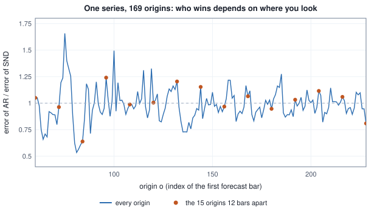

<!-- SPDX-License-Identifier: CC-BY-4.0 -->
<!-- Copyright (c) 2026 Martin Schröder <info@swedishembedded.com> -->

# Evaluating Forecasters Honestly

*How do we tell a forecaster with real skill from one that got lucky?*

Take one series and two forecasters from Chapter 1: the seasonal naive forecast with a drift (call it SND) and the autoregression on seasonal differences (call it AR). Ask each for the next twelve bars and score it by the mean absolute error. Three analysts do this, and none of them cheats.

The first cuts the series at bar $96$, as Chapter 1 did, and finds SND at $0.574$ and AR at $0.712$: AR is worse by a quarter. The second cuts at every twelfth bar from $60$ to $228$, fifteen cuts in all, and averages: SND $0.937$, AR $0.943$, a draw. The third cuts at every bar from $60$ to $228$, $169$ cuts, and finds SND at $0.927$ and AR at $0.899$, with AR the better of the two at $101$ origins. Three correct computations, three different stories about which forecaster to deploy.

Everything below is about what stands behind those differences. A score from a few origins is a draw from a distribution, and the question is how wide it is. A score can be inflated without a single wrong line of arithmetic, by the order in which bars are used, by the way origins overlap, by which baseline was chosen, and by what was looked at before the number was written down. Honest evaluation is mostly a list of such ways, and a procedure that closes each of them.

Scoring a forecast starts from six earlier ideas.

1. (Volume I, Chapter 12) Why is the standard error of the difference between two models smaller when both are scored on the same questions, and when would pairing not help at all?
2. (Volume I, Chapter 12) Twenty variants are each compared with one baseline at the $5\%$ level, and none is really different. What is the chance that at least one is declared different if the tests were independent, and what does Bonferroni's correction do about it?
3. (Volume I, Chapter 12) A bootstrap of the accuracy on clips of sixteen frames resampled the frames and reported a standard error $0.59$ times the true one. What should it have resampled, and why?
4. (Volume II, Chapter 8) What is a baseline for, and what happens to a claimed gain when the baseline was tuned less hard than the method?
5. (Chapter 1) Which two rules make a split of windows leakage-safe, and what does the embargo keep apart?
6. (Chapter 2) At which level does the pinball loss punish an under-forecast nine times as hard as an over-forecast, and how is the CRPS of a forecast given by quantiles related to the pinball loss?

## Walking forward through a series

The three analysts differ in one choice, the set of origins at which the forecaster is asked, and the choice is the first thing a report has to state. A **walk-forward evaluation** is the procedure that makes the choice explicit: it fixes a first origin, a horizon $h$ and a stride, and at each origin $o = o_0 + js$ for $j = 0, 1, 2, \dots$ it forecasts the $h$ bars $o, \dots, o + h - 1$ from the bars before $o$ alone, scores the forecast against what then happened, and moves on. The origin keeps the meaning of Chapter 1, the index of the first bar to be forecast, and a series of $n$ bars admits $N_{\mathrm{orig}} = \lfloor (n - h - o_0)/s \rfloor + 1$ origins, the last being the largest $o_0 + js$ that leaves $h$ bars after it. With $n = 240$, $h = 12$ and $o_0 = 60$, a stride of $1$ gives $169$ origins and a stride of $12$ gives $15$.

```text
function walk_forward(y: array<real>[n], first: int, h: int, stride: int,
        forecast: function(array<real>, int) -> array<real>) -> array<real>:
    require first >= 1 and h >= 1 and stride >= 1, "bad schedule"
    require first + h <= n, "no origin has h bars after it"
    count = floor((n - h - first) / stride) + 1
    E = []
    for j in 0 .. count:
        o = first + j * stride
        f = forecast(y[0:o], h)                # sees the bars 0 .. o - 1 and no others
        append mean(abs(f - y[o:o + h])) to E  # divisor h
    return E
```

The list $E$ holds the loss $E_o$ of the forecaster at each origin; this chapter uses the mean absolute error over the $h$ bars, and any loss of Chapter 2 works the same way. Four choices hide inside the function and each must be printed with a result. The first origin $o_0$ sets how much history the forecaster has at its first test. The stride $s$ sets how many origins there are. The past can **expand**, as here, so that every forecast sees all the bars before its origin, or it can **roll**, so that a forecast sees only the last $c$ bars; a model with a fixed context has no choice. And a forecaster that is fitted must say whether it is refitted at each origin, as AR is here, or fitted once. Refitting at every origin copies what a deployed forecaster does when it is retrained as data arrive, and it costs one fit per origin.

<!-- worked: evaluating_forecasts.origin_lottery -->
Generator: the book's SplitMix64, seed 0xa36d87bca803c1f3 (11776217844986135027). A normal() call that finds a held value returns it without drawing, and a held value left at the end of a series is carried into the next one (the generator is never reset). The series is the recipe of Chapter 1 with n = 240: y_t = 10 + 0.05 t + 3 sin(2 pi t / 12) + u_t with u_t = 0.7 u_(t-1) + 0.6 normal() and u_(-1) = 0, the 240 calls of normal() in increasing t, from the generator named evaluating_forecasts.series. The forecasters are those of Chapter 1, each refitted at every origin o from the bars y_0 .. y_(o-1) alone (an expanding past) and asked for the 12 bars o .. o + 11: SN repeats the last season, y_(o-12+(k mod 12)) for k = 0 .. 11; SND adds to that the drift delta * 12 * (floor(k / 12) + 1) with delta = (y_(o-1) - y_0) / (o - 1); AR forms the seasonal differences z_t = y_t - y_(t-12) for t = 12 .. o - 1, fits z_t = a + b z_(t-1) with an intercept by ordinary least squares over t = 13 .. o - 1, forecasts z_(o+k) = a + b z_(o+k-1) recursively from the last difference z_(o-1) (each forecast difference fed back in), and adds each to the bar of the season before, y_(o+k-12) (for k = 0 .. 11 no forecast bar is needed); naive repeats y_(o-1). The loss at an origin is the mean absolute error over its 12 forecast bars (divisor 12). First table: every 24th origin, SND against AR.

| origin o | MAE of SND | MAE of AR | AR / SND | smaller error |
|---|---:|---:|---:|---:|
| 60 | 1.215 | 1.276 | 1.050 | SND |
| 84 | 0.995 | 0.635 | 0.638 | AR |
| 108 | 0.782 | 0.772 | 0.987 | AR |
| 132 | 0.998 | 1.201 | 1.204 | SND |
| 156 | 1.051 | 1.016 | 0.967 | AR |
| 180 | 0.930 | 0.880 | 0.946 | AR |
| 204 | 1.088 | 1.213 | 1.115 | SND |
| 228 | 0.923 | 0.747 | 0.809 | AR |

| origins used | how many | mean MAE of SND | mean MAE of AR | origins where AR is smaller | skill of AR against SND |
|---|---:|---:|---:|---:|---:|
| the one origin 96 | 1 | 0.574 | 0.712 | 0 | -0.240 |
| 15 origins 60, 72, ..., 228 (every 12th) | 15 | 0.937 | 0.943 | 6 | -0.006 |
| all 169 origins 60, 61, ..., 228 | 169 | 0.927 | 0.899 | 101 | +0.030 |

The ratio AR / SND over the 169 origins has the smallest value 0.534 and the largest 1.658; AR has the smaller error at 101 of them. Skill is 1 minus the ratio of the two mean errors, here the mean over the origins listed in the row.
<!-- /worked -->



The figure is the first table drawn at every origin. The line crosses $1$ again and again, because a forecast error over twelve bars is dominated by whatever the remainder $u_t$ of Chapter 1 happened to do in those twelve bars, and neither forecaster can know that. The first table shows it: AR's error is $0.638$ times SND's at origin $84$ and $1.204$ times at origin $132$. The mean over many origins averages that out, slowly, and the skill printed in the last column (a quantity defined below, the fraction of SND's error that AR removes) goes from $-0.240$ through $-0.006$ to $+0.030$ as the origins go from one to fifteen to a hundred and sixty-nine. Whether the last of these numbers is a finding or a draw is what the rest of the chapter measures. The point to take from the first table is smaller: the disagreement is not an error in anyone's arithmetic. It is what a quantity measured on a short stretch of a series with memory looks like.

## The fit boundary moves with the origin

Both AR and SND are refitted from $y_0, \dots, y_{o-1}$ at origin $o$, so nothing in their fitting can touch a bar at or after $o$. A forecaster fitted on windows, in the way of Chapter 1 and of every pretrained model of Chapter 3 when it is fine-tuned, has a more delicate position, because the windows it learns from have targets of $h$ bars and the targets of recent windows reach past the origin.

Take a window with origin $o'$, whose context is the bars $o' - c, \dots, o' - 1$ and whose target is the bars $o', \dots, o' + h - 1$. At an evaluation origin $o$ the model may be fitted on the bars before $o - e$, where $e \ge 0$ is an embargo, and a window belongs to the fit only if its target also lies in those bars: $o' + h - 1 \le o - e - 1$, that is $o' \le o - e - h$. This is the leakage-safe window rule of Chapter 1 with the cut moving to $T_o = o - e$ as the origin moves; the purge is the requirement that the target end before the cut, and the embargo $e$ is a further margin for a remainder with memory. Only one gap appears here, where Chapter 1 had two, because the evaluation window needs no margin on its far side: a deployed model reads the most recent bars as input.

<!-- worked: evaluating_forecasts.fit_boundary -->
A model fitted by direct windows (context c = 24 bars, target h = 12 bars; the window with origin o' has context bars o' - 24 .. o' - 1 and target bars o' .. o' + 11, as in Chapter 1) is evaluated at an origin o. Its training windows are those with origin from 24 up to the last origin shown; the last target bar they use is last origin + 11. The purged rule keeps windows whose target ends at or before bar o - e - 1, so the last origin is o - e - 12.

| evaluation origin o | rule | last training origin | training windows | last target bar used | reaches bar o or later |
|---|---:|---:|---:|---:|---:|
| 96 | all windows with origin below o | 95 | 72 | 106 | yes |
| 96 | purge only, e = 0 | 84 | 61 | 95 | no |
| 96 | purge and embargo e = 6 | 78 | 55 | 89 | no |
| 96 | purge and embargo e = 12 | 72 | 49 | 83 | no |
| 132 | all windows with origin below o | 131 | 108 | 142 | yes |
| 132 | purge only, e = 0 | 120 | 97 | 131 | no |
| 132 | purge and embargo e = 6 | 114 | 91 | 125 | no |
| 132 | purge and embargo e = 12 | 108 | 85 | 119 | no |
<!-- /worked -->

Take the first block of the table. At origin $96$ the rule that uses every window with an origin before $96$ has $72$ training windows, and the last of them has origin $95$ and a target that runs to bar $106$: the training set contains the evaluation target, since it holds bars $96$ to $106$, eleven of the twelve bars to be forecast. Purging at the origin removes the $11$ windows whose targets cross it and leaves $61$, ending at bar $95$. An embargo of $6$ leaves $55$ windows and an embargo of $12$ leaves $49$. That the cost of the safe rule is a handful of windows, and the cost of the unsafe one is the whole evaluation, is the usual trade, and a later section puts a number on the second.

The same rule governs everything else that is learned from data. A scale fitted for a series, a hyperparameter, the choice among models, the length of the context: each is learned from some bars, and those bars must precede the bars on which the result is judged. This gives a name to the property the chapter is about. An **out-of-sample test** is a score on bars that came after, and played no part in, the fitting of the model, the choice among models and settings, and the choice of what to report. The first two parts of the definition are the leakage rule of Chapter 1. The third part is the one that is broken most often and least noticeably, and the section on a spent test set returns to it.

## Errors that can be compared across series

A mean absolute error has the units of the series. To average it over a panel of series with levels of $5$, $50$ and $500$ (the panel of Chapter 1) is to let the largest series decide, and to quote it for a single series is to say nothing about how hard that series is. A scale-free error divides by something that carries the units and measures how hard the series is. Percentage errors divide by the actual value and are undefined at zero and lopsided between over- and under-forecasts. Dividing by the mean level is not invariant to a change of origin of the units: the temperature in kelvin is an easier series than the temperature in degrees Celsius by that measure. The error that survives these objections divides by the error of a forecaster that needs nothing: the **mean absolute scaled error**.

For a past $y_0, \dots, y_{o-1}$ and a period $m$ let

$$\Delta_m = \frac{1}{o - m} \sum_{t=m}^{o-1} |y_t - y_{t-m}|$$

be the mean absolute difference between each bar of the past and the bar $m$ steps earlier, the in-sample error of the forecaster that repeats the value $m$ bars ago (seasonal naive for $m$ equal to the season, naive for $m = 1$). The MASE of a forecast at origin $o$ is its mean absolute error over the $h$ bars divided by $\Delta_m$ of the past before $o$. The scale is computed from the past of the origin and from nothing later, which is the same rule as for the scalers of Chapter 3: a scale taken from the whole series would carry the future into the metric.

```text
function mase(pred: array<real>[h], actual: array<real>[h], past: array<real>[o], m: int) -> real:
    require m >= 1 and len(past) > m, "past no longer than the period"
    scale = mean(abs(past[m:o] - past[0:o - m]))     # divisor o - m
    require scale > 0.0, "a constant past has no scale"
    return mean(abs(pred - actual)) / scale
```

The choice of $m$ matters more than it looks. Write MASE under both periods for the two forecasters at two origins, then over every origin.

<!-- worked: evaluating_forecasts.mase_scales -->
Generator: the book's SplitMix64, seed 0xa36d87bca803c1f3 (11776217844986135027). A normal() call that finds a held value returns it without drawing, and a held value left at the end of a series is carried into the next one (the generator is never reset). The series is the recipe of Chapter 1 with n = 240: y_t = 10 + 0.05 t + 3 sin(2 pi t / 12) + u_t with u_t = 0.7 u_(t-1) + 0.6 normal() and u_(-1) = 0, the 240 calls of normal() in increasing t, from the generator named evaluating_forecasts.series. The forecasters are those of Chapter 1, each refitted at every origin o from the bars y_0 .. y_(o-1) alone (an expanding past) and asked for the 12 bars o .. o + 11: SN repeats the last season, y_(o-12+(k mod 12)) for k = 0 .. 11; SND adds to that the drift delta * 12 * (floor(k / 12) + 1) with delta = (y_(o-1) - y_0) / (o - 1); AR forms the seasonal differences z_t = y_t - y_(t-12) for t = 12 .. o - 1, fits z_t = a + b z_(t-1) with an intercept by ordinary least squares over t = 13 .. o - 1, forecasts z_(o+k) = a + b z_(o+k-1) recursively from the last difference z_(o-1) (each forecast difference fed back in), and adds each to the bar of the season before, y_(o+k-12) (for k = 0 .. 11 no forecast bar is needed); naive repeats y_(o-1). At origin o, Delta_m is the mean absolute seasonal difference of the past, (1 / (o - m)) times the sum over t = m .. o - 1 of |y_t - y_(t-m)|, and the MASE of a forecaster at o is its MAE over the 12 forecast bars divided by Delta_m of the same past. First table: the two origins; second table: the mean of the MASE over all 169 origins 60 .. 228. Third table: SN on the same series and on the series y'_t = y_t + 27 sin(2 pi t / 12) (the library sine, the same normal() draws), over the same 169 origins.

| origin o | forecaster | MAE | Delta_1 of y_0 .. y_(o-1) | Delta_12 | MASE with m = 1 | MASE with m = 12 |
|---|---:|---:|---:|---:|---:|---:|
| 96 | seasonal naive with drift | 0.574 | 0.999 | 1.100 | 0.575 | 0.522 |
| 96 | AR(1) on seasonal differences | 0.712 | 0.999 | 1.100 | 0.713 | 0.648 |
| 228 | seasonal naive with drift | 0.923 | 1.025 | 1.015 | 0.900 | 0.910 |
| 228 | AR(1) on seasonal differences | 0.747 | 1.025 | 1.015 | 0.728 | 0.736 |

| forecaster | mean MASE, m = 1 | mean MASE, m = 12 |
|---|---:|---:|
| seasonal naive | 0.994 | 1.004 |
| seasonal naive with drift | 0.912 | 0.919 |
| AR(1) on seasonal differences | 0.884 | 0.892 |
| naive | 2.509 | 2.519 |

| series | mean MAE of SN | Delta_1 at o = 96 | Delta_12 at o = 96 | mean MASE, m = 1 | mean MASE, m = 12 |
|---|---:|---:|---:|---:|---:|
| amplitude 3 (the series above) | 1.012 | 0.999 | 1.100 | 0.994 | 1.004 |
| amplitude 30 (27 sin(2 pi t / 12) added) | 1.012 | 9.913 | 1.100 | 0.102 | 1.004 |
<!-- /worked -->

On the series of this chapter, whose season has amplitude $3$, the two scales are close, $\Delta_1 = 0.999$ and $\Delta_{12} = 1.100$ at origin $96$, and the two columns of the first table nearly agree. The third table shows why that is luck. Add to the same series a seasonal term $27 \sin(2\pi t/12)$, so that the season has amplitude $30$ and the noise is the same noise. A seasonal forecast copies a seasonal term exactly, so the error of seasonal naive does not change at all (its mean absolute error is $1.012$ in both rows), and a forecaster has not become better because the series acquired a larger season. The MASE with $m = 12$ stays at $1.004$. The MASE with $m = 1$ falls from $0.994$ to $0.102$, because the lag-1 scale $\Delta_1$ has grown to $9.913$ with the swing of the season. A MASE scaled by the one-step naive error, used on seasonal data, rewards the data for being seasonal.

Two more properties are worth keeping in mind. A MASE of $1$ means that the forecast error equals the in-sample one-step seasonal-naive error of that past, not that the forecast is as good as the seasonal-naive forecast at horizon $h$; the two happen to agree on this stationary series (the mean MASE of seasonal naive is $1.004$) and need not on one with a trend. And the scale is zero for a constant past, where the MASE is undefined and the algorithm refuses; a library that silently returns the unscaled error there changes the unit of one entry of an average of ratios, and that is not a convention a panel mean can survive.

## Quantile forecasts in one number: what the weighted quantile loss counts

A forecast given as quantiles, in the sense of Chapter 2, is scored by the pinball loss at each level. To report one number for a panel the leaderboards of pretrained forecasters use the **weighted quantile loss**: the mean over the $Q$ levels of a set $\mathcal{T}$ of twice the sum of the pinball losses over all bars at that level, divided by the sum of the absolute actual values,

$$\mathrm{wQL} = \frac{1}{Q} \sum_{\tau \in \mathcal{T}} \frac{2 \sum_{t} L_\tau(q_{t,\tau}, y_t)}{\sum_t |y_t|}.$$

At the single level $\tau = 0.5$ the pinball loss is half the absolute error, so the factor $2$ makes the median wQL the absolute error normalised by the magnitude of the actuals. The word weighted records that the denominator is a sum of magnitudes: when the numerators and the denominators are first summed across a panel of series, the large series count more; when each window is normalised separately and the results averaged, each window counts the same. Both are defensible, and a report says which.

What the formula counts is easiest to see on four bars. The table prints every pinball loss, the sum over the levels at three grids, and the wQL, which is that sum divided by $Q$.

<!-- worked: evaluating_forecasts.wql_counts -->
Actuals y = (10, 12, 9, 14), four bars. The forecast of bar t is the Gaussian with mean mu = (10.5, 11, 10, 13) and standard deviation 2, so its quantile at level tau is mu_t + 2 z_tau with z_tau the library inverse of the standard Gaussian distribution function (z_0.5 = 0, z_0.1 = -1.281552, z_0.9 = +1.281552; any inverse-distribution routine accurate to 1e-6 reproduces the table), and the last row of the second table adds 100 to every actual and every mean. The pinball loss of a quantile q against y at level tau is max(tau (y - q), (tau - 1)(y - q)). The sum over levels is 2 times the sum of the pinball losses over all bars and all levels, divided by the sum of |y_t| = 45; the wQL is that sum divided by the number of levels Q.

| bar t | actual y_t | mu_t | pinball at 0.1 | pinball at 0.5 | pinball at 0.9 |
|---|---:|---:|---:|---:|---:|
| 0 | 10.0 | 10.5 | 0.2063 | 0.2500 | 0.3063 |
| 1 | 12.0 | 11.0 | 0.3563 | 0.5000 | 0.1563 |
| 2 | 9.0 | 10.0 | 0.1563 | 0.5000 | 0.3563 |
| 3 | 14.0 | 13.0 | 0.3563 | 0.5000 | 0.1563 |

| levels used | number of levels Q | sum over levels | wQL (sum divided by Q) |
|---|---:|---:|---:|
| 0.5 | 1 | 0.0778 | 0.0778 |
| 0.1, 0.5, 0.9 | 3 | 0.1689 | 0.0563 |
| 0.1, 0.2, ..., 0.9 | 9 | 0.5383 | 0.0598 |
| 0.1, 0.5, 0.9, every y_t and mu_t raised by 100 | 3 | 0.0171 | 0.0057 |
<!-- /worked -->

Take the same forecast at three grids of levels. The sum over levels is $0.0778$ at the median alone, $0.1689$ at the grid $0.1, 0.5, 0.9$ and $0.5383$ at the nine levels $0.1, \dots, 0.9$. The forecast has not changed, and the number has grown seven-fold, because a sum grows with the number of levels $Q$, and it is not what is reported. The wQL, the mean over the levels, is $0.0778$, $0.0563$ and $0.0598$ and does not run away, which is why brain's `weighted_quantile_loss` divides by the number of levels: two forecasters scored on different grids are then not separated by their grids alone. The wQL is twice the mean pinball loss over the levels divided by the sum of magnitudes, which Chapter 2 identified with the CRPS (the integral of the pinball loss over the levels, estimated on a grid), here normalised by the same denominator.

The last row of the second table shows the other sensitivity. The same forecast and the same actuals, all raised by $100$, give a wQL of $0.0057$ against $0.0563$. The pinball losses have not changed (shifting the actuals and the quantiles together leaves every difference as it was) and the denominator has grown from $45$ to $445$. A score that falls tenfold when the units gain an offset is a statement about the denominator. It makes the wQL a poor metric for a series that is centred near zero (a return), where the denominator is small and the score is huge, and a good reason to report the MASE alongside it: the MASE is unchanged by a shift and by a scale.

## Skill: how much of the baseline's error is gone

A single error means nothing until it is set beside what a forecaster that needs no skill would have scored. Chapter 1 supplied those forecasters and Volume II said what a baseline is for. The **forecast skill score** turns the comparison into one number: for a forecaster A and a baseline over the same origins,

$$\mathrm{Sk} = 1 - \frac{\bar E^{\mathrm{A}}}{\bar E^{\mathrm{base}}}, \qquad \bar E = \frac{1}{N_{\mathrm{orig}}} \sum_o E_o,$$

the fraction of the baseline's mean loss that the forecaster removes. It is $0$ for a forecaster no better than the baseline, $1$ for a perfect one, and has no lower bound: a forecaster twice as bad as its baseline has a skill of $-1$. Both means are taken over the same origins, because the comparison is paired, and the skill is a ratio of means rather than a mean of per-origin ratios. A mean of ratios lets one origin with a tiny baseline error produce an enormous ratio and decide the result; the ratio of means weighs every origin by the size of its baseline error, which is the cost the error measures.

```text
function skill(E_model: array<real>[K], E_base: array<real>[K]) -> real:
    require len(E_model) == len(E_base) and len(E_base) >= 1, "losses must be paired by origin"
    require mean(E_base) > 0.0, "the baseline has no error to remove"
    return 1.0 - mean(E_model) / mean(E_base)
```

The number depends on the baseline as much as on the model, and that is the second place where a score can be inflated by choice.

<!-- worked: evaluating_forecasts.skill_matrix -->
The 169 origins 60 .. 228 of the first example (series seed 0xa36d87bca803c1f3 (11776217844986135027)). Each entry is the skill of the forecaster in the row against the baseline in the column, 1 - (mean MAE of the forecaster) / (mean MAE of the baseline) over all 169 origins.

| forecaster | against naive | against SN | against SND |
|---|---:|---:|---:|
| seasonal naive | +0.604 | - | -0.092 |
| seasonal naive with drift | +0.637 | +0.084 | - |
| AR(1) on seasonal differences | +0.648 | +0.112 | +0.030 |
<!-- /worked -->

The same AR forecaster has a skill of $0.648$ against the naive forecast, $0.112$ against seasonal naive and $0.030$ against seasonal naive with drift. Each is correct and the first is the one a marketing page would use. The honest baseline is the strongest forecaster that costs nothing to build, which for this series is SND, and the three numbers also say that most of what AR gains over naive is the season and the drift that SND already has.

The one the repository's own tables use needs a remark. `crates/forecast/src/metrics.rs` defines a skill score as $\mathrm{clamp}(1 - e/e_{\mathrm{base}}, 0, 1)$, and the report of `crates/fcbench` prints it as the "skill vs naive" table. The clamp turns every forecaster worse than its baseline into a $0$. A forecaster $5\%$ worse than naive and one $300\%$ worse print the same entry, and the table of a comparison that has gone wrong looks like the table of one that has found nothing. The unclamped skill above keeps the sign, and the sign is what an evaluator most needs to see.

## An error bar for skill that respects the order

A skill of $0.030$ over $169$ origins needs an error bar. Volume I supplied the bootstrap, and its cluster version is the one that applies: the observations are not independent, and one must resample the unit within which they depend. The origins of a walk-forward evaluation are not independent. Neighbouring origins forecast overlapping bars (origin $o$ and origin $o + 1$ share eleven of their twelve targets), and the errors of a forecaster have memory beyond that. The resampling unit is a block of consecutive origins: the **moving-block bootstrap** draws $\lceil K/\mathrm{blk} \rceil$ blocks of $\mathrm{blk}$ consecutive origins, each starting at a uniformly chosen position, lays them end to end, cuts the result to the original $K$ origins, and recomputes the skill; the interval is the pair of percentiles of the resampled skills. The same indices are used for the model and the baseline, which is what keeps the comparison paired.

```text
function bootstrap_skill(E_model: array<real>[K], E_base: array<real>[K], blk: int,
        resamples: int, rng: Generator) -> (real, real):
    require len(E_model) == len(E_base) and 1 <= blk and blk <= len(E_base), "bad block length"
    K = len(E_base)
    values = []
    for r in 0 .. resamples:
        idx = []
        for b in 0 .. ceil(K / blk):
            s = rng.integer(K - blk + 1)         # the block starts at s
            for j in 0 .. blk:
                append s + j to idx
        idx = idx[0:K]                           # cut to K origins
        append skill(rows(E_model, idx), rows(E_base, idx)) to values
    return (percentile(values, 0.025), percentile(values, 0.975))
```

With a block length of $1$ this is the plain bootstrap that treats the origins as independent. The table sets it against longer blocks for two comparisons.

<!-- worked: evaluating_forecasts.skill_intervals -->
The losses of the previous example (series seed 0xa36d87bca803c1f3 (11776217844986135027)). Skill of a model against a baseline is 1 - (mean model loss) / (mean baseline loss) over the origins in the row. The interval is the 2.5th and 97.5th percentile (the book's `percentile`) of the skill over 2000 resamples of the origins: a resample is ceil(K / blk) blocks of blk consecutive origins, each block starting at rng.integer(K - blk + 1) in the row's list of K origins, laid end to end and cut to K; the same indices are used for model and baseline. One generator (seed 0xe50e1657af0f1460 (16505154250214413408)) draws every row in the table's order, row after row, resample after resample.

| comparison | origins and blocks | skill | 2.5th percentile | 97.5th percentile | interval |
|---|---:|---:|---:|---:|---:|
| AR against SND | all 169 origins, blocks of 1 (independent origins) | +0.030 | +0.0029 | +0.0585 | excludes 0 |
| AR against SND | all 169 origins, blocks of 6 | +0.030 | -0.0172 | +0.0731 | contains 0 |
| AR against SND | all 169 origins, blocks of 12 | +0.030 | -0.0079 | +0.0618 | contains 0 |
| AR against SND | all 169 origins, blocks of 24 | +0.030 | +0.0002 | +0.0518 | excludes 0 |
| AR against SND | 15 origins 12 apart, blocks of 1 | -0.006 | -0.0753 | +0.0658 | contains 0 |
| SND against SN | all 169 origins, blocks of 1 (independent origins) | +0.084 | +0.0357 | +0.1292 | excludes 0 |
| SND against SN | all 169 origins, blocks of 6 | +0.084 | +0.0001 | +0.1840 | excludes 0 |
| SND against SN | all 169 origins, blocks of 12 | +0.084 | +0.0109 | +0.2039 | excludes 0 |
| SND against SN | all 169 origins, blocks of 24 | +0.084 | +0.0404 | +0.1995 | excludes 0 |
| SND against SN | 15 origins 12 apart, blocks of 1 | +0.065 | -0.0557 | +0.1716 | contains 0 |
<!-- /worked -->

For AR against SND, the plain bootstrap gives an interval for the skill from $+0.0029$ to $+0.0585$, which excludes zero and would be reported as a finding. Blocks of $12$, the horizon, give $-0.0079$ to $+0.0618$, which does not. The interval is about the same width on the upper side and is lower on the lower side, as it must be when the origins that were treated as independent were not. The two other block lengths show the cost of the tuning knob: at a block length of $6$ the lower end is $-0.0172$, and at $24$ it is $+0.0002$, on the edge of zero. A verdict that depends on the block length is not a verdict, and the sound practice is to fix the block length at the horizon before the data are seen and to say so. The second comparison is robust: SND against seasonal naive has a skill of $+0.084$ and every interval of the table excludes zero for it except on fifteen origins, whose interval is far too wide to claim anything.

The last row of each comparison is the walk-forward evaluation that a team with a slow model would run: fifteen origins twelve bars apart, a plain bootstrap of $15$ values. AR against SND has a skill of $-0.006$ there, with an interval from $-0.075$ to $+0.066$. A result of that width is not a negative finding about AR. It says that fifteen origins of one series cannot distinguish a $3\%$ difference from a $-3\%$ one.

## The Diebold-Mariano test, and why the overlap matters

The bootstrap needs a block length and a computer. The older answer is a formula. Let $d_o = E_o^{\mathrm{base}} - E_o^{\mathrm{A}}$ be the difference of the two losses at origin $o$, positive when the forecaster is better, and $\bar d$ its mean over $N_{\mathrm{orig}}$ origins; the skill of the previous section is $\bar d / \bar E^{\mathrm{base}}$. The mean of a dependent sequence has the variance

$$\mathrm{Var}(\bar d) = \frac{1}{N_{\mathrm{orig}}}\Bigl[\gamma_0 + 2 \sum_{k=1}^{N_{\mathrm{orig}} - 1} \bigl(1 - \tfrac{k}{N_{\mathrm{orig}}}\bigr) \gamma_k \Bigr],$$

where $\gamma_k$ is the autocovariance of $d$ at lag $k$ in the sense of Chapter 1, with the divisor $N_{\mathrm{orig}}$ at every lag. For independent origins every $\gamma_k$ with $k \ge 1$ is zero and the bracket is $\gamma_0$, the variance Volume I used for a paired test. For forecasts of horizon $h$ the origins within $h - 1$ of each other share bars, and $d_o$ is correlated with the next $h - 1$ differentials; the $h$-step errors of a forecaster that uses everything it has are a moving average of order $h - 1$, so from origins $h$ or more apart they share no bars and are uncorrelated. The **Diebold-Mariano test** keeps the terms up to lag $h - 1$ and drops the rest:

$$\hat v = \hat\gamma_0 + 2 \sum_{k=1}^{h-1} w_k \hat\gamma_k, \qquad \mathrm{DM} = \frac{\bar d}{\sqrt{\hat v / N_{\mathrm{orig}}}},$$

with $w_k = 1$ in the original rectangular form and $w_k = 1 - k/h$ in the Bartlett form, which is guaranteed to give a positive $\hat v$. The statistic is compared with the Gaussian, or for small samples with Student's $t$ on $N_{\mathrm{orig}} - 1$ degrees of freedom after a correction $\sqrt{(N_{\mathrm{orig}} + 1 - 2h + h(h-1)/N_{\mathrm{orig}})/N_{\mathrm{orig}}}$ of Harvey, Leybourne and Newbold. Any loss can be used; the test is about the mean of the differential.

```text
function dm_statistic(d: array<real>[K], lag: int, bartlett: bool) -> real:
    require lag >= 0 and lag < len(d), "lag must be below the number of origins"
    K = len(d)
    dbar = mean(d)
    v = 0.0
    for k in 0 ..= lag:
        g = sum((d[t] - dbar) * (d[t + k] - dbar) for t in 0 .. K - k) / K     # divisor K at every lag
        w = 1.0
        if bartlett:
            w = 1.0 - k / (lag + 1)
        if k == 0:
            v = v + g
        else:
            v = v + 2.0 * w * g
    require v > 0.0, "the long-run variance estimate is not positive: no statistic"
    return dbar / sqrt(v / K)
```

For the horizon $h$ the call is `dm_statistic(d, h - 1, ...)`. Apply it to the differential of the first example.

<!-- worked: evaluating_forecasts.dm_on_series -->
The losses of the first example (series seed 0xa36d87bca803c1f3 (11776217844986135027)), horizon h = 12. d_o = (MAE of SND at o) - (MAE of AR at o) for the 169 origins o = 60 .. 228, positive when AR is better; its mean is 0.0278. gamma_k is the autocovariance of d at lag k with the mean of d removed and the divisor 169 at every lag. The long-run variance is gamma_0 + 2 (sum over k = 1 .. 11 of w_k gamma_k) with w_k = 1 (rectangular) or w_k = 1 - k / 12 (Bartlett), and gamma_0 alone for independent origins; the statistic is the mean of d divided by the square root of (long-run variance / 169), and its p-value is 1 - erf(|statistic| / sqrt(2)).

| lag k | gamma_k of d | gamma_k / gamma_0 |
|---|---:|---:|
| 0 | 0.0299 | 1.000 |
| 1 | 0.0209 | 0.700 |
| 2 | 0.0123 | 0.412 |
| 3 | 0.0041 | 0.138 |
| 4 | -0.0033 | -0.112 |
| 5 | -0.0071 | -0.239 |
| 6 | -0.0084 | -0.280 |
| 7 | -0.0088 | -0.294 |
| 8 | -0.0079 | -0.265 |
| 9 | -0.0074 | -0.248 |
| 10 | -0.0061 | -0.205 |
| 11 | -0.0052 | -0.174 |

| estimate of the variance of d used | long-run variance | statistic | two-sided p (Gaussian) |
|---|---:|---:|---:|
| independent origins (lag 0) | 0.0299 | 2.09 | 0.0363 |
| rectangular weights, lag 11 | -0.0040 | none: the estimate is not positive | - |
| Bartlett weights, lag 11 | 0.0545 | 1.55 | 0.1214 |
<!-- /worked -->

The differential has an autocorrelation of $0.700$ at lag $1$ and $0.412$ at lag $2$, which is the overlap showing, and then turns negative from lag $4$ to $-0.294$ at lag $7$. The test that treats the origins as independent gives a statistic of $2.09$ and a $p$-value of $0.0363$, a result at the $5\%$ level. The rectangular long-run variance with lag $11$ is $-0.0040$: the negative autocovariances at long lags more than cancel the positive ones, the estimate of a variance is negative, and there is no statistic. That can happen to the rectangular form and is why the Bartlett weights exist. With them the long-run variance is $0.0545$, nearly twice the independent estimate $0.0299$, the statistic is $1.55$ and the $p$-value is $0.1214$. The data cannot tell AR from SND, which agrees with the block bootstrap of blocks of $12$.

An estimator that sometimes goes negative, and one that is guaranteed positive, ought to be checked on a case where the answer is known. The table below creates one. There is no difference between the forecasters, and the loss differential is constructed to have the correlation that overlap produces: $d_t = \tfrac{1}{\sqrt{12}} (\xi_t + \dots + \xi_{t+11})$ for independent Gaussian draws $\xi$, a moving sum of twelve independent shocks, which is what the differences of $12$-bar errors of a random walk look like. The true mean is zero, so a test at the $5\%$ level should reject $5\%$ of the time.

<!-- worked: evaluating_forecasts.dm_size -->
Differentials with no true difference: d_t = (1 / sqrt(12)) (xi_t + xi_(t+1) + ... + xi_(t+11)) for t = 0 .. K - 1 with xi the standard Gaussian calls of one generator per row of the table (seed 0xb8593bc0423469f2 (13283714272836479474), a fresh generator for each K), the K + 11 calls of normal() of a replicate in order, 2000 replicates in turn; d has mean 0, variance 1 and autocovariance (12 - k) / 12 at lag k < 12. Each statistic is that of the previous example with horizon 12 (the 'rectangular with factor' column is the rectangular statistic multiplied by the Harvey-Leybourne-Newbold factor sqrt((K + 1 - 2h + h (h - 1) / K) / K) with h = 12); the Gaussian columns reject when its absolute value exceeds 1.959964, the small-sample column when it exceeds the Student t multiplier of K - 1 degrees of freedom shown. A replicate whose rectangular long-run variance is not positive has no rectangular statistic and is counted as not rejecting.

| K origins | t multiplier | independent origins | rectangular | rectangular with factor | Bartlett | replicates with no rectangular statistic |
|---|---:|---:|---:|---:|---:|---:|
| 40 | 2.023 | 0.609 | 0.295 | 0.169 | 0.302 | 37 |
| 100 | 1.984 | 0.616 | 0.149 | 0.100 | 0.194 | 0 |
| 400 | 1.966 | 0.585 | 0.058 | 0.051 | 0.115 | 0 |
| 1600 | 1.961 | 0.573 | 0.046 | 0.045 | 0.098 | 0 |
<!-- /worked -->

The test that treats the origins as independent rejects about six times in ten at every number of origins, and more origins do not repair it: its variance estimate is $1$, the long-run variance is $12$, and its statistic is $\sqrt{12} = 3.5$ times too large however many origins are used. The rectangular form with the correct lag is right in the limit (the rate is $0.058$ at $400$ origins and $0.046$ at $1600$) and wrong for few origins: $0.295$ at $40$ and $0.149$ at $100$, with $37$ of $2000$ replicates at $40$ origins having no statistic at all. The small-sample correction with the $t$ multiplier brings the rates to $0.169$ and $0.100$, which roughly halves the excess over the nominal rate and still leaves twice the nominal rate at $100$ origins. The Bartlett weights keep the variance positive and pay for it: they shrink every autocovariance at lag $k$ by $1 - k/12$, and as the true autocovariances of this process are large at every lag up to eleven, the estimate is biased low and the test rejects $0.194$, $0.115$ and $0.098$ of the time at $100$, $400$ and $1600$ origins, twice the nominal rate even with many origins. The setting of the table is a clean one and a real differential is harder. The practical reading is that a Diebold-Mariano test with a horizon of twelve needs hundreds of origins before its nominal level is believable, and that the block bootstrap and the test, with their different failure modes, are best read together.

## Why a smaller stride buys nothing

The loop of a walk-forward evaluation has a stride, and the obvious way to get a tighter error bar is to set it to $1$ and use every origin. The previous section already contains the reason that this does not work, and the following table measures it.

<!-- worked: evaluating_forecasts.stride_information -->
Differentials of 12-bar forecasts over a stretch of 288 bars: xi_0 .. xi_287 are 288 calls of normal() (seed 0xebda8d453165b9b4 (16995051472156998068), a fresh generator for each stride, 2000 replicates in turn), the origin number t of stride s has d_t = (1 / sqrt(12)) (xi_(s t) + ... + xi_(s t + 11)), and the origins are t = 0 .. K - 1 with K = floor((288 - 12) / s) + 1. 'Spread of the mean' is the standard deviation (divisor 1999) of the mean of d over the replicates, the true size of the error bar. The two error-bar columns are the mean over the replicates of sqrt(estimate / K) where the estimate is the independent-origins variance gamma_0 or the rectangular long-run variance with lag ceil(12 / s) - 1 (the rule `tools/forecast/oos_skill_report.py` uses for the number of lags).

| stride s | origins K | spread of the mean of d | error bar, independent origins | error bar, overlap-aware |
|---|---:|---:|---:|---:|
| 1 | 277 | 0.2054 | 0.0585 | 0.1946 |
| 2 | 139 | 0.2049 | 0.0826 | 0.1950 |
| 3 | 93 | 0.2044 | 0.1009 | 0.1953 |
| 4 | 70 | 0.2041 | 0.1164 | 0.1957 |
| 6 | 47 | 0.2031 | 0.1420 | 0.1964 |
| 12 | 24 | 0.2017 | 0.1983 | 0.1983 |
<!-- /worked -->


Over a fixed stretch of $288$ bars, the true size of the error bar on the mean differential is $0.205$ at stride $1$ and $0.202$ at stride $12$: nothing was gained by using $277$ origins in place of $24$. The error bar that an evaluator reports when it treats the origins as independent is $0.0585$ at stride $1$, which is smaller than the truth by a factor of $3.5$, and rises to $0.198$ at stride $12$, where the origins no longer overlap and the independent formula is right. The overlap-aware estimate, in the last column, tracks the truth throughout. For a horizon of $h$, the number of independent comparisons a stretch of bars holds is about its length divided by $h$, however densely the origins are placed. A stride below the horizon gives a reader the impression of a larger sample, and costs forecasts: $277$ against $24$ forecasts for every model compared, a factor of $11.5$ in the work of evaluating a pretrained forecaster whose cost per forecast is that of Chapter 3, for the same information. A stride below the horizon is not wrong; it averages the same information over more origins, and the evaluator must then report an error bar that knows the origins overlap.

## How many series, how many origins

The remaining source of independence is the series. Series are different draws of the world; where the origins of one series share a past and a persistent remainder, two series share nothing. A forecasting benchmark is therefore a panel, and the question of how large a panel has to be before a difference is real has a formula. Let each series contribute a difference $m_i$ (the mean over its origins of $E^{\mathrm{base}} - E^{\mathrm{A}}$), and let the differences have mean $m$ and standard deviation $s$ over series. A test on $N$ series has the statistic $\bar m / (s/\sqrt{N})$, which for a true mean $m$ is about Gaussian with mean $m \sqrt{N}/s$ and unit variance. It exceeds the critical value $1.959964$ with probability $0.8$ when $m\sqrt{N}/s - 1.959964 = 0.841621$, so that

$$N = \Bigl(\frac{(1.959964 + 0.841621)\,s}{m}\Bigr)^2 .$$

The number of series needed grows as the square of the ratio of the spread to the effect. The table builds the ratio from a panel of $200$ series and from three ways of scoring each series, and then tests the formula by drawing panels of $N$ series from the $200$.

<!-- worked: evaluating_forecasts.how_many_series -->
200 series drawn from one generator (seed 0x9a904872222d4635 (11137481533524100661)), each by the recipe of Chapter 1 with n = 240 (its 240 calls of normal() in turn, series after series). On each series, SND and AR are evaluated at the origins of the row (h = 12, expanding past, as in the first example); the series' difference is the mean over those origins of (MAE of SND) - (MAE of AR), positive when AR is better. 'Needed' is the number of series ceil(((1.959964 + 0.841621) * s / m)^2) for a two-sided test at the 5 percent level to find a mean difference m with probability 0.8 when the differences have standard deviation s (divisor 199). The last columns are the share of 1000 draws of N series with replacement from the 200 differences for which mean / (sd / sqrt(N)) exceeds 1.959964 (sd with divisor N - 1); a fresh generator (seed 0x74c183fef5c7cb14 (8413150709973240596)) for each row, drawing the columns in order, N after N, each draw being N calls of rng.integer(200) (rows do not share a stream).

| origins per series | mean difference m | s | series needed | share significant, N = 5 | share significant, N = 10 | share significant, N = 20 | share significant, N = 40 | share significant, N = 80 |
|---|---:|---:|---:|---:|---:|---:|---:|---:|
| 1 origin (o = 144) | +0.013 | 0.150 | 986 | 0.108 | 0.087 | 0.093 | 0.114 | 0.141 |
| 5 origins (60, 96, 132, 168, 204) | +0.023 | 0.074 | 84 | 0.196 | 0.213 | 0.309 | 0.509 | 0.793 |
| 15 origins (60, 72, ..., 228) | +0.023 | 0.038 | 22 | 0.383 | 0.514 | 0.761 | 0.958 | 0.999 |
<!-- /worked -->


The mean difference between SND and AR is about $0.023$ in the mean absolute error, which is $2.4\%$ of the loss of SND. When each series is judged on its $15$ origins twelve bars apart the standard deviation of the differences is $0.038$, and the formula asks for $22$ series; drawing panels agrees, with $0.761$ of the panels of $20$ finding AR better and $0.958$ of the panels of $40$. When each series is judged on five origins the spread is $0.074$ and the formula asks for $84$, and when each is judged on a single origin the spread is $0.150$ and it asks for $986$: the draws never rise above $0.141$ even at $80$ series. The mean of the single-origin row is not $0.023$ but $0.013$, because a single origin is the luck of the first section: one origin is a poor estimate of what the forecaster does on average.

Two things follow. A claim that a forecaster is better, made on a panel and stated with its number of series and origins, can be checked against this formula by anyone with a guess at $s/m$, and a small panel of one origin each is a coin toss however large the dataset looks. And the cheapest way to shrink the spread $s$ is more origins per series, up to about the length of the series divided by the horizon, and past that more series. The formula assumes that each series has the same weight and that the differences are not heavy tailed; a panel dominated by a few large series, or a loss that is not scale free, makes the effective number of series much smaller than the number counted.

## A test set that has been looked at is a training set

The panel of the previous section lets one see in a few lines what the third clause of the definition of an out-of-sample test is for. Split each series' origins into the first seven (the origins $60, 72, \dots, 120$) and the last eight, and call the mean difference of SND minus AR on them $a$ and $b$. Rank the $200$ series by $a$ and look at the twenty at the top.

<!-- worked: evaluating_forecasts.selection_spent -->
The 200 series of the previous example (seed 0x9a904872222d4635 (11137481533524100661)). For each series, a is the mean over the first 7 of its 15 origins (60, 72, ..., 120) of (MAE of SND) - (MAE of AR), and b the mean over the last 8 (132, 144, ..., 228); positive favours AR. Series are ranked by a, largest first, a tie to the lower series number. Each row is the mean of a and of b over the series it names.

| series chosen | mean of a (origins used to choose) | mean of b (origins not used) |
|---|---:|---:|
| all 200 series | +0.0215 | +0.0240 |
| the 20 series with the largest difference on the first 7 origins | +0.1101 | +0.0130 |
| the 20 series with the smallest difference on the first 7 origins | -0.0922 | +0.0194 |
<!-- /worked -->

The twenty series at which AR looked best on the first seven origins have a mean difference of $+0.1101$ there, five times the panel's $+0.0215$. On the eight origins that played no part in the choice they have $+0.0130$, less than the panel's own $+0.0240$. The twenty at the bottom, chosen for having AR look worst, have $-0.0922$ on the origins used for the choice and $+0.0194$ on the others. Both groups regress to the mean of the panel, because the differences on seven origins are mostly noise and a group chosen for having a large noise term has one only on the data that were used to choose it. The first column of the second and third rows is what an evaluation reports if it picks the series, the horizons, the metric or the model after looking, and then scores them on the same origins; the second column is what the pick is worth.

This is the third clause of the definition. The same arithmetic applies to any choice made after seeing a score: the best of fifteen variants, the best checkpoint of a run, the horizon at which a model looks good, the threshold at which a fine-tuned model is promoted. Each choice spends part of the test set, because the origins used to choose are no longer a fair judge of the choice. The defences are the ones Volume II taught for the validation set: choose on origins that come before the test origins, and look at the test origins once, for the final candidate. A walk-forward evaluation is cheap to repeat and therefore easy to overuse; the number of times it was repeated, and what changed between the repetitions, belongs in the report with the score.

## Picking the best horizon, or the best series

The simplest way to spend a test set is to report only part of it. A forecaster is evaluated at twelve horizons, on forty series, and the report names the horizon or the series where it did best. The family of comparisons here is the one of Volume I, Chapter 12, and the table builds one on purpose where the forecaster has no skill to find.

<!-- worked: evaluating_forecasts.cherry_horizons -->
40 driftless random walks of 160 bars (seed 0xf628e3cd3344ebe5 (17737677602866654181), one generator, series after series): s_0 = normal(), s_t = s_(t-1) + normal(). For a series and a horizon h = 1 .. 12, the origins are o = 100 .. 160 - h; naive forecasts bar o + h - 1 as y_(o-1), drift as y_(o-1) + h (y_(o-1) - y_0) / (o - 1), and the error of each is its absolute error. Skill is 1 - (sum of drift errors) / (sum of naive errors) over the origins; the statistic of a cell is the rectangular statistic of d_o = (naive error) - (drift error) with lag h - 1 (lag 0 for h = 1) and no small-sample factor, so a positive statistic favours drift. The 480 cells are ranked by two-sided Gaussian p-value, and Holm's rule multiplies the r-th smallest (r = 1, 2, ...) by 480 - r + 1 and stops at the first product above 0.05. The skill of a cell is the pooled ratio of that one series and horizon; 'the honest average' is the plain mean of the 480 cell skills, not a pooled ratio over all cells. A cell whose rectangular variance is not positive gets statistic 0 (counted in neither tail); with lag 0 the variance is the sample variance and is positive.

| what is reported | skill of drift against naive |
|---|---:|
| every one of the 480 cells (the honest average) | -0.056 |
| all errors of all cells pooled into one ratio | -0.062 |
| each series at its best horizon, averaged over the 40 series | +0.012 |
| the single best cell of the 480 | +0.349 |

| count over the 480 cells | cells or series |
|---|---:|
| cells with a positive statistic above 1.959964 (unadjusted) | 8 |
| cells with a negative statistic below -1.959964 | 144 |
| positive cells that Holm's rule keeps at the 5 percent level | 0 |
| series with at least one horizon of positive skill | 12 |
<!-- /worked -->

The forty series are driftless random walks, for which the best forecast is the last value, and drift is an estimate of a slope that is zero, so that forecasting with it adds noise. Averaged over all $480$ cells (forty series, twelve horizons) the mean of the $480$ cell skills (each cell's skill is its own ratio of summed errors; the second row of the table pools all errors into one ratio) is $-0.056$, which is the honest answer: drift is about $6\%$ worse. A report that gives each series its best horizon, and averages those, has a skill of $+0.012$, a positive number for a forecaster that is worse in every honest sense. The single best of the $480$ cells has a skill of $+0.349$. $12$ of the $40$ series have at least one horizon at which drift is better than naive. Test the cells one by one with the rectangular statistic of the previous sections, and $8$ of $480$ show drift significantly better at the $5\%$ level, while $144$ show it significantly worse; drift really is a little worse here, so the $8$ are cells where noise outweighed a true disadvantage, the kind of cell that a report of its best horizon would feature, and Holm's rule, applied to all $480$, keeps none of them.

The count of the family decides the answer. $m$ must include every comparison that could have been reported if it had looked good: every horizon, series, metric, subset of series, window length and variant of the model. A report with a skill at the best horizon is a report with a family of twelve; a report at the best series is a report with a family of forty. A family decided after the numbers were seen can be made as small as one likes, which is why a defensible report fixes the horizons, the metrics and the subsets before computing any of them, or corrects for the full family.

## When the benchmark chooses for you

A selection can also be built into a score. The forecasting benchmarks of `crates/bench/src/forecast_bench.rs` score a scenario by the skill of its best structured forecast over naive, "the better of" a closed-form oracle, a seasonal-naive repeat and a linear drift, taken window by window, as a probe of how much exploitable structure a scenario has. The random-walk scenario is its negative control, and the comment of the file says that nothing beats the last value there, so that the skill stays near zero. The code takes, for each window, the smaller of the naive error and the errors of the candidates, with the realised future in hand. On a random walk the candidate is the line through the first and last bars of the context, an estimate that is right on average and wrong in the actual window, and a minimum of two noisy errors is smaller than either on average.

<!-- worked: evaluating_forecasts.benchmark_selection -->
200 repetitions in turn from one generator (seed 0x677450e15926e4b7 (7454672211998598327)); a repetition is 64 windows in turn, each a driftless random walk of 210 bars (s_0 = normal(), s_t = s_(t-1) + normal()), the first 200 as the context and the last 10 as the future. Naive repeats the last context value; drift continues the line through the first and last context bars, last + k (last - first) / 199 for k = 1 .. 10. A window's error is the mean absolute error over the 10 bars. The score of a repetition is 1 - (sum over windows of the error of the forecaster) / (sum over windows of the naive error); the table gives its mean over the 200 repetitions.

| forecaster | mean score over 200 repetitions |
|---|---:|
| drift, used as it is | -0.019 |
| the better of naive and drift, chosen window by window with the answer in hand | +0.055 |

The largest score of the better-of-two forecaster over the 200 repetitions is +0.091; the share of repetitions above 0.1 is 0.000.
<!-- /worked -->

Drift alone, as a forecaster, has a skill of $-0.019$ on this scenario, and chosen window by window it has $+0.055$, with a largest value of $+0.091$ in $200$ repetitions. The selection lifts the score by $0.074$ on a process on which no model can have any skill. The reference line the benchmark draws for a scenario with structure is $0.10$, so the bonus of the selection is more than half of the bar that is meant to separate structure from none. The test of the file asserts that the control stays below $0.1$, and a bonus of this size leaves room under that bar. The skill that the benchmark reports is a probe of the scenario, as the comment says, and not a statement about a forecaster; its reading on the control is the size of the selection, not zero.

## A negative control for the evaluator itself

The sections above give ways to quote a number that is too good. The remaining defence is a check of the evaluator itself: run the whole procedure, with its splits, scalers, fits and scores, on data for which the answer is known. On a driftless random walk the best forecast is the last value, so no forecaster can have skill against naive, and a procedure that reports skill has a leak or a bug. A **negative control** is such a run.

The table builds one. The forecaster is the nearest-window forecaster of Chapter 1, which copies the twelve bars that followed the training window whose context is closest to the current one. It is evaluated at twelve origins on each of $100$ random walks, with training windows chosen in two ways: every window that starts before the forecast, or only the windows whose targets end before it, which is the rule of the section on the fit boundary.

<!-- worked: evaluating_forecasts.control_leak -->
100 driftless random walks of 240 bars (seed 0x3e488d26b8a88318 (4487992226121024280), one generator, series after series): s_0 = normal(), s_t = s_(t-1) + normal(). On each, origins o = 96, 108, ..., 228 (12 origins), horizon 12. The nearest-window forecaster of Chapter 1 (context 24 bars, raw values, squared Euclidean distance, the earliest origin on a tie) copies the 12 bars that followed the nearest training window; its training windows have origins 24 .. o - 1 (every window that starts before the forecast) or 24 .. o - 12 (the purged rule). A series' score is the mean of its 12 origin errors (mean absolute error over 12 bars); the table gives the mean over the series, the skill 1 - (mean error) / (mean naive error), and the standard error of the mean paired difference (naive error minus the row's error, divisor 99 in the standard deviation, over sqrt(100)).

| forecaster | mean error | skill against naive | standard error of the paired difference |
|---|---:|---:|---:|
| naive | 1.955 | 0 by definition | - |
| nearest window, every earlier window as training | 0.818 | +0.581 | 0.033 |
| nearest window, windows purged at the fit boundary | 3.560 | -0.821 | 0.067 |
<!-- /worked -->

With every earlier window as training data the nearest-window forecaster has a mean error of $0.818$ against the naive forecast's $1.955$, a skill of $+0.581$ with a standard error of the paired difference of $0.033$. On a random walk, that cannot be skill. The nearest training window is the one that starts a bar before the origin, and the twelve bars it copies include eleven of the bars being forecast. Purge the windows whose targets cross the origin, and the same forecaster has a mean error of $3.560$, a skill of $-0.821$: the honest value, which is bad, because on a random walk copying the continuation of the most similar window is worse than standing still. The first number looked like a result and the second looks like a disappointment, and the second one is the only one that was ever true.

The evaluation of this table is itself a walk-forward evaluation; no cut was in the wrong place. The leak was in which windows were allowed to train the model. This is the kind of mistake a control catches and a review of the cut does not, because it lives in the code between the split and the score. A control catches the leaks that would transfer to it: one that passes a random walk through the same code path tests the leaks of target values, and says nothing about a leak through a covariate the random walk does not have. A positive control, a scenario in which a model must show skill, is the other half of the check: without it a harness that scores everything as zero would pass the negative control forever.

## What brain's evaluators decide with

The honest-evaluation half of brain's forecasting stack is `crates/fcbench`, introduced in commit `5ce448795` (21 July 2026) with the rest of the forecasting subsystem, and it is built on exactly the idea of the previous section. Its header says that the synthetic scenarios "prove implementation correctness, not financial skill". `crates/fcbench/src/scenarios.rs` generates seeded windows from processes with a known structure, an AR(1) with its geometric oracle, a seasonal trend, a GARCH volatility path, regime switches, jumps, and a driftless random walk marked as a negative control. `crates/fcbench/src/baselines.rs` holds the baselines every pretrained model of Chapter 3 is measured against: naive, drift, seasonal naive, an autoregression with differencing and a GARCH(1,1), each an ordinary forecaster that states a Gaussian per bar.

`crates/fcbench/src/harness.rs` runs every model on every scenario for a number of windows, each window generated from a seed that does not depend on the model, so that every model is scored on the same windows: the comparison is paired by construction. It averages each metric over the windows, and it owns the control. Every cell carries the standard error of its mean over the windows and, for each model but naive, the difference from naive on the windows both were scored on with its own standard error. `negative_control_violations` returns the models whose paired MASE difference on the random-walk scenario has its whole $99$ percent interval below zero, and `brain forecast compare` exits with an error when the list is not empty, so that a forecaster that appears to beat naive on a random walk fails the command instead of winning a table. The harness test `a_structured_scenario_lets_a_real_model_beat_naive` is the positive control, and its comment says why: it proves the harness can detect skill, so that the negative control does not pass merely because the scoring is inert.

`crates/fcbench/src/backtest.rs` is the walk-forward evaluation of a real series: origins taken from the end of the series backward, `stride` apart, with the context $y_0, \dots, y_{o-1}$ at each, so an expanding past, and each metric averaged over the origins with the number of origins reported beside it. The runtime exposes it as a request to the running server, which steps one model at a time and streams the aggregates after each (`crates/runtime/src/lib.rs`). Commit `ba5e4abfd` (11 September 2026) added `score_windows`, which scores several windows of a series in one forecast call, and in the same change moved the metric computation into one function shared by both entry points, with a test that the batched path equals the per-window path to the bit. The lesson is the one of this chapter's sections on baselines and scales: a metric that two routes compute separately is two metrics.

Both evaluators say how sure they are. The windows of the harness are independent draws, so a cell's standard error is the plain $\sigma/\sqrt{n}$, and the decision on the control reads the paired difference from naive rather than a fixed fraction of a mean: a model is flagged only when the mean of the difference plus $2.576$ of its standard errors is below zero. A two percent edge measured tightly is then skill that a random walk cannot have, and a fifty percent edge measured on a handful of windows is noise; the report prints each model's interval beside the verdict. The backtester reports the same two numbers per row, `std_err` and `vs_naive`, but its origins are not independent: the futures of $h$ bars at origins closer than $h$ apart share bars, so their errors move together and the spread between origins understates the uncertainty of the mean. It therefore estimates the standard error with Newey-West weights (a Bartlett kernel) at the lag $\lfloor (h - 1)/s \rfloor$ for stride $s$, the number of origins one future overlaps, which is $0$ at the default horizon of one bar and grows with the overlap.

The scale and the grid follow the request rather than a constant. The MASE scale is the in-sample error at the seasonal lag of the panel, `Panel::seasonal_period` read from its sampling frequency ($7$ for daily data, $24$ for hourly, $52$ for weekly, $12$ for monthly, $4$ for quarterly, and $1$ for a frequency it does not know or whose step does not divide its cycle), so the scaled error of a daily series with a week in it is not the lag-1 one that the third table of the MASE section shows can be changed tenfold by the size of the season without any change in the forecaster. The scorer takes the levels from `BacktestSpec::quantile_levels`: the weighted quantile loss is the mean over them and the coverage is that of the interval between the lowest and the highest; the comparison harness, which has no request, uses the grid $0.1$, $0.5$, $0.9$. A harness window on which a model errors, or on which a metric is not finite, is left out of that model's mean, and the cell records how many windows it is over: commit `a7b2d5fb6` prints it beside the value, as $(n/W)$, whenever it is below the run's. `forecast_bench.rs` chooses its candidate from the context alone, each candidate forecasting the last horizon bars of the context from what comes before them and the one with the lowest error forecasting the future, so the skill on the random-walk control is centred on zero (a few thousandths below it over the test's $400$ windows) where taking the better of the baselines with the future in hand gives the expected $+0.055$ that the previous section computes. And the HTML report says that no control was present when no random-walk scenario was in the comparison, as the markdown report does.

A baseline is itself code under test, and a skill measured against a faulty baseline is wrong by however much the baseline is. Commit `2d38d96c5` (12 November 2026) records one: `Arima::integrate` applied a single cumulative sum for any order $d \ge 1$, so an `Arima` with $d = 2$, whose fields are public, forecast a twice-differenced series as if it had been differenced once. The default set in `baselines.rs` uses $d = 1$ and was not affected. The fix integrates order by order, each sum anchored at the last value of that order of the context, and a test continues $t^2$ from its constant second difference and gets the next squares.

The out-of-sample evaluation of real models runs outside the crates, because it needs data and checkpoints the repository does not hold. `crates/cli/tests/it/oos_skill_eval.rs` writes a model-agnostic dump of predictions for every origin and every name of a universe, and `tools/forecast/oos_skill_report.py` scores it, and commit `20021c24c` (29 July 2026) is where it took the shape that this chapter describes. Its report computes, for each model, the weekly cross-sectional rank correlation of the predicted and realised returns with a standard error and a $t$ statistic. The standard error is the plain one when the weekly labels do not overlap and a Newey-West one, with Bartlett weights and a lag of $\lceil H/\mathrm{step} \rceil - 1$, when they do; the default step equals the horizon. It runs a negative control of $40$ within-week shuffles of the predictions, whose rank correlation should be zero to within its spread; it scores a fine-tune against the base model in the same sweep on identical origins, and gates the promotion on a paired difference of the weekly correlations with a $t$ statistic of at least $1.5$; it grades the fine-tune on holdout names it never saw, using a split manifest; and it ends with a mechanical verdict over criteria written down before the run, whose note reads, when any one fails, "no reliable edge demonstrated". The note about its own universe says what it cannot do: survivorship is not corrected, so absolute returns are optimistic and the correlation against the shuffled control is the primary read.

The companion commit `bf2229167` (29 July 2026) is the out-of-sample test in a line. The data preparation reserved only the embargo after the fine-tune cutoff, which left about two weeks of out-of-sample origins instead of fifty-two. It now reserves the whole graded window after the cutoff plus the embargo of ten bars, twice the horizon of five, and records the first origin in the manifest so that the run reads it instead of deriving one that violates the embargo. The message of the earlier commit says why the evaluation is keyed by date: origins counted by index misalign the calendars once the names have different numbers of bars, so that a cross-section would mix weeks. The report groups the predictions by the date of the last observed bar (`by_origin`), which is the answer.

The Bartlett weights in that report are the ones the table of the Diebold-Mariano section measured, and the chapter's simulation gives a reason to read the results with care when the step is below the horizon. In the simulated process above, which has the covariance structure of an overlap, they reject about twice as often as the nominal rate even with a thousand origins. The weekly rank correlation of a real model is not that process, and that simulation says nothing about which way the report errs; it says that a lag that equals the overlap with a kernel that shrinks the covariances is a choice, and that the block bootstrap of the earlier section is a second opinion that does not share the choice.

## Check your understanding

1. A report says: "skill $0.18$ against naive at horizon $24$ over $400$ origins at stride $1$, $\pm 0.02$ from the standard error of the $400$ per-origin differences". By about what factor is the error bar too small, and what would you ask for?
2. Find the error: "A MASE of $0.4$ means our forecast has $40\%$ of the error of the seasonal-naive forecast at the same horizon."
3. A forecaster is scored by the weighted quantile loss on the levels $0.1, 0.5, 0.9$ and a competitor by the weighted quantile loss on the nineteen levels $0.05, 0.10, \dots, 0.95$. Which number is larger when the forecasts are equally good, and by about what factor?
4. A team compares fifteen variants on the test origins, picks the one with the best skill and reports it with a block-bootstrap interval that excludes zero. Say what the interval covers and what it does not.
5. A forecaster is "better than seasonal naive at eleven of twelve horizons". What do you need to know before this means anything?
6. A negative control on a random walk passes after a change to the data pipeline. Does that show that the pipeline has no leak?
7. Why does an evaluation with a stride of $1$ and a horizon of $12$ give a smaller reported error bar than one with a stride of $12$ over the same bars, and which of the two has told you more about the forecaster?
8. For $d = (1, 2, 1, 2, 1, 2)$ and $h = 2$, say why the rectangular estimate of the long-run variance is not usable and what the Bartlett estimate gives.

## Summary

A single origin is a draw. The three analysts of the opening, each right, found $-0.240$, $-0.006$ and $+0.030$ for the skill of AR against SND, and the figure of the ratio of errors shows why: a twelve-bar error is dominated by what the remainder of the series did in those twelve bars. A walk-forward evaluation names its first origin, horizon, stride, whether the past expands or rolls, and whether the forecaster is refitted, and every forecast sees only the bars before its origin; for a model fitted on windows, the training windows are those whose targets end before the origin less an embargo, the rule of Chapter 1 with a moving cut. An out-of-sample test extends that rule from fitting to choosing: the bars on which a result is judged must have played no part in the fit, in the choice among models and settings, or in the choice of what to report.

The scores need care too. MASE is scale free and survives a change of units, but it is the ratio to the in-sample error of a particular period, and a period of one on a seasonal series rewards the season: the same forecaster read $0.994$ and $0.102$. The weighted quantile loss is a mean over levels, so a finer grid does not inflate it, but a shift of the units alone moved it from $0.0563$ to $0.0057$. The forecast skill score, one minus the ratio of mean losses, keeps its sign and is paired, and depends on the baseline as much as on the model: $0.648$, $0.112$ and $0.030$ against three baselines for one forecaster.

The error bar must know that origins overlap. A plain bootstrap or a plain standard error treats $169$ overlapping origins as $169$ independent comparisons, finds an interval for the skill of $[+0.0029, +0.0585]$ where blocks of the horizon find $[-0.0079, +0.0618]$, and a test that treats the origins as independent rejects a true null six times in ten. The Diebold-Mariano test, which weighs the autocovariances of the loss differential up to the horizon, repairs that, but its rectangular form can give a negative variance and its Bartlett form is too liberal for a process with the covariance of an overlap. The number of independent comparisons a stretch of bars holds is about its length over the horizon, so a smaller stride adds forecasts and no information ($277$ against $24$ origins for the same error bar); the series are the cheaper source of independence, and the number needed is $((1.959964 + 0.841621)s/m)^2$: $22$ series for the difference between SND and AR judged on fifteen origins each, $986$ if each is judged on one.

Whatever is chosen after looking is in the sample. The twenty series that favoured AR on the first seven origins had a difference of $+0.1101$ there and $+0.0130$ on the rest, and the best horizon of a forecaster with no skill averaged $+0.012$ where its honest skill is $-0.056$. A negative control run through the identical code, on data for which no skill is possible, caught a leak that a nearest-window forecaster turned into a skill of $+0.581$ on a random walk. brain's `crates/fcbench` implements this idea with scenarios of known structure, a hard gate on a random-walk control and paired windows, and leaves the uncertainty, the baseline's scale and the selection inside its scores to its callers, and the evaluation of real models, with a shuffled control, a paired fine-tune-against-base gate and a verdict over criteria fixed in advance, lives in a script that the commits of 29 July 2026 shaped.

Everything so far scores a forecast of a value or of a distribution of values. The next chapter changes the target to the time until something happens when many cases have not yet happened, where a plain error cannot be computed for the cases that are still open, and the statistics of the evaluation must be rebuilt for data that are only partly observed.

## References

- Francis X. Diebold and Roberto S. Mariano, "Comparing Predictive Accuracy", 1995.
- David Harvey, Stephen Leybourne and Paul Newbold, "Testing the Equality of Prediction Mean Squared Errors", 1997.
- Rob J. Hyndman and Anne B. Koehler, "Another Look at Measures of Forecast Accuracy", 2006.
- Hans R. Kuensch, "The Jackknife and the Bootstrap for General Stationary Observations", 1989.
- Whitney K. Newey and Kenneth D. West, "A Simple, Positive Semi-Definite, Heteroskedasticity and Autocorrelation Consistent Covariance Matrix", 1987.
- Leonard J. Tashman, "Out-of-Sample Tests of Forecasting Accuracy: An Analysis and Review", 2000.

## Exercises

1. **[Calculate]** A series has $n = 500$ bars, the horizon is $h = 24$ and the first origin is $o_0 = 100$. Give the number of origins and the last origin at a stride of $6$ and at a stride of $24$, and the number of forecasts needed to evaluate five models at each stride.
2. **[Calculate]** The past is $3, 5, 4, 8, 6, 10$ and the forecast of the next two bars is $11, 12$ against actuals $9, 14$. Give the MASE with $m = 1$ and with $m = 2$.
3. **[Calculate]** A forecaster has losses $2, 4, 3, 5$ at four origins and the baseline has $4, 4, 6, 6$. Give the skill as one minus the ratio of the mean losses and as one minus the mean of the per-origin ratios, and say which origin makes the second differ.
4. **[Calculate]** For $d = (1, 2, 1, 2, 1, 2)$ and a lag of $1$, give the mean, $\hat\gamma_0$, $\hat\gamma_1$ (divisor $6$), the rectangular and the Bartlett long-run variances, and the Bartlett statistic.
5. **[Calculate]** The mean difference of two forecasters over series is $m = 0.02$ and its standard deviation is $s = 0.1$. How many series give a probability of $0.8$ of a significant result at the two-sided $5\%$ level, and by what factor does the number change if $s$ doubles?
6. **[Calculate]** Two forecasters are compared at $12$ horizons on $20$ series, every cell by its own test at the $5\%$ level, and nothing separates them. How many cells are expected to be declared different, and at what level must each be tested for the family to keep a $5\%$ chance of any false positive?
7. **[Implement]** Reproduce `evaluating_forecasts.origin_lottery`: the series (the recipe of Chapter 1 with $n = 240$ and the generator named in the block), the three forecasters of Chapter 1 refitted at every origin, and the first table. Check the three skills against the last column.
8. **[Implement]** Reproduce `evaluating_forecasts.skill_intervals`: the moving-block bootstrap with the draw order of the block, for blocks of $1$, $6$, $12$ and $24$. Your intervals must agree with the table to three digits.
9. **[Implement]** Reproduce `evaluating_forecasts.dm_size`: the moving-sum differential, the four statistics and the rejection rates at $K = 40$ and $100$ origins, including the count of replicates with no rectangular statistic.
10. **[Implement]** Reproduce `evaluating_forecasts.control_leak`: the nearest-window forecaster on random walks with the two rules for training windows, and the skill of each against naive with the standard error of the paired difference.
11. **[Investigate]** The interval for the skill of AR against SND contains zero at blocks of $6$ and $12$ and excludes it at $1$ and, barely, at $24$. Using `skill_intervals` and `how_many_series`, decide how many more series or origins of the kind in the chapter would settle the question, and write the report you would give with the data in the chapter.
12. **[Investigate]** The skill score of `crates/forecast/src/metrics.rs` is clamped to $[0, 1]$. Construct a comparison of three forecasters in which the clamped table reads the same for a forecaster that is $10\%$ worse than the baseline and for one that is $200\%$ worse, and state what an unclamped column adds. Then say what a reader should do about a skill that is exactly zero in a clamped table.

## Key terms

- **walk-forward evaluation**: scoring a forecaster at a sequence of origins that move forward through a series, forecasting at each from the bars before it alone (refitting or not as stated), comparing with the bars that follow, and aggregating the losses, with first origin, horizon, stride and form of the past reported. <!-- concept: walk-forward-evaluation -->
- **out-of-sample test**: a score on bars that came after, and played no part in, the fitting of a model, the choice among models and settings, and the choice of what to report; a score that has been looked at before the choice is made is no longer one. <!-- concept: out-of-sample-test -->
- **forecast skill score**: one minus the ratio of a forecaster's mean loss to a baseline's over the same origins, the fraction of the baseline's error that the forecaster removes; zero for no better, one for perfect, negative for worse. <!-- concept: forecast-skill-score -->

## Answers

**Recall questions.**

1. The difference of two scores on the same questions has the variance $\mathrm{Var}[A] + \mathrm{Var}[B] - 2\,\mathrm{Cov}[A, B]$, and models that tend to be right on the same questions have a positive covariance, which shrinks it (the book's example fell from $0.0288$ to $0.0133$). If the two models' errors are independent the covariance is zero and pairing buys nothing.
2. $1 - 0.95^{20} = 0.64$. Bonferroni tests each comparison at $\alpha/m = 0.05/20 = 0.0025$, which holds the chance of any false positive at or below $0.05$ whatever the dependence, at the price of power.
3. It should have resampled whole clips. The frames of one clip are dependent, so resampling frames counts one clip's evidence sixteen times and reports an interval that is too narrow.
4. A baseline sets the zero of a claim: a gain is a gain over it. A baseline tuned less hard than the method makes the gain larger than the method deserves, because part of it is the tuning.
5. Assign each window to a side by its origin and not by its bars, and keep the targets of training windows on their side of the cut by purging those that cross it. The embargo keeps apart the two sides of a cut by a margin of at least the horizon, because a remainder with memory links bars near it.
6. At $\tau = 0.9$, where an under-forecast costs $0.9$ per unit and an over-forecast $0.1$. The CRPS of a forecast given by quantiles is estimated as twice the pinball loss averaged over the levels.

**Check your understanding.**

1. At horizon $24$ the differences of neighbouring origins overlap in up to $23$ bars, so the long-run variance is about $24$ times the variance of a single difference and the error bar is too small by about $\sqrt{24} \approx 4.9$, as in the stride table where the factor at horizon $12$ was $3.5$. Ask for an overlap-aware standard error (a block bootstrap with blocks of the horizon, or a Newey-West estimate with the lag $23$) and for the number of independent comparisons, about $400/24 \approx 17$.
2. The MASE is relative to the in-sample error of the one-step (or one-season) repeat of the past, $\Delta_m$, not to the out-of-sample error of the seasonal-naive forecast at horizon $h$. The two agree on a stationary series and differ on a series with a trend. The claim needs the MASE of the seasonal-naive forecast itself on the same origins.
3. The nineteen-level score is larger, by roughly $19/3 \approx 6$, because the weighted quantile loss as defined here sums over the levels. The level averages are close to each other (the table's $0.0563$ and $0.0598$ at three and nine levels), and it is those that compare.
4. The interval is for the skill of the chosen variant as measured on the origins that chose it, and the choice is a part of the sample: it does not cover the selection among fifteen, whose family is of size $15$. The winner's skill on new origins is expected to be lower (as the twenty series of the selection table fell from $+0.1101$ to $+0.0130$). Re-estimate on origins that did not take part in the choice.
5. The family (twelve horizons chosen in advance or by looking), the baseline, the number of series and origins, whether the differences were tested with an overlap-aware error bar, and how many other metrics, variants and subsets were tried. The horizons are also strongly correlated, so eleven of twelve is not eleven independent wins.
6. No. A random-walk control catches leaks that carry future values of the target into the forecast. A leak through a covariate, a calendar feature, a scaler fitted on other series or a feature the random walk does not have is not exercised by it. The test shows that this path of the pipeline does not leak target values on a series with no structure.
7. The stride-$1$ evaluation has more origins and the independent formula counts each as new information, so its reported error bar is smaller ($0.0585$ against $0.198$ in the table of the stride section); the true error bar is about the same ($0.205$ and $0.202$). The stride-$12$ evaluation, which needs $24$ of the $277$ forecasts, tells you the same.
8. The mean is $1.5$, $\hat\gamma_0 = 0.25$ and $\hat\gamma_1 = -1.25/6 = -0.2083$, so the rectangular estimate is $0.25 - 0.4167 = -0.1667$, negative, and a variance cannot be negative: there is no statistic. The Bartlett weight at lag $1$ is $1 - 1/2$, so the estimate is $0.25 + 2(0.5)(-0.2083) = 0.0417$.

**Exercises.**

1. $\lfloor (500 - 24 - 100)/6 \rfloor + 1 = 63$ origins at a stride of $6$, the last at $100 + 62 \cdot 6 = 472$; $\lfloor 376/24 \rfloor + 1 = 16$ origins at a stride of $24$, the last at $100 + 15 \cdot 24 = 460$. Five models need $315$ forecasts and $80$ forecasts.
2. The scale for $m = 1$ is $(2 + 1 + 4 + 2 + 4)/5 = 2.6$, for $m = 2$ it is $(1 + 3 + 2 + 2)/4 = 2$. The mean absolute error of the forecast is $(2 + 2)/2 = 2$, so the MASE is $2/2.6 = 0.769$ and $2/2 = 1.0$.
3. The mean losses are $3.5$ and $5$, so the skill is $0.3$. The per-origin ratios are $0.5, 1, 0.5, 0.8333$, with mean $0.7083$, so the second formula gives $0.2917$. The origin with the loss $4$ against $4$ counts as much as the origin with $3$ against $6$ in the second, although the baseline's error there is not larger.
4. The mean is $1.5$, $\hat\gamma_0 = 0.25$, $\hat\gamma_1 = -0.2083$; the rectangular variance is $-0.1667$ and the Bartlett one is $0.0417$; the Bartlett statistic is $1.5/\sqrt{0.0417/6} = 18.0$.
5. $((1.959964 + 0.841621) \cdot 0.1/0.02)^2 = 14.008^2 = 196.2$, so $197$ series. Doubling $s$ multiplies the number by $4$, to $785$.
6. $12 \times 20 = 240$ cells, so $12$ false positives are expected at $5\%$; the Bonferroni level is $0.05/240 = 0.000208$.
7. to 10. The tables of the blocks, to the printed digits: the differences between a reader's and the book's numbers must be at the last printed digit only, since every number is a closed-form computation on the draws of the named generators. The skills of exercise 7 are $-0.240$, $-0.006$ and $+0.030$; the intervals of exercise 8 for AR against SND are $[+0.0029, +0.0585]$ at blocks of $1$ and $[-0.0079, +0.0618]$ at blocks of $12$; in exercise 9 the rates at $K = 40$ are $0.609$, $0.295$, $0.169$ and $0.302$ and the count of replicates with no statistic is $37$; in exercise 10 the skills are $+0.581$ and $-0.821$.
11. With $s/m = 0.038/0.023$ for fifteen origins per series, about $22$ series from the formula. The chapter's evidence is one series with $169$ overlapping origins, about $14$ independent twelve-bar stretches, which is why its intervals are wide. Roughly $22$ series of the same recipe, each judged on fifteen origins twelve bars apart, would give a $0.8$ chance of settling it, and the report to give with the data in hand says that the block bootstrap interval for the skill includes zero, states the block length fixed in advance, and does not claim that AR is better.
12. A comparison of forecasters with mean losses $1.1$, $3.0$ and $1.0$ against a baseline of $1.0$ has a clamped skill table that prints $0$ for the first two and $0$ for the third as well ($1 - 1.0/1.0 = 0$): the first is $10\%$ worse and the second $200\%$ worse, and a forecaster that matches the baseline exactly prints the same as both. An unclamped column prints $-0.1$, $-2.0$ and $0$. A reader who sees an exact zero in a clamped table should ask for the unclamped value, because the entry reads zero for every forecaster at or below the baseline.
