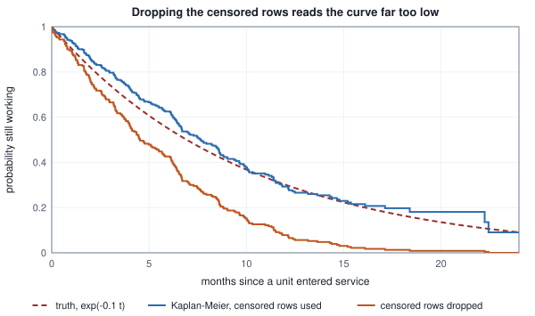
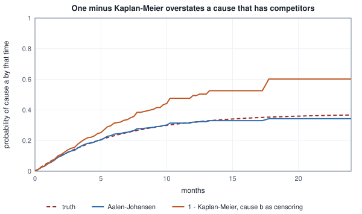

<!-- SPDX-License-Identifier: CC-BY-4.0 -->
<!-- Copyright (c) 2026 Martin Schröder <info@swedishembedded.com> -->

# Survival Analysis and Competing Risks

*How do we predict when something will happen when many examples have not happened yet?*

A service log is read on the last day of month $24$. It lists $400$ units that were put into service one by one over the two years before, and it says that $230$ of them have failed and $170$ are still running. Someone asks the plainest question the log should be able to answer: how long does a unit last?

Four people answer it, and none of them makes an arithmetic mistake. The first averages the lifetimes of the units that failed and gets $5.59$ months. The second averages the time every unit has been observed, failed or not, and gets $6.39$. The third divides the total time all units have been watched by the number of failures and gets $11.11$. The fourth has the one thing nobody has, the true lifetime of every unit including the ones still running, and gets $10.04$. The model that produced the log has a mean lifetime of $10$ months exactly. The first two answers are wrong by almost a factor of two in the same direction, the third is right to within what $230$ failures can say, and the reason is a single fact about the log: a unit that has not failed yet has a lifetime that is longer than we have seen, and that is information, not a missing value.

This chapter is about learning from that information. The target is the time until something happens (a failure, a purchase, a diagnosis, a default), and the data are rows for which the something has happened and rows for which it has not yet. The forecasts of the previous chapters could be scored when the outcome arrived; here the outcome of a large share of the rows never arrives inside the data, and every tool of the volume (the estimate of a rate, the error of a prediction, the comparison of two models) has to be rebuilt so that an open row counts for what it knows and no more.

Before the machinery, six things from earlier are needed. Answer them from memory; the answers are at the end of the chapter.

1. (Volume I, Chapter 17) The exponential waiting time of rate $\lambda$ has the cumulative distribution $1 - e^{-\lambda x}$. Which draw turns a uniform number $u$ into such a time, and what is the mean?
2. (Volume I, Chapter 9) What does the fundamental theorem say about the derivative of $\int_0^t r(s)\,ds$ with respect to $t$, and how does the trapezoid rule approximate that integral from values of $r$ on a grid?
3. (Volume I, Chapter 10) What is the conditional probability $P(A \mid B)$, and what does it say about the probability of surviving two stretches of time in a row?
4. (Volume II, Chapter 4) What is the likelihood of data as a function of a parameter, why do we minimise its negative logarithm, and what is the maximum-likelihood estimate of a coin's probability of heads after $d$ heads in $n$ flips?
5. (Volume II, Chapter 3) A logistic model gives the probability $p = \sigma(z)$ of a label $y$. What loss does it minimise, and what is the gradient of that loss with respect to $z$?
6. (Volume II, Chapter 6) The area under the ROC curve can be read as a count of pairs. Which pairs, and what credit does a tie in the score get?

## A log read on a particular day

The log of the opening is a generated cohort, so that the truth is known and every estimator can be held against it. The recipe is printed with the numbers.

<!-- worked: survival_analysis.censoring_bias -->
Generator: the book's SplitMix64, seed 0x4aecf99db494023d (5398964509045162557). Unit i = 0 .. 399 in order draws entry = 24 u from one uniform() and then a lifetime T = -ln(1 - u) / 0.1 months from a second one; the log is read at month 24, so the unit is followed for 24 - entry months, its observed time is min(T, 24 - entry), and it is an event when T is not larger than 24 - entry and censored otherwise. Of the 400 units 230 fail inside the window and 170 are censored; 133 are censored before month 12. Mean lifetime of the model that generated them: 1 / 0.1 = 10 months.

| estimate of the mean lifetime | months |
|---|---:|
| true lifetimes of all 400 units (unobservable: most are longer than the log shows) | 10.04 |
| mean observed time of the units that failed (censored rows dropped) | 5.59 |
| mean observed time of all units (censored times treated as failures) | 6.39 |
| total observed time divided by the number of failures | 11.11 |

| estimate of P(T <= 12) | value |
|---|---:|
| true failure probability by month 12, 1 - exp(-1.2) | 0.6988 |
| fraction of the 400 lifetimes that are at most 12 (unobservable) | 0.7150 |
| failures by month 12 over all 400 units (censored count as survivors) | 0.5300 |
| failures by month 12 over the 267 units not censored before month 12 (drop them) | 0.7940 |
| one minus the Kaplan-Meier estimate at month 12 | 0.7072 |
<!-- /worked -->

Each shortcut has a story. The first drops the censored rows, which sounds careful and is the worst of the four. A unit that entered service in month $20$ can only appear in the list of failures if it failed within four months; a unit that entered in month $2$ has twenty-two months to do so. The list of failures is therefore a sample selected for short lives, and its mean ($5.59$) says more about when the units entered than about how long they last. The second keeps every row but pretends that a running unit failed on the day the log was read, which turns "has lasted at least this long" into "lasted exactly this long", and the mean ($6.39$) is lower than the truth for the same reason. The third divides the exposure, the total time all units were watched, by the number of failures. A running unit contributes the time it has been seen to the numerator and nothing to the denominator, which is the right accounting for a unit that has so far survived. Why it is right is derived below; here it is enough that $11.11$ differs from $10$ by $1.11$, and a mean estimated from $230$ failures has a standard error of about $11.11 / \sqrt{230} = 0.73$.

What the second and the third did differently has a name. A lifetime $T_i$ is **censored** when the unit leaves observation before its failure is seen, so that all we know is that $T_i$ exceeds the time it was watched. Each unit has a lifetime $T_i$ and a censoring time $C_i$, the time at which observation would end whatever happens to the unit (here $24$ minus its entry time, and later in the chapter a random time too), and what the log records is the pair

$$
t_i = \min(T_i, C_i), \qquad \delta_i = \begin{cases} 1 & T_i \le C_i \ \text{(a failure is seen)} \\ 0 & T_i > C_i \ \text{(the unit is censored)}.\end{cases}
$$

This is **right censoring**, the case where the end of the story is hidden. Observation can end because the study ends (as here), because a unit is lost to follow-up, or because a different failure got there first, which is the subject of a later section. Whatever ends it, every method below rests on one assumption, that censoring is independent of the lifetime: the fact that a unit was removed at month $8$ says nothing about whether it would have failed in month $9$. The data cannot test this. If units are pulled from the log when they start to look unhealthy, the survivors that remain are healthier than the population and no estimator that treats them as typical can be right.

The same shortcuts distort the question "what fraction fail within $12$ months?", which looks like a classification problem with a yes-or-no label. The second table of the block asks it. The truth is $1 - e^{-1.2} = 0.6988$, the $400$ lifetimes themselves give $0.7150$ (a sample, so a little off the truth), and the labels one can build from the log give $0.5300$ if a running unit counts as "no" and $0.7940$ if the $133$ units censored before month $12$ are dropped because their label is unknown. Counting the open rows as "no" is too low for the reason of the second shortcut. Dropping the rows with an unknown label is too high, and for a subtler reason: a unit censored at month $8$ is a unit known to have survived eight months, and removing it removes a survivor, while every unit that failed early stays whatever its entry date. What the log supports is the last row, one minus a Kaplan-Meier estimate, $0.7072$, the subject of the next sections.

## Survival, density and hazard

A lifetime $T \ge 0$ has the cumulative distribution $F(t) = P(T \le t)$ and, where it exists, the density $f(t) = F'(t)$ of Volume I. Survival analysis works with the complement, the **survival function** $S(t) = P(T > t) = 1 - F(t)$, the probability of lasting beyond $t$. It starts at $S(0) = 1$ and never rises. A censored row says exactly one thing about it: $S(t_i)$ is the probability that this unit's lifetime exceeds what we saw.

Neither $F$ nor $f$ is the quantity to build models on, because neither says who is still in the race. The right one is a conditional rate. Among the units still running at time $t$, what fraction fail in the next sliver of time $\Delta$, per unit of time? The limit is the **hazard function**

$$
\lambda(t) = \lim_{\Delta \to 0} \frac{P(t < T \le t + \Delta \mid T > t)}{\Delta} = \frac{f(t)}{S(t)}.
$$

The second form follows from the definition of conditional probability: $P(t < T \le t+\Delta \mid T > t) = (F(t+\Delta) - F(t)) / S(t)$, and dividing by $\Delta$ gives $f(t)/S(t)$. A hazard is a rate, with units of one over time (per month here), so it is not a probability and may exceed $1$: a unit that fails on average every $0.4$ months has a hazard of $2.5$ per month and is certainly not certain to fail within a month.

Its use is that it speaks only about the units at risk. Since $f = -S'$, we have $\lambda = -S'/S = -\frac{d}{dt} \ln S$, and by the fundamental theorem of Volume I, integrating gives

$$
\Lambda(t) = \int_0^t \lambda(s)\,ds, \qquad S(t) = e^{-\Lambda(t)}.
$$

$\Lambda$ is the **cumulative hazard**, the total rate accumulated by time $t$. For a constant hazard $\lambda$ it is $\lambda t$, the survival function is the exponential $e^{-\lambda t}$ of Volume I, and the mean lifetime is $1/\lambda$. In general the mean is the area under the survival curve, $E[T] = \int_0^\infty S(t)\,dt$, because $T = \int_0^\infty 1[T > t]\,dt$ and the expectation of the indicator $1[T>t]$ is $S(t)$. The probability of failing in the next stretch of length $w$ given survival to $t$ is $1 - e^{-(\Lambda(t+w) - \Lambda(t))}$: the cumulative hazard is the clock, and a stretch of it turns into a probability by the same $1 - e^{-x}$ every time.

Three hazards that are constant on three pieces of time show how shapes read.

<!-- worked: survival_analysis.hazard_shapes -->
Three hazards, each constant on the pieces [0, 2), [2, 6) and [6, infinity) with the values falling 0.30, 0.10, 0.05; constant 0.10, 0.10, 0.10; rising 0.04, 0.10, 0.25 (per month). lambda(t) is the hazard at t, Lambda(t) = the sum over pieces of the hazard times the length of the piece below t, S = exp(-Lambda), f = lambda S, and the last column is the probability of failing in (t, t + 1] given survival to t, 1 - exp(-(Lambda(t + 1) - Lambda(t))).

| shape | t | lambda(t) | Lambda(t) | S(t) | f(t) | P(fail in (t, t+1] | T > t) |
|---|---:|---:|---:|---:|---:|---:|
| falling | 1.0 | 0.30 | 0.300 | 0.7408 | 0.2222 | 0.2592 |
| falling | 4.0 | 0.10 | 0.800 | 0.4493 | 0.0449 | 0.0952 |
| falling | 8.0 | 0.05 | 1.100 | 0.3329 | 0.0166 | 0.0488 |
| constant | 1.0 | 0.10 | 0.100 | 0.9048 | 0.0905 | 0.0952 |
| constant | 4.0 | 0.10 | 0.400 | 0.6703 | 0.0670 | 0.0952 |
| constant | 8.0 | 0.10 | 0.800 | 0.4493 | 0.0449 | 0.0952 |
| rising | 1.0 | 0.04 | 0.040 | 0.9608 | 0.0384 | 0.0392 |
| rising | 4.0 | 0.10 | 0.280 | 0.7558 | 0.0756 | 0.0952 |
| rising | 8.0 | 0.25 | 0.980 | 0.3753 | 0.0938 | 0.2212 |

Mean lifetime, the area under S, in months: falling 10.671, constant 10.000, rising 7.441.
<!-- /worked -->

At $t = 1$ the falling hazard is $0.30$ per month, and the probability of failing in the month after, given survival to $1$, is $0.2592$, not $0.30$: the hazard is the instantaneous rate and $1 - e^{-0.30}$ is the probability for a month during which the rate stays at $0.30$ (the month $(1, 2]$ lies wholly inside the first piece $[0, 2)$, so the rate does not change within it; the gap between $0.30$ and $0.2592$ is the gap between a rate and a probability, since a rate acting for a month fails a unit with probability $1 - e^{-\text{rate}}$, less than the rate). The three shapes agree on nothing else. The rising hazard has the smallest density $f$ early and the largest late, because the survivors it leaves are the ones about to wear out; the falling hazard has the largest density early, the typical profile of units with infant failures; and the constant one is the memoryless exponential. The three mean lifetimes, $10.671$, $10.000$ and $7.441$ months, come from the same formula, the area under $S$, and the middle piece carries the same $0.10$ in all three.

When time is cut into whole intervals $j = 1, 2, \dots, J$ (months, visits, years) the same idea has a discrete form: the **discrete hazard** $p_j = P(T \in (j-1, j] \mid T > j-1)$ is already a probability, and $S(j) = \prod_{i \le j}(1 - p_i)$ by the chain rule for conditional probabilities.

## The Kaplan-Meier estimator

How is a survival curve estimated without assuming its shape? The chain rule above suggests it: the probability of surviving beyond $t$ is the product, over every moment at which somebody failed, of the probability of getting through that moment given that you were there at its start. The conditional probabilities can be estimated from the units that were at risk. This is the **Kaplan-Meier estimator**.

Let $u_0 < u_1 < \dots < u_{m-1}$ be the distinct observed times, failures and censorings together. At $u_r$ let $n_r$ be the number of units whose time is at least $u_r$ (the units at risk), $d_r$ the number that fail at $u_r$ and $c_r$ the number censored there. Among the $n_r$ units at risk, $d_r$ failed at $u_r$, so the estimate of the conditional probability of surviving that moment is $1 - d_r/n_r$, and

$$
\hat S(t) = \prod_{u_r \le t} \left(1 - \frac{d_r}{n_r}\right).
$$

Four conventions settle every case that comes up, and the pseudocode below follows all of them.

- The units at risk at $u_r$ are those with time *at least* $u_r$. A unit censored at exactly $u_r$ is still at risk of failing at $u_r$: at a tie, failures happen before censorings.
- Several failures at the same time all count in $d_r$; there is no order inside a tie.
- A time at which only censorings occur changes nothing in $\hat S$, but the censored units leave the risk set for every later $r$. That is how a censored unit is used: it counts in the denominators up to its time and then stops.
- $\hat S$ is a right-continuous step function, so $\hat S(u_r)$ already includes the drop at $u_r$, and it is not defined beyond the largest observed time unless the curve has reached zero.

The estimator is not only plausible, it is the maximum-likelihood estimate of a survival curve with no shape assumed. Give each observed time its own discrete hazard $p_r$. A unit that fails at $u_r$ contributes $p_r \prod_{q < r}(1 - p_q)$, and a unit censored at $u_r$ contributes $\prod_{q \le r}(1 - p_q)$ (it got through $u_r$). Collect the factors for each $r$: the unit failures contribute $p_r$ to the power $d_r$, and every one of the $n_r - d_r$ units at risk that did not fail at $u_r$ contributes a factor $1 - p_r$. The likelihood is $\prod_r p_r^{d_r}(1 - p_r)^{n_r - d_r}$, a product of binomial likelihoods that are separate in the $p_r$, and each is maximised at the coin estimate of Volume II, $\hat p_r = d_r/n_r$. A section below uses this again.

```text
function kaplan_meier(time: array<real>[n], event: array<int>[n])
        -> (array<real>[m], array<real>[m], array<real>[m]):
    require n > 0, "no subjects"
    require min(time) >= 0.0 and all([event[i] == 0 or event[i] == 1 for i in 0 .. n]), "bad times or events"
    u = distinct(time)                       # increasing; m = len(u)
    S = zeros(real, [m])
    W = zeros(real, [m])
    s = 1.0
    w = 0.0
    for r in 0 .. m:
        n_r = len([i for i in 0 .. n if time[i] >= u[r]])
        d_r = len([i for i in 0 .. n if time[i] == u[r] and event[i] == 1])
        if d_r > 0:
            s = s * (1.0 - d_r / n_r)
            if n_r > d_r:
                w = w + d_r / (n_r * (n_r - d_r))     # the Greenwood sum, below
        S[r] = s
        W[r] = w
    return (u, S, W)
```

The array $W$ is for the error bar. Each factor $1 - d_r/n_r$ is a binomial proportion complement, and the logarithm of a product is a sum. The variance of $\ln(1 - \hat p)$ for a binomial $\hat p$ with $n$ trials is, by the delta method, $\left(\frac{1}{1-p}\right)^2 \frac{p(1-p)}{n} = \frac{p}{(1-p)\,n}$, estimated as $\frac{d}{n(n-d)}$. Treating the factors as independent (they involve disjoint events given the past) and returning from the logarithm by another delta step gives **Greenwood's formula**

$$
\widehat{\mathrm{Var}}\,\hat S(t) = \hat S(t)^2 \sum_{u_r \le t} \frac{d_r}{n_r (n_r - d_r)},
$$

which is $\hat S^2 W$ in the pseudocode. A term with $n_r = d_r$ (everyone left at risk fails) would divide by zero; there $\hat S$ is $0$ and its standard error is taken as $0$, which is what the code does by leaving $W$ alone. A twelve-unit table is small enough to follow by hand.

<!-- worked: survival_analysis.km_by_hand -->
The twelve subjects as (time, event) with event 1 for a failure and 0 for a censoring: (1, 1), (2, 1), (2, 0), (3, 1), (3, 1), (4, 0), (5, 1), (6, 0), (6, 0), (7, 1), (8, 0), (9, 0). At each distinct time t: n is the number of subjects with time at least t (a subject censored at t is still at risk at t), d the failures at t, c the censorings at t; the factor is 1 - d / n, S the running product, W the running sum of d / (n (n - d)), SE = S sqrt(W), the band S +- 1.959964 SE clipped to [0, 1], H the running sum of d / n and -ln S beside it. Times with no failure change none of S, W or H.

| t | n | d | c | 1 - d/n | S(t) | W | SE | 95% band | H(t) | -ln S(t) |
|---|---:|---:|---:|---:|---:|---:|---:|---:|---:|---:|
| 1 | 12 | 1 | 0 | 0.9167 | 0.9167 | 0.0076 | 0.0798 | [0.760, 1.000] | 0.0833 | 0.0870 |
| 2 | 11 | 1 | 1 | 0.9091 | 0.8333 | 0.0167 | 0.1076 | [0.622, 1.000] | 0.1742 | 0.1823 |
| 3 | 9 | 2 | 0 | 0.7778 | 0.6481 | 0.0484 | 0.1426 | [0.369, 0.928] | 0.3965 | 0.4336 |
| 4 | 7 | 0 | 1 | 1.0000 | 0.6481 | 0.0484 | 0.1426 | [0.369, 0.928] | 0.3965 | 0.4336 |
| 5 | 6 | 1 | 0 | 0.8333 | 0.5401 | 0.0817 | 0.1544 | [0.237, 0.843] | 0.5631 | 0.6160 |
| 6 | 5 | 0 | 2 | 1.0000 | 0.5401 | 0.0817 | 0.1544 | [0.237, 0.843] | 0.5631 | 0.6160 |
| 7 | 3 | 1 | 0 | 0.6667 | 0.3601 | 0.2484 | 0.1795 | [0.008, 0.712] | 0.8965 | 1.0214 |
| 8 | 2 | 0 | 1 | 1.0000 | 0.3601 | 0.2484 | 0.1795 | [0.008, 0.712] | 0.8965 | 1.0214 |
| 9 | 1 | 0 | 1 | 1.0000 | 0.3601 | 0.2484 | 0.1795 | [0.008, 0.712] | 0.8965 | 1.0214 |

The median survival time is the first time at which S is at most 0.5: t = 7. The restricted mean survival time up to t* = 9, the area under the step function from 0 to 9, is 5.8467.
<!-- /worked -->

Follow the rows. At $t = 2$ one unit fails and one is censored; the censored unit is at risk at $2$ ($n = 11$, which counts it) and gone at $3$ ($n = 9 = 12 - 1 - 2$). The factor at $t = 3$ is $7/9$ because two of the nine fail together. The product at $t = 3$ is $\frac{11}{12} \cdot \frac{10}{11} \cdot \frac{7}{9} = 0.6481$; the first two factors telescope to $10/12$. The rows with $d = 0$ copy the line above: that is the whole of a censoring's effect on the curve at its own time. It acts only afterwards, through $n$: the six units that fail by the end are $6/12 = 0.5$ of the units, but $\hat S$ ends at $0.3601$, because the six censored units did not wait to see whether they would fail, and the later failures were divided among fewer units at risk.

Beside $\hat S$ the table shows $H(t) = \sum_{u_r \le t} d_r/n_r$, the **Nelson-Aalen** estimate of the cumulative hazard (the sum of the observed failure rates per unit at risk, a sum where the integral of $\lambda$ would be), next to $-\ln \hat S$. They agree when the factors are small and drift apart as the risk set shrinks: $0.8965$ against $1.0214$ at $t = 7$, where one of three at risk fails. The two estimators answer the same question and the difference between $e^{-H}$ and $\hat S$ is a reminder that the numbers are estimates from a handful of units.

The band in the table is $\hat S \pm 1.959964\,\mathrm{SE}$ clipped to $[0, 1]$. It is wide ($[0.008, 0.712]$ at $t = 7$) and it is what twelve units can say. A band that needs clipping is a warning that the normal approximation is poor; better bands are built on the log or log-log scale, with the same Greenwood variance carried through.

Two summaries of the curve are used in place of a mean. The median survival time is the first $u_r$ at which $\hat S$ is at most $0.5$: here $7$. It does not exist when the curve stays above $0.5$ to the end. The mean may not exist either, because $\int_0^\infty \hat S$ is not defined when the last observation is a censoring and the curve has not reached zero. The **restricted mean survival time** up to a horizon $t^\star$ is the area under the step function from $0$ to $t^\star$, the expected value of $\min(T, t^\star)$: always defined, and $5.8467$ months up to $t^\star = 9$ in the table. A reader who wants a mean lifetime from a curve that ends early has to choose a $t^\star$ and say so.

On the cohort of the opening the estimator does what the shortcuts could not.

<!-- worked: survival_analysis.km_cohort -->
Generator: the book's SplitMix64, seed 0x4aecf99db494023d (5398964509045162557). Unit i = 0 .. 399 in order draws entry = 24 u from one uniform() and then a lifetime T = -ln(1 - u) / 0.1 months from a second one; the log is read at month 24, so the unit is followed for 24 - entry months, its observed time is min(T, 24 - entry), and it is an event when T is not larger than 24 - entry and censored otherwise. The estimator is the one of the previous table (events before censorings at a tie) with the Greenwood standard error and the clipped 95 percent band. Last column: the share of the units that failed whose failure time is above t, which is what dropping every censored row leaves.

| t | true exp(-0.1 t) | share of the 400 lifetimes above t | Kaplan-Meier | SE | 95% band | censored rows dropped |
|---|---:|---:|---:|---:|---:|---:|
| 3.0 | 0.7408 | 0.7925 | 0.7967 | 0.0207 | [0.7560, 0.8374] | 0.6652 |
| 6.0 | 0.5488 | 0.6000 | 0.6250 | 0.0263 | [0.5736, 0.6765] | 0.4261 |
| 12.0 | 0.3012 | 0.2850 | 0.2928 | 0.0292 | [0.2356, 0.3500] | 0.0783 |
| 18.0 | 0.1653 | 0.1675 | 0.1973 | 0.0288 | [0.1407, 0.2538] | 0.0130 |
| 24.0 | 0.0907 | 0.0775 | 0.0904 | 0.0478 | [0.0000, 0.1840] | 0.0000 |

Median of the Kaplan-Meier curve: 7.6491 months (true median of the model: ln 2 / 0.1 = 6.9315). Restricted mean up to 24 months: Kaplan-Meier 9.7452, true 9.0928.
<!-- /worked -->



The Kaplan-Meier column follows the third column, the survival fraction of the $400$ true lifetimes, to within about one standard error at every row ($0.6250$ against $0.6000$ at month $6$, with a standard error of $0.0263$), and that is the comparison that tests an estimator, because the $400$ lifetimes are themselves a sample that happens to lie above the model's curve at month $6$ ($0.6000$ against $0.5488$). The last column is the share of the failed units whose failure time is above $t$, which is the survival curve one obtains by dropping the censored rows; it reaches $0.0783$ at month $12$, where the estimator says $0.2928$. The median of the Kaplan-Meier curve is $7.6491$ months (the model's is $6.9315$; the sample's lifetimes run long), and its restricted mean up to $24$ months is $9.7452$ against $9.0928$ for the model.

## A likelihood for censored data, and models that put covariates in it

The Kaplan-Meier estimator describes a population. A prediction is about one unit, with features: an age, a load, a history. A **time-to-event model** maps the features $\mathbf{x}$ of a unit to its hazard $\lambda(t \mid \mathbf{x})$ (equivalently to a survival curve $S(t \mid \mathbf{x}) = e^{-\Lambda(t \mid \mathbf{x})}$) and is trained by maximising a likelihood in which a censored unit gets the credit it deserves. Everything the chapter has said fixes that likelihood.

A unit whose failure is seen at $t_i$ contributes the density of the lifetime there, $f(t_i) = \lambda(t_i) S(t_i)$. A unit censored at $t_i$ contributes the probability that its lifetime exceeds $t_i$, $S(t_i)$. With $\delta_i$ selecting the first factor, and taking logarithms with $\ln S = -\Lambda$,

$$
\ln L = \sum_i \Big[ \delta_i \ln \lambda(t_i \mid \mathbf{x}_i) - \Lambda(t_i \mid \mathbf{x}_i) \Big].
$$

The sum has the shape of the log-likelihood of Volume II, with a term per unit and a loss that is its negative, and the two parts say what the units contribute: the first only failures, where the hazard has to be high; the second every unit, failed or censored, the hazard accumulated over the whole time it was watched, which has to be low. For a constant hazard, $\ln L = d \ln\lambda - \lambda E$ with $d = \sum \delta_i$ the number of failures and $E = \sum t_i$ the total exposure. Setting the derivative $d/\lambda - E$ to zero gives $\hat\lambda = d/E$, and $1/\hat\lambda = E/d = 11.11$ is the third answer of the opening. Dropping the censored rows would drop their exposure from $E$ and leave the failures in $d$; that is the first answer.

Two ways of letting the hazard depend on time and on $\mathbf{x}$ cover most uses, and a model of either kind is a time-to-event model.

**Discrete time, on person-period rows.** Cut time into intervals and ask the question once per interval a unit is observed: did it fail in this one? A unit observed through interval $L$ becomes $L$ rows $(j, \mathbf{x}, y)$ for $j = 1, \dots, L$, with $y = 0$ for each interval it got through and $y = 1$ on the last row if the failure happened in that interval. These are **person-period rows**. The likelihood of the rows is exactly the likelihood of the discrete hazards $p_j(\mathbf{x})$, so a logistic regression of $y$ on the interval and the features, with the cross-entropy loss and the gradient $p - y$ of Volume II, is the model; any classifier that outputs a probability will do.

```text
function person_period(x: array<int>[n], last: array<int>[n], event: array<int>[n])
        -> list<(int, int, int)>:
    require n > 0 and min(last) >= 1, "every subject is observed for at least one interval"
    rows = []
    for i in 0 .. n:
        for j in 1 .. last[i] + 1:                # j = 1, ..., last[i]
            y = 1 if (event[i] == 1 and j == last[i]) else 0
            append (j, x[i], y) to rows
    return rows
```

<!-- worked: survival_analysis.discrete_hazard -->
Generator: the book's SplitMix64, seed 0x99540427a66c4d9c (11048460354189020572). Subject i = 0 .. 399 in order draws u = uniform() (x = 1 when u < 0.5), then c = 1 + integer(8) (the subject is observed through the end of interval c), then eight uniform() draws u_1 .. u_8; the event interval is the first j with u_j < sigmoid(alpha_j + 0.8 x), alpha_j = -2.6 + 0.15 (j - 1), and the event counts when j <= c, otherwise the subject is censored after interval c. The 400 subjects give 1330 person-period rows (j, x, y): a subject observed through interval L gives the rows j = 1 .. L with y = 0, except that the row j = L has y = 1 when the event happened in interval L. There are 182 events. The model is logit p_j = alpha_j (one intercept per interval) or alpha_j + beta x, fitted by Newton's method from all-zero parameters, 10 steps; the largest gradient entry after them is 8e-14 and 2e-14, below 1e-9.

| interval j | at risk n_j | events d_j | d_j / n_j | p_j fitted, intercepts only | p_j true at x = 0 | p_j fitted at x = 0 | p_j fitted at x = 1 |
|---|---:|---:|---:|---:|---:|---:|---:|
| 1 | 400 | 38 | 0.0950 | 0.0950 | 0.0691 | 0.0671 | 0.1246 |
| 2 | 300 | 42 | 0.1400 | 0.1400 | 0.0794 | 0.1015 | 0.1828 |
| 3 | 228 | 30 | 0.1316 | 0.1316 | 0.0911 | 0.0956 | 0.1730 |
| 4 | 167 | 33 | 0.1976 | 0.1976 | 0.1043 | 0.1464 | 0.2533 |
| 5 | 113 | 16 | 0.1416 | 0.1416 | 0.1192 | 0.1077 | 0.1928 |
| 6 | 69 | 12 | 0.1739 | 0.1739 | 0.1359 | 0.1321 | 0.2315 |
| 7 | 42 | 9 | 0.2143 | 0.2143 | 0.1545 | 0.1767 | 0.2981 |
| 8 | 11 | 2 | 0.1818 | 0.1818 | 0.1751 | 0.1435 | 0.2489 |

With intercepts only, the largest gap between the fitted hazard sigmoid(alpha_j) and the count ratio d_j / n_j is below 1e-9. With the covariate: beta = 0.6826 with standard error 0.1644 (the square root of the diagonal entry of the inverse of the Hessian), true 0.8; exp(beta) = 1.979. Probability of surviving all eight intervals, x = 0 and x = 1: true 0.3703 and 0.1285; the product of the fitted 1 - p_j, 0.3534 and 0.1444; Kaplan-Meier within each group (interval index as the time), 0.3818 and 0.1245.
<!-- /worked -->

With one intercept per interval and nothing else, the logistic model reproduces the Kaplan-Meier estimate: each fitted $p_j$ equals $d_j/n_j$ to rounding (the block asserts a gap below $10^{-9}$). This is the earlier derivation seen from the other side, since the logistic likelihood of the rows of interval $j$ is the binomial likelihood $p_j^{d_j}(1 - p_j)^{n_j - d_j}$. Adding the feature $x$ turns it into a regression: the coefficient $\beta = 0.6826$ (standard error $0.1644$, the square root of the diagonal entry of the inverse Hessian that Newton's method already formed) says that at every interval the odds of failing are $e^{\beta} = 1.979$ times larger for $x = 1$ than for $x = 0$; the true value $0.8$ is within one standard error. The product of the fitted $1 - p_j$ turns the hazards into the probability of getting through all eight intervals, $0.3534$ for $x = 0$ and $0.1444$ for $x = 1$, against a truth of $0.3703$ and $0.1285$ and group-wise Kaplan-Meier estimates of $0.3818$ and $0.1245$. The cost of the discrete form is the rows (here $1330$ from $400$ subjects, and a long follow-up in fine intervals makes many more) and the coarseness of the intervals.

**Continuous time, with a constant hazard on each piece.** Cut time at knots $0 = \kappa_0 < \kappa_1 < \dots < \kappa_P$ and let the hazard of a unit be constant on each piece $(\kappa_{p-1}, \kappa_p]$, with a failure exactly on a knot belonging to the earlier piece. Then the cumulative hazard of a unit is a sum over pieces of a hazard times the **exposure** $E_p$, the time the unit spent at risk inside the piece, $E_p = \max(0, \min(t_i, \kappa_p) - \kappa_{p-1})$ for a unit seen from time $0$ (and the overlap of $(a_i, t_i]$ with the piece for a unit that enters observation at $a_i$, which is how late entry is handled exactly). With $d_p \in \{0, 1\}$ marking the piece in which the failure fell, the loss of one unit is

$$
\sum_{p=1}^{P} \Big( \lambda_p E_p - d_p \ln \lambda_p \Big),
$$

the negative log-likelihood of a Poisson count: each piece counts $d_p$ failures over an exposure $E_p$ at rate $\lambda_p$. Summed over units, each piece has the constant-hazard solution $\hat\lambda_p = \sum d_p / \sum E_p$ and, with features, one writes $\ln\lambda_p(\mathbf{x}) = a_p + g(\mathbf{x})$: a baseline per piece and a function of the features that shifts the log-hazard by the same amount at every time. That is a proportional-hazards model, since the ratio of the hazards of two units, $e^{g(\mathbf{x}) - g(\mathbf{x}')}$, does not depend on $t$; $g$ may be a linear function, a sum of smooth effects or a neural network. The best-known regression of this family, Cox's, leaves the baseline unspecified and maximises a partial likelihood; the forms of this section estimate the baseline too, which a prediction of a probability at a horizon needs. For small $p_j$ the discrete and the piecewise forms are close ($1 - e^{-\lambda w} \approx \lambda w$ for a piece of width $w$), and the piecewise form has the advantage that any unit can enter at any time and any horizon can be asked of the fitted hazards.

## Two causes, and a curve that adds up to more than one

Units fail for different reasons, and an observation that ends in one failure hides all the others. A patient who dies of one disease will not be diagnosed with another, a customer who defaults cannot also prepay in full, a machine that is scrapped does not wear out. With **competing risks** there are $K$ causes of failure, the first to happen ends the unit's story, and the log records $(t_i, \delta_i)$ with $\delta_i \in \{0, 1, \dots, K\}$: $0$ for a censoring and $k$ for a failure of cause $k$.

The hazard splits by cause. The **cause-specific hazard** $\lambda_k(t)$ is the rate of failures from cause $k$ among the units still at risk of anything, $\lambda_k(t) = \lim_{\Delta \to 0} P(t < T \le t+\Delta, \text{cause } k \mid T > t)/\Delta$. The causes add: the hazard of failing from any cause is $\lambda(t) = \sum_k \lambda_k(t)$, and $S(t) = \exp(-\sum_k \Lambda_k(t))$. What one usually wants to predict is not a hazard but a probability, the **cumulative incidence** $F_k(t) = P(T \le t, \text{cause } k)$: how likely is cause $k$, by time $t$, in the world where the others also act? A unit fails from $k$ in $(s, s + ds]$ if it is alive at $s$ (probability $S(s)$) and then fails from $k$ (rate $\lambda_k(s)$), so by the integral of Volume I

$$
F_k(t) = \int_0^t \lambda_k(s)\, S(s)\, ds, \qquad S(t) + \sum_k F_k(t) = 1.
$$

The second equation is the partition of the future: a unit has either not failed by $t$ or failed from exactly one cause. Note that $F_k$ depends on every $\lambda_j$ through $S$: if another cause becomes more dangerous, fewer units survive long enough to fail from $k$ and $F_k$ falls even though $\lambda_k$ has not moved.

An analyst who wants $F_a$ for cause $a$ reaches for what she knows. She declares the units that failed from another cause censored (they left the study for a different reason, after all), computes the Kaplan-Meier estimate for cause $a$, and reports one minus it. What does this estimate? A unit that failed from cause $b$ is treated as if it had been alive and at risk of $a$ forever after, so the estimator behaves as though cause $b$ did not exist. It estimates $1 - e^{-\Lambda_a(t)}$, the probability of failing from $a$ in a world without $b$, which is larger than $F_a(t)$ and not what happens. The correct estimator keeps the structure of the partition. The **Aalen-Johansen** estimate grows by the share of the drop in survival that belongs to the cause:

$$
\hat F_k(t) = \sum_{u_r \le t} \hat S(u_{r-1}) \, \frac{d_{r,k}}{n_r},
$$

where $d_{r,k}$ counts the failures from cause $k$ at $u_r$, $n_r$ is the number at risk as before, and $\hat S(u_{r-1})$ is the all-cause Kaplan-Meier estimate just before (with $\hat S(u_{-1}) = 1$). It is the sum form of the integral above.

```text
function aalen_johansen(time: array<real>[n], cause: array<int>[n], k: int)
        -> (array<real>[m], array<real>[m]):
    require n > 0 and min(time) >= 0.0 and min(cause) >= 0 and k >= 1, "bad input"
    u = distinct(time)                       # increasing; m = len(u)
    F = zeros(real, [m])
    s = 1.0                                  # S just before u[r]: no failure of any cause yet
    f = 0.0
    for r in 0 .. m:
        n_r = len([i for i in 0 .. n if time[i] >= u[r]])
        d_k = len([i for i in 0 .. n if time[i] == u[r] and cause[i] == k])
        d_r = len([i for i in 0 .. n if time[i] == u[r] and cause[i] > 0])
        f = f + s * d_k / n_r
        s = s * (1.0 - d_r / n_r)
        F[r] = f
    return (u, F)
```

A cohort with two causes and constant hazards, $0.06$ for cause $a$ and $0.10$ for cause $b$ per month, has the closed form $F_k(t) = \frac{\lambda_k}{0.16}(1 - e^{-0.16 t})$ (for constant hazards the integral can be done, and the share of failures that belong to $a$ is always $0.06/0.16$).

<!-- worked: survival_analysis.competing_risks -->
Generator: the book's SplitMix64, seed 0x99c81257cf7c40e2 (11081127051497586914). Subject i = 0 .. 499 in order draws three uniform() values u1, u2, u3: T = -ln(1 - u1) / 0.16 months, the cause is 1 (cause a) when u2 < 0.375 = 0.06 / 0.16 and 2 (cause b) otherwise, and the censoring time is C = 6 + 18 u3. The subject is observed at min(T, C), with its cause if T <= C and censored otherwise. Of the 500 subjects 160 have cause a, 269 cause b and 71 are censored. True cumulative incidences: F_k(t) = (rate_k / 0.16)(1 - exp(-0.16 t)) with rates 0.06 and 0.10. 'AJ' is the Aalen-Johansen estimate (at each distinct time F_k grows by S(t-) d_k / n, then S is multiplied by 1 - d / n with d the events of both causes); 'naive' is one minus the Kaplan-Meier estimate that treats the other cause as a censoring. Last two columns: F_a + F_b + S for the AJ estimates (S the Kaplan-Meier estimate for either cause) and the sum of the two naive estimates. The second column is the number of subjects whose time is at least t.

| t | at risk | true F_a | AJ F_a | naive F_a | true F_b | AJ F_b | naive F_b | AJ: F_a + F_b + S | naive: F_a + F_b |
|---|---:|---:|---:|---:|---:|---:|---:|---:|---:|
| 3.0 | 319 | 0.1430 | 0.1360 | 0.1553 | 0.2383 | 0.2260 | 0.2447 | 1.0000 | 0.4000 |
| 6.0 | 196 | 0.2314 | 0.2420 | 0.3140 | 0.3857 | 0.3660 | 0.4286 | 1.0000 | 0.7426 |
| 12.0 | 56 | 0.3200 | 0.3204 | 0.4942 | 0.5334 | 0.5101 | 0.6649 | 1.0000 | 1.1591 |
| 18.0 | 9 | 0.3539 | 0.3429 | 0.6020 | 0.5899 | 0.5973 | 0.8498 | 1.0000 | 1.4518 |
| 24.0 | 0 | 0.3669 | 0.3429 | 0.6020 | 0.6116 | 0.6571 | 1.0000 | 1.0000 | 1.6020 |
<!-- /worked -->



At month $12$ the truth for cause $a$ is $0.3200$ and the Aalen-Johansen estimate $0.3204$; one minus the Kaplan-Meier estimate with cause $b$ as a censoring is $0.4942$, half as large again. For the two causes together the naive estimates add up to $1.1591$ at month $12$ and $1.6020$ at month $24$: a probability of cause $a$ plus a probability of cause $b$ larger than one is a test every competing-risks estimate must pass, and the naive ones fail it. The Aalen-Johansen estimates, with the all-cause survival, add up to $1$ at every row by construction. The tail of the table is thin: from month $18$ the Aalen-Johansen curves are held by few subjects (the table's second column: $56$ at month $12$ and $9$ at month $18$; censoring times run from month $6$ to month $24$), and the naive estimate of cause $b$ reaches $1.0000$ at month $24$ because the last unit at risk, observed at month $23.16$, failed from cause $b$. A step of a Kaplan-Meier curve that is taken by the last unit at risk is as large as it can be.

The cause-specific hazards themselves are estimated without trouble, because for a hazard the censoring treatment is right: the rate of cause $a$ among those at risk is the number of cause-$a$ failures over the exposure of everyone at risk, a unit that failed from $b$ simply stopping to be exposed.

<!-- worked: survival_analysis.cause_specific_hazards -->
Generator: the book's SplitMix64, seed 0x99c81257cf7c40e2 (11081127051497586914). Subject i = 0 .. 499 in order draws three uniform() values u1, u2, u3: T = -ln(1 - u1) / 0.16 months, the cause is 1 (cause a) when u2 < 0.375 = 0.06 / 0.16 and 2 (cause b) otherwise, and the censoring time is C = 6 + 18 u3. The subject is observed at min(T, C), with its cause if T <= C and censored otherwise. For each cause the hazard of a constant-rate model is the number of its events divided by the total time the subjects were under observation (every subject contributes its observed time, whatever ended it).

| cause | events d_k | total exposure E | d_k / E | true rate |
|---|---:|---:|---:|---:|
| cause a | 160 | 2838.95 | 0.0564 | 0.0600 |
| cause b | 269 | 2838.95 | 0.0948 | 0.1000 |

From the two constant hazards the cumulative incidence of cause a at month 12 is (lambda_a / (lambda_a + lambda_b))(1 - exp(-(lambda_a + lambda_b) 12)) = 0.3121; the Aalen-Johansen estimate there is 0.3204 and the truth 0.3200. If the true rate of cause b doubled to 0.20 and the rate of cause a stayed 0.06, the same formula with the true rates gives 0.2206 for the truth at month 12: the hazard of cause a is unchanged and its cumulative incidence falls.
<!-- /worked -->

The two ways of reporting answer different questions. A hazard asks how fast cause $a$ acts on a unit that is still at risk, which is a question about the mechanism and a natural quantity when comparing treatments of cause $a$ alone. A cumulative incidence asks how likely $a$ is, in the real setting with competitors, and is what a person deciding something means by "the probability that this happens within five years". The prediction of an individual's risk therefore takes a model of all the cause-specific hazards, jointly, and forms the cumulative incidence by the integral. One caution belongs here. Whether a unit censored by cause $b$ would have failed from $a$ sooner or later than the others cannot be seen in the data; the cumulative incidence is identifiable without that assumption and the "net" quantity $1 - e^{-\Lambda_a}$ is not. Fine and Gray modelled the cumulative incidence directly (the subdistribution hazard), which is a different regression from the cause-specific hazards of this chapter.

## Ranking and scoring when some outcomes are unseen

A time-to-event model needs a report card. Chapter 4 scored a forecast against the value that arrived; a prediction of failure by month $12$ for a unit censored at month $8$ has no value to be scored against. Two questions can still be asked of the open data: does the model order units correctly by risk, and are its probabilities at a horizon right?

**Ranking.** The **concordance index** is the pair count of Volume II's AUC, adapted to times. Take two units; if the model assigns the first a higher risk score, it should be the one that fails first. A pair $(i, j)$ is *comparable* when unit $i$ failed and unit $j$ was known to be still free of failure at that time: $t_j > t_i$, or $t_j = t_i$ with $j$ censored (at a tie, failures first). Two failures at the same time are not compared, and neither is a pair whose order the data do not show (a unit censored at month $4$ against one failing at month $9$). A comparable pair is concordant when the score of $i$ is higher, tied when equal (credit one half), discordant otherwise, and the index is the credit over the comparable pairs. Six subjects, written out pair by pair:

<!-- worked: survival_analysis.concordance_by_hand -->
Six subjects as (time, event, risk score): 0: (2, 1, 0.8), 1: (3, 1, 0.5), 2: (3, 0, 0.6), 3: (5, 1, 0.5), 4: (6, 0, 0.2), 5: (8, 1, 0.1). A pair (i, j) is comparable when subject i had an event and either T_j > T_i or T_j = T_i with j censored. It is concordant (credit 1) when the risk of i is higher, tied (credit 1/2) when equal, discordant (0) otherwise. Two events at the same time are not compared.

| i | j | time of i | time of j | risk i | risk j | credit |
|---:|---:|---|---|---:|---:|---:|
| 0 | 1 | 2 (event) | 3 (event) | 0.8 | 0.5 | 1.0 |
| 0 | 2 | 2 (event) | 3 (censored) | 0.8 | 0.6 | 1.0 |
| 0 | 3 | 2 (event) | 5 (event) | 0.8 | 0.5 | 1.0 |
| 0 | 4 | 2 (event) | 6 (censored) | 0.8 | 0.2 | 1.0 |
| 0 | 5 | 2 (event) | 8 (event) | 0.8 | 0.1 | 1.0 |
| 1 | 2 | 3 (event) | 3 (censored) | 0.5 | 0.6 | 0.0 |
| 1 | 3 | 3 (event) | 5 (event) | 0.5 | 0.5 | 0.5 |
| 1 | 4 | 3 (event) | 6 (censored) | 0.5 | 0.2 | 1.0 |
| 1 | 5 | 3 (event) | 8 (event) | 0.5 | 0.1 | 1.0 |
| 3 | 4 | 5 (event) | 6 (censored) | 0.5 | 0.2 | 1.0 |
| 3 | 5 | 5 (event) | 8 (event) | 0.5 | 0.1 | 1.0 |

Comparable pairs 11, credit 9.5, concordance 0.8636.
<!-- /worked -->

```text
function concordance(risk: array<real>[n], time: array<real>[n], event: array<int>[n],
                     tstar: real, weight: array<real>[n]) -> real:
    require n > 1, "fewer than two subjects"
    num = 0.0
    den = 0.0
    for i in 0 .. n:
        if event[i] == 1 and time[i] < tstar:
            for j in 0 .. n:
                if j != i and (time[j] > time[i] or (time[j] == time[i] and event[j] == 0)):
                    credit = 1.0 if risk[i] > risk[j] else (0.5 if risk[i] == risk[j] else 0.0)
                    num = num + weight[i] * credit
                    den = den + weight[i]
    require den > 0.0, "no comparable pair"
    return num / den
```

Harrell's version of the index is the call with `tstar = infinity` and all weights $1$. It has a weakness that the tables of this section expose: which pairs are comparable depends on the censoring. Early failures are comparable with almost everybody, late failures only with the few who were watched longer, so the index is a weighted average over failure times whose weights come from the censoring distribution rather than the model. **Uno's index** repairs this by inverse-probability-of-censoring weights. A pair with case $i$ is seen only if both $i$ and $j$ were still under observation at time $t_i$, and under independent censoring each has probability $G(t_i) = P(C > t_i)$ of being so; the probability of seeing the pair is $G(t_i)^2$, and weighting by its inverse restores the pairs that censoring hid. The weights blow up where $G$ is small, so Uno's index is truncated: only cases with $t_i < t^\star$ count, with $t^\star$ chosen where $G$ is not close to zero. $G$ itself is estimated from the data by the Kaplan-Meier estimator in which the *censorings* play the part of the events: `kaplan_meier(time, 1 - event)`, whose value at $t$ is read from the largest $u_r \le t$ (1 before the first). The weight is `weight[i] = 1.0 / G(time[i])^2`. In the cohorts here no two subjects share a time, so the tie clause is unused.

A cohort of $300$ subjects makes this concrete: two risk factors $x_1, x_2$ set the hazard through $\lambda = 0.08\,e^{0.7 x_1 - 0.5 x_2}$, a third feature $x_3$ plays no part, and censoring is drawn from a uniform distribution. The same draws are censored twice, lightly and heavily.

<!-- worked: survival_analysis.concordance_cohort -->
Generator: the book's SplitMix64, seed 0x6a8199a799f99de2 (7674584185137896930). Subject i = 0 .. 299 in order draws three normal() values x1, x2, x3 (a normal() call that finds a held value returns it without drawing), then two uniform() values u and v: lp = 0.7 x1 - 0.5 x2, T = -ln(1 - u) / (0.08 exp(lp)) months and the censoring time is C = 3 + 12 v (a second scenario, used once below, takes C = 2 + 6 v from the same v). The subject is observed at min(T, C), as an event when T <= C. x3 plays no part in T. Harrell's concordance compares every pair (i, j) with an event for i and T_j > T_i (observed times). Uno's concordance keeps the cases with observed time below t* and weights each case by 1 / G(T_i)^2, with G the Kaplan-Meier estimate of the censoring distribution (the censorings are the events of that estimate). The last column applies the definition to the true lifetimes, which nobody observes (every subject is a case when T is below t*, and the pairs are those with T_j > T_i). Tied risks count one half.

Censoring C = 3 + 12 v, t* = 12: 153 events and 147 censored, G(t*) = 0.2626.

| risk score | Harrell | Uno, t* = 12 | from the true lifetimes, t* = 12 |
|---|---:|---:|---:|
| both risk factors, true score 0.7 x1 - 0.5 x2 | 0.7330 | 0.7278 | 0.7125 |
| x1 only, score 0.7 x1 | 0.6966 | 0.6901 | 0.6752 |
| noise x3 | 0.4552 | 0.4562 | 0.4552 |
| no covariates (every subject the same) | 0.5000 | 0.5000 | 0.5000 |

Censoring C = 2 + 6 v, t* = 6: 105 events and 195 censored, G(t*) = 0.3599.

| risk score | Harrell | Uno, t* = 6 | from the true lifetimes, t* = 6 |
|---|---:|---:|---:|
| both risk factors, true score 0.7 x1 - 0.5 x2 | 0.7338 | 0.7394 | 0.7310 |
| x1 only, score 0.7 x1 | 0.7065 | 0.7104 | 0.6970 |
| noise x3 | 0.4484 | 0.4419 | 0.4517 |
| no covariates (every subject the same) | 0.5000 | 0.5000 | 0.5000 |
<!-- /worked -->

The model that knows both factors ranks best, the one that knows only $x_1$ is lower, the noise feature sits near $0.45$ (below one half by chance; the spread of a single index is a few hundredths), and the model with no covariates gets exactly $0.5$, since every pair is tied. The differences of $0.01$ to $0.02$ between Harrell's and Uno's indexes and the oracle value, computed from the true lifetimes, are within that spread, so one cohort cannot say which estimator is better. Repeating the cohort does:

<!-- worked: survival_analysis.concordance_replicates -->
Generator: the book's SplitMix64, seed 0x90a9377f2cec23cd (10423923831879771085). 200 replicates in order; each replicate draws 200 subjects in order, every subject three normal() values x1, x2, x3, then u = uniform() for T = -ln(1 - u) / (0.08 exp(0.7 x1 - 0.5 x2)) and v = uniform() for the censoring time of the scenario (the generator is never reset, a held normal() value is carried on); both scenarios of a replicate use the same 200 lifetimes and the same v, so C = 3 + 12 v and C = 2 + 6 v censor the same subjects with different times. The risk score is the true linear predictor 0.7 x1 - 0.5 x2. For each replicate: Harrell's and Uno's concordance on the censored data and the oracle concordance on the true lifetimes (cases with T below t*). Columns: the mean and the standard deviation over the replicates of the estimate, the mean of the oracle value, and the mean of the difference to the oracle with its standard error (standard deviation, divisor n - 1, over the square root of 200).

| scenario | estimator | mean | sd over replicates | mean of oracle | mean difference to oracle | SE of that mean |
|---|---|---:|---:|---:|---:|---:|
| C = 3 + 12 v, t* = 12 | Harrell | 0.7127 | 0.0267 | 0.7083 | 0.0044 | 0.0007 |
| C = 3 + 12 v, t* = 12 | Uno | 0.7082 | 0.0258 | 0.7083 | -0.0001 | 0.0008 |
| C = 2 + 6 v, t* = 6 | Harrell | 0.7174 | 0.0317 | 0.7143 | 0.0031 | 0.0008 |
| C = 2 + 6 v, t* = 6 | Uno | 0.7150 | 0.0312 | 0.7143 | 0.0007 | 0.0009 |
<!-- /worked -->

Harrell's index is high by $0.0044$ (standard error $0.0007$) under the lighter censoring and by $0.0031$ under the heavier, and Uno's is unbiased to within its error: $-0.0001$ and $+0.0007$. The bias is small here because a proportional-hazards model ranks units about equally well at every time; it is the sort of effect that is invisible in one cohort, small in an average and still a dependence of a model's score on the censoring of the sample it was measured on, which Uno's index does not have.

A rank statistic says nothing about whether a predicted probability of $0.3$ means three in ten. The brain survival crate says so in its header: concordance "is not a proper scoring rule" and should be reported beside a squared-error probability score and a calibration, never alone.

**Scoring a probability at a horizon.** The squared-error score of a probability is the one Chapter 6 develops under the name of the Brier score: for a predicted probability $F_i(t^\star)$ of failing by $t^\star$ and the outcome $y_i = 1[T_i \le t^\star]$, the mean of $(y_i - F_i)^2$. A forecast of $0.5$ for everyone scores $0.25$. With true lifetimes this is a plain mean, and that is the oracle value in the tables. With censoring, the label $y_i$ is known for a unit that failed by $t^\star$ ($y = 1$) and for a unit still observed at $t^\star$ ($y = 0$), and unknown for a unit censored before $t^\star$ without a failure. The inverse-probability-of-censoring weights apply again: the label of unit $i$ is known when the unit was not censored before $\min(T_i, t^\star)$, which has probability $G(\min(T_i, t^\star))$, so each known label is weighted by one over that and the unknown ones count as zero. In terms of the predicted survival $S_i(t^\star) = 1 - F_i(t^\star)$:

```text
function ipcw_brier(S_t: array<real>[n], time: array<real>[n], event: array<int>[n],
                    G: function(real) -> real, t: real) -> real:
    require n > 0, "no subjects"
    total = 0.0
    for i in 0 .. n:
        if time[i] <= t:
            if event[i] == 1:
                total = total + S_t[i]^2 / G(time[i])          # failed by t: label 1
        else:
            total = total + (1.0 - S_t[i])^2 / G(t)             # still observed at t: label 0
    return total / n                                            # a unit censored by t adds 0
```

The mean divides by all $n$ units, censored ones included: dividing by the number of units with a known label would reintroduce the selection. Under independent censoring this is unbiased for the oracle score. The score integrated over a window of horizons is the trapezoid rule of Volume I applied to the scores at a grid of horizons and divided by the length of the window.

<!-- worked: survival_analysis.brier_under_censoring -->
Generator: the book's SplitMix64, seed 0x6a8199a799f99de2 (7674584185137896930). Subject i = 0 .. 299 in order draws three normal() values x1, x2, x3 (a normal() call that finds a held value returns it without drawing), then two uniform() values u and v: lp = 0.7 x1 - 0.5 x2, T = -ln(1 - u) / (0.08 exp(lp)) months and the censoring time is C = 3 + 12 v (a second scenario, used once below, takes C = 2 + 6 v from the same v). The subject is observed at min(T, C), as an event when T <= C. x3 plays no part in T. The predicted survival of subject i for the true model is exp(-0.08 exp(lp_i) t); for 'x1 only' the same with lp = 0.7 x1; for the Kaplan-Meier model every subject has the Kaplan-Meier estimate of the observed data. The score at horizon t is the mean over all 300 subjects of the squared distance between the predicted probability of failing by t and what happened. With G the Kaplan-Meier estimate of the censoring distribution: a subject that failed by t contributes S_i(t)^2 / G(T_i), a subject whose observed time exceeds t contributes (1 - S_i(t))^2 / G(t), and a subject censored by t contributes 0. The integrated score is the trapezoid rule over t = 1, 2, ..., 12 divided by 11. Below the tables, the skill 1 - (score) / (Kaplan-Meier score) at t = 12 is computed from the unrounded scores.

| horizon t | from the true lifetimes | censored counted as survivors | censored by t dropped | inverse-probability-of-censoring weighted | subjects kept by dropping |
|---|---:|---:|---:|---:|---:|
| 3.0 | 0.1560 | 0.1560 | 0.1560 | 0.1560 | 300 |
| 6.0 | 0.1839 | 0.1808 | 0.1858 | 0.1846 | 252 |
| 9.0 | 0.1806 | 0.1850 | 0.1685 | 0.1851 | 217 |
| 12.0 | 0.1746 | 0.1978 | 0.1184 | 0.1652 | 182 |

| model, inverse-probability weighted | t = 3 | t = 6 | t = 9 | t = 12 | integrated, t = 1 .. 12 | integrated, true lifetimes |
|---|---:|---:|---:|---:|---:|---:|
| both risk factors (true model) | 0.1560 | 0.1846 | 0.1851 | 0.1652 | 0.1670 | 0.1691 |
| x1 only | 0.1635 | 0.1992 | 0.2046 | 0.1862 | 0.1813 | 0.1831 |
| Kaplan-Meier, no covariates | 0.1875 | 0.2425 | 0.2491 | 0.2358 | 0.2200 | 0.2193 |

Skill at t = 12 against the Kaplan-Meier model, from the unrounded scores: both risk factors 0.300, x1 only 0.210.
<!-- /worked -->


The first table scores the true model four ways. At the horizon of $3$ months no unit has been censored yet (the censoring times start at $3$), and all four columns agree on $0.1560$. By $12$ months the choices part: counting censored units as survivors gives $0.1978$, dropping the units censored before the horizon gives $0.1184$, and the weighted score gives $0.1652$, against $0.1746$ from the true lifetimes. The weighted score is not exact, since $G$ is itself an estimate from $300$ units and few units are left at month $12$; its error ($-0.009$) is smaller than those of the shortcuts ($+0.023$ and $-0.056$).

The second table is a ranking of models by probability. At $t = 12$ the Kaplan-Meier curve with no covariates scores $0.2358$ and the models improve on it: the skill of Chapter 4, one minus the ratio of the two scores, is $0.300$ for the model with both factors and $0.210$ for the one with $x_1$ alone (computed from the unrounded scores, as the line below the tables states; the four-digit entries shown give $0.299$ for the first). The figure shows what the table's columns say: the score belongs to a horizon, and the ordering of models and the size of the gaps differ from one horizon to another (the integrated score condenses a window of horizons into one number and hides this). The score of even the true model stays near $0.17$: the outcome of a single unit is random, and a score that is not near zero for the best possible model is not a defect.

## A prediction at every horizon

A question asked of a deployed model is almost never "when will this unit fail?" and nearly always "what is the chance that it fails within the next year, or five years?" Each horizon is a separate number. A model that predicts only one horizon needs a model per horizon and a reconstruction of its labels from censored rows; a model of the hazard answers every horizon at once, because the survival curve and the cumulative incidences are functions of the hazards over the time before the horizon.

With a hazard that is constant on pieces the functions are closed forms. Take a table of hazards, one row per piece and one column per code, and call a code *absorbing* when its occurrence ends follow-up (a death, a failure) and *non-absorbing* when it does not (a diagnosis, a visit, a repair). In piece $p$ let $L_p$ be the sum of the hazards of the absorbing codes, plus the hazard of the code asked about when that code is not absorbing (a code that can happen once competes with itself too: we ask for the probability of the *first* occurrence). For a stay of length $\Delta$ in the piece, the probability of leaving the free state is $1 - e^{-L_p \Delta}$, and constant hazards share the leaving among the codes in proportion to their hazards, because $\int_0^\Delta \lambda_k e^{-L s}\,ds = (\lambda_k/L)(1 - e^{-L\Delta})$. Chaining the pieces, with $\phi$ the probability of being free of every competing event at the start of the piece:

```text
function incidence_at(haz: array<real>[P, K], absorbing: array<bool>[K],
                      knots: array<real>[P + 1], k: int, t: real) -> real:
    require P >= 1 and 0 <= k and k < K and min(haz) >= 0.0, "bad table"
    phi = 1.0
    cif = 0.0
    for p in 0 .. P:
        dt = max(0.0, min(t, knots[p + 1]) - knots[p])      # time inside piece p below t
        if dt > 0.0:
            lam = sum([haz[p, c] for c in 0 .. K if absorbing[c]])
            if not absorbing[k]:
                lam = lam + haz[p, k]
            if lam > 0.0:
                leave = 1.0 - exp(-lam * dt)
                cif = cif + haz[p, k] / lam * phi * leave
                phi = phi * (1.0 - leave)
    return cif
```

The survival function is the same chain without the share: $S(t) = \exp(-\sum_p (\sum_{c\ \text{absorbing}} \lambda_{pc})\,\Delta_p(t))$, with $\Delta_p(t)$ the time inside piece $p$ below $t$. Past the last knot nothing is known, so the curves are held at their value there.

<!-- worked: survival_analysis.horizon_curves -->
One subject's table of hazards on the pieces [0, 2), [2, 5) and [5, 10] (knots 0, 2, 5, 10), per year:

| code | absorbing | [0, 2) | [2, 5) | [5, 10] |
|---|---|---:|---:|---:|
| cause a (absorbing) | yes | 0.05 | 0.10 | 0.20 |
| cause b (absorbing) | yes | 0.02 | 0.04 | 0.08 |
| diagnosis (not absorbing) | no | 0.10 | 0.10 | 0.05 |

In piece p let L_p be the sum of the hazards of the absorbing codes (plus the code's own hazard when the code is not absorbing) and w_p(t) the time of the piece below t. S(t) = exp(-sum over pieces of (sum of absorbing hazards) w_p(t)); the cumulative incidence of code k is the sum over pieces of (lambda_kp / L_p) times the probability of no competing event at the start of the piece times (1 - exp(-L_p w_p(t))); past the last knot the curves keep their value at 10. 'Diagnosis' is the probability of the diagnosis before t and before any death.

| t | S(t) | F_a(t) | F_b(t) | S + F_a + F_b | diagnosis before t, alive |
|---|---:|---:|---:|---:|---:|
| 1.0 | 0.9324 | 0.0483 | 0.0193 | 1.0000 | 0.0920 |
| 2.0 | 0.8694 | 0.0933 | 0.0373 | 1.0000 | 0.1695 |
| 3.5 | 0.7047 | 0.2109 | 0.0844 | 1.0000 | 0.2592 |
| 5.0 | 0.5712 | 0.3063 | 0.1225 | 1.0000 | 0.3218 |
| 7.0 | 0.3263 | 0.4812 | 0.1925 | 1.0000 | 0.3471 |
| 10.0 | 0.1409 | 0.6137 | 0.2455 | 1.0000 | 0.3642 |
| 12.0 | 0.1409 | 0.6137 | 0.2455 | 1.0000 | 0.3642 |

Against the midpoint rule on the integral of lambda_k S_k with step 0.0005 years, the largest difference over the 21 closed-form values above is 3.0e-10, below 1e-6.
<!-- /worked -->

For the absorbing causes the partition of the earlier section holds in the last column of the first group: $S + F_a + F_b$ is $1$ at every horizon. The diagnosis has its own competitors, the two deaths, and is a probability of being diagnosed while alive; it flattens at $0.3642$ even though its hazard never falls to zero, since by year $10$ most of the units have died. The closed form agrees with a numerical integration of $\lambda_k S_k$ (midpoint rule, step $0.0005$ years) to below $10^{-6}$ at all the horizons shown. A horizon beyond the last knot would need a hazard the table does not contain, so a well-behaved implementation refuses it or says it holds the curve; it does not extrapolate.

The word *horizon* has changed meaning since Chapter 1, where it counted bars ahead of a forecast origin. Here it is a time after the moment the prediction was made, and the reasoning about leakage carries over unchanged: a prediction at time $s$ may use only what was known at $s$, the units to be scored are the ones whose observation starts at or after the cut that separates training from evaluation, and the censoring distribution used to weight the scores is best estimated on the training units, not on the ones being scored. A horizon with very few events is not scored at all. A squared-error score from a handful of failures is noise, and the weights $1/G$ make a few units carry the sum.

## What the survival and horizon crates compute

`crates/survival` is a leaf crate: it takes an observation, `Obs`, made of a time, an optional cause (`None` for a censoring) and a sampling weight, and depends on no other crate of the repository, so a model or an application can evaluate predictions without a model. Commit `19a4c4b7f` (5 October 2026) added it with the estimators of this chapter. `crates/survival/src/estimate.rs` has the Kaplan-Meier estimate (`kaplan_meier`), the censoring distribution $G$ (`censoring`) and the Aalen-Johansen estimate (`aalen_johansen`), all as right-continuous step functions with an `at` for the value at a time and a `before` for the left limit. The tie rule of this chapter is the header's: at a shared time events come before censorings, so a subject censored at $t$ is still at risk of an event at $t$, and in `censoring` a subject with an event at $t$ is removed from the risk set before the censorings at $t$ are counted. Weights are sampling weights, and a test (`integer_weights_equal_duplicated_rows`) holds every estimator to the rule that a subject of weight $w$ is $w$ copies of itself. Another (`aalen_johansen_partitions_with_survival`) checks that survival and the cumulative incidences of the causes sum to one at every time, the check of the table above.

`crates/survival/src/concordance.rs` computes the pair counts without forming the pairs, in $O(n \log n)$: subjects are visited from the latest time to the earliest and a Fenwick tree over the ranks of the predictions answers how many weighted subjects already visited have a lower score. A subject whose event is another cause is given an infinite time for this cause, which makes it comparable with every case that came earlier, the competing-risks convention that this chapter's single-cause pairs do not need. Scores within `TIED_TOL` ($10^{-8}$) of each other tie and count one half. The Uno version restricts the cases to $T_i < t^\star$ and weights them by $1/G(T_i)^2$ with $G$ estimated on the training data. `crates/survival/src/brier.rs` is `ipcw_brier` above with one case more: a subject whose competing event came by $t$ contributes $F_i^2/G(T_i)$, because its outcome for this cause is known to be a zero, and its mean divides by the total weight of all subjects. `crates/survival/src/auc.rs` computes the time-dependent AUC at a horizon, the Volume II pair count with cases (failure by the horizon, weighted by $1/G(T_i)$) against controls (still free after it). The commit says that every number is held to an independent implementation, and the test shows how: `crates/survival/tests/reference.rs` compares each metric with values that a Python generator, `tools/goldens/survival_metrics_reference.py`, wrote into `crates/survival/testdata/reference.json`, to a relative $10^{-9}$.

`crates/horizon` turns the hazard model of this chapter into a trained network. Commit `3f8386bd2` (5 October 2026) added the kernels `pexp_nll_value.wgsl` and `pexp_nll_grad.wgsl`, and the header of the first states the loss of the piecewise section above in the engine's terms: for every (row, code) it computes $w_i \cdot \mathrm{inv\_wsum} \cdot (e^{\ln\lambda}\,\mathrm{expo} - \mathrm{event}\,\ln\lambda)$, with the exposure `expo` zero outside a unit's at-risk window, so that "left truncation and right censoring are both exact this way". The exposure comes from `crates/horizon/src/encode.rs`, which also states the leakage rule of the previous section as the file's first paragraph: only what is known at prediction time reaches the encoder. Exposure for a code ends at the earliest of the end of the unit's observation window, its own event and the first absorbing event; a competing absorbing event therefore censors the other codes' hazards, as the cause-specific hazard of this chapter requires. A test, `exposure_respects_windows_absorption_and_event_pieces`, builds a unit that dies of one cause at $3.5$ with knots $0, 1, 2.5, 4$ and asserts an exposure of $1.0, 1.5, 1.0$ with an event in the third piece for the cause that occurred, and the same exposure with no event for the other cause. `crates/horizon/src/survival.rs` is `incidence_at` above: `Curves` holds the hazards per piece and evaluates `survival` and `cif` at any horizon inside the knots, with the curves held at the last knot, and `Curves::first_events` reads a group of codes that compete for being first.

Commit `baaaad357` (6 October 2026) added the reference for it. `crates/horizon/tests/it/reference.rs` holds the encoder's exposures and event pieces, the loss kernels (on the CPU backend) and their gradient, and the closed-form survival and cumulative incidence to numbers that `tools/goldens/survival_likelihood_reference.py` derived in PyTorch from the raw subjects by its own rules, its own autograd, and a matrix exponential of each piece's competing-risks generator. The matrix exponential is an independent way to the same $F_k$: it needs no formula for the share of the leaving. Commit `7c4bc61a7` (6 October 2026) added generators with known truth, and the competing one (`crates/horizon/src/synthetic/competing.rs`) draws the event time by inverting the summed cumulative hazard, as Volume I drew an exponential, and computes the true cumulative incidence as $\int h_k S$ by Simpson's rule; a test checks the Aalen-Johansen estimate from $30{,}000$ simulated subjects against that integral within four binomial standard errors (plus a margin of $0.002$). This is the chapter's cohort at scale: simulated data with a known $F_k$, an estimator held to it.

The held-out evaluation, `crates/horizon/src/evaluation.rs`, applies the score card of this chapter at each horizon the caller names: Uno's concordance truncated at the horizon, the time-dependent AUC and the squared-error score at the horizon, the score integrated over $(0, \text{horizon}]$ on an even grid of $20$ points, and calibration. A (code, horizon) with fewer than $30$ events by the horizon is left out of the results and listed as absent, never reported as a number, and a horizon beyond the last knot is an error. The censoring distribution behind the weights is estimated on the evaluated subjects unless the caller passes a reference set (`censoring_from`, the training subjects, as the concordance's definition prefers). Subjects who share a `group_id` are resampled together in the bootstrap intervals, so members of a household or a site are not treated as independent. The model's knots are configuration: `DEFAULT_KNOTS` has $17$ of them from $0$ to $22$ years, finer early where most of the follow-up lies. Commit `81039339a` (5 October 2026) added the additive proportional-hazards model on the same contract, whose documentation calls it "a piecewise-exponential GAM", the baseline that the set encoder has to beat on the same inputs and the same evaluation, which is the discipline of Chapter 4 applied to a model class.

One bug of the family that the chapter's likelihood predicts is in the history. The loss of one unit is $\lambda E - d \ln\lambda$, and for a count $d = 1$ over a vanishing exposure $E$ it has no minimum.

<!-- worked: survival_analysis.count_without_exposure -->
The Poisson negative log-likelihood of one event (d = 1) over an exposure E, lambda E - ln lambda, is minimised at lambda = 1 / E, where it equals 1 + ln E:

| exposure E (one event) | minimiser d / E | negative log-likelihood at it |
|---|---:|---:|
| 1.0 | 1 | 1.000 |
| 0.1 | 10 | -1.303 |
| 0.01 | 100 | -3.605 |
| 0.001 | 1000 | -5.908 |
<!-- /worked -->

Commit `08cbbeee0` (5 October 2026) records that an event dated after the subject's first absorbing event was scored with no exposure behind it, "an unbounded term pushing its hazard up". The encoder now requires `event <= absorbed` for an event to count (the file's test `an_event_dated_after_death_is_not_an_event` moves a diagnosis past the death and asserts that the unit keeps its exposure up to the death and loses the event). The error in the other direction is as quiet. A unit whose event is counted as a censoring keeps its exposure and loses its count, and the estimate $d/E$ falls; the encoder therefore allows an event a rounding distance past the end of its observation window (`WINDOW_SLACK`), with a comment that a one-ulp difference "silently biases every hazard down" and a test (`an_event_one_ulp_past_its_window_end_is_not_censored`) that moves the event one step of floating point past the end and requires it to count, and then moves it a real $10^{-3}$ and requires it to be a censoring.

## Check your understanding

1. A report says the average life of a component is $5.6$ months, from the components that have failed in a log of components that entered over two years. Say what is wrong, in which direction, and what you would ask for.
2. Find the error: "Six of the twelve subjects in the hand-worked table failed, so the survival at the end is $1 - 6/12 = 0.5$; the Kaplan-Meier value $0.3601$ must be a mistake."
3. A hazard is estimated as $2.5$ per month for a component. A colleague says a probability cannot be larger than one. Who is right, and what is the probability that a component alive at the start of a month fails within it, if the hazard stayed at $2.5$?
4. Two causes, $a$ and $b$, have hazards $0.06$ and $0.10$. Without computing a Kaplan-Meier estimate, what are $F_a(12)$ if cause $b$ is removed and what is it with $b$ present, and which of the two does the naive one-minus-Kaplan-Meier estimate approach?
5. Model $M$ has a concordance of $0.72$ on one cohort and $0.74$ on another where censoring was heavier. Can you say it did better on the second?
6. At a horizon of $3$ months the four columns of the Brier table agree. Why, and what would make them agree at every horizon?
7. A person-period table has a subject with the rows $(1, x, 0), (2, x, 0), (3, x, 0), (4, x, 0), (5, x, 1)$ and another with $(1, x', 0), (2, x', 0), (3, x', 0)$. What happened to each, and which rows enter the likelihood of interval $4$?
8. In the diagnosis column of the horizon table the curve flattens although the hazard is $0.05$ per year in the last piece. How is that consistent?

## Summary

A unit that has not failed yet is a censored observation: it says the lifetime exceeds a number. Dropping such rows, or treating them as failures at the day of reading, biases a mean lifetime from $10.04$ to $5.59$ or $6.39$ on the cohort of the opening; dividing the total exposure by the number of failures gives $11.11$, within about one and a half standard errors of the truth. The tool that makes this systematic is the hazard, the conditional failure rate among the units still at risk, with its cumulative $\Lambda$, its survival function $S = e^{-\Lambda}$ and the likelihood $\sum[\delta_i\ln\lambda(t_i) - \Lambda(t_i)]$ that gives a failure its rate and every unit its exposure. The Kaplan-Meier estimator multiplies, over the distinct times, the fraction of those at risk who got through; it is the maximum-likelihood estimate of a curve without a shape, its Greenwood variance gives an error bar, and its conventions (those at risk have a time at least $t$, failures before censorings at a tie) matter. A model puts features into the hazard, in discrete time as a logistic regression on person-period rows (which with one intercept per interval reproduces Kaplan-Meier exactly) or in continuous time as a piecewise-constant hazard with a Poisson loss.

When a unit can fail in several ways, the cause-specific hazards, estimated by treating other causes as censoring, are right, and one minus the Kaplan-Meier estimate of a cause is not: it reached $0.4942$ against a truth of $0.3200$ and made two causes add to $1.16$. The Aalen-Johansen estimate restores the partition. A ranking is scored by the concordance index, Harrell's biased upward by $0.0044$ by the censoring where Uno's, with weights $1/G^2$, is not; a probability at a horizon is scored by a squared error with weights $1/G$, which removed most of the error that dropping or counting censored units left. A hazard table answers every horizon in closed form, and each horizon is evaluated on its own, with enough events.

What is left out is what these tools take for granted. Independent censoring cannot be tested, a probability is only as good as its calibration, and a squared error of a probability, which this chapter uses as an operational score, is one member of a family of scores with a reason behind them. The next chapter takes up that family: what makes a score reward honest probabilities, and where a probability becomes an action.

## References

- Odd O. Aalen and Soren Johansen, "An Empirical Transition Matrix for Non-homogeneous Markov Chains Based on Censored Observations", 1978.
- David R. Cox, "Regression Models and Life-Tables", 1972.
- Jason P. Fine and Robert J. Gray, "A Proportional Hazards Model for the Subdistribution of a Competing Risk", 1999.
- Thomas A. Gerds and Martin Schumacher, "Consistent Estimation of the Expected Brier Score in General Survival Models with Right-Censored Event Times", 2006.
- Erika Graf, Claudia Schmoor, Willi Sauerbrei and Martin Schumacher, "Assessment and Comparison of Prognostic Classification Schemes for Survival Data", 1999.
- Major Greenwood, "The Natural Duration of Cancer", 1926.
- Frank E. Harrell, Robert M. Califf, David B. Pryor, Kerry L. Lee and Robert A. Rosati, "Evaluating the Yield of Medical Tests", 1982.
- Edward L. Kaplan and Paul Meier, "Nonparametric Estimation from Incomplete Observations", 1958.
- Wayne Nelson, "Theory and Applications of Hazard Plotting for Censored Failure Data", 1972.
- Hajime Uno, Tianxi Cai, Michael J. Pencina, Ralph B. D'Agostino and L. J. Wei, "On the C-statistics for Evaluating Overall Adequacy of Risk Prediction Procedures with Censored Survival Data", 2011.

## Exercises

1. **[Calculate]** Six subjects have (time, event): $(2, 1), (3, 0), (3, 1), (5, 1), (5, 0), (8, 0)$. Give $\hat S$ at each distinct time, the Greenwood sum $W$ and the standard error at each, and the restricted mean survival time up to $t^\star = 6$.
2. **[Calculate]** Five components are watched for $3, 7, 2, 10, 4$ months; those watched $7$ and $10$ months were still working. Under a constant hazard give $\hat\lambda$, the mean lifetime and the estimated probability of lasting $6$ months, and say what the three would be if the censored components were dropped.
3. **[Calculate]** A hazard is $\lambda(t) = 0.02\,t$ per month. Give $\Lambda(t)$, $S(10)$, the median lifetime and the probability of failing in $(10, 11]$ given survival to $10$.
4. **[Calculate]** Two causes have constant hazards $0.03$ and $0.07$ per month. Give $F_a(10)$, $F_b(10)$ and $S(10)$, check that they sum to $1$, and give the value to which one minus the Kaplan-Meier estimate of cause $a$ with cause $b$ as a censoring converges at $t = 10$.
5. **[Calculate]** Five subjects have (time, event, risk): $(1, 1, 0.9), (2, 1, 0.4), (2, 0, 0.7), (4, 1, 0.6), (6, 0, 0.1)$. List the comparable pairs and give Harrell's concordance index.
6. **[Calculate]** The censoring distribution has $G(4) = 0.8$ and $G(6) = 0.5$. A subject fails at $t = 4$ with predicted survival $S(6) = 0.7$ at the horizon $t^\star = 6$; another is still observed at $6$ with predicted survival $0.4$. Give each subject's term of the weighted squared-error score and the weight of the first subject as a case in Uno's index.
7. **[Implement]** Reproduce `survival_analysis.km_by_hand` and `survival_analysis.km_cohort`: the tie rule, Greenwood sum, Nelson-Aalen sum, median and restricted mean, then the cohort from the generator named in the block (draw order: entry, then lifetime, per unit). Agree to the printed digits.
8. **[Implement]** Reproduce `survival_analysis.discrete_hazard`: the cohort with its draw order, the person-period rows, and Newton's method from zero for $10$ steps with the two models. Check that the intercept-only fit equals $d_j/n_j$ and that your gradient at the end is below $10^{-9}$.
9. **[Implement]** Reproduce `survival_analysis.competing_risks`: the two-cause cohort, the Aalen-Johansen estimate and the naive one-minus-Kaplan-Meier estimate for each cause at the five times, and the two sum columns.
10. **[Implement]** Reproduce `survival_analysis.concordance_by_hand` and the Brier columns of `survival_analysis.brier_under_censoring` at $t = 3, 6, 9, 12$: the censoring distribution from `kaplan_meier(time, 1 - event)`, the three weighted terms and the oracle column.
11. **[Investigate]** Make the censoring informative in the cohort of the opening: for every unit with an even index $i$ (counting from $0$) whose failure is seen before month $12$, replace its row by a censoring at half its observed time (a unit removed "because it looked worn"). Estimate the median and the survival at month $12$ with Kaplan-Meier and report the bias against the values of the table. What does this say about the assumption that every method of the chapter rests on, and what could the log show that would reveal it?
12. **[Investigate]** Fit the piecewise-exponential model without features to the cohort of the opening on the pieces $(0, 3], (3, 6], (6, 12], (12, 24]$: compute $d_p$, $E_p$ and $\hat\lambda_p = d_p/E_p$, and compare the implied $S(12)$ with the Kaplan-Meier value $0.2928$. How would you choose the knots, and what does a piece with $d_p = 0$ do to the estimate?

## Key terms

- **censoring**: the loss of the end of a unit's story, so that only a lower bound on its lifetime is known (it lasted at least as long as it was watched); a censored row is information about survival to a time, not a missing value. <!-- concept: censoring -->
- **hazard function**: the rate at which units still at risk at time $t$ fail, the limit of the probability of failing in a short stretch given survival to $t$ divided by the length of the stretch, equal to the density over the survival function; its integral is the cumulative hazard and the survival function is the exponential of minus that. <!-- concept: hazard-function -->
- **Kaplan-Meier estimator**: the estimate of a survival curve that multiplies, over the distinct observed times, the fraction of the units at risk that did not fail at that time; censored units count in the units at risk until their time. <!-- concept: kaplan-meier-estimator -->
- **competing risks**: a setting in which a unit can end in one of several ways and the first ends the follow-up for all, so that the probability of a cause (its cumulative incidence) depends on the hazards of the others and one minus the Kaplan-Meier estimate of a cause is not that probability. <!-- concept: competing-risks -->
- **time-to-event model**: a model that maps the features of a unit to its hazard, and so to its survival curve at any horizon, trained by a likelihood in which a failure contributes its hazard and every unit its accumulated hazard over the time it was observed. <!-- concept: time-to-event-model -->

## Answers

**Recall questions.**

1. The draw is $x = -\ln(1 - u)/\lambda$, from inverting $u = 1 - e^{-\lambda x}$, and the mean is $1/\lambda$.
2. The derivative of $\int_0^t r(s)\,ds$ with respect to $t$ is $r(t)$. The trapezoid rule replaces the curve on each panel by the chord, giving $\sum_k \frac12 (r_k + r_{k+1})(s_{k+1} - s_k)$ over neighbouring grid points $s_k$.
3. $P(A \mid B) = P(A \cap B)/P(B)$, so $P(A \cap B) = P(B)\,P(A \mid B)$. The probability of surviving two stretches is the probability of surviving the first times the probability of surviving the second given the first.
4. The likelihood is the probability of the observed data read as a function of the parameter. The logarithm turns a product over independent examples into a sum and does not move the maximiser, and the negative is a loss to minimise. The estimate for a coin is $d/n$.
5. The binary cross-entropy $-[y\ln p + (1-y)\ln(1-p)]$; its gradient with respect to the logit $z$ is $p - y$.
6. Every pair of one positive and one negative example; the credit is $1$ if the positive scores higher, $\frac12$ for a tie and $0$ otherwise, and the area is the mean credit.

**Check your understanding.**

1. The average is over the components that have failed, which is a sample selected for short lives, since those that entered late could only appear by failing quickly; the average is too low, and the log also contains the running ones. Ask for the exposure of all components and the number of failures, or a survival curve (Kaplan-Meier), and for the mean restricted to a horizon if the curve does not reach zero.
2. $1 - 6/12$ counts the six censored units as if they had survived forever. They left the risk set at their times, and the later failures were divided among fewer units at risk, so each later failure removes a larger fraction of the remaining probability. The product $\frac{11}{12}\frac{10}{11}\frac{7}{9}\frac{5}{6}\frac{2}{3} = 0.3601$ is the estimate, and $0.5$ would be right only if nothing had been censored.
3. Both are right about what they say. A hazard is a rate and may exceed one. The probability of failing in a month at a constant hazard of $2.5$ is $1 - e^{-2.5} = 0.918$.
4. Without $b$: $1 - e^{-0.06 \cdot 12} = 0.513$. With $b$: $0.375 (1 - e^{-0.16 \cdot 12}) = 0.320$. The naive estimate treats units that failed from $b$ as censored, so it approaches the first number.
5. Not from these numbers alone. Harrell's index depends on the censoring of the sample (about $0.003$ to $0.004$ high in the replicates, a bias that depends on the censoring distribution), and a single cohort's index has a spread of about $0.03$. Compare with Uno's index at a common $t^\star$, or compute both models on the same data, with an interval.
6. No unit is censored before $3$ months in the cohort, so every unit's label is known and the weights are $1$: the four columns are the same. They would agree at every horizon only without censoring before it.
7. The first failed in interval $5$ after getting through intervals $1$ to $4$; the second was observed through interval $3$ and left (censored after interval $3$). Interval $4$ takes the row $(4, x, 0)$ of the first subject and no row of the second.
8. The curve is the probability of being diagnosed before $t$ and before any death. The hazard is a rate among the units still alive and undiagnosed, and by year $10$ few such units are left ($S = 0.1409$ for death alone), so the same rate adds little to the cumulative incidence.

**Exercises.**

1. At $t = 2$: $n = 6$, factor $5/6$, $\hat S = 0.8333$, $W = 1/30 = 0.0333$, $\mathrm{SE} = 0.1521$. At $t = 3$: $n = 5$, $d = 1$, $\hat S = 0.6667$, $W = 0.0833$, $\mathrm{SE} = 0.1925$. At $t = 5$: $n = 3$, $d = 1$, $\hat S = 0.4444$, $W = 0.25$, $\mathrm{SE} = 0.2222$. At $t = 8$: only a censoring, nothing changes. The area up to $6$ is $2(1) + 1(0.8333) + 2(0.6667) + 1(0.4444) = 4.6111$.
2. $d = 3$ and $E = 3 + 7 + 2 + 10 + 4 = 26$, so $\hat\lambda = 3/26 = 0.1154$ per month, the mean $26/3 = 8.67$ months and $\hat S(6) = e^{-6 \cdot 3/26} = 0.5004$. Dropping the censored components leaves $d = 3$ and $E = 9$: $\hat\lambda = 0.333$, mean $3$ months, $\hat S(6) = e^{-2} = 0.135$.
3. $\Lambda(t) = 0.01\,t^2$, $S(10) = e^{-1} = 0.3679$, the median solves $0.01\,t^2 = \ln 2$, $t = 8.326$, and the probability is $1 - e^{-0.01(121 - 100)} = 1 - e^{-0.21} = 0.1894$.
4. With $\Lambda = 0.1$ per month, $S(10) = e^{-1} = 0.3679$, $F_a(10) = 0.3(1 - e^{-1}) = 0.1896$, $F_b(10) = 0.7(1 - e^{-1}) = 0.4425$, and $0.3679 + 0.1896 + 0.4425 = 1.0000$. The naive estimate approaches $1 - e^{-0.3} = 0.2592$.
5. The comparable pairs (case, other) are $(0,1), (0,2), (0,3), (0,4)$, then $(1,2)$ (the censoring at the same time as the failure), $(1,3), (1,4)$, then $(3,4)$: eight pairs. Credits: the four pairs of subject $0$ are concordant ($0.9$ is the highest), $(1,2)$ is discordant ($0.4 < 0.7$), $(1,3)$ is discordant ($0.4 < 0.6$), $(1,4)$ and $(3,4)$ are concordant. The credit is $6$ of $8$, a concordance of $0.75$.
6. The first subject's term is $S^2/G(T) = 0.49/0.8 = 0.6125$; the second's is $(1 - 0.4)^2/G(6) = 0.36/0.5 = 0.72$; the case weight in Uno's index is $1/0.8^2 = 1.5625$.
7. to 10. The tables of the blocks, to the printed digits. Values to check: the survival at the end of `km_by_hand` is $0.3601$ with median $7$ and restricted mean $5.8467$; `km_cohort` gives $0.2928$ at month $12$; `discrete_hazard` gives $\beta = 0.6826$ with standard error $0.1644$; `competing_risks` gives $0.3204$ and $0.4942$ for cause $a$ at month $12$; `concordance_by_hand` gives $9.5/11 = 0.8636$; and the weighted score at $t = 12$ is $0.1652$ against $0.1746$ from the true lifetimes.
11. The rule turns $101$ failures into censorings (the cohort then has $129$ failures instead of $230$). The Kaplan-Meier median moves from $7.65$ to $11.81$ months and the survival at month $12$ from $0.2928$ to $0.4853$: the estimate is too high, because the units taken out were the ones about to fail and the survivors left in the log are healthier than the population. The assumption that every method of the chapter rests on is that censoring carries no information about the remaining lifetime. The times alone cannot reveal that it fails; what can is knowledge of why units left (a reason code for each removal), or a comparison of the features of the censored units with those of the units that stayed.
12. The pieces have failures $d_p = 77, 55, 80, 18$ and exposures $E_p = 1019.63, 668.13, 625.36, 242.65$ months (the total exposure is $2555.77$ months, with $230$ failures), so $\hat\lambda_p = 0.0755, 0.0823, 0.1279, 0.0742$ per month, and the implied $S(12) = \exp(-(3 \cdot 0.0755 + 3 \cdot 0.0823 + 6 \cdot 0.1279)) = 0.2891$, within $0.004$ of the Kaplan-Meier value (the standard error there is $0.029$). Knots are placed where the hazard is believed to change and where each piece holds enough failures to estimate a rate (the evaluation in `crates/horizon` asks for at least $30$ events before it scores a horizon). A piece with $d_p = 0$ has $\hat\lambda_p = 0$ and a survival curve that does not fall over it, the continuous analogue of a fitted $\hat p_j = 0$ in the discrete model, where the fitted intercept goes to minus infinity.
