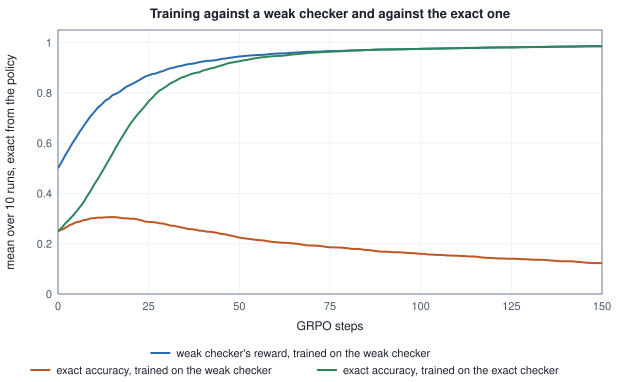

<!-- SPDX-License-Identifier: CC-BY-4.0 -->
<!-- Copyright (c) 2026 Martin Schröder <info@swedishembedded.com> -->

# Reinforcement and Preference Learning for Language Models

*How is a pretrained language model taught to follow instructions and prefer good answers?*

Take the language model of Volume V, trained on nothing but running text, and ask it to behave as an assistant. Its first failure is not a wrong answer. It has never seen the markers that frame a conversation, so it has no idea that a turn ends, and the number that says so can be computed: a bigram model counted from the corpus of Volume V, Chapter 2 gives the closing marker `<|im_end|>` a probability of $0.0029$ after the last word of a perfectly good answer, about one in three hundred and fifty, close to the one in $329$ that a model which knew nothing of the ids would give any of them. Adapting a pretrained model is a matter of changing such numbers on purpose: first by showing the model what an answer looks like, then by telling it which of two answers is better, then by letting it write answers and be scored by a program.

Each step reuses a tool already built. Showing is a loss on demonstrations, the cross-entropy of Volume III restricted to the tokens that the assistant wrote. Telling is a model of choices, and a way to turn those choices into a distribution over answers that stays close to where the model started. Scoring is the policy gradient of the previous chapter, with a group of answers to the same prompt standing in for the critic. Each step answers a defect of the one before. A demonstration cannot say which of two acceptable answers is better. A learned scorer can be exploited by a policy that is allowed to wander. A checker that a program can run cannot be argued with, and for that very reason it has to be exactly right.

Six earlier ideas carry the derivations, and each is worth bringing back before it is needed; the answers are in the Answers section.

1. (Volume V, Chapter 4, "Language Modeling", causal language model.) A causal model gives the three tokens of a completion the conditional probabilities $0.5$, $0.2$ and $0.1$. What probability does it give the completion, and what is its log-probability in nats?
2. (Volume V, Chapter 10, "Training a GPT from Scratch", loss masking.) A row has ten target positions of which four are supervised, with losses $2, 1, 3, 1$; the other six add up to $12$. What is the loss, and by what is the sum divided?
3. (Volume V, Chapter 2, "Tokenization", chat template.) In ChatML, with which ids does the prompt that asks for a reply end, and which id must the model learn to produce in order to stop?
4. (Chapter 3, "Policy Gradients", PPO.) A sample has advantage $A = -1$ and ratio $\rho = 0.7$ under $\epsilon = 0.2$. Which term of the minimum wins, and what is the gradient factor?
5. (Volume I, Chapter 13, "Information, Entropy and Surprise", KL divergence.) For $p = (0.5, 0.5)$ and $q = (0.75, 0.25)$ the divergence $\mathrm{KL}(p \,\|\, q)$ is $0.1438$ nats. What is $\mathrm{KL}(q \,\|\, p)$?
6. (Volume II, Chapter 3, "Classification and Logistic Regression", softplus.) What are $\mathrm{softplus}(0)$ and $\mathrm{sigmoid}(0)$, and what is the slope of $\mathrm{softplus}(-m)$ with respect to $m$ at $m = 0$?

## A model that has never seen a turn end

A conversation is one sequence of ids framed by the template of Volume V, Chapter 2, and **supervised fine-tuning** is the cross-entropy loss of next-token prediction applied to such sequences, with one change. A position is scored only when its target is something the assistant is meant to produce. The system prompt and the user's message are the context of the task, and a loss on them would reward the model for writing the user's side of the dialogue. Write $s_t = 1$ for a position whose target is supervised and $s_t = 0$ for the others, and $\ell_t = -\ln p_\theta(x_{t+1} \mid x_{\le t})$ for the loss of position $t$. The loss of a batch is

$$\mathcal{L} = \frac{\sum_t s_t\,\ell_t}{\sum_t s_t},$$

the loss masking of Volume V, Chapter 10: every position is computed, because the later ones need the earlier ones as context, and the ones with $s_t = 0$ then contribute nothing to the value or to the gradient. The numerator is a sum over the supervised targets and the denominator counts them. The block below makes every convention visible on a model small enough to print.

<!-- worked: llm_alignment.sft_masked_loss -->
The pretrained model is a bigram: for the 329 ids of the tokenization chapter's toy tokenizer (326 ordinary ids, then START = 326, END = 327, EOT = 328) it counts the adjacent id pairs of that chapter's corpus (67 ids, no special tokens) and sets the logit of the pair (a, b) to ln(count(a, b) + 0.1), so p(b | a) is the softmax of row a, in the stable form. Conversation A is the three messages of that chapter ((system, `the baker sells bread`), (user, `the cat sat on the bread`), (assistant, `the baker sat on the cat`)) in its ChatML template, 44 ids; position t has the input id ids[t] and the target ids[t + 1], t = 0 .. 42, so there are 43 targets and the first id is never one. The ids come from the tokenizer of Volume V, Chapter 2 (`tokenization.ToyTokenizer`: byte-level BPE with 70 merges trained on that corpus, pre-tokenized as there, ids 0 .. 325, then the three special ids); conversation B, used for the two divisors below, is (system, `the baker sells bread`), (user, `the baker sold bread`), (assistant, `the baker sells bread`) in the same template. In the table START, END and the pieces are written as in that chapter ('_' is a space, <0A> a line feed). Chosen by this chapter's rule, the supervised targets are the assistant's text and END (7 targets); the line feed after END is listed below them.

| t | input | target | part of the turn | p(target) | -ln p |
|---:|---|---|---|---:|---:|
| 35 | <0A> | the | assistant text | 0.0030 | 5.7961 |
| 36 | the | _baker | assistant text | 0.0324 | 3.4281 |
| 37 | _baker | _sat | assistant text | 0.0298 | 3.5129 |
| 38 | _sat | _on | assistant text | 0.0602 | 2.8105 |
| 39 | _on | _the | assistant text | 0.0602 | 2.8105 |
| 40 | _the | _cat | assistant text | 0.0513 | 2.9692 |
| 41 | _cat | END | assistant END | 0.0029 | 5.8551 |
| 42 | END | <0A> | assistant newline | 0.0030 | 5.7961 |

Loss of the same model on conversation A under four conventions for which targets count (sum of -ln p over the counted targets in position order; the mean divides by their number):

| counted targets | number | sum | mean |
|---|---:|---:|---:|
| assistant text and END (this chapter) | 7 | 27.1824 | 3.8832 |
| and the line feed after END (the form `answers_as_asked` trains) | 8 | 32.9785 | 4.1223 |
| and the assistant's header (the mask of a whole conversation) | 18 | 90.9391 | 5.0522 |
| every target, prompt included | 43 | 223.3316 | 5.1938 |

Two conversations in one batch: B is ((system, `the baker sells bread`), (user, `the baker sold bread`), (assistant, `the baker sells bread`)), 5 supervised targets against 7 for A, summed losses 27.1824 and 26.8443. The same summed losses give two means:

| divisor | value | weight of one token of A | weight of one token of B |
|---|---:|---:|---:|
| supervised tokens of the whole batch | 4.5022 | 0.0833 | 0.0833 |
| supervised tokens of each example, then the mean of the examples | 4.6260 | 0.0714 | 0.1000 |
<!-- /worked -->

Read the first table before the second. Of the $43$ targets of conversation A, seven are the assistant's text and its closing marker, and the model finds them hard: the probability of the first word after the line feed is $0.0030$, because the corpus has no line feed, and that of `END` is $0.0029$, because it has no marker either. The words in between it has at least met, at probabilities from $0.03$ to $0.06$. The second table shows what the choice of mask does to the number that is reported. The loss on the seven supervised targets is $3.8832$ nats, on the eight that add the line feed after `END` it is $4.1223$, and with the assistant's header as well it is $5.0522$; counting every target, the prompt included, the figure is $5.1938$, a number about the template and the prompt, which the model is not being asked to write. Three of these conventions are in use. This chapter's rule, the answer and the marker that closes the turn, is the one of Volume V. In brain, the `answers_as_asked` form supervises one more id, the line feed after the closing marker (the test `each_answer_of_a_dialogue_is_trained_as_the_model_is_asked_for_it` in `crates/data/src/chat.rs` pins the supervised text `a1<|im_end|>\n`), and the mask of a whole conversation also supervises the header of an assistant turn. The last is not always wanted, because no sampler ever samples a header: a sample that carries the log-probabilities of a rollout has nothing to place on those ids, so `ChatSample::encode_rollout` (the constructor of a training sample from a sampled completion) refuses a whole-conversation sample that carries them.

The closing marker deserves its place on the list, because it is how the model learns to stop. A model whose loss never covered it would continue after a finished answer with whatever its corpus did after a full stop, and `ChatSample::encode_with` therefore trains the end-of-turn token of every assistant turn it trains.

The third table shows the other convention that has to be chosen. Two conversations in one batch can be averaged per token or per example. With the first divisor, the supervised tokens of the whole batch, a token of conversation A and one of B weigh the same, $0.0833$. With the second, each example's mean taken first and the examples averaged, a token of the longer answer weighs $0.0714$ and one of the shorter $0.1000$: the same sum of losses, a different gradient, and a model that is paid more per token for short answers. The reinforcement-learning objectives of this chapter meet the same choice again as `LossAgg::SeqMean` (the per-example mean first, then the mean of the examples, the second divisor) and `LossAgg::TokenSum` (one divisor shared by every token of the optimizer step, the first) in `crates/rl/src/objective/grpo.rs`.

As pseudocode the loss is a loop with a count. The floor of one on the count gives a batch with nothing supervised a loss and a gradient of zero instead of an undefined quotient, which is also brain's rule.

```text
function masked_mean_loss(logits: array<real>[N, V], targets: array<int>[N], mask: array<int>[N]) -> real:
    require N > 0
    total = 0.0
    count = 0
    for t in 0 .. N:
        if mask[t] == 1:
            total = total + (lse(logits[t]) - logits[t][targets[t]])
            count = count + 1
    return total / max(count, 1)
```

Its gradient is the one of Volume III, Chapter 3 times the mask and the divisor: at a supervised position the gradient with respect to the logits is $(\mathbf{p} - \mathbf{e}_{\text{target}})/n$ with $n = \sum_t s_t$, and at every other position it is zero. The next block descends it on the bigram's logit table.

<!-- worked: llm_alignment.sft_step -->
The model and conversation A of the previous block. The loss is the mean of -ln p(target) over the n = 7 supervised targets (divisor 7); every other position contributes nothing to the value or the gradient. At the first supervised position (t = 35, input <0A>, target the) the gradient of the loss with respect to the 329 logits of that position's row is (p - e_target) / 7: its target entry is -0.1424 (p(target) = 0.0030) and the two largest other entries are 0.0004 (the id EOT) and 0.0004 (the id END); the 329 entries add to a number of absolute value below 1e-12, which is 0 up to rounding. Gradient descent on the logit table with the step 2.0: every step computes the gradient of the masked mean over all 7 targets from the table as it stands (the rows of the table that no supervised position reads, all of them unchanged after 20 steps, get no gradient), and subtracts 2.0 times it. 'Supervised' is the loss being minimized; 'other targets' is the mean -ln p over the 36 targets the mask leaves out, computed by the same model and never trained on; 'p(END after the last word)' is the probability of the closing id after the last word of the answer.

| steps | supervised loss | other targets | p(END after the last word) |
|---:|---:|---:|---:|
| 0 | 3.8832 | 5.4486 | 0.0029 |
| 1 | 3.6167 | 5.4128 | 0.0038 |
| 2 | 3.3561 | 5.3781 | 0.0051 |
| 5 | 2.6217 | 5.2825 | 0.0118 |
| 10 | 1.6290 | 5.1638 | 0.0465 |
| 20 | 0.5697 | 5.0933 | 0.3548 |
<!-- /worked -->

Twenty steps take the supervised loss from $3.8832$ to $0.5697$ and the probability of the closing marker after the last word from $0.0029$ to $0.3548$: the model has learned to stop, on one conversation. The other targets of the conversation improve too, from $5.4486$ to $5.0933$, although no gradient came from them; the model sees only the previous id, so a row that the supervised positions train, the row of `_the` for instance, is also the row that the prompt's positions read. A model that reads its whole context separates them, and a bigram does not, which is a reason to treat the improvement of the unsupervised targets as the table's own artifact.

Supervised fine-tuning is also the special case of the policy-gradient reduction of the previous chapter in which every advantage is $1$ and every ratio is $1$, and brain implements it that way (the section on `crates/rl` below). Its limit is in its name. It imitates. A demonstration shows one good answer to a prompt, and it cannot say that a second, different answer would have been better or worse, because the loss is the same whatever the model's other answers are. To learn that, the learner has to be told about two answers at once.

## Choices instead of demonstrations

People are much better at choosing between two answers than at writing the best one, and the data this produces is a **preference pair**: a prompt, an answer that was chosen and an answer that was rejected. A set of such pairs is **preference data**. It says nothing about how good either answer is, only that one is better than the other for that prompt, and it tolerates the disagreement of labellers, who choose differently on close calls.

The simplest model of that disagreement is the one of Bradley and Terry. Give every answer $y$ a number $r(y)$, its reward, and say that a labeller prefers $y_i$ to $y_j$ with probability

$$P(y_i \succ y_j) = \mathrm{sigmoid}\big(r(y_i) - r(y_j)\big) = \frac{e^{r(y_i)}}{e^{r(y_i)} + e^{r(y_j)}}.$$

Two answers of equal reward are chosen with probability one half, a difference of $1$ gives $0.73$, of $3$ gives $0.95$. The second form says that the chance of being chosen is proportional to $e^{r}$, which is the logistic regression of Volume II applied to a difference of scores, and it has one property that the rest of the chapter uses: only differences of rewards matter, and adding the same number to every reward changes no probability.

The running example is one prompt, `17 + 25 =`, and five complete answers to it: `42`, `The sum is 42.`, `43`, `I am not sure.` and `40 41 42 43 44 45`. A language model's distribution over completions is a distribution over very many strings; this one has five, so that everything can be printed, and its logits are the parameters. A labeller who reads the answers gives them the rewards $(2.0, 2.5, 0, 0.5, -1.0)$ (a number nobody sees: only the choices it produces are data). The block draws sixteen labelled pairs.

<!-- worked: llm_alignment.bradley_terry_pairs -->
One prompt (`17 + 25 =`), five complete answers: a0 = `42`; a1 = `The sum is 42.`; a2 = `43`; a3 = `I am not sure.`; a4 = `40 41 42 43 44 45`. The labeller's reward of the answers is r = (2.0, 2.5, 0.0, 0.5, -1.0) (a model never sees it, only choices made by it). The Bradley-Terry probability that a labeller prefers answer i to answer j is sigmoid(r_i - r_j):

| P(row preferred to column) | a0 | a1 | a2 | a3 | a4 |
|---|---:|---:|---:|---:|---:|
| a0 | - | 0.378 | 0.881 | 0.818 | 0.953 |
| a1 | 0.622 | - | 0.924 | 0.881 | 0.971 |
| a2 | 0.119 | 0.076 | - | 0.378 | 0.731 |
| a3 | 0.182 | 0.119 | 0.622 | - | 0.818 |
| a4 | 0.047 | 0.029 | 0.269 | 0.182 | - |

Generator: the book's SplitMix64, seed 0xbac244beddd62f4d (`seed_of` of the name `llm_alignment.pairs`, defined on the pseudocode page). Each of the 16 pairs draws, in this order, i = integer(5), j = integer(4) (raised by 1 when j >= i, so that j is another answer) and u = uniform(); the labeller chooses i when u < sigmoid(r_i - r_j) and j otherwise. The generator runs once across the 16 pairs.

| pair | i | j | u | P(i preferred) | chosen | agrees with the reward |
|---:|---|---|---:|---:|---|---:|
| 0 | a4 | a1 | 0.743882 | 0.0293 | a1 | yes |
| 1 | a4 | a3 | 0.563392 | 0.1824 | a3 | yes |
| 2 | a4 | a0 | 0.957353 | 0.0474 | a0 | yes |
| 3 | a1 | a0 | 0.302143 | 0.6225 | a1 | yes |
| 4 | a2 | a3 | 0.459048 | 0.3775 | a3 | yes |
| 5 | a3 | a1 | 0.555927 | 0.1192 | a1 | yes |
| 6 | a2 | a0 | 0.072310 | 0.1192 | a2 | NO |
| 7 | a4 | a2 | 0.353639 | 0.2689 | a2 | yes |
| 8 | a0 | a2 | 0.817213 | 0.8808 | a0 | yes |
| 9 | a1 | a0 | 0.028329 | 0.6225 | a1 | yes |
| 10 | a1 | a3 | 0.812502 | 0.8808 | a1 | yes |
| 11 | a1 | a2 | 0.630525 | 0.9241 | a1 | yes |
| 12 | a0 | a3 | 0.175655 | 0.8176 | a0 | yes |
| 13 | a0 | a4 | 0.999953 | 0.9526 | a4 | NO |
| 14 | a0 | a4 | 0.159166 | 0.9526 | a0 | yes |
| 15 | a4 | a2 | 0.219611 | 0.2689 | a4 | NO |

3 of the 16 labels disagree with the reward (the labeller chose the answer with the lower reward), which is what a probability of preferring that is not 1 means.
<!-- /worked -->

Three of the sixteen labels disagree with the reward, which is exactly the kind of noise the model says to expect: pair $13$ chose `40 41 42 43 44 45` over `42` although the labeller prefers `42` with probability $0.9526$, and it happened because the uniform draw landed above that probability (it was $0.99995$). The noise will matter in a moment, because it is all that a learner sees of the labeller.

## A table of scores fitted to the choices

A **reward model** is a model that reads a prompt and an answer and returns a single number, trained so that the answers people chose get larger numbers than the answers they rejected. For text it is usually the language model itself with its output layer replaced by one value read at the last token; here it is a table of five scores $s_y$, which is the simplest model that can express any ranking of five answers. Training it is maximum likelihood on the Bradley-Terry model. For one pair with chosen answer $y_{\mathrm{c}}$ and rejected answer $y_{\mathrm{r}}$ the margin is $m = s_{y_{\mathrm{c}}} - s_{y_{\mathrm{r}}}$, the probability the model gives to the label is $\mathrm{sigmoid}(m)$ and the loss is $-\ln\mathrm{sigmoid}(m) = \mathrm{softplus}(-m)$, the loss of Volume II with the label always one and the margin as the logit. Its derivative with respect to $m$ is $-\mathrm{sigmoid}(-m)$: the more wrong the model is, the harder the pair pushes. The gradient therefore raises the chosen score and lowers the rejected one by the same amount.

```text
function reward_model_epoch(s: array<real>[m], chosen: list<int>, rejected: list<int>, lr: real) -> array<real>[m]:
    require len(chosen) == len(rejected) and len(chosen) > 0 and lr > 0
    n = len(chosen)
    grad = zeros(real, [m])
    for i in 0 .. n:
        w = sigmoid(-(s[chosen[i]] - s[rejected[i]])) / n
        grad[chosen[i]] = grad[chosen[i]] - w
        grad[rejected[i]] = grad[rejected[i]] + w
    return s - lr * grad
```

The scores start at zero, so the first loss is $\ln 2$.

<!-- worked: llm_alignment.reward_model -->
The pairs of the previous block. The reward model is a table of one score per answer, s = (s_0 .. s_4), the simplest model that can express any ranking (a real one is a network that reads the text). Pair n with chosen answer c and rejected answer d has margin m = s_c - s_d and loss softplus(-m) = -ln sigmoid(m); the loss is the mean over the 16 pairs (divisor 16), its gradient gives the chosen answer -sigmoid(-m) / 16 and the rejected one +sigmoid(-m) / 16 (summed over the pairs). Full-batch gradient descent from s = 0 with the step 1.0, 100 steps; no weight decay and no early stopping other than the step count.

| step | scores s | mean loss | pairs with a positive margin in the labelled direction |
|---:|---|---:|---:|
| 0 | (0.000, 0.000, 0.000, 0.000, 0.000) | 0.6931 | 0 of 16 |
| 10 | (-0.032, 1.215, -0.442, -0.145, -0.597) | 0.4818 | 13 of 16 |
| 30 | (-0.156, 2.125, -0.805, -0.178, -0.985) | 0.4225 | 13 of 16 |
| 100 | (-0.403, 3.182, -1.154, -0.297, -1.328) | 0.3994 | 12 of 16 |

At step 0 the loss is ln 2 = 0.6931. After 100 steps the loss is 0.3994; adding 5 to every score leaves it at 0.3994, because only differences of scores enter. The ranking the model learned is a1 > a3 > a0 > a2 > a4; the labeller's own is a1 > a0 > a3 > a2 > a4 (rewards 2.5, 2, 0.5, 0, -1).
<!-- /worked -->

The model fits the pairs and then fits their noise. It ranks `The sum is 42.` first, correctly, and then `I am not sure.` above `42`, which the labeller does not believe: two of the three upsets of the previous block involved `42`, and sixteen labels are not enough to outvote them. The scores can also not be read as rewards. The labeller's gap between the best and the worst answer is $3.5$ and the model's is $4.5$, and no pair of the data says which is right, only that the ordering is. Such an error is harmless as long as nobody optimizes hard against the reward model, and optimizing against it is the next step.

## Staying near where the model started

Suppose the policy is simply trained to maximize the reward model's score. The policy would put all its probability on the answer with the highest score, here `The sum is 42.`, and in a real model it would find the corners where the scorer is mistaken, since the scorer was fitted on the answers the starting model happens to write and says nothing of the rest. The usual remedy is a penalty on how far the policy moves from the model that supervised fine-tuning produced, the **reference policy** $\pi_{\mathrm{ref}}$. The objective is

$$J_\beta(\pi) = \mathbb{E}_{y \sim \pi}\big[\,r(y)\,\big] - \beta\,\mathrm{KL}(\pi \,\|\, \pi_{\mathrm{ref}}),$$

the expected reward minus $\beta$ times the KL divergence of Volume I of the policy from the reference, in that direction: the average over the policy's own answers of $\ln(\pi(y)/\pi_{\mathrm{ref}}(y))$. This is the **KL penalty**, and $\beta > 0$, a number in the units of the reward, says how many units of reward one nat of movement costs. The reference is frozen: it is the model at the start of the run, held fixed (in brain, the base with its adapter switched off, as the section on `crates/rl` shows).

The objective has a closed-form maximizer. Define $Z = \sum_y \pi_{\mathrm{ref}}(y)\,e^{r(y)/\beta}$ and the distribution $\pi^\ast(y) = \pi_{\mathrm{ref}}(y)\,e^{r(y)/\beta} / Z$. Taking logarithms, $r(y) = \beta \ln\big(\pi^\ast(y)/\pi_{\mathrm{ref}}(y)\big) + \beta \ln Z$. Put that for $r$ in the objective:

$$\begin{aligned}
J_\beta(\pi) &= \sum_y \pi(y)\Big[\beta \ln\frac{\pi^\ast(y)}{\pi_{\mathrm{ref}}(y)} + \beta \ln Z - \beta \ln\frac{\pi(y)}{\pi_{\mathrm{ref}}(y)}\Big] \\
&= \beta \ln Z - \beta\,\mathrm{KL}(\pi \,\|\, \pi^\ast).
\end{aligned}$$

A KL divergence is never negative and is zero only when the two distributions are equal. The objective is therefore largest at $\pi = \pi^\ast$, where it equals $\beta \ln Z$, and every other policy loses exactly $\beta$ times its divergence from $\pi^\ast$:

$$\pi^\ast(y) = \frac{\pi_{\mathrm{ref}}(y)\,\exp\big(r(y)/\beta\big)}{Z}, \qquad \max_\pi J_\beta = \beta \ln Z.$$

The reference is reweighted by $e^{r/\beta}$ and renormalized. The block evaluates it for six values of $\beta$, and checks the closed form against gradient ascent on the objective.

<!-- worked: llm_alignment.kl_optimum -->
The five answers of the preference block, the reference policy pi_ref = (0.15, 0.10, 0.30, 0.20, 0.25) (the policy supervised fine-tuning left behind; its logits are theta_ref = ln pi_ref) and the reward r = (2.0, 2.5, 0.0, 0.5, -1.0). For each beta the closed-form optimum is pi*(y) = pi_ref(y) exp(r(y) / beta) / Z with Z = sum_y pi_ref(y) exp(r(y) / beta), computed as a stable softmax of ln pi_ref(y) + r(y) / beta. 'E r' is sum_y pi*(y) r(y), the KL is in nats (natural logarithm, direction pi* then pi_ref, sums in answer order), J_beta(pi) = E r - beta KL(pi || pi_ref), and the last column is the number beta ln Z that the derivation says J_beta(pi*) equals (the last row, beta = infinity, is pi_ref itself).

| beta | pi*(a0) | pi*(a1) | pi*(a2) | pi*(a3) | pi*(a4) | E r | KL of pi* from pi_ref | J_beta(pi*) | beta ln Z |
|---:|---:|---:|---:|---:|---:|---:|---:|---:|---:|
| 10 | 0.175 | 0.123 | 0.286 | 0.201 | 0.216 | 0.540 | 0.007 | 0.4696 | 0.4696 |
| 2 | 0.278 | 0.238 | 0.205 | 0.175 | 0.103 | 1.136 | 0.186 | 0.7640 | 0.7640 |
| 1 | 0.364 | 0.400 | 0.098 | 0.108 | 0.030 | 1.750 | 0.636 | 1.1146 | 1.1146 |
| 0.5 | 0.343 | 0.621 | 0.013 | 0.023 | 0.001 | 2.247 | 1.320 | 1.5871 | 1.5871 |
| 0.25 | 0.169 | 0.831 | 0.000 | 0.001 | 0.000 | 2.414 | 1.774 | 1.9707 | 1.9707 |
| 0.1 | 0.010 | 0.990 | 0.000 | 0.000 | 0.000 | 2.495 | 2.242 | 2.2707 | 2.2707 |
| infinity | 0.150 | 0.100 | 0.300 | 0.200 | 0.250 | 0.400 | 0.000 | 0.4000 | 0.4000 |

The exact gradient of J_beta(theta) with respect to the five logits is pi_j (f_j - sum_k pi_k f_k) with f_k = r_k - beta ln(pi_k / pi_ref_k). Gradient ascent from theta_ref with the step 1, 20,000 steps, reaches:

| beta | largest abs(pi - pi*) | abs(J_beta(pi*) - J_beta(pi)) |
|---:|---:|---:|
| 2 | 0.000000 | 0.000000000 |
| 1 | 0.000000 | 0.000000000 |
| 0.5 | 0.000000 | 0.000000000 |
<!-- /worked -->


The two ends of the scale are what the derivation promises. For large $\beta$ the reference is hardly touched ($\beta = 10$: $E\,r = 0.540$ against $0.400$ for the reference, at a cost of $0.007$ nats) and for small $\beta$ the mass collects on the answer of highest reward ($\beta = 0.1$: $0.990$ on `The sum is 42.`, at a cost of $2.242$ nats, almost all of the $-\ln 0.10 = 2.303$ nats it takes to move all of the mass onto the answer to which the reference gives $0.10$). In between is a smooth frontier, and the answer `42`, whose reward is nearly the highest, gains mass first and loses it again as `The sum is 42.` takes over. The last column of the table agrees with $J_\beta(\pi^\ast)$ in every row, and gradient ascent from the reference reaches $\pi^\ast$ to within $10^{-6}$ for the three values it was run on.

What the penalty buys against the reward model's errors can also be counted. The block below optimizes the learned scores $s$ of the previous section in the place of the labeller's reward and then values the result with the labeller's.

<!-- worked: llm_alignment.learned_reward_cost -->
The reward model of the previous blocks, s = (-0.403, 3.182, -1.154, -0.297, -1.328) (a table of scores after 100 steps), used as the reward of the KL-regularized objective: for each beta the optimum pi*_s(y) = pi_ref(y) exp(s(y) / beta) / Z. 'E s' is the reward the model believes the policy earns, 'E r' the reward the labeller's r = (2.0, 2.5, 0.0, 0.5, -1.0) gives it, and 'best E r at that KL' is the largest E r among the optima of r itself (beta found by bisection on ln beta over [ln 0.001, ln 10000], 200 halvings: the KL of the optimum falls as beta rises, so a midpoint whose KL exceeds the target becomes the new lower end and any other midpoint the new upper end, and beta is the final midpoint) that spend the same KL(pi || pi_ref); the last column is the shortfall, the price of the reward model's errors at that distance from the reference.

| beta | pi*_s | KL of pi from pi_ref | E s | E r | best E r at that KL | shortfall |
|---:|---|---:|---:|---:|---:|---:|
| 10 | (0.150, 0.143, 0.278, 0.202, 0.228) | 0.010 | -0.288 | 0.530 | 0.567 | 0.037 |
| 3 | (0.136, 0.299, 0.211, 0.188, 0.166) | 0.160 | 0.376 | 0.947 | 1.082 | 0.136 |
| 2 | (0.113, 0.453, 0.156, 0.159, 0.119) | 0.426 | 1.012 | 1.320 | 1.514 | 0.194 |
| 1 | (0.036, 0.855, 0.034, 0.053, 0.023) | 1.583 | 2.620 | 2.211 | 2.358 | 0.147 |
| 0.5 | (0.001, 0.996, 0.001, 0.002, 0.000) | 2.270 | 3.168 | 2.493 | 2.498 | 0.004 |
| 0.25 | (0.000, 1.000, 0.000, 0.000, 0.000) | 2.303 | 3.182 | 2.500 | 2.500 | 0.000 |
<!-- /worked -->

At $\beta = 2$ the policy that is optimal for the learned scores earns $1.320$ of true reward at a cost of $0.426$ nats, where the best policy of the true reward at that distance earns $1.514$, a shortfall of $0.194$; at $\beta = 0.25$ it has no shortfall at all, but only because both rewards put the whole mass on the same answer. The reward model's mistake, ranking `I am not sure.` above `42`, shows only in the middle of the frontier: it costs reward on the way and not at the end. In a real model the end is not a single answer and the mistakes of a scorer are not so kind.

## The penalty one token at a time

A real policy is not a table over whole answers. It writes an answer one token at a time, and its probability for the answer is the product of the conditionals of Volume V, so that $\ln \pi(y) - \ln \pi_{\mathrm{ref}}(y)$ is a sum over the tokens. The KL divergence of the sequences is then also a sum over positions, by the chain rule: the divergence of the next-token distributions after each prefix, averaged over the prefixes that the policy reaches. This is what makes the penalty computable from per-token quantities that a model produces anyway. The block checks the chain rule on a model with two tokens and three positions, and measures the two estimators of Chapter 3 summed over a sequence.

<!-- worked: llm_alignment.token_kl_estimators -->
A language model over the two tokens 0 and 1 that writes exactly 3 tokens (no end token), so there are 8 sequences. The reference pi_ref and the policy pi are given by the probability of the token 1 after each of the 7 prefixes (the probability of the token 0 is the complement):

| prefix | P(prefix under pi) | pi_ref(1 after prefix) | pi(1 after prefix) | KL of pi from pi_ref after the prefix | weighted by the prefix |
|---|---:|---:|---:|---:|---:|
| (empty) | 1.0000 | 0.50 | 0.65 | 0.0457 | 0.0457 |
| `0` | 0.3500 | 0.40 | 0.50 | 0.0204 | 0.0071 |
| `1` | 0.6500 | 0.60 | 0.75 | 0.0499 | 0.0324 |
| `00` | 0.1750 | 0.30 | 0.20 | 0.0257 | 0.0045 |
| `01` | 0.1750 | 0.50 | 0.60 | 0.0201 | 0.0035 |
| `10` | 0.1625 | 0.50 | 0.45 | 0.0050 | 0.0008 |
| `11` | 0.4875 | 0.70 | 0.85 | 0.0611 | 0.0298 |

The weighted column adds to 0.1239, the exact KL(pi || pi_ref) of the whole sequence (0.1239; sums over the sequences in the order below, natural logarithms): the chain rule of the KL, the KL after each prefix averaged over the prefixes that pi reaches. For a sequence y_1 y_2 y_3 drawn from pi, the estimator k1 sums ln(pi(y_t | y_<t) / pi_ref(y_t | y_<t)) over the three tokens, and k3 sums rho_t - 1 - ln rho_t with rho_t = pi_ref(y_t | y_<t) / pi(y_t | y_<t); the means and variances over pi's eight sequences are exact (the variance has divisor 1, an expectation).

| sequence | pi(sequence) | pi_ref(sequence) | k1 summed | k3 summed |
|---|---:|---:|---:|---:|
| 000 | 0.1400 | 0.2100 | -0.4055 | 0.0981 |
| 001 | 0.0350 | 0.0900 | -0.9445 | 0.1841 |
| 010 | 0.0700 | 0.1000 | -0.3567 | 0.1219 |
| 011 | 0.1050 | 0.1000 | 0.0488 | 0.1107 |
| 100 | 0.0894 | 0.1000 | -0.1123 | 0.1660 |
| 101 | 0.0731 | 0.1000 | -0.3130 | 0.1673 |
| 110 | 0.0731 | 0.0900 | -0.2076 | 0.3616 |
| 111 | 0.4144 | 0.2100 | 0.6797 | 0.0724 |

Mean of k1: 0.1239, mean of k3: 0.1239, exact KL 0.1239. Standard deviation of k1: 0.5009, of k3: 0.0759. The smallest k1 is -0.9445 and the smallest k3 is 0.0724. A loss that averages the per-token terms over the 3 tokens instead of summing them has the mean 0.0413, 3 times smaller.
<!-- /worked -->

The weighted column adds to $0.1239$, the exact divergence of the whole sequence. Both estimators have that mean over the policy's own sequences. The estimator $k_1$, the sum of the per-token log-ratios, has the standard deviation $0.5009$ and takes values from $-0.9445$ to $0.6797$, so its single-sample value can be negative for a quantity that is not. The estimator $k_3$, the sum of $\rho_t - 1 - \ln\rho_t$ with $\rho_t = \pi_{\mathrm{ref}}(y_t \mid y_{<t})/\pi(y_t \mid y_{<t})$, has the standard deviation $0.0759$ and is never negative. This is Chapter 3's estimator with the roles changed: there the samples came from the old policy and the ratio was the new policy over the old, estimating $\mathrm{KL}(\pi_{\mathrm{old}} \,\|\, \pi_\theta)$; here the samples come from the policy and the ratio is the reference over the policy, estimating $\mathrm{KL}(\pi \,\|\, \pi_{\mathrm{ref}})$. A training loop that takes the mean of the per-token terms over a completion instead of their sum reports the divergence divided by the length, $0.0413$ for the three tokens, which is a different penalty at a different $\beta$.

## Putting the penalty in the reward, or in the loss

There are two ways to apply the penalty to a policy-gradient step, and they do different things. In the original recipe of reinforcement learning from human feedback (RLHF), which is PPO with a reward model, the penalty is folded into the reward: a completion's reward is $r(y) - \beta \ln(\pi(y)/\pi_{\mathrm{ref}}(y))$, summed over its tokens, an ordinary advantage is formed from it and the clipped surrogate of Chapter 3 does the rest. In the other, which brain's objective uses, the reward and the advantage know nothing of the reference, and the penalty is an extra term of the loss, the $k_3$ estimate of the divergence of each token, whose gradient is added to that of the policy term. Its weight on the cross-entropy direction is $\beta(\pi_{\mathrm{ref}}/\pi - 1)$ for a sampled token (the section on `crates/rl` shows it in `token_term_banded`).

Both are written as the derivative of a single sampled term with the sample held fixed, which is how a loss on sampled tokens is differentiated. That is where they differ, and the five answers show it exactly, with no sampling. The expectation over the policy of the sample-fixed gradient of each term is compared with the gradient of each of the two KL divergences.

<!-- worked: llm_alignment.kl_gradient_direction -->
The five answers of the KL-regularized objective, pi_ref = (0.15, 0.10, 0.30, 0.20, 0.25), at theta = theta_ref + (0.8, 0.3, -0.5, -0.2, 0.4), where pi = (0.2811, 0.1137, 0.1532, 0.1379, 0.3141). The rows are gradients with respect to the five logits. The finite differences use the step 1e-06 on the exact KLs (nats, summed in answer order). For the sampled-answer rows, the gradient of the per-sample term with y held fixed is written with the score e_y - pi (the gradient of ln pi(y)): the k1 term ln(pi(y)/pi_ref(y)) has the gradient (e_y - pi); the k3 term q - 1 - ln q with q = pi_ref(y)/pi(y) has the gradient (1 - q)(e_y - pi); and the penalty folded into the reward multiplies the score by the number ln(pi(y)/pi_ref(y)) without differentiating it. Each is averaged exactly over the five answers with the weights pi(y) (no sampling).

| quantity | d/d theta_0 | d/d theta_1 | d/d theta_2 | d/d theta_3 | d/d theta_4 |
|---|---:|---:|---:|---:|---:|
| gradient of KL(pi_theta, pi_ref), finite difference | 0.14606 | 0.00222 | -0.11959 | -0.06625 | 0.03755 |
| gradient of KL(pi_ref, pi_theta), finite difference | 0.13113 | 0.01367 | -0.14677 | -0.06211 | 0.06407 |
| mean over y ~ pi of the k1 term with y held fixed | 0.00000 | 0.00000 | 0.00000 | 0.00000 | 0.00000 |
| mean over y ~ pi of the k3 term with y held fixed | 0.13113 | 0.01367 | -0.14677 | -0.06211 | 0.06407 |
| mean over y ~ pi of (ln(pi/pi_ref)) times the score | 0.14606 | 0.00222 | -0.11959 | -0.06625 | 0.03755 |

The k3 row equals the forward-KL row (largest difference 7.6e-11) and the folded row equals the reverse-KL row (largest difference 5.0e-11); the criterion for both is 1e-8. The k1 row is (0.0, 0.0, 0.0, 0.0, 0.0) up to rounding (largest entry 2.1e-17).

Where the two penalties lead, for beta = 0.5 and the reward r = (2.0, 2.5, 0.0, 0.5, -1.0): the policy at which the gradient of E r - beta KL(pi || pi_ref) vanishes is the closed form pi*; the policy at which the gradient of E r - beta KL(pi_ref || pi) vanishes was found by gradient ascent from theta_ref with the step 0.5 until every component was below 1e-13.

| policy | pi(a0) | pi(a1) | pi(a2) | pi(a3) | pi(a4) | E r | KL of pi from pi_ref |
|---|---:|---:|---:|---:|---:|---:|---:|
| pi* (KL in the reward; the closed form) | 0.343 | 0.621 | 0.013 | 0.023 | 0.001 | 2.247 | 1.320 |
| where ascent with the k3 term settles | 0.132 | 0.726 | 0.058 | 0.048 | 0.035 | 2.069 | 1.190 |
<!-- /worked -->

Three facts come out of the table. The $k_1$ term with the sample held fixed has expected gradient zero, since the expected score of the policy's own sample is zero (Chapter 3), so a $k_1$ in the loss would apply no penalty at all. The penalty folded into the reward has the expected gradient of $\mathrm{KL}(\pi \,\|\, \pi_{\mathrm{ref}})$, which is the penalty of the objective $J_\beta$ and of the closed form. And the $k_3$ term in the loss, with the sample held fixed, has the expected gradient of $\mathrm{KL}(\pi_{\mathrm{ref}} \,\|\, \pi)$, the divergence in the other direction. The derivation is two lines: with $q = \pi_{\mathrm{ref}}(y)/\pi(y)$ the gradient of $q - 1 - \ln q$ is $(1 - q)\,\nabla\ln\pi(y)$, whose mean over $y \sim \pi$ is $-\sum_y \pi_{\mathrm{ref}}(y)\,\nabla\ln\pi(y)$, which is $\nabla\,\mathrm{KL}(\pi_{\mathrm{ref}} \,\|\, \pi)$ because the score has mean zero. The mean value of the $k_3$ estimate is that of $\mathrm{KL}(\pi \,\|\, \pi_{\mathrm{ref}})$; its gradient, with the sample held fixed, is that of the other.

The distinction is not academic, because the two penalties lead to different policies. The second table of the block settles the question for $\beta = 0.5$: with the penalty folded into the reward the policy reaches the closed form $\pi^\ast$, and with the $k_3$ term in the loss it settles somewhere else, with more mass on the answers the reward dislikes ($0.058$, $0.048$ and $0.035$ on the last three against $0.013$, $0.023$ and $0.001$) and a smaller gain ($E\,r = 2.069$ against $2.247$). The divergence $\mathrm{KL}(\pi_{\mathrm{ref}} \,\|\, \pi)$ is an average over the reference's answers, so it punishes a policy that has stopped producing something the reference produced, and its cost grows without bound as the policy's probability of such an answer falls toward zero; low-reward answers therefore keep more of their mass. The sampled runs below confirm that this is what a learner does.

The pseudocode below is the algorithm of the runs: one iteration of PPO on the five answers, in which the variable `in_loss` selects where the penalty enters and the sample is a batch of $64$ answers drawn from `pi_old`.

```text
function rlhf_iteration(theta: array<real>[m], pi_ref: array<real>[m], r: array<real>[m], beta: real,
                        batch: int, epochs: int, eta: real, eps: real, in_loss: bool,
                        rng: Generator) -> array<real>[m]:
    require beta > 0 and batch > 0 and epochs > 0 and eta > 0 and eps > 0
    pi_old = softmax(theta)
    ys = zeros(int, [batch])
    rew = zeros(real, [batch])
    mean = 0.0
    for i in 0 .. batch:
        ys[i] = sample_index(pi_old, rng)
        rew[i] = r[ys[i]] if in_loss else r[ys[i]] - beta * log(pi_old[ys[i]] / pi_ref[ys[i]])
        mean = mean + rew[i]
    mean = mean / batch
    for e in 0 .. epochs:
        pi = softmax(theta)
        grad = zeros(real, [m])
        for i in 0 .. batch:
            y = ys[i]
            adv = rew[i] - mean
            rho = pi[y] / pi_old[y]
            w = 0.0
            if rho * adv <= min(max(rho, 1.0 - eps), 1.0 + eps) * adv:
                w = adv * rho
            if in_loss:
                w = w + beta * (pi_ref[y] / pi[y] - 1.0)
            for k in 0 .. m:
                grad[k] = grad[k] + w * ((1.0 if k == y else 0.0) - pi[k]) / batch
        theta = theta + eta * grad
    return theta
```

The answers are drawn first, one `sample_index` each, in the order of the batch, and the batch mean is the baseline, summed in order. The behaviour probabilities `pi_old` and the advantages stay fixed during the epochs, the reference is frozen throughout, and the policy takes `epochs` steps on one batch (here $4$) before the next is drawn. The clip is the PPO clip of Chapter 3, applied to the ratio, and a clipped sample contributes nothing from its advantage but still contributes its penalty weight in the loss variant, as brain's `token_term_banded` does.

<!-- worked: llm_alignment.rlhf_runs -->
The five answers, pi_ref = (0.15, 0.10, 0.30, 0.20, 0.25), the labeller's reward r = (2.0, 2.5, 0.0, 0.5, -1.0) used as the reward model (so that the only error is the algorithm's), beta = 0.5. The target is the closed-form optimum pi* = (0.3425, 0.6208, 0.0125, 0.0227, 0.0014), with J_beta(pi*) = 1.5871. Each run starts from theta_ref and draws, per iteration, 64 answers y_i from pi_old (one uniform() each, inverse CDF over pi_old in answer order, the generator of the run continuing), forms the reward of each, subtracts the batch mean (summed in order, divisor 64) to get the advantage A_i, and takes 4 epochs of the clipped surrogate of the policy-gradient chapter on the whole batch (one minibatch, in drawing order) with the step 0.5 and the clip 0.2: the gradient on theta is the mean over the batch of w_i (e_(y_i) - pi_theta) with w_i = A_i rho_i for a sample that the clip leaves (raw term not above clipped term) and 0 otherwise, rho_i = pi_theta(y_i) / pi_old(y_i). Variant 'KL folded into the reward': the reward of a sample is r(y) - beta ln(pi_old(y) / pi_ref(y)). Variant 'k3 term in the loss': the reward is r(y), and every sample adds beta (pi_ref(y) / pi_theta(y) - 1) to its w_i, the weight of the gradient of the k3 term of the previous block with the current policy in the denominator, so the KL is never in the advantage. Variant 'k3 term against pi_old' (the check of the exercise on this block) is the previous one with pi_old(y) in the place of pi_ref(y), so that the penalty compares the policy with the one that sampled the batch and not with the reference. 10 runs per variant, every run restarting from its own seed (seeds below). 'J' is J_beta(pi) = E r - beta KL(pi || pi_ref) of the policy at the start of the iteration and 'KL to pi*' is KL(pi* || pi); each cell is the mean over the 10 runs (summed in run order).

| iteration | J, KL in the reward | KL to pi*, KL in the reward | J, k3 in the loss | KL to pi*, k3 in the loss | J, k3 against pi_old | KL to pi*, k3 against pi_old |
|---:|---:|---:|---:|---:|---:|---:|
| 0 | 0.400 | 1.3196 | 0.400 | 1.3196 | 0.400 | 1.3196 |
| 10 | 1.552 | 0.0396 | 1.496 | 0.1051 | 1.546 | 0.0772 |
| 25 | 1.580 | 0.0081 | 1.476 | 0.1772 | 1.406 | 0.7250 |
| 50 | 1.585 | 0.0027 | 1.472 | 0.1876 | 1.373 | 1.1378 |
| 100 | 1.586 | 0.0013 | 1.472 | 0.1887 | 1.361 | 1.4730 |
| 200 | 1.587 | 0.0005 | 1.471 | 0.1891 | 1.355 | 1.7617 |

Every number learned from samples is printed with the digits that the run and four copies of it share: the copies start with the first logit of the reference policy, theta_ref[0], changed by +1e-12, -1e-12, +3e-12 and -3e-12 (the nudges of stable.py), and a digit is printed only if all five agree on it ('about x' keeps the leading digits that survive, 'unstable' means that none does). The copies use the same generator and so draw the same numbers; they differ only if a nudge flips a comparison. A run is a deterministic computation, so another implementation reproduces the printed digits.

| run | KL folded into the reward | k3 term in the loss | k3 term against pi_old |
|---:|---:|---:|---:|
| 0 | 0x2a55c7e09bc913d8 | 0x1e68daedfa91422c | 0x7d982395c62f4d44 |
| 1 | 0xae8ab717a2d9b053 | 0x47ff50a37a59607d | 0x0dd3f0dce399ba50 |
| 2 | 0x7e54777fd5665ea8 | 0x1238a33b0aae16dc | 0x23aa9a25a50580b9 |
| 3 | 0xcb6bfaea549af4f1 | 0xce64ba19a5167e5c | 0x7e48dcb2fb736820 |
| 4 | 0x3ab8ef57d85243bc | 0x1c1a00bd77a3728f | 0xafb30de6fde6673f |
| 5 | 0x9976e477910012c7 | 0x0589ab6798f09c28 | 0x8ffdfdd214dc9916 |
| 6 | 0x649348033fd1fef2 | 0xa2969379d60dade7 | 0x5799eee0276b1ea6 |
| 7 | 0xd5bd7f69e26e8a77 | 0x3bfe7af9d1868c4f | 0x3b361297dc3d5d4f |
| 8 | 0xef14e379c830fc74 | 0xf8b560a40fe64f85 | 0x2094c0c5438de87b |
| 9 | 0x047e7603c7c5b08c | 0xabf3e9167e919dfb | 0x10b6722fc2d3145e |
<!-- /worked -->

With the penalty in the reward the runs reach $J_\beta = 1.587$ and are $0.0005$ nats from $\pi^\ast$ at iteration $200$, against a closed-form maximum of $1.5871$. With the $k_3$ term in the loss they stop at $1.471$, $0.1891$ nats from $\pi^\ast$, and do not move closer: they have found the maximum of another objective. The difference is large at $\beta = 0.5$ because the answers are few and the penalty is strong. At the small coefficient brain's trainer defaults to ($\beta = 0.02$ for `PolicyGradientConfig::kl_beta`) both penalties are weak next to the reward, and the choice of direction matters less than the choice of the coefficient. It matters whenever the solution of the regularized problem itself is wanted, as it is in the closed form.

## Skipping the reward model: direct preference optimization

The closed form can be read the other way round. If $\pi^\ast$ is what the reward and the penalty jointly define, then the reward is a function of the optimal policy: $r(y) = \beta \ln(\pi^\ast(y)/\pi_{\mathrm{ref}}(y)) + \beta \ln Z$. The block checks it at $\beta = 0.5$: the number added to the implicit reward $\beta \ln(\pi^\ast/\pi_{\mathrm{ref}})$ to get the true reward is the same for every answer.

<!-- worked: llm_alignment.dpo_implicit_reward -->
The optimum pi* of the KL-regularized objective for beta = 0.5 and the labeller's reward r, with pi_ref = (0.15, 0.10, 0.30, 0.20, 0.25). The implicit reward of a policy is beta ln(pi(y) / pi_ref(y)); at pi* it differs from r(y) by the same number for every answer, which the derivation says is beta ln Z = 1.5871.

| answer | r | pi_ref | pi* | beta ln(pi*/pi_ref) | r minus the implicit reward |
|---|---:|---:|---:|---:|---:|
| a0 | 2.0 | 0.150 | 0.3425 | 0.4129 | 1.5871 |
| a1 | 2.5 | 0.100 | 0.6208 | 0.9129 | 1.5871 |
| a2 | 0.0 | 0.300 | 0.0125 | -1.5871 | 1.5871 |
| a3 | 0.5 | 0.200 | 0.0227 | -1.0871 | 1.5871 |
| a4 | -1.0 | 0.250 | 0.0014 | -2.5871 | 1.5871 |
<!-- /worked -->

The **direct preference optimization** of Rafailov and colleagues (DPO) makes use of that. Choose a reward model of the form $s(y) = \beta\ln\big(\pi_\theta(y)/\pi_{\mathrm{ref}}(y)\big)$: the policy being trained is itself the reward model, through its implicit reward. Put it in the Bradley-Terry loss. The margin of a pair is the difference of two scores, and in the difference the unknown $\beta \ln Z$ cancels, which is the one thing that made the closed form impossible to use for a policy over many answers and is the reason the method needs no sum over all answers. For a pair with chosen answer $y_{\mathrm{c}}$ and rejected answer $y_{\mathrm{r}}$,

$$u = \beta\Big[\ln\frac{\pi_\theta(y_{\mathrm{c}})}{\pi_{\mathrm{ref}}(y_{\mathrm{c}})} - \ln\frac{\pi_\theta(y_{\mathrm{r}})}{\pi_{\mathrm{ref}}(y_{\mathrm{r}})}\Big], \qquad \mathcal{L}_{\mathrm{DPO}} = -\ln\mathrm{sigmoid}(u) = \mathrm{softplus}(-u).$$

The Volume II chapter that met this loss wrote the margin as $m$ and its scale as $\beta_{\mathrm{pref}}$; it is the same $\beta$ as the penalty's here. For a language model the log-probabilities are sums over the tokens of each answer, so $u$ is a sum over both answers' tokens, with the reference's log-probabilities computed once before training. The gradient with respect to the logits of a table is $-\beta\,\mathrm{sigmoid}(-u)\,(\mathbf{e}_{y_{\mathrm{c}}} - \mathbf{e}_{y_{\mathrm{r}}})$, and for a model with parameters it is $-\beta\,\mathrm{sigmoid}(-u)$ times the difference of the two answers' gradients of $\ln\pi_\theta$: raise the chosen answer, lower the rejected one, by an amount that is large while the model has the pair wrong. In pseudocode, for the table of five answers:

```text
function dpo_loss(theta: array<real>[m], theta_ref: array<real>[m], chosen: int, rejected: int, beta: real) -> real:
    require beta > 0
    lse_new = lse(theta)
    lse_ref = lse(theta_ref)
    gain_c = (theta[chosen] - lse_new) - (theta_ref[chosen] - lse_ref)
    gain_r = (theta[rejected] - lse_new) - (theta_ref[rejected] - lse_ref)
    return softplus(-(beta * (gain_c - gain_r)))
```

The block works one pair by hand and checks the gradient against central differences of the loss.

<!-- worked: llm_alignment.dpo_pair_gradient -->
One pair: chosen a0 (`42`), rejected a2 (`43`), beta = 0.5, the policy at theta = theta_ref + (0.4, 0.0, -0.4, 0.0, 0.0) (so that the policy has already moved: at theta = theta_ref the margin is 0 and the loss ln 2 = 0.6931). The margin is u = (implicit reward of the chosen answer) - (implicit reward of the rejected answer), the implicit reward of an answer being beta ln(pi_theta / pi_ref); the loss is softplus(-u) and its gradient with respect to the logits is -beta sigmoid(-u) (e_chosen - e_rejected). 'Central difference' is (L(theta + h e_k) - L(theta - h e_k)) / (2h) with h = 1e-06 on the loss itself. 'After one step' is the policy softmax(theta - 1 * gradient).

| answer | pi_ref | pi_theta | implicit reward | gradient | central difference | pi after one step |
|---|---:|---:|---:|---:|---:|---:|
| a0 | 0.1500 | 0.2295 | 0.2127 | -0.20066 | -0.20066 | 0.2768 |
| a1 | 0.1000 | 0.1026 | 0.0127 | 0.00000 | 0.00000 | 0.1012 |
| a2 | 0.3000 | 0.2063 | -0.1873 | 0.20066 | 0.20066 | 0.1665 |
| a3 | 0.2000 | 0.2052 | 0.0127 | 0.00000 | 0.00000 | 0.2024 |
| a4 | 0.2500 | 0.2564 | 0.0127 | 0.00000 | 0.00000 | 0.2530 |

u = 0.4000, loss = softplus(-u) = 0.5130, sigmoid(-u) = 0.4013, so the gradient on the chosen logit is -0.5 * 0.4013 = -0.20066. The largest difference between the two gradient columns is 1.4e-11, below the criterion 1e-7. After the step the margin is 0.6007 (it was 0.4000) and the probability of the chosen answer 0.2768 (it was 0.2295) while that of the rejected answer is 0.1665 (it was 0.2063).
<!-- /worked -->

The gradient is $-0.20066$ on the chosen logit and $+0.20066$ on the rejected one, $\beta\,\mathrm{sigmoid}(-u) = 0.5 \times 0.4013$, and zero on the other three; the central differences agree to $1.4 \times 10^{-11}$, below the criterion. After the step the chosen answer has gone from $0.2295$ to $0.2768$ and the rejected from $0.2063$ to $0.1665$. At $\theta = \theta_{\mathrm{ref}}$ the margin is exactly $0$ and the loss $\ln 2$, which is the first loss of every DPO run that starts from its own reference. Every DPO run in brain starts from its own reference: `Dpo::try_from_dataset` takes as its frozen reference the model the run starts from, and `Objective::check_data` scores every pair on it once before the first step, so the first step's margin is exactly zero.

Does it reach the same place as the reward model and the closed form? On the full population of pairs it does. The block takes every ordered pair of the five answers, weighted by the Bradley-Terry probability that the labeller chooses it, and descends the DPO loss.

<!-- worked: llm_alignment.dpo_population -->
The population version of the preference data: every ordered pair (i, j) with i different from j of the five answers (20 of them), with the weight 1/20 times the probability sigmoid(r_i - r_j) that the labeller chooses i over j, r = (2.0, 2.5, 0.0, 0.5, -1.0); the loss is the weighted sum of softplus(-u) over the 20 pairs (u as before, beta = 0.5). Gradient descent from theta_ref with the step 20. The target is the optimum pi* of the KL-regularized objective for the same beta and the reward r, pi* = (0.3425, 0.6208, 0.0125, 0.0227, 0.0014).

| step | pi_theta | largest abs(pi - pi*) | KL of pi* from pi_theta |
|---:|---|---:|---:|
| 0 | (0.1500, 0.1000, 0.3000, 0.2000, 0.2500) | 5.2e-01 | 1.3e+00 |
| 10 | (0.3802, 0.5375, 0.0308, 0.0461, 0.0055) | 8.3e-02 | 2.4e-02 |
| 30 | (0.3480, 0.6112, 0.0141, 0.0250, 0.0017) | 9.5e-03 | 3.3e-04 |
| 60 | (0.3429, 0.6202, 0.0126, 0.0229, 0.0014) | 5.3e-04 | 1.0e-06 |
| 100 | (0.3426, 0.6207, 0.0125, 0.0227, 0.0014) | 1.2e-05 | 5.0e-10 |
<!-- /worked -->

By step $100$ the policy is within $1.2 \times 10^{-5}$ of the closed-form $\pi^\ast$ of the labeller's reward, which a reward model trained on the same population, followed by a policy optimized against it, would also reach. On a finite sample the equivalence is exact and not only in the limit, for a policy that is a table. A step of gradient descent on the DPO loss with the step $\eta$ is a step on the scores $s = \beta(\theta - \theta_{\mathrm{ref}})$ of the Bradley-Terry loss with the step $\eta \beta^2$, because $\partial \mathcal{L}/\partial\theta = \beta\,\partial\mathcal{L}/\partial s$; and the policy $\mathrm{softmax}(\theta_{\mathrm{ref}} + s/\beta)$ is the closed-form optimum for the reward $s$. The next block runs both routes on the sixteen pairs and compares them at the end.

<!-- worked: llm_alignment.dpo_is_reward_modelling -->
The 16 pairs of the preference block. Route 1 (reward model, then optimum): scores s from 0 by gradient descent on the mean Bradley-Terry loss with the step 1, then pi*_s = softmax(theta_ref + s / beta) with beta = 0.5. Route 2 (DPO): theta from theta_ref by gradient descent on the mean DPO loss over the same pairs with the step 4, beta = 0.5, which is 4 * beta^2 = 1 times the gradient of the loss in the scores. 'Policy gap' is the largest absolute difference between the DPO policy pi_theta and pi*_s at the same step; 'reward gap' the largest difference between beta ln(pi_theta/pi_ref) and s after both are shifted to be 0 on a0.

| step | scores s of route 1 | policy pi_theta of route 2 | policy gap | reward gap |
|---:|---|---|---:|---:|
| 0 | (0.000, 0.000, 0.000, 0.000, 0.000) | (0.1500, 0.1000, 0.3000, 0.2000, 0.2500) | 0.0e+00 | 0.0e+00 |
| 10 | (-0.032, 1.215, -0.442, -0.145, -0.597) | (0.0866, 0.6987, 0.0762, 0.0920, 0.0466) | 3.3e-16 | 2.2e-16 |
| 30 | (-0.156, 2.125, -0.805, -0.178, -0.985) | (0.0149, 0.9532, 0.0081, 0.0190, 0.0047) | 1.7e-17 | 3.3e-16 |
| 100 | (-0.403, 3.182, -1.154, -0.297, -1.328) | (0.0011, 0.9961, 0.0005, 0.0019, 0.0003) | 0.0e+00 | 2.2e-16 |

The largest of all the gaps is 3.3e-16, below the criterion 1e-9.

Pair 8 of the preference block has chosen a0 and rejected a2. The same route-2 policy at those steps, with the margin u = beta ln(pi_theta/pi_ref) of a0 minus that of a2 (beta = 0.5):

| step | pi_theta(a0), chosen | pi_theta(a2), rejected | margin u |
|---:|---:|---:|---:|
| 0 | 0.1500 | 0.3000 | 0.0000 |
| 10 | 0.0866 | 0.0762 | 0.4105 |
| 30 | 0.0149 | 0.0081 | 0.6492 |
| 100 | 0.0011 | 0.0005 | 0.7505 |
<!-- /worked -->

The two agree to rounding at every step, and the policy of the DPO run is at each step the optimum of the reward model that the first route has at the same step. The lesson is about what DPO is, and what it saves. It is not a different learning problem from fitting a reward model and optimizing against it; it is the same one with the reward model implicit and the optimization done in closed form, and it needs no sampling, no second model during training and no critic. What it gives up is everything that depends on fresh samples: it trains on pairs that someone else wrote, from a different policy than the one being trained, and the model can raise the margin by lowering the probability of both answers. The commit that added an anchor, commit `b74291b96` (4 October 2026), says that "DPO alone can lower the probability of both answers while widening the margin between them", and gives the loss a term `nll_weight` times the mean negative log-likelihood of the chosen answer (`add_chosen_nll` in `crates/rl/src/objective/dpo.rs`, with its exact gradient in the weight of the chosen row, and covered by the gradient check). For one pair on a table the effect cannot appear: the gradient raises the chosen logit and lowers the rejected one by the same amount, and that can only raise the chosen answer's probability, whatever the other answers hold. It appears as soon as answers are shared between pairs, and the last table of the block above shows it on the sixteen pairs. Pair 8 chose `42` over `43`; by step $10$ the probability of `42` has fallen from $0.1500$ to $0.0866$ and that of `43` from $0.3000$ to $0.0762$, and by step $100$ they are $0.0011$ and $0.0005$, while the margin $u$ of the pair has grown from $0$ to $0.7505$. The mass has gone to `The sum is 42.`, which the sixteen labels favour most, and a margin is a difference that two falling probabilities can still widen. That is the arithmetic behind the commit's sentence; what the commit observed in a network it does not record, and the anchor is the cure it chose.

## Replacing the critic by the other answers

The policy-gradient method of the previous chapter keeps a second network, the critic, to estimate the value that serves as a baseline. For language models that costs a model the size of the policy, which has to be trained too. **Group relative policy optimization**, GRPO, removes it by asking the policy for several answers to the same prompt and using the group itself as the baseline. For a prompt, draw $n_{\mathrm{g}}$ completions and score them, $r_1, \dots, r_{n_{\mathrm{g}}}$. The advantage of completion $i$ is its reward minus the group's mean, and optionally divided by the group's standard deviation:

$$\hat A_i = r_i - \bar r, \qquad \text{or} \qquad \hat A_i = \frac{r_i - \bar r}{\sigma_r + 10^{-4}},$$

with $\bar r = \frac{1}{n_{\mathrm{g}}}\sum_i r_i$ and $\sigma_r$ the population standard deviation, divisor $n_{\mathrm{g}}$. The advantage is then given to every token of the completion and fed to the clipped surrogate of Chapter 3; the baseline is the group mean, with the prompt playing the part of the state. The block lists the conventions on seven groups: which standard deviation, what happens when the rewards are all equal, and what a group of one does.

<!-- worked: llm_alignment.group_advantages -->
Seven groups of rewards for the completions of one prompt. For a group of n_g rewards the mean is the sum in order divided by n_g, the standard deviation is the population one, the square root of (the sum of squared deviations from the mean, in order) / n_g (the sample standard deviation, divisor n_g - 1, is printed for comparison and is not used). The mean-centred advantage of a completion is r - mean; the z-score advantage is (r - mean) / (std + 0.0001). A group of one completion has advantage 1.0, and a group of two or more whose standard deviation is below 1e-06 has advantage 0.0 for every member under both rules.

| rewards | n_g | mean | std (population) | std (sample) | mean-centred | z-score |
|---|---:|---:|---:|---:|---|---|
| (1.0, 0.0, 0.0, 1.0) | 4 | 0.500 | 0.5000 | 0.5774 | (0.500, -0.500, -0.500, 0.500) | (1.000, -1.000, -1.000, 1.000) |
| (1.0, 0.0, 0.0, 0.0) | 4 | 0.250 | 0.4330 | 0.5000 | (0.750, -0.250, -0.250, -0.250) | (1.732, -0.577, -0.577, -0.577) |
| (0.2, 0.9, 0.4, 0.7, 0.1) | 5 | 0.460 | 0.3007 | 0.3362 | (-0.260, 0.440, -0.060, 0.240, -0.360) | (-0.864, 1.463, -0.199, 0.798, -1.197) |
| (0.6, 0.5) | 2 | 0.550 | 0.0500 | 0.0707 | (0.050, -0.050) | (0.998, -0.998) |
| (1.0, 1.0, 1.0, 1.0) | 4 | 1.000 | 0.0000 | 0.0000 | (0.000, 0.000, 0.000, 0.000) | (0.000, 0.000, 0.000, 0.000) |
| (0.0, 0.0, 0.0, 0.0) | 4 | 0.000 | 0.0000 | 0.0000 | (0.000, 0.000, 0.000, 0.000) | (0.000, 0.000, 0.000, 0.000) |
| (0.7) | 1 | 0.700 | 0.0000 | - | (1.000) | (1.000) |
<!-- /worked -->

The two rules agree in sign and differ in size. For $(1, 0, 0, 1)$ the mean-centred advantages are $\pm 0.5$ and the z-scores $\pm 1.000$; for the pair $(0.6, 0.5)$ the mean-centred advantages are $\pm 0.05$, which keeps the size of the gap between the two, and the z-scores are $\pm 0.998$, which erases it: a tiny preference weighs as much as a decisive one. A group whose rewards are all equal, $(1, 1, 1, 1)$ or $(0, 0, 0, 0)$, has advantage zero for every member under both rules, because it carries no comparison: no completion was better than another. A group of one has nothing to subtract from and gets $1.0$, which makes the reduction of GRPO to rejection sampling, the imitation of one completion kept because it was verified, the same formula with $n_{\mathrm{g}} = 1$ (`crates/rl/src/objective/advantage.rs`).

Two questions decide how good the group baseline is, and the block below answers both by enumeration. One is how the estimate scales the true gradient: the group mean includes the completion's own reward, and Chapter 3 derived that the expected mean-centred estimate is $(1 - 1/n_{\mathrm{g}})$ times the true gradient, which the enumeration checks exactly. The other is what the standard deviation does. Take a policy with one logit whose success probability is $p$, rewards $0$ and $1$, so that the true gradient with respect to the logit is $p(1-p)$, and sum over the $k$ successes of a group exactly.

<!-- worked: llm_alignment.group_gradient_scale -->
A policy with one logit theta whose success probability is p = sigmoid(theta); a completion earns reward 1 with probability p and 0 otherwise, so the expected reward is J = p and the exact gradient dJ/dtheta is p (1 - p). A group of n_g completions has k successes with the binomial probability C(n_g, k) p^k (1 - p)^(n_g - k), k = 0 .. n_g; the estimate of the group is (1 / n_g) times the sum over its completions of the advantage times the score d ln pi / d theta (which is 1 - p for a success and -p for a failure), with the advantages of the previous block (a flat group, k = 0 or k = n_g, contributes 0). The expected estimate is summed exactly over k = 0 .. n_g. The cells are the expected estimate divided by p (1 - p), the factor by which the group estimate scales the true gradient; the last two columns are the probability p^n_g + (1 - p)^n_g that a group is flat.

| p | p(1 - p) | mean-centred, n_g = 2 | mean-centred, n_g = 4 | mean-centred, n_g = 8 | mean-centred, n_g = 16 | z-score, n_g = 4 | z-score, n_g = 8 | flat group, n_g = 4 | flat group, n_g = 8 |
|---:|---:|---:|---:|---:|---:|---:|---:|---:|---:|
| 0.02 | 0.0196 | 0.5000 | 0.7500 | 0.8750 | 0.9375 | 1.723 | 2.572 | 0.922 | 0.851 |
| 0.1 | 0.0900 | 0.5000 | 0.7500 | 0.8750 | 0.9375 | 1.690 | 2.327 | 0.656 | 0.430 |
| 0.3 | 0.2100 | 0.5000 | 0.7500 | 0.8750 | 0.9375 | 1.634 | 1.962 | 0.248 | 0.058 |
| 0.5 | 0.2500 | 0.5000 | 0.7500 | 0.8750 | 0.9375 | 1.616 | 1.855 | 0.125 | 0.008 |
| 0.7 | 0.2100 | 0.5000 | 0.7500 | 0.8750 | 0.9375 | 1.634 | 1.962 | 0.248 | 0.058 |
| 0.9 | 0.0900 | 0.5000 | 0.7500 | 0.8750 | 0.9375 | 1.690 | 2.327 | 0.656 | 0.430 |
| 0.98 | 0.0196 | 0.5000 | 0.7500 | 0.8750 | 0.9375 | 1.723 | 2.572 | 0.922 | 0.851 |
<!-- /worked -->

The mean-centred columns are $0.5000, 0.7500, 0.8750$ and $0.9375$ for $n_{\mathrm{g}} = 2, 4, 8, 16$, equal to $1 - 1/n_{\mathrm{g}}$ for every $p$: the direction is right, the scale is shrunk by a number that depends on the group size and nothing else, and a leave-one-out mean would remove even that. The z-score columns depend on $p$. For a prompt the policy gets right half the time the estimate is $1.855$ times the true gradient at $n_{\mathrm{g}} = 8$, and for a prompt it solves one time in fifty it is $2.572$ times: dividing by the standard deviation weights a prompt whose answers are nearly all alike, such as one the policy rarely solves, more heavily than one it solves half the time, and the weight is the inverse of the spread. Whether that is a feature (every prompt counts) or a bias (rare success is boosted) is a choice, and brain's default is the mean-centred one. The last two columns are the second cost of a group. A prompt that the policy always gets right or always gets wrong is a flat group and teaches nothing; for $p = 0.1$ and $n_{\mathrm{g}} = 8$ the probability is $0.430$, and a trainer that does not look at it spends nearly half of what it samples on groups that contribute a zero. The GRPO objective of brain looks: its step gathers rows with a non-zero advantage, drawing further groups while it is short (dynamic sampling, up to `resample_factor` times the nominal number, three by default), and the step is not taken at all on zero rows. Knowledge #290, which recorded this, measured the cost on a tiny model: with about eighty percent of groups flat, seven of twenty optimizer steps had run on zero rows and still applied weight decay and momentum.

The GRPO of the five answers is short, and its pseudocode says what a step is.

```text
function group_advantages(rewards: array<real>[n_g], zscore: bool) -> array<real>[n_g]:
    n = len(rewards)
    adv = zeros(real, [n])
    if n <= 1:
        for i in 0 .. n:
            adv[i] = 1.0
        return adv
    mean = 0.0
    for i in 0 .. n:
        mean = mean + rewards[i]
    mean = mean / n
    var = 0.0
    for i in 0 .. n:
        var = var + (rewards[i] - mean) * (rewards[i] - mean)
    std = sqrt(var / n)
    if std < 1e-6:
        return adv
    for i in 0 .. n:
        adv[i] = (rewards[i] - mean) / (std + 1e-4) if zscore else rewards[i] - mean
    return adv

function grpo_step(theta: array<real>[m], check: array<real>[m], group: int, lr: real,
                   rng: Generator) -> array<real>[m]:
    require group > 0 and lr > 0
    pi = softmax(theta)
    ys = zeros(int, [group])
    rewards = zeros(real, [group])
    for i in 0 .. group:
        ys[i] = sample_index(pi, rng)
        rewards[i] = check[ys[i]]
    adv = group_advantages(rewards, false)
    grad = zeros(real, [m])
    for i in 0 .. group:
        for k in 0 .. m:
            grad[k] = grad[k] + adv[i] * ((1.0 if k == ys[i] else 0.0) - pi[k]) / group
    return theta + lr * grad
```

(One update per group, so that the importance ratio is $1$ and the clip of Chapter 3 never binds; the loss divides by the group size, every completion counting as one token, as in the table.) Production GRPO takes several updates per group, with the clip and the penalty, and in brain per token: the divisor is a choice between the completion's own length and the step's mean length (`LossAgg`), the same choice that the table of weights of the supervised loss showed.

## A reward that a program can check

The reward of GRPO does not have to come from a learned model. For tasks whose answer can be checked, a program can give the reward, and a **verifiable reward** is a reward computed by an exact, deterministic checker: the final number equals the expected number, the code passes its tests, the proof is accepted by a proof checker. Such a reward needs no labeller and cannot be argued with. Nothing in it is learned, so there is no scorer whose mistakes a policy can exploit by drifting, and for that reason it is the reward that the training of reasoning models leans on. It moves the burden: the policy cannot cheat the checker by finding the gaps of a learned approximation, but it will find the gaps in the checker.

The next block compares two checkers of the prompt `17 + 25 =` on thirteen completions. The exact one is what brain's `MathAnswer` does (`crates/rl/src/verify.rs`): take the contents of the last `\boxed{...}`, or if there is none the last number of the text, read it as an exact rational, and compare it with the expected answer as a rational, so that `0.5`, `1/2` and `\frac{1}{2}` are one answer and no float tolerance can let a wrong one through. The weak one rewards the completion when the text `42` occurs anywhere in it.

<!-- worked: llm_alignment.verifier_cases -->
Two checkers for the prompt `17 + 25 =` whose expected answer is 42. The exact checker takes the contents of the last `\boxed{...}` of the completion, or when there is none its last number (the last run of digits, '.', ',' and '/' that holds a digit, with a '-' directly before it kept and trailing punctuation dropped), reads both it and the expected answer as an exact rational (an integer, a decimal, `a/b` or `\frac{a}{b}`, a thousands comma in a group of the form 1,234 removed, anything else unreadable), and rewards 1 only when the two numbers are equal. The weak checker rewards 1 when the text 42 occurs anywhere in the completion.

| completion | extracted answer | exact checker | weak checker |
|---|---|---:|---:|
| `42` | `42` | 1.0 | 1.0 |
| `The sum is 42.` | `42` | 1.0 | 1.0 |
| `42.0` | `42.0` | 1.0 | 1.0 |
| `84/2` | `84/2` | 1.0 | 0.0 |
| `\boxed{\frac{84}{2}}` | `\frac{84}{2}` | 1.0 | 0.0 |
| `\boxed{42} (checked: 6 * 7)` | `42` | 1.0 | 1.0 |
| `43` | `43` | 0.0 | 0.0 |
| `I am not sure.` | none | 0.0 | 0.0 |
| `40 41 42 43 44 45` | `45` | 0.0 | 1.0 |
| `42 or 43` | `43` | 0.0 | 1.0 |
| `1,042` | `1,042` | 0.0 | 1.0 |
| `1042` | `1042` | 0.0 | 1.0 |
| (empty) | none | 0.0 | 0.0 |

On the five answers of the chapter the two checkers give the reward vectors (1, 1, 0, 0, 0) and (1, 1, 0, 0, 1) (a0 .. a4), which is what the constants of the module hold: True.
<!-- /worked -->

The weak checker is wrong in both directions. It pays `40 41 42 43 44 45`, `42 or 43` and `1042`, none of which answers the question, and it refuses `84/2`, which does. The exact checker rewards `84/2` and `\boxed{\frac{84}{2}}`, and refuses `42 or 43` because the last number is $43$: a convention, stated, and one that a policy can learn to respect. Neither checker is free of convention, and the right questions to ask of a checker are which wrong answers it accepts and which right ones it refuses.

## When the checker is too weak

A policy trained on a reward optimizes the reward, and a reward that is only correlated with what was wanted is optimized away from it. The block trains GRPO on the five answers with each of the two checkers. The weak checker pays three of them: the two right ones, and `40 41 42 43 44 45`, the answer that spreads the bets.

<!-- worked: llm_alignment.grpo_checker_runs -->
The five answers, pi_ref = (0.15, 0.10, 0.30, 0.20, 0.25) (theta from theta_ref = ln pi_ref), group size n_g = 8. Each step draws 8 answers from the current policy (one uniform() each, inverse CDF in answer order, the generator of the run continuing), gives each the reward of the checker (the exact checker rewards a0 and a1, the weak one a0, a1 and a4), forms mean-centred advantages (0 for a group whose rewards are all equal), and moves theta by 0.5 times the mean over the group of A_i (e_(y_i) - pi); one update per group, so that the importance ratio is 1 and the clip never binds, and no KL term. 10 runs per checker, every run restarting from its own seed (seeds below). The cells are the mean over the 10 runs of three exact properties of the policy at the start of the step (not of the sampled group): 'weak reward' = pi(a0) + pi(a1) + pi(a4), 'exact accuracy' = pi(a0) + pi(a1), and pi(a4), the probability of the answer that lists many numbers (summed in answer order).

| step | exact checker: weak reward | exact checker: exact accuracy | exact checker: pi(a4) | weak checker: weak reward | weak checker: exact accuracy | weak checker: pi(a4) |
|---:|---:|---:|---:|---:|---:|---:|
| 0 | 0.500 | 0.250 | 0.250 | 0.500 | 0.250 | 0.250 |
| 10 | 0.622 | 0.436 | 0.186 | 0.724 | 0.302 | 0.422 |
| 25 | 0.844 | 0.766 | 0.078 | 0.870 | 0.286 | 0.583 |
| 50 | 0.951 | 0.926 | 0.026 | 0.945 | 0.224 | 0.720 |
| 100 | 0.984 | 0.975 | 0.009 | 0.975 | 0.160 | 0.815 |
| 150 | 0.991 | 0.986 | 0.005 | 0.985 | 0.123 | 0.862 |

Trained on the weak checker, the mean exact accuracy over the steps 0 .. 150 is largest at step 15, 0.306, and first falls below its starting value 0.250 at step 41.

Every number learned from samples is printed with the digits that the run and four copies of it share: the copies start with the first logit of the reference policy, theta_ref[0], changed by +1e-12, -1e-12, +3e-12 and -3e-12 (the nudges of stable.py), and a digit is printed only if all five agree on it ('about x' keeps the leading digits that survive, 'unstable' means that none does). The copies use the same generator and so draw the same numbers; they differ only if a nudge flips a comparison. A run is a deterministic computation, so another implementation reproduces the printed digits.

| run | exact checker | weak checker |
|---:|---:|---:|
| 0 | 0xa792bba0d4b1c65c | 0xac9a6e4a6080b158 |
| 1 | 0xee91dc3bbcf485ab | 0x89b12390f25ef1f2 |
| 2 | 0x6151c6ea5e34d0a8 | 0xbe67f4dffbc53971 |
| 3 | 0x87311f9a296681f3 | 0x526bc0ba60487904 |
| 4 | 0x61cc3b0355cfac53 | 0xfb79bc07b7d0cf1a |
| 5 | 0x7386e8a2c12bdef7 | 0xd924ab9d28f0d27c |
| 6 | 0x6bdb0acfc37a9f6d | 0x8cad0ae1e868486b |
| 7 | 0x643ab72cb125534a | 0x19a4aed2c4469e59 |
| 8 | 0xb92c9b2617dfad26 | 0x6673cdc90c256fd1 |
| 9 | 0x9191844553bd0248 | 0x1e5a97746a673593 |
<!-- /worked -->



Trained on the exact checker, the policy's accuracy goes from $0.250$ to $0.986$ over the $150$ steps. Trained on the weak one the reward it is paid goes from $0.500$ to $0.985$, which is as good as the first, and its accuracy goes from $0.250$ to $0.123$: the answer that lists many numbers holds $0.862$ of the probability. The hack is not a clever one. The spread answer started as the likeliest of the three the weak checker rewards ($0.25$ against $0.15$ and $0.10$), and the policy gradient raises each rewarded answer in proportion to what it already has. The checker was the whole of the supervision, the policy did what it paid for, and the measure that mattered, the exact one, would have shown the failure if anyone had looked at it: the accuracy peaks at $0.306$ at step $15$ and is below its starting value of $0.250$ from step $41$. The defence is to keep an exact held-out checker that the policy never trains on, and to read it beside the reward during training; Chapters 7 and 8 come back to it as a gate.

## What the methods cost in arithmetic

The pieces of the methods have counts. A forward pass costs $2$ FLOPs per parameter per token, the backward pass $4$, and decoding a token with a cache about $2P$ for a model of $P$ parameters (Volume V, Chapter 10, with the attention over the context left out).

<!-- worked: llm_alignment.alignment_costs -->
The convention of the chapter on training a GPT: a forward pass costs 2 FLOPs per parameter per token and the backward pass 4, so a step on T tokens of a model of P parameters costs 6 P T, and a token decoded with a key-value cache about 2 P (attention over the context, a few percent, is left out). Setting: P = P_r = P_v = 1e+09, a prompt of T_p = 128 tokens, a completion of T_c = 512 tokens, so T = T_p + T_c = 640, and G = 8 completions per prompt. One FLOP is one multiplication or addition.

| piece | FLOPs | value for the setting |
|---|---|---:|
| supervised fine-tuning, one example of T tokens, one step | 6 P T | 3.840e+12 |
| sampling G completions (prefill once, decode each) | 2 P (T_p + G T_c) | 8.448e+12 |
| reference log-probabilities of G completions | 2 P T G | 1.024e+13 |
| reward model on G completions | 2 P_r T G | 1.024e+13 |
| critic of PPO, one epoch on G completions | 6 P_v T G | 3.072e+13 |
| policy update on G completions, one epoch (PPO and GRPO) | 6 P T G | 3.072e+13 |
| DPO, reference log-probabilities of one pair, once | 2 P (2 T) | 2.560e+12 |
| DPO, update on one pair, one epoch | 6 P (2 T) | 7.680e+12 |

Sums for one prompt with its G completions (or G pairs for DPO):

| method | FLOPs |
|---|---:|
| RLHF with PPO (sampling, reference, reward model, critic, policy; one epoch) | 9.037e+13 |
| GRPO with a program as the reward (sampling, reference, policy; one epoch) | 4.941e+13 |
| DPO on 8 pairs (the reference scored once for each pair, then the update; one epoch) | 8.192e+13 |

Bytes of weights held, two bytes per parameter (bf16), optimizer state and activations not counted:

| method | models held | bytes |
|---|---|---:|
| RLHF with PPO | policy, reference, reward model, critic | 8.0e+09 |
| GRPO | policy, reference | 4.0e+09 |
| DPO | policy, reference | 4.0e+09 |
<!-- /worked -->

For one prompt with eight completions of $512$ tokens, the PPO recipe costs $9.037 \times 10^{13}$ FLOPs of which $3.072 \times 10^{13}$ are the critic's update and $1.024 \times 10^{13}$ the reward model's forward pass, and it holds four models; GRPO with a program as the reward costs $4.941 \times 10^{13}$ and holds two. DPO on eight pairs costs $8.192 \times 10^{13}$ for an update that involves no sampling, which is not comparable without saying where the pairs came from: they were written by a policy somewhere else at a cost of their own. The count that matters when choosing is not the largest entry but which ones can be dropped, and the verifiable reward drops both the reward model and the critic.

## How `crates/rl` reduces all of it to one weighted loss

Chapter 3 told how `crates/rl` turns the clipped surrogate into a number per token and a model's ordinary cross-entropy backward. The same reduction carries the rest of this chapter, and each piece is a short function that a gradient check covers.

The per-token weight is `token_term_banded` in `crates/rl/src/objective/grpo_term.rs`. For a token with advantage $A$ it adds the policy term's weight, $A\rho$ when the raw term wins the minimum and zero when the clip binds, to the penalty's weight $\beta(\pi_{\mathrm{ref}}/\pi - 1)$ from the $k_3$ term (`k3_with_slope`), and returns the loss that the sum is the derivative of. The penalty is applied to every token with a reference log-probability, including those whose advantage is zero. This is the form the section on the penalty analysed. The penalty is the $k_3$ term, `k3_kl`: its value at a sampled token is $\rho - 1 - \ln\rho$ with $\rho = \pi_{\mathrm{ref}}/\pi$, whose mean over the policy's samples is $\mathrm{KL}(\pi \,\|\, \pi_{\mathrm{ref}})$, and the gradient it contributes, with the sample held fixed, has the expected value of the gradient of $\mathrm{KL}(\pi_{\mathrm{ref}} \,\|\, \pi)$, which is the statement of the table above. `crates/rl/src/objective/pg_batch.rs` is where the weights become a batch step for both the GRPO sampler and the external trainer: a token whose advantage is NaN is an imitation token, trained with the cross-entropy weight $1$ and no penalty, so that supervised and reinforcement records mix in one dataset, and supervised fine-tuning runs through the same code path.

The advantage is `group_advantages_with` in `crates/rl/src/objective/advantage.rs`, with the conventions of the pseudocode above, the default being `MeanCentered` and a flat group meaning a spread below $10^{-6}$. Commit `d1807c4ed` (16 October 2026) created the file with the other changes that knowledge #290 lists: the mean-centred default (the entry's example is the pair $0.6$ and $0.5$, which the z-score turns into $\pm 1$ and the centred rule into $\pm 0.05$), the per-step token denominator `LossAgg::TokenSum`, the upper edge $0.28$ of the clip band against the lower $0.2$, the step that is refused when no row has an advantage, and the refusal of a row whose behaviour policy is more than `staleness_bound` optimizer steps old. Chapter 3 told the part of that change about the tempered ratio: `RatioBasis::Trainer`, the default, sets the logit scale to $1/T$ in `prepare`, so that the importance ratio is taken in the distribution that sampled. It also decides what the penalty compares. The reference log-probabilities are read from the same model with its adapter off (`adapter_off_logprobs` in `grpo.rs`), at the same logit scale, so the penalty is the divergence between two tempered distributions and never between a tempered policy and an untempered reference. The rest of that change is the part about groups, the sampling arithmetic of the group-baseline sections made operational.

The reference is a frozen policy, and brain has two forms of it. With `GrpoOptions::log_kl` (on by default) the objective records the penalty's value, measured against the adapter-disabled model: `with_adapters_disabled` in `pg_batch.rs` zeroes the tensors a LoRA adapter starts at zero, reads the reference log-probabilities and restores them, so the reference needs no second copy of the weights. The external trainer, `ExternalPolicyGradient` in `crates/rl/src/objective/external.rs`, takes rollouts that were collected elsewhere, and its configuration fixes the conventions above for it: `PolicyGradientConfig::default` has the clip half-width $0.2$, `kl_beta` $0.02$, the reference `Base`, and the loss aggregation `SeqMean`, the per-completion mean of the published GRPO, where the sampler of the objective itself defaults to `TokenSum`. The behaviour log-probabilities have to be recorded with the rollout ("required on every supervised token"), or the run asks explicitly for the proxy of the start-of-run policy, which is exact only when the rollouts were sampled from it: the test `a_policy_gradient_job_over_unrecorded_rollouts_must_ask_for_the_proxy` in `crates/trainjob/tests/it/run.rs` pins the refusal, and the reason is the one of Chapter 3's seventh check question, an importance ratio is meaningful only against the policy that sampled.

DPO is `crates/rl/src/objective/dpo.rs`, the objective whose reduction is the least obvious. A pair is packed as the two rows of one batch of two, so that a step is one forward and one backward and not four; the margin $u$ is formed from the summed log-probabilities of each row's supervised tokens and the reference's, `pair_term` returns the loss $\mathrm{softplus}(-u)$ and the weights $\pm\beta\,\mathrm{sigmoid}(-u)\,C$ with $C$ the count of supervised positions of the whole forward, applied uniformly across the tokens of a row because $u$ depends on a row only through its total. That is the pair gradient of the worked block, written as weights on the cross-entropy backward. Commit `24f5be517` (6 September 2026) added it in that form, and it checked the weights against a host recomputation of the true $-\ln\mathrm{sigmoid}(u)$ (`crates/rl/tests/dpo_gradcheck.rs`); commit `fbc80b1a4` (30 September 2026) put it behind `PreferenceFineTune` in `crates/sdk/src/preference.rs`, where the reference is the model the run starts from, scored once per pair before the first step and cached, and `DEFAULT_DPO_BETA` is $0.1$. That $\beta$ multiplies a margin made of sums over whole answers, and the `kl_beta` of $0.02$ above multiplies a per-token penalty: the two numbers are not comparable. The pairs themselves come from two places. A user supplies a dataset in `generic-preference-v1`, and `pairs_from_group` builds one from a sampled group, the first verified-correct completion against the first verified-incorrect one, and returns nothing for a group without contrast, never asking a model to judge which is better: the verifier is the only source of the preference.

The reward seam is `crates/promote/src/env.rs`, re-exported as `rl::env`. A `Task` carries a prompt and whatever a `Verifier` needs to recompute correctness, and `Verifier::verify` must be re-runnable byte for byte on a stored run: no judge model, no network, no source of randomness, so that a decision made from a reward can be re-derived later. `MathAnswer` implements it with the exact rationals of the block (commit `e5a842279`, 30 September 2026, "a reward that cannot be argued with"), and `ExternalVerifier` runs a command supplied by the operator, which receives the task id, the expected answer and the completion as JSON on its input and prints the reward: brain never executes model output itself. (`Task::answer` holds whatever a verifier needs to recompute correctness: a digest or a target for some task families, the expected answer itself for others, `MathAnswer`'s among them. It is verifier-side material, never copied into training data as a label.)

## Trajectories in, adapters out: `crates/atif` and `crates/trainjob`

Not every reward comes from a checker brain runs. An agent that works for hours leaves a record of what it did, and if the outcome was scored, that record is a training example with a reward on it. `crates/atif` is brain's implementation of the Agent Trajectory Interchange Format, version 1.7, a JSON schema for exactly that: a trajectory has an agent profile and a list of steps, each a system message, a user message or an agent turn with its reasoning, tool calls, observations and metrics, with subagent trajectories embedded and the numbers of the whole run in `final_metrics`. `validate_trajectory` checks the rules the types cannot (steps numbered from $1$ in order, agent-only fields only on agent steps, every observation resolving to a tool call, subagent references resolving to embedded trajectories) and reports every violation and not only the first. The crate depends on no other brain crate and on no agent runtime: the wire format is the whole contract, which is why any producer of ATIF can feed brain. Commit `2c794ad30` (14 August 2026) added it as a copy of an implementation that already existed, so that brain could read trajectories without a dependency between repositories, and commit `3d85ccd67` (29 September 2026) restated its scope in the form the crate's documentation has now.

`crates/rl/src/atif.rs` is where a trajectory becomes training data, and the ideas above decide its rules. A trajectory's reward is the number its producer stamped at `final_metrics.extra.reward`. A trajectory without one is skipped and not defaulted to a weight of one, because training on a trajectory whose outcome is unknown would be indistinguishable from training on a known-good one. The reward is broadcast over every token of the trajectory, and the loss mask still decides which of them are trained, the weighted cross-entropy of `fit_weighted` in `crates/rl/src/lib.rs`: the masked supervised loss with a weight on the cross-entropy of every position (weights of one everywhere reproduce the unweighted gradient, which each model's gradient check asserts). The reading of the reward is a `Verifier` (`AtifVerifier`), a special case of the seam above, and not a second path (commit `5471dfbf4`, 5 September 2026, whose message says why: each reward source would otherwise have grown its own path from the agent's output to a training weight). A reward that is missing from a task built some other way is scored as NaN in a release build (a debug build refuses the task), which no gate counts as a win, and not as zero, which would invent a failure the recording never showed. The first version of the crate (commit `113db2596`, 14 August 2026) carried a trajectory only as far as a weighted dataset. The objectives of this chapter came after it, and the ingestion that weights every token by a trajectory's reward is still there beside them, the rewarded cousin of imitation.

`crates/trainjob` is the last step: it makes a fine-tune a job of the serving process. The model `brain/train` has one action, `train`, which fine-tunes a chat model's LoRA adapter either by supervised imitation or by the clipped policy gradient on rollout records that carry an advantage, with the settings of this chapter exposed as bounded, typed parameters: `kl_beta`, `clip_eps`, `reference` (`base` or `start`), `loss_agg` (`seq-mean` or `token-sum`), `temperature` and the behaviour source. It is called like any action, over a bus or over HTTP, and its design is a list of refusals. A caller never names a path: a dataset is an input blob or the blake3 digest of a file in a content-addressed store the operator configures, a digest is exactly sixty-four lowercase hexadecimal digits so that it cannot spell a separator, the file is opened without following links, size-bounded and verified against its digest as it is copied into the job's private directory (`stage` in `crates/trainjob/src/job.rs`, with the test `a_stored_dataset_that_was_swapped_is_refused_by_its_hash`). The job is a workload of the residency executor: it reserves the footprint of the run (`ChatFineTune::footprint`), takes the card with the most room or evicts the least valuable idle serving instances, never an instance a request is running on, waits up to an admission deadline and is then refused, and a run that could never fit the largest card is refused at the door (`a_run_that_cannot_fit_the_largest_card_is_refused_with_what_it_needs`). Commit `3cc9eda11` (6 November 2026) added all of that in one change, and the tests of the crate run the real executor, so that training shares cards with serving without taking the server down. It is the production end of these methods: the weights of the five-answer toy become the adapter of a chat model, the groups and pairs arrive as blobs, and the sums of the cost block are paid on whatever card has room.

## Check your understanding

1. Find the error: "Loss masking means the model never sees the prompt, so a supervised fine-tune cannot condition on it."
2. Two reward models give the pair scores $(2.0, 3.5)$ and $(5.0, 6.5)$ for the same two answers. Do they have the same loss on a pair that prefers the second answer, and what does that say about reading a reward model's score as a number?
3. A colleague wants the most reward and proposes $\beta \to 0$ in the closed form. What does $\pi^\ast$ do as $\beta$ falls, and why is that dangerous when the reward is a learned one?
4. In DPO the normalizer $Z$ of the closed form has disappeared from the loss. Which step of the derivation removed it, and what would the loss need if the loss compared one answer with a fixed baseline instead of two answers to the same prompt?
5. A group of eight completions has seven rewards of $1$ and one of $0$. Give the mean-centred advantages. Which completion gets the largest-magnitude advantage and what does that say about groups in which most answers succeed?
6. A team trains with GRPO on a checker that accepts any answer containing the expected string, and reports the reward rising to $0.98$. What other number must they report, and what do the five-answer runs predict it does?
7. A $k_3$ term is added to the loss with a small $\beta$, "to keep the policy near the reference in the KL sense". Name the divergence whose gradient it follows in expectation and a consequence for low-reward answers.
8. Why does PPO with a reward model hold four networks and GRPO with a program as the reward two?

## Summary

Supervised fine-tuning is next-token prediction on chat-formatted data with the loss mask on the assistant's tokens only, and its details (the closing marker, the line feed after it, the divisor of the mean) are conventions that change the number reported and the gradient applied. It imitates; to prefer, a learner needs choices. Preference data is pairs, the Bradley-Terry model says the chance of a choice is a sigmoid of a reward difference, and a reward model is fitted to the choices by logistic regression on differences, which fixes it only up to a constant and only as well as the labels allow: on sixteen pairs the table of scores ranked `I am not sure.` above `42`. A reward is not to be maximized without a constraint, and the KL-regularized objective $\mathbb{E}\,r - \beta\,\mathrm{KL}(\pi\,\|\,\pi_{\mathrm{ref}})$ has the closed-form maximizer $\pi_{\mathrm{ref}} e^{r/\beta}/Z$ with value $\beta\ln Z$. Direct preference optimization inverts that closed form to read a reward off a policy, puts it in the Bradley-Terry loss where $Z$ cancels, and for a tabular policy is exactly reward modelling in disguise (the two routes agreed to $3 \times 10^{-16}$). The penalty can be folded into the reward, where its expected gradient is that of $\mathrm{KL}(\pi\,\|\,\pi_{\mathrm{ref}})$ and the runs reach the closed form, or added as a $k_3$ term of the loss, where with the sample held fixed its expected gradient is that of $\mathrm{KL}(\pi_{\mathrm{ref}}\,\|\,\pi)$ and the runs settle $0.1891$ nats away. GRPO replaces the critic by the group of answers to a prompt: mean-centred advantages scale the gradient by $1 - 1/n_{\mathrm{g}}$, z-scores weight prompts by the inverse of their spread, and a group of equal rewards teaches nothing. A reward from a program, read as an exact rational from the last boxed answer or the last number, cannot be argued with and can still be too weak: a checker that pays for `42` anywhere sent the policy to the answer that lists many numbers while the exact accuracy fell from $0.250$ to $0.123$. Counted in FLOPs, the verifiable reward drops both the reward model and the critic, and brain's `crates/rl` reduces all of it, with the penalty, to one weighted cross-entropy backward, over rewards from `crates/atif` trajectories or checkers, in jobs that `crates/trainjob` places beside serving.

These recipes train a model once on one reward. A model that goes on learning from new experience forgets, and a new version has to be shown better than the old before it replaces it. Chapter 7 asks how that is decided. The next chapter first sets search beside learning: when it is cheaper to look for an answer than to train a policy that finds it.

## References

- R. A. Bradley and M. E. Terry, "Rank analysis of incomplete block designs: I. The method of paired comparisons", 1952.
- P. F. Christiano, J. Leike, T. B. Brown, M. Martic, S. Legg and D. Amodei, "Deep reinforcement learning from human preferences", 2017.
- D. M. Ziegler, N. Stiennon, J. Wu, T. B. Brown, A. Radford, D. Amodei, P. Christiano and G. Irving, "Fine-tuning language models from human preferences", 2019.
- L. Ouyang et al., "Training language models to follow instructions with human feedback", 2022.
- R. Rafailov, A. Sharma, E. Mitchell, S. Ermon, C. D. Manning and C. Finn, "Direct preference optimization: your language model is secretly a reward model", 2023.
- Z. Shao et al., "DeepSeekMath: pushing the limits of mathematical reasoning in open language models", 2024.
- J. Schulman, "Approximating KL divergence", 2020.

## Exercises

1. **[Calculate]** A batch holds two rows. Row A has three supervised targets with losses $1, 2, 3$ and row B has one supervised target with the loss $6$. Compute the mean loss with the supervised tokens of the batch as the divisor and the mean of the two rows' means, and the weight of one token of each row under both.
2. **[Calculate]** Three answers have the scores $s = (0.5, -0.5, 1.0)$ and the three pairs have the chosen and rejected answers $(0, 1)$, $(2, 0)$ and $(1, 2)$. Compute the mean Bradley-Terry loss and the gradient with respect to $s$, and check that its entries add to zero.
3. **[Calculate]** Two answers with $\pi_{\mathrm{ref}} = (0.5, 0.5)$ and rewards $(1, 0)$, $\beta = 1$. Give $\pi^\ast$, $Z$, $\beta\ln Z$, $\mathbb{E}\,r$ and $\mathrm{KL}(\pi^\ast \,\|\, \pi_{\mathrm{ref}})$, and check that $J_\beta(\pi^\ast)$ equals $\beta \ln Z$.
4. **[Calculate]** A pair has the summed log-probabilities $-20$ (chosen) and $-30$ (rejected) under the policy and $-22$ and $-29$ under the reference, $\beta = 0.1$. Give $u$, the loss, $\mathrm{sigmoid}(-u)$, and the weight $\beta\,\mathrm{sigmoid}(-u)$ per token on the chosen and the rejected row.
5. **[Calculate]** A group of $n_{\mathrm{g}} = 8$ has one reward of $1$ and seven of $0$. Give the mean-centred and the z-score advantages (population standard deviation, the $10^{-4}$ added), and the probability that a group of eight is flat when the success probability is $0.1$.
6. **[Calculate]** For a sampled token with $\rho = \pi_{\mathrm{ref}}/\pi = 2$ and another with $\rho = 0.5$ compute $k_1 = -\ln\rho$ and $k_3 = \rho - 1 - \ln\rho$, and say which of the two estimators can be negative.
7. **[Implement]** Reproduce `llm_alignment.sft_masked_loss` and `llm_alignment.sft_step`: the bigram table from the corpus of Volume V, Chapter 2 with the smoothing $0.1$, the four masks, the two divisors, and the descent on the table with the step $2.0$.
8. **[Implement]** Reproduce `llm_alignment.bradley_terry_pairs`, `llm_alignment.reward_model`, `llm_alignment.kl_optimum` and `llm_alignment.learned_reward_cost`, with the generator, draw order and stated step sizes; implement the bisection on $\ln\beta$ for the matched-KL column.
9. **[Implement]** Reproduce `llm_alignment.dpo_implicit_reward`, `dpo_pair_gradient`, `dpo_population` and `dpo_is_reward_modelling`, including the central-difference check of the pair gradient and the agreement of the two routes to $10^{-9}$.
10. **[Implement]** Reproduce `llm_alignment.kl_gradient_direction` and `llm_alignment.rlhf_runs` with the draw order and update order stated, and report how the first two variants differ at iteration $200$. Then reproduce the third, the run with the penalty in the loss given the weight $\beta(\pi_{\mathrm{old}}/\pi - 1)$ in the place of $\beta(\pi_{\mathrm{ref}}/\pi - 1)$, and say what it does.
11. **[Implement]** Reproduce `llm_alignment.group_advantages`, `group_gradient_scale`, `verifier_cases` and `grpo_checker_runs`, including the exact binomial sums and the ten runs of each checker.
12. **[Investigate]** Fit the table of reward-model scores of the chapter to $100$ different draws of the sixteen pairs (generator names of your choosing, stated) and report, for each, whether `I am not sure.` is ranked above `42` and the shortfall of the learned optimum at $\beta = 2$. How many pairs does it take to make the ranking right nine times in ten?

## Key terms

- **supervised fine-tuning**: continuing next-token training of a pretrained language model on demonstrations written in the chat template, with the loss mask on the assistant's tokens and the closing marker only. <!-- concept: supervised-fine-tuning -->
- **preference data**: pairs of answers to the same prompt with a label saying which one people chose, which says that one is better than the other and nothing about how good either is. <!-- concept: preference-data -->
- **reward model**: a model that reads a prompt and an answer and returns one number, fitted by logistic regression on the difference of the scores of chosen and rejected answers, so that it is defined only up to a constant. <!-- concept: reward-model -->
- **direct preference optimization**: training a policy on preference pairs with the loss $-\ln\mathrm{sigmoid}(u)$ of the reward difference whose reward is the policy's own log-ratio to a frozen reference, which is the closed-form optimum of the KL-penalized objective written as a reward model. <!-- concept: direct-preference-optimization -->
- **GRPO**: group relative policy optimization, which samples several answers to a prompt and uses the group's mean reward (and optionally its standard deviation) in place of a learned critic to form each answer's advantage. <!-- concept: grpo -->
- **verifiable reward**: a reward computed by an exact, deterministic program, such as comparing a final answer with the expected one or running tests, that needs no labeller and no learned scorer. <!-- concept: verifiable-reward -->
- **KL penalty**: the term $\beta\,\mathrm{KL}(\pi \,\|\, \pi_{\mathrm{ref}})$ subtracted from the expected reward to keep the policy near a frozen reference, whose maximizer is $\pi_{\mathrm{ref}} e^{r/\beta}/Z$. <!-- concept: kl-penalty -->

## Answers

**Recall questions.**

1. The probability is $0.5 \times 0.2 \times 0.1 = 0.01$ and the log-probability $\ln 0.01 = -4.6052$ nats, the sum of the logs of the three conditionals.
2. The loss is $(2 + 1 + 3 + 1)/4 = 1.75$: the sum over the supervised positions divided by their number, not by ten (that would give $19/10 = 1.9$, with the unsupervised six counted). The six masked positions contribute nothing.
3. The prompt ends with `<|im_start|>`, `assistant` and a line feed (the generation prompt), and the model must learn to produce `<|im_end|>` to close its turn.
4. The raw term is $\rho A = -0.7$ and the clipped term $\mathrm{clip}(0.7, 0.8, 1.2) A = -0.8$. The minimum is the clipped term, so the gradient factor is $0$: the sample has already moved down as far as the band allows.
5. $\mathrm{KL}(q \,\|\, p) = 0.75\ln(0.75/0.5) + 0.25\ln(0.25/0.5) = 0.3041 - 0.1733 = 0.1308$ nats, not $0.1438$: the divergence is not symmetric, which is why the direction matters in this chapter.
6. $\mathrm{softplus}(0) = \ln 2 = 0.6931$ and $\mathrm{sigmoid}(0) = 0.5$. The slope of $\mathrm{softplus}(-m)$ is $-\mathrm{sigmoid}(-m)$, which is $-0.5$ at $m = 0$.

**Check your understanding.**

1. The prompt is computed: its tokens are the inputs of the positions that follow, and the later tokens attend to them. The mask only removes the loss and the gradient of the positions whose targets are prompt tokens, so the model conditions on the prompt and is not rewarded for writing it.
2. The two pairs have the same margin $1.5$ and so the same loss. A reward model is defined only up to an additive constant and only differences are meaningful; a score compared across two models, or across prompts, is not a reward.
3. As $\beta$ falls $\pi^\ast$ puts all its mass on the answer with the largest $r(y)$ (for $\beta = 0.1$, $0.990$ on one answer). With a learned $r$ that answer is the one the scorer likes best, including where the scorer is wrong, and the policy has been moved as far as possible from the data the scorer was fitted on.
4. In the margin $u$ the two answers share the same prompt and so the same $Z$, and the difference of the two implicit rewards cancels it. A loss on one answer against a fixed baseline would not cancel it and would need the sum over all answers.
5. The mean is $0.875$, so the seven successes have advantage $+0.125$ and the failure $-0.875$. The failure has the largest magnitude. In a group where most answers succeed the rare failure is penalized heavily and each success is barely rewarded, so what such a group teaches is mostly what to avoid.
6. The exact accuracy against a checker that cannot be argued with, or at least one the policy was never trained on. The five-answer runs predict it falls: from $0.250$ to $0.123$ while the weak reward reached $0.985$.
7. It follows the gradient of $\mathrm{KL}(\pi_{\mathrm{ref}} \,\|\, \pi)$, the divergence in the other direction, which punishes a policy for dropping what the reference produced, at a cost that grows without bound as the dropped answer's probability falls toward zero. Low-reward answers keep more of their mass than the closed form would leave them ($0.058$ against $0.013$ on `43` at $\beta = 0.5$).
8. PPO holds the policy, a frozen reference, the reward model that scores completions and the critic that estimates values. GRPO takes the baseline from the group, so it needs no critic, and a program supplies the reward, so it needs no reward model. In brain the reference needs no copy at all when the policy is an adapter that can be switched off.

**Exercises.**

1. Pooled: $(1 + 2 + 3 + 6)/4 = 3$. Mean of means: $(2 + 6)/2 = 4$. Per-token weights: $1/4$ for every token under the first; $1/(2 \cdot 3) = 0.1667$ for a token of A and $1/(2 \cdot 1) = 0.5$ for the token of B under the second.
2. The margins are $1.0$, $0.5$ and $-1.5$; the losses $0.3133$, $0.4741$ and $1.7014$, mean $0.8296$. The weights $\mathrm{sigmoid}(-m)/3$ are $0.0896$, $0.1258$ and $0.2725$. The gradient is $(0.0362, -0.1829, 0.1467)$, which adds to zero.
3. $\pi^\ast = (e/(1+e), 1/(1+e)) = (0.7311, 0.2689)$; $Z = (e + 1)/2 = 1.8591$; $\beta\ln Z = 0.6201$; $\mathbb{E}\,r = 0.7311$; $\mathrm{KL} = 0.7311\ln 1.4621 + 0.2689 \ln 0.5379 = 0.2778 - 0.1667 = 0.1111$; and $0.7311 - 0.1111 = 0.6200$ equals $\beta \ln Z$ to rounding.
4. $u = 0.1[(-20 + 22) - (-30 + 29)] = 0.1 \times 3 = 0.3$; the loss $\mathrm{softplus}(-0.3) = 0.5544$; $\mathrm{sigmoid}(-0.3) = 0.4256$; the weight $0.1 \times 0.4256 = 0.04256$ per token, $+$ on the chosen and $-$ on the rejected row.
5. The mean is $0.125$. The mean-centred advantages are $0.875$ and seven times $-0.125$. The population standard deviation is $\sqrt{0.109375} = 0.3307$, so the z-scores are $2.645$ and $-0.378$. The probability of a flat group is $0.9^8 + 0.1^8 = 0.4305$.
6. For $\rho = 2$: $k_1 = -0.6931$ and $k_3 = 2 - 1 - 0.6931 = 0.3069$. For $\rho = 0.5$: $k_1 = +0.6931$ and $k_3 = 0.5 - 1 + 0.6931 = 0.1931$. $k_1$ can be negative, $k_3$ cannot.
7. to 11. The checks are the tables of the blocks to the printed digits. In 10, putting $\pi_{\mathrm{old}}$ in the numerator makes the penalty's weight $0$ at the first epoch of every iteration and afterwards only a brake on the movement within the iteration, so nothing keeps the policy near the reference from one iteration to the next: the run drifts toward the maximizer of the reward. The seven-column table of `rlhf_runs` has that variant as its last two columns (ten runs, the seeds printed): $J_\beta$ is $1.546$ at iteration $10$, then falls to $1.355$ at iteration $200$ while $\mathrm{KL}(\pi^\ast \,\|\, \pi)$ grows from $0.0772$ to $1.7617$, against $1.587$ and $0.0005$ for the penalty in the reward.
12. The answer depends on the generator names; a sound report states them, the fraction of draws in which `I am not sure.` is ranked above `42` at each number of pairs, and the shortfall at $\beta = 2$ for each.
