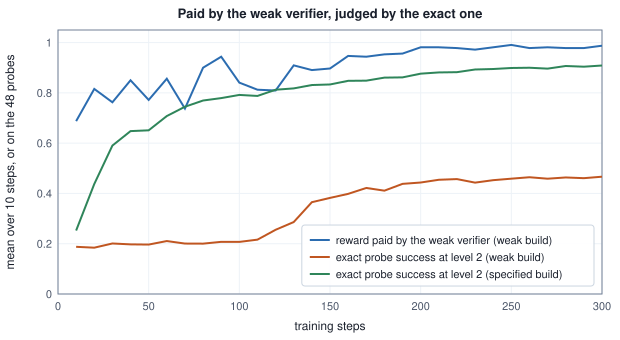

<!-- SPDX-License-Identifier: CC-BY-4.0 -->
<!-- Copyright (c) 2026 Martin Schröder <info@swedishembedded.com> -->

# Project: An Agent That Improves from Verified Feedback

*Can you train an agent that solves progressively harder tasks from verified rewards, and decide when a new version is better?*

Train five agents on the same tasks, from the same generator, for the same 300 steps, and look only at the number each trainer was paid for its last ten steps. The best curve belongs to the broken agent. It was paid 0.988 on average, where the correct build was paid 0.906, and it is the worst agent of the five: on the hardest level its success on inputs it has never seen is 0.017, where the correct build reaches 0.761. A trainer that reads only its own reward would have kept it.

<!-- worked: project_agent.opening -->
Five builds of the agent, all from the generator `project_agent.run0` (seed 0x9b71a812e8fb7398, 11200918547418805144), each trained for 300 steps. 'Reward seen' is the mean reward the trainer was paid for the answers of its last 10 steps (steps 291 to 300), with the verifier that build uses; 'level' is the level the trainer used in step 300; 'probe level 5' is the mean success of the exact probe bank at level 5, for the trainer's final policy; 'promoted' counts the snapshots (of 30) that the build's gate admitted as the served version, and 'served level 5' is the probe success at level 5 of the version served after the last snapshot. The first four rows are the system of milestones 1 to 7 and the three mistakes of milestone 8; the last row is a control.

| build | reward seen | level | probe level 5 | promoted | served level 5 |
|---|---:|---:|---:|---:|---:|
| the system as specified | 0.906 | 5 | 0.761 | 28 | 0.761 |
| the weak verifier (milestone 8, mistake 1) | 0.988 | 2 | 0.017 | 11 | 0.017 |
| a curriculum that reads the training reward (mistake 2) | 0.887 | 5 | 0.757 | 29 | 0.757 |
| a gate that compares unpaired means (mistake 3) | 0.906 | 5 | 0.761 | 10 | 0.704 |
| no curriculum, level 5 from the first step | 0.056 | 5 | 0.033 | 24 | 0.033 |

Every number learned from samples is printed with the digits that the run and four copies of it share: the copies start with the first stored number of the policy, theta[0], changed by +1e-12, -1e-12, +3e-12 and -3e-12 (the nudges of stable.py), and a digit is printed only if all five agree on it ('about x' keeps the leading digits that survive, 'unstable' means that none does; a count or a decision is printed only if all five agree on it). The copies use the same generator and so draw the same numbers; they differ only if a nudge flips a comparison. A run is a deterministic computation, so another implementation reproduces the printed digits.
<!-- /worked -->

The first row is the system as specified. The second is the same system with one slip in the verifier: it compares every output digit with the target digit modulo 2 where the task is modulo 3, so that two of the three digits are interchangeable whenever the target is even. The policy learns to give an answer the verifier pays for, the reward goes to 0.988, and the agent is stuck at level 2 of 5 with 0.017 on level 5. The third row is a curriculum that decides when to raise the difficulty from the training reward instead of from probes the policy never trains on, and it is the one build of the five that this table can hardly tell from the first: 0.757 against 0.761 on level 5, 0.887 against 0.906 in the reward seen, 29 promotions against 28. The fourth is a promotion gate that compares the two versions' means as if they were unrelated samples, and it promotes 10 of 30 snapshots where the paired gate promotes 28 and ends serving 0.704 where the paired one serves 0.761. The last row has no curriculum at all and is the control that shows what the curriculum buys.

That is the shape of the project. You build a small agent that improves from rewards a program can check, and then you build the tests that tell you which of its failures they can see. The pieces are those of the volume in the order an improving agent needs them: a family of tasks with an exact verifier and a difficulty knob (Chapter 4), a small policy trained by group-relative advantages and the clipped surrogate (Chapters 3 and 4), a probe bank that no training row touches, a curriculum that reads it, and a promotion gate with a version that can be taken back (Chapter 7). Chapters [1](01-mdps.md) and [2](02-value-learning.md) supply the vocabulary of a policy, a return and an update, [5](05-search.md) the habit of asking what a verifier can and cannot see, and [6](06-decision-models.md) the habit of judging a model by a decision it supports.

![A two-row diagram. Upper row, left to right: the task generator (24 pool inputs and a level from 1 to 5), the policy (240 numbers, 8 answers for each of 4 tasks per step), the exact verifier (marked as the place of mistake 1, a weak verifier), the group advantages and clipped update. A downward arrow carries the policy to the lower row. Lower row: the probe bank (48 inputs at each of 5 levels, never trained on), whose scores feed two paths: leftwards to the curriculum, which raises the level and sends it up to the task generator (mistake 2 is marked here, a curriculum that reads the training reward), and rightwards every 10 steps to the gate (mistake 3, an unpaired standard error), which promotes a version to the registry with its audit bank and rollback.](img/agent-improvement-loop.svg)

`scripts/book/worked/project_agent.py`, the module that produced every number below, imports the worked modules of the earlier chapters instead of copying them: the stable softmax, the inverse-CDF draw and the clip of Chapter 3 (`policy_gradients`), the group-relative advantage of Chapter 4 (`llm_alignment`) and the one-sided Gaussian point of the paired lower bound of Chapter 7 (`continual_learning`). You build the agent in any language. You need double-precision arithmetic with a correctly rounded `exp` and `sqrt`, the book's generator ([Volume I, Chapter 17](../v01-mathematics/17-randomness.md)) with its shuffle, and SHA-256 for the identities of the banks. Six questions bring back what the milestones lean on, from the clipped update to the arithmetic of an all-or-nothing reward.

1. (Chapter 3, the clipped surrogate.) With $\epsilon = 0.2$, an importance ratio $\rho = 1.3$ and advantages $+2$ and $-2$, which term of $\min(\rho A, \mathrm{clip}(\rho, 1 - \epsilon, 1 + \epsilon) A)$ is the minimum in each case, and is the gradient with respect to the log-probability that moves $\rho$ zero or $A\rho$?
2. (Chapter 4, group advantages.) A group of eight answers is paid $1, 0, 0, 0, 0, 0, 0, 0$. What are the mean-centred advantages, and what are they if the eight rewards are all $0$? If the policy solves a prompt with probability $0.1$, how likely is a group of eight to be flat?
3. (Chapter 4, a checker that can be argued with.) What two questions does Chapter 4 say to ask of any checker, and what happened to the policy trained on the weak checker of the five answers?
4. (Chapter 7, a probe bank.) What four properties make a set of evaluation items a probe bank and not a pile of test rows, and why must the rows the probes came from never be trained on?
5. (Chapter 7, non-inferiority.) A block of 48 probes has a mean paired difference of $-0.03$ and a standard error of $0.01$. Is the candidate non-inferior within a margin of $0.05$? Within $0.02$? (Use the one-sided Gaussian point $1.645$.)
6. (Volume I, Chapter 10, independent events.) A policy puts probability $0.8$, $0.5$ and $0.9$ on the right digit at three independent positions. What is the probability that a sampled answer is right at all three, and why is that the quantity a task with an all-or-nothing verifier pays for?

## What is fixed before anything is built

Every random input comes from the book's SplitMix64 at the seed `seed_of(name)` printed beside its table, drawn in the order the text states: the split of the inputs from `project_agent.split`, the demonstration draws from `project_agent.demo`, the demonstration step from `project_agent.step`, the five training runs from `project_agent.run0` to `project_agent.run4` and the faulty candidate from `project_agent.bug`. A run restarts its generator at its first step and never restarts it again. Arithmetic is in 64-bit floating point. Everything counts from 0 (positions, digits, the pool, the probes), except levels and steps, which count from 1, and a sum runs in the order the text states, from `0.0`.

The conventions that the numbers depend on are these, and each is stated again where it is used. A level $\ell$ is the number of output digits that must all be right. A curriculum test is non-strict, success at least $\tau_{\mathrm{c}} = 0.6$, and the bars of the gate are strict, a lower bound must be above the bar and a bound exactly at it fails. The advantage of an answer is its reward minus the group mean (Chapter 4's mean-centred rule, so a group whose rewards are all equal has the advantage 0), and a group is flat when every advantage is exactly 0. The loss of a step divides by the number of tokens of the whole batch, flat groups included. The success of a policy on an input is an exact probability, not a sampled outcome (milestone 2), so the scores of a candidate and of the version it is compared with have no sampling noise, and the only variation between the 48 probes of a level is the variation between inputs.

Nothing in this system is chaotic, but the stable-digits rule is applied all the same, because stability that is assumed and never checked is an easy assumption to get wrong. Every number that depends on a trained policy is computed five times, from the run as drawn and from four copies in which the first stored number of the policy, `theta[0]`, starts at $+10^{-12}$, $-10^{-12}$, $+3 \times 10^{-12}$ and $-3 \times 10^{-12}$ instead of 0 (it is the constant weight of digit 0 at output position 0 and is used by every step), and a number is printed only with the digits on which all five agree; a count, a step or a decision is printed only if all five agree on it. The banks and their identities depend on no trained number and are exact.

## Building the agent, milestone by milestone

The pseudocode follows [Pseudocode Conventions](../pseudocode.md). Build and check each milestone before the next: a disagreement at milestone 6 that follows agreement at 1 to 5 points at the gate and not at the world.

### 1. Building the verifier and its tasks

An agent that improves from verified feedback needs a world where feedback can be verified, small enough that the whole thing can be printed. A task here is an input of five digits $x_0, \dots, x_4$ over the alphabet $\{0, 1, 2\}$, written as a number $m$ in $0, \dots, 242$ with $x_i = \lfloor m / 3^i \rfloor \bmod 3$ (least significant first), and the right answer is the digits $t_j = (x_j + j + 1) \bmod 3$: every digit shifted forward by its own position plus one. There are 243 inputs. The shift differs by position so that the five positions have five different mappings to learn, and nothing a policy learns at position 0 helps at position 3.

The difficulty knob is the **level** $\ell \in \{1, \dots, 5\}$: at level $\ell$ the policy must emit the first $\ell$ digits, and the answer is right only if all of them are. A policy that guesses uniformly is right at level $\ell$ with probability $3^{-\ell}$, from $0.333$ at level 1 to $0.0041$ at level 5, and since the reward is all or nothing, the knob is also the rarity of a reward.

```text
function digits(m: int) -> array<int>[5]:
    x = zeros(int, [5])
    for i in 0 .. 5:
        x[i] = (m // 3^i) mod 3
    return x

function target_digits(x: array<int>[5]) -> array<int>[5]:
    t = zeros(int, [5])
    for j in 0 .. 5:
        t[j] = (x[j] + j + 1) mod 3
    return t

function verify_exact(answer: array<int>[ell], t: array<int>[5], level: int) -> real:
    if len(answer) != level:
        return 0.0
    for j in 0 .. level:
        if answer[j] != t[j]:
            return 0.0
    return 1.0

function verify_weak(answer: array<int>[ell], t: array<int>[5], level: int) -> real:
    if len(answer) != level:
        return 0.0
    for j in 0 .. level:
        if answer[j] mod 2 != t[j] mod 2:
            return 0.0
    return 1.0
```

The weak verifier is the planted mistake of milestone 8. It is a plausible slip, a `% 2` where `% 3` was meant, and it is weak in the way of Chapter 4's weak checker: it pays everything the exact verifier pays and more besides. The inputs are split once, so that no row a policy trains on can be a probe: the book's shuffle of $0, 1, \dots, 242$ from `project_agent.split`, of which the first 48 numbers are the probe inputs, the next 48 the audit inputs (the bank of milestone 7), the next 24 the training pool, and the remaining 123 are not used. The audit bank is the same construction as the probe bank, over different inputs.

<!-- worked: project_agent.tasks -->
The family: an input is a number m in 0 .. 242 and its five digits are x_i = floor(m / 3^i) mod 3 for i = 0 .. 4, least significant first. The target digit j is t_j = (x_j + j + 1) mod 3 (the planted generator bug of milestone 8 uses (x_j + j) mod 3). The generator `project_agent.split` (seed 0x243ba8987e6ab932, 2610865781900753202) shuffles the list 0, 1, ..., 242 with the book's shuffle (i from 242 down to 1, j = integer(i + 1), swap positions i and j); the first 48 numbers of the shuffled list are the probe inputs, the next 48 the audit inputs and the next 24 the training pool, and the remaining 123 are not used. The pool in order: 66, 5, 239, 0, 144, 39, 174, 212, 201, 235, 180, 188, 229, 138, 167, 158, 151, 13, 240, 209, 216, 208, 227, 91. The digest of a slice is the SHA-256 of its numbers written in decimal and joined by a comma, in the order of the slice (first 16 hex digits).

| slice | size | first entries (the shuffled order) | digest of all its numbers |
|---|---:|---|---|
| probes | 48 | 156, 73, 177, 187, 186, 49 | 756598f2043c6f98 |
| audit | 48 | 19, 238, 226, 47, 219, 29 | 308319443774fe53 |
| pool | 24 | 66, 5, 239, 0, 144, 39 | 4d813425a4c593c0 |

| slice | input m | digits x_0 .. x_4 | target t_0 .. t_4 |
|---|---:|---|---|
| pool | 66 | 01120 | 10102 |
| pool | 5 | 21000 | 00012 |
| pool | 239 | 21222 | 00201 |
| probe | 156 | 01221 | 10200 |
| probe | 73 | 10220 | 22202 |
| probe | 177 | 02102 | 11111 |
| audit | 19 | 10200 | 22212 |
| audit | 238 | 11222 | 20201 |
<!-- /worked -->

<!-- worked: project_agent.verifier_cases -->
The input m = 156 (the first probe input), digits 01221, target 10200, at level 4: the policy must emit the first 4 target digits, 1020. The exact verifier rewards 1 when all 4 output digits equal the target digits and 0 otherwise (an answer of any other length is 0, as in the row of three digits). The weak verifier rewards 1 when every output digit has the same parity as the target digit (digit mod 2); it accepts every answer the exact verifier accepts and others besides.

| output | digits | exact reward | weak reward |
|---|---:|---:|---:|
| the target | 1020 | 1 | 1 |
| digit 0 changed by +1 (the parity changes unless the digit goes 2 to 0) | 2020 | 0 | 0 |
| digit 1 changed by +2 (the parity is kept only when the digit goes 0 to 2) | 1220 | 0 | 1 |
| digit 3 changed by +1 | 1021 | 0 | 0 |
| the first three digits only | 102 | 0 | 0 |
| the input digits unchanged | 0122 | 0 | 0 |
<!-- /worked -->

The table is a check of the verifier before anything depends on it. The second row of wrong answers is the point: the target digit 0 at position 1 became 2, another even digit, and the weak verifier pays for it where the exact one does not. **Milestone 1 ends** when your split reproduces the pool, the digests of the three slices, and the first probe input with its digits and its target, and your two verifiers reproduce the table.

### 2. A policy that fits on a page

The policy reads all five input digits and emits the answer one digit at a time. It has no hidden layer and no state: the distribution of output position $j$ depends on the input and on $j$, and not on the digits already emitted. Its numbers are a table $\boldsymbol\theta$ of $5 \times 3 \times 16 = 240$ entries, indexed by position $j$, digit $c$ and feature $f$; the 16 features of an input are a constant 1 and, for each input position $i$, an indicator that $x_i$ has its value, so the logit of digit $c$ at position $j$ is the constant weight plus the five weights of the indicators that are 1. Every one of the 240 numbers starts at 0.0, so that every position starts uniform.

```text
function position_probs(theta: array<real>[240], x: array<int>[5], j: int) -> array<real>[3]:
    z = zeros(real, [3])
    for c in 0 .. 3:
        base = (j * 3 + c) * 16
        z[c] = theta[base]
        for i in 0 .. 5:
            z[c] = z[c] + theta[base + 1 + 3 * i + x[i]]
    return softmax(z)

function success(theta: array<real>[240], x: array<int>[5], level: int) -> real:
    t = target_digits(x)
    p = 1.0
    for j in 0 .. level:
        p = p * position_probs(theta, x, j)[t[j]]
    return p

function bank_success(theta: array<real>[240], inputs: list<int>, level: int) -> real:
    acc = 0.0
    for m in inputs:
        acc = acc + success(theta, digits(m), level)
    return acc / len(inputs)
```

Two things in the design are choices with consequences. The policy reads every input digit at every position although the rule needs only one, so that it has room to memorize the 24 training inputs, which is what the probe bank exists to catch. And `success` is the probability that a sampled answer is right, the product of the target digits' probabilities, which is exactly the expected reward of the exact verifier. A sampled answer is the digits that come out of 
`sample_index(position_probs(theta, x, j), rng)` for $j = 0, \dots, \ell - 1$ in order, one `uniform()` each (Chapter 3).

<!-- worked: project_agent.policy -->
The policy has 240 = 5 positions x 3 digits x 16 features numbers, all 240 initialized to 0.0: theta[(j * 3 + c) * 16 + f] is the weight of feature f for digit c at output position j, and the logit of digit c at position j is theta[(j*3+c)*16] + sum over i = 0 .. 4 of theta[(j*3+c)*16 + 1 + 3i + x_i] (the sum accumulated in increasing i, the constant first). The distribution of position j is the stable softmax of its three logits. At theta = 0 every position is uniform over the three digits, so the probability of the first `level` target digits is 3^-level.

| level | success of input m = 66 | 3^-level | mean over the 48 probe inputs |
|---:|---:|---:|---:|
| 1 | 0.333333 | 0.333333 | 0.333333 |
| 2 | 0.111111 | 0.111111 | 0.111111 |
| 3 | 0.037037 | 0.037037 | 0.037037 |
| 4 | 0.012346 | 0.012346 | 0.012346 |
| 5 | 0.004115 | 0.004115 | 0.004115 |

A digit is drawn by the inverse CDF of Chapter 3: one `uniform()` from the generator, the first digit whose running sum of probabilities exceeds it. At theta = 0 the first six draws of the generator `project_agent.demo` (seed 0x1c6ff2374fdbdd57, 2049122674853797207) are 0.021606, 0.799760, 0.995796, 0.871607, 0.444788, 0.285809, which give the digits 0, 2, 2, 2, 1, 0 (the thresholds are 1/3 and 2/3; the position-0 probabilities of input 66 are 0.333333, 0.333333, 0.333333).

Gradient check. For the starting point theta_k = ((37 k) mod 101 - 50) / 500 for k = 0 .. 239, the input m = 66, level 3 and the answer 2, 0, 1, the gradient of ln pi(answer | x) = the sum over positions of ln pi_j(answer_j) has 54 nonzero entries (3 positions x 3 digits x 6 features, the constant and the five indicators that are 1); the largest relative difference |fd - g| / max(1, |g|) between the analytic gradient g and a central finite difference fd with step 1e-6, over all 240 numbers, is below 1e-6.
<!-- /worked -->

**Milestone 2 ends** when your policy gives $3^{-\ell}$ at $\boldsymbol\theta = 0$, reproduces the six draws, and your gradient of the log-probability of an answer agrees with a central difference below $10^{-6}$ on every one of the 240 numbers: a gradient you have not checked is the usual source of a policy that trains and does not improve.

### 3. One verified batch and one clipped update

A step takes $B = 4$ tasks from the pool, with replacement, asks the policy for $n_{\mathrm{g}} = 8$ answers to each, scores them with the verifier, and turns the 32 rewards into advantages by the group rule of Chapter 4. Every digit of an answer carries the advantage of its answer. The update is the clipped surrogate of Chapter 3 over two epochs of the same batch: the importance ratio of a digit is its probability under the current policy over its probability under the policy at the start of the step, a digit whose ratio has left the band $[1 - \epsilon, 1 + \epsilon]$ on the side its advantage pushes toward contributes nothing, and the parameters move by $\eta = 2$ times the gradient. The first epoch has every ratio equal to exactly 1, so the clip can only bind in the second. That is why there are two.

```text
function train_step(theta: array<real>[240], level: int, pool: list<int>,
                    verify: function(array<int>[ell], array<int>[5], int) -> real,
                    ascent: real, rng: Generator) -> (array<real>[240], real, int):
    require 1 <= level and level <= 5
    require ascent == 1.0 or ascent == -1.0
    theta = copy(theta)
    eta = 2.0
    eps = 0.2
    xs = []
    answers = []
    advantage = []
    total = 0.0
    flat = 0
    tasks = []
    for b in 0 .. 4:
        append pool[rng.integer(len(pool))] to tasks
    for m in tasks:
        x = digits(m)
        t = target_digits(x)
        group = []
        rewards = zeros(real, [8])
        for g in 0 .. 8:
            a = zeros(int, [level])
            for j in 0 .. level:
                a[j] = sample_index(position_probs(theta, x, j), rng)
            append a to group
            rewards[g] = verify(a, t, level)
            total = total + rewards[g]
        adv = group_advantages(rewards, false)
        signal = false
        for g in 0 .. 8:
            if adv[g] != 0.0:
                signal = true
        if not signal:
            flat = flat + 1
        for g in 0 .. 8:
            append x to xs
            append group[g] to answers
            append adv[g] to advantage
    n = len(answers)
    old = zeros(real, [n, level])
    for s in 0 .. n:
        for j in 0 .. level:
            old[s, j] = position_probs(theta, xs[s], j)[answers[s][j]]
    n_tok = n * level
    for epoch in 0 .. 2:
        grad = zeros(real, [240])
        for s in 0 .. n:
            if advantage[s] == 0.0:
                continue
            for j in 0 .. level:
                pi = position_probs(theta, xs[s], j)
                rho = pi[answers[s][j]] / old[s, j]
                raw = rho * advantage[s]
                if raw > min(max(rho, 1.0 - eps), 1.0 + eps) * advantage[s]:
                    continue
                w = advantage[s] * rho / n_tok
                for c in 0 .. 3:
                    g = ((1.0 if c == answers[s][j] else 0.0) - pi[c]) * w
                    base = (j * 3 + c) * 16
                    grad[base] = grad[base] + g
                    for i in 0 .. 5:
                        grad[base + 1 + 3 * i + xs[s][i]] = grad[base + 1 + 3 * i + xs[s][i]] + g
        for k in 0 .. 240:
            theta[k] = theta[k] + (ascent * eta) * grad[k]
    return (theta, total / n, flat)
```

(`ascent` is $+1$ in every step of the specified system; milestone 7 plants a sign error by calling it with $-1$. The samples are in task-major order, a task's eight answers together, and `signal` is false exactly when the group is flat.) The routine uses `group_advantages` of Chapter 4 with its mean-centred rule, and the tokens of a flat group still count in `n_tok`: a flat group contributes a zero gradient and dilutes the others, a cost that the counts of flat groups in milestone 5 measure.

<!-- worked: project_agent.one_step -->
One step from theta = 0 at level 2. The generator is `project_agent.step` (seed 0x1d7a4df14efcdfd0, 2124095873066262480), used as the training run uses it: first B = 4 draws `integer(24)` choose the pool entries (with replacement), then for each task in order and each of its 8 answers in order, level = 2 draws `uniform()`, one per output position. An answer is the digits that come out. The group advantage is r - mean(r) (0 for a group whose rewards are all equal); every token of an answer carries the advantage of its answer. The loss divides by the number of tokens of the whole batch, n_tok = B x n_g x level = 64 (flat groups included). Two epochs, step size 2, clip band 1 +- 0.2.

| task m | digits | target (level 2) | the 8 answers | right | advantage of a right answer | advantage of a wrong one |
|---:|---|---|---|---:|---:|---:|
| 138 | 01021 | 10 | 10 02 20 02 21 21 12 10 | 2 | +0.750 | -0.250 |
| 91 | 10101 | 22 | 01 10 00 21 12 11 02 20 | 0 | 0 | 0 |
| 91 | 10101 | 22 | 12 21 11 02 01 12 12 20 | 0 | 0 | 0 |
| 151 | 12121 | 21 | 20 01 12 01 22 01 22 12 | 0 | 0 | 0 |

The mean reward of the step is 0.0625 and 3 of the 4 groups are flat. The two epochs, with the importance ratio of every token with a nonzero advantage against the policy at the start of the step (1.0 exactly in epoch 1), the tokens whose surrogate is clipped, and the L1 change of the 240 numbers:

| epoch | smallest ratio | largest ratio | tokens clipped | L1 change of theta |
|---:|---:|---:|---:|---:|
| 1 | 1.0000 | 1.0000 | 0 | 0.937500 |
| 2 | 0.8564 | 1.2461 | 4 | 0.203292 |

The mean probe success at level 2 goes from 0.111111 (= 1/9) to 0.113693.
<!-- /worked -->

The table shows what a step from scratch looks like at level 2. Three of the four groups are flat, all eight answers wrong, so the step has one group to learn from, in which two answers were right and every digit of those two carries $+0.75$ and every digit of the six others $-0.25$. The first epoch moves the numbers by an L1 distance of 0.9375 with no digit clipped. In the second epoch the ratios have spread to $0.8564$ at the least and $1.2461$ at the most, and four digits whose ratio has left the band on the side their advantage pushes toward are skipped. After the step the mean probe success at level 2 has risen from $1/9$ to 0.113693.

**Milestone 3 ends** when your step, from the same generator and the same zero policy, reproduces the table: the tasks, the answers, the rewards, the two epochs' ratios, clipped counts and L1 changes, and the probe success after the step.

### 4. A bank of probes the policy never sees

A policy that is trained on 24 inputs and judged on the same 24 is scored on how well it remembers them. The agent is judged on a probe bank: for each level 1 to 5, the 48 probe inputs of milestone 1, a probe being the pair of an input and a level, 240 in all. The bank has the four properties of Chapter 7: each probe carries its level (so that a regression is named, "level 2 regressed", and not only counted), the inputs are disjoint from the pool by construction (a slice of one shuffle), the bank is frozen with an identity (the SHA-256 of its lines, below) and each answer is checked by the exact verifier. The score of a version on a probe is `success`, the probability that a sampled answer is right, so that comparing two versions on the 48 probes of a level compares them on 48 paired numbers in $[0, 1]$.

<!-- worked: project_agent.probe_bank -->
The probe bank has 5 x 48 = 240 probes: for level 1 .. 5 and each probe input in the order of the shuffled list, one line `level|m|target digits of the first `level` positions` (for example `1|156|1` and `5|181|22211`). Its identity is the SHA-256 of the 240 lines joined by a line feed (no final one), first 16 hex digits: fd63244976f94fee; with the target digit of the first line increased by 1 (mod 3) it is 9d3f05bdc616fd90. The audit bank is the same construction over the audit inputs. At theta = 0 the success of every probe is exactly 3^-level, so each bank's mean is too:

| level | probes | mean success of the probe bank at theta = 0 | of the audit bank |
|---:|---:|---:|---:|
| 1 | 48 | 0.333333 | 0.333333 |
| 2 | 48 | 0.111111 | 0.111111 |
| 3 | 48 | 0.037037 | 0.037037 |
| 4 | 48 | 0.012346 | 0.012346 |
| 5 | 48 | 0.004115 | 0.004115 |
<!-- /worked -->

**Milestone 4 ends** when your bank has the identity of the table and your scores at $\boldsymbol\theta = 0$ are the powers of one third.

### 5. Raising the level when the probes say so

A policy trained from scratch at level 5 sees a right answer once in 243. With eight answers to a task, a group is flat with probability $(1 - 1/243)^8 = 0.968$, and a flat group teaches nothing. The curriculum starts at level 1 and raises the level when the policy has become good enough at the current one for the next to produce rewards: after the update of step $s$, the probe success at the level used in step $s$ is computed, and when it is at least $\tau_{\mathrm{c}} = 0.6$ and the level is below 5 the level of step $s + 1$ is one higher. Training is the loop below, with a snapshot of the policy kept every 10 steps and its level (the level the trainer will use next).

```text
function train_agent(pool: list<int>, probes: list<int>, verify: function(array<int>[ell], array<int>[5], int) -> real,
                     reads_training: bool, steps: int, rng: Generator)
                    -> list<(int, int, array<real>[240])>:
    tau = 0.6
    theta = zeros(real, [240])
    level = 1
    snapshots = []
    for step in 1 ..= steps:
        (theta, training, flat) = train_step(theta, level, pool, verify, 1.0, rng)
        signal = training if reads_training else bank_success(theta, probes, level)
        if signal >= tau and level < 5:
            level = level + 1
        if step mod 10 == 0:
            append (step, level, copy(theta)) to snapshots
    return snapshots
```

`reads_training` is false in the specified system. The training success of milestone 8's flawed curriculum is the mean reward of the 32 answers of the step just taken. The headline run is the generator `project_agent.run0`, 300 steps.

<!-- worked: project_agent.curriculum_run -->
The headline run: generator `project_agent.run0` (seed 0x9b71a812e8fb7398, 11200918547418805144), the policy of milestone 2 from theta = 0 (theta[0] nudged in the four copies), the loop of milestones 3 to 5 for 300 steps. Each step draws, in this order, 4 pool entries (`integer(24)` each) and then, task by task, answer by answer and position by position, one `uniform()` per output digit, from one generator that is never restarted within the run. The level starts at 1. After the update of step s the mean success of the 48 probe inputs at the level used in step s is computed (summed in probe order); when it is at least 0.6 (non-strict) and the level is below 5 the level is raised by 1 for step s + 1. 'Training success' is the mean reward of the 32 answers sampled in step s. 'Flat groups' counts the groups with no gradient (all rewards equal) among the 4 groups of each of the 10 steps after the advance (of 40).

| level left | step of the advance | probe success after that step | training success of that step | flat groups in the next 10 steps |
|---:|---:|---:|---:|---:|
| 1 | 6 | 0.6385 | 0.5938 | 7 |
| 2 | 32 | 0.6027 | 0.7812 | 1 |
| 3 | 79 | 0.6187 | 0.6562 | 4 |
| 4 | 130 | 0.6048 | 0.7812 | 3 |

The policy as it stands at the end of selected steps (the mean success of the probe bank at each level, over the 48 probe inputs). The row before the last is the same policy as the row of step 300, scored on the 24 pool inputs it trained on instead of the probe inputs. The last row is the control without a curriculum: the same run from the same generator, every step at level 5.

| step | level of the next step | probe level 1 | level 2 | level 3 | level 4 | level 5 |
|---:|---:|---:|---:|---:|---:|---:|
| 10 | 2 | 0.676 | 0.252 | 0.084 | 0.028 | 0.009 |
| 30 | 2 | 0.835 | 0.590 | 0.197 | 0.066 | 0.022 |
| 60 | 3 | 0.882 | 0.708 | 0.502 | 0.167 | 0.056 |
| 90 | 4 | 0.911 | 0.779 | 0.641 | 0.326 | 0.109 |
| 120 | 4 | 0.914 | 0.812 | 0.699 | 0.554 | 0.185 |
| 150 | 5 | 0.928 | 0.833 | 0.748 | 0.654 | 0.348 |
| 200 | 5 | 0.953 | 0.876 | 0.802 | 0.750 | 0.589 |
| 250 | 5 | 0.966 | 0.899 | 0.838 | 0.801 | 0.704 |
| 300 | 5 | 0.968 | 0.909 | 0.862 | 0.832 | 0.761 |
| the policy of step 300 on the 24 pool inputs | 5 | 0.987 | 0.973 | 0.957 | 0.940 | 0.914 |
| no curriculum (level 5 from step 1), step 300 | 5 | 0.497 | 0.228 | 0.121 | 0.066 | 0.033 |

Flat groups over the 300 steps (1200 groups): 224 with the curriculum, 1068 without it.

Every number learned from samples is printed with the digits that the run and four copies of it share: the copies start with the first stored number of the policy, theta[0], changed by +1e-12, -1e-12, +3e-12 and -3e-12 (the nudges of stable.py), and a digit is printed only if all five agree on it ('about x' keeps the leading digits that survive, 'unstable' means that none does; a count or a decision is printed only if all five agree on it). The copies use the same generator and so draw the same numbers; they differ only if a nudge flips a comparison. A run is a deterministic computation, so another implementation reproduces the printed digits.
<!-- /worked -->

The level is raised at steps 6, 32, 79 and 130, each time at a probe success between 0.60 and 0.64 (0.6385, 0.6027, 0.6187, 0.6048): success moves slowly relative to the threshold, so the curriculum does not overshoot it. At the first advance the mean reward of the step's 32 answers was 0.5938, below the threshold, while the probes were at 0.6385: a training reward and a probe success are different numbers, and mistake 2 of milestone 8 turns on the difference. The ten steps after each advance have few flat groups (7, 1, 4 and 3 of 40), and over the whole run 224 of 1200 groups are flat.

The row before the last scores the same policy on the 24 pool inputs it trained on, 0.914 at level 5 where the probes give 0.761: the gap is what a reader sees when a training measure is used for a decision that needs a held-out one. The last row is the control, and it is the reason to have a curriculum. With every step at level 5 the same generator and the same number of steps give a level-5 probe success of 0.033, where the curriculum reaches 0.761, and 1068 of the 1200 groups are flat, 89 percent against 19. The agent that is never asked the easy question never has a reward to learn from.


**Milestone 5 ends** when your run with the generator `project_agent.run0` has the four advances at the steps and probe successes of the first table, the probe success by level of the second at its marked steps, and the control row: a curriculum is easy to get almost right, and a reader whose advances are one step late has a different threshold test, strict where this one is not, or a probe success computed before the update.

### 6. Deciding which snapshot may be served

A snapshot is not a version. The trainer's state at step 100 is a candidate, and whether it replaces what is served is a decision with a stated test, the paired non-inferiority test of Chapter 7. Both policies are scored on the same 48 probes at each level, so each level gives 48 paired differences $d_k$ (candidate minus the version being served). Their mean $\bar d$, their standard error $\mathrm{SE} = \sqrt{s^2/48}$ with $s^2$ the variance of the $d_k$ with divisor 47, and the lower bound $\bar d - 1.644854\,\mathrm{SE}$ are the whole statistics. The gate has two bars, in this order and each strict. First, the candidate must be non-inferior on every level: the lower bound at every level 1 to 5 must be above $-\delta = -0.02$, and the first level that is not is named. Second, the candidate must have gained where the trainer is working: the lower bound at the level the trainer will use next must be above 0. The margin is set against the paired standard errors the run produces, which the next table shows to be between 0.002 and 0.026. A candidate that has not changed at all has a lower bound of about $-1.645\,\mathrm{SE}$, so a margin below that cannot be met even by a copy of the served version (Chapter 7's gate that cannot say yes), and $0.02$ is above it for most of the table.

```text
function paired_lower(cand: array<real>[n], inc: array<real>[n]) -> (real, real, real):
    require n >= 2
    d = zeros(real, [n])
    for k in 0 .. n:
        d[k] = cand[k] - inc[k]
    m = sum(d) / n
    s2 = 0.0
    for k in 0 .. n:
        s2 = s2 + (d[k] - m) * (d[k] - m)
    s2 = s2 / (n - 1)
    se = sqrt(s2 / n)
    return (m, se, m - 1.644854 * se)

function first_regressed(sc_c: list<array<real>[48]>, sc_i: list<array<real>[48]>, delta: real) -> int:
    for lv in 1 ..= 5:
        (m, se, lower) = paired_lower(sc_c[lv - 1], sc_i[lv - 1])
        if not (lower > -delta):
            return lv
    return 0

function gate(sc_c: list<array<real>[48]>, sc_i: list<array<real>[48]>, level: int, delta: real)
             -> (text, optional text):
    bad = first_regressed(sc_c, sc_i, delta)
    if bad > 0:
        return ("reject", "level " + bad + " regressed")
    (m, se, lower) = paired_lower(sc_c[level - 1], sc_i[level - 1])
    if not (lower > 0.0):
        return ("reject", "gain not shown")
    return ("promote", none)
```

Here `sc_c[lv - 1][k]` is `success` of the candidate on probe input $k$ of the bank at level `lv`, in the order of the bank. The gate of the headline run is the specified one with $\delta = 0.02$.

<!-- worked: project_agent.gate_run -->
The 30 snapshots of the headline run (every 10 steps, after the update and the curriculum check of that step), each judged against the version being served. Per probe the score is the success probability of the probe's input at the level (milestone 2); for each level the paired differences d_k (candidate minus served, over the 48 probes in order), their mean, the paired standard error sqrt(s^2 / 48) with s^2 the variance of the d_k with divisor 47, and the lower bound mean - 1.644854 x SE (strict comparisons: a bound exactly at the bar fails). The gate checks, in this order: every level 1 .. 5 has a lower bound above -0.02 (the first level that does not is named), then the level the trainer will use next has a lower bound above 0. A promoted candidate becomes the served version, after the audit of milestone 7. The 'unpaired' column is the same gate with the standard error of two independent means, sqrt(var(candidate) / 48 + var(served) / 48), which is the gate of mistake 3. Gain columns are the paired difference at the trainer's next level.

| step | level | mean gain at that level | paired SE | lower bound | paired gate | unpaired gate |
|---:|---:|---:|---:|---:|---|---|
| 10 | 2 | 0.1413 | 0.0119 | 0.1217 | promote | promote |
| 20 | 2 | 0.1851 | 0.0162 | 0.1584 | promote | promote |
| 30 | 2 | 0.1528 | 0.0087 | 0.1385 | promote | promote |
| 40 | 3 | 0.0919 | 0.0211 | 0.0573 | promote | reject: level 1 regressed |
| 50 | 3 | 0.0585 | 0.0146 | 0.0346 | promote | promote |
| 60 | 3 | 0.1546 | 0.0209 | 0.1203 | promote | promote |
| 70 | 3 | 0.0411 | 0.0176 | 0.0122 | promote | reject: level 1 regressed |
| 80 | 4 | 0.0301 | 0.0044 | 0.0229 | promote | promote |
| 90 | 4 | 0.1149 | 0.0145 | 0.0910 | promote | reject: level 2 regressed |
| 100 | 4 | 0.0788 | 0.0079 | 0.0658 | promote | reject: level 2 regressed |
| 110 | 4 | 0.0912 | 0.0109 | 0.0733 | promote | reject: level 1 regressed |
| 120 | 4 | 0.0583 | 0.0083 | 0.0447 | promote | promote |
| 130 | 5 | 0.0168 | 0.0019 | 0.0137 | promote | reject: level 2 regressed |
| 140 | 5 | 0.0822 | 0.0259 | 0.0396 | promote | reject: level 2 regressed |
| 150 | 5 | 0.0642 | 0.0056 | 0.0550 | promote | reject: level 2 regressed |
| 160 | 5 | 0.0504 | 0.0065 | 0.0397 | promote | promote |
| 170 | 5 | 0.0644 | 0.0072 | 0.0525 | promote | reject: level 2 regressed |
| 180 | 5 | 0.0529 | 0.0089 | 0.0383 | promote | reject: level 2 regressed |
| 190 | 5 | 0.0265 | 0.0056 | 0.0172 | promote | reject: level 2 regressed |
| 200 | 5 | 0.0472 | 0.0096 | 0.0315 | promote | promote |
| 210 | 5 | 0.0292 | 0.0036 | 0.0233 | promote | reject: level 2 regressed |
| 220 | 5 | 0.0252 | 0.0047 | 0.0174 | promote | reject: level 2 regressed |
| 230 | 5 | 0.0191 | 0.0056 | 0.0100 | promote | reject: level 3 regressed |
| 240 | 5 | 0.0309 | 0.0070 | 0.0194 | promote | reject: level 3 regressed |
| 250 | 5 | 0.0102 | 0.0075 | -0.0021 | reject: gain not shown | promote |
| 260 | 5 | 0.0221 | 0.0069 | 0.0108 | promote | reject: level 2 regressed |
| 270 | 5 | 0.0129 | 0.0034 | 0.0074 | promote | reject: level 2 regressed |
| 280 | 5 | 0.0186 | 0.0024 | 0.0146 | promote | reject: level 2 regressed |
| 290 | 5 | 0.0010 | 0.0021 | -0.0024 | reject: gain not shown | reject: level 2 regressed |
| 300 | 5 | 0.0135 | 0.0025 | 0.0094 | promote | reject: level 2 regressed |

Promotions of the 30 snapshots: 28 with the paired gate, 10 with the unpaired one. Audit failures after a promotion (paired gate): 0.

Every number learned from samples is printed with the digits that the run and four copies of it share: the copies start with the first stored number of the policy, theta[0], changed by +1e-12, -1e-12, +3e-12 and -3e-12 (the nudges of stable.py), and a digit is printed only if all five agree on it ('about x' keeps the leading digits that survive, 'unstable' means that none does; a count or a decision is printed only if all five agree on it). The copies use the same generator and so draw the same numbers; they differ only if a nudge flips a comparison. A run is a deterministic computation, so another implementation reproduces the printed digits.
<!-- /worked -->

The paired gate promotes 28 of the 30 snapshots. It refuses two, at steps 250 and 290, with "gain not shown": the candidate's mean gain at level 5 is $+0.0102$ at step 250 with a paired standard error of 0.0075, a lower bound of $-0.0021$, and the training has simply not yet produced enough improvement over ten steps to be distinguished from nothing. Refusing is what the gate is for when a gain has not been shown; the two refused snapshots are followed by promotions at 260 and 300, and no promoted version fails its audit. The right-hand column is the gate of mistake 3 and is explained below.

The reason the unpaired gate differs is arithmetic, and the next block shows it on one candidate: the first snapshot that the paired gate promotes and the unpaired gate refuses.

<!-- worked: project_agent.two_errors -->
The first snapshot of the headline run that the paired gate promotes and the unpaired gate refuses: step 40, judged against version 3 (promoted at step 30). For each level, the mean paired difference, the paired standard error, the paired lower bound, the standard error of two independent means and the lower bound that it gives (the bar is -0.02).

| level | mean difference | paired SE | paired lower bound | unpaired SE | unpaired lower bound |
|---:|---:|---:|---:|---:|---:|
| 1 | 0.0100 | 0.0035 | 0.0043 | 0.0219 | -0.0260 |
| 2 | 0.0575 | 0.0074 | 0.0453 | 0.0324 | 0.0043 |
| 3 | 0.0919 | 0.0211 | 0.0573 | 0.0245 | 0.0516 |
| 4 | 0.0306 | 0.0070 | 0.0191 | 0.0082 | 0.0172 |
| 5 | 0.0102 | 0.0023 | 0.0064 | 0.0027 | 0.0057 |

Every number learned from samples is printed with the digits that the run and four copies of it share: the copies start with the first stored number of the policy, theta[0], changed by +1e-12, -1e-12, +3e-12 and -3e-12 (the nudges of stable.py), and a digit is printed only if all five agree on it ('about x' keeps the leading digits that survive, 'unstable' means that none does; a count or a decision is printed only if all five agree on it). The copies use the same generator and so draw the same numbers; they differ only if a nudge flips a comparison. A run is a deterministic computation, so another implementation reproduces the printed digits.
<!-- /worked -->

At level 1 the candidate improves by $+0.0100$ on average, and the paired standard error is 0.0035: the 48 inputs differ from each other in success (the unpaired standard error implies a standard deviation of about 0.11 at this level), but the candidate improves every one of them by nearly the same amount. Treating the two sets of 48 scores as independent samples counts the variation between inputs as noise in the difference, and the standard error becomes 0.0219, six times larger. The lower bound falls from $+0.0043$ to $-0.0260$, below the margin of $-0.02$, and a candidate that improved every level is refused for a regression it did not have. The paired test is the right one because the data are paired, not because it is more permissive: its standard error is small only for as long as the two versions move together.

**Milestone 6 ends** when your gate reproduces the decisions, gains and bounds of the 30 snapshots, with both standard errors, and the first split step.

### 7. Keeping the old version and taking it back

A gate is a statistical test on 48 probes per level, and its decision can be wrong in ways it cannot see: the same bank has now been used 30 times to choose among versions, and a candidate that clears it may have learned the bank's inputs rather than the task. So a promotion is followed by an **audit** on the audit bank, inputs that no training row and no gate decision has touched, with the non-inferiority bars of the gate (without the gain bar) against the version that was served before. If the audit finds a level regressed the version stays in the registry but the served pointer does not move to it; a promotion that has been served and is later found wanting is taken back by moving the pointer to the version served before. Both need the same thing: the previous version must still exist, byte-identical to what was served, and the pointer must move in one step.

The routine `bank_scores(theta, inputs)` that `serve` calls is the list over levels 1 to 5 of the `success` of every input of `inputs`, in order.

```text
function serve(snapshots: list<(int, int, array<real>[240])>, init: array<real>[240], probes: list<int>,
               audit: list<int>, delta: real) -> (list<(int, array<real>[240])>, int):
    registry = [(0, init)]
    sc = [bank_scores(init, probes)]
    au = [bank_scores(init, audit)]
    served = 0
    for (step, level, theta) in snapshots:
        cand = bank_scores(theta, probes)
        (decision, cause) = gate(cand, sc[served], level, delta)
        if decision == "promote":
            cand_audit = bank_scores(theta, audit)
            append (step, theta) to registry
            append cand to sc
            append cand_audit to au
            if first_regressed(cand_audit, au[served], delta) == 0:
                served = len(registry) - 1
    return (registry, served)
```

(The version that fails its audit stays in the registry with its scores and is not served; a later candidate is judged against the version served.)

<!-- worked: project_agent.versions -->
The registry of the headline run under the paired gate: every promoted version keeps its parameters (the 240 numbers, as served) and the scores it had when it was promoted. Version 0 is the untrained policy. The columns are the mean success of the probe bank at each level and, in the last column, the mean success at level 5 of the audit bank (inputs the gate never saw). The versions shown are 0, 1, 2, 4, 8, 12, 16, 20, 24 and the last (28); the last row is the trainer's own state at step 300, which is not a version unless the last snapshot was promoted.

| version | promoted at step | probe level 1 | level 2 | level 3 | level 4 | level 5 | audit level 5 |
|---:|---:|---:|---:|---:|---:|---:|---:|
| 0 | 0 | 0.333 | 0.111 | 0.037 | 0.012 | 0.004 | 0.004 |
| 1 | 10 | 0.676 | 0.252 | 0.084 | 0.028 | 0.009 | 0.010 |
| 2 | 20 | 0.743 | 0.438 | 0.146 | 0.049 | 0.016 | 0.017 |
| 4 | 40 | 0.845 | 0.648 | 0.289 | 0.096 | 0.032 | 0.034 |
| 8 | 80 | 0.908 | 0.770 | 0.620 | 0.211 | 0.070 | 0.072 |
| 12 | 120 | 0.914 | 0.812 | 0.699 | 0.554 | 0.185 | 0.185 |
| 16 | 160 | 0.939 | 0.848 | 0.760 | 0.680 | 0.398 | 0.386 |
| 20 | 200 | 0.953 | 0.876 | 0.802 | 0.750 | 0.589 | 0.573 |
| 24 | 240 | 0.962 | 0.895 | 0.824 | 0.787 | 0.694 | 0.703 |
| 28 | 300 | 0.968 | 0.909 | 0.862 | 0.832 | 0.761 | 0.758 |
| trained state, step 300 | 300 | 0.968 | 0.909 | 0.862 | 0.832 | 0.761 | 0.758 |

Audits that failed after a promotion: 0.

Every number learned from samples is printed with the digits that the run and four copies of it share: the copies start with the first stored number of the policy, theta[0], changed by +1e-12, -1e-12, +3e-12 and -3e-12 (the nudges of stable.py), and a digit is printed only if all five agree on it ('about x' keeps the leading digits that survive, 'unstable' means that none does; a count or a decision is printed only if all five agree on it). The copies use the same generator and so draw the same numbers; they differ only if a nudge flips a comparison. A run is a deterministic computation, so another implementation reproduces the printed digits.
<!-- /worked -->

Version 0 is the untrained policy; the headline run promotes 28 of 30 snapshots, none fails its audit, and the last version is the trainer's state at step 300. The audit bank agrees with the probe bank at level 5 to within 0.016 at every version shown (0.758 against 0.761 at the end), which is the result the audit is there to check for, and not a proof that the probes were not overfitted (question 6 of Check your understanding).

The registry is tested with a candidate that is worse than the one being served. Take the trainer's state at step 100 and run 20 more steps with the update's sign reversed, $\boldsymbol\theta - \eta\,\mathrm{grad}$ for $\boldsymbol\theta + \eta\,\mathrm{grad}$, a one-character slip that makes every step move the policy toward worse answers.

<!-- worked: project_agent.rollback -->
The faulty candidate. Take the trainer's state at step 100 (the snapshot of milestone 6, at level 4) and train it for 20 more steps with the loop of milestone 5 at that level, but with a sign error in the update: theta - eta x grad in place of theta + eta x grad in both epochs of every step (the sampling, the advantages and the clipping are unchanged). The generator is `project_agent.bug` (seed 0x05d66610053a31a6, 420635834198929830), restarted for this candidate. It is judged against the version served when the snapshot of step 100 was judged.

|  | level 1 | level 2 | level 3 | level 4 | level 5 |
|---|---:|---:|---:|---:|---:|
| served version 9, probe bank | 0.911 | 0.779 | 0.641 | 0.326 | 0.109 |
| faulty candidate, probe bank | 0.891 | 0.775 | 0.483 | 0.120 | 0.040 |
| paired lower bound, faulty minus served, probe bank | -0.044 | -0.028 | -0.207 | -0.251 | -0.084 |
| served version, audit bank | 0.917 | 0.800 | 0.655 | 0.311 | 0.104 |
| faulty candidate, audit bank | 0.886 | 0.770 | 0.492 | 0.144 | 0.048 |

The decision of the paired gate is 'reject: level 1 regressed', and that of the unpaired gate 'reject: level 1 regressed'. If the candidate is served anyway (a hot fix that bypasses the gate), the audit, which applies the non-inferiority bars of the gate to the audit bank against the previous version, names level 1 as the first that regressed, and the rollback moves the served pointer back to version 9; the parameters and the stored probe scores of that version are identical to what they were before the candidate arrived: yes.

Every number learned from samples is printed with the digits that the run and four copies of it share: the copies start with the first stored number of the policy, theta[0], changed by +1e-12, -1e-12, +3e-12 and -3e-12 (the nudges of stable.py), and a digit is printed only if all five agree on it ('about x' keeps the leading digits that survive, 'unstable' means that none does; a count or a decision is printed only if all five agree on it). The copies use the same generator and so draw the same numbers; they differ only if a nudge flips a comparison. A run is a deterministic computation, so another implementation reproduces the printed digits.
<!-- /worked -->

The faulty candidate is not a catastrophe. Its probe success is 0.891 at level 1 against 0.911, and 0.120 at level 4 against 0.326, so that on the probe bank it has lost nearly two thirds of the mean success of the level where the trainer was working. The paired lower bounds of the difference are $-0.044$, $-0.028$, $-0.207$, $-0.251$ and $-0.084$ at the five levels, all below the margin of $-0.02$, so both the paired and the unpaired gates refuse it, naming level 1 because the first level that fails is the one named (the loss there is only $0.020$, and the gate does not look for the worst). A candidate that bypasses the gate is found by the audit, which finds level 1 regressed on the 48 audit inputs as well and returns the pointer to version 9. The check that matters is the last: after the rollback the version served has the parameters and the stored probe scores it had before the candidate arrived, identical, not close.

**Milestone 7 ends** when your registry reproduces the table of versions, no audit fails, and your faulty candidate is refused by both gates, caught by the audit when forced, and rolled back to the version served before it with identical parameters.

### 8. Three planted mistakes and the numbers that catch each

A system that works is not yet tested. Each mistake below is of the kind a review signs off, and each is planted alone in the otherwise correct system, on the same generators. The project asks the tests to catch each by the check that can see it, and to say which checks cannot.

1. **A weak verifier.** The reward of every sampled answer is `verify_weak`, parity digit by digit. The probe bank and the curriculum still use the exact success.
2. **A curriculum that reads the training reward.** The level rises when the mean reward of the step's 32 answers is at least 0.6, not the probe success.
3. **A gate that compares unpaired means.** The standard error of the difference is that of two independent means, $\sqrt{s_{\mathrm{c}}^2/48 + s_{\mathrm{i}}^2/48}$ with the unbiased variance of each set, in both bars.

<!-- worked: project_agent.weak_verifier -->
Mistake 1: the weak verifier. The system of milestones 1 to 7 with one change, the reward of every sampled answer is the weak verifier of milestone 1 (every output digit has the parity of the target digit); the curriculum still reads the exact probe bank. Five seeds, run names `project_agent.run0`, `project_agent.run1`, `project_agent.run2`, `project_agent.run3`, `project_agent.run4`, the same generators for both systems. 'Level of step 300' is the level the trainer used in step 300; 'weak reward' is the mean reward the trainer was paid over steps 291 to 300; 'exact probe success' is the mean success of the exact probe bank at the trainer's level, with the final policy.

| seed | specified: level of step 300 | specified: probe level 5 | weak: level of step 300 | weak: weak reward, last 10 steps | weak: exact probe success at its level | weak: probe level 5 |
|---:|---:|---:|---:|---:|---:|---:|
| 0 | 5 | 0.761 | 2 | 0.988 | 0.467 | 0.017 |
| 1 | 5 | 0.732 | 2 | 0.984 | 0.379 | 0.014 |
| 2 | 5 | 0.743 | 2 | 0.984 | 0.487 | 0.018 |
| 3 | 5 | 0.747 | 2 | 0.988 | 0.416 | 0.015 |
| 4 | 5 | 0.749 | 1 | 0.997 | 0.550 | 0.007 |

Every number learned from samples is printed with the digits that the run and four copies of it share: the copies start with the first stored number of the policy, theta[0], changed by +1e-12, -1e-12, +3e-12 and -3e-12 (the nudges of stable.py), and a digit is printed only if all five agree on it ('about x' keeps the leading digits that survive, 'unstable' means that none does; a count or a decision is printed only if all five agree on it). The copies use the same generator and so draw the same numbers; they differ only if a nudge flips a comparison. A run is a deterministic computation, so another implementation reproduces the printed digits.
<!-- /worked -->



The weak verifier is the mistake every training-side measure agrees with. The reward the trainer sees rises to 0.988, higher than the 0.906 of the correct build; the training reward has no way to disagree, since it is the verifier's own number. The gate promotes 11 versions of 30, because the weak build does improve on the exact bank at the levels it trains. The two checks that see it are the probe bank, which is exact, and the curriculum that reads it. The exact probe success of the weak build at its own level is 0.467 at level 2, and the curriculum never reaches 0.6 there, so the build stays at level 2 for 300 steps (at level 1 or 2 in all five seeds). Its exact success at level 5 is 0.017, where the specified build has 0.761; over the five seeds the weak builds end between 0.007 and 0.018 and the specified builds between 0.732 and 0.761.

The numbers say what the policy learned. When the target digit is 1 the only digit with the right parity is 1; when it is 0 or 2, which is two target digits in three, either even digit is paid, and the policy commits to one of them, which is the right one for about half the inputs. The exact success of one position is therefore about $1/3 + (2/3)(1/2) = 2/3$ and that of two positions about $(2/3)^2 = 0.444$ (0.467 measured). The three positions beyond level 2 were never trained, so each is uniform, and the success at level 5 is about $(2/3)^2 (1/3)^3 = 0.444/27 = 0.0165$ (0.017 measured). The estimate rests on four assumptions: the target digit is 0, 1 or 2 with probability one third each; at a target digit of 0 or 2 the policy has settled on one of the two even digits, which is the right one for half of the inputs, since the verifier is indifferent between them; the policy is nearly deterministic at the two trained positions (the weak reward is 0.988); and the positions are independent, so that the probability of an answer is the product over positions. The probe inputs are not an exact third each: the target digit is 1 for 13 of the 48 at position 0 and for 20 of the 48 at position 1, which with the even choices half right gives $\frac{13 + 35/2}{48} \cdot \frac{20 + 28/2}{48} = 0.450$; the measured 0.467 is that figure with the even choices not exactly half right. It is the mechanism of Chapter 4's weak checker: the policy was paid for what the verifier accepts and did what it paid for.

<!-- worked: project_agent.train_reward_curriculum -->
Mistake 2: a curriculum that reads the training reward. The system of milestones 1 to 7 with one change: the level is raised when the mean reward of the 32 answers sampled in the step just taken is at least 0.6, instead of the probe success. Five seeds, as above. First table: the steps at which the level was raised (the 1 to 2, 2 to 3, 3 to 4 and 4 to 5 advances), the probe success after the step at each advance, and for the flawed curriculum the training success of the step at each advance.

| seed | what the curriculum reads | steps of the four advances | probe success after those steps | training success of those steps |
|---:|---|---|---|---|
| 0 | probe success | 6, 32, 79, 130 | 0.64, 0.60, 0.62, 0.60 | - |
|  | training success | 7, 19, 32, 67 | 0.65, 0.39, 0.21, 0.23 | 0.75, 0.69, 0.62, 0.69 |
| 1 | probe success | 7, 51, 95, 144 | 0.64, 0.61, 0.61, 0.62 | - |
|  | training success | 6, 15, 38, 76 | 0.54, 0.28, 0.24, 0.27 | 0.72, 0.62, 0.72, 0.66 |
| 2 | probe success | 8, 38, 75, 116 | 0.63, 0.60, 0.60, 0.60 | - |
|  | training success | 3, 15, 34, 69 | 0.51, 0.29, 0.22, 0.25 | 0.62, 0.69, 0.62, 0.75 |
| 3 | probe success | 13, 44, 85, 137 | 0.61, 0.62, 0.60, 0.60 | - |
|  | training success | 5, 25, 42, 66 | 0.48, 0.34, 0.23, 0.19 | 0.72, 0.75, 0.66, 0.62 |
| 4 | probe success | 12, 58, 93, 141 | 0.64, 0.62, 0.61, 0.60 | - |
|  | training success | 3, 12, 51, 87 | 0.46, 0.20, 0.25, 0.25 | 0.78, 0.62, 0.66, 0.66 |

Second table: the flat groups among the groups of the 10 steps after each of the four advances (of 160), and the probe success at level 5 after 300 steps.

| seed | flat groups, specified | flat groups, training-reward curriculum | probe level 5, specified | probe level 5, training-reward curriculum |
|---:|---:|---:|---:|---:|
| 0 | 15 | 35 | 0.761 | 0.757 |
| 1 | 10 | 44 | 0.732 | 0.735 |
| 2 | 12 | 18 | 0.743 | 0.772 |
| 3 | 13 | 33 | 0.747 | 0.739 |
| 4 | 11 | 59 | 0.749 | 0.761 |

Every number learned from samples is printed with the digits that the run and four copies of it share: the copies start with the first stored number of the policy, theta[0], changed by +1e-12, -1e-12, +3e-12 and -3e-12 (the nudges of stable.py), and a digit is printed only if all five agree on it ('about x' keeps the leading digits that survive, 'unstable' means that none does; a count or a decision is printed only if all five agree on it). The copies use the same generator and so draw the same numbers; they differ only if a nudge flips a comparison. A run is a deterministic computation, so another implementation reproduces the printed digits.
<!-- /worked -->

The curriculum that reads the training reward is the mistake the end state does not show. After 300 steps its probe success at level 5 is 0.757 against 0.761, and in the five seeds within 0.03 of the specified system, sometimes above it; a test that compared the final policies would pass it. The process shows it. The specified curriculum advances only at a probe success of at least 0.6, by its own rule. The flawed one advances at 0.65, 0.39, 0.21 and 0.23, with a training reward of 0.75, 0.69, 0.62 and 0.69 at the same steps, and at steps 7, 19, 32 and 67 where the specified one advances at 6, 32, 79 and 130, so its second, third and fourth advances are 13, 47 and 63 steps sooner. Two things inflate the training reward. It is the mean of 32 draws, and a rule that fires at the first step at which a noisy estimate crosses 0.6 fires on a lucky batch as often as on a good policy. And it is measured on the 24 inputs the policy has just been trained on: the policy of step 300 has 0.914 at level 5 on those 24 and 0.761 on the probes, a gap of 0.153 that is memorization.

The cost shows in the flat groups of the ten steps after an advance: 15 of 160 for the specified curriculum and 35 for the flawed one in the headline seed, and between 10 and 15 against 18 to 59 over the five seeds. The agent is moved to a level at which it has little to learn from. That cost is real and small. In this world the five positions are learned independently, so every reward a group does find still teaches, and an agent that advances early catches up by the end of the run. In a world where levels share parameters an early advance could damage what the lower levels had learned, and the end state could then show it. The acceptance test is on the process, probe success at every advance at least 0.6, and it costs nothing to run.

<!-- worked: project_agent.unpaired_gate -->
Mistake 3: a gate that compares unpaired means. The snapshots of the five specified runs (milestone 6) are judged twice, once by the paired gate and once by the same gate with the standard error of two independent means. 'Lag' is the mean over the 30 snapshots of the probe success of the snapshot at the trainer's level minus that of the version being served at that moment (in the chain of the gate in question). 'Served level 5' is the probe success at level 5 of the version served after the last snapshot.

| seed | promotions, paired (of 30) | promotions, unpaired | lag, paired | lag, unpaired | served level 5, paired | served level 5, unpaired |
|---:|---:|---:|---:|---:|---:|---:|
| 0 | 28 | 10 | 0.0595 | 0.1155 | 0.761 | 0.704 |
| 1 | 28 | 10 | 0.0615 | 0.1192 | 0.732 | 0.732 |
| 2 | 27 | 11 | 0.0574 | 0.0915 | 0.748 | 0.717 |
| 3 | 27 | 12 | 0.0629 | 0.0975 | 0.747 | 0.732 |
| 4 | 30 | 11 | 0.0652 | 0.1137 | 0.749 | 0.711 |

Every number learned from samples is printed with the digits that the run and four copies of it share: the copies start with the first stored number of the policy, theta[0], changed by +1e-12, -1e-12, +3e-12 and -3e-12 (the nudges of stable.py), and a digit is printed only if all five agree on it ('about x' keeps the leading digits that survive, 'unstable' means that none does; a count or a decision is printed only if all five agree on it). The copies use the same generator and so draw the same numbers; they differ only if a nudge flips a comparison. A run is a deterministic computation, so another implementation reproduces the printed digits.
<!-- /worked -->

The unpaired gate is the mistake the training run does not see at all, because the trainer does not read the gate: the trainer and its snapshots are the same in both builds. What changes is what is served. The unpaired gate promotes 10 to 12 of 30 snapshots over the five seeds against 27 to 30, and in the headline seed the version served is behind the trainer by a mean of 0.1155 in probe success at the trainer's level, against 0.0595. It ends serving 0.704 at level 5 where the paired gate serves 0.761 (the two agree at 0.732 in one of the five seeds). It is not a gate that promotes bad versions; it is a gate that cannot say yes, because the noise it attributes to the difference is the variation between inputs and not the variation of the improvement. The levels it names are mostly level 2, and sometimes 1 and 3, where the policy has long stopped changing much and a real gain of a few hundredths cannot clear a standard error of 0.03.

The check that sees it is not the final policy and not the training curve. It is the number of promotions, the lag, and the two standard errors on one candidate, as in the table of milestone 6.

The control of milestone 5 has a table of its own for the five seeds.

<!-- worked: project_agent.fixed_level_control -->
The control without a curriculum: every step at level 5, five seeds, the other settings those of the specified run.

| seed | flat groups, curriculum (of 1200) | flat groups, level 5 throughout | probe level 5, curriculum | probe level 5, level 5 throughout |
|---:|---:|---:|---:|---:|
| 0 | 224 | 1068 | 0.761 | 0.033 |
| 1 | 222 | 871 | 0.732 | 0.112 |
| 2 | 225 | 956 | 0.743 | 0.051 |
| 3 | 245 | 965 | 0.747 | 0.049 |
| 4 | 248 | 1013 | 0.749 | 0.052 |

Every number learned from samples is printed with the digits that the run and four copies of it share: the copies start with the first stored number of the policy, theta[0], changed by +1e-12, -1e-12, +3e-12 and -3e-12 (the nudges of stable.py), and a digit is printed only if all five agree on it ('about x' keeps the leading digits that survive, 'unstable' means that none does; a count or a decision is printed only if all five agree on it). The copies use the same generator and so draw the same numbers; they differ only if a nudge flips a comparison. A run is a deterministic computation, so another implementation reproduces the printed digits.
<!-- /worked -->

**Milestone 8 ends** when each planted build produces the numbers of its row in its table, and the specified build does not: the weak build at level 2 with a weak reward near 0.99, the training-reward curriculum advancing before its probe success reaches 0.6, and the unpaired gate promoting a third of what the paired gate does.

### 9. What the agent costs in token evaluations

The last milestone counts the work, in token evaluations and in bytes, for the headline run of the specified system. One token evaluation is the three logits and the softmax of one output position of one input; sampling, the old probabilities, the gradient of each epoch, the curriculum's probe check after every step, and the scoring of the snapshots and the audits are all counted in the same unit, so that the shares are comparable.

<!-- worked: project_agent.bill -->
Work counted in token evaluations for the headline run (the specified system, 300 steps): one token evaluation is the three logits and the softmax of one output position of one input (milestone 2). The gradient of an epoch evaluates the tokens of the groups that are not flat (their advantages are nonzero) and nothing else; the numbers of flat groups per step are those of the run. The counts of the steps use the level of each step.

| stage | count | token evaluations | share (%) |
|---|---|---:|---:|
| sample the answers | sum over steps of B x n_g x level | 40,096 | 16.3 |
| old probabilities of the sampled digits | the same count | 40,096 | 16.3 |
| epoch gradients (tokens of non-flat groups) | sum over steps of E x (B - flat) x n_g x level | 63,808 | 25.9 |
| curriculum check, every step | sum over steps of 48 x level | 60,144 | 24.5 |
| score the snapshots on the probe bank | 30 x 48 x (1 + 2 + 3 + 4 + 5) | 21,600 | 8.8 |
| audit the promotions on the audit bank | 28 x 48 x 15 | 20,160 | 8.2 |
| total |  | 245,904 | 100.0 |

The policy is 240 doubles, 1,920 bytes; a registry entry is the policy plus the stored scores of the probe bank and of the audit bank (480 doubles), 5,760 bytes, so 28 promoted versions plus version 0 hold 167,040 bytes.

Every number learned from samples is printed with the digits that the run and four copies of it share: the copies start with the first stored number of the policy, theta[0], changed by +1e-12, -1e-12, +3e-12 and -3e-12 (the nudges of stable.py), and a digit is printed only if all five agree on it ('about x' keeps the leading digits that survive, 'unstable' means that none does; a count or a decision is printed only if all five agree on it). The copies use the same generator and so draw the same numbers; they differ only if a nudge flips a comparison. A run is a deterministic computation, so another implementation reproduces the printed digits.
<!-- /worked -->

The system spends a quarter of its arithmetic, 24.5 percent, asking whether to raise the level, and another 17 percent scoring and auditing snapshots and promotions; sampling, the old probabilities and the gradients are the rest. The curriculum check evaluates 48 inputs at the current level after every step, $48 \ell$ token evaluations, where sampling the step's 32 answers costs $32 \ell$, so the check costs one and a half times the sampling (60,144 against 40,096). A check every fifth step would cut it to a fifth and delay an advance by at most four steps; that is the first extension below. The registry is small: 28 promoted versions and version 0 hold 167,040 bytes, 5,760 bytes each, against 1,920 bytes for the policy itself.

## What the reader's run must reproduce

The tests are the values the worked module prints, collected as a checklist. Test in the order of the milestones: a disagreement at milestone 6 that follows agreement at 1 to 5 points at the gate and not at the world. 'Exact' means equal integers or equal text; a number with decimals is matched to the digits shown, which are the digits on which the run and its four nudged copies agree.

<!-- worked: project_agent.acceptance_tests -->
Each row is a number of a block above for the headline run (generator `project_agent.run0`), collected in the order of the milestones. 'Exact' means equal integers or equal text; a number with decimals is to be matched to the digits shown, which are the digits on which the run and its four nudged copies agree.

| milestone | quantity | value | how to compare |
|---:|---|---|---|
| 1 | SHA-256 prefix of the pool, probe and audit numbers | 4d813425a4c593c0, 756598f2043c6f98, 308319443774fe53 | exact |
| 1 | the first probe input: m, its digits, its target | 156, 01221, 10200 | exact |
| 2 | success of any input at theta = 0, levels 1 to 5 | 0.333333, 0.111111, 0.037037, 0.012346, 0.004115 | 6 decimals |
| 2 | first six draws of project_agent.demo | 0.021606, 0.799760, 0.995796, 0.871607, 0.444788, 0.285809 | 6 decimals |
| 3 | one step from theta = 0, level 2: mean reward, flat groups | 0.0625, 3 | exact |
| 3 | tokens clipped, L1 change of theta, in epoch 1 and in epoch 2 | 0, 0.937500; 4, 0.203292 | exact; 6 decimals |
| 3 | mean probe success at level 2 after that step | 0.113693 | 6 decimals |
| 4 | identity of the probe bank (SHA-256 prefix) | fd63244976f94fee | exact |
| 5 | steps at which the level is raised, 1 to 2 .. 4 to 5 | 6, 32, 79, 130 | exact |
| 5 | probe success after those steps | 0.6385, 0.6027, 0.6187, 0.6048 | 4 decimals |
| 5 | probe success at levels 1 to 5, step 300 | 0.968, 0.909, 0.862, 0.832, 0.761 | 3 decimals |
| 5 | flat groups of 1200, curriculum and level 5 throughout | 224, 1068 | exact |
| 6 | snapshots promoted of 30, paired gate and unpaired gate | 28, 10 | exact |
| 6 | steps of the snapshots the paired gate refuses, and the cause | 250, 290: gain not shown | exact |
| 6 | step 40 against the served version: level 1 paired and unpaired lower bound | 0.0043, -0.0260 | 4 decimals |
| 7 | faulty candidate: paired gate decision, first level the audit finds regressed, version served after rollback | reject: level 1 regressed, 1, 9 | exact |
| 8 | weak verifier: level of step 300, weak reward, exact probe success at that level, probe level 5 | 2, 0.988, 0.467, 0.017 | 3 decimals |
| 8 | training-reward curriculum: steps of the advances, probe success after them | 7, 19, 32, 67; 0.65, 0.39, 0.21, 0.23 | exact; 2 decimals |
| 8 | unpaired gate: promotions of 30, lag, served level 5 | 10, 0.1155, 0.704 | exact; 4 and 3 decimals |
<!-- /worked -->

A system that passes the first sixteen rows is the specified agent. The last three rows are what tell it from its three planted variants: with a weak verifier the reward is near 1 and the level stops at 2, with a training-reward curriculum the advances come early and the probe success at three of the four is far below 0.6, with an unpaired gate a third of the snapshots are promoted. A reader who reproduces the first rows and not the last has built the agent and has not built the tests.

## Where the loop's parts sit in brain

The project is small and shaped like the real thing, and each piece of it corresponds to code of the repository, closest in the middle and loosest at the ends.

**The task family and the verifier.** `crates/promote/src/env.rs` is the seam that the project's `target_digits` and `verify_exact` stand in for: a `Task` has an `id`, a `prompt` and an `answer`, "whatever a verifier needs to recompute correctness", and a `Verifier` scores a completion deterministically and "never by asking a model to judge". Its reward is a scalar with named parts kept beside it in a map whose order is fixed, so that a stored reward re-serializes byte for byte and a stored run artifact can be re-scored later, which is what makes a verifier something the owner can audit. The exact verifier for text answers is `MathAnswer` in `crates/rl/src/verify.rs`, which reads the contents of the last `\boxed{...}` or else the last number and compares two exact rationals; it is the project's `verify_exact` with a convention for where the answer is. A verifier that has to run generated code cannot be a function inside the trainer: `ExternalVerifier` hands the completion to a command the operator supplies, which runs it against tests and prints the reward, and brain never executes model output itself.

**The split.** `crates/rl/src/curriculum.rs` is a task family whose rules are built to be of identical difficulty, so that a retention study measures forgetting and not hardness, and whose split is, in its own words, a property of the CONTENT, not of the seed: a hash of the content tuple decides whether it is in the evaluation space, so that an exploration tuple can never also be an evaluation tuple. The project's split is the same idea in another construction, disjoint slices of one shuffle, and its difficulty knob is the opposite choice on purpose. `crates/rl/src/improve.rs` asserts the property again at run time: `explore_anchor_split` hashes every task's own `id` and panics, naming each colliding id, if the held-out split shares one with the explore split.

**The update.** `crates/rl/src/objective/grpo.rs` is the project's `train_step`. Its per-token weight is the project's $A\rho$ divided by a count of tokens: `token_term` in `objective/grpo_term.rs` computes it with the same rule (the raw term wins whenever $\rho A \le \mathrm{clip}(\rho)A$, and the weight is exactly 0 where the clamp has saturated), and the default `LossAgg::TokenSum` divides every token of the step by the step's mean count of supervised tokens, so that all tokens weigh the same, as in the project. The differences are the ones a larger system needs. The clip band is `[1 - clip_eps, 1 + clip_eps_high]`, and the default of its upper edge is 0.28. A step draws further groups, up to `resample_factor` (default 3) times the nominal number, while it holds fewer rows with a nonzero advantage than it needs, and `step_verdict` refuses the step when there are none, where the project takes a step of zero gradient. Knowledge #290 records what happens when the first ratio is not exactly 1: the trainer's probability of a sampled token was found to differ from the sampler's by up to 12.3 percent when the sampling temperature was not 1, because the sampler scored a tempered softmax and the trainer an untempered one; the fix recomputes the behaviour log-probability in the training forward, so that the ratio of the first update is 1 whatever produced the sample, which is what the project's `old` array does by construction.

**The loop and the gate.** `crates/rl/src/improve.rs` has `cycle`, which commit `6eb9f525d` (September 2026) describes as rollout over an explore split, training by whichever objective is configured, a gate against the incumbent, and a versioned adapter stamped with its provenance only on promotion. Its test is the project's faulty candidate (`crates/rl/tests/improve_cycle.rs`): a second cycle takes the first's promoted checkpoint as its incumbent and trains with a `Sabotage` objective that does no forward or backward and writes fresh noise over every parameter, and the test asserts that the gate rejects it and that no adapter file appears. The gate is `crates/promote/src/gate.rs`, the pure function over paired scores of Chapter 7: its inputs are the candidate's and the incumbent's per-task scores, "the SAME held-out tasks in the SAME order", which is the pairing whose absence is the project's third mistake, and its significance bar is the exact sign test of Chapter 7 where the project's bar is a paired lower bound. The two have the same structure, a significance bar, a floor under the effect, a bar on what must not regress, and differ in how the regression is measured, a budget on the drop of means there and a one-sided bound with a margin here.

**The registry and the rollback.** The project's registry and served pointer correspond to the adapter files of a run directory and the release manifest of serving. `crates/modelstore/src/adapter_manifest.rs` is a small file naming an adapter and the digest it must hash to, written atomically (beside the old one, then renamed over it), and `crates/catalog/src/adapter_release.rs` follows it: a new manifest yields a release only after the named file hashes to the stated digest and binds to the served base, a manifest that fails a check yields nothing and the caller keeps serving what it had, and a manifest naming a digest other than the one served is a release like any other, so that writing the manifest back to an earlier adapter that was kept unchanged is a rollback by the same path (commit `1e6bcc1af`, September 2026, introduced the pin and the manifest).

**What a real task would add.** The project's world is closed: five digits, one shift rule, a policy that is a table. A real verifier answers questions that a person did not write down, and a real policy shares parameters between levels, which would make the early advance of mistake 2 cost something that this world hides. Its probe bank would be sampled and not exact, the sign test of Chapter 7 would replace the paired lower bound over probabilities, and the audit would be bounded in the way Chapter 7 describes. The project is the loop with every part visible, so that each part can be broken in turn.

## Where to take the agent next

These are optional. Each changes one thing and asks you to predict the outcome before you run it.

1. **A cheaper curriculum check.** Compute the probe success every fifth step instead of every step. Predict the shift of each advance and the new share of the bill.
2. **Sampled probes and the sign test.** Replace the exact success by the 0/1 outcome of one sampled answer per probe, and the paired lower bound by the exact sign test of Chapter 7 on the discordant probes. Predict how many of the 30 snapshots are promoted, and whether 48 probes per level can support a margin of 0.02.
3. **Dynamic sampling.** When a group is flat, draw another for the same step up to three times as brain's objective does. Predict the flat share of groups and the probe success at level 5 at 300 steps.
4. **A pool that is too small.** Shrink the pool from 24 to 12 inputs and repeat milestone 5. Predict the gap between the success on the pool and on the probe bank, and whether the specified curriculum reaches level 3.
5. **A penalty against version 0.** Add the penalty of Chapter 4 against the untrained policy to the update and plot the probe success at level 5 against the KL of the policy from version 0. Predict the effect on the weak-verifier build.
6. **An archive of tasks.** Replace the uniform draw from the pool by a draw from an archive keyed by level and by the success of the policy on the task, as in Chapter 5, and keep one task per cell. Predict whether the flat share falls.
7. **Many levels, many blocks.** Give the tasks 20 levels and keep the bars. Predict what the paired gate does when one level drops by 0.30, with the lower bound of every level at $-0.02$, and whether a pooled bar over the levels would have seen it (Chapter 7's finding).

## Check your understanding

1. A colleague reads the opening table: "the weak-verifier build has the highest reward, 0.988, so its training went best and we should ship it". Find the error, and name the two checks of the project that show it.
2. The training-reward curriculum ends at a probe success of 0.757 at level 5, within 0.004 of the specified 0.761. A reviewer concludes the mistake is harmless. What do the advance steps and the flat counts say, and why does the end state hide it in this world?
3. The paired gate's standard error at level 1 is 0.0035 and the unpaired one 0.0219 for the same candidate. Why are they so different, what would make them equal, and what does the unpaired gate do to a policy that improves every probe by the same small amount?
4. The curriculum check reads 48 probe inputs at the current level after every step and the training reads 32 answers. Explain why this makes the check a quarter of the work, and what would break if the check were made on the 24 pool inputs instead.
5. The faulty candidate loses 0.02 on level 1 and 0.206 on level 4, and the gate names level 1. Is that a defect of the gate? What would a gate that names the worst level need, and would it change the decision?
6. The audit bank agrees with the probe bank at level 5 to within 0.016 at every version shown. Does that prove the gate did not overfit its probes? What would a disagreement show, and what is the cost of an audit on every promotion?

## Summary

If every test passes, you have a complete agent that improves from verified feedback on a world whose answers are known: five-digit shift tasks with an exact verifier, a policy of 240 numbers, a step of 4 tasks and 32 answers that turns group advantages into a clipped update, a probe bank and an audit bank that no training input touches, a curriculum that raised the level at steps 6, 32, 79 and 130 on a probe success of 0.6, and a paired gate that admitted 28 of 30 snapshots as served versions with no audit failure and a registry that can give an old version back, identically. The agent solves level 1 of the probes with probability 0.968 and level 5 with 0.761; the same steps without a curriculum reach 0.033 at level 5.

What the project established, in order. A reward is the only supervision, and a reward that is almost the right one is optimized away from the right one: the weak verifier produced the best training curve and the worst agent, and only an exact bank the policy never trains on, read by the curriculum and by the table, shows it. A curriculum earns its place by the flat groups it prevents, 224 of 1200 against 1068, and its threshold must be read from the bank and not from the training reward, which overstates the probe success by what the policy has memorized, though in this world the cost of reading the wrong one is a process fault that the end state hides. A gate that compares versions on the same probes can resolve a change of $0.01$ with a margin of $0.02$, where the unpaired comparison of the same numbers cannot, and a gate that cannot say yes leaves the best version unserved while the trainer improves, here 10 promotions of 30 against 28. And a version that has been served can be taken back, because the previous one was kept unchanged and the pointer moves in one step.

Where this stops. The tasks are one shift rule on five digits, the policy a table that reads each position independently, the probe scores exact probabilities and the verifier a function that fits on a page. The 300 steps are one draw of a stochastic process, and the five seeds are five more; their agreement on the shape and their spread on the digits are the evidence. The gate's margin was chosen for 48 probes and would be wrong at 20. Several of the extensions above lift one of them.

## References

- J. Schulman, F. Wolski, P. Dhariwal, A. Radford and O. Klimov, "Proximal policy optimization algorithms", 2017.
- Z. Shao et al., "DeepSeekMath: pushing the limits of mathematical reasoning in open language models", 2024.
- Y. Bengio, J. Louradour, R. Collobert and J. Weston, "Curriculum learning", 2009.
- D. Amodei, C. Olah, J. Steinhardt, P. Christiano, J. Schulman and D. Mane, "Concrete problems in AI safety", 2016.
- S. J. Wellek, "Testing statistical hypotheses of equivalence and noninferiority", 2010.

## Answers

1. For $A = +2$: $\rho A = 2.6$ and $\mathrm{clip}(\rho)A = 1.2 \times 2 = 2.4$; the minimum is the clipped term $2.4$, the clamp has saturated, and the gradient is 0. For $A = -2$: $\rho A = -2.6$ and $\mathrm{clip}(\rho)A = -2.4$; the minimum is the raw term $-2.6$, and the gradient is $A\rho = -2.6$ times the score. (The clip stops a ratio that has already gone up from rewarding an answer further, and does nothing to stop a bad answer that has become more likely from being pushed down.)
2. The mean is $1/8 = 0.125$, so the advantages are $+0.875$ for the right answer and $-0.125$ for each of the seven others. For eight zeros the mean is 0 and every advantage is 0: a flat group, no gradient. A group is flat when all eight answers are right or all wrong: $0.1^8 + 0.9^8 = 0.4305$.
3. Which wrong answers does it accept, and which right ones does it refuse. The policy trained on the weak checker of the five answers had a reward that rose from $0.500$ to $0.985$ while its exact accuracy went from $0.250$ to $0.123$, because it learned to give the answer that lists many numbers, which the checker paid for.
4. Each item carries its capability; the items are disjoint from every row a candidate trains on, by construction; the bank is frozen and has an identity (a digest of its contents); and each answer is checkable by a program. A probe that was trained on measures memorization and flatters every number downstream, including the gate's.
5. The lower bound is $-0.03 - 1.645 \times 0.01 = -0.04645$. It is above $-0.05$, so the candidate is non-inferior within 0.05; it is not above $-0.02$, so it is not within 0.02.
6. The answers are independent, so the probability of all three is the product $0.8 \times 0.5 \times 0.9 = 0.36$. A verifier that pays 1 only for a fully right answer pays with exactly that probability, so the product is the expected reward, and with $\ell$ digits of probability $0.8$ it falls as $0.8^\ell$: a task gets rarer to reward as it gets longer, which is why a difficulty knob of this kind is a knob on the sparsity of the reward.

Check your understanding.

1. The reward is the verifier's own number, so it cannot disagree with the verifier: a policy that has found what the weak verifier pays for sees a higher reward however far it is from the task. Two checks see it: the exact probe success at the build's level (0.467 at level 2, and 0.017 at level 5) and the curriculum that reads it, which never reaches 0.6 and keeps the build at level 2.
2. The advance steps are 7, 19, 32 and 67 against 6, 32, 79 and 130, at probe successes of 0.65, 0.39, 0.21 and 0.23, three of them below the rule's own 0.6; the flat groups of the 10 steps after an advance are 35 against 15 of 160. The end state hides it because the five positions are learned independently and every reward a group finds still teaches, so a policy that was moved early catches up; a test of the final probe success passes it and a test of the process does not.
3. The 48 inputs differ in difficulty, so the scores vary widely from probe to probe, and the candidate improves every probe by nearly the same amount, so the paired differences hardly vary at all. The paired standard error counts only the second variation (0.0035), the unpaired one counts the first as well (0.0219). They would be equal if the candidate's and the incumbent's scores were uncorrelated across probes. A policy that improves every probe by the same small amount has a paired standard error near 0 and is promoted; the unpaired gate sees a gain smaller than its standard error and refuses it.
4. A check is $48\ell$ token evaluations per step and sampling is $32\ell$, so the check costs $1.5$ times the sampling and, with the other stages, 24.5 percent of the 245,904 token evaluations of the run. Made on the 24 pool inputs it would read the policy on the inputs it trains on, which it has partly memorized, and it would be the flawed curriculum of mistake 2 with a lower noise.
5. It is not a defect: the gate names the first level whose bound fails, and decides on all of them. A gate that names the worst level needs the five bounds and their minimum, which the gate already computes for its decision, so the decision does not change, only the cause reported. The margin of 0.02 is applied to the paired lower bound and not to the mean loss: at level 1 the mean loss is 0.020, but the lower bound is $-0.044$, below $-0.02$, so level 1 is named, while the loss of 0.206 at level 4 shows where the damage is.
6. No. The audit bank is a second sample of 48 inputs per level that did not choose the version, so agreement within its noise says that the selection did not stand out against it; the audit has a standard error of its own. A disagreement larger than that, an audit that finds a level regressed where the probe bank did not, would be the signature of selection on the probes: thirty decisions have been made on the same 48 inputs. An audit on every promotion costs the candidate's scores on the audit bank, $48 \times 15 = 720$ token evaluations per promotion, and over the 28 promotions 8.2 percent of the run.
