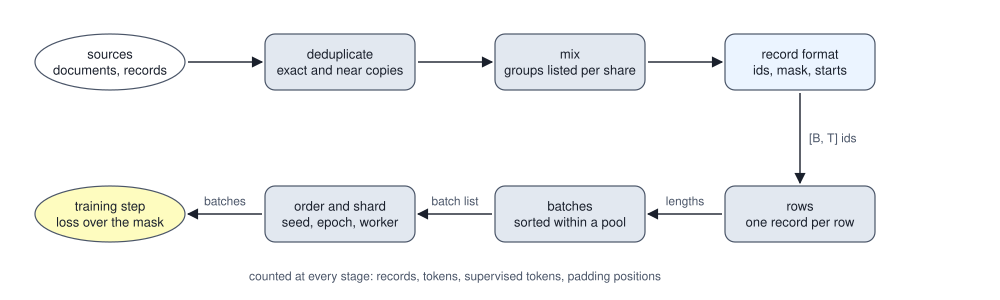

<!-- SPDX-License-Identifier: CC-BY-4.0 -->
<!-- Copyright (c) 2026 Martin Schröder <info@swedishembedded.com> -->

# Data Pipelines for Large Models

*How is training data prepared, mixed and fed at scale?*

Every stage between a pile of records and a gradient step is simple, and none of them reports its own mistakes. The run still trains, the loss still falls, and the number that comes out measures something other than what was intended. The commonest case in fine-tuning is the layout of rows. Instruction records are short, a question and an answer of a few dozen tokens, and a row of a thousand positions is cheaper to fill when several records share it. But a position in such a row can read every earlier position, the earlier records included. If a neighbour has already given the answer that this record asks for, the model scores well at that position by copying it, and a held-out loss computed on such rows measures copying in part. At serving time there is one question and nothing to copy. On the toy corpus of the section on rows, 28 records of about 63 tokens each, packing into rows of 512 positions puts the answer of 6 of the 28 records, word for word, earlier in the row that asks for it.

Six stages lie between the sources of a fine-tuning run and its step. Exact and near copies are removed, among the records and between them and the held-out set. Groups of records are mixed in stated shares. Each record is written as token ids, a mask and a start offset. Records become rows, and rows are cut into batches. The batches are put in an order that can be reproduced, and each worker of a distributed run takes its share. Counts of records, tokens, supervised tokens and padding positions can be kept at every stage, and the layout and bucketing tables below are such counts.



## A conversation as three arrays

A pretraining corpus is a heap of documents in which every token is a target. A fine-tuning record is a conversation, and only some of its messages, the assistant's replies, are what the model is to learn to write; the others are context. Chapter 10 of Volume V gave the loss a mask $s_t$ that says which positions count, and Chapter 4 of Volume XII applied it to a conversation. Neither said who builds the mask or what that builder must tell the trainer. A conversation has first to become ids, so recall the framing that does it (Volume V, Chapter 2): what does ChatML write for one message, and what does the string end with when the model is asked to reply? And recall what the mask does to the loss (Volume V, Chapter 10): a batch has 64 positions of which 56 are supervised, so which denominator makes the loss the mean over the targets that count? The answers are at the end.

Supervised fine-tuning (SFT) trains a model on such records. An **SFT data format** is the agreement between whoever produces the records and the trainer: what a record contains, how it becomes token ids, which of the ids are scored, and where each record starts. The two programs are written by different people, and a disagreement between them raises no error. It trains the wrong thing.

The agreement has three requirements. The supervision boundary must be stated for every message, never inferred: a record with no explicit boundary would have to be read as all context or as all trained, and either silently misdirects the loss, since the first trains nothing from the record and the second puts the prompt into the loss. The ids must come from the template of the checkpoint that will be trained, so that the framing, the beginning-of-sequence token and the end-of-turn token are the ones the model knows; a conversation whose rendering does not extend the rendering of its prefix would make the mask fall on the wrong span, and must be refused. And a token's mask must be the message's flag, so that a trained assistant turn also trains its end-of-turn token, which is how the model learns to stop.

In brain the reader is `ChatSample::from_jsonl` in `crates/data/src/chat.rs`, an instance of it. It takes one JSON record per line: a list of messages, each with a role, a content string and a flag `train`, plus optional tool definitions and metadata. An unknown field is an error, a mistyped field is an error naming the line and the field, and `train` is required on every message. The record is rendered once, whole, and each message's byte range of that text is encoded and the pieces concatenated (`ChatSample::encode_with`), and it refuses a conversation whose rendering is not prefix-stable.

A tiny version of the whole step can be printed. The tokenizer here is the simplest that has special tokens: the UTF-8 bytes of the text are the ids 0 to 255, and the two framing tokens of ChatML are 256 (`<|im_start|>`) and 257 (`<|im_end|>`). A message is its header (`<|im_start|>`, the role's bytes, a line feed), its content's bytes, and its tail (`<|im_end|>`, a line feed). There are two ways to say which tokens of a trained message are scored. The first supervises everything the message is made of, header included, and is what a rendering of the whole conversation gives. The second supervises the content and the tail only, because at serving time the header is part of the prompt: the model is asked from `<|im_start|>assistant` and a line feed, and never has to write it. brain keeps both. The second is the one `ChatSample::answers_as_asked` builds, as a prompt that is not supervised followed by a completion that is, and a test in the same file checks that the prompt and the completion are exactly what the serving renderer gives for the same conversation prefix.

<!-- worked: training_data.record_format -->
Token 256 is the text `<|im_start|>` and is written `[start]` in the table; token 257 is `<|im_end|>`, written `[end]`; every other id is a byte, written as its character, with `\n` for the line feed (10). The record is `user: Hello`, `assistant: Hi`, the second message trained; the second record is `user: 2+2?`, `assistant: 4`.

| position i | token | id | supervised, whole message | supervised, as asked |
|---|---:|---:|---:|---:|
| 0 | `[start]` | 256 | 0 | 0 |
| 1 | `u` | 117 | 0 | 0 |
| 2 | `s` | 115 | 0 | 0 |
| 3 | `e` | 101 | 0 | 0 |
| 4 | `r` | 114 | 0 | 0 |
| 5 | `\n` | 10 | 0 | 0 |
| 6 | `H` | 72 | 0 | 0 |
| 7 | `e` | 101 | 0 | 0 |
| 8 | `l` | 108 | 0 | 0 |
| 9 | `l` | 108 | 0 | 0 |
| 10 | `o` | 111 | 0 | 0 |
| 11 | `[end]` | 257 | 0 | 0 |
| 12 | `\n` | 10 | 0 | 0 |
| 13 | `[start]` | 256 | 1 | 0 |
| 14 | `a` | 97 | 1 | 0 |
| 15 | `s` | 115 | 1 | 0 |
| 16 | `s` | 115 | 1 | 0 |
| 17 | `i` | 105 | 1 | 0 |
| 18 | `s` | 115 | 1 | 0 |
| 19 | `t` | 116 | 1 | 0 |
| 20 | `a` | 97 | 1 | 0 |
| 21 | `n` | 110 | 1 | 0 |
| 22 | `t` | 116 | 1 | 0 |
| 23 | `\n` | 10 | 1 | 0 |
| 24 | `H` | 72 | 1 | 1 |
| 25 | `i` | 105 | 1 | 1 |
| 26 | `[end]` | 257 | 1 | 1 |
| 27 | `\n` | 10 | 1 | 1 |

| record | tokens | start offset | supervised, whole message | supervised, as asked |
|---|---:|---:|---:|---:|
| 0 | 28 | 0 | 15 | 4 |
| 1 | 26 | 28 | 14 | 3 |

The dataset of the two records has 54 token ids, a mask of 54 flags and the starts [0, 28]. Under the as-asked mask the positions t whose target is supervised (the mask read at t + 1) are 23 to 26 and 50 to 52: 7 positions; the mask at position 0 of the stream, which is never a target, is 0.
<!-- /worked -->

Two details of the table decide whether a training run is right. The first is the index base of the mask. The mask belongs to tokens, but the loss belongs to positions: position $t$ is scored on the target token $x_{t+1}$, so it counts when the mask of token $t + 1$ is set. That is why the last sentence of the block lists the positions 23 to 26 and 50 to 52 and not 24 to 27 and 51 to 53, and why the mask at position 0, which is never a target, is irrelevant. `crates/data/src/loader.rs` states the same convention (`mask[start + 1 + t]` decides position $t$), and a mask laid one place off is the bug of the copy experiment in Chapter 10 of Volume V, which left the first answer letter out of the loss. The second detail is the difference between the two columns: the header of the assistant's message is 11 of the 15 supervised tokens of the first record under the whole-message rule and none of the 4 under the as-asked rule. Tokens that serving supplies are scored in the first column, and what the model learns about them is spent on something that is never asked of it.

The function is short, and it is the whole contract between the producer and the trainer.

```text
function encode_record(messages: list<(text, text, bool)>, convention: text)
        -> (list<int>, list<bool>):
    require convention == "whole" or convention == "asked"
    ids = []
    mask = []
    for (role, content, trained) in messages:
        header = concat([256], bytes of role, [10])
        for t in header:
            append t to ids
            append (trained and convention == "whole") to mask
        for t in concat(bytes of content, [257, 10]):
            append t to ids
            append trained to mask
    return (ids, mask)
```

What the trainer receives is three parallel arrays, written beside each other by `write_split` in `crates/data/src/chat.rs`. The ids go to `<split>.u32.bin` at four bytes each (a vocabulary of more than 65,535 ids does not fit the two bytes of the older `.bin` files; commit `5605f369a`, June 2026, widened the token path for Qwen's vocabulary), the mask to `<split>.mask.bin` at one byte per token, and the start offset of every record to `<split>.ex.bin` at eight bytes per record. The two records of the block above are 54 token ids, 54 mask bytes and the starts 0 and 28: $54 \times 4 + 54 + 2 \times 8 = 286$ bytes. The trainer checks what it reads before it trusts it. `load_dataset` in `crates/model/src/train.rs` refuses a mask that does not have exactly one entry per token, because the alternative is a run that trains without a mask and supervises the prompt, and refuses a start index that does not ascend from 0 inside the stream.

Why store the starts at all? The first design of brain's chat datasets put a separator token between records and found the boundaries by scanning for it. Knowledge #189 and commit `46afb1694` (September 2026) record why that was replaced. The separator was Qwen's end-of-text id, 151643, which is out of range for a vocabulary of 32,256 or 102,400 ids, so datasets for those models carried an id their embedding table did not have. And the checkpoint's own end-of-sequence id would not do either, since it occurs after every assistant turn of a multi-turn record and would cut one conversation into several. The lesson is general: a record boundary is information about the data, and a stream that carries it in-band has made an assumption about the vocabulary. The commit writes the starts beside the stream, the stream holds only the conversations' tokens, and a dataset written the old way is still read by its separator when the stream holds that id and the vocabulary covers it.

The crate carries the same discipline into the other record shapes of training. The preference format of `crates/data/src/preference.rs` is a prompt, a chosen turn and a rejected turn, parsed as strictly as a chat record, with which tokens are supervised following from where a message stands (the prompt never, the two candidates always). The masked-language-model corruption of `crates/data/src/mlm.rs` shifts nothing, because its target is the token at the same position, and it packs fixed-length windows without padding, since a bidirectional model would attend to padding it could not tell from text. The fill-in-the-middle prompt of `crates/data/src/fim.rs` frames a prefix and a suffix with the checkpoint's own three tokens and says plainly when a vocabulary has none. Each is a small contract of the same kind: what a record holds, and what the loss is to see.

## One record to a row

A trainer works on rectangles. Chapter 10 of Volume V cut a stream into rows wherever the cut fell; recall its count: a training stream has 1,636 tokens and rows have 16 positions, so how many rows does it make, and how many positions of the last row are padding? That cut is right for documents that are long compared with a row and wrong for records that are short. The question here is what a row of a fine-tuning run should hold, and three answers can be counted on the same data. The data are 28 validation records of a corpus of facts (a person, a city, and three wordings of the question), 63 tokens each on average.

<!-- worked: training_data.layouts -->
28 validation records from `training_data.facts.val` (seed 0x9bdbdf608f966799); for each, in order, `integer(12)` picks the fact and then `integer(3)` the wording of the question; the user message is the question and the assistant message is `<name> lives in <city>.`, name i living in city i, the names being Ada, Ben, Cleo, Dan, Eva, Finn, Gus, Hana, Ivo, Jon, Kai, Lea and the cities Oslo, Rome, Lima, Kyiv, Bern, Riga, Baku, Doha, Faro, Graz, Hue, Nice, and the three wordings of the question (index 0, 1, 2) being `Where does {n} live?`; `Which city is home to {n}?`; `{n} lives in which city?` with `{n}` the name. The 28 records hold 1,766 tokens (mean 63.07, longest 67), of which 564 are supervised under the as-asked mask. A row has 512 positions in the first two layouts: position i of a packed row holds the stream token it starts at plus i, its target is the next token, and the last row is padded; in a one-record row all the record's tokens are inputs and the last has no target. 'Positions with a real input' are the positions that are not padding. 'Mean other records readable' is, over the supervised targets, the number of records other than the target's own that have a token at or before the position in its row. 'Answers already in the row' counts, among the records whose answer text (the bytes of `<name> lives in <city>.`) lies wholly in the inputs of one row, those whose answer occurs as a run of tokens in the same row before it begins.

| layout | rows | row length | positions computed | positions with a real input | padding, percent | supervised targets | mean other records readable | answers already in the row |
|---|---:|---:|---:|---:|---:|---:|---:|---:|
| packed stream, rows of 512 | 4 | 512 | 2,048 | 1,765 | 13.8 | 564 | 3.23 | 6 of 28 |
| one record per row, rows of 512 | 28 | 512 | 14,336 | 1,766 | 87.7 | 564 | 0.00 | 0 of 28 |
| one record per row, rows of the longest record | 28 | 67 | 1,876 | 1,766 | 5.9 | 564 | 0.00 | 0 of 28 |
<!-- /worked -->

Read the first row against the last two. Packing the 1,766 tokens into rows of 512 computes 2,048 positions, 13.8 percent of them padding in the last row, and every record's supervised positions can read on average 3.23 other records. Six of the 28 answers already stand, word for word, earlier in the row that asks for them. If the validation loss is computed on such rows, the model is partly scored on whether it copies a sibling's answer, and 6 of 28 is what the data give. A record is paired with a fact by a uniform draw from 12, so a record that follows $m$ others in its row has the same fact as one of them with probability $1 - (11/12)^m$; for $m = 3$ that is 0.2297 and for 3.23 it is 0.245, against the observed 0.214. Real instruction data have more repeats of the same answer than twelve facts do, and a row of 1024 positions holds twice as many neighbours, and the effect grows with both.

That the effect shows in the loss and not in the generated answer is what makes it hard to see. Chapter 10 of Volume V trained two models on independent documents, one allowed to read across the boundary, and the two masks differed by hundredths of a nat, because an earlier document says nothing about the next. A fine-tuning record is different. The earlier records are demonstrations of the very mapping the later question asks for, so reading them is not noise but help that serving will not provide. The remedy of that chapter, a block-diagonal mask, would remove it, and it needs a kernel that knows where the records are. The remedy of `crates/data/src/loader.rs` needs nothing of the kernel: a row holds one record.

The cost of the first layout was found in a real fine-tune (commit `a9f38b586`, September 2026). Its held-out loss was 0.0353, which as a mean cross-entropy over the supervised tokens means the model gave the right next token a geometric-mean probability of $e^{-0.0353} = 0.965$ on questions it had never seen, while about a quarter of the same questions were answered correctly when generated one at a time. The commit measured 48 percent of the supervised validation records with their exact answer earlier in the same row, and made a row one record. `TokenDataset::new_examples` takes the stream, the mask, the start of each record and a pad id, and makes row $b$ the record $b$ names: its tokens left-aligned, the rest of the row padding, and the target of every padded position `IGNORE`. The last token of a record is an input and has no target, since nothing of the record follows it. Causal attention inside the row can only reach the record's own earlier tokens, so the kernel needs no change, and the function's comment states the layout: a row never runs on into the next record, padding carries no gradient, and a held-out loss measured on such rows is about one question and not about a crowd of them. The tests in the file fix it (`an_example_row_never_reaches_into_the_next_example`, `every_example_can_be_drawn`, `an_example_longer_than_the_row_is_refused`). The second of the three was added for a bug that is easy to overlook: the stream-window sampler it replaced could not draw a record whose start left less than a block of the stream after it, so those records were never drawn at all.

The third test is the one that ties the layout to the data. A record longer than the row is refused by `new_examples` with the record's number, its length and the block size, and `load_dataset` returns that as an error: the alternative is a truncated answer, and training on the stump of an answer teaches the model to stop in the wrong place. The row must therefore be at least as long as the longest record, and the second row of the table shows what happens when it is much longer. Fixed rows of 512 for records of at most 67 tokens compute 14,336 positions to carry 1,766 tokens, 87.7 percent padding. `prepare_chat_samples` reports the longest record it wrote (`Prepared::longest_example`), and `block_for` in `crates/sdk/src/finetune.rs` sizes the row to exactly that, at least a minimum, capped by a maximum the caller names. Its comment gives the reason for not rounding up to a power of two: attention and every activation scale with the row, so padding a 5,646-token record to 8,192 computes work for 8,192 tokens to train 5,646. The third row of the table is that rule, 28 rows of 67 positions, 1,876 positions computed and 5.9 percent of them padding. The command-line tool says what it did (`row sized to the data`) and refuses an explicit block that is shorter than the longest record.

The step reports the cost it pays. `StepWork` in `crates/model/src/train.rs` (commit `634dbb4b3`, October 2026) counts, for each optimizer step, the tokens of the records it trained on (`useful_tokens`), the tokens the forward passes computed (`computed_tokens`), and the positions that carry a supervised target; `padded_tokens` is the difference of the first two. These are counts of work, and the table above is the same count made before the run.

## Sorting records by length without biasing the batch

Sizing the row to the longest record leaves a second kind of padding, which comes from the data and not from the row. The records of a real instruction set are not 63 tokens long. Most are short and a few are many times longer, and a row as long as the longest is mostly padding for a typical record. A batch whose rows are each padded only to the longest record in that batch spends less, and which records meet in a batch is then a choice. **Sequence-length bucketing** is the choice to put records of similar length in the same batch: sort the records by length inside a window of the data, cut the sorted window into batches, and shuffle the batches.

The cost of a batch of $B$ records of lengths $L_1, \dots, L_B$, computed at the length of its longest, is $B \max_i L_i$ positions, and the padding is $\sum_i (\max_j L_j - L_i)$. Sorting makes neighbours of equal length and pushes that sum toward zero. The window inside which records are sorted is the **pool**: $Q$ batches, so $Q B$ records. A pool of one batch is plain shuffled batching; a pool as large as the data is one global sort. The routine, and the table that counts it, make the choice explicit.

```text
function bucket_batches(L: list<int>, B: int, Q: int, rng: Generator)
        -> list<list<int>>:
    require B >= 1 and Q >= 1
    require len(L) >= 1
    order = [0, 1, ..., len(L) - 1]
    shuffle(order, rng)
    batches = []
    for c in 0 .. (len(order) + Q * B - 1) // (Q * B):
        chunk = order[c * Q * B : (c + 1) * Q * B]
        sort chunk ascending by L[i], equal lengths keeping their order in chunk
        for b in 0 .. (len(chunk) + B - 1) // B:
            append chunk[b * B : (b + 1) * B] to batches
    shuffle(batches, rng)
    return batches
```

<!-- worked: training_data.length_batches -->
240 record lengths from `training_data.lengths` (seed 0x17be3f32b4eef62b), drawn in order, each record by one `uniform()` and then one `integer`: when the uniform is below 0.2 the record is long and its length is 96 + `integer(129)`, otherwise it is short and its length is 16 + `integer(33)`; 50 are long, the longest is 224, the shortest 16, together 14,725 tokens (mean 61.35). Batches of 8 records, so 30 batches; each batch is computed at the length of its longest record, and a position is one token of one row. For every pool size the generator `training_data.batches` (seed 0xb8ece68313919b22) starts again: first the shuffle of the 240 indices, then, after the sorting and cutting, the shuffle of the list of batches. The weight of a supervised token is 1 divided by the supervised tokens of its batch, since the loss of a batch is a per-token mean; a record of length L has L // 2 (integer division) supervised tokens.

| batching | pool | positions computed | padding, percent | supervised tokens per batch | heaviest / lightest batch |
|---|---:|---:|---:|---:|---:|
| every row at the longest record | - | 53,760 | 72.6 | - | - |
| pool of 1 batch (plain shuffled batches) | 1 | 41,512 | 64.5 | 123 to 414 | 3.37 |
| pool of 2 batches | 2 | 28,128 | 47.7 | 76 to 610 | 8.03 |
| pool of 3 batches | 3 | 22,536 | 34.7 | 76 to 704 | 9.26 |
| pool of 5 batches | 5 | 19,184 | 23.2 | 69 to 789 | 11.43 |
| pool of 6 batches | 6 | 18,960 | 22.3 | 67 to 811 | 12.10 |
| pool of 10 batches | 10 | 17,088 | 13.8 | 66 to 834 | 12.64 |
| pool of 15 batches | 15 | 16,008 | 8.0 | 65 to 863 | 13.28 |
| pool of 30 batches (one global sort) | 30 | 15,616 | 5.7 | 64 to 872 | 13.62 |
<!-- /worked -->


With a pool of one batch, the 8 records of a batch are drawn independently and the batch is computed at its longest, so 64.5 percent of the positions it computes are padding, against 72.6 percent if every row had the length of the longest record of all. A pool of five batches already takes the padding to 23.2 percent, a pool of fifteen to 8.0 and a global sort to 5.7. Computing 15,616 positions in place of 41,512 is $1 - 15{,}616/41{,}512 = 62.4$ percent fewer positions, and the saving against the single fixed row is 71.0 percent. The positions are the work only in part: the dense layers cost a fixed number of FLOPs per position (Chapter 10 of Volume V counted six per parameter), while the attention scores of a row grow with the square of its length, so a padded row costs more than its positions say and the saving of a batch of short rows is larger than the position count shows.

Two prices come with it, and the last column of the table shows the second. The first is that the batch is no longer a draw of the data. When records are sorted, a batch of the shortest records and a batch of the longest differ in what they teach: short answers and long ones differ in topic, in difficulty and in how much of the record is answer. The final shuffle of the batch list takes the order out of the run, so that the optimizer does not see all the short ones first, but it cannot restore the independence inside a batch, and a pool of 30 puts the 8 shortest records together. The second price is the weight of a token. The loss of a batch is a mean over its supervised tokens, so a supervised token of a batch has weight $1/S_b$ where $S_b$ is the batch's count. With plain batching the heaviest batch has 3.37 times the supervised tokens of the lightest (414 against 123), and with a global sort 13.62 times (872 against 64), so a token in the lightest batch carries more than thirteen times the weight of one in the heaviest. That is a different objective, and one that favours the short records.

The cure is the denominator of Chapter 10 of Volume V, taken one level up. When $k$ batches are accumulated into one optimizer step, divide the loss and the gradient of each of them by the same count, not by its own, and the step's gradient is the mean over all its supervised tokens, whichever batch holds them. brain does this in `micro_steps` in `crates/model/src/train.rs`: the denominator it sets for every micro-batch is the mean of the step's supervised positions per micro-batch, through `set_loss_denominator`, whose documentation says exactly that batches accumulated into one step share one denominator. Commit `c2a048cbf` (October 2026) introduced it, with the stated aim that a short record no longer weighs as much as a long one and that the reported training loss is the per-token mean a held-out evaluation measures. If the micro-batches of one step are the batches of one pool, so that a long batch and a short one fall in the same step, every token of the step then weighs the same.

What brain does with length is on the side of the row, not the batch. The loader hands the trainer rows of one length per run, sized to the longest record by the rule above, and the step counts its padded tokens; the model may trim: `Model::computed_tokens` in `crates/model/src/lib.rs` documents that a causal model computes nothing after the last supervised position of a row, and `Qwen35` reports the length it ran (`run_len`) for a batch of one sequence whose supervised positions end early. The quantity that the pool of this section would reduce is the one `StepWork::padded_tokens` already reports.

## A share of what: mixing sources

Real training data come from several places. A fine-tuning set has the records written for the new skill, records kept from the model's earlier tasks so that it does not forget them (Chapter 7 of Volume XII called that replay), and perhaps a set of general demonstrations. A **data mixture** says how much of the training each group gets, as shares that add up to 1. Two questions come at once, and the second hides inside the first: how to make a stream that has the shares, and what the shares are shares of.

Start with the second. A share of 0.5 for a group B can mean half the records of the stream, half of its tokens, or half of its supervised tokens, and they are three different mixtures when the groups' records have different lengths. Take a group A whose records have 40 tokens and a group B whose records have 200.

<!-- worked: training_data.mixture -->
| case | records per group | share asked | times listed | scale | rows listed | share realised | largest deviation |
|---|---:|---:|---:|---:|---:|---:|---:|
| a replay set nine times the dataset | 100, 900 | 0.75, 0.25 | 27, 1 | 1 | 3,600 | 0.7500, 0.2500 | 0.0000 |
| a replay set a tenth of the dataset | 100, 10 | 0.50, 0.50 | 1, 10 | 1 | 200 | 0.5000, 0.5000 | 0.0000 |
| a ratio that rounds badly at scale 1 | 278, 150 | 0.75, 0.25 | 5, 3 | 3 | 1,840 | 0.7554, 0.2446 | 0.0054 |
| two replay groups | 278, 60, 93 | 0.50, 0.25, 0.25 | 4, 9, 6 | 4 | 2,210 | 0.5032, 0.2443, 0.2525 | 0.0057 |

Two sources: every record of A has 40 tokens and every record of B has 200. A share w of B among the rows drawn is a share w * 200 / ((1 - w) * 40 + w * 200) of the tokens drawn.

| share of B among the rows | share of B among the tokens |
|---|---:|
| 0.05 | 0.2083 |
| 0.10 | 0.3571 |
| 0.20 | 0.5556 |
| 0.50 | 0.8333 |

| share of B wanted among the tokens | share of B to ask among the rows |
|---|---:|
| 0.05 | 0.0104 |
| 0.10 | 0.0217 |
| 0.20 | 0.0476 |
| 0.50 | 0.1667 |
<!-- /worked -->

Asking for half the rows from B gives it 0.8333 of the tokens, and the shares of the second table say how far a share of rows is from a share of tokens: 0.05 of the rows is 0.2083 of the tokens. The inverse, the third table, is what one asks to get a token share: 0.5 of the tokens from B needs only 0.1667 of the rows. The measure that the loss sees is the supervised tokens, since a token contributes to the gradient only if it is supervised, so a careful mixture is stated in the unit it is meant to control and converted with the lengths, as the formula of the block does: a share $w$ of rows is $w \bar L_{\mathrm B} / ((1 - w) \bar L_{\mathrm A} + w \bar L_{\mathrm B})$ of the tokens for mean lengths $\bar L_{\mathrm A}$ and $\bar L_{\mathrm B}$.

The first question is how to realise a share. One way is to draw. brain's `Mixture` in `crates/rl/src/objective/mixture.rs` draws, for each micro-step, which of its objectives runs, by one uniform number scaled by the sum of the weights and walked through the cumulative weights (`draw_arm`), and a test draws 200,000 times and checks that every arm's frequency is within a hundredth of its weight. It is a share of micro-steps; the arms of the study that uses it, in `crates/rl/src/continual.rs`, are loaded with one batch shape, so a micro-step is the same number of rows from either, and it is a share of rows again, not of tokens, unless the records have equal lengths. A draw also has a variance: with 100 micro-steps and a share of 0.1, the count of the small group is a binomial draw with standard deviation 3, and runs of a few thousand steps are needed before the realised share is close.

The other way is to list. `ChatFineTune::replay_at` and `replay_share` in `crates/sdk/src/finetune.rs` name a replay file and its share of the rows (commit `cc746367c`, October 2026), and the routine that turns shares into a stream is `mix_repeats`: each group is listed a whole number of times in the list of rows, so that the groups come out in their shares. The derivation is short. A group $g$ has $n_g$ records and a share $q_g$ of the rows, so each of its records must have weight $q_g / n_g$, and the number of times a record is listed is that weight over the smallest weight, times a scale $c$ that is a whole number. Repeats are whole numbers, so the realised shares are only close, and the scale is the first $c$ from 1 to 16 at which every realised share is within 0.01 of its asked share.

```text
function mix_repeats(n: list<int>, q: list<real>) -> (list<int>, int):
    require len(n) == len(q), "one share per group"
    require all(0.0 < q[g] and q[g] < 1.0 for g in 1 .. len(q))
    require sum(q[1:]) < 1.0, "the dataset keeps some share"
    q[0] = 1.0 - sum(q[1:])          # group 0 is the dataset; its share is what is left
    w = list of len(n); w[g] = q[g] / n[g] if n[g] > 0, else -1.0       # -1.0 marks a group with no records
    least = the smallest w[g] that is at least 0.0
    best_off = 2.0; best_m = []; best_c = 0     # 2.0 exceeds every deviation
    for c in 1 ..= 16:
        m = list of len(n); m[g] = 1 if w[g] < 0.0, else max(1, floor(w[g] / least * c + 0.5))
        rows = sum(m[g] * n[g] for g in 0 .. len(n))
        off = max(abs(m[g] * n[g] / rows - q[g]) for g in 0 .. len(n) if n[g] > 0)
        if off <= 0.01:
            return (m, c)
        if off < best_off:
            best_off = off; best_m = m; best_c = c
    return (best_m, best_c)
```

The cases of the first table are the cases of the test that guards `mix_repeats` in `crates/sdk/src/finetune.rs`. A replay set nine times the dataset at a quarter of the rows needs the dataset listed 27 times against once (and the test's `[27, 1]` is the first row's repeats); one a tenth of the dataset at a half needs the replay listed ten times; and a ratio that does not round well at scale 1, 278 records against 150 at a quarter, is listed as 5 and 3 only at scale 3, where the largest deviation is 0.0054, after scales 1 and 2 leave 0.0375 and 0.0146. The table is an independent computation of the same rule from this description: it gives the repeats `[27, 1]` and `[1, 10]` that the test asserts, and for the other two cases it meets the tolerance of a hundredth that the test asserts.

Listing has a cost that the table makes visible and that no share hides. In the first row the dataset's 100 records are listed 27 times each, in a list of 3,600 rows. The mixture the run sees is exact, and each pass over the list shows every record of the dataset 27 times and every record of the replay set once. A group that is small and heavily weighted is repeated, and a repeated record is a duplicate by construction, so the number of times is the thing to look at before a share is chosen. The opposite problem, a large group taking almost all of the rows, is the one that the examples-proportional mixing of the text-to-text transfer work solved with a cap on how much a source may count. A mixture that is a list is also best traversed and not sampled, a pass over the list in a shuffled order, which is the subject of the last section.

## Near copies and the validation set

Whatever the shares are, a record that stands twice in the data counts twice, and a record that stands on both sides of a split makes the score too good: recall Chapter 5 of Volume II, where a list of 200 records holds 100 items twice each, with labels that are coin flips, and is split at random into halves, and a model answers a test record with the label of the nearest training record. What is its expected accuracy? **Deduplication** is the removal of records that repeat other records, and it is part of the mixture before it is anything else: a duplicate is a weight nobody chose. It is also the cheapest defence against that leakage. The simplest test is to hash. The SHA-256 digest of a record's text is the same for the same text, so records that share a digest are copies, and one per digest is kept. It costs one pass and finds nothing else: the second row of the first table below is what it finds after one more step, the normalisation of the text (lower case, runs of white space made single spaces).

The corpus of the next block is a plant. Two hundred documents of 60 words each are drawn from a vocabulary of 150 words, and then 120 more are planted: 30 exact copies, 30 copies with capitals and double spaces, and three groups of 20 whose words have been replaced, each word independently with probability 0.1, 0.2 and 0.3. The truth is known, so the methods can be scored.

<!-- worked: training_data.duplicates -->
200 originals of 60 words from `training_data.docs` (seed 0xd18e42b31eaef34b), planted copies from `training_data.plant` (seed 0x0f25b1783d6b2ce1) in this way: 320 documents, 120 of them planted. An original is 60 draws `integer(150)` of `training_data.docs`, document after document, word k written `w` and its three digits (`w007`) and the words joined by single spaces. The generator `training_data.plant` shuffles the list 0 .. 199 once (the Fisher-Yates shuffle of the randomness chapter), so the originals are chosen without repeats; its first 30 entries name the originals copied exactly, the next 30 the originals copied in capitals (`W007`) with two spaces between words, and the next three runs of 20 the originals corrupted at the rates 0.1, 0.2 and 0.3. A corrupted copy takes its words in turn: one `uniform()` from `training_data.plant`, and when it is below the rate one `integer(150)` from the same generator gives the new word (the copies and the format variants use no draws). A shingle is three consecutive words of the normalised text joined by single spaces (`w007 w101 w044`); a document has 58 shingles at most.

| rule for calling a document a duplicate of an earlier one | documents dropped | of the planted |
|---|---:|---|
| SHA-256 of the raw text | 30 | 30 copies |
| SHA-256 of the normalised text | 60 | 30 copies and 30 format variants |

| planted kind | documents | mean Jaccard with the original | smallest | mean MinHash estimate (64 hashes) | mean absolute error of the estimate |
|---|---:|---:|---:|---:|---:|
| copy | 30 | 1.0000 | 1.0000 | 1.0000 | 0.0000 |
| format | 30 | 1.0000 | 1.0000 | 1.0000 | 0.0000 |
| rate 0.1 | 20 | 0.5533 | 0.2340 | 0.5648 | 0.0470 |
| rate 0.2 | 20 | 0.3553 | 0.2340 | 0.3414 | 0.0460 |
| rate 0.3 | 20 | 0.2163 | 0.1048 | 0.2047 | 0.0424 |

All 51,040 pairs, a pair being flagged when its similarity is at least the threshold.

| threshold | copies and variants found (exact Jaccard) | rate 0.1 | rate 0.2 | rate 0.3 | false pairs (exact Jaccard) | false pairs (estimate) | planted pairs missed (estimate) |
|---|---:|---:|---:|---:|---:|---:|---:|
| 0.5 | 60 of 60 | 13 of 20 | 0 of 20 | 0 of 20 | 0 | 0 | 45 |
| 0.3 | 60 of 60 | 19 of 20 | 15 of 20 | 1 of 20 | 0 | 0 | 28 |
| 0.2 | 60 of 60 | 20 of 20 | 20 of 20 | 13 of 20 | 0 | 0 | 10 |
<!-- /worked -->

The hash of the raw text finds 30 duplicates, the 30 exact copies, and the hash of the normalised text finds 60. The 60 documents with replaced words are not found by either: one changed word in ten is enough to change the digest. A near copy needs a similarity, and the first similarity to reach for is on sets. A **shingle** is a run of three consecutive words, and a document $D$ is the set $\mathcal{S}(D)$ of its shingles (58 at most here). The **Jaccard similarity** of two sets is the size of their intersection over the size of their union,

$$
J(X, Y) = \frac{|X \cap Y|}{|X \cup Y|},
$$

which is 1 for equal sets and 0 for disjoint ones. If each word of a document is replaced with probability $r$, a shingle survives with probability $(1 - r)^3$, so $\psi = (1-r)^3$ of its shingles are common and $J = \psi / (2 - \psi)$: 0.574, 0.344 and 0.207 for $r = 0.1, 0.2, 0.3$. The table's means, 0.5533, 0.3553 and 0.2163, are close to them, and its smallest values are the reason a threshold is a decision: the smallest similarity at rate 0.1, 0.2340, is lower than the mean at rate 0.2, so the groups overlap and no threshold separates them. The thresholds table is the result. A threshold of 0.5 finds the copies and variants and 13 of the 20 documents at rate 0.1; 0.3 finds 19 and 15 of the first two groups and one of the last; 0.2 finds 20, 20 and 13. None of the three flags a false pair among the 51,040, because the random documents here share almost no three-word runs, which real text, with its boilerplate and its set phrases, does not do. The threshold is chosen on a sample read by a person.

Comparing every pair costs $n(n-1)/2$ comparisons, which is why the exact test does not reach a web-sized corpus. **MinHash** estimates $J$ from a short signature of each set. Give every shingle a number by a hash function $h$ and let $h_{\min}(X) = \min_{x \in X} h(x)$. Over a random choice of $h$, the shingle with the smallest hash in the union $X \cup Y$ is equally likely to be any of its members, and the two minima $h_{\min}(X)$ and $h_{\min}(Y)$ are equal exactly when that shingle is in the intersection, which has probability $|X \cap Y| / |X \cup Y| = J$. One hash function gives a yes or a no; $K$ of them give $K$ trials, and the fraction of equal entries of two signatures estimates $J$ with standard error $\sqrt{J(1-J)/K}$. With $K = 64$ and $J = 0.3553$ that is 0.0598 and the mean absolute error of a normal estimate is 0.8 of it, 0.0477; the table's measured 0.0460 at rate 0.2 agrees. The $i$-th hash of a shingle here is $\mathrm{mix}(f \oplus \sigma_i)$, with $f$ the first eight bytes of the SHA-256 digest of the shingle and $\sigma_i$ the $i$-th raw value of the generator `training_data.minhash`, as the pseudocode says.

```text
function minhash(shingles: list<text>, seeds: list<u64>) -> list<u64>:
    require len(shingles) >= 1
    f = [fingerprint(s) for s in shingles]
    sig = []
    for i in 0 .. len(seeds):
        append min(mix(f[j] xor seeds[i]) for j in 0 .. len(f)) to sig
    return sig
```

The estimate removes the cost of a pair from the size of a document, but not the number of pairs. **Banding** does. Cut the signature of $K$ entries into $\beta$ bands of $\rho$ entries each, with $\beta\rho = K$, and call two documents a candidate pair when at least one band is equal in both. A band is equal with probability $J^\rho$, so the pair is a candidate with probability $1 - (1 - J^\rho)^\beta$, an S-shaped curve in $J$ whose steepness the choice of $\rho$ sets.

<!-- worked: training_data.banding -->
A signature of 64 entries is cut into b bands of r consecutive entries (b r = 64); two documents are a candidate pair when all r entries of at least one band are equal. A pair of Jaccard similarity J is a candidate with probability 1 - (1 - J^r)^b. The 64 seeds of the signatures are the first 64 raw values (`next`) of the generator `training_data.minhash` (seed 0x3e1b3b5666b6bacb); band k holds entries k r to k r + r - 1.

| J | b = 32, r = 2 | b = 16, r = 4 | b = 8, r = 8 |
|---|---:|---:|---:|
| 0.1 | 0.2750 | 0.0016 | 0.0000 |
| 0.2 | 0.7292 | 0.0253 | 0.0000 |
| 0.3 | 0.9511 | 0.1220 | 0.0005 |
| 0.5 | 0.9999 | 0.6439 | 0.0308 |
| 0.7 | 1.0000 | 0.9876 | 0.3781 |
| 0.9 | 1.0000 | 1.0000 | 0.9889 |

| banding | candidate pairs | share of all pairs | planted pairs among them | candidates with exact J >= 0.3 | candidates below 0.3 | lookups to check the candidates |
|---|---:|---:|---:|---:|---:|---:|
| b = 32, r = 2 | 115 | 0.0023 | 114 | 95 | 20 | 6,670 |
| b = 16, r = 4 | 79 | 0.0015 | 79 | 77 | 2 | 4,582 |
| b = 8, r = 8 | 64 | 0.0013 | 64 | 64 | 0 | 3,712 |

Counting rule for the work: one lookup of a shingle in another document's shingle set is one operation, one hash evaluation of a shingle under one of the 64 seeds is one operation, and one entry written into a band table is one operation. Comparing every pair exactly costs the smaller shingle count of each pair in lookups, 2,960,320 here. Building the signatures costs 18,560 shingles times 64 seeds, 1,187,840 hash evaluations; filling the band tables costs one entry per document and band, 10,240, 5,120 and 2,560 for the three bandings; checking the candidates exactly costs the last column of the table above.
<!-- /worked -->

The first table gives the curves. With $\beta = 32$ bands of $\rho = 2$ entries a pair at $J = 0.3$ is a candidate with probability 0.9511 and one at 0.1 with 0.2750; with 8 bands of 8 only pairs above about 0.9 are likely candidates. The second table gives the effect on the corpus. The 51,040 pairs shrink to 115, 79 or 64 candidates, at most 0.23 percent of the pairs and nearly all planted, and the exact check of the candidates costs between 3,712 and 6,670 lookups in place of 2,960,320. The counting rule is in the block: signatures cost one hash evaluation per shingle and seed, the band tables one entry per document and band. For $n$ documents of $z$ shingles the exact method costs about $z\,n(n-1)/2$ lookups and the signatures $z\,n\,K$ hash evaluations, so their ratio is $(n - 1)/(2K)$: 2.49 at $n = 320$, as the block's two counts show, and above 7,800 at a million documents.

The same machinery guards the validation set, which is the case that matters most. The next block takes the 200 originals as the training set and builds 30 validation documents: six are the training documents of six chosen indices with one word in ten replaced, and 24 are fresh draws.

<!-- worked: training_data.contamination -->
A validation set of 30 documents from `training_data.fresh` (seed 0xe0575f92c69dd339) against the 200 original documents as the training set. The generator first shuffles 0 .. 199; for the first 6 entries, in order, the training document of that index is corrupted at rate 0.1 to give validation documents 0 to 5 (each word in turn: one `uniform()` from `training_data.fresh`, and below 0.1 one `integer(150)` from the same generator gives the new word); then 24 fresh documents of 60 `integer(150)` draws each follow.

| check | validation documents flagged |
|---|---:|
| an exact SHA-256 match with a training text | 0 |
| a training document with Jaccard at least 0.3 | 6 (numbers 0, 1, 2, 3, 4, 5) |
| the same, after dropping the training documents those matched | 0 |

The largest Jaccard similarities of the flagged validation documents with the training set run from 0.4500 to 0.7313; of the 24 fresh documents the largest is 0.0175. The training documents dropped are 6, and the best match of every flagged validation document is the training document it was made from: True.
<!-- /worked -->

The exact match finds none of the six, and the similarity finds all six, at 0.45 to 0.7313, against 0.0175 for the largest of the fresh ones. Dropping the six training documents they point at leaves no validation document with a neighbour above 0.3. The remedy removes the training side because the held-out set is the fixed point against which every other run is compared; a validation document that changes between runs changes the thing being measured. A run reports the count of such neighbours before and after, so the number a reader sees is about data that has been checked.

The pipelines of brain guard the boundary in the three ways the data allow. A dataset of recorded game episodes is split by whole episode, never by frame (`split` in `crates/data/src/episode.rs`; Chapter 5 of Volume II described it). The TinyStories dataset of `crates/data/src/prepare.rs` learns its tokenizer on the first 30,000 training stories only, so the vocabulary carries no trace of the validation text. And `run_study` in `crates/rl/src/continual.rs` audits every training source, the explore split of each cycle and the rehearsal pool, against the frozen probes by identifier, and stops with a message that a held-out score is honest only if the policy never trained on the task it is scored against. Each of them is exact: an episode, a story or an identifier is the unit compared. A record that is the same question in other words under another identifier is the case that the similarity of this section is for.

## An order that survives a restart

The batches of a long run are not drawn once. A run passes over the data many times, and the order of a pass is a choice with two requirements: every record must be seen once before any is seen again, and the order must be a function of what a restart knows. The first is drawing without replacement. Drawing with replacement is simpler and leaves $(1 - 1/n)^n$ of the records unseen after $n$ draws, which is $0.3678$ for a list of 3,600 rows and $1/e = 0.3679$ in the limit: a third of the records are not seen in the first pass and others are seen twice or more. A shuffle per epoch gives each record exactly once.

The second requirement decides how the shuffle is generated. A single generator that runs through all the epochs has an order that depends on the state it has reached, and a restart must save and restore that state or it will follow a different order. An order that is a function of the run's seed and the epoch number alone needs only a counter: the draw $d$ of a run is entry $d \bmod n$ of the order of epoch $\lfloor d/n \rfloor$, and a run resumed at draw $d$ computes it from $d$.

```text
function epoch_order(seed: u64, n: int, epoch: int) -> list<int>:
    require n >= 1 and epoch >= 0
    rng = Generator(seed xor (u64(epoch + 1) * 0x9E3779B97F4A7C15))
    order = [0, 1, ..., n - 1]
    shuffle(order, rng)
    return order

function draw(seed: u64, n: int, d: int) -> int:
    require d >= 0
    return epoch_order(seed, n, d // n)[d mod n]
```

<!-- worked: training_data.epochs -->
7 examples, 0 to 6, and the run seed 0x69fc21a154720daa (the seed of the name `training_data.epochs`).

| epoch | order of the 7 examples |
|---:|---|
| 0 | 2 6 1 3 5 4 0 |
| 1 | 1 4 6 5 3 2 0 |
| 2 | 5 6 3 2 1 4 0 |

| run | draws 10 to 20 |
|---|---|
| straight run, read from draw 10 | 5 3 2 0 5 6 3 2 1 4 0 |
| resumed at draw 10: epoch 10 // 7, entry 10 mod 7, then on | 5 3 2 0 5 6 3 2 1 4 0 |
| resumed with the epoch forgotten: entry 3 of epoch 0, then epoch 1 | 3 5 4 0 1 4 6 5 3 2 0 |

The resumed run equals the straight run: True. Every epoch holds each example once: True (epochs 0 to 49).

With 3 workers, draw d belongs to worker d mod 3; every worker computes all 21 draws and keeps its own (draw:example).

| worker | draws it keeps |
|---:|---|
| 0 | 0:2 3:3 6:0 9:6 12:2 15:6 18:1 |
| 1 | 1:6 4:5 7:1 10:5 13:0 16:3 19:4 |
| 2 | 2:1 5:4 8:4 11:3 14:5 17:2 20:0 |
<!-- /worked -->

The block shows the three things that rule gives. Each epoch is a shuffle of the seven examples that holds each once (the check runs over epochs 0 to 49). A run resumed at draw 10 reads draws 10 to 20 as the straight run does, by computing entry 3 of epoch 1 and on, and a resume that remembers the position inside the epoch and forgets the epoch follows another order from its first draw, 3 where the straight run has 5. And the workers of a distributed run divide the stream without talking: every worker computes all of the draws and keeps those whose index mod 3 is its own, so the three keep disjoint draws whose interleaving is the whole stream and all stay in step.

This is the rule `EpochOrder` in `crates/model/src/train.rs` implements, and the file's comments give the same account: the order of an epoch is a function of the seed and the epoch alone, a draw's place in it a function of the count of draws before it, and a run resumed at draw $n$ continues the order a straight run follows. The shuffle is the one of the pseudocode, from the last position down to 1, each swapped with a uniform position at or before it. The seed of an epoch is the run's seed exclusive-or the epoch plus one times the golden-ratio constant of SplitMix64. The block uses the book's generator and not brain's `Rng::new`. brain's generator starts one step later in the SplitMix64 stream (its first output is the second output of the book's) and its bounded draw rejects a different set of raw values (the top partial block, where the book's rejects the bottom one), so the orders printed here are the book's and not brain's; the properties above are those of the rule. The sharding is `shard` in the same file: record $n$ of the whole stream belongs to the rank $n \bmod w$ for a world of $w$, and every rank consumes every record and drops the others', so their orders stay on one stream. The held-out records are deliberately not sharded: the whole validation split is scored once, by rank 0, and the value is broadcast, so that every replica selects on the same number.

The held-out split is read by another rule. `eval_every_example` scores each validation record exactly once, in order, `batch_size` at a time, so the held-out loss is the same quantity every time (a drawn sample would score a different subset each time), and it weights each batch's mean by the batch's supervised positions, because a batch's mean is over its own count and a sum over batches of those means would again give a short batch the weight of a long one. Resuming needs the position of the stream and not only the weights: commit `29dfbb79f` (November 2026) made the shared loop save the objective's own stream position with the exact-resume state, and the loop refuses a saved state that lacks the position of an objective that has one, in words that say resuming would restart its data at record 0.

## Where the stages live

The six stages are spread over four crates. `crates/data` owns what a record is, since the format, the loader and the rows are the data layer's contract with whoever trains. `crates/sdk` owns what a fine-tune of a model is asked to do with its data: `mix_rows` and `mix_repeats` listing groups at their shares and `block_for` sizing the row, since both need to know the whole fine-tune request. `crates/model` owns the loop: the epoch order, the shard, the shared denominator and the `StepWork` counts, since they are properties of a step. And `crates/rl` composes objectives: `Mixture` draws among them, and the audit of its study keeps the held-out probes out of every source. Each stage has one home, and a dataset that breaks the format's contract is refused where the loader reads it, with the file and the reason, not where a model first misbehaves.

Six commits mark the stages of the chapter. Commit `a9f38b586` made a row one record; `46afb1694` took the boundary out of the stream; `cc746367c` kept a share by listing; `c2a048cbf` gave every record of a step one denominator and drew records in epochs; `634dbb4b3` made the padding a number the step reports; and `29dfbb79f` made a resume continue the objectives' data streams where the run left them. 

## Check your understanding

1. The reader in brain rejects a record whose messages carry no `train` flag, where a default of "the last assistant message is trained" would accept it. Give one record on which that default trains the wrong tokens, and say what the loss would then be a mean over.
2. The layout block packs 1,766 tokens into 4 rows of 512. Predict, without running it, the number of rows, the positions computed and the padding percentage with rows of 1,024, and say whether the mean number of other records a supervised position can read goes up or down.
3. A colleague says: "Sort all the records by length and the padding is gone, so use a pool the size of the data." Use the table of the bucketing section to find two things that are wrong with that.
4. A mixture asks for half of the rows from a group of 200-token records and half from a group of 40-token records. What share of the tokens does the long group get, and what share of rows should be asked for if the two groups are to have equal token counts?
5. A pair of documents has Jaccard similarity exactly 0.5. With signatures of 64 entries, what is the standard error of the MinHash estimate, and what share of such pairs does the rule "flag when the estimate is at least 0.5" miss? What does that say about where to put a threshold on the estimate?
6. A run with 7-example epochs is interrupted after 10 draws, so the next draw is draw 10, and it is resumed by computing entry 10 mod 7 of epoch 0 instead of entry 3 of epoch 1. Does the resumed run see the same records in the same order as the straight run? Use the block of the previous section.

## Summary

A training record has an inside, and the format that writes it down decides what the loss will see. A conversation becomes three arrays: ids from the checkpoint's own template, a mask that the producer must state and that is read at the target's index, and the start offset of every record kept beside the stream and not in it. A record then becomes a row, and one record to a row, sized to the longest record, is the layout that keeps a position from reading answers it will not have at serving time; the cost is padding, which sorting records by length inside a pool of batches cuts at the price of a batch that is no longer a draw of the data, and which a shared denominator keeps from reweighting the tokens. A mixture is a share of something, and the something must be named, rows or tokens, before the whole-number listing that realises it is read for how often it repeats a record. Duplicates are removed by hashes where they are exact and by shingles, MinHash and banding where they are not, and above all between the training set and the held-out set, where an exact hash finds nothing of what a similarity finds. The order of feeding is a function of the seed, the epoch and the draw count, so that a restart and a team of workers each know where they are.

All of that was about what goes into a step. The next chapter looks at what the numbers in the step are made of: when the weights are held in 16 or 8 bits, which of them must stay in higher precision for the run not to fall apart.

## References

- Broder, A. Z. On the resemblance and containment of documents, 1997.
- Lee, K., Ippolito, D., Nystrom, A., Zhang, C., Eck, D., Callison-Burch, C. and Carlini, N. Deduplicating training data makes language models better, 2022.
- Leskovec, J., Rajaraman, A. and Ullman, J. D. Mining of Massive Datasets, chapter 3 (finding similar items), 2014.
- Raffel, C., Shazeer, N., Roberts, A., Lee, K., Narang, S., Matena, M., Zhou, Y., Li, W. and Liu, P. J. Exploring the limits of transfer learning with a unified text-to-text transformer, 2020.
- Krell, M. M., Kosec, M., Perez, S. P. and Fitzgibbon, A. Efficient sequence packing without cross-contamination: accelerating large language models without impacting performance, 2021.

## Exercises

1. **[Calculate]** Encode the record `user: "Hey"`, `assistant: "Yes!"` as the chapter does (bytes, framing tokens 256 and 257, a line feed after the role and after `<|im_end|>`). How many tokens does it have, how many are supervised under the whole-message rule and under the as-asked rule, and at which positions $t$ is the target supervised under the second?
2. **[Implement]** Reproduce the table of `training_data.record_format` for the two records of the block: the token pieces and ids of the first record, both masks, the start offsets, and the byte counts of the three arrays for $u32$ ids.
3. **[Calculate]** In the layout experiment a record has the same fact as an earlier record of its row with probability $1 - (11/12)^m$ for $m$ earlier records. Compute it for $m = 4$ and $m = 8$, and explain why the value at $m = 8$ describes rows of 1,024 positions better than the value at $m = 3$ describes rows of 512.
4. **[Implement]** Reproduce `training_data.layouts`: the 28 validation records, the three layouts, the padding percentages, the mean number of other records readable and the count of answers already in the row. Report the counting rule you used for each column.
5. **[Implement]** Reproduce the rows of `training_data.length_batches` for pools of 1, 5 and 30, with `bucket_batches` as written. Check the total of positions against the padding percentage of the table.
6. **[Calculate]** By hand, run `mix_repeats` on a dataset of 50 records and a replay group of 20 records at a share of 0.4. Which scale is chosen, what are the repeats, and what are the realised shares?
7. **[Implement]** Reproduce both tables of the token-share part of `training_data.mixture`, and add a third source of 100-token records to find the shares of rows that give the sources A (40 tokens per record), B (200) and C (100) the shares 0.5, 0.3 and 0.2 of the tokens, in that order.
8. **[Calculate]** A pair has Jaccard similarity 0.5. Compute the probability that it is a candidate under 16 bands of 4 entries, and compare it with the table of `training_data.banding`; then compute it under 32 bands of 2.
9. **[Implement]** Reproduce `training_data.duplicates` and `training_data.contamination`: the corpus, the two hash rules, the thresholds table, and the six flagged validation documents. Use the signatures of 64 entries with the hash of the pseudocode.
10. **[Implement]** Reproduce `training_data.epochs` and extend it to a world of 4 workers: print the draws each keeps for 28 draws, and check that the four lists are disjoint and that together they are the straight run.
11. **[Investigate]** Change the share of long records in `training_data.length_batches` from 0.2 to 0.05 and to 0.5. For each, find the pool at which the padding first falls below 10 percent, and say how the heaviest-to-lightest ratio of batches moves. Explain the order of the two effects.
12. **[Investigate]** Plant near copies at the rate 0.4 and 0.5 in `training_data.duplicates`. Find the threshold of the exact Jaccard similarity at which the false pairs first appear among the 51,040 pairs, and say what that tells you about choosing a threshold for real text.

## Key terms

- **SFT data format**: the agreement between the producer of fine-tuning records and the trainer about what a record holds, how it becomes token ids, which ids are scored and where each record starts. <!-- concept: sft-data-format -->
- **data mixture**: the shares in which groups of records contribute to training, which must name what they are shares of (rows, tokens or supervised tokens) and be realised by a draw or a listing. <!-- concept: data-mixture -->
- **deduplication**: removing records that repeat other records, exactly by a hash of the text and approximately by a set similarity of shingles, within the training data and between it and the held-out data. <!-- concept: deduplication -->
- **sequence-length bucketing**: forming batches of records of similar length by sorting inside a pool of batches, so that less of each batch is padding, at the cost of batches that are no longer draws of the data. <!-- concept: sequence-length-bucketing -->

## Answers

**Recall.**

1. A message is `<|im_start|>`, the role, a line feed, the content, `<|im_end|>` and a line feed. A prompt that asks for a reply ends with `<|im_start|>assistant` and a line feed.
2. The number of supervised positions, 56: the loss is $\sum_t s_t \ell_t / \sum_t s_t$. Dividing by 64 would give a loss 12.5 percent too low, and the value would depend on how much padding the batch has.
3. The stream has $1636 - 1 = 1635$ targets, so $\lceil 1635/16 \rceil = 103$ rows. The first 102 rows take $102 \times 16 = 1632$ targets, so the last row has 3 real positions and 13 padding positions.
4. The twin of a test record is in the training half with probability $100/199$ and then the lookup is right; otherwise it is right half the time. So $\tfrac12 + \tfrac12 \cdot \tfrac{100}{199} = 0.7513$.

**Check your understanding.**

1. A conversation of user, assistant, user, assistant in which both assistant turns are demonstrations: the default trains only the second, so the first demonstration contributes nothing and the loss is a mean over half of the tokens that were meant. A conversation whose last turn is an assistant turn that a producer kept only as context (a failed attempt) is the opposite case, and the default trains it. Neither raises an error, which is why the flag is required.
2. $\lceil 1765/1024 \rceil = 2$ rows, $2 \times 1024 = 2048$ positions computed, the same 2,048 as before (1,765 real inputs, 13.8 percent padding). The mean number of other records a supervised position can read goes up, since each row holds about twice as many records.
3. A global sort leaves 5.7 percent padding, not none, because the batches still pad inside themselves. And it makes the batches homogeneous: the heaviest batch has 13.62 times the supervised tokens of the lightest (872 against 64), so with per-batch means a token of the lightest batch has more than thirteen times the weight of one of the heaviest unless a shared denominator is used.
4. Half of the rows from the 200-token group is $0.5 \times 200 / (0.5 \times 40 + 0.5 \times 200) = 0.8333$ of the tokens. Equal token counts need the share of the long group among the rows to be $0.5 \times 40 / (200 \times 0.5 + 40 \times 0.5) = 1/6 = 0.1667$.
5. $\sqrt{0.5 \times 0.5/64} = 0.0625$. The number of equal entries is the number of successes in 64 fair trials, and the estimate is below 0.5 when that number is under 32, which has probability 0.4503. The rule misses 45 percent of such pairs and catches 55 percent. A threshold on the estimate placed at the similarity to be caught therefore loses almost half of the pairs at that similarity; it is placed lower, by about two standard errors, and the exact similarity is computed for what it flags.
6. No. Draw 10 is entry 3 of epoch 1, which is 5 in the block; entry 3 of epoch 0 is 3, so the resumed run differs from its first draw. The rest of the draws differ too (3 5 4 0 1 4 6 5 3 2 0 against 5 3 2 0 5 6 3 2 1 4 0). The resumed run is not the interrupted one.

**Exercises.**

1. The record is `<|im_start|>user\nHey<|im_end|>\n<|im_start|>assistant\nYes!<|im_end|>\n`: the first message has $1 + 4 + 1 + 3 + 1 + 1 = 11$ tokens, the second $1 + 9 + 1 + 4 + 1 + 1 = 17$, so 28 tokens. Under the whole-message rule the supervised tokens are the 17 of the second message. Under the as-asked rule they are the 4 bytes of `Yes!`, `<|im_end|>` and the line feed, so 6. The positions whose targets are supervised are those whose next token is one of them, so $t = 21$ to $26$.
3. $1 - (11/12)^4 = 0.2939$ and $1 - (11/12)^8 = 0.5015$. A row of 1,024 positions holds about twice as many records as one of 512, so the average number of earlier records is nearer 7 than 3.2.
6. The weights are $0.6/50 = 0.012$ and $0.4/20 = 0.02$, a ratio of 1.667. Scale 1 gives repeats 1 and 2 (rows 50 and 40, shares 0.556 and 0.444, deviation 0.044); scale 2 gives 2 and 3 (shares 0.625 and 0.375, deviation 0.025); scale 3 gives 3 and 5, 250 rows, shares 0.6 and 0.4 exactly, so the scale is 3.
8. $1 - (1 - 0.5^4)^{16} = 1 - 0.9375^{16} = 0.6439$, as in the table. Under 32 bands of 2: $1 - (1 - 0.25)^{32} = 0.9999$.
