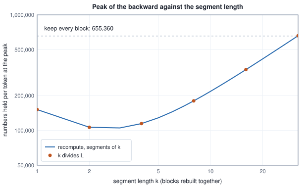

<!-- SPDX-License-Identifier: CC-BY-4.0 -->
<!-- Copyright (c) 2026 Martin Schröder <info@swedishembedded.com> -->

# Where Training Memory Goes

*Why does training a model need several times the memory of running it, and how do we get it back?*

A feed-forward block has two weight matrices, one with 16,384 rows and 4,096 columns and one with 4,096 rows and 16,384 columns. Together they are 134,217,728 numbers, and running the block costs exactly that much memory whether it sees one token or a million. Training adds a cost that grows with the data. Every token that passes through the block leaves behind its 4,096-number input and the 16,384-number output of the block's tanh, 20,480 numbers in all, because the backward pass will read both. The weights are shared by every token; those 20,480 numbers are not. Once a batch holds more than 6,553.6 tokens, the numbers kept for it outnumber the block's own weights, and a step of 8,192 tokens through a stack of 32 such blocks keeps 20 GiB of them next to 16 GiB of weights.

The activations are not the whole bill. Each weight also has a gradient and, under Adam, two moments, so a weight in fp32 costs 16 bytes in training and 4 in use. The stack of 32 blocks has 4,294,967,296 weights: 16 GiB to run, 64 GiB of weights, gradients and moments to train, and 84 GiB with the activations of that one step. Almost all of the difference is recoverable, but nothing is recovered for free. Rebuilding a block's tensors instead of keeping them spends arithmetic, one more forward pass. Storing the kept tensors or the moments in fewer bits spends precision. Holding the moments off the device and walking through them in small pieces spends bytes moved between memories. What follows prices each of these in the currency it spends, so that the cheapest can be taken first.

Four results from earlier volumes are needed at once, and it is worth answering them before reading on. A tanh layer computes $\mathbf{A} = \tanh(\mathbf{Z})$; its backward pass needs the local slope, so which of $\mathbf{Z}$ and $\mathbf{A}$ may the forward pass drop, and what is the slope in terms of the one it keeps (Volume III, Chapter 4)? After Adam's first update with bias correction, what do its two moment arrays hold, and how many numbers beyond the weight and its gradient does the optimizer keep per weight (Volume III, Chapter 7)? Volume VI, Chapter 10 priced the state of a training step per parameter: how many bytes under fp32 Adam, and why does a bf16 value with a bf16 gradient and an fp32 master copy not lower that figure? And a group of 64 numbers is stored as 8-bit codes with one scale (Volume IV, Chapter 12): how large is the step between neighbouring codes when the largest magnitude of the group is $a$, and how large is the greatest error of rounding to nearest?

## The numbers a block keeps for its backward pass

Take one residual block, with $n$ tokens as the rows of $\mathbf{X}$ of shape $[n, D]$, a first matrix $\mathbf{W}_1$ of shape $[F, D]$ and a second $\mathbf{W}_2$ of shape $[D, F]$:

$$
\mathbf{Z} = \mathbf{X}\,\mathbf{W}_1^\top, \qquad \mathbf{A} = \tanh(\mathbf{Z}),
$$

$$
\mathbf{Y} = \mathbf{X} + \mathbf{A}\,\mathbf{W}_2^\top .
$$

Given the gradient $d\mathbf{Y}$ that arrives from above, the rules of Volume III, Chapter 4 give the four gradients the block needs:

$$
d\mathbf{W}_2 = d\mathbf{Y}^\top \mathbf{A}, \qquad d\mathbf{A} = d\mathbf{Y}\,\mathbf{W}_2,
$$

$$
d\mathbf{Z} = d\mathbf{A} \odot (1 - \mathbf{A}^2), \qquad d\mathbf{W}_1 = d\mathbf{Z}^\top \mathbf{X},
$$

and $d\mathbf{X} = d\mathbf{Y} + d\mathbf{Z}\,\mathbf{W}_1$ goes on to the block below. Read the right-hand sides for what they need from the forward pass. The first reads $\mathbf{A}$, the third reads $\mathbf{A}$ again (the slope of tanh in terms of its output), the fourth reads $\mathbf{X}$, and the weights are parameters that exist anyway. Neither $\mathbf{Z}$ nor $\mathbf{Y}$ is needed. The block therefore has to keep $\mathbf{X}$ and $\mathbf{A}$, $n(D+F)$ numbers, until its backward pass has run.

The statement is checkable. The worked module writes the backward of a block so that its only access to the forward pass is a read of $\mathbf{X}$ and $\mathbf{A}$ from a tape, runs a stack of two blocks, and compares every weight gradient with a central finite difference.

<!-- worked: training_memory.saved_by_backward -->
A stack of 2 residual blocks with D = 4, F = 8 on n = 3 tokens (rows). The forward is Z = X W1^T (W1 is [F, D]), A = tanh(Z) (the correctly rounded library tanh), Y = X + A W2^T (W2 is [D, F]); the loss is half the sum of the squares of the last output, so the gradient entering the last block is that output. The weights are drawn from one generator seeded 1078866267024081730 (seed_of 'training_memory.saved_by_backward'), as normal() times 0.5 in this order: for each block W1 row by row, then W2 row by row; then X row by row with normal() times 1. The backward of a block is written to take only the saved arrays X and A (and the weights, which are parameters); the table lists what it read. All 128 weights' gradients agree with central differences (step 1e-5) to a relative difference below 1e-6: yes.

| block | array | shape | numbers | read by |
|---|---|---:|---:|---|
| block 0 | A | [3, 8] | 24 | dW2 and dZ = dA (1 - A^2) (read A) |
| block 0 | X | [3, 4] | 12 | dW1 (reads X) |
| block 1 | A | [3, 8] | 24 | dW2 and dZ = dA (1 - A^2) (read A) |
| block 1 | X | [3, 4] | 12 | dW1 (reads X) |

Saved numbers: 72 = blocks x n x (D + F) = 2 x 3 x 12. The weights of a block, 2 D F = 64, are not counted here: they exist whether or not a backward pass follows.
<!-- /worked -->

The backward pass is correct with nothing but the saved arrays, and the count of what it read is $n(D+F)$ per block. The weights, $2DF$ per block, are not part of that count. They exist whether or not a backward pass follows.

**Activation memory** is the memory that holds these saved activations for the length of a step: for a stack of $L$ such blocks, $L\,n\,(D+F)$ numbers, each $a$ bytes. Volume VI, Chapter 10 wrote the whole bill of a training step as $M_{\mathrm{train}} = P\,(b_v + b_g + b_m + n_{\mathrm{slot}}\,b_{\mathrm{slot}}) + n\,a_{\mathrm{tok}} + \mathrm{scr}$: a group that depends on the parameters and one that depends on the tokens. For the stack of this chapter, $a_{\mathrm{tok}}$ is $L(D+F)$ numbers. A real layer keeps more than this block does, because attention keeps its queries, keys, values and statistics as well; the same chapter counted 81,424 numbers per token for one sliding-window layer of a 48-layer tower. The block here is the smallest one that has both a per-token cost and a per-parameter one, and every table below uses the same stack: $L = 32$ blocks, $D = 4{,}096$, $F = 16{,}384$, so $P = L \cdot 2DF = 4{,}294{,}967{,}296$.

<!-- worked: training_memory.activations_against_state -->
The stack of the chapter: L = 32 blocks with D = 4096 and F = 16,384, so P = L x 2 D F = 4,294,967,296 trainable numbers (2^32), no embedding and no attention. Every number is fp32, 4 bytes: a weight, its gradient, and the two AdamW moments (16 bytes per parameter in all). Kept activations are L x n x (D + F) numbers (the count of the previous table, per block and token). Gibibytes are 2^30 bytes, rounded to two decimals. The kept activations equal the parameter count at n = 2 D F / (D + F) = 6,553.6 tokens.

| tokens n | weights | gradients | two moments | kept activations | total | total / weights |
|---|---:|---:|---:|---:|---:|---:|
| 512 | 16.00 | 16.00 | 32.00 | 1.25 | 65.25 | 4.08 |
| 2,048 | 16.00 | 16.00 | 32.00 | 5.00 | 69.00 | 4.31 |
| 8,192 | 16.00 | 16.00 | 32.00 | 20.00 | 84.00 | 5.25 |
| 32,768 | 16.00 | 16.00 | 32.00 | 80.00 | 144.00 | 9.00 |
| 131,072 | 16.00 | 16.00 | 32.00 | 320.00 | 384.00 | 24.00 |
<!-- /worked -->

The three columns of state do not move. The activations do: they equal the parameter count at $n = 2DF/(D+F) = 6{,}553.6$ tokens and are 20 GiB at 8,192 tokens, so the step costs 5.25 times the weights. At 131,072 tokens, a long sequence or a large batch, the activations alone are 320 GiB. That growth with $n$ is why the first remedy is aimed at them.

## Rebuilding a block from its input

The forward pass of a block is a function of its input and its weights. If the input is kept, $\mathbf{A}$ need not be: the backward pass can compute $\mathbf{A} = \tanh(\mathbf{X}\mathbf{W}_1^\top)$ again at the moment it needs it, use it, and drop it. This is **activation checkpointing** (also called recomputation, or rematerialisation): the forward keeps only the inputs of the blocks, the **boundaries**, and the backward replays one block's forward from its boundary just before differentiating that block.

The saving is the difference between holding every block's $\mathbf{X}$ and $\mathbf{A}$ at once and holding every block's $\mathbf{X}$ plus one block's $\mathbf{A}$ at a time. The price has to be counted in the same units as the saving. Count the arithmetic by one rule: a product of an $[m, k]$ matrix by a $[k, p]$ matrix costs $2mkp$ floating-point operations, FLOPs (one multiply and one add per term), and tanh and additions are not counted. The forward of a block is two products of $2nDF$ FLOPs each, so $4nDF$. Its backward is four such products ($d\mathbf{W}_2$, $d\mathbf{A}$, $d\mathbf{W}_1$ and the $d\mathbf{Z}\,\mathbf{W}_1$ of $d\mathbf{X}$), so $8nDF$. A step that keeps everything costs $12\,nDF$ per block, and a step that replays every block's forward costs $16\,nDF$: a third more arithmetic, for every block, whatever else is chosen.

A boundary need not be kept for every block. Keep the input of every $k$-th block and the backward pass has to rebuild a whole segment of $k$ blocks from its input before it can differentiate any of them, holding the $\mathbf{X}$ and $\mathbf{A}$ of all $k$ at once. The peak held at the backward is the $L/k$ kept inputs plus one rebuilt segment,

$$
\frac{L}{k}\,D + k\,(D + F) \quad\text{numbers per token},
$$

which has its smallest value where the two terms are balanced, at $k = \sqrt{LD/(D+F)}$. Every block's forward runs twice whatever $k$ is, so the arithmetic is the $16\,nDF$ of the last paragraph for every segment length.

<!-- worked: training_memory.segment_choices -->
The stack of the previous tables (L = 32, D = 4096, F = 16,384) on n = 8,192 tokens, fp32. A segment of k blocks keeps its input; the backward rebuilds the segment (k blocks of X and A), runs its backward and drops it. The peak held at the backward is (L / k) D + k (D + F) numbers per token. FLOPs count 2 per multiply-add of a matrix product and nothing for tanh or additions: a forward is two products of 2 n D F FLOPs each per block, the backward four such products, so a step that keeps everything is 12 n D F L and a step that rebuilds every block once is 16 n D F L, whatever k is. The real minimum of the peak over k is at k = sqrt(L D / (D + F)) = 2.530; the table lists the divisors of L.

| policy | k | numbers per token | GiB at n = 8,192 | share of keep | 10^12 FLOPs per step |
|---|---:|---:|---:|---:|---:|
| keep every block | - | 655,360 | 20.00 | 1.000 | 211.1 |
| recompute, segments of 1 | 1 | 151,552 | 4.62 | 0.231 | 281.5 |
| recompute, segments of 2 | 2 | 106,496 | 3.25 | 0.163 | 281.5 |
| recompute, segments of 4 | 4 | 114,688 | 3.50 | 0.175 | 281.5 |
| recompute, segments of 8 | 8 | 180,224 | 5.50 | 0.275 | 281.5 |
| recompute, segments of 16 | 16 | 335,872 | 10.25 | 0.512 | 281.5 |
| recompute, segments of 32 | 32 | 659,456 | 20.12 | 1.006 | 281.5 |
<!-- /worked -->



Recomputing in segments of one block, the rule the saved-activation code of brain follows, holds 151,552 numbers per token, 23.1 percent of keeping every block, for 281.5 instead of 211.1 times $10^{12}$ FLOPs per step (a third more). The curve has its minimum between segments of 2 and 4 blocks (the divisors of $L$ are the points), where the peak is 16.3 and 17.5 percent of keeping; longer segments give the saving back until one segment spanning the whole stack holds slightly more than keeping everything, since it also keeps the input. A saving of 4.3 times in activation memory for a third more arithmetic is what makes the long batches of the previous table possible at all.

Written out, the backward of the stack with segments of length $k$ is the loop below. `block_forward` and `block_backward` are the two directions of the block above, and `tanh_slope(a)` is $1 - a^2$, the derivative of tanh in terms of its output.

```text
function block_forward(X: array<real>[n, D], W1: array<real>[F, D],
                       W2: array<real>[D, F])
        -> (array<real>[n, F], array<real>[n, D]):
    A = map(tanh, matmul(X, transpose(W1)))
    Y = X + matmul(A, transpose(W2))
    return (A, Y)

function block_backward(dY: array<real>[n, D], X: array<real>[n, D],
                        A: array<real>[n, F], W1: array<real>[F, D],
                        W2: array<real>[D, F])
        -> (array<real>[n, D], array<real>[F, D], array<real>[D, F]):
    dW2 = matmul(transpose(dY), A)
    dA = matmul(dY, W2)
    dZ = dA * map(tanh_slope, A)
    dW1 = matmul(transpose(dZ), X)
    dX = dY + matmul(dZ, W1)
    return (dX, dW1, dW2)

function recompute_backward(kept: list<array<real>[n, D]>,
                            W1s: list<array<real>[F, D]>,
                            W2s: list<array<real>[D, F]>,
                            k: int, dY: array<real>[n, D])
        -> list<(array<real>[F, D], array<real>[D, F])>:
    require k >= 1
    L = len(W1s)
    require len(kept) == (L - 1) // k + 1
    grads = a list of L entries, each assigned below
    for g in (L - 1) // k down to 0:
        s = g * k
        e = min(s + k, L)
        saved = []
        X = kept[g]                       # the boundary of segment g
        for l in s .. e:                  # replay the segment's forward
            (A, Y) = block_forward(X, W1s[l], W2s[l])
            append (X, A) to saved
            X = Y
        for l in e - 1 down to s:         # then its backward
            (Xl, Al) = saved[l - s]
            (dY, dW1, dW2) = block_backward(dY, Xl, Al, W1s[l], W2s[l])
            grads[l] = (dW1, dW2)
    return grads
```

Here `kept[g]` is the input of the first block of segment $g$, taken from the forward pass, and `dY` on entry is the gradient of the loss with respect to the output of the last block. The claim worth testing is the strong one: that the gradient is not merely close to the gradient of keeping everything but the same, bit for bit. The forward of a block is deterministic arithmetic on the same inputs, so the replay produces the very numbers the forward produced.

<!-- worked: training_memory.recompute_exact -->
A stack of 6 blocks (D = 4, F = 8, n = 3) drawn as in the first table from the generator seeded 2294196567141439153 (seed_of 'training_memory.recompute_exact'); the loss is half the sum of squares of the last output, in float64. 'caches alive' is the most blocks whose X and A exist at once. 'bit-identical loss' compares the 64-bit patterns; the last column counts gradient entries, of both weight matrices of every block, whose 64-bit pattern differs from the keep run.

| policy | caches alive | bit-identical loss | gradient entries that differ |
|---|---:|---:|---:|
| keep every block | 6 | - | 0 of 384 |
| recompute, segments of 1 | 1 | yes | 0 of 384 |
| recompute, segments of 2 | 2 | yes | 0 of 384 |
| recompute, segments of 3 | 3 | yes | 0 of 384 |

The same stack when an update has already changed one weight (W1 of block 3, entry [1][2], by +0.05) after the forward and before the backward, in both rows with recompute in segments of k = 1 (the keep row holds every block's X and A): the relative distance, in the Euclidean norm of all gradient entries, of the resulting gradient from the gradient of the unchanged weights, and from the gradient a fresh forward and backward at the changed weights would give.

| backward after the early update | distance from the old point's gradient | distance from the new point's gradient |
|---|---:|---:|
| keep: kept X and A | 0.0156 | 0.0649 |
| recompute: kept inputs, rebuilt A | 0.0529 | 0.0473 |
<!-- /worked -->

All 384 gradient entries agree in every bit, for segments of 1, 2 and 3 blocks, and the loss is bit-identical; the replay held 1, 2 and 3 caches at once where keeping held 6. The argument has a premise that the table's second half breaks. The replay must read the weights the forward read. When one weight was changed after the forward and before the backward, as a trainer that updates each tensor the moment its gradient is complete would do, neither route gives the gradient of the old point or of the new one: keeping reads old activations with new weights, and recomputing reads old boundaries with new weights, so each is a mixture of two parameter versions. Replay is exact only for a forward that is a pure function of its input and of weights that stay put until the backward has finished, and a layer with a random mask replays exactly only if the mask is redrawn from the same key. The same condition governs how a trainer may update during the backward, which the section on the streamed update returns to.

The idea applies wherever one large tensor exists only to be read once more. The output head of a language model turns each token's hidden vector into one logit per vocabulary entry; with a vocabulary of 248,320 entries, the logits of a token are 993,280 bytes in fp32. Keeping only a chunk of logits at a time and recomputing each chunk in the backward is checkpointing of one product:

<!-- worked: training_memory.head_chunks -->
The logits of an output head over a vocabulary of V = 248,320 with hidden width d = 5,120 on n = 4,096 tokens, in fp32. The logits of t tokens are 4 t V bytes. FLOPs count 2 per multiply-add of a product and nothing else: the forward is one [n, d] by [d, V] product of 2 n d V FLOPs, the backward two (the gradient of the hidden state and the gradient of the head), so keeping the logits costs 3 products and recomputing each chunk's logits in the backward 4.

| logits held at once | bytes | GiB | 10^12 FLOPs of the head per step |
|---|---:|---:|---:|
| whole (every token's logits kept) | 4,068,474,880 | 3.79 | 31.2 |
| chunks of 1,024 tokens | 1,017,118,720 | 0.95 | 41.7 |
| chunks of 512 tokens | 508,559,360 | 0.47 | 41.7 |
<!-- /worked -->

The chunk of 512 tokens holds 8 times fewer logits than the whole and costs one more product of the head, a third more of that product's arithmetic.

## Holding the kept boundaries in fewer bits

After recomputation, the memory that remains for activations is mostly the boundaries: 4,966,055,936 bytes of the stack's 4.62 GiB are $L$ boundaries of $n \times D$ fp32 numbers plus one block's $\mathbf{X}$ and $\mathbf{A}$, and the boundaries are $32 \cdot 8{,}192 \cdot 4{,}096 \cdot 4$ bytes = 4 GiB of it. They can be stored narrower, and then there are more choices to name than "keep" or "rebuild". A **saved-activation policy** is the rule that says what the forward keeps for the backward: every block's tensors; only the boundaries, in full precision, with each block replayed; or only the boundaries in a narrow format, with each block replayed from the value read back. The three are rungs of a ladder, widest first, and a trainer is handed one rung.

A narrow boundary changes the model, not only its memory. The forward must continue from the rounded value, not from the exact one: store the boundary, read it back, and give the next block what was read. Otherwise the backward would rebuild a block from an input that differs from the one the forward used, which is the mixture of two versions again. With the rounded value used on both sides the only deviation from the full-precision run is one rounding per boundary. Two formats are named. bf16 keeps each element to a relative error of at most $2^{-8}$. FP8 in the E4M3 layout (4 exponent bits, 3 fraction bits) keeps each row with one fp32 scale, $s = a_{\mathrm{row}} / 448$ for the largest magnitude $a_{\mathrm{row}}$ of the row, and its relative error for numbers that are not tiny next to the row's maximum is at most $2^{-4}$. A narrow store costs, per boundary of $n$ rows and $D$ columns, $4\lceil nD/2 \rceil$ bytes for bf16 and $4\lceil nD/4 \rceil + 4n$ for FP8 (four codes to a 4-byte word, plus one scale per row), and two fp32 working buffers of $nD$ numbers into which the stream is decoded for the layers to read. That fixed cost has a consequence: a rung is worth offering only if it is smaller than the rung before it.

<!-- worked: training_memory.boundary_ladder -->
The stack of the previous tables on n = 8,192 tokens: keep holds L n (D + F) fp32 numbers; recompute holds the L fp32 boundaries and the X and A of one block; a narrow rung replaces the L fp32 boundaries by L boundaries in the format (bf16: 4 x ceil(n D / 2) bytes; fp8, E4M3 with one fp32 scale per row: 4 x ceil(n D / 4) + 4 n) and adds two fp32 working buffers of n D numbers that the narrow stream decodes into. A rung is offered only if it is smaller than the one before it. First table: L = 32. Second table: the same quantities for other L.

| rung | bytes | GiB | share of keep | offered |
|---|---:|---:|---:|---|
| keep | 21,474,836,480 | 20.00 | 1.0000 | yes |
| recompute | 4,966,055,936 | 4.62 | 0.2313 | yes |
| recompute+bf16 | 3,087,007,744 | 2.88 | 0.1437 | yes |
| recompute+fp8 | 2,014,314,496 | 1.88 | 0.0938 | yes |

| blocks (boundaries) | bf16 rung minus recompute, bytes | fp8 rung minus recompute, bytes | narrow rungs offered |
|---|---:|---:|---|
| 1 | +201,326,592 | +167,804,928 | none |
| 2 | +134,217,728 | +67,174,400 | none |
| 3 | +67,108,864 | -33,456,128 | recompute+fp8 |
| 4 | +0 | -134,086,656 | recompute+fp8 |
| 5 | -67,108,864 | -234,717,184 | recompute+bf16, recompute+fp8 |
| 6 | -134,217,728 | -335,347,712 | recompute+bf16, recompute+fp8 |
| 8 | -268,435,456 | -536,608,768 | recompute+bf16, recompute+fp8 |
| 16 | -805,306,368 | -1,341,652,992 | recompute+bf16, recompute+fp8 |
| 32 | -1,879,048,192 | -2,951,741,440 | recompute+bf16, recompute+fp8 |
<!-- /worked -->

With 32 boundaries every rung is smaller than the one before: bf16 halves the boundaries and FP8 nearly quarters them, taking the activations of the step from 20 GiB to 4.62, 2.88 and 1.88 GiB. A stack of one or two blocks gains nothing from a narrow stream, because its working buffers cost more than the boundaries it narrows, and the bf16 rung only becomes smaller than recomputation at five boundaries.

The rounding itself is measured on two things, the rounding of one row and the effect on a whole step.

<!-- worked: training_memory.boundary_rounding -->
Three rows of 8 numbers, drawn from the generator seeded 15352669940719103639 (seed_of 'training_memory.boundary_rounding') as normal() in order, row by row; entry 3 of row 2 (counting from 0) is then multiplied by 20, so it is the largest entry of its row. Each row is stored in bf16 (nearest even) or fp8 (the row's own scale s = amax / 448, then E4M3 rounding to nearest even with a subnormal step of 2^-9 and saturation at 448, then multiplication by s) and read back. 'relative error' is the largest |error| / |x| over the row; 'error / row max' is the largest |error| / amax.

| row | amax | bf16, relative error | bf16, error / row max | fp8, relative error | fp8, error / row max |
|---|---:|---:|---:|---:|---:|
| 0 | 2.343 | 0.00259 | 0.000868 | 0.0528 | 0.0322 |
| 1 | 2.087 | 0.00346 | 0.00346 | 0.0534 | 0.0161 |
| 2 | 1.476 | 0.00257 | 0.00252 | 0.0486 | 0.0356 |

A stack of 6 blocks (D = 16, F = 32, n = 64), drawn as in the first table from the generator seeded 5641694077207603615 (seed_of 'training_memory.boundary_rounding.stack') with entries of W1 and W2 scaled by 0.25 in place of 0.5 (each entry normal() times 0.25, W1 then W2 of block 0, then of block 1, and so on, then the 64 x 16 entries of X as normal() times 1 in row-major order), run with recompute in segments of 1. Each block's input is stored in the format and the block reads it back, in the forward and in the rebuild, so the forward continues from the rounded value. Compared with the fp32 boundaries: the relative change of the loss, the cosine between the two complete gradients, and the smallest cosine over the 12 weight matrices.

| boundary format | relative change of the loss | cosine of the whole gradient | smallest cosine of a matrix |
|---|---:|---:|---:|
| bf16 | 0.000228 | 0.999988 | 0.999981 |
| fp8 | 0.00426 | 0.997819 | 0.996808 |
<!-- /worked -->

Both formats stay inside their stated bounds on the three rows: bf16 within $2^{-8} = 0.0039$ of each element and FP8 within $2^{-4} = 0.0625$. Row 2, in which one entry was multiplied by 20, shows what a per-row scale does with one large entry: it sets the scale, and because E4M3 has 4 exponent bits the other seven entries, several times smaller, still sit inside its normal range, so the errors of that row are of the same size as those of the others. On the six-block stack the change of the loss is 0.0228 percent for bf16 and 0.426 percent for FP8, and the gradient of every matrix keeps its direction (cosines above 0.9968). Brain's shared test for narrow boundaries asks for the loss to move by less than 2 percent for bf16 and 15 percent for FP8 (of the loss, or of 1 when the loss is smaller), and every gradient to keep a cosine of more than 0.99 and 0.95 with the full-precision one; it adds that the batch must hold enough tokens for the per-element errors to average out, and the stack here has 64 tokens. A step on a handful of tokens would not show agreement this tight.

Of everything the forward holds, only the boundary stream is narrowed. Recurrent state, normalisation statistics and softmax statistics stay in full precision wherever the trainer keeps them, as the header of brain's saved-activation module states. And because accuracy for FP8 boundaries has not been measured on a real model, the module marks that format as one the planner may not choose unasked: a caller can name it, and the planner picks only formats flagged as validated.

## Choosing the levers in a fixed order

When a step does not fit, someone must decide which of the above to pull and how far. A planner that does this before anything is loaded has a simple structure. Each category of memory (weights, gradients, optimizer state, activations, the cache of keys and values for rollouts, staging buffers) is a list of variants, largest first, where the first is the form as requested or stored. A variant may not be larger than the one before it, so a lever can only shrink a footprint. The levers are tried in one fixed order, each only if the caller authorized it, and only for as long as the total still does not fit. Nothing is changed silently: every decision is recorded, and when nothing authorized is enough the planner refuses and reports the arithmetic. Brain's order is: narrower optimizer state, recomputation, narrower saved activations (validated formats only), moving state from the device to host memory (the host bytes must fit), converting a frozen base to a narrower format (only when the caller names it), a smaller cache, and a smaller micro-batch.

Each lever spends something different, which is the sense in which an order can be defended: narrower moments spend rounding noise in the state, which the section on 8-bit moments measures; recomputation spends a third more arithmetic; narrow boundaries spend precision in every gradient; offload spends bytes moved across a link every step. The table runs the first four levers on the stack of this chapter, with device capacities from 96 to 24 GiB and host memory of 64 GiB. It simplifies the planner in three ways: weights and gradients are one fixed variant each (`training_demands` builds them from the precision of the parameters, and adds a frozen base and a master copy when there are any), there is no cache of keys and values, no staging and no recurrent state, and the lever order is cut after offload. The visiting rule is brain's own: `plan` takes a lever, walks the categories in the order they were listed, moves each to its next variant of that lever while the total does not fit, and skips a step that would overflow the host.

<!-- worked: training_memory.memory_plans -->
The stack of the previous tables (P = 4,294,967,296, L = 32, n = 8,192) in fp32 with AdamW. Categories and variants, in the order the planner visits them: weights, 4 P = 16.00 GiB (fixed); gradients, 16.00 GiB (fixed); optimizer state, f32 moments 32.00 GiB, then bf16 moments 16.00, then int8 blocks of 256 8.12 (code plus one fp32 scale per 256 numbers, both moments), then the f32 moments held on the host (32.00 GiB of host bytes, 0 on the device); activations, the rungs of the previous table (the fp8 rung is not one the planner may choose on its own). The planner pulls the levers in the order state, recompute, activation precision, offload; within a lever it visits the categories in the order listed, takes the next variant of that lever, and stops the moment the device total fits. Host capacity is 64 GiB; device capacities are in GiB. 'decisions' counts the variants taken. When nothing fits, the row is the smallest plan the authorized levers reach.

| device GiB | optimizer state | activations | decisions | device GiB used | host GiB used | outcome |
|---|---|---|---:|---:|---:|---|
| 96 | f32 moments | keep | 0 | 84.00 | 0.00 | fits |
| 80 | bf16 moments | keep | 1 | 68.00 | 0.00 | fits |
| 64 | int8 blocks of 256 | keep | 2 | 60.12 | 0.00 | fits |
| 48 | int8 blocks of 256 | recompute | 3 | 44.75 | 0.00 | fits |
| 40 | f32 moments on the host | recompute+bf16 | 5 | 34.88 | 32.00 | fits |
| 32 | f32 moments on the host | recompute+bf16 | 5 | 34.88 | 32.00 | refused |
| 24 | f32 moments on the host | recompute+bf16 | 5 | 34.88 | 32.00 | refused |
| 40, only recompute authorized | f32 moments | recompute | 1 | 68.62 | 0.00 | refused |
<!-- /worked -->

At 96 GiB the step fits as it is (84 GiB). At 80 the planner needs 4 GiB back and the first lever, bf16 moments, supplies 16 of them. At 64 it takes the 8-bit moments, and only at 48 does it reach recomputation, because narrowing the state alone leaves 60.12 GiB. At 40 it has used all of the state's narrowing, the recomputation and the bf16 boundaries, and still needs more: the last lever moves the optimizer state to the host, where it stands in the requested fp32 format (32 GiB of the host's 64) instead of the 8-bit blocks that were taken a step before. That is how the module is written, and the reason is visible in the table: host memory is the roomy side, and a narrow rung already taken does not have to be carried over. The plan then needs 34.88 GiB of the device, which fits 40 and does not fit 32 or 24; there the planner refuses, and the row reports the smallest plan the authorized levers reach. The last row shows authorization at work: with only recomputation allowed, 40 GiB is refused at 68.62 GiB, and the planner does not touch the state that it was not permitted to narrow.

## What the optimizer owns for each weight

The second group of the bill, per parameter, has its own name: **optimizer-state memory** is the bytes an optimizer holds for each parameter beyond the weight and its gradient, the moments (one **slot** of the size of the weight for each moment), a master copy of the weight when the value is narrower, and any scales or statistics that go with them. Under Adam there are two slots, a running average of the gradient (the first moment) and one of its square (the second moment). Stochastic gradient descent (SGD) with momentum has one, a running average of the gradients, and so has Lion, an optimizer that keeps one such average and applies only its sign scaled by the rate. Adafactor, which the last row of the table below prices, keeps no slot of the weight's size at all, only statistics of rows and columns. The size of a slot depends on its format: 4 bytes an element in fp32, 2 in bf16, 1 plus a share of a scale in 8-bit blocks.

<!-- worked: training_memory.optimizer_bytes -->
The optimizer state of the stack of the chapter, P = 4,294,967,296 numbers, counted physically: an fp32 slot is 4 bytes a number, a bf16 slot 2, an int8 slot 1 byte a number plus one fp32 scale (4 bytes) per block (the last block counted whole, here P divides evenly). Adafactor keeps, for each of the 2 L matrices of shape [F, D] and [D, F], one fp32 number per row and one per column.

| rule | format of a slot | bytes | GiB | bytes per parameter |
|---|---|---:|---:|---:|
| AdamW (2 slots) | f32 | 34,359,738,368 | 32.000 | 8.0000 |
| AdamW | bf16 | 17,179,869,184 | 16.000 | 4.0000 |
| AdamW | int8, blocks of 256 | 8,724,152,320 | 8.125 | 2.0312 |
| AdamW | int8, blocks of 64 | 9,126,805,504 | 8.500 | 2.1250 |
| Lion or SGD with momentum (1 slot) | f32 | 17,179,869,184 | 16.000 | 4.0000 |
| Lion or SGD with momentum | int8, blocks of 64 | 4,563,402,752 | 4.250 | 1.0625 |
| Adafactor (factored, no first moment) | rows + columns, fp32 | 5,242,880 | 0.005 | 0.001221 |
<!-- /worked -->

The last row is of another kind. Adafactor does not keep a matrix of second moments, only the row means and column means of the squared gradients, and rebuilds the matrix from them. For an $n \times k$ matrix that is $n + k$ numbers where an elementwise second moment has $nk$.

<!-- worked: training_memory.factored_state -->
Adafactor's second moment of a matrix of squared gradients G2 with n rows and k columns, kept as the row means R and the column means C of G2 and rebuilt as V = R C^T / mean(R), where mean(R) is the mean of the n row means (the mean of all entries of G2). The statistics of a single step, with no averaging over steps, are shown.

squares g^2 of rank one, G2_ij = a_i b_j with a = (1, 4, 9), b = (1, 2, 3, 4):

| quantity | value |
|---|---|
| R (row means) | 2.5, 10, 22.5 |
| C (column means) | 4.66667, 9.33333, 14, 18.6667 |
| mean of R | 11.6667 |
| V = R C^T / mean(R), row by row | 1, 2, 3, 4 | 4, 8, 12, 16 | 9, 18, 27, 36 |
| largest |V - G2| | below 1e-12 |
| numbers kept, rows + columns, against rows x columns | 7 against 12 |

squares of the identity pattern, G2 = [[4, 0], [0, 4]]:

| quantity | value |
|---|---|
| R (row means) | 2, 2 |
| C (column means) | 2, 2 |
| mean of R | 2 |
| V = R C^T / mean(R), row by row | 2, 2 | 2, 2 |
| largest |V - G2| | 2 |
| numbers kept, rows + columns, against rows x columns | 4 against 4 |
<!-- /worked -->

When the squares of the gradient are a product of a row factor and a column factor, as in the first matrix, the rebuilt second moment is exact. When they are not, as in the second, the rebuild averages: the diagonal pattern of the identity is rebuilt as a constant, with an error as large as the entries themselves. Adafactor accepts that approximation in exchange for the state of the stack falling to 5,242,880 bytes, 0.001221 bytes per parameter, from 32 GiB of fp32 moments. It has no first moment, so there is nothing else to store.

## Eight bits and a scale for each block of 64

An 8-bit code has 256 values. Volume IV used such codes for weights, where an affine map with a scale and a zero point puts the codes evenly across the range of a group. Moments have a different distribution. A second moment is a running mean of squared gradients, and squared gradients of different weights differ by many orders of magnitude, so within one block a handful of entries are large and most are small. An even spacing of the levels spends nearly all of them on the large entries and rounds the small ones to zero. And zero is the one value a second moment must not take, because Adam divides by its square root: the update $\hat m / (\sqrt{\hat v} + \epsilon)$ with $\hat v$ decoded as zero becomes $\hat m / \epsilon$, which with $\epsilon = 10^{-8}$ is a hundred-million-times too large for a first moment of size 1.

**Optimizer-state quantization** is storing each moment in 8-bit codes with one scale per block of elements, and so replaces 4 bytes an element by $1 + 4/B_{\mathrm{q}}$, where $B_{\mathrm{q}}$ is the block length, and it is built from three decisions. The block scale is the largest magnitude of the block, so a block of small values keeps its own resolution beside a block of large ones. Inside the block the codes are spaced by a power law rather than evenly, so that the levels thin out toward the maximum and crowd toward zero. And the encoder never produces a code that decodes to zero for a positive second moment. Brain's maps, with $q$ the integer code, $s$ the block's largest magnitude and nearest rounding $q = \lfloor y + \tfrac12 \rfloor$ of the scaled value $y$, are:

$$
\text{first moment:}\quad x = \pm\,s\left(\frac{|q|}{127}\right)^2,
$$

$$
\text{second moment:}\quad x = s\left(\frac{q}{255}\right)^4, \quad q \in 1 \dots 255 .
$$

The first moment has a sign and 127 magnitude levels, spaced as a square; the second has 255 positive levels spaced as a fourth power, and code 0 stands only for an exact zero. Encoding is the inverse, $|q| = \lfloor 127\sqrt{|x|/s} + u \rfloor$ and $q = \lfloor 255\,(x/s)^{1/4} + u \rfloor$ clamped to its range, with $u = \tfrac12$ for nearest rounding and a uniform draw for stochastic rounding. In the pseudocode of this book, for a block of $B$ values:

```text
function encode_second_moment(v: array<real>[B], u: array<real>[B])
        -> (array<int>[B], real):
    s = max(v)                       # v >= 0
    codes = zeros(int, [B])
    if s > 0.0:
        for i in 0 .. B:
            if v[i] > 0.0:
                y = 255.0 * (v[i] / s) ^ 0.25
                codes[i] = clamp(floor(y + u[i]), 1, 255)
    return (codes, s)

function decode_second_moment(codes: array<int>[B], s: real)
        -> array<real>[B]:
    return [(codes[i] / 255.0) ^ 4 * s for i in 0 .. B]

function encode_first_moment(m: array<real>[B], u: array<real>[B])
        -> (array<int>[B], real):
    s = max([abs(m[i]) for i in 0 .. B])
    codes = zeros(int, [B])
    if s > 0.0:
        for i in 0 .. B:
            q = clamp(floor(127.0 * sqrt(abs(m[i]) / s) + u[i]), 0, 127)
            codes[i] = q if m[i] >= 0.0 else -q
    return (codes, s)

function decode_first_moment(codes: array<int>[B], s: real)
        -> array<real>[B]:
    return [(abs(codes[i]) / 127.0) ^ 2 * s if codes[i] >= 0
            else -((abs(codes[i]) / 127.0) ^ 2 * s) for i in 0 .. B]
```

How good the codes are can be derived. With levels at $x_q = (q/Q)^p s$ the relative distance from a code to the next is $((q+1)/q)^p - 1 \approx p/q$, and rounding to nearest in the code index makes an error of at most half of it, so a value of ratio $\rho = x/s$, which sits near $q = Q\rho^{1/p}$, is stored to a relative error of about

$$
\frac{p}{2\,Q\,\rho^{1/p}} .
$$

An even spacing ($p = 1$) gives $1/(2Q\rho)$, which exceeds 100 percent for $\rho$ below $1/(2Q)$: the value is rounded to zero. The fourth-root map has $p = 4$ and the error grows only as $\rho^{-1/4}$: a value $10^{-4}$ of the maximum is stored to about 8 percent. The table measures the error directly, by encoding values on a fine grid of ratios, for the even map, the power maps of brain and a logarithmic map that has a constant relative step (16 levels an octave for a second moment, 8 for a first moment), which brain also provides.

<!-- worked: training_memory.state_maps -->
The largest relative error, in percent, of encoding a value x with ratio rho = x / (block maximum) to nearest and decoding it, searched over 400 values evenly spaced in the logarithm from rho to 2 rho. A block's scale is its maximum, so rho <= 1. 'zero' marks a value that decodes as 0 (error 100 percent); 'raised' marks a value below the smallest level that the encoder raises to it. A value above the scale is capped at it, and the 400 values include both ends, x = rho 2^(j / 399) for j = 0 .. 399. The fourth-root and log maps of the non-negative slots have 255 positive levels (codes 1 to 255; their encoder clamps a positive value up to code 1, so a decode is never zero); the linear map is the unclamped baseline, whose code 0 decodes as zero, so a value below half a level is lost; signed slots have a sign and 127 magnitude levels (code 0 is zero). 'linear' puts level q at q / 255 (or q / 127) of the scale; 'fourth-root' puts it at (q / 255)^4, 'sqrt' at (q / 127)^2, and 'log' at 2^((q - 255) / 16) (16 levels an octave; signed: 2^((q - 127) / 8), 8 levels an octave).

Second-moment slots (non-negative):

| rho | linear | fourth-root | log |
|---|---:|---:|---:|
| 1 | 0 | 0 | 0 |
| 0.1 | 1.96 | 1.36 | 2.19 |
| 0.01 | 17.6 | 2.38 | 2.19 |
| 0.001 | 100 (zero) | 4.43 | 2.18 |
| 0.0001 | 100 (zero) | 8.08 | 2.18 |
| 1e-06 | 100 (zero) | 25.5 | 1.56e+03 (raised) |
| 1e-08 | 100 (zero) | 91.6 | 1.66e+05 (raised) |

First-moment slots (signed):

| rho | linear | sqrt | log |
|---|---:|---:|---:|
| 1 | 0 | 0 | 0 |
| 0.1 | 3.68 | 2.43 | 4.41 |
| 0.01 | 33.3 | 7.42 | 4.42 |
| 0.001 | 100 (zero) | 23.5 | 4.41 |
| 0.0001 | 100 (zero) | 77.7 | 4.42 |
| 1e-06 | 100 (zero) | 100 (zero) | 100 (zero) |
| 1e-08 | 100 (zero) | 100 (zero) | 100 (zero) |
<!-- /worked -->


The three maps trade range against precision. The even map is best at the top and loses everything below about $2 \times 10^{-3}$ of the maximum. The logarithmic map has the same error, 2.2 percent for a second moment and 4.4 percent for a first, from the maximum down to about 16 octaves (a factor of $6.6 \times 10^4$); below that a second moment is raised to the lowest level, with errors above 1,000 percent, and a first moment is flushed to zero. The power maps lose precision gradually: the fourth-root map still returns a positive number, with an error below 100 percent (91.6 percent at worst), for a value $10^{-8}$ of the maximum. That is the property a second moment needs: it stays positive, and a relative error $\varepsilon$ in $v$ is only about $\varepsilon/2$ in $\sqrt{v}$, the quantity Adam divides by.

The effect on Adam's step is the next measurement. A block of 64 gradients $g_i = a_i e^{2 b_i}$ spans nearly four decades; after the first bias-corrected step from zero the moments are $m = g$ and $v = g^2$, so the exact step is $\mathrm{sign}(g)$, of size 1 for every entry, and the table forms the step from decoded moments.

<!-- worked: training_memory.block_codes -->
One block of 64 gradients g_i = a_i exp(2 b_i), a_i and b_i from normal() of the generator seeded 15093790500771295116 (seed_of 'training_memory.block_codes'), in the order a_0, b_0, a_1, b_1, ...; they span |g| from 0.0054 to 33.4. After one Adam step from zero (bias-corrected) the first moment is m = g and the second moment v = g^2, so the exact update m / (sqrt(v) + epsilon) is sign(g), of size 1 (epsilon = 1e-8). Each slot is encoded to nearest with its own block scale (the block maximum) and decoded, and the update is formed from the decoded values. The linear rows are the unclamped baseline of the previous table: a value that rounds to code 0 decodes as 0, while the fourth-root and log maps raise a positive value to code 1.

| codes | m decoded as 0 | v decoded as 0 | updates farther than 0.1 from sign(g) | largest |update| |
|---|---:|---:|---:|---:|
| linear 8-bit for both | 15 | 40 | 45 | 1.05e+08 |
| sqrt map for m, fourth-root map for v | 0 | 0 | 5 | 1.79 |
| log map for both | 0 | 0 | 14 | 1.04 |
<!-- /worked -->

With even codes for both moments, 40 of the 64 second moments decode as zero and 15 of the first moments do too; where the first moment survives and the second does not, the step is $m / \epsilon$, and the largest step of the block is $1.05 \times 10^8$ instead of 1. With the square-root and fourth-root maps nothing decodes as zero, 5 of the 64 steps are more than 0.1 away from the exact one, and the largest step is 1.79. The logarithmic maps give 14 such steps, with a largest step of 1.04: they are accurate over their range, and the range does not reach the smallest gradients of this block, whose squares are more than 7 decades below the largest. Which map is better depends on the spread of the moments in a block, not on a universal ranking.

A second effect is not visible in a single step. A second moment is an exponential moving average, $v \leftarrow \beta_2 v + (1-\beta_2) g^2$, and when gradients are small the decay per step is only 0.1 percent for $\beta_2 = 0.999$, much less than the gap between two neighbouring codes (about 1.9 percent at $v/s = 0.5$). Rounded to nearest, a decay smaller than half a gap rounds back to where it was, the same arithmetic as the thousand additions of 0.001 of the previous chapter, and the moment does not move. Stochastic rounding, with the counter-based draw of Chapter 2, moves it with the right odds.

<!-- worked: training_memory.ema_decay -->
A block of 64 second moments: element 0 is held at 1.0 by a large gradient every step, so the block's scale stays 1.0; the other 63 elements start at the value of code 214, (214 / 255)^4 = 0.49601 (the code nearest to 0.5), and receive a gradient of zero, so the exact update is v <- 0.999 v. Each element is stored with the fourth-root map, code = clamp(floor(255 v^(1/4) + u), 1, 255) and v = (code / 255)^4, and re-encoded after every step: u = 0.5 is rounding to nearest, and u = uniform() from the generator seeded 16740872894913767492 (seed_of 'training_memory.ema_decay') is stochastic rounding, one draw per element per step, step by step, the elements in order 1 to 63 (element 0 is not rounded). The columns are the exact value, start x 0.999^step, the mean over the 63 elements, and for the stochastic run the standard deviation of the 63 (divisor 62) and the standard error of their mean (that deviation over sqrt(63)).

| step | exact start x 0.999^step | mean, nearest | mean, stochastic | std of the 63 | std error of the mean |
|---:|---:|---:|---:|---:|---:|
| 0 | 0.49601 | 0.49601 | 0.49601 | 0.00000 | 0.00000 |
| 100 | 0.44879 | 0.49601 | 0.44810 | 0.01755 | 0.00221 |
| 300 | 0.36740 | 0.49601 | 0.36402 | 0.02744 | 0.00346 |
| 600 | 0.27214 | 0.49601 | 0.26700 | 0.02722 | 0.00343 |
| 1000 | 0.18238 | 0.49601 | 0.18027 | 0.02344 | 0.00295 |
<!-- /worked -->

The elements that round to nearest stay at 0.49601: the decay of one step, 0.1 percent, is under half the gap between neighbouring codes (the gap is about 1.9 percent at this height), so every step rounds back. The exact decay takes the value to 0.18238 after 1,000 steps, and the stochastically rounded elements average 0.18027, 0.00211 below it and within the standard error of the mean over 63 elements, 0.00295. Each element is a noisy walk around the exact decay (a standard deviation of 0.02344 at step 1,000); the noise averages out over the elements of a block and leaves the decay in place.

Does a run trained with these moments differ from fp32? The next table trains 256 weights with AdamW and different curvatures for 300 steps, once with fp32 moments, once with 8-bit blocks of 64 and stochastic rounding, and once with 8-bit blocks and nearest rounding.

<!-- worked: training_memory.int8_training -->
AdamW (beta1 = 0.9, beta2 = 0.999, epsilon = 1e-08, rate 0.02, no weight decay, bias-corrected) on L = sum_i h_i (w_i - t_i)^2 / 2 over 256 weights from w = 0, with curvature h_i = 10^(-1 + 2 i / 255) and targets t_i = normal() in order i = 0 .. 255 from one generator seeded 9540673547392500694 (seed_of 'training_memory.int8_training'). In the 8-bit rows both moments are re-encoded after every update, the first with the square-root map and the second with the fourth-root map, each in blocks of 64 weights with the block maximum as scale; the stochastic rounding uses the counter draw of Chapter 2, u = counter_uniform(key, i) for weight i, with key = mix32(2 t + slot) at step t = 1, 2, ... and slot 0 for the first moment, 1 for the second. The cells are the loss after steps 10, 50, 100 and 300. A number that comes from a chaotic run is printed with only the digits that are the same in the run and in four copies of it whose first weight is changed by +1e-12, -1e-12, +3e-12 and -3e-12: in full if all agree on it, as 'about x' with the leading digits on which all agree, or as 'unstable' when not even one digit survives; the other digits cannot be reproduced in another implementation. In the nudged runs weight 0 starts at the stated tiny amount instead of 0.

| moments | loss after step 10 | after step 50 | after step 100 | after step 300 |
|---|---:|---:|---:|---:|
| fp32 moments | 220.8 | 49.6 | 5.463 | 2.485e-05 |
| 8-bit blocks of 64, stochastic rounding | 220.9 | 49.78 | 5.526 | 2.779e-05 |
| 8-bit blocks of 64, nearest | 220.7 | 50.23 | 5.457 | 1.32e-05 |

The loss at w = 0, sum_i h_i t_i^2 / 2, is 307.07.
<!-- /worked -->

No cell needed the reduced form of the rule: the plain run and the four nudged copies of each row agree on every digit printed, so these runs are not chaotic at this rate. The three runs fall together, from 307.07 at $w = 0$ to about 220 after 10 steps, 50 after 50, 5.5 after 100 and between $10^{-5}$ and $3 \times 10^{-5}$ after 300. Nothing in this run separates stochastic rounding from nearest rounding at the end, and the table does not claim they differ: the reason to prefer stochastic rounding is the decay of the previous table, a failure that needs a block with one large element and many slowly decaying ones.

## Updating through a window of tiles

Moments held in 8 bits and a master held off the device still have to be used by an update, and the update needs a decoded fp32 value for each element it touches. If the whole tensor were decoded, the saving would be a loan: the decoded copy would cost what the narrow state saved. The AdamW rule is elementwise (each weight's update reads only that weight's value, gradient and moments), which lets the update walk through the tensor in **tiles**, contiguous ranges of elements: decode the tile's moments, apply the rule, encode them again, move on. A **streamed optimizer** is an update that works in this way, with the state held in whatever backing is convenient (memory, or a file read by position and never mapped whole), so that the memory it needs for one step is the memory for one tile and not for the tensor or the model.

Brain allocates five fp32 tiles once: the value (or the master it is rebuilt from), the gradient, the two moments, and a copy of the master for writing it back. For a tile of $\tau$ elements that is $20\tau$ bytes of staging. Two constraints complete the design. A block's scale is the maximum over the whole block, so a tile must begin and end on block boundaries, or a tile would encode a block from only part of its elements; brain's storage refuses a tile that starts inside a block, and the requested tile size is rounded up to a multiple of the least common multiple of every block size (and Adafactor row length) in use, the smallest tile that starts on every boundary. And the rounding randomness must not depend on how the tensor is cut into tiles, which is the counter-based draw of Chapter 2, a function of the step, the tensor, the slot and the element's absolute index. The routine that follows is the streamed step for AdamW (no weight decay) with both moments in blocks of 64, written for the first-moment and second-moment codes above:

```text
record State8:
    mq: array<int>[n]      # first-moment codes, -127 .. 127
    ms: array<real>[nb]    # one scale per block of 64
    vq: array<int>[n]      # second-moment codes, 0 .. 255
    vs: array<real>[nb]

function streamed_adamw_step(w: inout array<real>[n], g: array<real>[n],
                             state: inout State8, t: int, tile: int,
                             lr: real) -> none:
    require tile >= 1 and t >= 1
    b1 = 0.9; b2 = 0.999; eps = 1.0e-8
    for c in 0 .. (n + tile - 1) // tile:
        a = c * tile
        e = min(a + tile, n)
        m = [dec_first(state.mq[i], state.ms[i // 64]) for i in a .. e]
        v = [dec_second(state.vq[i], state.vs[i // 64]) for i in a .. e]
        for j in 0 .. e - a:
            m[j] = b1 * m[j] + (1.0 - b1) * g[a + j]
            v[j] = b2 * v[j] + (1.0 - b2) * g[a + j] * g[a + j]
            mhat = m[j] / (1.0 - b1 ^ t)
            vhat = v[j] / (1.0 - b2 ^ t)
            w[a + j] = w[a + j] - lr * mhat / (sqrt(vhat) + eps)
        for slot in 0 .. 2:           # 0: first moment, 1: second moment
            key = mix32(2 * t + slot)
            for bk in a // 64 .. (e + 63) // 64:
                lo = max(bk * 64, a)       # the part of block bk inside this tile
                hi = min(bk * 64 + 64, e)
                u = [counter_uniform(key, i) for i in lo .. hi]
                if slot == 0:
                    (q, s) = encode_first_moment(m[lo - a : hi - a], u)
                    state.mq[lo : hi] = q
                    state.ms[bk] = s
                else:
                    (q, s) = encode_second_moment(v[lo - a : hi - a], u)
                    state.vq[lo : hi] = q
                    state.vs[bk] = s
```

`dec_first(q, s)` and `dec_second(q, s)` are the one-element forms of the decoders above, and `mix32` and `counter_uniform` are those of Chapter 2 (a state of zero codes and zero scales decodes to zeros). A step with the tile equal to the whole tensor is exactly the update used by the run of the previous table. The table below cuts the same step into tiles. A tile that is a multiple of 64 must give the same weights as the whole tensor, bit for bit, and a tile of 100 that was used as asked, cutting a block in two, must not. In the routine `lo` and `hi` clip each block to the tile: for a tile that is a multiple of 64 every segment is a whole block (the last of the tensor possibly shorter), while a tile that cuts a block encodes each piece of it on its own and writes the scale of the piece, the later piece replacing the earlier one's scale, which is what the last row of the table counts.

<!-- worked: training_memory.tile_independence -->
5 AdamW steps (beta1 = 0.9, beta2 = 0.999, epsilon = 1e-8, rate 0.05, no weight decay, bias-corrected) over 1000 weights from w = 0 on L = sum_i h_i (w_i - t_i)^2 / 2 with h_i = 1 + (i mod 7) and t_i = normal() in order from the generator seeded 17673242449925187733 (seed_of 'training_memory.tile_independence'). Both moments are held in 8-bit blocks of 64 (square-root map for the first, fourth-root map for the second) with stochastic rounding by the counter draw, u = counter_uniform(key, i) with i the absolute index and key = mix32(2 t + slot) (t the step from 1, slot 0 or 1). The update walks the weights in tiles: decode the tile's moments, apply the rule, encode them. The requested tile is rounded up to the next multiple of the block, which is the tile used; the staging column is 5 fp32 tiles, 20 bytes an element of the tile. The last column counts weights after step 5 whose 64-bit pattern differs from the run that takes the whole tensor as one tile.

| tile requested | tile used | staging bytes of the five tiles | weights that differ |
|---:|---:|---:|---:|
| 64 | 64 | 1,280 | 0 of 1000 |
| 192 | 192 | 3,840 | 0 of 1000 |
| 256 | 256 | 5,120 | 0 of 1000 |
| 1000 | 1,024 | 20,480 | 0 of 1000 |
| 100 | 128 | 2,560 | 0 of 1000 |
| 100, used as requested | 100 | 2,000 | 576 of 1000 |
<!-- /worked -->

A request for a tile of 100 is rounded up to 128, the next multiple of 64, and a request of 1,000 to 1,024, which is larger than the whole tensor; both give the whole-tensor result. The cut that would have been made at 100 changes 576 of the 1,000 weights, which is the situation that the storage's refusal of a tile starting inside a block rules out. The cost of a tile is a fixed number of bytes, independent of the tensor:

<!-- worked: training_memory.staging_bytes -->
The bytes of a streamed AdamW step for a tensor of n numbers whose two moments are in 8-bit blocks of 256 and whose master copy is fp32: the state, 2 (n + 4 ceil(n / 256)) + 4 n bytes, and the staging, which is five fp32 tiles (value or master, gradient, two moments: 20 bytes a tile element) plus the storage's byte buffer of 4 bytes a tile element and one fp32 scale per 256 elements of the tile. Tiles of 2^16 and 2^26 elements.

| n | state bytes | staging bytes, tile 2^16 | staging bytes, tile 2^26 |
|---:|---:|---:|---:|
| 1,000,000 | 6,031,256 | 1,573,888 | 1,611,661,312 |
| 1,000,000,000 | 6,031,250,000 | 1,573,888 | 1,611,661,312 |
| 7,000,000,000 | 42,218,750,000 | 1,573,888 | 1,611,661,312 |
<!-- /worked -->

A model of 7 billion numbers takes 42.2 gigabytes of state in this format and the same 1.57 megabytes of staging as a model of a million, for tiles of $2^{16}$ elements. Brain tests exactly this: with state, values and gradients in files, the heap allocated by one step is at most 4,096 bytes for 4,194,304 parameters and no more than 4,096 bytes above that of a step over 65,536 parameters, 64 times fewer, so a step allocates nothing beyond the workspace declared at construction. The default tile of its host optimizer for offloaded parameters is $2^{26}$ elements, which at 20 bytes an element is 1.25 GiB of staging for five tiles.

Two parts of an update are not elementwise. The first is the global gradient norm used for clipping: it needs every gradient before any update, so a streamed step either makes one pass over the gradients to sum their squares and then a second pass to update, or, for a trainer that measures the norm on the device, takes the multiplier as an argument. The second is the factored second moment: Adafactor's statistics are row and column means, so its tiles are whole rows, and it makes three passes over a tensor's gradient tiles, one for the statistics, one for the root mean square of the update that its clip needs, and one to apply it. Finally there is the question of when a value may be published. A trainer that updates a tensor as soon as its gradient is complete is safe only when nothing later in the same step reads the old value; the second table of the section on rebuilding shows what is read when it is not. Brain's answer is to hold the new values aside and publish them together once every gradient of the step has been computed, so that all gradients are taken against one parameter version.

## Where the levers live in brain

The activation side is in `crates/model/src/saved.rs` and `crates/model/src/memplan.rs`. `SavedPolicy` has three kinds of value, `Keep`, `Recompute` and `Quantized(format)`, with `SavedFormat` as f32, bf16 or FP8, and a trainer is handed one through `Model::set_saved_policy`, which by default refuses any policy but keeping, by name, instead of ignoring it. The `activations=` key of a training run names `keep` or `recompute`. The contract that every model offering a policy must pass is a pair of shared checks in the same file: `check_recompute` runs one step under `Keep` and one under `Recompute` and demands bit-equal loss, bit-equal gradients and, where the backend accounts for its allocations, fewer peak live device bytes, and `check_quantized_boundaries` demands the loss and gradient agreement quoted above and, under the same proviso, fewer live bytes for each narrower format. The tests of trainers of several families of model call them, among them an encoder-decoder and an object detector. The planner prices every rung (`activation_demand` refuses to offer a rung that would not be smaller), and `saved_policy` reads the planner's choice back from its label. A gate turns the coverage into a rule: `scripts/gates/check-saved-policy.sh` fails when a crate defines a backward pass and neither takes the policy through one of the shared mechanisms nor is listed, with a reason, in `scripts/gates/saved-policy.allow`, and it fails when a listed crate gains a mechanism, so the list of exceptions can only shrink (commit `a90205997`, 27 October 2026).

Three commits tell the order of events. Commit `a4a1242bc` (21 October 2026) introduced `saved.rs` with the policy, the narrow store and its two FP8 pack and unpack kernels, priced it in `memplan.rs`, and wired it into two LoRA trainers (low-rank adaptation, the subject of the next chapter). Commit `d29f541e5` (26 October 2026) added `Residuals`, the shared stream of boundaries that holds them narrow and alternates two fp32 working buffers, with the shared `check_quantized_boundaries`; its message says the rounding takes place in the forward as each boundary is written and that the backward decodes a layer's input before replaying it. Commit `17dacefe3` (26 October 2026) moved two more models onto the same policy and the shared `check_recompute`. Knowledge #231 records the property that makes all this safe for the largest trainer: a recomputed layer reproduced the dropped activations bit for bit, because nothing in the layer's forward is order-dependent across calls, and the test it names asserts equal loss and equal gradients with exact equality on two base precisions and on a recurrent layer cut into three chunks. The head's chunking of the previous section is knowledge #221 and `crates/model/src/head_ce.rs`, whose header states the 993 KB per token at a vocabulary of 248,320 and that the backward recomputes each chunk's logits.

The state side is in `crates/optim` and `crates/paramstore`. `crates/paramstore/src/precision.rs` is the byte accounting: it describes a parameter's value, gradient, state format and master, charges every byte including scales, and builds `optimizer_state_ladder`, the three formats (fp32, bf16, 8-bit blocks) with their physical totals that the planner offers as variants of the optimizer-state category. `ParamStore` itself keeps the device buffers: a parameter built with `Role::Frozen` allocates only its weight, `Role::Offload` keeps the weight and gradient on the device and the moments off it, and the device AdamW kernel (`adamw_q8`) keeps its moments in blocks of 64 with exactly the maps above; its header says so, and its parity test holds the device update to the host reference with stochastic rounding. `crates/optim/src/codec.rs` holds the maps, including the clamp that keeps a positive second moment from decoding to zero, whose test `nonnegative_never_collapses_positive_to_zero` is the property of this chapter's block table; `storage.rs` holds the tile-addressed backings and refuses misaligned tiles; `streamed.rs` is the streamed optimizer; `factored.rs` is Adafactor's statistics; `deferred.rs` is the deferred publication, whose header lists tied embeddings, recomputed activations and a second pass over shared weights among the readers that make an immediate update unsafe. `crates/model/src/hostopt.rs` gives a host-side trainer AdamW through the same streamed optimizer in whichever state format the run names.

Two commits of 20 October 2026 are the state side's turning point. Commit `b7d283e1b` introduced the streamed optimizer, with the codecs and the tile independence test. Commit `7849a8ad5`, 26 minutes later, replaced the hand-written host-offloaded AdamW by it. The old code kept, per offloaded parameter, an fp32 copy of the weight in host memory and two fp32 vectors of moments, 12 bytes a parameter on the host in whole-tensor vectors; the new one holds state in the parameter's own format (8, 4 or about 2 bytes a parameter for fp32, bf16 or 8-bit moments) and keeps no second host copy of a weight that the device already holds in fp32. Commit `6d3edf527` (21 October 2026) then added Adafactor's factored state and the logarithmic 8-bit maps. The lesson of the sequence is the order of the work: a bounded-memory update was built first as one routine over any state format, and the cases that had been written separately (host offload, the host trainers) became callers of it.

## Summary

Training holds, beyond the weights, the activations of a step, which grow with the tokens, the gradients, and the optimizer's state. For the stack of 32 blocks of this chapter, the activations of 8,192 tokens were 20 GiB beside 64 GiB of state, 5.25 times the weights in all. Recomputation takes the activations back at the price of one more forward pass, a third more arithmetic, exactly the same gradients bit for bit as long as the weights do not change between the forward and the replay; segments of $k$ blocks move the peak along $(L/k)D + k(D+F)$. Narrow boundaries take back more, to 2.88 and 1.88 GiB, at one rounding per boundary, with a loss changed by 0.0228 and 0.426 percent on the stack tested. A planner can pull these in a fixed order against a capacity, record every step and refuse with the arithmetic. The state is the optimizer's: 8 bytes a weight for two fp32 moments, 2.03 in 8-bit blocks of 256, almost nothing for Adafactor's factored statistics. 8-bit moments work because of three choices, a scale per block, codes spaced by a power, and a second moment that never decodes to zero, and a stochastic rounding keeps slow decays alive. A streamed optimizer applies them in tiles of a bounded size with a draw that does not depend on the tiling, so that its memory is a tile and not a model.

The three levers each moved a cost out of memory: arithmetic, precision, or bytes between memories. Two lines of the bill are still whole: the weights and the gradients. The next chapter takes the larger step of not training most of them at all: a low-rank adapter on a frozen and quantized base has gradients and moments only for a few million numbers.

## References

- Chen, T., Xu, B., Zhang, C. and Guestrin, C. Training deep nets with sublinear memory cost, 2016.
- Griewank, A. and Walther, A. Algorithm 799: revolve, an implementation of checkpointing for the reverse or adjoint mode of computational differentiation, 2000.
- Dettmers, T., Lewis, M., Shleifer, S. and Zettlemoyer, L. 8-bit optimizers via block-wise quantization, 2022.
- Shazeer, N. and Stern, M. Adafactor: adaptive learning rates with sublinear memory cost, 2018.

## Exercises

1. **[Calculate]** A block has $D = 1{,}024$ and $F = 4{,}096$. At how many tokens do the numbers it keeps for the backward pass equal its weights? How many numbers does a stack of 24 such blocks keep per token, and how many does it hold per token under recomputation in segments of 1, 2, 3 and 4 blocks?
2. **[Calculate]** Which segment length minimises $(L/k)D + k(D+F)$ for $L = 24$, $D = 1{,}024$, $F = 4{,}096$, among the real numbers and among the divisors of $L$? What share of keeping does the best divisor hold?
3. **[Calculate]** A narrow FP8 stream replaces $L$ fp32 boundaries of $n \times D$ numbers and adds two fp32 working buffers. Derive the smallest $L$ for which the FP8 rung is smaller than recomputation with fp32 boundaries, as a function of $D$ (use $4\lceil nD/4\rceil + 4n \approx nD + 4n$), and evaluate it for $D = 4{,}096$.
4. **[Calculate]** Give the bytes per parameter of the two moments of AdamW in 8-bit blocks of 128, and the total in decimal gigabytes for $7 \times 10^9$ parameters, with one fp32 scale per block and per moment.
5. **[Calculate]** Using $p/(2Q\rho^{1/p})$, estimate the relative error of the fourth-root map ($p = 4$, $Q = 255$) for $\rho = 10^{-4}$, and the largest $\rho$ at which the even map ($p = 1$, $Q = 255$) rounds a value to zero. Compare with the table of the maps.
6. **[Calculate]** Count the staging bytes of the five fp32 tiles of a streamed step for tiles of $2^{20}$ elements, and the tile used when 3,000 elements are requested with blocks of 64.
7. **[Implement]** Reproduce `training_memory.saved_by_backward`: the stack of two blocks drawn from the stated generator in the stated order, the backward that reads only $\mathbf{X}$ and $\mathbf{A}$, the count of saved numbers and the finite-difference check against the criterion below 1e-6.
8. **[Implement]** Reproduce `training_memory.recompute_exact`: replay in segments of 1, 2 and 3 blocks against keeping everything, counting gradient entries whose 64-bit pattern differs, and the two rows with a weight changed after the forward.
9. **[Implement]** Reproduce `training_memory.state_maps` and `training_memory.block_codes`: the three maps for each of the two moments, the worst relative error on the stated grid, and the decoded steps of the block of 64 gradients.
10. **[Implement]** Reproduce `training_memory.tile_independence`: the streamed step with the counter draw, for the stated tiles, counting the weights that differ from the whole-tensor run.
11. **[Investigate]** In `training_memory.block_codes` change the block length to 16 and to 256 (draw 256 gradients in the same order and take the first 16, the first 64 and all 256 as the block). Report the number of second moments decoded as zero with the linear map and the number of steps more than 0.1 from the exact one for the fourth-root map, and say what the block length trades.
12. **[Investigate]** In `training_memory.int8_training` raise the rate from 0.02 to 0.2. Report the losses after steps 10, 50, 100 and 300 for the three rows (with the stable-digits rule) and say whether the rounding of the moments now matters.

## Check your understanding

1. A colleague says that recomputing each block costs no extra arithmetic, because the blocks' inputs were already computed in the forward pass. Find the error, and give the extra arithmetic of the step in terms of $n$, $D$, $F$.
2. A block contains a mask drawn at random in its forward pass. Under recomputation the backward replays the forward. What goes wrong if the replay draws a new mask, and what must the layer record instead?
3. A trainer stores each boundary in bf16 but lets the forward continue from the unrounded value, and rebuilds the next block from the stored boundary. Which two inputs does that block see, and which table of this chapter shows the consequence of a block that sees an input other than the forward's?
4. The second moments of a block are encoded with an even 8-bit map and rounded to nearest. A weight's gradient is $10^{-3}$ of the largest gradient of the block and its first moment is not zero. What happens to its update, and what does the fourth-root map change?
5. A streamed step uses tiles of 100 elements and blocks of 64. Which blocks are encoded from part of their elements, what scale is written for them, and why does the result depend on the tile size?
6. At a capacity of 40 GiB the planner ends with the optimizer state on the host in fp32 even though it took the 8-bit rung first. Does that discard the narrowing? What would have changed if the host had only 16 GiB?

## Key terms

- **activation memory**: the memory that holds the saved activations of one training step, a number per token that grows with the batch and with depth, as opposed to the per-parameter memory of weights, gradients and optimizer state. <!-- concept: activation-memory -->
- **optimizer-state memory**: the bytes an optimizer holds for each parameter beyond its weight and gradient: the moment slots, a master copy when the value is narrow, and the scales or statistics that go with them. <!-- concept: optimizer-state-memory -->
- **activation checkpointing**: keeping only the inputs of a stack's blocks or segments in the forward pass and replaying each segment's forward just before its backward, so that one segment's activations exist at a time, for one more forward pass of arithmetic. <!-- concept: activation-checkpointing -->
- **saved-activation policy**: the rule that says what the forward pass keeps for the backward pass: every layer's tensors, only the layer boundaries with each layer replayed, or only the boundaries held in a narrower format. <!-- concept: saved-activation-policy -->
- **optimizer-state quantization**: storing the moments of an optimizer as 8-bit codes with one scale per block, using a spacing of the codes that favours small values and never decoding a positive second moment as zero. <!-- concept: optimizer-state-quantization -->
- **streamed optimizer**: an optimizer update that walks through each tensor in tiles, decoding a tile of state, applying the update rule and encoding the state again, so that its working memory is the size of a tile and independent of the model, with a rounding draw that does not depend on how the tensor was cut. <!-- concept: streamed-optimizer -->

## Answers

**Recall.**

1. $\mathbf{A}$ may be kept and $\mathbf{Z}$ dropped, since the slope of tanh is $1 - \mathbf{A}^2$, formed from the output alone; keeping $\mathbf{Z}$ instead would need $\tanh$ evaluated again in the backward.
2. After the first update $\hat m = g$ and $\hat v = g^2$, so the step is about $\eta\,\mathrm{sign}(g)$. Adam keeps two numbers per weight (the two moments) beyond the weight and its gradient, 8 bytes in fp32.
3. 16 bytes per parameter: 4 for the value, 4 for the gradient and 8 for the two moments. With bf16 value and gradient and an fp32 master the sum is $2 + 2 + 4 + 8 = 16$: the 2-byte value replaces half of the old 4-byte one and the master adds 4.
4. For a symmetric signed code with 7 magnitude bits the step is $\Delta = a/127$ (an affine map over the group's whole range has $\Delta = (\max - \min)/255$), and the largest error of rounding to nearest is $\Delta/2$.

**Check your understanding.**

1. The inputs were computed, but the activations inside the block ($\mathbf{A}$, and in a real layer everything between the inputs) are the ones dropped, and they are computed again. The extra work is one forward pass of every block, $4nDF$ per block, a third more than the $12nDF$ of a step that keeps everything.
2. The replayed block would differ from the one the forward computed, so the backward would differentiate a different function from the one the loss measured, and the gradients would not match keeping. The layer must record the key or the mask's seed with its boundary and redraw the same mask from it.
3. The next block's forward used the unrounded value and its rebuild sees the rounded one: two different inputs. It is the mixture of two versions of the second table of the section on rebuilding, where a changed weight gave gradients at distances of 0.0156 and 0.0649 (keeping) and 0.0529 and 0.0473 (recomputing) from the two consistent ones.
4. The second moment is the square of the gradient, $10^{-6}$ of the block's largest second moment, below $1/510$, so an even map decodes it as zero and the step is $m/\epsilon$ with $\epsilon = 10^{-8}$, a hundred million times too large for a first moment of the order of 1. The fourth-root map keeps it positive, with a relative error of at most 25.5 percent in the value (the table at $\rho = 10^{-6}$) and about half of that in the step.
5. The blocks that straddle the tile boundaries: block 1 (elements 64 to 127) straddles the cut at 100, so the first tile encodes its elements 64 to 99 and writes a scale from them, and the second tile encodes elements 100 to 127 from their own maximum and overwrites that scale, so the first part is decoded under the wrong scale. The result then depends on where the cuts fall.
6. No. The 8-bit rung was a decision about what the device holds; the offload lever replaces the device's state by the requested format on the host, where there is room, and the planner records both steps. With 16 GiB of host memory the 32 GiB of fp32 state would not fit on the host, and a step that overflows the host is not taken, so the plan would keep the 8-bit blocks on the device, at 43.00 GiB, and be refused at 40 GiB.

**Exercises.**

1. $2DF/(D+F) = 2 \cdot 1{,}024 \cdot 4{,}096 / 5{,}120 = 1{,}638.4$ tokens. The stack keeps $24 \cdot 5{,}120 = 122{,}880$ numbers per token; under recomputation the peak is $(24/k)\,1{,}024 + 5{,}120\,k$: 29,696, 22,528, 23,552 and 26,624 numbers for $k = 1, 2, 3, 4$.
2. The real minimum is at $\sqrt{24 \cdot 1{,}024/5{,}120} = \sqrt{4.8} = 2.19$. Among the divisors of 24 the best is $k = 2$ with 22,528 numbers per token, $22{,}528/122{,}880 = 0.1833$ of keeping.
3. The narrow rung minus recomputation is $L(nD + 4n) + 8nD - 4LnD$ bytes, negative when $L(3D - 4) > 8D$, that is $L > 8D/(3D-4)$. For $D = 4{,}096$ this is $L > 2.67$, so 3 boundaries, as the table of the ladder shows.
4. $2(1 + 4/128) = 2.0625$ bytes a parameter, and $2.0625 \cdot 7 \times 10^9 = 14.44$ gigabytes.
5. $q \approx 255 \cdot 0.1 = 25.5$ and the error is $4/(2 \cdot 25.5) \approx 7.8$ percent, the table gives 8.08. The even map rounds to zero below $\rho = 1/510 = 0.00196$.
6. $20 \cdot 2^{20} = 20{,}971{,}520$ bytes, 20 MiB. Rounded up to the next multiple of 64, 3,000 becomes 3,008 elements (47 blocks).
