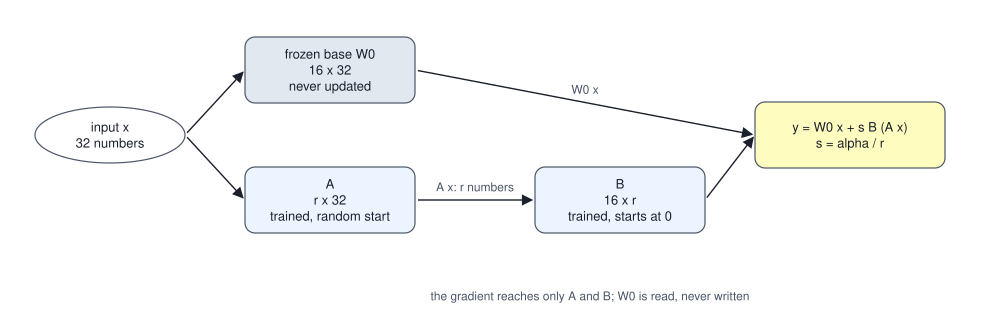
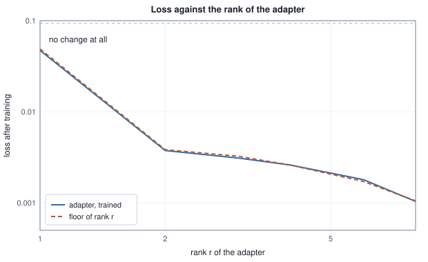
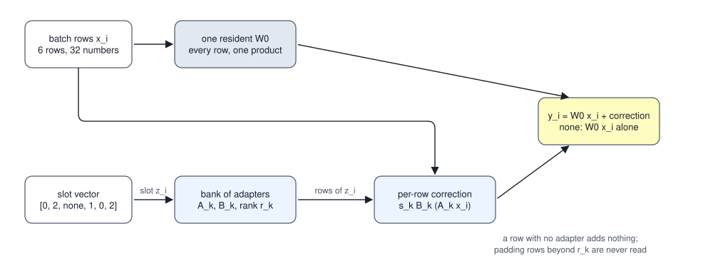

<!-- SPDX-License-Identifier: CC-BY-4.0 -->
<!-- Copyright (c) 2026 Martin Schröder <info@swedishembedded.com> -->

# Parameter-Efficient Fine-Tuning

*How can we adapt a billion-parameter model by training only a few million numbers?*

A weight matrix with 4,096 rows and 4,096 columns holds 16,777,216 numbers. Two thin matrices, one with 8 rows and 4,096 columns and one with 4,096 rows and 8 columns, hold 65,536 numbers between them, exactly 1/256 of that, and their product is a matrix of the full 4,096 by 4,096 shape that can be added to the weight. If a fine-tune can be written as such a sum, then every number that training needs next to the weight (a gradient, two Adam moments) is needed for 65,536 numbers and not for 16,777,216, and what the run leaves behind to be stored and shipped is the thin pair and not a second copy of the model.

Whether a fine-tune can be written that way is a question about the change it makes, and it has an answer that can be computed on a small case. The rest follows from the answer: how the two thin matrices are trained, what that does to the memory bill of Chapter 3, how far the frozen weight beside them can be squeezed, what happens when the sum is actually formed, and how one resident copy of a model can serve many such pairs in one batch.

The argument leans on four results from earlier volumes, each posed here as a question.

1. (Volume I, Chapter 6, low-rank approximation.) A matrix of $m$ rows and $n$ columns is replaced by the best matrix of rank $r$. How many numbers does the replacement need, and what is the error of the best one in terms of the singular values?
2. (Volume XII, Chapter 4, supervised fine-tuning.) Which positions of a conversation enter the loss of a fine-tune on demonstrations, and which do not?
3. (Volume IV, Chapter 12, weight-only quantization.) What is stored, what is decoded and when, and how many bytes does a weight cost if a group of 32 shares one fp32 scale and each code has 4 bits?
4. (Volume XIII, Chapter 3, where training memory goes.) How many bytes does a weight in fp32 cost in training under Adam, and which part of the memory of a step does not depend on the number of weights at all?

## A change that two thin matrices can hold

A concrete case makes the question exact. Take one linear layer of 16 rows and 32 columns, the weight $\mathbf{W}_0$, and a target $\mathbf{W}^\star = \mathbf{W}_0 + \Delta\mathbf{W}^\star$ that the fine-tune must reach. The loss of a weight $\mathbf{W}$ is the mean over a fixed set of 128 inputs $\mathbf{x}_n$ of half the squared length of $(\mathbf{W} - \mathbf{W}^\star)\mathbf{x}_n$. The case is built so that the answer is known: the needed change is two directions (two rank-one matrices of different strength) plus a small unstructured part.

<!-- worked: peft.task_spectrum -->
The layer has 16 rows and 32 columns (512 weights). One generator seeded 12482792456709129677 (seed_of 'peft.task') draws, in this order and each by normal(): W0 (16 x 32, row-major, every draw times 0.5), U (16 x 2, row-major), V (32 x 2, row-major), G (16 x 32, row-major) and 128 inputs x_n of 32 numbers (row-major). The change the fine-tune needs is dW* = 0.02 u1 v1^T + 0.01 u2 v2^T + 0.004 G (u1, u2 the columns of U, v1, v2 the columns of V), the target is W* = W0 + dW*, and the loss of a weight W is the mean over the inputs of half the squared length of (W - W*) x_n, written L(W) = (1 / (2 128)) sum_n |(W - W*) x_n|^2; its gradient with respect to the whole weight is (W - W*) M with M = (1 / 128) sum_n x_n x_n^T. Singular values come from one-sided Jacobi rotations in float64. The loss of the base itself is L(W0) = 0.09352. Row r gives the r-th singular value of dW*, the share of its squared Frobenius norm held by the first r singular values, the count r (16 + 32) of numbers in two factors of rank r, and the loss of the weight W0 + (best rank-r approximation of dW* in the Frobenius norm), called the floor of rank r below. The loss weights the directions of the inputs by their spread, which the Frobenius norm does not, so a trained rank-r change can end slightly under its floor.

| r | singular value r | share of squared norm kept (percent) | numbers in the two factors | loss with the best rank-r change |
|---:|---:|---:|---:|---:|
| 1 | 0.3261 | 52.386 | 48 | 0.04895 |
| 2 | 0.299 | 96.428 | 96 | 0.00384 |
| 3 | 0.03448 | 97.013 | 144 | 0.003248 |
| 4 | 0.03216 | 97.523 | 192 | 0.0026 |
| 8 | 0.02445 | 98.917 | 384 | 0.001052 |
<!-- /worked -->

The first two singular values of $\Delta\mathbf{W}^\star$ are 0.3261 and 0.299, and the third is 0.03448: a matrix of 512 entries whose change is carried by two directions. The first two hold 96.428 percent of its squared Frobenius norm and cost 96 numbers in two factors, against 512 for the whole matrix. The last column makes the same statement in the currency that training pays in. The loss of the unchanged weight is 0.09352; the best rank-1 change brings it to 0.04895, 52 percent of where it started, and the best rank-2 change to 0.00384, 4.1 percent. From rank 3 on, each additional direction removes a little of what is left. By the theorem of Volume I, Chapter 6 these are the best any matrix of that rank can do under the Frobenius norm. They are not the best under this loss, which weights the directions of the inputs by their spread, so a trained adapter can end slightly below the table's last column, and does at ranks 1, 2 and 8 in the sweep below.

The case is rigged to have a small answer. That real fine-tunes have one too is an observation, not a theorem: the measurements that made it a method (Hu et al., 2021, in the references) found that the change a fine-tune makes to the weights of a large language model is well described by a small rank, and everything below holds whatever the rank turns out to be, because it only uses the form of the answer.

## Training the two factors and nothing else

The form is a sum. The base weight $\mathbf{W}_0$ of shape $[m, n]$ stays as it is, and the weight the layer uses is

$$
\mathbf{W} = \mathbf{W}_0 + s\,\mathbf{B}\mathbf{A}, \qquad \mathbf{A}: [r, n], \quad \mathbf{B}: [m, r], \quad s = \alpha / r,
$$

where the rank $r$ is far smaller than $m$ and $n$ and $\alpha$ is a constant chosen by the user. For inputs as rows, $\mathbf{Y} = \mathbf{X}\mathbf{W}^\top = \mathbf{X}\mathbf{W}_0^\top + s\,(\mathbf{X}\mathbf{A}^\top)\mathbf{B}^\top$: the correction is computed from a detour through $r$ numbers per row, and the pair $(\mathbf{A}, \mathbf{B})$ with its scale is a **low-rank adaptation** (LoRA), also called an adapter when the surrounding machinery is meant. Everything below builds on this one construction.



Two decisions of the construction come from what the gradient does. Let $d\mathbf{W}$ be the gradient of the loss with respect to the whole weight $\mathbf{W}$, the matrix that full fine-tuning would use (it is $d\mathbf{Y}^\top\mathbf{X}$ for the layer above). The chain rule of Volume III, Chapter 4 for $\mathbf{W} = \mathbf{W}_0 + s\mathbf{B}\mathbf{A}$ gives

$$
d\mathbf{B} = s\, d\mathbf{W}\, \mathbf{A}^\top, \qquad d\mathbf{A} = s\, \mathbf{B}^\top d\mathbf{W}.
$$

The first consequence concerns the start. If $\mathbf{B} = \mathbf{0}$ then $d\mathbf{A} = \mathbf{0}$, and if also $\mathbf{A} = \mathbf{0}$ then $d\mathbf{B} = \mathbf{0}$ too and nothing ever moves. So one factor starts at zero, which makes $\mathbf{W} = \mathbf{W}_0$ at step 0 (the adapted model begins as the base, exactly), and the other starts random, which makes the first gradient $d\mathbf{B}$ nonzero. After the first step $\mathbf{B}$ is nonzero and $\mathbf{A}$ begins to move. The second concerns the product. Written this way $d\mathbf{W}$ would be a full $m \times n$ matrix, as large as the weight; the point of the method is that it is never formed. The same gradients are $d\mathbf{B} = s\, d\mathbf{Y}^\top (\mathbf{X}\mathbf{A}^\top)$ and $d\mathbf{A} = s\,(d\mathbf{Y}\mathbf{B})^\top \mathbf{X}$, products of matrices with $r$ columns, and the gradient the layer sends down to its input is $d\mathbf{Y}\mathbf{W}_0 + s\,(d\mathbf{Y}\mathbf{B})\mathbf{A}$: the first term reads the frozen weight, which therefore stays in memory but never needs a gradient of its own. The worked cases below form $d\mathbf{W}$ because their loss is defined on the whole matrix; the layer of a network need not.

The scale $s = \alpha/r$ keeps the size of the correction from growing with the rank: with $\alpha$ fixed, a larger rank adds more terms to the product, and $s$ halves for each doubling of $r$. In the worked cases below $\alpha = r$, so $s = 1$. The training rule is the Adam of Volume III, Chapter 7 applied to $\mathbf{A}$ and $\mathbf{B}$ only.

```text
function lora_gradients(dW: array<real>[m, n], A: array<real>[r, n],
                        B: array<real>[m, r], s: real)
        -> (array<real>[r, n], array<real>[m, r]):
    dA = s * matmul(transpose(B), dW)
    dB = s * matmul(dW, transpose(A))
    return (dA, dB)

function train_lora(W0: array<real>[m, n], A: array<real>[r, n],
                    loss_gradient: function(array<real>[m, n]) -> array<real>[m, n],
                    s: real, steps: int, lr: real)
        -> (array<real>[r, n], array<real>[m, r]):
    require r >= 1 and steps >= 1
    B = zeros(real, [m, r])
    mA = zeros(real, [r, n]);  vA = zeros(real, [r, n])
    mB = zeros(real, [m, r]);  vB = zeros(real, [m, r])
    for t in 1 ..= steps:
        W = W0 + s * matmul(B, A)
        dW = loss_gradient(W)
        (dA, dB) = lora_gradients(dW, A, B, s)
        adam_update(A, dA, mA, vA, t, lr)
        adam_update(B, dB, mB, vB, t, lr)
    return (A, B)
```

Before the training is trusted, the gradients are checked the way Volume III, Chapter 6 taught.

<!-- worked: peft.lora_gradient_check -->
Rank r = 3 and scale s = 2/3 (alpha = 2). One generator seeded 3450161370625411420 (seed_of 'peft.lora_gradient_check') draws A (3 x 32, row-major, each normal() divided by sqrt(32)) and then B (16 x 3, row-major, each normal() times 0.1). The analytic gradients dA = s B^T dW and dB = s dW A^T, with dW = (W - W*) M for W = W0 + s B A, are compared with central differences of the loss with step 1e-06 at every one of the 144 entries; the deviation is |numeric - analytic| / max(1, |analytic|), and the criterion is that its largest value is below 1e-6.

| quantity | value |
|---|---:|
| largest deviation over all 144 entries | passes (below 1e-6) |
| |dA| and |dB| (Frobenius) at B = 0 with s = 2/3 (alpha = 2, r = 3), A the rank-3 start of the sweep | 0 and 0.115 |
<!-- /worked -->

The deviation passes its criterion at all 144 entries. The second row shows the start described above: with $\mathbf{B} = \mathbf{0}$ the gradient of $\mathbf{A}$ is exactly zero and that of $\mathbf{B}$ is not, and the first Adam step (about the rate times the sign of the gradient, as in Chapter 3) therefore moves only $\mathbf{B}$.

How much does a rank cost in loss? Four adapters of rank 1, 2, 4 and 8 and the full weight were each trained for 300 Adam steps on the task of the first table.

<!-- worked: peft.rank_sweep -->
The task of the first table, 300 Adam steps (beta1 0.9, beta2 0.999, epsilon 1e-8, bias-corrected, no weight decay, rate 0.01) on the trainable numbers only. LoRA starts from B = 0 and A = normal() / sqrt(32) in row-major order, from a generator seeded 10649204629576324875 (seed_of 'peft.rank_sweep') that every run starts afresh, so the rank-2 A begins with the rank-1 A; the scale is s = alpha / r with alpha = r, that is s = 1. The full run starts from W0 and updates all weights. The loss column is the loss after the last step, and a loss below 1e-9 is printed as such. A number that comes from a chaotic run is printed with only the digits that are the same in the run and in four copies of it whose first weight is changed by +1e-12, -1e-12, +3e-12 and -3e-12: in full if all agree on it, as 'about x' with the leading digits on which all agree, or as 'unstable' when not even one digit survives; the other digits cannot be reproduced in another implementation. In the nudged runs the first entry of A (of the weight, in the full run) starts at the stated tiny amount above its value. The last column repeats the floor of the first table.

| trained | trainable numbers | percent of the weights | loss after 300 steps | floor of the best change of that rank |
|---|---:|---:|---:|---:|
| LoRA, rank 1 | 48 | 9.38 | 0.04716 | 0.04895 |
| LoRA, rank 2 | 96 | 18.75 | 0.003753 | 0.00384 |
| LoRA, rank 4 | 192 | 37.50 | 0.002601 | 0.0026 |
| LoRA, rank 8 | 384 | 75.00 | 0.001037 | 0.001052 |
| every weight | 512 | 100.00 | below 1e-9 | - |
<!-- /worked -->

The adapters sit on the floors of the first table, rank 1 at 0.04716, rank 2 at 0.003753, rank 4 at 0.002601 and rank 8 at 0.001037. The trained values are a little under the Frobenius floors at ranks 1, 2 and 8 and a hair above it at rank 4 (0.002601 against 0.0026, 0.04 percent more), for the reason given above. The full run goes to zero, which an adapter cannot: its rank-8 pair is 75 percent as large as the weight and is still short of it. What the table is for is the second row. Rank 2, 96 numbers, reaches 0.003753 where the weight's 512 numbers reach 0 (below 1e-9), and what is lost between them is the small unstructured part of the change, which no rank below 16 can hold. Whether that part matters is a question about the task and not about the method.



## What a frozen base takes out of the memory bill

Chapter 3 ended with the weights and their gradients as the two lines of the bill that none of its levers touched, and an adapter touches both. The base is frozen, so it has no gradient and no moments, and the only trainable numbers are those of the factors.

Take the stack of Chapter 3, 32 blocks of two matrices of shapes $[16384, 4096]$ and $[4096, 16384]$, with an adapter of rank 16 on each matrix. An adapter on a matrix of $m$ rows and $n$ columns has $r(m + n)$ numbers, here $16 \times 20{,}480 = 327{,}680$, so the stack has 20,971,520 of them, 0.488 percent of its weights. At 16 bytes a number (value, gradient and two moments in fp32) the adapters' state is 0.3125 GiB, where full fine-tuning's gradients and moments were 48 GiB.

What stays is the activation memory. The backward pass still goes through every layer of the base to reach the layers below, and the adapter needs the input of its layer and the tanh output of Chapter 3 to form its own gradients, so the kept tensors are the same 20,480 numbers per token and block as before, plus the $r$ numbers per token that each adapter's first product leaves for the backward pass. Each row below counts exactly these, in GiB ($2^{30}$ bytes), for the base stored in four ways.

<!-- worked: peft.memory_bill -->
The stack of Chapter 3: 32 blocks of two matrices each, [16384, 4096] and [4096, 16384], so 4,294,967,296 weights, and a step of 8,192 tokens. An adapter of rank 16 on both matrices of every block has 16 x (4096 + 16384) = 327,680 numbers per matrix and 20,971,520 in all (0.488 percent of the weights). The adapter's state is 16 bytes a number (value, gradient and two Adam moments, all fp32); the base is frozen, so it has no gradient and no moments. The activation columns add the 20,480 numbers per token and block that Chapter 3 keeps (fp32) and the 16 numbers per token that each of the two adapters' first products leave for the backward pass (two per block). Sizes are in GiB (2^30 bytes); the second column is bytes per frozen weight.

| frozen base stored as | bytes per weight | base | adapter state | activations | total |
|---|---:|---:|---:|---:|---:|
| fp32 | 4.000 | 16.00 | 0.31 | 20.03 | 36.34 |
| bf16 | 2.000 | 8.00 | 0.31 | 20.03 | 28.34 |
| 8-bit codes, one fp32 scale per 32 | 1.125 | 4.50 | 0.31 | 20.03 | 24.84 |
| 4-bit codes, one fp32 scale per 32 | 0.625 | 2.50 | 0.31 | 20.03 | 22.84 |

Training every weight in fp32 costs 84.00 GiB on the same stack (weights, gradients and moments at 16 bytes a weight plus the same 20.00 GiB of kept tensors).
<!-- /worked -->

An adapter on an fp32 base brings the step from 84.00 GiB to 36.34 GiB, and the remaining 20.03 GiB of it are activations, which the levers of Chapter 3 (recomputing, narrow boundaries) still act on, and which are as large as ever. The weights are now the largest line left, and the frozen base can be stored in any format that the forward and the backward pass can read, since no update ever lands on it. That is what the next section uses, and the rows of the table with 8-bit and 4-bit codes (24.84 and 22.84 GiB) show where it leads.

## Storing the frozen base in four bits

A weight that is never updated does not need the headroom that updates need. Chapter 2 spent a master copy and stochastic rounding on keeping many small updates from vanishing in a narrow format; a frozen base has no updates to lose. So the base can be stored as in Volume IV, Chapter 12: low-bit codes with one scale per group, the codes decoded in the matrix product, the activations and the adapter in a wider format. Training the adapter over such a base is **quantized-base fine-tuning**, and the gradient rule of the previous section is unchanged. The forward pass reads $\mathbf{W}_0$ through its decoded value $\hat{\mathbf{W}}_0$, and the input gradient reads $d\mathbf{Y}\hat{\mathbf{W}}_0$; the adapter's own gradients, $s\,d\mathbf{Y}^\top(\mathbf{X}\mathbf{A}^\top)$ and $s\,(d\mathbf{Y}\mathbf{B})^\top\mathbf{X}$, involve only the activations and the incoming gradient, so they do not read the base at all.

Four bits give 16 codes per weight, and two ways of placing them are in use. The first spaces them evenly: with a group scale of $\max|g|/7$ the codes are the integers $-7 \dots 7$ (15 values, one code unused), rounded half away from zero. The second places them where the weights are. Trained weights are bell-shaped, many near zero and few at the extremes, and an even spacing spends as many codes on the empty tails as on the crowded middle. **NF4** (4-bit NormalFloat) is a codebook of 16 values placed at the quantiles of a normal distribution, scaled so that the group's largest magnitude is at $\pm 1$: each weight is divided by the group's largest magnitude and replaced by the nearest of the 16 values, a tie going to the lower code. Its values, and what each costs, come from measuring them on a drawn Gaussian matrix.

<!-- worked: peft.nf4_error -->
A matrix of 64 rows and 256 columns, every entry 0.02 times normal(), drawn row-major from one generator seeded 3138550542665774405 (seed_of 'peft.nf4_error'). Each row is cut into groups of 32 consecutive entries with one scale each; the scale is the group's largest magnitude divided by 127, 7 or 1 (1 is the largest magnitude of the codebook), the integer formats round half away from zero and clamp, and the codebook format takes the nearest of the 16 values below, a tie going to the lower code. The codebook is -1, -0.696193, -0.525073, -0.394917, -0.284441, -0.184773, -0.09105, 0, 0.0795803, 0.16093, 0.246112, 0.337915, 0.44071, 0.562617, 0.722957, 1, and the gaps between neighbouring values are 0.3038, 0.1711, 0.1302, 0.1105, 0.0997, 0.0937, 0.0911, 0.0796, 0.0813, 0.0852, 0.0918, 0.1028, 0.1219, 0.1603, 0.2770. Bits per weight include one fp32 scale (32 bits) per group. The relative error is the Frobenius norm of (decoded - original) over that of the original, and the worst error is the largest absolute difference of one entry.

| format | bits per weight | relative error | worst error of one entry |
|---|---:|---:|---:|
| 8-bit, steps of max / 127 | 9.00 | 0.0053 | 0.00030 |
| 4-bit, steps of max / 7 | 5.00 | 0.0965 | 0.00537 |
| 4-bit, the 16 values of the codebook | 5.00 | 0.0869 | 0.00845 |
<!-- /worked -->

Group scales cost memory too. With one fp32 scale (32 bits) per group of 32 weights the codes' 4 bits become 5 bits per weight, 0.625 bytes: the 4-bit row of the memory table above. The codebook format's relative error, 0.0869, is below the even 4-bit format's 0.0965, which is what its placement of the values is for, and its worst error on a single entry is larger, 0.00845 against 0.00537, because its widest gap (0.3038 of the scale, between the first two values) is wider than the even format's step (one seventh of the scale, 0.1429). Eight bits are about 16 times as accurate as the codebook format and 18 times as accurate as the even one (0.0053 against 0.0869 and 0.0965), at 9 bits a weight and not 5.

What does the adapter do about the error that remains? The task of the first table is trained twice over each decoded base, once toward the target the deployed base is asked to reach and once toward the original target, which counts what quantization removed as well as what the fine-tune adds.

<!-- worked: peft.lora_over_quantized_base -->
The task of the first table with the frozen base replaced by its decoded copy Q (groups of 32, which is one group a row here). A rank-2 adapter (alpha = 2, so s = 1) is trained for 300 Adam steps exactly as in the rank sweep, twice. In the first run the target is Q + dW*, the same change asked of the deployed base; in the second the target is the original W* = W0 + dW*, so that the loss counts what the quantization took away as well as what the fine-tune must add. Each pair of columns gives the loss before training and after it. A loss below 1e-9 is printed as such. A number that comes from a chaotic run is printed with only the digits that are the same in the run and in four copies of it whose first weight is changed by +1e-12, -1e-12, +3e-12 and -3e-12: in full if all agree on it, as 'about x' with the leading digits on which all agree, or as 'unstable' when not even one digit survives; the other digits cannot be reproduced in another implementation.

| base | bits per weight | before, target Q + dW* | after, target Q + dW* | before, target W* | after, target W* |
|---|---:|---:|---:|---:|---:|
| fp32 | 32.00 | 0.09352 | 0.003753 | 0.09352 | 0.003753 |
| 8-bit, steps of max / 127 | 9.00 | 0.09352 | 0.003753 | 0.09496 | 0.00564 |
| 4-bit, steps of max / 7 | 5.00 | 0.09352 | 0.003753 | 0.7605 | 0.5248 |
| 4-bit, the 16 values of the codebook | 5.00 | 0.09352 | 0.003753 | 0.6197 | 0.4112 |
<!-- /worked -->

The first pair of columns is the same on every row: 0.09352 before and 0.003753 after. When the task is defined relative to the base that is deployed, the update does not care how that base was stored, since the loss depends on the weight only through the difference from the target and the gradient formulas contain the base only in the forward value. That is the property that lets one adapter implementation serve a base stored in any format. The second pair is what quantization costs. An 8-bit base leaves the loss at 0.09496 before training and 0.00564 after, close to the exact base's 0.003753. A 4-bit base leaves it at 0.7605 (even spacing) and 0.6197 (codebook) before, and a rank-2 adapter lowers these to 0.5248 and 0.4112 but cannot remove them, because quantization noise is spread over all 512 entries and a rank-2 change holds 96 numbers. These losses are squared errors of one matrix against another; they say how much of the weight an adapter can repair, and nothing about what a language model's task loss does with a 4-bit base, which has to be measured on the model and its task.

## Adding the change to the weight, and when that loses it

An adapter exists to be used, and there are two ways to use it. One is to form the sum. After training, $\mathbf{W} = \mathbf{W}_0 + s\mathbf{B}\mathbf{A}$ is a single matrix of the shape of the base, and the layer runs with no extra work at all: this is **adapter merging**, also called folding. The other is to leave the base alone and compute $\mathbf{y} = \mathbf{W}_0\mathbf{x} + s\mathbf{B}(\mathbf{A}\mathbf{x})$ at run time.

Merging has an algebra that matters when there is more than one adapter. Adapters over one linear add: $s_1\mathbf{B}_1\mathbf{A}_1 + s_2\mathbf{B}_2\mathbf{A}_2$, the strengths $s_i$ being the dial that scales each. The sum is also one product of rank $r_1 + r_2$, with the factors side by side,

$$
s_1\mathbf{B}_1\mathbf{A}_1 + s_2\mathbf{B}_2\mathbf{A}_2 = \begin{bmatrix} s_1\mathbf{B}_1 & s_2\mathbf{B}_2 \end{bmatrix} \begin{bmatrix} \mathbf{A}_1 \\ \mathbf{A}_2 \end{bmatrix},
$$

so a stack of adapters applied beside the base costs one detour through $r_1 + r_2$ numbers, not two passes. Two adapters of ranks 2 and 3 on the 16 by 32 layer show it, together with the limit of the merge.

<!-- worked: peft.merge_adapters -->
Two adapters on the 16 x 32 layer: A1 (2 x 32), B1 (16 x 2), A2 (3 x 32) and B2 (16 x 3), every entry 0.2 times normal(), drawn in the order A1, B1, A2, B2 (each row-major) from one generator seeded 28307739434983699 (seed_of 'peft.merge_adapters'). The strengths are s1 = 1 and s2 = 0.5 (the scale alpha / r of each adapter folded into its strength). The sum form is s1 B1 A1 + s2 B2 A2; the concatenated form is [s1 B1 | s2 B2] times A1 stacked over A2, a single product of rank 5. Singular values come from one-sided Jacobi rotations in float64.

| quantity | value |
|---|---:|
| largest entry of |sum form - concatenated form| | below 1e-15 |
| largest entry of |adapter 1 first - adapter 2 first| | below 1e-15 |
| rank of the merged change (singular values above 1e-12) | 5 |
| error of the best rank-1 copy of the merged change, over its norm | 0.5883 |
| error of the best rank-2 copy of the merged change, over its norm | 0.4349 |
| error of the best rank-3 copy of the merged change, over its norm | 0.2902 |
| error of the best rank-4 copy of the merged change, over its norm | 0.1908 |
<!-- /worked -->

The sum and the concatenated form agree to float64 rounding and do not depend on which adapter is added first (the order matters only for the last bits in a narrow format, which is why a fold that must be reproducible fixes it). The merged change has rank 5, not 3: it cannot be stored in the rank of either adapter without loss, and the cost of forcing it into rank 4 is 0.1908 of its norm. Merging is exact, and re-factoring the merge into a smaller adapter is not.

Merging is exact in a dense base, and it can silently fail in a quantized one. The sum $\mathbf{W}_0 + s\mathbf{B}\mathbf{A}$ must be stored in whatever format the base has, and a quantized format rounds. The delta of a trained adapter is small: in an 8-bit group the step is the group's largest magnitude over 127, and a delta much below one step does not survive rounding. (In a dense fp32 base the sum is rounded to the fp32 grid, far finer than any delta that matters; in a narrow float such as bf16 the argument of Chapter 2 applies, and an update below half a gap is lost in the same way.) The worked layer has an 8-bit base, groups of 32, one group per row, and the rank-2 adapter trained on it. The adapter is multiplied by a strength so that its entries are a stated fraction of one step.

<!-- worked: peft.fold_into_quantized -->
The int8 base Q of the task (W0 quantized in groups of 32, one group per row, scale = largest magnitude / 127, so Q is the decoded matrix) and the rank-2 adapter trained on it with the rank-sweep recipe (s = 1, the task's original target W*, not Q + the change), multiplied by a strength. 'Delta in steps' is the root mean square of one entry of strength x B A divided by the mean step of the base, the mean over the 16 rows of their scale. The fold re-encodes Q + strength x B A (the W of the next sentence is Q) with the same rule and subtracts the decoded base; 'same code' is the percent of the 512 weights whose integer code is the old one, and the next column the Frobenius norm of (what survived - what was intended) over the norm of what was intended. The runtime route computes y = W x + strength B (A x) with W the decoded base; its last column is the largest difference from (W + strength B A) x over the first 16 inputs, in float64. The strengths multiply the adapter, which makes the 'delta in steps' column the dial.

| strength | delta in steps | weights with the same code (percent) | relative error of the fold | largest output difference of the runtime route |
|---|---:|---:|---:|---:|
| 0.05 | 0.095 | 99.4 | 1.034 | below 1e-12 |
| 0.1 | 0.190 | 95.3 | 0.841 | below 1e-12 |
| 0.25 | 0.475 | 78.1 | 0.514 | below 1e-12 |
| 0.5 | 0.949 | 55.9 | 0.286 | below 1e-12 |
| 1 | 1.899 | 34.8 | 0.150 | below 1e-12 |
<!-- /worked -->

At a strength of 0.05, where an entry of the delta is 0.095 of a step, 99.4 percent of the weights keep their integer code and the delta that survives is as wrong as the one that was intended is large (a relative error of 1.034): a few weights crossed a rounding boundary and moved by a whole step, about ten times the delta, and the group's scale, which is set by its largest weight, moves with that weight. At 0.25 the delta is 0.475 of a step and 78.1 percent of the codes are unchanged. Only when the delta is about two steps does the fold deliver most of it (strength 1, a relative error of 0.150). The runtime route never looks at the grid: it computes the correction in a wider format beside the codes, and its output differs from that of the exact sum by less than 1e-12 at every strength.

This is the second decision a model must make about an adapter, and it is made once, from the one fact that decides it: whether the base is stored as the floats it already is, or is quantized on the way to the device. Dense, the adapter is folded into the weights; quantized, the weights stay exactly as the checkpoint has them and the correction runs beside them. An adapter of a kind with no low-rank form (a Kronecker-product adapter, whose delta is full rank) has no runtime form either, and brain refuses it against a quantized base by name instead of rounding it onto the grid.

## One resident base, a bank of adapters

A server that holds one model and many fine-tunes has two choices. It can merge each adapter into its own copy of the weights, so that every fine-tune is a full model in memory. Or it can hold one copy and let each request carry the name of its adapter. **Adapter serving** is the second: a **bank** keeps many adapters resident beside one base, a **slot** vector names the adapter that corrects each row of a batch, and a row that names none is served by the base alone.



The arithmetic of a row is the runtime form of the previous section, with the adapter gathered by the row's slot: $\mathbf{y}_i = \mathbf{W}_0\mathbf{x}_i + s_k\mathbf{B}_k(\mathbf{A}_k\mathbf{x}_i)$ for $k$ the slot of row $i$. Adapters of different ranks share the bank by padding to the largest rank, $r_{\max}$, and the padding is never read; the factor $s_k = \alpha/r_k$ is folded into the stored $\mathbf{B}_k$, transposed so that a row of the stored matrix is one rank direction.

```text
function bank_forward(W0: array<real>[m, n],
                      A_bank: list<array<real>[r_max, n]>,
                      Bt_bank: list<array<real>[r_max, m]>,
                      ranks: list<int>, slots: list<int>,
                      X: array<real>[R, n]) -> array<real>[R, m]:
    require len(A_bank) == len(ranks) and len(slots) == R
    Y = matmul(X, transpose(W0))
    for i in 0 .. R:
        z = slots[i]
        if z < len(ranks):                    # a slot outside the bank: no adapter
            r = ranks[z]
            t = matmul(A_bank[z][0:r, :], X[i])
            Y[i] = Y[i] + matmul(t, Bt_bank[z][0:r, :])
    return Y
```

The example has a bank of three adapters of ranks 2, 4 and 1 padded to $r_{\max} = 4$, scales $\alpha/r_k$ with $\alpha = 4$, and a batch of six rows with slots 0, 2, none, 1, 0, 2.

<!-- worked: peft.bank_semantics -->
The 16 x 32 layer W0 of the task (the first 512 draws of the generator seeded seed_of 'peft.task', each normal() times 0.5, row-major) and a bank of three adapters whose ranks are 2, 4 and 1, padded to r_max = 4 rows. One generator seeded 5884249008025941678 (seed_of 'peft.bank') draws, for slot 0, 1, 2 in turn, A_k (r_k x 32, row-major) and then B_k (16 x r_k, row-major), every entry 0.2 times normal(), and after the three slots draws the six input rows (32 numbers each, row-major, each normal() with no factor). The bank stores A_k padded to r_max rows and the transposed (alpha / r_k) B_k, alpha = 4, padded the same way; in the 'poisoned' copy every padding row holds 1e6 instead of zero. A batch of six rows carries the slot vector [0, 2] + [none] + [1, 0, 2]; row i computes t = A_k x_i over the first r_k rows of its slot and adds t B_k^T (scaled) to W0 x_i, and a row whose slot is outside the bank adds nothing. The 'difference' column is the largest entry of |bank row - (merged weight) x_i| in float64, where the merged weight is W0 + (alpha / r_k) B_k A_k (W0 for a row with no adapter); the last column asks whether the poisoned padding changes any bit of the row.

| row | slot | rank used | difference from the merged weight | same bits with poisoned padding |
|---:|---:|---:|---:|---:|
| 0 | 0 | 2 | below 1e-12 | yes |
| 1 | 2 | 1 | below 1e-12 | yes |
| 2 | none (4294967295) | - | below 1e-12 | yes |
| 3 | 1 | 4 | below 1e-12 | yes |
| 4 | 0 | 2 | below 1e-12 | yes |
| 5 | 2 | 1 | below 1e-12 | yes |
<!-- /worked -->

Each row matches the product with its own merged weight, and the row with no adapter matches the base alone. Poisoning the padding (rows of 1e6 where zeros are expected) changes no bit of any output, which is the property that lets a lower-rank adapter be loaded into a slot by overwriting only its own rows.

One more thing depends on which adapter a row used. A language model keeps, for the tokens it has already read, the keys and values that its attention layers computed, so that a new request that begins with the same prompt can reuse them (a prefix cache). Those keys and values are products of the weights. A token's key is $\mathbf{W}_k\mathbf{x}$ with whichever $\mathbf{W}_k$ the row's adapter makes, and the cache entry of one adapter is wrong under another.

<!-- worked: peft.kv_difference -->
The key a token gets from a layer, y = W x, with the first input row of the bank example (as drawn there, entries normal()) as x and the 16 x 32 layer W0 of the task (as in the bank example) as the key projection of one position, once without an adapter and once with each adapter of the bank merged in. The table gives |key with the adapter - key of the base| over |key of the base| (Euclidean norms).

| adapter | relative change of the cached key |
|---|---:|
| adapter 0 | 0.4867 |
| adapter 1 | 0.0263 |
| adapter 2 | 0.1300 |
<!-- /worked -->

The key of the same token changes by 0.4867 of its length under adapter 0, 0.0263 under adapter 1 and 0.1300 under adapter 2. A cache keyed by token ids alone would hand one user's cached keys to another. The cache must therefore carry the identity of the adapter in its key (a **namespace**, with the base model as namespace 0), and an adapter that is unloaded must never leave a number that a later adapter can reuse.

The reason to bank rather than merge is the memory that the second choice multiplies. Counting the stack of Chapter 3 with adapters of rank 16 in fp32:

<!-- worked: peft.serving_cost -->
The stack of Chapter 3 (4,294,967,296 weights) with adapters of rank 16 on both matrices of every block (20,971,520 numbers each, kept in fp32). A merged copy of the stack costs all the weights in fp32; the bank keeps one fp32 base and the adapters. Per token, one multiply-add counts as 2 floating-point operations (FLOPs): the base matrices cost 8,589,934,592 FLOPs, and the adapter of the row's slot adds 41,943,040 FLOPs (0.488 percent of the base), whatever the number of adapters in the bank. Sizes are in GiB.

| adapters served | merged copies, one per adapter | one base and a bank |
|---:|---:|---:|
| 1 | 16.00 | 16.08 |
| 10 | 160.00 | 16.78 |
| 100 | 1,600.00 | 23.81 |
| 1,000 | 16,000.00 | 94.12 |
<!-- /worked -->

A hundred merged copies need 1,600 GiB, and a base with a bank of a hundred adapters 23.81 GiB. The price is arithmetic: the adapter of a row adds 41,943,040 FLOPs per token to the 8,589,934,592 of the base matrices, 0.488 percent, and that does not grow with the number of adapters in the bank, since a row reads only its own.

## How brain keeps the adapter beside the base

The host-side adapter is `crates/model/src/lora.rs`. `Pair` holds `A` as `[r x in]` and `B` as `[out x r]`, builds `A` from a caller-supplied draw and `B` as zeros, so that a fresh adapter is a no-op, adds `scale * B * A` to a weight (`delta`), and turns a gradient of the whole weight into the two factors' gradients (`project`): `dA = scale * B^T dW` and `dB = scale * dW A^T`, the formulas above. Its Adam step is the shared `crate::Adam::default()` (beta 1 of 0.9, beta 2 of 0.999, epsilon 1e-8, defined in `crates/optim/src/lib.rs`) with no weight decay. `LoraCfg::new(rank, seed)` sets `alpha = rank` (so the scale is 1) and seeds the draw of `A` with the run's seed. The scale itself is computed in one place, `TargetHp::scale` in `crates/model/src/adapter/mod.rs`, which is `alpha / rank`, or `alpha / sqrt(rank)` when the rank-stabilised variant is on; the same struct carries the other variants, a larger rate for `B` than for `A` and an `A` that stays at its start, and `crates/model/tests/it/adapter_rslora.rs` and `crates/model/tests/it/adapter_lora_fa.rs` test two of them.

The device-side runtime is `crates/model/src/adapter/exec.rs`. Its forward is two products, `mid = x A^T` and `y += scale * mid B^T`, and its backward the gradients of the previous sections without a full-size `dW`: `gB += d_out^T mid`, `dmid = scale * d_out B`, `gA += dmid^T x` and `dx += dmid A`. The point of the section on quantized bases is visible in the signatures of `lora_forward` and `lora_backward` in that file: they take the fp32 activation `x`, the incoming gradient `d_out`, the adapter's own `A` and `B` and the name of the linear (to look up its rank and scale), and no base weight, so the runtime is independent of how the base is stored and layers in different formats need nothing special. The base's side of the same contract is the `Weight` enum of `crates/model/src/ops.rs`, which has an `NF4` tier: `[n, k/8]` words of packed 4-bit codes and a `[n, k/32]` fp32 scale, the layout described above, decoded as `NF4_LUT[code] * scale`. The codebook has a single source, `kernels::template::NF4_CODEBOOK`, and `model::lut4` (the host quantizer, with the nearest-value search and the lower code on a tie) and the device decode are generated from it. Its test `nf4_beats_q4_on_a_gaussian_like_distribution` measures the claim of the previous sections on a synthetic draw.

Three episodes of the history shaped this code. Commit `4fa58dabb` (10 August 2026) hoisted the adapter pair, which two model crates had carried as near-verbatim copies, into `model::lora`, with each model keeping only what differs.

The second is the merge. Commit `7df14c15c` (12 September 2026) and commit `49493103c` (12 September 2026) are two reports of one failure. A model with an 8-bit base folded its adapter into the weights and quantized the result, and the adapter was largely rounded away on a run that reported it as loaded. The commits describe a measured share of weights that kept the base code; the tests that measure it are `crates/wan/tests/it/lora_int8_delivery.rs` and `crates/flux2/tests/it/lora_requant_int8.rs`, and the first of the three tests of the wan file asserts, at the smallest strength of its sweep, that most weights receive no delta and that the surviving delta's cosine to the intended one is below 0.9, and the third asserts that the correction beside the weights delivers the adapter's output change at a cosine above 0.9999 on every linear. The fix is not in either model. `AdapterSet::delivery(storage, strength)` in `crates/model/src/adapter/mod.rs` takes the base's storage, `Dense` or `Quantized`, and returns a fold for the first and a runtime correction (`RuntimeLora`, one `RuntimeDelta` per target with `B` already carrying the scale; `RuntimeDelta::absorb` joins the deltas of several adapters over one linear by concatenating on the rank axis) for the second; a kind without a low-rank form is refused for a quantized base with a message that names the kind and the site. Because both arms must be matched by the caller, a model cannot reach the fold by forgetting that its base is quantized, and `fold_into` takes the storage as an argument for the same reason. The lesson is that the decision belongs where the knowledge is: the fact that decides it was in neither file that used to make it.

The third is the bank. Commit `ffaed32af` (13 October 2026) added the per-row kernels (`lora_xa_rows`, with a barrier-free twin for devices without workgroup reductions, and `lora_delta_rows`), and commit `5f13db518` (16 October 2026) the generic bank over any model's adapter sites, `crates/model/src/adapter/bank.rs`. The bank stores, for each site, `slots` adapters padded to `r_max` with `A` as `[slots, r_max, k]`, the transposed scaled `B` as `[slots, r_max, n]` and the live rank per slot; a row whose slot is `LORA_SLOT_NONE`, or any slot beyond the bank, is left untouched (`crates/model/src/dispatch.rs`). The lifecycle is the behaviour of five methods of `AdapterBank`. `register` checks an adapter against the bank (a rank within `r_max`, every pair at a site the bank targets with that site's dimensions), keeps it in host memory with `B` transposed and multiplied by `alpha / rank`, and gives it a fresh KV namespace from `NamespaceIds::fresh`; registering a digest that is already registered returns the id it has. Nothing is on the device yet, so registering costs no device memory and a registry can hold more adapters than the bank has slots (`max_registered` against `slots`). `availability` is what the scheduler asks before it admits a request that names an adapter (`adapter_verdict` in `crates/model/src/serve.rs`). For a cold adapter it claims a slot with `claim_slot`: a free slot if there is one, otherwise the resident adapter with the oldest `last_used` stamp among those that have no pin and are not the one just offered; with every slot held the answer is `Loading` and the request waits. Each call then writes sites into the slot until it has written one upload quantum (`upload_quantum_bytes`, 4 MiB unless configured; the loop stops after the first site that reaches it, and always writes at least one), and answers `Loading` until the last site and then the ranks are in. The bound exists so that a cold load of a large adapter is spread over scheduling steps instead of holding the other rows of the batch for the whole copy, and the ranks go last because a slot is published as usable (`resident_slot`) only then. The answer `Resident` marks the adapter as offered, which protects it from eviction until `pin` or until the scheduler asks about another adapter. `pin` is called once per sequence and `unpin` when it ends: a running sequence names its slot at every step, so overwriting the slot would change its weights in the middle of a generation, and eviction is therefore least-recently-used among the adapters nothing pins, `touch` refreshing the stamp on every offer and pin. Eviction frees the slot and keeps the registration and the namespace, so the adapter's cached keys and values stay valid (the test `eviction_from_a_slot_keeps_the_adapters_cache_and_reload_is_exact` in `crates/qwen3/tests/it/engine_adapter_bank.rs` evicts an adapter from a one-slot bank, reloads it and finds both its cached blocks and its output bits unchanged). `unload` of an adapter that is pinned or offered only marks it draining, so that `availability` refuses new sequences, and the last `unpin` removes it and returns its namespace for the engine to purge from the prefix cache (the test `lifecycle_unload_is_deferred_while_running_and_cancel_releases_the_pin` in the same file). The tests of the kernels (`crates/model/tests/it/lora_bank_rows.rs`) hold a mixed batch to each row run alone, including the row with no adapter. Commit `53bd99ecd` (13 October 2026) is the namespace of the previous section: `BlockTable` carries a `KvNamespace`, `PrefixCache` keys every chain by `(namespace, parent block, token ids)`, `evict_namespace` drops an unloaded adapter's entries, and `NamespaceIds::fresh` hands out numbers strictly increasing and never repeated, which is the "never reuse" of the argument.

One history of the NF4 tier is worth knowing, since two statements of it were each true for a time. Commit `a9cdaf9e8` (16 October 2026) added `Weight::NF4` as a tier read against fp32 activations, one packed copy serving both the forward and the input gradient, and the knowledge entry for it (#220) records why the tier must not be silently promoted to another one: every test passed on the wrong path. Commit `892e263a1` (20 October 2026) then moved NF4 onto the shared tile route that every quantized tier uses, decoding a bounded tile of rows and multiplying the dense tile, and deleted the dedicated kernels; the entry notes this, and the property that mattered, one stored copy for forward and input gradient, did not change.

## Summary

A fine-tune changes the weights of a layer by a matrix that is often well described by a small rank. An adapter writes the change as $s\mathbf{B}\mathbf{A}$ and trains only the two thin factors, from $\mathbf{B} = \mathbf{0}$ and a random $\mathbf{A}$; on the worked layer rank 2, with 96 numbers for 512, reached 0.003753 of a loss that began at 0.09352. Its gradients are $s\, d\mathbf{W}\mathbf{A}^\top$ and $s\,\mathbf{B}^\top d\mathbf{W}$, formed without the full-size $d\mathbf{W}$. On the stack of Chapter 3 an adapter of rank 16 trains 0.488 percent of the weights and cuts the step from 84.00 to 36.34 GiB; the activations, 20.03 GiB, are untouched by it.

Because a frozen base receives no updates it can be stored in 8 or 4 bits and read through its decoded value; with groups of 32 and one fp32 scale a 4-bit weight costs 5 bits, the step falls to 22.84 GiB, and the adapter's gradients do not read the base at all. The base's error stays: a rank-2 adapter reduced a 4-bit base's loss from 0.7605 to 0.5248 and no further. An adapter is merged into a dense base by one sum, and merging several adapters is a sum of their products, of rank at most the sum of their ranks. Into a quantized base the sum is rounded onto the base's grid and a delta below a step is largely lost (99.4 percent of codes unchanged at 0.095 of a step), so the correction runs beside the codes instead. One resident base then serves many adapters at once through a bank and a slot vector, at 0.488 percent more arithmetic per token and a cache whose entries carry the adapter's namespace.

What remains is to spread the whole step over more than one device. The adapters shrank the trainable state and the quantized base shrank the weights, and a model still large enough has to be cut across devices; the next chapter does it by data, by tensor and by pipeline, and counts what the cut costs in bytes moved.

## References

- Hu, E. J., Shen, Y., Wallis, P., Allen-Zhu, Z., Li, Y., Wang, S., Wang, L. and Chen, W. LoRA: low-rank adaptation of large language models, 2021.
- Dettmers, T., Pagnoni, A., Holtzman, A. and Zettlemoyer, L. QLoRA: efficient finetuning of quantized language models, 2023.
- Kalajdzievski, D. A rank stabilization scaling factor for fine-tuning with LoRA, 2023.

## Exercises

1. **[Calculate]** A matrix has 4,096 rows and 11,008 columns. How many numbers has an adapter of rank 16 on it, what percent of the matrix is that, and at which rank does the adapter have as many numbers as the matrix?
2. **[Calculate]** For the stack of Chapter 3 with an adapter of rank 64 on both matrices of every block, give the number of trainable numbers, the percent of the weights, the adapter state in GiB at 16 bytes a number, the extra kept numbers per step (the $r$ per token that each adapter's first product leaves), and the total for a base with 4-bit codes and one fp32 scale per 32 weights.
3. **[Calculate]** A 4-bit code with one fp32 scale per group of 64 weights, and a 4-bit code with one fp16 scale per group of 32: how many bytes per weight does each cost, and how many decimal gigabytes does a base of $7 \times 10^9$ weights take?
4. **[Calculate]** At the start of training $\mathbf{B} = \mathbf{0}$. By how much does each entry of $\mathbf{B}$ move on the first Adam step with rate 0.01 when the gradient entry is far above $\epsilon$ in magnitude, and why does $\mathbf{A}$ not move at all?
5. **[Calculate]** A bank has three slots with live ranks 2, 4 and 1, padded to $r_{\max} = 4$, on a layer of 16 rows and 32 columns. How many numbers does the bank hold for this layer ($\mathbf{A}$ and the transposed $\mathbf{B}$ padded, and the three ranks), and what share of the padded rows is live?
6. **[Implement]** Reproduce `peft.lora_gradient_check`: the draws of $\mathbf{A}$ and $\mathbf{B}$ from the stated generator, the gradients $s\,\mathbf{B}^\top d\mathbf{W}$ and $s\,d\mathbf{W}\mathbf{A}^\top$ with $d\mathbf{W} = (\mathbf{W} - \mathbf{W}^\star)\mathbf{M}$, and the central-difference check against the criterion below 1e-6.
7. **[Implement]** Reproduce the rank-1 and rank-2 rows of `peft.rank_sweep`: the task from the stated generator and draw order, Adam as stated, and the stable-digits rule (four nudged copies).
8. **[Implement]** Reproduce `peft.nf4_error`: the three formats on the stated matrix, with the stated rounding and tie rules, and the relative error to four decimals.
9. **[Implement]** Reproduce `peft.fold_into_quantized` for the strengths 0.05 and 1: the 8-bit codes and scales of the base, the codes after re-encoding the sum, the share that is unchanged and the relative error of the survivor.
10. **[Implement]** Reproduce `peft.bank_semantics`: the bank of three adapters, the six rows, and the comparison with each row's merged weight, with the padding set to 1e6.
11. **[Investigate]** In `peft.rank_sweep` replace $\alpha = r$ by $\alpha = 8$ for every rank. Report the losses after 300 steps and say whether $s = \alpha/r$ changes what Adam reaches in this problem.
12. **[Investigate]** In `peft.fold_into_quantized` choose the strengths that put the delta at 2 and at 4 steps. Report the share of unchanged codes and the relative error of the fold, and state at which delta, in steps, you would call the fold acceptable for a use of your own.

## Check your understanding

1. A colleague says an adapter lets a 20 GiB activation budget shrink to a small one, since only small matrices are trained. Find the error and say which line of the bill an adapter does reduce.
2. Both factors of an adapter are initialised to zero. What are the first gradients, and what does the adapter learn? What if $\mathbf{B}$ is zero and $\mathbf{A}$ is random, and what if the opposite?
3. After folding an adapter at strength 0.1 into an 8-bit base, 95.3 percent of the codes are unchanged. A reviewer concludes that the fold loses only 4.7 percent of the adapter. Find the error using the relative-error column.
4. Two adapters of rank 2 and 3 are merged into one. A user asks for the result as a single adapter of rank 3 to save memory. What does that cost, and how would you measure it?
5. A prefix cache is keyed by token ids and shared by requests served with different adapters. Describe what goes wrong and what the namespace changes.
6. A bank holds 100 adapters of rank 16. A batch of 64 rows uses 40 different adapters. Does the arithmetic of the batch grow with the 40? Does the memory of the bank?
7. An adapter is trained on a base stored in 4 bits and served on the same base in fp32. State what can differ in the two outputs, and why the adapter's training gradient did not need the base's codes.

## Key terms

- **low-rank adaptation (LoRA)**: fine-tuning a layer by adding the scaled product of two thin trained matrices to its frozen weight, $\mathbf{W} = \mathbf{W}_0 + s\mathbf{B}\mathbf{A}$, with $\mathbf{B}$ starting at zero so that the adapted layer begins as the base. <!-- concept: lora -->
- **quantized-base fine-tuning**: training an adapter beside a frozen base stored as low-bit codes with group scales, reading the base through its decoded value, so that the weights cost a fraction of their fp32 size and no update ever has to land on a rounded weight. <!-- concept: quantized-base-finetuning -->
- **adapter merging**: forming the sum of a base weight and the scaled products of one or several adapters, exact in a dense base, and in a quantized base replaced by a correction computed beside the codes because the sum would be rounded onto the base's grid. <!-- concept: adapter-merging -->
- **adapter serving**: serving many adapters from one resident base, a bank of adapters padded to a common rank with a slot vector that names the adapter of each row of a batch, and a cache namespace so that stored keys and values are never shared between adapters. <!-- concept: adapter-serving -->

## Answers

**Recall.**

1. It needs $r(m + n)$ numbers, and its error under the Frobenius norm is the square root of the sum of the squares of the singular values it drops (the best rank-$r$ matrix keeps the largest $r$).
2. The positions of the assistant's turns and the closing marker are in the loss; the prompt and the other roles' tokens are masked out.
3. The weights are stored as 4-bit codes with one scale per group, the activations stay wide, and the codes are decoded inside the matrix product. A weight costs $4 + 32/32 = 5$ bits, 0.625 bytes.
4. 16 bytes: 4 for the value, 4 for the gradient and 8 for the two moments. The activations kept for the backward pass grow with the number of tokens and not with the number of weights.

**Check your understanding.**

1. The backward pass still goes through every layer of the base and the adapters need the layers' inputs, so the 20 GiB of kept tensors of the stack are unchanged (20.03 GiB with the adapters' own). What an adapter reduces is the gradients and the moments, from 48 GiB to 0.31 GiB, and with a quantized base the weights.
2. With both zero, $d\mathbf{A} = s\mathbf{B}^\top d\mathbf{W} = \mathbf{0}$ and $d\mathbf{B} = s\,d\mathbf{W}\mathbf{A}^\top = \mathbf{0}$, so nothing ever moves. With $\mathbf{B} = \mathbf{0}$ and $\mathbf{A}$ random only $\mathbf{B}$ moves first, and $\mathbf{A}$ follows once $\mathbf{B}$ is nonzero; the adapted layer starts as the base. With $\mathbf{A} = \mathbf{0}$ and $\mathbf{B}$ random, $d\mathbf{B} = \mathbf{0}$ and $d\mathbf{A}$ is nonzero: it also learns, but the adapted layer starts as $\mathbf{W}_0 + s\mathbf{B}\cdot\mathbf{0} = \mathbf{W}_0$ as well.
3. The share of codes that are unchanged says nothing about how much of the intended delta was delivered. The relative error at strength 0.1 is 0.841: the delta that survives is off by 84 percent of the delta's own size, since the few weights that crossed a boundary jumped a whole step while the rest of the delta was rounded to nothing, and the group scale also moves a little.
4. The merged change has rank 5 and a rank-3 copy leaves an error of 0.2902 of its norm (table of the merge). It is measured by truncating the singular value decomposition of the merged change and comparing it with the change in the Frobenius norm, or better by the loss on the task.
5. The keys and values of a token depend on the weights, which depend on the adapter, so a block cached under one adapter is wrong under another (the keys of the example token differ by 0.0263 to 0.4867 of their length). The namespace makes the adapter's identity part of the key, so a lookup only finds blocks computed under the same adapter, and an unloaded adapter's blocks can be dropped.
6. The arithmetic does not: each row pays its own adapter's $2r(m + n)$ per layer, the same whether the batch holds one adapter or forty. The memory does not either: all 100 adapters are resident (or loaded on demand into slots), and a batch that touches 40 reads only those.
7. The outputs can differ by the quantization error of the base, which the adapter did not learn to compensate for exactly (it trained against the decoded weights). The gradients $s\,d\mathbf{Y}^\top(\mathbf{X}\mathbf{A}^\top)$ and $s\,(d\mathbf{Y}\mathbf{B})^\top\mathbf{X}$ involve the activations and the incoming gradient, and the base reached them only through the activations it had produced.

**Exercises.**

1. $16 \times (4{,}096 + 11{,}008) = 241{,}664$ numbers, which is 0.536 percent of the 45,088,768 of the matrix. The adapter has as many numbers as the matrix at $r = mn/(m + n) = 2{,}985.2$, so from rank 2,986 up.
2. $64 \times 20{,}480 \times 2 \times 32 = 83{,}886{,}080$ numbers, 1.953 percent of the weights; the state is $83{,}886{,}080 \times 16$ bytes $= 1.25$ GiB; the extra kept numbers are $2 \times 64 \times 32 \times 8{,}192 = 33{,}554{,}432$ (0.125 GiB at 4 bytes). With the 2.5 GiB of base and the 20 GiB of kept tensors, the total is $2.5 + 1.25 + 20 + 0.125 = 23.875$ GiB.
3. Both cost $0.5 + 4/64 = 0.5 + 2/32 = 0.5625$ bytes per weight, and $7 \times 10^9 \times 0.5625$ bytes is 3.94 decimal gigabytes.
4. Each entry of $\mathbf{B}$ moves by about the rate, 0.01, in the direction opposite to the sign of its gradient (the first step is $\eta\,\mathrm{sign}(g)$ when $|g| \gg \epsilon$). $\mathbf{A}$ does not move because its gradient is exactly zero, so both moments stay at zero and the update is $0/(0 + \epsilon) = 0$.
5. $\mathbf{A}$ holds $3 \times 4 \times 32 = 384$ numbers and the transposed $\mathbf{B}$ $3 \times 4 \times 16 = 192$, plus 3 ranks: 579 numbers. The live rows are $2 + 4 + 1 = 7$ of 12, 58.3 percent.
6. The checks of the chapter: `peft.lora_gradient_check` prints a pass against 1e-6 over all 144 entries and gradients of $\mathbf{A}$ of exactly 0 and of $\mathbf{B}$ of 0.115 at the start.
7. Rank 1: 0.04716, rank 2: 0.003753, in the table of the rank sweep.
8. 0.0053 (8-bit), 0.0965 (even 4-bit) and 0.0869 (codebook), worst entry errors 0.00030, 0.00537 and 0.00845.
9. Strength 0.05: 99.4 percent of codes unchanged, relative error 1.034; strength 1: 34.8 percent and 0.150.
10. All six rows agree with their merged weights to below 1e-12 and are bit-identical with poisoned padding.
11. The losses are 0.04716, 0.003753, 0.002596 and 0.001037 for ranks 1, 2, 4 and 8, within 0.2 percent of the $\alpha = r$ run at rank 4 (0.002601) and the same at the other ranks to the digits shown. Under Adam the size of a step is set by the rate and not by the gradient, so $s$ changes how far $s\mathbf{B}\mathbf{A}$ moves per step, and with 300 steps at this rate both runs converge to the same floors.
12. At 2 steps (strength 1.0534 times the strength 1 adapter): 34.0 percent of the codes unchanged and a relative error of 0.141; at 4 steps (strength 2.1069): 20.9 percent and 0.0726. What counts as acceptable is a matter of the use: the relative error falls from 1.03 at 0.095 of a step to 0.073 at 4 steps, so the fold keeps most of a delta only once it is several steps.
