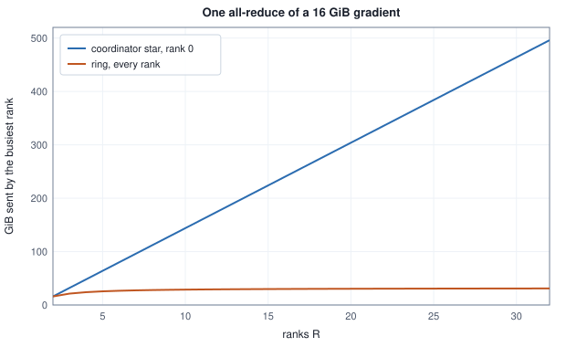
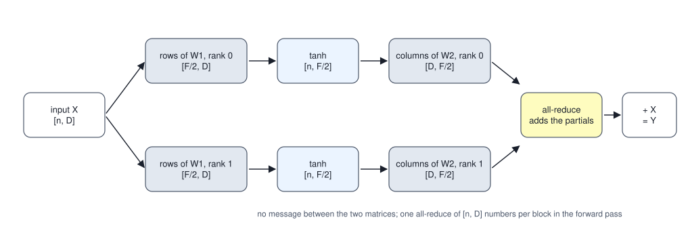
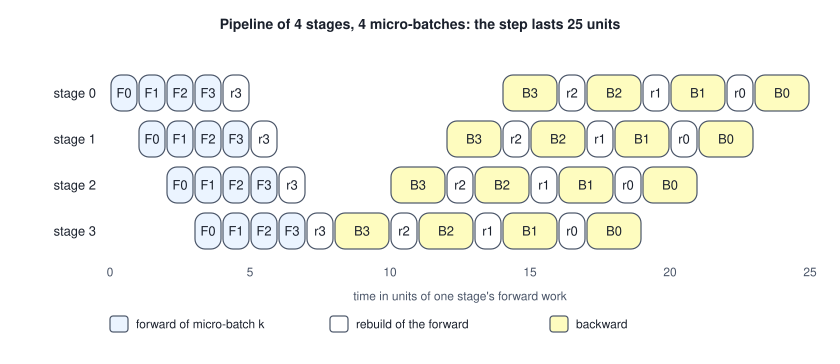

<!-- SPDX-License-Identifier: CC-BY-4.0 -->
<!-- Copyright (c) 2026 Martin Schröder <info@swedishembedded.com> -->

# Parallel and Distributed Training

*How is one training run spread across many devices without changing its result?*

A device has a fixed amount of memory and a fixed rate of arithmetic, and one step of the stack of the last two chapters asks for more of both than a single device offers. The weights, gradients and Adam moments of its 4,294,967,296 weights take 64 GiB (Chapter 3), and the step itself is 211,106,232,532,992 floating-point operations (FLOPs): 12 n D F for each of 32 blocks, which is 6 times 8,192 tokens times 4,294,967,296 weights. Sixteen devices would divide both, if the work could be divided without changing what a step computes.

Three things in a step can be divided. The examples of the batch are independent of each other until the loss adds them. The numbers inside one layer's matrices are independent of each other until a product adds them. And the layers are a chain, each needing only the output of the one before. Each division is exact in arithmetic, and each leaves every device holding a piece of an answer that somebody must put together, which costs bytes sent between devices. The three divisions are **data parallelism**, **tensor parallelism** and **pipeline parallelism**, and the question that decides between them is never whether the result is right (it is right by construction) but how many bytes each one sends, how much of the state it takes off each device, and how much of the time a device has work.

Five results from earlier volumes are used at once, and answering them first saves a detour. The gradient of a minibatch of $B$ examples is built from the gradients of single examples (Volume III, Chapter 7): in terms of them, what is it, and what does the batch size do to its variance? Gradient accumulation (Volume III, Chapter 5) adds into a persistent buffer and zeroes it once per optimiser step: what does that make of a batch cut into pieces? A product $\mathbf{C} = \mathbf{A}\mathbf{B}$ with inner size $F$ (Volume I, Chapter 4) can be cut in two ways, by the inner index or by the columns of $\mathbf{B}$: for each way, how are $\mathbf{A}$ and $\mathbf{B}$ cut, and are the pieces of $\mathbf{C}$ joined or added? When the experts of a mixture layer sit on different devices (Volume VI, Chapter 4), what must cross between devices, and what is the exchange called? And what does one weight cost in bytes under fp32 Adam, and what is the state of the stack of Chapter 3 in GiB (Volume XIII, Chapter 3)?

## Splitting the batch and averaging what comes back

The loss of a batch is the mean of the losses of its rows, so its gradient is the mean of the gradients of its rows. A mean can be computed in pieces. Cut the $B$ rows into $R$ shards, let each of $R$ replicas of the model hold the same weights and compute the mean gradient of its own shard, and combine the shard gradients. If every shard has $B/R$ rows then

$$
\mathbf{g} = \frac{1}{B}\sum_{i=1}^{B} \mathbf{g}_i = \frac{1}{R}\sum_{j=0}^{R-1}\Bigl(\frac{R}{B}\sum_{i \in \text{shard } j}\mathbf{g}_i\Bigr) = \frac{1}{R}\sum_{j=0}^{R-1}\mathbf{g}^{(j)},
$$

the plain average of the shard gradients $\mathbf{g}^{(j)}$. Every replica then applies the same update to the same weights, and they stay equal without any further exchange. This is **data parallelism**: the model is copied, the data is divided, and the one message of a step is a gradient. The small case that checks it is a linear model on three weights and a batch of 12 rows.

<!-- worked: parallelism.shard_gradients -->
One generator seeded 16892913195025486560 (seed_of 'parallelism.shards') draws, in this order and each by normal(): the 12 rows x_i of 3 numbers (row-major), the 12 targets y_i and the 3 weights w (each times 0.5). The loss of a batch is the mean over its rows of half the square of w . x_i - y_i, so its gradient is the mean of (w . x_i - y_i) x_i; each component is accumulated in increasing row order from 0.0 and divided by the row count. The full-batch gradient is (0.0347989, -0.36423, -0.23966). A replica's gradient is the same mean over its own rows; the replicas' gradients are added in rank order from 0.0 and divided by their number. The deviation is the largest absolute difference of a component from the full-batch gradient, and the criterion is that it is below 1e-12.

| layout | average of the replicas' gradients against the full batch |
|---|---|
| 1 replica, 12 contiguous rows each | passes (below 1e-12) |
| 2 replicas, 6 contiguous rows each | passes (below 1e-12) |
| 3 replicas, 4 contiguous rows each | passes (below 1e-12) |
| 4 replicas, 3 contiguous rows each | passes (below 1e-12) |
| 6 replicas, 2 contiguous rows each | passes (below 1e-12) |
| 12 replicas, 1 contiguous row each | passes (below 1e-12) |
| 3 replicas, 6 micro-batches of 2 rows dealt round-robin | passes (below 1e-12) |
<!-- /worked -->

The plain average is exact only when the shards have the same size. A shard of 5 rows and one of 3 do not contribute equally to a mean over 8, and the average must be weighted by the number of rows each shard holds:

$$
\mathbf{g} = \frac{\sum_j n_j\,\mathbf{g}^{(j)}}{\sum_j n_j},
$$

with $n_j$ the row count of shard $j$ (the equal-size form is the case $n_j = B/R$). The same rows cut into shards of 5, 3 and 4 show what the unweighted form does:

<!-- worked: parallelism.weighted_shards -->
The data, weights and gradient rule of the previous table, with the 12 rows cut into three shards of 5, 3 and 4 rows (rows 0 to 4, 5 to 7, 8 to 11). The plain average adds the three shard gradients and divides by 3; the weighted one adds each shard gradient times its row count and divides by 12; both add in replica order from 0.0.

| gradient | rows | components (6 significant digits) |
|---|---:|---|
| replica 0: rows 0 to 4 | 5 | 0.295444, 0.387129, 0.284327 |
| replica 1: rows 5 to 7 | 3 | -0.112082, -0.744823, -0.230741 |
| replica 2: rows 8 to 11 | 4 | -0.180847, -1.01798, -0.901334 |
| full batch, 12 rows | 12 | 0.0347989, -0.36423, -0.23966 |
| plain average of the three | - | 0.000838399, -0.458559, -0.282583 |
| average weighted by row count | - | 0.0347989, -0.36423, -0.23966 |

The plain average is 0.1091 away from the full-batch gradient (Euclidean distance); the weighted one passes the criterion of the previous table (below 1e-12).
<!-- /worked -->

The rule matters wherever the shards are measured in something that varies, such as the tokens that enter the loss of a fine-tune (Chapter 1): a shard of long records has more positions than a shard of short ones, and a mean taken over positions must be weighted by them. The routine below is the whole of the combination. The plain average is the call in which every count is 1.

```text
function average_gradients(grads: list<array<real>[N]>, counts: list<int>)
        -> array<real>[N]:
    require len(grads) == len(counts) and len(grads) >= 1
    total = zeros(real, [N])
    for j in 0 .. len(grads):
        total = total + counts[j] * grads[j]
    return total / sum(counts)
```

Shards need not be one piece per replica. A replica can take several micro-batches and accumulate them (Volume III, Chapter 5), and the last row of the first table deals six micro-batches of two rows to three replicas, replica $r$ taking micro-batches $r$, $r + 3$, and so on, adding their gradient sums into its own zeroed buffer; the replicas' sums are then added and divided by the 12 rows. The answer is the same because addition does not care which device did it. That is why a step of $R$ replicas that each accumulate $a$ micro-batches is one step of a batch $R a$ times as large as a micro-batch, and why the two ideas, accumulation on one device and division over several, compose.

## What a collective does with the messages

What data parallelism asks of the network is not a send from one device to another. Every replica holds a gradient, and every replica needs the combination of all of them. An operation in which all the processes of a group take part, each calling it with its own data and each receiving a result, is **collective communication**. A process of the group is a rank, numbered $0, \dots, R - 1$ (here a rank is an index among processes, not the rank of a matrix), and $R$ is the number of ranks. Four operations cover everything this chapter needs. In **all-reduce** every rank contributes an array and every rank receives the elementwise sum. In **all-gather** every rank receives the arrays of all ranks, joined in rank order. In **reduce-scatter** the arrays are summed and the sum is cut into $R$ equal pieces, rank $j$ receiving piece $j$. In **broadcast** every rank receives the array of one chosen rank. Four ranks holding the arrays below show the four results:

<!-- worked: parallelism.collective_ops -->
4 ranks, each holding 4 whole numbers: element i of rank j is 10 j + i.

| rank j | input of rank j |
|---:|---|
| 0 | [0, 1, 2, 3] |
| 1 | [10, 11, 12, 13] |
| 2 | [20, 21, 22, 23] |
| 3 | [30, 31, 32, 33] |

All-gather lists the inputs in rank order; the sums are over the four ranks; reduce-scatter hands rank j element j of the sum.

| operation | result |
|---|---|
| broadcast, root 2 | every rank: [20, 21, 22, 23] |
| all-gather | every rank: [0, 1, 2, 3, 10, 11, 12, 13, 20, 21, 22, 23, 30, 31, 32, 33] |
| all-reduce (sum) | every rank: [60, 64, 68, 72] |
| reduce-scatter (sum) | rank 0: 60; rank 1: 64; rank 2: 68; rank 3: 72 |
<!-- /worked -->

Reduce-scatter followed by all-gather is an all-reduce: each rank first receives its piece of the sum and then collects the pieces of the others. That identity is used twice below, once to price the all-reduce and once to share the optimizer's state.

Brain gives these four operations one interface and puts every kind of parallelism behind it. The trait `Collective` in `crates/model/src/collective.rs` has exactly `all_reduce`, `all_gather`, `reduce_scatter` and `broadcast`, each called by a rank with its own payload (a vector of f32 numbers tagged with the data type it was staged at), each returning a result or a typed error. Reductions are sums in a fixed order: in `HostCollective`, the transport for ranks that are threads of one process, each rank writes its payload into a slot, all wait at a barrier, each computes the same function of all the slots, and all wait at a second barrier so that no rank overwrites a slot before every rank has read it; the all-reduce starts a zero array and adds the slots in rank order. The tests `all_reduce_sums_and_broadcasts`, `all_gather_concatenates_in_rank_order`, `reduce_scatter_sums_then_slices` and `broadcast_delivers_roots_data` check the four results, `reusable_across_multiple_ops` checks that the barriers can be crossed again and again, and a length that does not divide by the number of ranks, or ranks that disagree on the data type, is a reported error and not a panic (`reduce_scatter_reports_world_size_mismatch_not_panic`, `all_reduce_reports_dtype_mismatch_not_panic`).

## Two ways to move a gradient: a coordinator and a ring

Computing the all-reduce is arithmetic; what differs between implementations is where the bytes go. The simplest is a star. One rank, the coordinator, receives the arrays of the others, sums them and sends the sum back to each. This is what `NetworkCollective` in `crates/model/src/netcollective.rs` does between processes: rank 0 listens, the others connect, and in every operation the workers send their payload to rank 0, which sums in rank order from zero (the same order as `HostCollective`, so the two transports give the same bits) and sends each rank its result. The wire frame is one tag byte for the data type followed by each element as a little-endian f32 (`send_payload`), so a payload of $N$ numbers costs $4N$ bytes however it was staged, plus the tag byte of the frame (before the stream's own sealing).

The star puts the whole load on one rank. With $N$ numbers of 4 bytes each, rank 0 receives $(R-1)\,4N$ bytes and sends $(R-1)\,4N$, and a worker sends $4N$ and receives $4N$. The **ring all-reduce** removes the bottleneck by cutting each array into $R$ chunks of $N/R$ numbers and using the identity above. In a reduce-scatter phase of $R - 1$ steps, rank $j$ sends chunk $(j - s) \bmod R$ to rank $(j + 1) \bmod R$ in step $s$, and the receiver adds it to its own copy; after the phase rank $j$ holds the finished sum of chunk $(j + 1) \bmod R$. In an all-gather phase of $R - 1$ more steps, rank $j$ sends chunk $(j + 1 - s) \bmod R$ to the same neighbour, which overwrites its copy. A rank sends $2(R-1)$ messages of $N/R$ numbers each, $2\frac{R-1}{R}\,4N$ bytes in all, which approaches $8N$ however many ranks there are.

```text
function ring_all_reduce(v: list<array<real>[N]>) -> list<array<real>[N]>:
    R = len(v)
    require R >= 2 and N mod R == 0
    c = N // R
    buf = empty list of arrays
    for j in 0 .. R:
        append copy(v[j]) to buf
    for s in 0 .. R - 1:                        # reduce-scatter
        msg = empty list of arrays
        for j in 0 .. R:
            k = (j - s) mod R
            append buf[j][k * c : (k + 1) * c] to msg
        for j in 0 .. R:
            k = (j - s) mod R
            to = (j + 1) mod R
            buf[to][k * c : (k + 1) * c] = buf[to][k * c : (k + 1) * c] + msg[j]
    for s in 0 .. R - 1:                        # all-gather
        msg = empty list of arrays
        for j in 0 .. R:
            k = (j + 1 - s) mod R
            append buf[j][k * c : (k + 1) * c] to msg
        for j in 0 .. R:
            k = (j + 1 - s) mod R
            to = (j + 1) mod R
            buf[to][k * c : (k + 1) * c] = msg[j]
    return buf
```

In both phases every message of a step is read before any is written, so a step is one simultaneous exchange. The same four ranks and four numbers as before, with a chunk of one element:

<!-- worked: parallelism.ring_steps -->
The inputs of the previous table (4 ranks, 4 numbers, so chunk c is element c). In every step, rank j sends the chunk named in its column to rank (j + 1) mod 4. In a reduce-scatter step the receiver adds it to its own copy of that chunk; in an all-gather step it overwrites its copy.

| phase | step s | rank 0 sends | rank 1 sends | rank 2 sends | rank 3 sends |
|---|---|---|---|---|---|
| reduce-scatter | 0 | chunk 0 | chunk 1 | chunk 2 | chunk 3 |
| reduce-scatter | 1 | chunk 3 | chunk 0 | chunk 1 | chunk 2 |
| reduce-scatter | 2 | chunk 2 | chunk 3 | chunk 0 | chunk 1 |
| all-gather | 0 | chunk 1 | chunk 2 | chunk 3 | chunk 0 |
| all-gather | 1 | chunk 0 | chunk 1 | chunk 2 | chunk 3 |
| all-gather | 2 | chunk 3 | chunk 0 | chunk 1 | chunk 2 |

After the six steps every rank holds [60, 64, 68, 72], the all-reduce of the previous table (passes); each rank sent 6 numbers, 2 (R - 1) / R of the 4, and in the sum of chunk c the numbers are added in the order ((v_c + v_(c+1)) + v_(c+2)) + v_(c+3), indices mod 4.
<!-- /worked -->

The two topologies move the same sum and differ in what the busiest rank carries. For the gradient of the stack of Chapter 3, $N = 4{,}294{,}967{,}296$ numbers and 16 GiB:

<!-- worked: parallelism.wire_bytes -->
The gradient of the 4,294,967,296-weight stack of Chapter 3 in fp32 (4 bytes a number, 16.00 GiB, 1 GiB = 2^30 bytes). Bytes are payload bytes only (framing and the one tag byte of a frame are not counted) and a rank's sent and received bytes are counted separately. In the coordinator star every worker sends its whole gradient to rank 0, which sends the whole sum back to each worker; in the ring every rank sends 2 (R - 1) chunks of 1/R of the gradient. The busiest rank of either topology handles 2 (R - 1) messages.

| ranks R | star: rank 0 sends and receives (GiB) | star: a worker sends and receives (GiB) | ring: every rank sends and receives (GiB) | busiest rank, star over ring | ring: one message (GiB) |
|---|---:|---:|---:|---:|---:|
| 2 | 16.00 | 16.00 | 16.00 | 1.00 | 8.00 |
| 4 | 48.00 | 16.00 | 24.00 | 2.00 | 4.00 |
| 8 | 112.00 | 16.00 | 28.00 | 4.00 | 2.00 |
| 16 | 240.00 | 16.00 | 30.00 | 8.00 | 1.00 |
<!-- /worked -->



At 2 ranks the two are the same, 16 GiB. At 16 ranks rank 0 of the star handles 240 GiB, eight times what each rank of the ring sends (30 GiB), and the ring's largest message is 1 GiB. The ring's price is in the number of steps, $2(R-1)$ in sequence, each of which waits for the slowest link, so it favours large messages. Brain's own header says where the star is the right choice: a federated round, with one average per round, and modest groups; and that a bandwidth-optimal ring or tree "is a drop-in replacement behind this same trait". That is the reason for the interface: commit `8c26b3c4a` (23 July 2026) introduced the trait and `HostCollective`, with the sentence that adding cluster support later "is a new Collective impl, not a rewrite of the sharding code". The planner of the tensor-parallel degree, below, prices its all-reduces with the ring's $2(K-1)/K$.

The network transport also bounds a message: `MAX_MSG_ELEMS` is $2^{28}$ numbers, 1 GiB, and `send_payload` refuses a larger one with an error, because a length read off the wire must not decide an allocation. The largest single tensor of the stack, with $2^{26}$ numbers, is far below it.

Two more things in the same file show what an operation costs. `TimedCollective` wraps any transport and records, per operation kind, the number of calls, the payload bytes (elements times the width of the staged data type, rounded up to whole bytes; for fp32 this is $4N$ and equals the frame's payload) and the wall time with its percentiles, and `ShapedCollective` charges a deterministic simulated link (round-trip latency, payload divided by bandwidth, seeded jitter) before each operation, so that the cost of a step can be decomposed on a link other than the one under the desk (commit `6283b251f`, 24 October 2026). The first gives the bytes, which are the hardware-independent measure used here; the times are observations of one setup.

## Why the sum depends on its order

An all-reduce is a sum, and a sum of floating-point numbers is not independent of its order. The coordinator adds rank 0, then rank 1, and so on. In the ring, the chunk whose reduction starts at rank $c$ is added as $((v_c + v_{c+1}) + v_{c+2}) + \dots$, with indices taken modulo $R$, so each chunk has its own order. Both are correct sums of the same numbers and they need not give the same float32.

<!-- worked: parallelism.summation_order -->
14371388938673467958 is seed_of 'parallelism.order'; each row starts this generator afresh and draws R x 840 values by normal(), rank 0's 840 first, then rank 1's, and so on; every draw is rounded to the nearest float32, and every addition is done in float64 and rounded to the nearest float32 (ties to even). Element i is summed in the coordinator's order (0.0, then rank 0, rank 1, ...) and in the ring's order for its chunk c = floor(i / (840 / R)) (rank c, then c + 1, ..., indices mod R). A difference is counted when the two float32 results are not the same number; its size is measured in units of the spacing of the float32 numbers at the coordinator's result.

| ranks R | elements | elements that differ | percent | largest difference (spacings) |
|---|---:|---:|---:|---:|
| 2 | 840 | 0 | 0.0 | 0 |
| 3 | 840 | 180 | 21.4 | 1150 |
| 4 | 840 | 265 | 31.5 | 192 |
| 8 | 840 | 438 | 52.1 | 768 |
<!-- /worked -->

With two ranks the orders coincide, since $(0 + a) + b$ and $(0 + b) + a$ are the same number. With three or more they do not, and a fraction of the elements differ in the last bits: 21.4 percent at three ranks, 31.5 at four, 52.1 at eight. The largest difference in the table, 1,150 spacings at three ranks, is not a sign of a bad algorithm. It occurs where the two partial sums nearly cancel, so that the result is much smaller than its terms and a one-spacing difference in a term is many spacings of the result.

Nothing is wrong with either order, and what matters is that each is fixed. Every rank must end with the same weights: in the star they all receive one sum from rank 0, and in the ring the all-gather phase copies finished chunks, so within a run the replicas agree to the bit. Across runs, the bits depend on the number of ranks and on the topology, and a run of 4 ranks is not bit-comparable with a run of 8 or with a run of 1. Brain treats the group as part of a run's identity for this reason. A `JobPlan` in `crates/model/src/job.rs` names the world size and the three degrees of the grid, `validate` refuses a plan whose product of degrees is not the world size, and each rank sends the plan's exact bytes when it joins: a process started with a different world size or grid is refused by the coordinator (`a_rank_started_with_a_different_plan_is_refused`). A distributed run that keeps exact resume state must likewise name its world size in its run identity, or `fit_controlled_sharded` refuses it. That a restarted run is the same run is the subject of Chapter 7; here it is enough that the order of the additions is part of what must be restored.

## What a data-parallel step does in brain

A data-parallel step has three parts: each rank takes its share of the data, the gradients are averaged, and every rank applies the same update. Brain has two realisations of the last two.

The first is symmetrical over processes or threads. `DdpOptimizer` and its numeric core `FlatAdam` in `crates/model/src/distributed.rs` flatten a rank's gradient into one vector, call `all_reduce` through whatever `Collective` they are given, divide the sum by the world size, apply the global-norm clip to the mean, and run AdamW on the mean. Every rank does this on its own full copy of the weights and moments, and since the reduced vector is the same everywhere (fixed order) and the update is deterministic, the replicas stay bit-identical "with no separate broadcast". The test `ddp_step_equals_mean_grad_baseline` fixes the claim on two ranks with gradients $(1, -2, 3)$ and $(3, 0, 1)$: five steps give replicas that are equal to the bit, and equal within $10^{-6}$ to a single rank fed the mean gradient $(2, -1, 2)$. For a model of the `Model` trait whose optimizer step is the model's own, `reduce_grads` replaces each parameter's gradient with the mean over the group (the sum divided by the world size, which is the equal-shard form of the first section) and leaves the schedule, the clip and the resume state to the model. The training loop `fit_controlled_sharded` in `crates/model/src/train.rs` reduces between the micro-steps of a step and the optimizer with `reduce_grads_weighted`, the count-weighted form of the first section: a token objective's gradient on a rank is a mean over that rank's supervised positions, so each rank's gradient is weighted by its count of them, and the step descends the per-token mean over all ranks even when their counts differ. Until commit `e399f536b` the loop used the equal-weight `reduce_grads`, which is exact only when every rank holds the same count. An objective that reports no count is weighted equally.

The second is a single process with several cards. `DataParallel` in `crates/model/src/parallel.rs` holds one replica per card and deals the step's micro-batches to them round-robin (`forward_backward` gives replica $r$ the micro-batches $r$, $r + R$, $r + 2R$, and so on, each on its own thread), then `adamw_step` pulls every replica's gradient to the host, adds them, applies the global-norm clip to the sum, runs one AdamW update over one host-resident slab and writes the new weights to every card. The moments therefore exist once, on the host, and not once per replica; the replicas keep only weights and gradients on their cards.

Whichever realisation is used, the batch stream must give each rank different data, or averaging would compute the same gradient $R$ times. Commit `1f0e66dc5` (23 October 2026) added `Objective::shard`: rank $r$ of a world of $R$ draws the batches $r$, $r + R$, $r + 2R$ of the deterministic stream, and the unit test `the_ranks_draw_disjoint_shards_that_union_to_the_unsharded_stream` checks, for 8 records and two ranks, that the shards do not overlap and that their interleaving is the unsharded stream. Held-out records are not sharded: rank 0 scores them and the number is broadcast, so that every replica selects on the same held-out loss (`agreed_eval`).

## Keeping the optimizer's state once instead of $R$ times

After the all-reduce every rank holds the same mean gradient, the same weights and the same two Adam moments, and performs the same update on all of them. $R - 1$ of the $R$ copies of the moments, and $R - 1$ of the $R$ copies of the update arithmetic, are redundant. Adam updates each weight from that weight's own gradient and moments (Volume III, Chapter 7), so the weights can be cut into $R$ slices, with rank $j$ updating slice $j$ and holding the moments of slice $j$ only. This is a **sharded optimizer**. The step changes in two places. The gradient is reduce-scattered instead of all-reduced, so that rank $j$ receives the sum of slice $j$ and not of all of it, and the updated weights are all-gathered afterwards so that every rank holds all of them again.

```text
function sharded_adam_step(w: array<real>[N], grads: list<array<real>[N]>,
                           m: list<array<real>[c]>, v: list<array<real>[c]>,
                           t: int, lr: real) -> array<real>[N]:
    R = len(grads)
    require N mod R == 0
    c = N // R
    total = zeros(real, [N])
    for j in 0 .. R:                            # the reduce-scatter's sum
        total = total + grads[j]
    w_new = zeros(real, [N])
    for r in 0 .. R:                            # rank r, on its own slice
        piece = w[r * c : (r + 1) * c]
        g = total[r * c : (r + 1) * c] / R
        adam_update(piece, g, m[r], v[r], t, lr)
        w_new[r * c : (r + 1) * c] = piece
    return w_new                                # the all-gather of the slices
```

The memory saved is the moments, and the bytes sent do not grow. For the stack of Chapter 3 in fp32, a replicated rank holds 16 bytes for each weight (value, gradient, two moments) and a sharded one holds 8 bytes plus its $1/R$ of the other 8. On a ring, the all-reduce of the gradient sends $2\frac{R-1}{R}$ of the gradient per rank, and the reduce-scatter plus the all-gather of the weights sends $\frac{R-1}{R}$ of each, the same total:

<!-- worked: parallelism.sharded_state -->
The 4,294,967,296-weight stack of Chapter 3 trained with Adam in fp32, 1 GiB = 2^30 bytes. A rank always holds the weights (4 bytes a number) and the gradient (4 bytes); the replicated optimizer also holds the two moments (8 bytes) and the sharded one holds 1/R of them. Sent bytes are payload bytes per rank per step on a ring: the replicated optimizer all-reduces the gradient; the sharded one reduce-scatters the gradient and all-gathers the updated weights, both in fp32.

| ranks R | replicated: state per rank (GiB) | sharded: state per rank (GiB) | replicated: bytes sent per rank (GiB) | sharded: bytes sent per rank (GiB) |
|---|---:|---:|---:|---:|
| 1 | 64.00 | 64.00 | 0.00 | 0.00 |
| 2 | 64.00 | 48.00 | 16.00 | 16.00 |
| 4 | 64.00 | 40.00 | 24.00 | 24.00 |
| 8 | 64.00 | 36.00 | 28.00 | 28.00 |
| 16 | 64.00 | 34.00 | 30.00 | 30.00 |
<!-- /worked -->

At 16 ranks the state of a rank falls from 64 to 34 GiB and the bytes sent stay at 30 GiB. The weights and gradients, 32 GiB, are the floor of this scheme, since the moments are the only part that is divided; the same slicing applied to the gradient (which a reduce-scatter already delivers in slices) and to the weights (which an all-gather could assemble layer by layer) divides those too, at the price of gathering weights before they are used (Rajbhandari et al., 2020, in the references).

That the sharded step is the same step is checked on 8 weights over 4 ranks and 5 steps, with the gradients given:

<!-- worked: parallelism.sharded_equivalence -->
7535714527963822123 is seed_of 'parallelism.sharded'. One generator draws, by normal(), the 8 starting weights (each times 0.5) and then, for each of the 5 steps in turn, the gradients of the 4 ranks (rank 0's 8 numbers first), so the gradients are given and do not depend on the weights. Each step sums the four gradients in rank order from 0.0 and divides by 4. Adam is the one of Volume III, Chapter 7 (rate 0.01, beta1 0.9, beta2 0.999, epsilon 1e-8, bias-corrected, no weight decay, steps counted from 1), in float64. The replicated run gives every rank all 8 weights and 16 moments; the sharded run gives rank r the elements 2 r and 2 r + 1 and their 4 moments, and all-gathers the updated pairs.

| weight i | start | after 5 steps, replicated | after 5 steps, sharded |
|---|---:|---:|---:|
| 0 | -0.54516 | -0.570823 | -0.570823 |
| 1 | -0.098317 | -0.109007 | -0.109007 |
| 2 | -0.310876 | -0.274571 | -0.274571 |
| 3 | 0.131328 | 0.0959225 | 0.0959225 |
| 4 | -0.138184 | -0.180292 | -0.180292 |
| 5 | -0.376175 | -0.358655 | -0.358655 |
| 6 | 0.349022 | 0.380366 | 0.380366 |
| 7 | -0.374183 | -0.421702 | -0.421702 |

The four replicated ranks end with identical weights (yes). The sharded run ends with 0 of the 8 weights different from them (bit patterns compared). A rank holds 24 numbers of state in the replicated run and 12 in the sharded one.
<!-- /worked -->

The two runs agree to the bit, because each element of the sum is formed in the same order by an all-reduce and by a reduce-scatter (rank order, from zero) and because Adam is elementwise. One quantity does not decompose elementwise: the global-norm clip needs the norm of the whole gradient. The squared norm does decompose over slices, $\lVert\mathbf{g}\rVert^2 = \sum_j \lVert\mathbf{g}_{\text{slice } j}\rVert^2$, so each rank sums the squares of its own slice and one scalar is all-reduced; the squares are then added in the order of the reduction, which can differ from the order of a single-device sum in the last bit of the clip coefficient.

Brain's data-parallel paths divide the state differently. `FlatAdam` is the replicated form: each rank holds the full `master`, `m` and `v` vectors, and `DdpOptimizer::new` builds them from the model's weights. `DataParallel` holds them once on the host, as above. The trait `Collective` carries `reduce_scatter` and `all_gather` with the semantics of this section (`reduce_scatter_sums_then_slices`, `net_reduce_scatter_sums_then_slices`), so the step above is a composition of operations the interface already has.

## Cutting one matrix product across ranks

Data parallelism needs a whole copy of the model on every rank. When the state of one copy does not fit, the model itself must be cut. Matrix multiplication offers two cuts of a product $\mathbf{C} = \mathbf{A}\mathbf{B}$. If $\mathbf{B}$ is cut into column blocks, $\mathbf{C}$ is cut into the matching column blocks and each rank computes its own with no communication: the pieces are joined. If the inner index is cut, with $\mathbf{A}$ cut into column blocks and $\mathbf{B}$ into the matching row blocks, each rank computes a full-size partial product $\mathbf{A}_j\mathbf{B}_j$ and the pieces are added: one all-reduce.

A block of the stack of Chapter 3 is $\mathbf{Y} = \mathbf{X} + \tanh(\mathbf{X}\mathbf{W}_1^\top)\,\mathbf{W}_2^\top$, two products with a pointwise function between them, and the two cuts fit together. Cut $\mathbf{W}_1$ (shape $[F, D]$) by rows into $K$ pieces: rank $j$ computes $\mathbf{A}_j = \tanh(\mathbf{X}\mathbf{W}_{1,j}^\top)$ of shape $[n, F/K]$, a column block of the hidden layer, with no communication, and the pointwise $\tanh$ needs none either. Cut $\mathbf{W}_2$ (shape $[D, F]$) by the matching columns: rank $j$ already holds the block of the hidden layer that its columns multiply, so $\mathbf{A}_j\mathbf{W}_{2,j}^\top$ is a partial sum over $F$, and the $K$ partials are added by one all-reduce. This split is **tensor parallelism**: the first matrix is column-parallel (its output is cut), the second row-parallel (its input is cut), and a pair of them costs one all-reduce in the forward pass.



The backward pass mirrors it. Rank $j$ forms $d\mathbf{A}_j = d\mathbf{Y}\,\mathbf{W}_{2,j}$, then $d\mathbf{Z}_j = d\mathbf{A}_j \odot (1 - \mathbf{A}_j^2)$, and holds the gradients of its own shards ($d\mathbf{W}_2$ shard is $d\mathbf{Y}^\top\mathbf{A}_j$, and the $d\mathbf{W}_1$ shard is $d\mathbf{Z}_j^\top\mathbf{X}$, so no weight gradient is communicated), and each rank's contribution to the input gradient, $d\mathbf{Z}_j\mathbf{W}_{1,j}$, is again a partial sum over $F$: a second all-reduce. Two details are easy to get wrong. A term that every rank already holds must be added once, after the reduction: the residual $\mathbf{X}$ in the forward and $d\mathbf{Y}$ in the backward. Added inside every rank's partial, it is counted $K$ times. And the sums are in a stated order, so the check is against a tolerance and not against bit equality.

<!-- worked: parallelism.tensor_split -->
17205723717242345038 is seed_of 'parallelism.tensor'. One generator draws, by the draw order of Chapter 3 (W1 [8, 6] row-major, W2 [6, 8] row-major, each normal() times 0.5, then X [4, 6] row-major, each normal()), one block Y = X + tanh(X W1^T) W2^T with the loss L = 0.5 sum(Y^2), so dY = Y. Rank j of K takes the rows j 8/K to (j + 1) 8/K - 1 of W1 and the same columns of W2; the K partial products A_j W2_j^T are added in rank order from zeros (the all-reduce) and X is added once to the sum. In the backward, rank j forms dA_j = dY W2_j, dZ_j = dA_j times (1 - A_j^2), the weight gradients of its own shards and the partial dZ_j W1_j; the partials are added in rank order and dY is added once. The check compares Y, dX, dW1 and dW2 (shards put back in place) with the unsplit block of Chapter 3 and passes when every entry differs by less than 1e-12. The last column adds X inside every rank's partial instead, and gives the largest error of an entry of Y.

| ranks K | numbers all-reduced per step (forward plus backward) | against the unsplit block | X added inside each partial: largest error of an entry of Y |
|---:|---:|---|---:|
| 1 | 0 | passes (below 1e-12) | - |
| 2 | 48 | passes (below 1e-12) | 2.395 |
| 4 | 48 | passes (below 1e-12) | 7.184 |
<!-- /worked -->

```text
function tp_block_forward(X: array<real>[n, D], W1: array<real>[F, D],
                          W2: array<real>[D, F], K: int) -> array<real>[n, D]:
    require F mod K == 0
    fk = F // K
    S = zeros(real, [n, D])
    for j in 0 .. K:                            # the all-reduce, in rank order
        W1j = W1[j * fk : (j + 1) * fk, :]
        W2j = W2[:, j * fk : (j + 1) * fk]
        Aj = tanh(matmul(X, transpose(W1j)))
        S = S + matmul(Aj, transpose(W2j))
    return X + S
```

What does the cut buy, and what does it cost? For one block of the stack, with $n = 8{,}192$ tokens, $D = 4{,}096$ and $F = 16{,}384$, the matrix FLOPs of a step per rank fall as $1/K$, but the all-reduced array is $n D$ numbers whatever $K$ is, once forward and once backward. The ratio of the two, FLOPs per byte sent, is $12nDF/K$ over $2 \cdot 2\frac{K-1}{K}\cdot 4nD$, which is $3F/(4(K-1))$:

<!-- worked: parallelism.tensor_costs -->
One block of the stack of Chapter 3 (D = 4096, F = 16384, 8192 tokens in the step). A multiply-add counts as 2 FLOPs and only the matrix products are counted: the forward has 2, each 2 n D F FLOPs, and the backward has 4 of the same size, so 12 n D F in all; the tanh and the additions are not counted. Each of the forward and the backward all-reduces one [n, D] fp32 array (n D numbers), and on a ring a rank sends 2 (K - 1) / K of it. 1 MiB = 2^20 bytes.

| ranks K | matrix FLOPs per rank per block (10^9) | numbers all-reduced per block | bytes sent per rank per block (MiB) | FLOPs per byte sent |
|---|---:|---:|---:|---:|
| 1 | 6,597.07 | 0 | - | - |
| 2 | 3,298.53 | 67,108,864 | 256 | 12,288 |
| 4 | 1,649.27 | 67,108,864 | 384 | 4,096 |
| 8 | 824.63 | 67,108,864 | 448 | 1,755 |
<!-- /worked -->

Compute per rank halves with every doubling of $K$ while the bytes sent per rank grow from 256 to 448 MiB, so the FLOPs per byte fall from 12,288 to 1,755 between two and eight ranks. Whether this hides behind the arithmetic depends on a ratio the table cannot give: the device's peak FLOP/s against the bandwidth of the link between the ranks (the roofline of Volume IV applies to a link as to a memory). Over a link slow compared with the memory, a tensor-parallel group is slower than one device, which is why such a group is kept to the ranks with the fastest interconnect, and why a planner does not choose the degree "as many devices as possible".

Brain's planner says this in code. `plan_tp` in `crates/model/src/plan.rs` chooses the degree capacity-first: among the divisors of the device count, the smallest degree $K$ for which `fits` holds (the state, divided by $K$, plus the activations, which plain tensor parallelism does not divide, must fit the memory of a device), and it reports when the degree forced by memory shrinks the local matrices below the tile of the matrix kernel, 128. Its cost model counts two all-reduces per layer (attention and feed-forward) and prices each on a ring, $2(K-1)/K$ of $m D$ fp32 numbers. The mechanics are proven by tests that run the same block unsplit and split: `tensor_parallel_mlp_matches_single_gpu` and `tensor_parallel_mlp_training_matches_single_gpu` in `crates/model/tests/it/tensor_parallel.rs` (relative difference below $10^{-4}$, and every rank holding the identical reduced result), a head-wise split of attention in the same file, and, for the SwiGLU feed-forward of a served model, `shard_mlp` and `mlp_forward_tp` in `crates/qwen3/src/tp.rs`, in which gate and up are column-parallel, down is row-parallel and exactly one all-reduce combines the partials. Commits `9fa9a1357` (the feed-forward forward pass) and `aea1b2686` (its backward pass, 23 July 2026) record the order of events; the second states that the input gradient is all-reduced and the weight-shard gradients are local, which the code of the test shows.

Expert parallelism, which Volume VI introduced, is a tensor cut of the same kind: the experts of a layer are the pieces of its feed-forward matrices. It differs in what crosses between ranks. A tensor-parallel rank holds a piece of every token's computation and the partials are added; an expert-parallel rank holds whole experts and receives the tokens routed to them, an exchange in which each rank sends a different piece to every other. The four operations above are not that exchange, and the all-to-all is a fifth communication pattern.

## Cutting the depth into stages

A layer stack can be cut the other way, across its layers. Stage $0$ holds the first layers, stage $1$ the next, and so on; a stage passes its output to the next, and in the backward pass the next passes the gradient of that output back. This is **pipeline parallelism**. A stage holds only its own layers' weights, gradients and moments, so the state per rank falls as $1/p$ for $p$ stages. What crosses a cut is one array, the residual stream of $n \times D$ numbers, forward and its gradient backward, and it is the same size at every cut because every layer has the same width. Where to cut is therefore not a question of which cut sends least, but of how to make the stages equal.

Stages are not equal in layer count. The first stage also holds the embedding and the last holds the output head and the loss, which can be large. The cut is the choice of consecutive layer counts that minimises the cost of the largest stage:

<!-- worked: parallelism.balanced_cuts -->
32 layers of cost 1 each are cut into 4 stages of consecutive layers, every stage with at least one layer; the first stage also carries the embedding, of cost 3, and the last the output head and loss, of cost 5 (costs in units of one layer). Every way of cutting is tried, and the one whose largest stage cost is smallest is kept (1 way reaches that value).

| cut | layers in stages 0 to 3 | cost of stages 0 to 3 | largest stage cost |
|---|---|---|---|
| equal layers per stage | 8, 8, 8, 8 | 11, 8, 8, 13 | 13 |
| cuts that minimise the largest stage cost | 7, 10, 10, 5 | 10, 10, 10, 10 | 10 |
<!-- /worked -->

Giving the first and the last stage fewer layers, 7 and 5 against 10 and 10, makes every stage cost 10 layers' worth where equal cuts leave the largest at 13, so the busiest stage of the equal cut carries 30 percent more than that of the balanced one, and a pipeline runs at the pace of its busiest stage. Brain's `plan_balanced` in `crates/model/src/shard.rs` does this by dynamic programming over the layer counts and stages, minimising the maximum stage cost; it uses an abstract cost `ShardCost` (a layer, the embedding, the head) and the same cut for cards assumed to be alike, and `plan_by_capacity` places stages against the real bytes of devices of different sizes. Commit `f65cb6abd` (23 July 2026) lifted a pipeline that had been written for one model into the generic `Pipeline<M: Shardable>`, with a small seam that a model implements (its stage cost, how to build a stage, run its forward and backward stage, and move the residual); its message states the argument above, that the transfer is constant at every cut so that placement is "a pure load-balancing problem".

## Filling the stages with micro-batches

One batch sent through the stages alone leaves $p - 1$ of the $p$ stages idle at any moment, a duty cycle of $1/p$. The remedy is to cut the batch into $m_{\mathrm{b}}$ micro-batches and let stage $s$ work on micro-batch $k$ while stage $s + 1$ works on micro-batch $k - 1$. The schedule brain runs, one thread per stage connected by channels, is this. Each stage runs the forwards of micro-batches $0$ to $m_{\mathrm{b}} - 1$ in order, each waiting for the previous stage's output of the same micro-batch; it keeps only the input of each micro-batch, not the activations inside; then, from micro-batch $m_{\mathrm{b}} - 1$ down to 0, it rebuilds the activations from the kept input (the replay of Chapter 3), and runs the backward, which waits for the next stage's gradient of that micro-batch. The last stage waits for nothing. Count the work in units of one stage's forward on one micro-batch: the backward is 2 units (Chapter 3 counts the backward at twice the forward) and the rebuild 1, so a stage does 4 units for each micro-batch.

```text
function pipeline_length(p: int, m: int) -> int:
    require p >= 1 and m >= 1
    t = zeros(int, [p])                         # when stage s is next free
    fwd = zeros(int, [p, m])                    # when stage s finishes micro-batch k's forward
    bwd = zeros(int, [p, m])                    # when stage s finishes micro-batch k's backward
    for s in 0 .. p:
        for k in 0 .. m:
            start = t[s] if s == 0 else max(t[s], fwd[s - 1, k])
            t[s] = start + 1
            fwd[s, k] = t[s]
    for s in p - 1 down to 0:
        for k in m - 1 down to 0:
            ready = t[s] + 1                    # the rebuild, which waits for nothing
            if s < p - 1:
                ready = max(ready, bwd[s + 1, k])
            t[s] = ready + 2
            bwd[s, k] = t[s]
    return max(t)
```



The left half of the figure shows the staggering of the forwards and the right half the reverse: the last stage starts its backward the moment its forwards end, and each earlier stage waits for its neighbour. Its length can be read off the dependencies. The last stage finishes its forwards at $m_{\mathrm{b}} + p - 1$ units, since stage $s$ starts micro-batch 0 at unit $s$, and then works without a break for $3 m_{\mathrm{b}}$ units (a rebuild and a backward per micro-batch). The gradient of micro-batch 0 then climbs the pipeline, and each of the $p - 1$ stages above adds its backward of 2 units, its rebuild having been done while it waited. The step lasts $4 m_{\mathrm{b}} + 3(p - 1)$ units, in which each stage works $4 m_{\mathrm{b}}$. The idle time, $3(p-1)$ units, is the **bubble**: one forward and one backward for each stage of depth beyond the first, whatever the number of micro-batches.

<!-- worked: parallelism.pipeline_schedule -->
Stages of equal size, and one unit is the forward work of one stage on one micro-batch. A stage's backward is 2 units, and because the stage rebuilds its activations before the backward (as in Chapter 3) the rebuild is 1 more unit, so one stage does 4 units of work on each micro-batch. The sends take no units. Each stage runs the forwards of the micro-batches 0 to m - 1 in order, waiting for the previous stage's output of the same micro-batch, and then, from micro-batch m - 1 down to 0, the rebuild (which waits for nothing) and the backward (which waits for the next stage's gradient of that micro-batch; the last stage waits for nothing). The step ends when the last stage has finished.

Four stages:

| micro-batches m | length of the step (units) | work of one stage (units) | share of the length a stage is busy (percent) | share if micro-batches go through one at a time (percent) |
|---|---:|---:|---:|---:|
| 1 | 13 | 4 | 30.8 | 25.0 |
| 2 | 17 | 8 | 47.1 | 25.0 |
| 4 | 25 | 16 | 64.0 | 25.0 |
| 8 | 41 | 32 | 78.0 | 25.0 |
| 16 | 73 | 64 | 87.7 | 25.0 |
| 32 | 137 | 128 | 93.4 | 25.0 |

Other depths:

| stages p | micro-batches m | length of the step (units) | share busy (percent) |
|---|---:|---:|---:|
| 2 | 8 | 35 | 91.4 |
| 4 | 8 | 41 | 78.0 |
| 8 | 8 | 53 | 60.4 |
| 8 | 32 | 149 | 85.9 |
<!-- /worked -->

The share of the step that a stage is busy is $4 m_{\mathrm{b}}/(4 m_{\mathrm{b}} + 3(p-1))$. With four stages it is 30.8 percent for one micro-batch, 64.0 percent for four and 93.4 for 32. To reach 90 percent at four stages, $4m_{\mathrm{b}}/(4m_{\mathrm{b}} + 9) \ge 0.9$ means $4m_{\mathrm{b}} \ge 81$, that is 21 micro-batches. A deeper pipeline needs proportionally more micro-batches, since the bubble grows with $p$ and not with $m_{\mathrm{b}}$ (the last two rows of the second table, at the same eight micro-batches).

Micro-batching changes the order of the work but not what is computed. In the schedule the gradient of a micro-batch is rebuilt from its kept input and pushed through the cut, and the gradients are accumulated as in the first section, so the result is a sum of the micro-batches' gradients. A small stack of four blocks cut into two stages of two blocks shows how little differs:

<!-- worked: parallelism.pipeline_accumulation -->
17426169681887872258 is seed_of 'parallelism.pipeline'. One generator draws the 4 blocks and the input by the draw order of Chapter 3 (4 blocks with W1 [6, 4] and W2 [4, 6], each normal() times 0.5, then X [8, 4], each normal()). The loss is 0.5 sum(Y^2) over all 8 rows of the last block's output, so micro-batch gradients add with no scale. The 8 rows are cut into 4 micro-batches of 2 consecutive rows. The pipeline has 2 stages (blocks 0 and 1, then blocks 2 and 3); each stage keeps only the input of each micro-batch and rebuilds its activations before its backward; the gradient of the cut's activations crosses the cut. Gradients are added into zeroed buffers in the order stated. The criterion compares every entry with the gradient of one backward over the whole batch (below 1e-12); the third column counts the entries (out of 4 blocks x 2 matrices x 24 = 192) whose 64-bit patterns differ from the first row.

| run | gradient entries | bit patterns differing from the first row | against one backward over the whole batch |
|---|---:|---:|---|
| accumulation, micro-batches 0, 1, 2, 3 (no cut) | 192 | 0 | passes (below 1e-12) |
| pipeline of 2 stages, backward over micro-batches 3, 2, 1, 0 | 192 | 73 | passes (below 1e-12) |
| pipeline of 2 stages, backward over micro-batches 0, 1, 2, 3 | 192 | 0 | passes (below 1e-12) |
<!-- /worked -->

All three runs agree with one backward over the whole batch to the tolerance, so the cut and the rebuild change nothing. The second row differs from the first in 73 of 192 gradient entries at the last bits, and the third, which accumulates in the order of the first, differs in none. The difference is therefore not the pipeline but the order in which the micro-batches are added: the backward phase visits them from the last to the first. Brain's test `microbatch_pipeline_grad_parity` in `crates/qwen3/tests/it/shard_microbatch.rs` compares the pipelined gradients of a real model with sequential accumulation against a relative tolerance of $10^{-3}$, and the message of commit `ac008f329` (23 July 2026, which introduced `pipelined_fwd_bwd`) records, for its validation run, a worst relative gradient difference of $1.11 \times 10^{-7}$ against sequential accumulation, not a difference of zero. The test asserts only the tolerance.

What the schedule keeps for the backward is one input per micro-batch in every stage after the first, the stash. With a fixed batch of $n = 8{,}192$ tokens it is $nD$ numbers per stage whatever the number of micro-batches, 128 MiB in fp32, since the micro-batches shrink as they multiply. `Pipeline::train_step` is the schedule followed by the fused optimizer with the scale $1/m_{\mathrm{b}}$.

## Numbering the ranks for three cuts at once

The three cuts compose: tensor groups inside pipeline stages, pipeline replicated over data-parallel groups. A rank needs to know which three groups it belongs to. Brain numbers the ranks of a $R_{\mathrm{t}} \times R_{\mathrm{p}} \times R_{\mathrm{d}}$ grid so that tensor peers are adjacent, then pipeline, then data: the rank of coordinates $(t, p, d)$ is $(d R_{\mathrm{p}} + p)R_{\mathrm{t}} + t$ (`Grid` in `crates/model/src/grid.rs`). The module header gives the reason, which the costs above support: the tensor group communicates twice per block and should be the ranks that are closest; the pipeline sends one residual per cut; and the data group sends one gradient per step, so it can span the slowest links.

<!-- worked: parallelism.grid_layout -->
A grid of 4 x 2 x 2 = 16 ranks, with rank = (d x 2 + p) x 4 + t for the coordinate (t, p, d) of tensor, pipeline and data position. A rank's tensor group is the ranks that differ only in t, its pipeline group those that differ only in p, its data group those that differ only in d, each listed in increasing order of the coordinate that varies.

| rank | (t, p, d) | tensor group | pipeline group | data group |
|---|---|---|---|---|
| 0 | (0, 0, 0) | [0, 1, 2, 3] | [0, 4] | [0, 8] |
| 1 | (1, 0, 0) | [0, 1, 2, 3] | [1, 5] | [1, 9] |
| 5 | (1, 1, 0) | [4, 5, 6, 7] | [1, 5] | [5, 13] |
| 9 | (1, 0, 1) | [8, 9, 10, 11] | [9, 13] | [1, 9] |
| 15 | (3, 1, 1) | [12, 13, 14, 15] | [11, 15] | [7, 15] |

The map from coordinates to ranks and back returns the rank it started from for all 16 ranks (passes).
<!-- /worked -->

The rows for ranks 1 and 5 reproduce the unit tests `tp_peers_are_adjacent` (the tensor group of rank 5 is $[4, 5, 6, 7]$), `pipeline_group_strides_by_tp` (the pipeline group of rank 1 is $[1, 5]$) and `data_group_strides_by_tp_times_pp` (its data group is $[1, 9]$). `LocalGroups` builds one `HostCollective` per group, and a `JobPlan` makes the grid part of the job's identity, so that each of the three kinds of group is a `Collective` and the transport stays independent of the layout.

What a grid costs per rank is the sum of the three kinds of traffic and what it holds is the state of its share. For 16 ranks and the stack of Chapter 3, with $n = 8{,}192$ tokens per replica per step:

<!-- worked: parallelism.grid_costs -->
The stack of Chapter 3 (L = 32 blocks, D = 4096, 8192 tokens per replica per step) on 16 ranks, cut tensor x pipeline x data. State is the weights, gradients and Adam moments in fp32 (16 bytes a weight) of the rank's share, 1 / (t p) of the weights; activations are not counted. The tensor column is L / p blocks, each with one forward and one backward all-reduce of n D fp32 numbers over t ranks on a ring, 2 (t - 1) / t of the array sent per rank; the pipeline column is the largest number of bytes sent by any stage, the [n, D] fp32 residual forward and its gradient back (each of the middle stages sends both, the end stages one); the data column is a ring all-reduce over d ranks of the rank's gradient, 4 bytes for each of its 1 / (t p) of the weights. All sizes in GiB (2^30 bytes) per rank per step.

| t x p x d | state per rank | tensor traffic sent | pipeline traffic sent, busiest stage | data traffic sent | all traffic sent |
|---|---:|---:|---:|---:|---:|
| 1 x 1 x 16 | 64.000 | 0.000 | 0.000 | 30.000 | 30.000 |
| 4 x 1 x 4 | 16.000 | 12.000 | 0.000 | 6.000 | 18.000 |
| 1 x 4 x 4 | 16.000 | 0.000 | 0.250 | 6.000 | 6.250 |
| 2 x 2 x 4 | 16.000 | 4.000 | 0.125 | 6.000 | 10.125 |
| 4 x 4 x 1 | 4.000 | 3.000 | 0.250 | 0.000 | 3.250 |
| 2 x 4 x 2 | 8.000 | 2.000 | 0.250 | 2.000 | 4.250 |
<!-- /worked -->

Sixteen ranks in a single data-parallel group need 64 GiB of state each and send 30 GiB; cutting tensor by 4 and data by 4 brings the state to 16 GiB and the traffic to 18 GiB, of which tensor traffic is 12; cutting the depth in 4 instead takes 16 GiB of state and only 6.25 GiB of traffic, but at the price of the bubble of the previous section; and the grid $2 \times 4 \times 2$ holds 8 GiB with 4.25 GiB sent. No row is best. The choice is made against the memory of a device (the smallest cut that fits, as `plan_tp` does for the tensor degree), then against the interconnect (tensor traffic on the fastest links) and the bubble (enough micro-batches for the depth), and data parallelism takes the remaining ranks because its traffic is smallest and least frequent.

## Averaging weights when the nodes cannot exchange gradients every step

A gradient all-reduce at every step assumes a fast network between ranks. Where the ranks are far apart (machines in different places, each with data it keeps), the exchange can be made rarer: each node takes $E$ steps on its own data from shared weights, and the shared weights are replaced by the average of the nodes' weights, weighted by the number of samples each node used. This is **federated averaging**. With $E = 1$ it is data parallelism: a node's weights after one gradient step are $\mathbf{w} - \eta\mathbf{g}_i$, and the weighted average of those is $\mathbf{w} - \eta\,\bar{\mathbf{g}}$, the step along the weighted mean gradient. With $E > 1$ each node moves toward the minimum of its own loss, and the average of those places is not the minimum of the average. Three nodes with different sample counts and different losses show the cost of rare exchange:

<!-- worked: parallelism.fedavg_rounds -->
Three nodes with n = 1, 3 and 4 samples. Node i has the loss f_i(w) = 1/2 sum over j of h_ij (w_j - c_ij)^2 on two weights, with the curvatures h = ((1.0, 0.2), (0.2, 1.0), (1.0, 1.0)) and the centres c = ((1.0, 0.0), (0.0, 1.0), (-1.0, -1.0)) (one pair per node, in node order). The common objective is the sample-weighted mean of the nodes' losses, whose minimiser is (-0.535714, -0.138889). Every run starts from w = (0, 0) and makes 12 gradient steps in all with the rate 0.5: each round, every node takes E steps of plain gradient descent on its own loss from the shared weights, and the new shared weights are the average of the nodes' weights weighted by their sample counts (summed in node order from 0.0 and divided by 1 + 3 + 4 = 8). The distance is the Euclidean distance of the final weights from the minimiser.

| local steps E per round | rounds | final weights | distance from the minimiser |
|---:|---:|---|---|
| 1 | 12 | -0.532667, -0.138782 | 0.003049 |
| 3 | 4 | -0.498252, -0.136583 | 0.03753 |
| 6 | 2 | -0.446312, -0.132903 | 0.0896 |
| 12 | 1 | -0.374908, -0.124969 | 0.1614 |

A run of gradient averaging, in which each of the 12 steps moves the weights along the sample-weighted mean of the nodes' gradients at the current weights, reaches -0.532667, -0.138782 (differences from the K = 1 row below 1e-12: yes). The sample-weighted average of the weight vectors (10, 20) with 1 sample and (0, 0) with 3 samples is (2.5, 5).
<!-- /worked -->

Twelve gradient steps cost 12 exchanges at $E = 1$ and end 0.003049 from the minimiser of the combined objective; with 4 exchanges the end is 0.03753 away, with 2 it is 0.0896, with one it is 0.1614 away. Communication falls in proportion to $E$ and the result moves away from what the data-parallel step would have computed: the two are the same only at $E = 1$.

Brain implements the average as `fed_avg_flat` in `crates/model/src/distributed.rs`: each rank scales its weights by its sample count and all-reduces them, all-reduces the counts as one more number, and divides; `federated_average` applies it to any model through `param_names`, `read_weight` and `write_weight`. The test `fed_avg_is_sample_weighted_mean` uses the numbers of the last sentence of the table: the weights $(10, 20)$ from a node with 1 sample and $(0, 0)$ from a node with 3 give $(2.5, 5)$ on every rank. `federated_round_averages_node_models` in `crates/model/tests/it/distributed_model.rs` runs a round of two nodes with equal counts and weights $(10, -2)$ and $(0, 6)$, both ending at $(5, 2)$, and the same file trains a small model data-parallel over `HostCollective` and over loopback TCP, with replicas that must be equal and within $10^{-3}$ of the mean of the replicas' targets; commit `b198aa73e` (26 July 2026) records the design, that the same code runs on threads, across machines or as federated nodes by swapping only the `Collective`.

## Experts trained apart and assembled

The other federation in brain divides the model and not the data. In a mixture of experts (Volume VI) a node can train one expert against a frozen backbone, and the experts can later be put into one model. The crate `crates/federated` holds the artifact mechanics. A checkpoint is split into a shared file (every tensor that is not an expert's: embeddings, attention, norms, router, head, with the model's configuration) and one file per expert, whose tensors, across all layers, are those named `blocks.L.moe.experts.E.rest` (`expert_id`):

<!-- worked: parallelism.expert_shards -->
A checkpoint of one layer with three experts, as the unit tests of the shard module build it. A tensor belongs to expert E when its name has the form blocks.L.moe.experts.E.rest (L and E whole numbers); every other tensor is shared.

| tensor | expert | file |
|---|---:|---|
| `token_emb.weight` | - | shared.safetensors |
| `blocks.0.moe.router.weight` | - | shared.safetensors |
| `blocks.0.moe.experts.0.w_gate.weight` | 0 | experts/expert_0000.safetensors |
| `blocks.0.moe.experts.0.w_up.weight` | 0 | experts/expert_0000.safetensors |
| `blocks.0.moe.experts.0.w_down.weight` | 0 | experts/expert_0000.safetensors |
| `blocks.0.moe.experts.1.w_gate.weight` | 1 | experts/expert_0001.safetensors |
| `blocks.0.moe.experts.1.w_up.weight` | 1 | experts/expert_0001.safetensors |
| `blocks.0.moe.experts.1.w_down.weight` | 1 | experts/expert_0001.safetensors |
| `blocks.0.moe.experts.2.w_gate.weight` | 2 | experts/expert_0002.safetensors |
| `blocks.0.moe.experts.2.w_up.weight` | 2 | experts/expert_0002.safetensors |
| `blocks.0.moe.experts.2.w_down.weight` | 2 | experts/expert_0002.safetensors |

The base holds the value 10 + E in every tensor of expert E. Assembling the base with overlays, each overlay applied in the order listed and the last writer of a tensor winning, gives these values for the first tensor of experts 0, 1 and 2:

| assembled from | expert 0 | expert 1 | expert 2 |
|---|---:|---:|---:|
| base alone | 10 | 11 | 12 |
| base, then an overlay of expert 1 holding 99 | 10 | 99 | 12 |
| base, then overlays of expert 1 holding 42 and 77 | 10 | 77 | 12 |
<!-- /worked -->

A `manifest.json` records a SHA-256 (Secure Hash Algorithm, 256 bits) hash of the configuration and of every file; `verify` recomputes them and refuses a directory whose bytes do not match, and `assemble` refuses an overlay whose configuration hash differs from the base. `assemble` starts from a base directory and applies overlays in order, the last writer of a tensor winning, as in the second table. Three tests pin it down: `split_assemble_roundtrip_is_identity` (a split followed by an assembly reproduces every tensor), `overlay_replaces_one_expert_last_wins` (an overlay of one retrained expert replaces that expert and no other), and `assemble_last_wins_across_three_files` (base 11, an overlay 42, a later overlay 77 gives 77). Commit `d47c11baa` (24 June 2026) introduced the mechanics; commit `15316324d` (31 July 2026) changed the implementation to read headers first and stream each tensor once, with `assemble` resolving the winner of every name from headers alone and decoding only the tensors that still win, so that a worker returning one expert never needs the whole base in memory.

This is not expert parallelism. Expert parallelism trains one model on many devices at once, exchanging tokens at every layer, and its result is the result of one run. The shards here are trained without any exchange, and the assembled model is whatever the independent runs produced: the test shows that cutting and joining loses nothing, not that independent training equals joint training.

## When a rank is lost

A collective is a promise that every rank will call it. A rank that dies, or a peer that never joins, must not hang the others and must not leave a replica half updated. Commit `7676b6f3e` (23 October 2026) made `FlatAdam::step`, `DdpOptimizer::step`, `fed_avg_flat` and `federated_average` return a `CollectiveResult`: a failed collective returns its error before any weight is written, so the weights and the optimizer's state are those of the last committed step and a driver can restart from it. `collective_errors.rs` tests a lost peer (`a_lost_peer_fails_the_optimiser_step_without_touching_weights`, `a_lost_peer_fails_the_federated_average`) and that a validation failure keeps its own error kind. Over the network, every operation carries a timeout from the plan, a rank that cannot take part sends an abort with its reason instead of a result, and `a_rank_that_dies_does_not_hang_its_peers` and `a_peer_without_the_job_secret_cannot_join_or_disturb_the_job` in `crates/model/tests/it/distributed_job.rs` test two ends of it. The checkpoint that such a restart reads, and what makes the resumed run the same run, is the next chapters' subject.

## How the three cuts came into brain

The order of the commits of July 2026 is the order of the dependencies. Commit `8c26b3c4a` (23 July) added the collective trait and its in-process transport before any parallel training used it, with the four operations and deterministic reduction. The same day, `77e17c43b` moved data-parallel training out of one model into `DataParallel<M: Model>`, which rides the model trait and so serves every model that implements it, and `f65cb6abd` did the same for the pipeline; `9fa9a1357` and `aea1b2686` validated the tensor split on the transport; `e0b03ebfd` and `95a182eb2` added the grid and its groups; and `ac008f329` put micro-batches into the pipeline. On 26 July `b198aa73e` added the network transport and the rank-symmetric optimizer behind the same trait. The lesson of the sequence is that the communication primitive was built once and each cut became a caller of it, so that a new transport (threads, then sockets) or a new kind of node (a federated one) replaced one implementation and not every driver.

## Summary

A step can be divided by examples, by the numbers inside layers and by layers. Data parallelism divides the batch and averages the gradients, weighted by row counts when the shards differ, and needs one gradient-sized collective per step. A collective is an operation all ranks call: all-reduce, all-gather, reduce-scatter and broadcast, with the identity that reduce-scatter then all-gather is all-reduce. On a star the busiest rank carries $(R-1)$ gradients, on a ring $2(R-1)/R$ of one, 240 against 30 GiB at 16 ranks for the stack of this volume; the sums are added in an order that the topology fixes, which changes the last bits, so the number of ranks is part of a run's identity. A sharded optimizer keeps $1/R$ of the moments on each rank, 34 GiB against 64 at 16 ranks, for the same bytes sent. Tensor parallelism cuts a pair of matrices by rows and then columns so that one all-reduce per block and direction joins the partial sums, dividing the arithmetic by $K$ but not the bytes per rank. Pipeline parallelism cuts the layers, sends one residual per cut, needs micro-batches to keep the stages busy, and wastes $3(p-1)$ units of a step of $4m_{\mathrm{b}} + 3(p-1)$. A grid numbers the ranks for all three, and federated averaging trades the exchange at every step for local steps and a result that equals data parallelism only for one local step.

The limits are the ones counted. None of these removes the moments of a rank that holds a whole replica, none divides the activations of tensor parallelism, and all of them assume that the ranks can be kept alive and agree on what they have computed. A run of many ranks over many days therefore needs a state it can write and read back as one: the checkpoint, and with it the determinism that decides whether the run that resumes is the run that crashed, the subject of Chapter 7. Chapter 6 comes first, since it changes what the run computes for a small model from a large one.

## References

- Huang, Y. et al. GPipe: efficient training of giant neural networks using pipeline parallelism, 2019.
- Shoeybi, M. et al. Megatron-LM: training multi-billion parameter language models using model parallelism, 2019.
- Rajbhandari, S., Rasley, J., Ruwase, O. and He, Y. ZeRO: memory optimizations toward training trillion parameter models, 2020.
- McMahan, H. B., Moore, E., Ramage, D., Hampson, S. and Aguera y Arcas, B. Communication-efficient learning of deep networks from decentralized data, 2017.
- Thakur, R., Rabenseifner, R. and Gropp, W. Optimization of collective communication operations in MPICH, 2005.

## Exercises

1. **[Calculate]** A batch of 20 rows is cut into shards of 8, 8 and 4 rows whose mean gradients are $2.0$, $2.0$ and $-1.0$ (one weight). Give the full-batch gradient, the plain average of the shard gradients, and the error of the plain average.
2. **[Calculate]** For $R = 6$ ranks and a gradient of $N = 6 \times 10^8$ fp32 numbers, give the bytes sent by rank 0 in a coordinator star and by each rank of a ring, and the largest single message of each.
3. **[Calculate]** With four ranks, write the chunk sent by each rank in each of the three all-gather steps of the ring when the finished chunk of rank $j$ is chunk $(j+1) \bmod 4$, and check that after the third step every rank holds all four finished chunks.
4. **[Calculate]** A replicated Adam run holds 16 bytes for each of $7 \times 10^9$ weights. Give the state per rank with a sharded optimizer at $R = 8$ and at $R = 64$, in decimal gigabytes, and the limit as $R$ grows.
5. **[Calculate]** For a block with $D = 2{,}048$ and $F = 8{,}192$ and $n = 4{,}096$ tokens, give the FLOPs per byte sent per rank at $K = 4$ by the formula $3F/(4(K-1))$ and check it against $12nDF/K$ divided by the bytes sent in a forward and a backward all-reduce.
6. **[Calculate]** A pipeline of 6 stages must reach at least 85 percent busy time. How many micro-batches does the schedule of this chapter need?
7. **[Implement]** Reproduce `parallelism.shard_gradients` and `parallelism.weighted_shards`: the regression data from the stated generator in the stated order, the shard gradients and the weighted average, against the criterion below 1e-12.
8. **[Implement]** Reproduce `parallelism.ring_steps` and `parallelism.summation_order`: the ring on 4 ranks and the counts of float32 elements that differ between the coordinator's order and the ring's, for the stated generator and the stated rounding.
9. **[Implement]** Reproduce `parallelism.sharded_equivalence`: replicated and sharded Adam on 8 weights, 4 ranks and 5 steps, comparing the bit patterns.
10. **[Implement]** Reproduce `parallelism.tensor_split` and `parallelism.pipeline_accumulation`: the block cut over 1, 2 and 4 ranks against the unsplit block, and the two-stage pipeline with the micro-batches accumulated in both orders, counting entries whose 64-bit patterns differ.
11. **[Investigate]** In `parallelism.fedavg_rounds` change the sample counts from 1, 3, 4 to 1, 1, 1 and to 1, 1, 100. Report the minimiser and the distance after 12 steps for $E = 1$ and $E = 12$, and say which node the final weights follow.
12. **[Investigate]** In `parallelism.pipeline_schedule` make the backward cost 1 unit and then 3, with the rebuild unchanged. Give the length of the step as a function of $m_{\mathrm{b}}$ and $p$ in each case and say what part of the bubble changes.

## Check your understanding

1. A colleague averages the gradients of three replicas that hold 5, 3 and 4 rows and says the result is the full-batch gradient. Find the error and give the correct combination.
2. In a tensor-parallel block with a residual connection, a rank adds the block's input $\mathbf{X}$ to its partial output before the all-reduce. What does the block output when there are $K$ ranks, and where should $\mathbf{X}$ be added?
3. A star all-reduce and a ring all-reduce of the same array on 8 ranks give results that differ in the last bit of 52 percent of the elements. Which one is wrong, and what must hold for a run to be repeatable?
4. A sharded optimizer is used with a global-norm clip. Why can the clip not be computed from each rank's own slice alone, and what is the smallest extra communication that fixes it?
5. A pipeline has 4 stages and 8 micro-batches. Someone doubles the micro-batches to 16 and expects the idle time of a stage to halve. What happens to it, and to the share of time a stage is busy?
6. Federated averaging with $E = 1$ and with $E = 6$ local steps per round is run for 12 steps. Which communicates less, which is closer to what data parallelism would have computed, and why are the two answers the same one?

## Key terms

- **data parallelism**: copying the model onto several ranks, giving each its own share of the batch and combining the shares' gradients into the gradient of the whole batch before every rank applies the same update. <!-- concept: data-parallelism -->
- **tensor parallelism**: cutting the matrices inside one layer across ranks, the first of a pair by rows and the second by the matching columns, so that each rank holds a partial output and one all-reduce adds them. <!-- concept: tensor-parallelism -->
- **pipeline parallelism**: cutting a stack of layers into consecutive stages on different ranks, passing the residual forward and its gradient back across each cut, and feeding micro-batches so that the stages work at the same time. <!-- concept: pipeline-parallelism -->
- **collective communication**: an operation that all the ranks of a group call, each with its own data and each receiving a result, such as all-reduce, all-gather, reduce-scatter and broadcast. <!-- concept: collective-communication -->
- **all-reduce**: the collective in which every rank contributes an array and every rank receives their elementwise sum; it equals a reduce-scatter followed by an all-gather. <!-- concept: all-reduce -->
- **sharded optimizer**: an optimizer whose state is divided over the ranks, each rank holding and updating the moments of one slice of the weights, with the gradient reduce-scattered to it and the updated weights all-gathered afterwards. <!-- concept: sharded-optimizer -->

## Answers

**Recall.**

1. The gradient of a minibatch is the mean of the gradients of its examples, $\frac1B\sum_i\mathbf{g}_i$; it has the expectation of the full gradient and, for independent draws, a variance $1/B$ of that of one example.
2. A batch cut into micro-batches is one batch: each piece's gradient is added into the same buffer, which is zeroed once per optimiser step, so the buffer ends holding the sum over the whole batch.
3. Cutting the columns of $\mathbf{B}$ cuts $\mathbf{C}$ into the matching column blocks, which are joined and need no communication. Cutting the inner index (columns of $\mathbf{A}$, matching rows of $\mathbf{B}$) gives $K$ full-size partial products that are added.
4. The tokens routed to an expert travel to the device that holds it and the expert's outputs travel back; every device sends a different piece to every other, and the exchange is an all-to-all.
5. 16 bytes under fp32 Adam (4 for the value, 4 for the gradient, 8 for the two moments); the stack of 4,294,967,296 weights has 64 GiB of such state.

**Check your understanding.**

1. The plain average ignores the sizes of the shards. The correct combination is $(5 g_0 + 3 g_1 + 4 g_2)/12$; the plain average gives the small shard as much weight as the large ones.
2. The sum then contains $K$ copies of $\mathbf{X}$ plus the partials, so the output is $K\mathbf{X}$ plus the block's correction instead of $\mathbf{X}$ plus it, an error of $(K-1)\mathbf{X}$. It is added once, after the all-reduce.
3. Neither: both are correct sums in different orders, and float addition is not associative. For repeatability the order must be fixed and the number of ranks and the topology kept the same, which is why the plan is part of the run's identity.
4. The norm of the whole gradient is needed and a rank has a slice. The squared norm is the sum of the slices' squared norms, so one scalar all-reduce of the slice sums gives it.
5. The idle time of a stage stays at $3(p-1) = 9$ units, since it does not depend on the micro-batches. The step grows to $4 \cdot 16 + 9 = 73$ units and the busy share rises from $32/41$ to $64/73$.
6. $E = 6$ communicates less (2 exchanges against 12) and is farther from the data-parallel result, since each node moves toward its own minimum for 6 steps before the average; both follow from the same fact, that the weights are exchanged less often.

**Exercises.**

1. The full-batch gradient is $(8 \cdot 2 + 8 \cdot 2 + 4 \cdot (-1))/20 = 1.4$; the plain average is $(2 + 2 - 1)/3 = 1$; the error is $0.4$.
2. A star sends $5 \cdot 6 \times 10^8 \cdot 4 = 1.2 \times 10^{10}$ bytes from rank 0 (and receives as many); a ring rank sends $2 \cdot \frac56 \cdot 2.4 \times 10^9 = 4 \times 10^9$ bytes. The largest message is the whole gradient, $2.4 \times 10^9$ bytes, in the star and a sixth of it, $4 \times 10^8$ bytes, in the ring.
3. In step $s$ rank $j$ sends chunk $(j + 1 - s) \bmod 4$: step 0, chunks 1, 2, 3, 0; step 1, chunks 0, 1, 2, 3; step 2, chunks 3, 0, 1, 2. After step 0 rank $j$ holds its own finished chunk $(j+1) \bmod 4$ and chunk $j$; after step 1 also chunk $j - 1$; after step 2 also chunk $j - 2$, so all four.
4. State per rank is $8 + 8/R$ bytes per weight: $8 \cdot 7 \times 10^9 \cdot 1.125 = 63$ GB at $R = 8$ and $8 \cdot 7 \times 10^9 \cdot 1.015625 = 56.875$ GB at $R = 64$, with the limit $8 \cdot 7 \times 10^9 = 56$ GB.
5. $3F/(4 \cdot 3) = 3 \cdot 8192/12 = 2{,}048$ FLOPs per byte. Check: the FLOPs are $12nDF/4 = 12 \cdot 4096 \cdot 2048 \cdot 8192/4 = 2.0616 \times 10^{11}$; the bytes are $2 \cdot 2\cdot\frac34\cdot 4nD = 12nD = 12 \cdot 4096 \cdot 2048 = 100{,}663{,}296$; the ratio is $2{,}048$.
6. $4m/(4m + 15) \ge 0.85$ gives $4m \ge 85$, so $m \ge 21.25$, that is 22 micro-batches.
7. to 10. The tables of the named worked functions; the criterion is stated in each block.
11. The minimiser is $w^\star_j = \sum_i n_i h_{ij} c_{ij}/\sum_i n_i h_{ij}$. For counts 1, 1, 1 it is $(0, 0)$, the starting point, so gradient averaging does not move; for counts 1, 1, 100 it is close to the third node's centre $(-1, -1)$, because that node holds almost all the samples. The module's table for both choices:

<!-- worked: parallelism.fedavg_counts -->
The nodes, curvatures, centres, starting point, rate and 12 steps of fedavg_rounds, with only the sample counts changed; the counts weight both the objective and the average of the nodes' weights.

| sample counts | minimiser | local steps E per round | final weights | distance from the minimiser |
|---|---|---:|---|---|
| 1, 1, 1 | 0, 0 | 1 | 0, 0 | 0 |
| 1, 1, 1 | 0, 0 | 12 | 0, 0 | 0 |
| 1, 1, 100 | -0.978261, -0.978261 | 1 | -0.977999, -0.977999 | 0.000371 |
| 1, 1, 100 | -0.978261, -0.978261 | 12 | -0.970351, -0.970351 | 0.01119 |
<!-- /worked -->

With equal counts the three nodes' local moves cancel at every $E$, so the final weights stay at the minimiser. With counts 1, 1, 100 the final weights follow the third node at both $E$, and the distance grows from $E = 1$ to $E = 12$ as in the original table.
12. With the backward at $b$ units the rebuild is overlapped as before: the step is $(1 + 1 + b) m_{\mathrm{b}} + (1 + b)(p - 1)$ units, so the bubble is $(1 + b)(p-1)$: 2 per extra stage for $b = 1$ and 4 for $b = 3$, and the work per micro-batch changes from 4 to 3 and 5.
