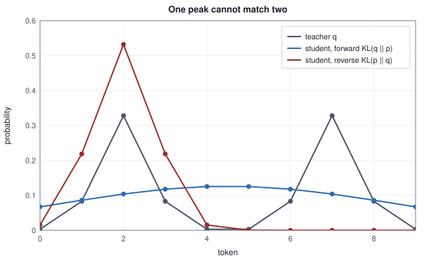

<!-- SPDX-License-Identifier: CC-BY-4.0 -->
<!-- Copyright (c) 2026 Martin Schröder <info@swedishembedded.com> -->

# Distillation

*How does a small model learn from a large one?*

A training label is the cheapest thing a model can be shown. It names one class and says nothing about the others. A model that has already learned the task says much more. At the position of the first table below, a trained teacher gives 0.7010 to the class it likes best, 0.2333 to a second class that is nearly as good an answer, and 0.0426, 0.0173 and 0.0058 to three that are plainly worse. Each of those five numbers is a statement about how the classes relate, and a one-hot label states none of them. A student trained on the label learns which class won. A student trained on the five numbers learns the ranking, the near-miss and the size of the gap, from the same example.

That is worth having when the teacher is too large to serve and the student is small enough to. Getting the teacher's behaviour into the student is the whole use of the idea, and three of its details decide whether it works: what the student is trained against (the teacher's whole distribution, or only its largest entries, since the whole distribution of a language model has one entry per token of a vocabulary), at which points of a text the teacher is asked (the texts of a dataset, or the texts the student itself writes), and in which direction the divergence between the two distributions is measured. Each detail has a cost that can be counted.

Six earlier results are used at once. The divergence of two distributions is not symmetric (Volume I, Chapter 13, "Information, Entropy and Surprise", KL divergence): for $p = (0.9, 0.1)$ and $q = (0.5, 0.5)$, what are $D_{\mathrm{KL}}(p \,\Vert\, q)$ and $D_{\mathrm{KL}}(q \,\Vert\, p)$? The cross-entropy of a softmax against a target distribution has a simple gradient with respect to the logits (Volume III, Chapter 3, "Softmax, Logits and Cross-Entropy"): for $p = (0.2, 0.5, 0.3)$ and the one-hot target on class 2, what is it? Dividing logits by a temperature (Volume V, Chapter 11, "Decoding: Turning Probabilities into Text") flattens the distribution: for logits $(2, 0)$ and a temperature of 2, what are the probabilities, and what happens as the temperature grows without bound? Supervised fine-tuning (Volume XII, Chapter 4, "Reinforcement and Preference Learning for Language Models") scores only the assistant's tokens: on which positions of a row does it put its loss? The policy gradient of a softmax policy (Volume XII, Chapter 3, "Policy Gradients") weights $\nabla \ln \pi(a)$ by an advantage: what is $\nabla_{\mathbf z} \ln \pi(a)$ with respect to the logits $\mathbf z$ for a sampled action $a$, and what does a negative advantage do to the logit of $a$? And a step that keeps every activation costs $12\,nDF$ FLOPs per block (Chapter 3, "Where Training Memory Goes"): what do $K$ such steps over the same tokens cost?

## What a label throws away

Let a student produce logits $\mathbf{z}$ and the distribution $\mathbf{p} = \mathrm{softmax}(\mathbf{z})$ over $C$ classes, and let a target be any distribution $\mathbf{t}$ over the same classes. The cross-entropy of the student against it is $L = -\sum_k t_k \ln p_k$. The softmax has $\partial \ln p_k / \partial z_i = \delta_{ki} - p_i$ (it is $1$ when $k = i$ and $0$ otherwise, minus $p_i$), so

$$
\frac{\partial L}{\partial z_i} = -\sum_k t_k\,(\delta_{ki} - p_i) = -t_i + p_i \sum_k t_k = p_i - t_i,
$$

using $\sum_k t_k = 1$. With the one-hot target $\mathbf{t} = \mathbf{e}_y$ of an ordinary label this is the $\mathbf{p} - \mathbf{e}_y$ of Volume III, Chapter 3. Nothing in the derivation needed $\mathbf{t}$ to be one-hot, only that it sums to 1. When $\mathbf{t}$ is the output distribution $\mathbf{q}$ of a teacher it is called a **soft target**, and the loss is usually written as a divergence: $D_{\mathrm{KL}}(\mathbf{q} \,\Vert\, \mathbf{p}) = H(\mathbf{q}, \mathbf{p}) - H(\mathbf{q})$, the cross-entropy minus the teacher's own entropy. The teacher is frozen, so $H(\mathbf{q})$ does not depend on the student, and the two losses have the same gradient $\mathbf{p} - \mathbf{q}$. Training a student against the output distributions of a teacher is **knowledge distillation**.

<!-- worked: distillation.soft_target_gradient -->
One position with five classes. Teacher logits (3.2, 2.1, 0.4, -0.5, -1.6) and student logits (1.0, 0.5, 0.3, 0.2, 0.0); q and p are their stable softmaxes (temperature 1). The soft column is the gradient of KL(q || p) with respect to the student's logits, p - q; the hard column is the gradient of the cross-entropy against the one-hot label of the teacher's largest class (class 0), p - e_0. Natural logarithms, four decimals.

| class | q (teacher) | p (student) | soft gradient p - q | hard gradient p - e_0 |
|---|---:|---:|---:|---:|
| 0 | 0.7010 | 0.3424 | -0.3585 | -0.6576 |
| 1 | 0.2333 | 0.2077 | -0.0256 | +0.2077 |
| 2 | 0.0426 | 0.1700 | +0.1274 | +0.1700 |
| 3 | 0.0173 | 0.1539 | +0.1365 | +0.1539 |
| 4 | 0.0058 | 0.1260 | +0.1202 | +0.1260 |

KL(q || p) = 0.4147, the cross-entropy H(q, p) = 1.2378, the teacher's entropy H(q) = 0.8231, and H(q, p) - H(q) = 0.4147. A central finite difference of KL(q || p) (step 1e-6 on each logit) differs from p - q by less than 1e-8 (the criterion, checked). The components of each gradient column sum to zero to below 1e-15.
<!-- /worked -->

Read the two gradient columns beside each other. The label's gradient pushes every class that is not class 0 down by its whole probability, class 1 included (+0.2077), and class 0 up by the missing 0.6576. The soft gradient treats class 1 differently: the teacher gives it 0.2333 and the student 0.2077, so there is almost nothing to correct (-0.0256), while classes 2, 3 and 4, which the student overrates by 0.1274, 0.1365 and 0.1202, are the ones pushed down. The student is told where it is wrong, in proportion to how wrong, and not only that class 0 was the answer. Distillation has a second reading: the label is itself a soft target, the one of a teacher that puts all its mass on one class. Supervised fine-tuning (Volume XII, Chapter 4) is distillation from that teacher, and everything below is a way of replacing it with a better one.

How much better has to be measured. The next table trains small students, always against the same teacher, with three kinds of target: one class sampled from the teacher's distribution, the teacher's two largest classes renormalized, and its full distribution. The test is the mean divergence from the teacher on contexts the student never saw.

<!-- worked: distillation.soft_versus_hard -->
A teacher and a student, both softmax classifiers over 5 classes. The teacher reads 6 features: its 5 x 6 weight matrix is 0.7 * normal() in row-major order from the generator seeded 18329194904305256508 (seed_of 'distillation.teacher'). The student reads only the first 4 features, so it cannot copy the teacher. Each of the 4 runs (index r = 0 to 3) restarts its own generator, named 'distillation.train.r' (seeds 10044490013599092348, 222015839287932920, 17476925822574282088, 5351037358010910834), and draws the 48 training contexts first (6 normal() each, in order) and then 48 uniform() values, one per context; a run with n contexts uses the first n of both. The hard label of a context is the first class whose cumulative teacher probability exceeds its uniform value (the last class if none does). The three targets are that one-hot label, the teacher's top 2 classes renormalized, and the full teacher distribution. The student has no bias and starts at zero; it minimizes the mean cross-entropy against its targets plus 0.05/2 times the sum of its squared weights by 800 steps of gradient descent with rate 1.0, from which every run ends with a largest gradient component below 1e-12 (checked). The score is the mean over 400 test contexts (generator 'distillation.test', seed 14248553146624329122, 6 normal() each) of KL(q || p), q the teacher's and p the student's distribution, averaged over the 4 runs. The student fitted to the full teacher distribution of 400 other contexts (generator 'distillation.floor', seed 8390755144713209922) scores 0.3440 on the same test set. A number that comes from a chaotic run is printed with only the digits that are the same in the run and in four copies of it whose first weight is changed by +1e-12, -1e-12, +3e-12 and -3e-12: in full if all agree on it, as 'about x' with the leading digits on which all agree, or as 'unstable' when not even one digit survives; the other digits cannot be reproduced in another implementation. The problem is convex and the runs converge, so every number below is printed in full.

| training contexts | one-hot label sampled from the teacher | top 2 of the teacher | full teacher distribution |
|---:|---:|---:|---:|
| 6 | 1.1915 | 0.7675 | 0.6335 |
| 12 | 0.7960 | 0.4946 | 0.4550 |
| 24 | 0.5503 | 0.3785 | 0.3754 |
| 48 | 0.4375 | 0.3703 | 0.3688 |
<!-- /worked -->


With 6 contexts the student trained on sampled labels is 1.1915 nats from the teacher, and the student trained on full distributions 0.6335; the labels at 48 contexts (0.4375) are still behind the full distributions at 24 (0.3754). The reason is in the expectation. The label $y$ is drawn from $\mathbf{q}$, so the expected value of its one-hot vector is $\mathbf{q}$, and the expected hard gradient $\mathbb{E}_y[\mathbf{p} - \mathbf{e}_y] = \mathbf{p} - \mathbf{q}$ is the soft gradient. The hard label is therefore an unbiased but noisy copy of the soft target. Its noise is what the extra contexts have to average out, and the soft target does not have it: the average is already taken. The curves meet only as the number of contexts grows, and they meet at a floor that is not zero, because this student sees four of the teacher's six features and cannot copy it (a student fitted to 400 contexts of full distributions scores 0.3440). Two classes already carry most of the benefit: at 24 contexts the top-2 target is 0.3785 and the full one 0.3754.

## Softening the teacher with a temperature

A trained classifier is usually sure of itself. In the first table the teacher's 0.7010 on its favourite is mild; a model trained longer on easier data puts 0.99 there and shares the remaining 0.01 among the others, where the ranking of the rest, the part worth learning, is hidden in the fourth decimal. Dividing the logits by a temperature $\tau > 1$ before the softmax (Volume V, Chapter 11) brings those small probabilities up to where a loss can see them. The student's logits are divided by the same $\tau$, the divergence is taken between the two softened distributions, $\mathbf{q}_\tau = \mathrm{softmax}(\mathbf{z}^{\mathrm{t}}/\tau)$ and $\mathbf{p}_\tau = \mathrm{softmax}(\mathbf{z}^{\mathrm{s}}/\tau)$, and at the end of training the student is used at $\tau = 1$.

The gradient of $D_{\mathrm{KL}}(\mathbf{q}_\tau \,\Vert\, \mathbf{p}_\tau)$ with respect to the student's logits is the one derived above with a chain-rule factor $1/\tau$, because $\mathbf{z}^{\mathrm{s}}$ enters through $\mathbf{z}^{\mathrm{s}}/\tau$:

$$
\frac{\partial D_{\mathrm{KL}}(\mathbf{q}_\tau \,\Vert\, \mathbf{p}_\tau)}{\partial z^{\mathrm{s}}_i} = \frac{1}{\tau}\,(p_{\tau,i} - q_{\tau,i}).
$$

For a large $\tau$ the softmax is nearly flat, and its first-order expansion is $\mathrm{softmax}(\mathbf{z}/\tau)_i \approx \frac{1}{C}\bigl(1 + (z_i - \bar z)/\tau\bigr)$, where $\bar z$ is the mean of the $C$ logits. Substituting for both distributions,

$$
\frac{1}{\tau}(p_{\tau,i} - q_{\tau,i}) \approx \frac{1}{C\,\tau^2}\Bigl((z^{\mathrm{s}}_i - \bar z^{\mathrm{s}}) - (z^{\mathrm{t}}_i - \bar z^{\mathrm{t}})\Bigr).
$$

Two facts follow. At a high temperature distillation is regression on the logits, each centred on its own mean (a constant added to all logits changes no probability, so only the centred logits are information). And the gradient shrinks as $1/\tau^2$, so a loss that is multiplied by $\tau^2$ keeps its gradient at the size $\frac{1}{C}$ times the logit difference whatever $\tau$ is. Without the factor, a run that mixes this loss with a label loss would hear the teacher less as $\tau$ rose. The table checks both on the five logits of the first table.

<!-- worked: distillation.temperature_gradient -->
The logits of the first table (teacher (3.2, 2.1, 0.4, -0.5, -1.6), student (1.0, 0.5, 0.3, 0.2, 0.0)), every probability the softmax of the logits divided by tau. 'largest q' and 'entropy' describe the teacher's distribution at that temperature (nats; ln 5 = 1.6094 is the entropy of the uniform distribution on five classes). The scaled loss is tau^2 KL(q_tau || p_tau). The gradient column is tau^2 times the first component of the gradient of that KL, that is tau (p_tau - q_tau) for class 0 (a central finite difference with step 1e-6 agrees with (p_tau - q_tau) / tau to below 1e-8). The last column is the largest difference, over the five classes, between tau (p_tau - q_tau) and (1/5) times the centred student logits minus the centred teacher logits, the limit of the derivation. The approximation for class 0 is -0.37600.

| tau | largest q | entropy of q | scaled loss | scaled gradient, class 0 | largest gap to the limit |
|---:|---:|---:|---:|---:|---:|
| 1 | 0.7010 | 0.8231 | 0.41469 | -0.35852 | 0.26380 |
| 2 | 0.4827 | 1.2936 | 0.77766 | -0.43362 | 0.14899 |
| 4 | 0.3385 | 1.5180 | 0.94389 | -0.42811 | 0.07066 |
| 8 | 0.2663 | 1.5859 | 0.98792 | -0.40760 | 0.03324 |
| 16 | 0.2322 | 1.6035 | 0.99620 | -0.39304 | 0.01713 |
| 32 | 0.2158 | 1.6080 | 0.99671 | -0.38480 | 0.00880 |
<!-- /worked -->

The teacher's entropy rises from 0.8231 nats at $\tau = 1$ to 1.5180 at $\tau = 4$, close to the 1.6094 of five equal classes, so the near-miss class and the three worse ones are all visibly different at $\tau = 4$, where the favourite holds 0.3385. The scaled gradient of class 0 is $-0.3585$ at $\tau = 1$ and tends to the limit $-0.3760$, and the largest gap to the limit falls from 0.2638 to 0.0088 at $\tau = 32$, roughly halving each time $\tau$ doubles once $\tau$ is 2 or more (the ratios are 2.1, 2.1, 1.9 and 1.9; the doubling from 1 to 2 gives 1.8), as the first-order expansion says it should.

The distillation objective of brain uses no temperature of its own. `TopK::from_logits` in `crates/rl/src/objective/distill.rs` applies the softmax to the raw logits it is given, a temperature of 1, and the student's loss is the model's own cross-entropy, which the objective does not rescale (its `prepare` only enables weighted losses). A softer teacher is a caller's choice: the integration test `distillation_lowers_its_kl` in `crates/rl/tests/it/objective_fits.rs` multiplies the teacher's logits by `TEACHER_SHARPNESS`, 20 (a temperature of 1/20), because its teacher is the student's own base model and an unscaled teacher would leave no gap for training to close. The one place a temperature divides logits in the on-policy objective described below is the temperature the collector sampled with: the policy trained is `softmax(logits / temperature)` (`PolicyGradientConfig::temperature`, default 1).

## Keeping the K largest entries of a teacher's row

A language model's distribution has one probability for each token of its vocabulary. A dense target for one position of a vocabulary of 100,000 tokens is 400,000 bytes in fp32, and a step has thousands of positions. A teacher's row is almost all tail: its mass sits on a few tokens, and the tail is mostly noise to the student. The practical form of distillation for language keeps the $K$ largest entries.

Let the kept ids be $v_1, \dots, v_K$ in order of decreasing teacher probability (a tie goes to the lower id), and let $q_k$ be their probabilities renormalized to sum to 1, so $\mathbf{q}_K$ is a sparse distribution with $q_k$ at $v_k$ and 0 elsewhere. A softmax of the logits $\mathbf{z}$ restricted to the kept ids and renormalized is the same thing, because the common denominator cancels:

```text
function topk_teacher(z: array<real>[V], k: int)
        -> (array<int>[K], array<real>[K]):
    require k >= 1 and V >= 1, "a teacher row needs a token and k >= 1"
    order = argsort(z, descending)            # a tie goes to the lower id
    K = min(k, V)
    ids = order[0:K]
    e = zeros(real, [K])
    for i in 0 .. K:
        e[i] = exp(z[ids[i]] - z[ids[0]])
    return ids, e / sum(e)
```

The student is trained against $\mathbf{q}_K$ with the same loss as before, so its gradient with respect to its logits is $\mathbf{p} - \mathbf{q}_K$. This can be computed without any kernel that takes a target distribution. Since $\sum_k q_k = 1$,

$$
\mathbf{p} - \mathbf{q}_K = \sum_{k=1}^{K} q_k\,\mathbf{p} - \sum_{k=1}^{K} q_k\,\mathbf{e}_{v_k} = \sum_{k=1}^{K} q_k\,(\mathbf{p} - \mathbf{e}_{v_k}),
$$

and each term $\mathbf{p} - \mathbf{e}_{v_k}$ is the gradient of an ordinary cross-entropy with the single label $v_k$. So the gradient of a top-$K$ distillation is the weighted sum of $K$ ordinary label gradients over the same row, pass $k$ using the label $v_k$ at weight $q_k$. A position that has no teacher (a prompt position) takes part in no pass, and a position whose teacher kept fewer than $K$ entries drops out of the later passes. The loss is a mean over the $n_{\mathrm{act}}$ positions that have a teacher, and the weights carry the divisor, which is the convention of the next section. The routine is:

```text
function distill_gradient(Z: array<real>[T, V], ids: list<array<int>>,
                          q: list<array<real>>) -> array<real>[T, V]:
    # position t has the teacher (ids[t], q[t]); an empty ids[t] means none
    require len(ids) == T and len(q) == T
    n_act = max(1, number of positions t with len(ids[t]) > 0)
    G = zeros(real, [T, V])
    for t in 0 .. T:
        p = softmax(Z[t, :])
        for k in 0 .. len(ids[t]):
            e = zeros(real, [V])
            e[ids[t][k]] = 1.0
            G[t, :] = G[t, :] + (q[t][k] / n_act) * (p - e)
    return G
```

and the loss it descends, $\frac{1}{n_{\mathrm{act}}}\sum_t D_{\mathrm{KL}}(\mathbf{q}_K^{(t)} \,\Vert\, \mathbf{p}^{(t)})$, is

```text
function distill_loss(Z: array<real>[T, V], ids: list<array<int>>,
                      q: list<array<real>>) -> real:
    require len(ids) == T and len(q) == T
    n_act = max(1, number of positions t with len(ids[t]) > 0)
    total = 0.0
    for t in 0 .. T:
        if len(ids[t]) > 0:
            p = softmax(Z[t, :])
            for k in 0 .. len(ids[t]):
                total = total + q[t][k] * (log(q[t][k]) - log(p[ids[t][k]]))
    return total / n_act
```

Two things have to be counted: what the truncation does to the target ($\mathbf{q}_K$ is not $\mathbf{q}$, and the student is pulled toward the first), and what it does to the cost (bytes saved, and arithmetic spent on $K$ passes). The first table counts the target, the second the cost.

<!-- worked: distillation.topk_gap -->
One position, eight tokens. Teacher logits (2.6, 2.1, 1.7, 0.9, 0.2, -0.4, -1.1, -2.0), student logits (1.2, 1.9, 0.6, 1.1, 0.4, 0.0, -0.3, -0.5), temperature 1. 'kept mass' is the teacher's probability on its K largest tokens before renormalizing; KL is KL(q_K || p) for the renormalized top-K distribution q_K; 'distance' is the sum over the eight tokens of |q_K - q|, which is how far the gradient p - q_K is from the full gradient p - q in the sum of absolute components; 'bytes' is 4 for each stored id and 4 for each stored probability, 8 K. For every K the gradient p - q_K equals the sum over the K kept tokens of q_k (p - e_k) to below 1e-12 (checked). The full KL(q || p) is 0.2477.

| K | kept mass | KL(q_K \|\| p) | distance of q_K from q | bytes stored |
|---:|---:|---:|---:|---:|
| 1 | 0.4218 | 1.7270 | 1.1565 | 8 |
| 2 | 0.6776 | 0.7999 | 0.6449 | 16 |
| 3 | 0.8490 | 0.6052 | 0.3019 | 24 |
| 4 | 0.9261 | 0.4203 | 0.1478 | 32 |
| 5 | 0.9643 | 0.3370 | 0.0713 | 40 |
| 6 | 0.9853 | 0.2891 | 0.0293 | 48 |
| 7 | 0.9958 | 0.2617 | 0.0085 | 56 |
| 8 | 1.0000 | 0.2477 | 0.0000 | 64 |
<!-- /worked -->

The kept mass is how much of the teacher the top $K$ holds: 0.4218 for $K = 1$, 0.8490 for $K = 3$, 0.9958 for $K = 7$. The gradient $\mathbf{p} - \mathbf{q}_K$ differs from the full gradient $\mathbf{p} - \mathbf{q}$ by the distance in the fourth column, 1.1565 at $K = 1$ and 0.0293 at $K = 6$, so the truncation is a difference in the target, and the K-pass computation introduces no further one (the identity was checked to below 1e-12 for every $K$). And $K = 1$ is a supervised label: the student is trained on the teacher's single most likely token, which is the supervised fine-tuning of Volume XII, Chapter 4 on text that the teacher would write greedily. The $\mathrm{KL}(\mathbf{q}_K \,\Vert\, \mathbf{p})$ column is 1.7270 there, and falls toward the full divergence 0.2477 as $K$ rises to the whole vocabulary of 8.

<!-- worked: distillation.topk_cost -->
A vocabulary of 100,000 tokens, one step of 8,192 positions, and the stack of Chapter 3 (2^32 weights, 211,106,232,532,992 FLOPs for one forward and backward pass over 8,192 tokens, 6 n P for n tokens and P weights). A dense teacher row is 4 x 100,000 = 400,000 bytes of fp32 probabilities per position. A top-K row is 4 bytes for each id and 4 for each probability, 8 K bytes; it is smaller than the dense row while K is below half the vocabulary. The FLOP column counts K passes, one forward and one backward each, over the same tokens.

| K | bytes per position | percent of a dense row | bytes for 8,192 positions | FLOPs of the K passes |
|---:|---:|---:|---:|---:|
| 1 | 8 | 0.002 | 65,536 | 211,106,232,532,992 |
| 8 | 64 | 0.016 | 524,288 | 1,688,849,860,263,936 |
| 32 | 256 | 0.064 | 2,097,152 | 6,755,399,441,055,744 |
| 64 | 512 | 0.128 | 4,194,304 | 13,510,798,882,111,488 |
| 128 | 1,024 | 0.256 | 8,388,608 | 27,021,597,764,222,976 |
<!-- /worked -->

The storage is a small fraction of the dense row even at $K = 128$ (0.256 percent), and the arithmetic is the opposite: $K$ passes are $K$ times the 211,106,232,532,992 FLOPs of one forward and backward pass over the 8,192 tokens of the stack of Chapter 3, since each pass runs the whole network. That is the price of using no new kernel, and brain pays it. A kernel that took a whole target distribution would need one pass, and the identity above is the reason it would give the same gradient.

## One example, one mean

A distillation loss over an example is naturally a sum over its positions of one divergence each, and the temptation is to descend the sum. Then a long example takes a longer step than a short one: an example of 100 teacher-scored positions steps up to 100 times as hard as one of a single position (exactly so if the positions' gradients were alike), though each is one example in a batch. A reported loss that is the mean while the gradient written is the sum hides this: the loss curve looks normal and the effective learning rate depends on the data's length distribution.

The top-K objective in brain had exactly that disagreement. Commit `21c9da2ba` (8 November 2026), whose message is `rl: top-K distillation writes the gradient of the mean KL it reports`, records that the passes carried the weight $q_k \cdot \mathrm{count}_k$ and so summed the per-position gradients, while the reported loss was their mean over the teacher-scored positions. The code now carries the fix in both places the convention lives: `topk_weight(prob, count, active)` returns `prob * count / active` and `mean_kl` divides by `active_positions`, and the test `the_reported_loss_is_the_dense_mean_kl_of_each_example_whatever_its_length` in `crates/rl/tests/distill_normalisation.rs` compares the reported loss with a dense-softmax oracle for examples of 1 and 4 positions. The table counts what the old convention did on a small case.

<!-- worked: distillation.normalisation -->
A student that is one linear softmax: logits W x with W of shape [5, 3] and x of 3 numbers, the same W at every position. One generator seeded 15117367884731916203 (seed_of 'distillation.normalisation') draws, in this order: the 15 entries of W (row-major, each 0.5 * normal()), then for each of 4 positions its x (3 normal()) and its teacher logits (5 values, each 1.5 * normal()), whose top 2 renormalized is the position's target. An example is its first n positions. The loss is the mean over the n positions of KL(q_K || p). The two gradients are with respect to W, summed over positions: the older convention adds the positions' gradients of KL(q_K || p) without dividing, the current one divides the sum by n. The table gives the Frobenius norm of each (the square root of the sum of the squares of the 15 entries) and whether the current gradient agrees with a central finite difference of the mean loss (step 1e-6 on each entry) to below 1e-7.

| positions n | mean KL(q_K \|\| p) | norm, summed over positions | norm, mean over positions | finite-difference check |
|---:|---:|---:|---:|---:|
| 1 | 1.69694 | 1.18628 | 1.18628 | passes (below 1e-7) |
| 2 | 1.29837 | 1.68861 | 0.84431 | passes (below 1e-7) |
| 4 | 0.90157 | 2.03458 | 0.50864 | passes (below 1e-7) |
<!-- /worked -->

With the same student and the same positions, the gradient norm of an example of 4 positions is 2.03458 under the sum and 0.50864 under the mean, and of an example of one position 1.18628 under both. Under the mean an example counts once whatever its length, and the loop that accumulates the examples of an optimizer step then averages them. The `count` in `pass_arrays` is a separate matter: it is the divisor that the model's own weighted cross-entropy applies to each pass, which the weight cancels so that the model's `1/count` does not enter the result.

## How a teacher's row is laid over the student's

The objective, `DistillTopK` in `crates/rl/src/objective/distill.rs`, was added in commit `9e0b8a619` (6 September 2026). It rests on the identity above and on one property of the training loop: a model's backward pass adds into its gradient buffers and does not overwrite them. `run_passes` loops $k$ from 0 to the largest number of kept entries in the row; for each it builds the targets and weights with `pass_arrays` (`IGNORE` and weight 0 at a position that has no $k$-th entry), hands them to the model as a weighted-loss batch, runs `forward` and `backward`, and lets the $K$ backward passes sum. The design needs no kernel beyond the weighted cross-entropy that direct preference optimization (DPO) and group-relative policy optimization (GRPO) already use.

Three details are not in the mathematics and are in the code. A teacher position has to be aligned with the token it predicts: `pack_row` puts the distribution for `completion[i]` at position `prompt.len() - 1 + i`, one before the token, and the test `pack_row_aligns_teacher_to_the_completion_span` pins it. An example that cannot be packed faithfully is refused and never silently changed: a row that overruns the sequence length, a teacher distribution that is not a distribution (`TopK::validate` requires equal numbers of ids and probabilities, no repeated id, finite non-negative probabilities that sum to 1 within $10^{-3}$) and an example with no teacher position at all are each an error, tested by `pack_row_refuses_a_completion_that_overruns_seq_len_instead_of_truncating_it` and `a_teacher_distribution_must_be_a_distribution`. And an optimizer step in which no pass ran, because no position had a teacher, is skipped (`StepVerdict::Skip` in `step_verdict`) so that it does not decay the weights or advance Adam's moments on a zero gradient.

Where the teacher's distributions come from is the job of `teacher_example` and `TeacherFit` in `crates/rl/src/fit.rs` (commit `54312424d`, 4 November 2026). Given a prepared row of tokens and targets and the teacher's logits for all positions, `teacher_example` takes the prompt through the first supervised position and the completion through the last, with the teacher's top $K$ at each supervised position and no teacher at an unsupervised position between two answers (`a_teacher_example_spans_the_supervised_positions`). `TeacherFit` runs a teacher over a whole prepared dataset with the model's all-position logits, and `DistillFit` then trains a student on the collected examples by the same training loop every other objective uses. In `crates/sdk/src/chat_trainer.rs` the two are wired together, with the teacher built as the base model in fp32 and the student as a low-rank adaptation (LoRA) adapter (Chapter 4) over a base in whatever encoding the family declares; `distillation_trains_the_adapters_over_every_base_encoding` runs 20 steps on each base encoding with a teacher of $K = 8$ sharpened by the factor of 20, requires the divergence to end below 0.95 of where it began, and checks that only adapter tensors moved.

One use of this wiring is not a small model learning from a large one but a compressed model learning from its original. `distill_recovery` in `crates/sdk/src/optimize.rs` takes the model-optimizing flow, which chooses a number format for each layer of a model to fit a memory budget, and trains a LoRA adapter over the model held at the chosen formats toward the original model's top-16 distributions on the calibration records (`TEACHER_TOP_K` is 16). Commit `60f150547` (4 November 2026) describes it as distilling an adapter over the base held at the plan with "the original model's top-K distributions as teacher". The integration test `crates/sdk/tests/it/model_optimizer.rs` asserts that the loss of the plan without the adapter (`plan_loss`) and the loss with it (`recovered_loss`) are both finite and different (lines 149 and 150), which says the adapter changed what the compressed model computes; the comparison of the two losses is reported in the flow's outcome.

Three tests check the identity and the gradient. `crates/rl/tests/distill_full_kl.rs` sets $K$ equal to the vocabulary of a tiny `qwen3` model and compares the reported loss with the textbook $\sum_v q_v(\ln q_v - \ln p_v)$ computed from the model's raw logits by plain `exp` and `ln`, requiring agreement within $10^{-2}$; it shows that the sparse path is the dense one at full $K$ and not a different approximation that merely has a gradient. `crates/rl/tests/distill_gradcheck.rs` checks the accumulated gradient against finite differences of a loss that its harness recomputes on the host with `pass_arrays` and `mean_kl`, and `crates/rl/tests/distill_normalisation.rs` against finite differences of the objective's own reported loss, with a ragged $K$ of 3, 2 and 1 over three positions behind two prompt positions. Both depend on a gate of Volume III, Chapter 6: a gradient is right when it is the derivative of the number that is reported, and the commit of the previous section is what made that true.

## When the student writes the text

Everything so far trained the student on text that the teacher scored: the records of a dataset, whoever wrote them. At use the student writes its own text, one token at a time, and the contexts it reaches are the ones its own choices lead to. A student that errs at a position lands in a context that no training record contains, because no record contains a continuation of that error, and from there it has nothing to imitate. If at each token the student has a chance $\epsilon_{\mathrm{tok}}$ of choosing a token its teacher would not, the chance that $T$ tokens contain no such token is $(1 - \epsilon_{\mathrm{tok}})^T$:

<!-- worked: distillation.drift -->
If at every token the student has a chance epsilon_tok of choosing a token its teacher would not, independently of the other tokens, the chance that a continuation of T tokens contains no such token is (1 - eps)^T, three significant digits with trailing zeros dropped (0.67 stands for 0.670).

| epsilon_tok | T = 50 | T = 100 | T = 200 | T = 500 |
|---:|---:|---:|---:|---:|
| 0.002 | 0.905 | 0.819 | 0.67 | 0.368 |
| 0.01 | 0.605 | 0.366 | 0.134 | 0.00657 |
| 0.02 | 0.364 | 0.133 | 0.0176 | 4.1e-05 |
<!-- /worked -->

At $\epsilon_{\mathrm{tok}} = 0.01$ a continuation of 200 tokens stays inside the teacher's own territory with probability 0.134; at 0.02, 0.0176. Imitating learners meet this in many fields, and for language models it is the argument for scoring the student's own continuations. Ross, Gordon and Bagnell (2011) bound the effect: when the learner's per-step loss on the expert's own states is $\epsilon$ (a bound on the 0-1 loss) and each step costs at most 1, copying the expert from its recorded states gives a total cost over $T$ steps at most $T^2\epsilon$ above the expert's, a bound they show is tight; their dataset-aggregation method, which trains on the states the learner itself visits, is at most $uT\epsilon_N + O(1)$ above, linear in $T$, where $u$ bounds how much one wrong action raises the expert's cost and $\epsilon_N$ is the loss of the best policy in hindsight on the states the learner's iterates visited.

**On-policy distillation** does that. The student samples a continuation, the teacher scores each sampled token in the context the student produced, and the student is trained on the teacher's judgement of its own tokens. The word on-policy is the one of Volume XII, Chapter 3: the data comes from the policy being trained. The judgement has to be turned into a loss, and the loss that comes out is not the forward divergence of the previous sections.

## Which way round the divergence goes

The divergence is not symmetric (Volume I, Chapter 13), and the two directions ask different things of a student that is too small to match the teacher. The **forward** divergence $D_{\mathrm{KL}}(\mathbf{q} \,\Vert\, \mathbf{p})$ is the loss of everything above: it is infinite wherever the teacher has mass and the student has none, so a student that minimizes it spreads itself to cover every place the teacher has mass. The **reverse** divergence $D_{\mathrm{KL}}(\mathbf{p} \,\Vert\, \mathbf{q})$ is infinite wherever the student has mass and the teacher has none, so a student that minimizes it stays inside what the teacher supports, even if that means ignoring a peak. The next table makes a student with room for only one peak choose between a teacher's two, by trying every student in a grid and keeping the best of each.

<!-- worked: distillation.forward_versus_reverse -->
A teacher over the ten tokens 0 to 9 with two peaks: q_v is proportional to 0.005 + exp(-(v - 2)^2 / (2 x 0.36)) + exp(-(v - 7)^2 / (2 x 0.36)), normalized to sum 1. The student is a discretized Gaussian, p_v proportional to exp(-(v - mu)^2 / (2 sigma^2)), with two numbers to choose: mu from 0 to 9 in steps of 0.25 and sigma from 0.25 to 6 in steps of 0.25 (37 x 24 = 888 students). Each objective is minimized by trying every student, mu ascending then sigma ascending, and keeping the first student whose value is smaller than the best so far by more than 1e-9 (the teacher is symmetric about 4.5, so a student with mean mu and the one with mean 9 - mu tie up to rounding, and the smaller mu is kept). 'Forward' minimizes KL(q || p), 'reverse' KL(p || q). Natural logarithms, four decimals.

| token | teacher q | forward-KL student | reverse-KL student |
|---:|---:|---:|---:|
| 0 | 0.0029 | 0.0671 | 0.0152 |
| 1 | 0.0830 | 0.0861 | 0.2187 |
| 2 | 0.3281 | 0.1039 | 0.5320 |
| 3 | 0.0830 | 0.1177 | 0.2187 |
| 4 | 0.0029 | 0.1253 | 0.0152 |
| 5 | 0.0029 | 0.1253 | 0.0002 |
| 6 | 0.0830 | 0.1177 | 0.0000 |
| 7 | 0.3281 | 0.1039 | 0.0000 |
| 8 | 0.0830 | 0.0861 | 0.0000 |
| 9 | 0.0029 | 0.0671 | 0.0000 |

| quantity | forward-KL student | reverse-KL student |
|---|---:|---:|
| best mean mu, best sigma | 4.5, 4.0 | 2.0, 0.75 |
| KL(q \|\| p), the forward divergence | 0.6510 | 10.4531 |
| KL(p \|\| q), the reverse divergence | 1.2148 | 0.7306 |
| student mass on tokens where q < 0.01 | 0.3847 | 0.0306 |
| student mass on tokens 0 to 4 | 0.5000 | 0.9998 |
<!-- /worked -->



The forward student is wide (mean 4.5, spread 4.0): it puts 0.3847 of its mass on tokens where the teacher has less than 0.01, in the valley between the peaks and past the ends. A text sampled from it would often contain tokens that the teacher regards as errors. The reverse student sits on the left peak (mean 2.0, spread 0.75), puts 0.0306 on those tokens, and ignores the right peak altogether: its reverse divergence is 0.7306, the forward one 10.4531. It never produces what the teacher would not, at the price of not producing everything the teacher would. For a student whose samples are what a user reads, the second is often the better trade, and it is also the divergence whose gradient can be estimated from the student's own samples and one teacher probability per sample.

The reverse divergence's gradient is not $\mathbf{p} - \mathbf{q}$. Write $a_i = \ln p_i - \ln q_i$ and $\mathrm{KL} = \sum_i p_i a_i$. Differentiating with respect to the student's logits, with $\partial p_i / \partial z_j = p_i(\delta_{ij} - p_j)$ and $\partial \ln p_i / \partial z_j = \delta_{ij} - p_j$,

$$
\frac{\partial \mathrm{KL}}{\partial z_j} = \sum_i p_i(\delta_{ij} - p_j)\,a_i + \sum_i p_i(\delta_{ij} - p_j) = p_j\Bigl(a_j - \sum_i p_i a_i\Bigr),
$$

since the second sum is $p_j - p_j \sum_i p_i = 0$. This is an exact gradient and needs the teacher's whole row. The student's own samples give another way to compute the same thing. Draw an answer $y$ from $\mathbf{p}$ and let its advantage be $A_y = \ln q_y - \ln p_y = -a_y$. The policy gradient of Volume XII, Chapter 3 is $\nabla_{\mathbf z} \ln p_y = \mathbf{e}_y - \mathbf{p}$ (the answer to the fifth recall question), and the single-sample estimate of the divergence's gradient is $-A_y(\mathbf{e}_y - \mathbf{p})$. Its expectation over $y \sim \mathbf{p}$ is $\sum_y p_y a_y(\mathbf{e}_y - \mathbf{p}) = \mathbf{p} \odot \mathbf{a} - \mathbf{p}\sum_y p_y a_y$, the exact gradient. The routine for one sample is

```text
function sampled_gradient(z: array<real>[V], logq: array<real>[V], y: int)
        -> array<real>[V]:
    require 0 <= y < V
    p = softmax(z)
    adv = logq[y] - log(p[y])
    e = zeros(real, [V])
    e[y] = 1.0
    return -adv * (e - p)
```

and a toy shows that the two agree. The student has four answers with the logits $(0.5, 0.2, -0.3, 0.0)$. The teacher is the same model shown a hint, modelled as an addition of 2.0 to the logit of answer 2:

<!-- worked: distillation.reverse_kl_estimator -->
The student's logits are (0.5, 0.2, -0.3, 0.0) over four answers. The teacher is the same model shown a hint, which we model as adding 2.0 to the logit of answer 2 (and nothing else), so its logits are (0.5, 0.2, 1.7, 0.0). The advantage of answer y is A_y = ln q_y - ln p_y. 'exact' is the gradient of KL(p || q) with respect to the student's logits, p_j (a_j - sum_i p_i a_i) with a = ln p - ln q. 'expected estimate' is the exact sum over the four answers of p_y x (-A_y) x (e_y - p), the expectation of the single-sample estimate. 'sample mean' averages that estimate over 2000 answers drawn from p by one generator seeded 3262177825811760616 (seed_of 'distillation.estimator'): each draw is one uniform(), and the answer is the first whose cumulative p exceeds it.

| answer | p | q | advantage A | exact gradient | expected estimate | sample mean of 2000 |
|---:|---:|---:|---:|---:|---:|---:|
| 0 | 0.3576 | 0.1764 | -0.7063 | +0.1149 | +0.1149 | +0.1243 |
| 1 | 0.2649 | 0.1307 | -0.7063 | +0.0851 | +0.0851 | +0.0759 |
| 2 | 0.1607 | 0.5858 | +1.2937 | -0.2697 | -0.2697 | -0.2695 |
| 3 | 0.2169 | 0.1070 | -0.7063 | +0.0697 | +0.0697 | +0.0694 |

The exact and the expected columns agree to below 1e-12 (the criterion, checked), and a central finite difference of KL(p || q) (step 1e-6) agrees with the exact column to below 1e-8 (checked). KL(p || q) is 0.3850 before any step.
<!-- /worked -->

The advantage of answers 0, 1 and 3 is the same, $-0.7063$, since the hint changes none of their logits and only the normalizer, and that of answer 2 is $+1.2937$. Descending the gradient lowers the logits of the first three and raises the one the hint favours. The sample mean of 2,000 draws is within 0.01 of the exact value on every component, the largest difference being 0.0094 on answer 0 (+0.1243 against +0.1149); the estimate is unbiased and noisy, and what removes the noise is more samples. Following the exact gradient with a rate of 1.0 takes the student to the teacher:

<!-- worked: distillation.descent_on_the_advantage -->
Gradient descent on the student's four logits, rate 1.0, minimizing KL(p || q) against the hinted teacher of the previous table, which stays frozen at its logits (0.5, 0.2, 1.7, 0.0), using the exact gradient. Four decimals, five for the divergence.

| step | p(answer 2) | p(answer 0) | KL(p \|\| q) |
|---:|---:|---:|---:|
| 0 | 0.1607 | 0.3576 | 0.38498 |
| 1 | 0.2159 | 0.3270 | 0.28514 |
| 2 | 0.2853 | 0.2939 | 0.18499 |
| 5 | 0.4797 | 0.2114 | 0.02331 |
| 10 | 0.5716 | 0.1771 | 0.00059 |
| 20 | 0.5853 | 0.1754 | 0.00001 |
| 50 | 0.5858 | 0.1764 | 0.00000 |
<!-- /worked -->

The probability of answer 2 goes from 0.1607 to 0.5853 at step 20, where the divergence is 0.00001, and to 0.5858, the teacher's value, by step 50.

## Dense credit from the model's own hint

In brain the student is trained on its own tokens with a teacher in one place, and the teacher is of a particular kind. The module doc of `crates/rl/src/objective/external.rs` calls it self-distillation with privileged information, and it was added in commit `60c5d7fa5` (5 November 2026). A record is a rollout of the student, collected by an orchestrator outside brain, and it may carry a teacher context: the same conversation with extra messages the student never saw (a reference answer, say). The teacher is the same frozen model, either the base with its adapter disabled or the adapter the run started from (`ReferencePolicy`), scoring the student's own tokens after reading the extra messages. Every supervised token $y_t$ of the rollout then gets the advantage

$$
A_t = \ln q_{\mathrm{teacher}}(y_t \mid \text{privileged context}, y_{<t}) - \ln p_{\mathrm{old}}(y_t \mid y_{<t}),
$$

where $p_{\mathrm{old}}$ is the behaviour log-probability of the token. It is the sampled-token advantage of the previous section, token by token: positive where the hint makes the token more likely, negative where it makes it less. It is added to the record's own scalar advantage (zero for a record that has none) and trained through the objective that `ExternalPolicyGradient` already has for any advantage (the clipped surrogate of proximal policy optimization (PPO), Volume XII, Chapter 3: for a ratio $r = e^{\mathrm{new} - \mathrm{old}}$ the loss $-\min(rA, \mathrm{clip}(r, 1 - \epsilon, 1 + \epsilon)A)$ plus a small penalty toward a reference policy, the $k_3$ estimate $e^{u} - u - 1$ of the divergence at the sampled token with $u = \mathrm{ref} - \mathrm{new}$, the log-probabilities under the reference and the student); there is no second loss. With the start-of-run behaviour described below, $r = 1$ at the first optimizer step and the policy term's gradient is the plain on-policy estimator $-A\,\nabla \ln p$ of the previous section, divided by the sequence's token count under the default normalization. Two properties of this estimator are worth keeping in view: it uses one teacher log-probability per sampled token and not the teacher's whole row, so it estimates the reverse divergence at the sampled tokens rather than computing it; and each token's advantage is its own term, with no contribution from the tokens after it, so the student's effect on which contexts come later is not differentiated.

Where the behaviour log-probability comes from decides whether the data is on-policy in the sense of the estimator. The default is the sampler's recorded one, which makes the ratio the true importance ratio. Where none was recorded, `BehaviourSource::StartOfRunProxy` takes the log-probability under the policy the run started from, which is exact only when the rollouts were sampled from that policy. The tests of self-distillation use that proxy, since their records carry no recorded value.

A dense advantage can swamp a run: one token on which the hint makes a large difference gets a large $A_t$, and a handful of such tokens can dominate a step. The objective has two named guards, applied in this order, and the $k_3$ penalty toward the reference stays. `advantage_bound` clamps each $A_t$ to $[-c, c]$. `sequence_advantage_cap` multiplies all the advantages of a sequence by $\mathrm{cap}/\sum_t |A_t|$ when that sum exceeds the cap, so the sequence keeps the proportions between its tokens and loses scale. As a routine:

```text
function token_advantages(logp_teacher: array<real>[N], logp_old: array<real>[N],
                          bound: real or none, cap: real or none)
        -> (array<real>[N], int):
    a = logp_teacher - logp_old
    clamped = 0
    if bound is not none:
        for t in 0 .. N:
            if abs(a[t]) > bound:
                clamped = clamped + 1
            a[t] = clamp(a[t], -bound, bound)
    m = sum(abs(a))
    if cap is not none and m > cap:
        a = a * (cap / m)
    return a, clamped
```

<!-- worked: distillation.advantage_guards -->
Eight sampled tokens of one answer. The teacher's log-probabilities of them, in its privileged context, are (-0.9, -2.2, -0.4, -3.1, -1.5, -0.7, -2.6, -1.1); the log-probabilities the sampler recorded are (-1.0, -1.9, -2.4, -1.2, -1.6, -0.7, -0.3, -1.1). The advantage of a token is the first minus the second; a bound c clamps each advantage to [-c, c], and then, if the sum of the magnitudes exceeds a cap, every advantage is multiplied by cap divided by that sum. 'tokens clamped' counts the advantages whose magnitude exceeded the bound.

| guards | advantages of the eight tokens | sum of magnitudes | largest magnitude | tokens clamped |
|---|---:|---:|---:|---:|
| no guard | +0.100, -0.300, +2.000, -1.900, +0.100, +0.000, -2.300, +0.000 | 6.700 | 2.300 | 0 |
| bound 1.0 | +0.100, -0.300, +1.000, -1.000, +0.100, +0.000, -1.000, +0.000 | 3.500 | 1.000 | 3 |
| cap 3.0 | +0.045, -0.134, +0.896, -0.851, +0.045, +0.000, -1.030, +0.000 | 3.000 | 1.030 | 0 |
| bound 1.0 and cap 3.0 | +0.086, -0.257, +0.857, -0.857, +0.086, +0.000, -0.857, +0.000 | 3.000 | 0.857 | 3 |
<!-- /worked -->

The bound turns the three large advantages (+2.0, -1.9, -2.3) into magnitude 1 and leaves the others alone, for a sum of magnitudes of 3.500. The cap alone multiplies everything by $3.0/6.7 = 0.448$, which shrinks the small advantages too (+0.100 becomes +0.045). Both together give 0.857 for the three large tokens and 0.086 for the +0.100 one, a sum of exactly 3.000. In brain the clamp counts toward the step's reported clipped fraction and the cap toward the number of sequences scaled down (`PolicyGradientStats`).

The tests in `crates/rl/tests/it/self_distill.rs` pin the behaviour on a tiny `qwen35` model with a LoRA adapter. An identical view gives every token an advantage of exactly zero (`an_identical_view_gives_every_token_zero_advantage`). In `a_token_the_teacher_prefers_is_raised_and_one_it_rejects_is_lowered` the step's mean advantage equals the hand-computed mean of the base's log-probability minus the student's within $10^{-4}$, and after 8 steps the tokens with positive advantage have gained log-probability in total while those with negative advantage have lost it. A privileged prefix changes the teacher and so the advantages. The bound and the cap limit what a step sees: with the bound at half the unbounded maximum the largest magnitude stays within it and the clipped fraction is positive, and with a cap of 0.1 the largest advantage stays within 0.1. A teacher rendering that cannot be scored against its student (longer than the row, or supervising a different number of tokens) has its example refused, because log-probabilities of a different token sequence are not the student's tokens' log-probabilities.

## Check your understanding

1. A colleague says a top-16 distillation is a biased version of the full divergence, since the K passes drop the tail. Say where the difference lies and whether the passes themselves add to it.
2. A distillation loss is reported as the mean over an example's teacher-scored positions, and its gradient is the sum. Two examples have 1 and 10 positions. What does the optimizer's step do, and why does the loss curve not show it?
3. A student is trained at $\tau = 4$ against a teacher at $\tau = 4$ and the loss is not multiplied by $\tau^2$. It is mixed with a label loss. What goes wrong?
4. A teacher has two equally likely continuations, A and B, and the student can represent only one. Which direction of the divergence has the student choose one, and which has it split its mass? Which one makes its samples valid?
5. In on-policy self-distillation a token has $A_t = +2.0$ and $p_{\mathrm{old}} = 0.1$. What does the teacher think of the token, and how does the first step move its logit? What happens if the student already agreed with the teacher on every token?
6. A privileged teacher rendering supervises 12 tokens and the student's rollout 11. Why is the record refused instead of scored on the first 11?
7. A team raises $K$ from 8 to 128 to get a closer student. List what it must count besides the divergence.

## Summary

A label is a soft target that is certain; a teacher's distribution is a better one. Training a student against a teacher's distribution, whose gradient with respect to the logits is $\mathbf{p} - \mathbf{q}$, is knowledge distillation, and in a small case it brings a student within 0.4550 nats of its teacher with 12 contexts where sampled labels leave it at 0.7960. A temperature spreads the teacher's mass so the tail can be seen, and a loss multiplied by $\tau^2$ keeps its gradient, which tends to a regression on the centred logits. A teacher's row is too large to keep, so the top $K$ entries are kept and renormalized, and the gradient $\mathbf{p} - \mathbf{q}_K$ equals the sum of $K$ ordinary label gradients weighted by $q_k$: no new kernel, $K$ times the FLOPs, and $K = 1$ is supervised fine-tuning on the teacher's greedy token. One example counts once when its loss and its gradient are both a mean over its teacher-scored positions, which is the convention commit `21c9da2ba` brought brain to. A student that learns from a dataset meets contexts of its own making that the dataset does not hold, with a chance of staying on the teacher's path of $(1 - \epsilon_{\mathrm{tok}})^T$; on-policy distillation scores the student's own tokens, and its loss is the reverse divergence, whose gradient is estimated from samples as the advantage $\ln q - \ln p$ times $\nabla \ln p$. In brain it takes the teacher to be the same model with extra context, bounds and caps the advantages, and trains through its one clipped policy-gradient step.

The limits are the ones counted. The target of a top-$K$ student is $\mathbf{q}_K$ and not $\mathbf{q}$, and the $K$ passes are paid in full. A temperature other than 1, and a student-side temperature, are the caller's to apply. The on-policy objective sees one teacher log-probability per sampled token and trusts the rollouts to have come from the policy it assumes. And all of it assumes that a student and a teacher can be held in memory and trained for days. A run that does that must survive a crash and still produce the model it would have produced, which is the subject of Chapter 7.

## References

- Hinton, G., Vinyals, O. and Dean, J. Distilling the knowledge in a neural network, 2015. The soft target, the temperature and the factor $\tau^2$.
- Ba, J. and Caruana, R. Do deep nets really need to be deep?, 2014. Distillation as regression on the teacher's logits.
- Kim, Y. and Rush, A. M. Sequence-level knowledge distillation, 2016. Training a student on text the teacher generates.
- Ross, S., Gordon, G. and Bagnell, D. A reduction of imitation learning and structured prediction to no-regret online learning, 2011. The growth of error with the horizon and the remedy of training on the learner's own states.
- Gu, Y., Dong, L., Wei, F. and Huang, M. MiniLLM: knowledge distillation of large language models, 2024. The reverse divergence for a language-model student.
- Agarwal, R. et al. On-policy distillation of language models: learning from self-generated mistakes, 2024. Scoring the student's own samples with the teacher.
- Williams, R. J. Simple statistical gradient-following algorithms for connectionist reinforcement learning, 1992. The estimator $A\,\nabla \ln p$.

## Exercises

1. **[Calculate]** A student has $\mathbf{p} = (0.5, 0.3, 0.2)$ and the teacher $\mathbf{q} = (0.6, 0.3, 0.1)$. Give the soft gradient, the hard gradient for the label of the teacher's largest class, $D_{\mathrm{KL}}(\mathbf{q} \,\Vert\, \mathbf{p})$ and $D_{\mathrm{KL}}(\mathbf{p} \,\Vert\, \mathbf{q})$.
2. **[Calculate]** A vocabulary has 50,000 tokens. How many bytes does a dense fp32 row hold, how many a top-20 row of a 4-byte id and a 4-byte probability, and at which $K$ do the two have the same size?
3. **[Calculate]** The teacher's logits are $(2, 0)$ and the student's $(0, 0)$. At $\tau = 4$, give the two softened distributions, $\tau\,(p_{\tau} - q_{\tau})$ for class 0, and the limit $\frac{1}{C}$ times the centred student logit minus the centred teacher logit for that class.
4. **[Calculate]** An example has 10 teacher-scored positions and another has 2, and every position's gradient has the same norm $g$ and points the same way. Give the norm of each example's gradient under the sum and under the mean convention, and the ratio of the two examples' norms in each.
5. **[Calculate]** The advantages of three tokens are $(1.5, -0.5, 2.0)$. Apply a bound of 1.0 and then a cap of 2.0 and give the three results.
6. **[Calculate]** With $\epsilon_{\mathrm{tok}} = 0.005$, what is the chance that 300 tokens contain no token the teacher would not choose? At which $T$ does it first drop below one half?
7. **[Implement]** Reproduce `distillation.soft_target_gradient`: the two softmaxes, the soft and hard gradients, $D_{\mathrm{KL}}$ and the finite-difference check against the criterion below 1e-8.
8. **[Implement]** Reproduce the $n = 6$ row of `distillation.soft_versus_hard` for the three targets: the generators and draw orders as stated, the gradient descent with its penalty, and the mean test divergence over the four runs.
9. **[Implement]** Reproduce `distillation.topk_gap` and the identity $\mathbf{p} - \mathbf{q}_K = \sum_k q_k(\mathbf{p} - \mathbf{e}_{v_k})$ for every $K$ with the routine `distill_gradient`.
10. **[Implement]** Reproduce `distillation.forward_versus_reverse`: the grid of 888 students, the tie rule, and the summary rows.
11. **[Investigate]** In `distillation.soft_versus_hard` replace the top-2 target by the top-1 target of the teacher (the teacher's most likely class as a hard label). Report the four sizes, compare them with the sampled label and say why the result is not the same as the sampled label's.
12. **[Investigate]** In `distillation.forward_versus_reverse` raise the floor 0.005 of the teacher to 0.05 and then 0.5. Report the best students for both divergences, and say at which floor the two choices coincide.

## Key terms

- **knowledge distillation**: training a student model to reproduce the output distributions of a frozen teacher, usually by the divergence $D_{\mathrm{KL}}(\mathbf{q} \,\Vert\, \mathbf{p})$ whose gradient with respect to the student's logits is $\mathbf{p} - \mathbf{q}$. <!-- concept: knowledge-distillation -->
- **soft targets**: the teacher's probability for every class (or its $K$ largest, renormalized) used as the training target in place of a single label, so each example tells the student how the classes relate. <!-- concept: soft-targets -->
- **on-policy distillation**: distillation on the student's own samples, the teacher scoring each sampled token in its context, so that the student is corrected where it actually goes; its loss is the reverse divergence $D_{\mathrm{KL}}(\mathbf{p} \,\Vert\, \mathbf{q})$, estimated per token by the advantage $\ln q - \ln p$. <!-- concept: on-policy-distillation -->

## Answers

**Recall.**

1. $D_{\mathrm{KL}}(p \,\Vert\, q) = 0.9\ln 1.8 + 0.1 \ln 0.2 = 0.3681$ nats and $D_{\mathrm{KL}}(q \,\Vert\, p) = 0.5\ln(0.5/0.9) + 0.5\ln 5 = 0.5108$ nats; the divergence is not symmetric.
2. $\mathbf{p} - \mathbf{e}_2 = (0.2, 0.5, -0.7)$.
3. At $\tau = 2$ the logits become $(1, 0)$ and the probabilities $(0.7311, 0.2689)$. As $\tau$ grows without bound the distribution tends to uniform, here $(0.5, 0.5)$.
4. On the tokens the assistant writes and on the closing marker; the prompt and the other roles' tokens carry no loss.
5. $\nabla_{\mathbf z}\ln\pi(a) = \mathbf{e}_a - \mathbf{p}$. A negative advantage reverses the sign of the step, so the logit of $a$ falls and the other logits rise in proportion to their probabilities.
6. $K \cdot 12\,nDF$ FLOPs per block, $K$ times one step; for the stack of Chapter 3 on 8,192 tokens, 211,106,232,532,992 FLOPs for $K = 1$.

**Exercises.**

1. Soft: $(-0.1, 0, 0.1)$. Hard for class 0: $(-0.5, 0.3, 0.2)$. $D_{\mathrm{KL}}(\mathbf{q} \,\Vert\, \mathbf{p}) = 0.0401$ and $D_{\mathrm{KL}}(\mathbf{p} \,\Vert\, \mathbf{q}) = 0.0475$ nats.
2. Dense: $4 \times 50{,}000 = 200{,}000$ bytes. Top-20: $8 \times 20 = 160$ bytes, 0.08 percent of the dense row. Equal at $8K = 4V$, so $K = V/2 = 25{,}000$.
3. $\mathbf{q}_\tau = (0.6225, 0.3775)$ and $\mathbf{p}_\tau = (0.5, 0.5)$; $\tau(p_\tau - q_\tau) = 4 \times (0.5 - 0.6225) = -0.4898$ for class 0. The centred logits are $(1, -1)$ for the teacher and $(0, 0)$ for the student, so the limit is $\frac12(0 - 1) = -0.5$.
4. Under the sum the norms are $10g$ and $2g$, a ratio of 5; under the mean both are $g$, a ratio of 1.
5. The bound gives $(1.0, -0.5, 1.0)$ with the magnitude sum 2.5; the cap scales by $2.0/2.5 = 0.8$ to $(0.8, -0.4, 0.8)$.
6. $0.995^{300} = 0.2223$. It first drops below one half at $T = 139$, since $0.995^{138} = 0.5007$ and $0.995^{139} = 0.4982$.
7. Soft gradient $(-0.3585, -0.0256, +0.1274, +0.1365, +0.1202)$, hard gradient $(-0.6576, +0.2077, +0.1700, +0.1539, +0.1260)$, $D_{\mathrm{KL}}(\mathbf{q} \,\Vert\, \mathbf{p}) = 0.4147$ nats and a finite-difference gap below 1e-8.
8. At $n = 6$: sampled label 1.1915, top 2 0.7675, full distribution 0.6335.
9. $K = 1$ to 8: $D_{\mathrm{KL}}(\mathbf{q}_K \,\Vert\, \mathbf{p})$ is 1.7270, 0.7999, 0.6052, 0.4203, 0.3370, 0.2891, 0.2617 and 0.2477, and the identity holds for each to below 1e-12.
10. The forward student has mean 4.5 and spread 4.0 (forward divergence 0.6510); the reverse student has mean 2.0 and spread 0.75 (reverse divergence 0.7306).
11. The top-1 label is better than a sampled label at every size and worse than the full distribution. It is deterministic, so it has no sampling noise, but it is a different target from the teacher's distribution: it throws away the second class entirely, and what the student learns from it is the teacher's argmax and not the teacher's probabilities. At 48 contexts it is still 0.4199 against 0.3688 for the full distribution.

<!-- worked: distillation.answer_top1 -->
The runs of the table 'soft versus hard' with one more target: the teacher's most likely class as a one-hot label ('top 1'), beside the sampled label and the full distribution (same generators, penalty, steps and score).

| training contexts | one-hot label sampled from the teacher | top 1 of the teacher | full teacher distribution |
|---:|---:|---:|---:|
| 6 | 1.1915 | 1.0770 | 0.6335 |
| 12 | 0.7960 | 0.6915 | 0.4550 |
| 24 | 0.5503 | 0.4583 | 0.3754 |
| 48 | 0.4375 | 0.4199 | 0.3688 |
<!-- /worked -->

12. The two choices coincide when the floor is large enough that the teacher has no empty valley. At 0.005 the two best students differ completely; at 0.05 they share the mean but the reverse student is wider; at 0.5 they coincide at mean 4.5 and spread 6.0, the edge of the grid.

<!-- worked: distillation.answer_floor -->
The grid search of the table 'forward versus reverse' with the teacher's floor (the constant added to each raw weight before normalizing) changed. mu, sigma are the best student's mean and spread; the divergences are those of the student chosen by that objective, with the same tie rule.

| floor | forward best mu, sigma | reverse best mu, sigma | forward KL(q \|\| p) | reverse KL(p \|\| q) |
|---:|---:|---:|---:|---:|
| 0.005 | 4.5, 4.0 | 2.0, 0.75 | 0.6510 | 0.7306 |
| 0.05 | 4.5, 4.25 | 4.5, 5.0 | 0.4653 | 0.5769 |
| 0.5 | 4.5, 6.0 | 4.5, 6.0 | 0.0894 | 0.0850 |
<!-- /worked -->

**Check your understanding.**

1. The difference lies in the target: $\mathbf{q}_K$ is not $\mathbf{q}$, and the gradient $\mathbf{p} - \mathbf{q}_K$ is off from the full one by the distance of the table (0.1478 at $K = 4$ of 8). The passes add nothing, since the identity $\mathbf{p} - \mathbf{q}_K = \sum_k q_k(\mathbf{p} - \mathbf{e}_{v_k})$ holds for every $K$ exactly.
2. The step is ten times as large for the long example as it is for the short one, in the same units, because the gradient is a sum of ten gradients and the other of one. The loss curve shows the mean, which does not depend on the length, so a data set with long examples trains at a larger effective rate and nothing in the curve says so.
3. The gradient of the softened divergence shrinks as $1/\tau^2$, 1/16 at $\tau = 4$, so beside the label loss the teacher's term weighs sixteen times less than at $\tau = 1$. Multiplying the loss by $\tau^2$ restores its size.
4. The forward divergence spreads the student's mass over both continuations (it is infinite if the student gives either one none). The reverse divergence has the student take one of them. Its samples are then always continuations the teacher would write; the forward student's samples include tokens in between that neither continuation would produce.
5. The teacher gives the token a log-probability 2.0 above the student's, so the teacher's probability of the token is $0.1\,e^{2} = 0.739$. The first step raises the logit of that token and lowers the others' in proportion to their probabilities. If the student agreed with the teacher on every token all the advantages would be exactly zero and the step would have no policy-gradient signal, as the test of an identical view shows.
6. The log-probabilities of a teacher that supervises a different number of tokens are not those of the student's tokens, so scoring the first 11 would pair each student token with a probability of some other token; the example is refused so that the mismatch is found before the run.
7. The arithmetic: $K = 128$ is 16 times the FLOPs of $K = 8$ (27,021,597,764,222,976 against 1,688,849,860,263,936 for the stack of Chapter 3 on 8,192 tokens); the bytes of the teacher's rows, 1,024 per position against 64; the kept mass and the distance $\sum_v |q_K - q|$ that actually changes (the table of the top-$K$ gap shows it flattening well before $K$ is large); and whether the extra passes change the student's quality on the use it is for.
