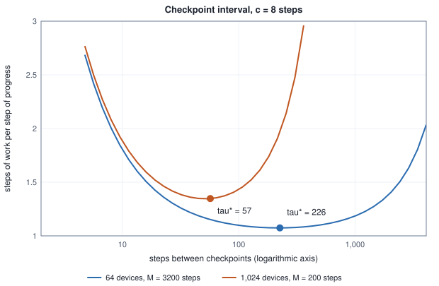
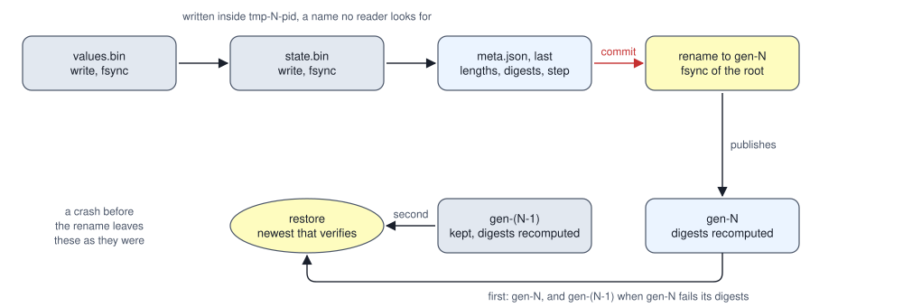

<!-- SPDX-License-Identifier: CC-BY-4.0 -->
<!-- Copyright (c) 2026 Martin Schröder <info@swedishembedded.com> -->

# Checkpoints, Determinism and Recovery

*How does a long training run survive a crash and still produce the same model?*

A device that fails once in 204,800 steps of work is a good device. Run a hundred thousand steps on one of them and the chance that nothing goes wrong is 61 percent. Run the same hundred thousand steps on 64 of them, with the same good devices, and a failure arrives on average every 3,200 steps, 31 of them are expected before the end, and a run that starts over after each failure would need on average $1.2 \times 10^{17}$ steps of work to finish. It never finishes. The arithmetic of the run is unchanged and the machine around it has changed from something that works to something that nearly always has just broken.

A long run therefore has to be able to stop anywhere and go on, and "go on" has a sharp meaning here: the steps after the break must be the steps that would have happened without it. A run that resumes into a slightly different model has not recovered, it has been replaced by another run, and nobody can tell which one produced the numbers in the report. Two things have to be built. One is a way to write the run's state so that a crash during the writing cannot destroy the last good copy. The other is a way to say what the state is, down to every counter and every random draw, so that the continuation is bit for bit the one that was interrupted.

Four ideas from earlier are needed at once, and each can be answered from memory before reading on. What must a checkpoint file say about each tensor so that a reader that has never seen it can find and decode its bytes (Volume VI, Chapter 2, "Importing Pretrained Models and Proving Parity")? Two runs are given the same seed: what else must they share for their results to be identical, and what happens to a stream generator whose values are asked for in another order (Volume I, Chapter 17, "Randomness on a Deterministic Machine")? After $t$ updates of AdamW, what does the next update read besides the weights and the gradient (Volume III, Chapter 7, "Optimizers: From SGD to AdamW")? Why is a rounding draw that is a function of a key and the index of the element better than the next value of a stream (Chapter 2 of this volume, "Mixed-Precision Training")? And draw $d$ of a run's examples: which entry of which epoch's order is it (Chapter 1, "Data Pipelines for Large Models")? The answers are at the end.

## Where the lost steps go

Failures are modelled here as arriving at a constant rate, independent of how long the run has been going. That assumption is wrong for real hardware in detail (parts wear in, and fail together), and it makes the arithmetic closed-form. Let $\mu_{\mathrm{f}}$ be the mean number of steps of work between failures of the whole group. A group of $R$ devices (the $R$ ranks of Chapter 5) fails when any one of them does, so if one device fails once in $\mu_{\mathrm{dev}}$ steps, $\mu_{\mathrm{f}} = \mu_{\mathrm{dev}}/R$. The chance that a stretch of $L$ steps passes with no failure is $e^{-L/\mu_{\mathrm{f}}}$.

Now take a stretch of $L$ steps of work that must be done in one piece, and that starts again from its beginning after every failure. Call the expected steps of work spent on it $T(L)$. With probability $p = e^{-L/\mu_{\mathrm{f}}}$ it succeeds and costs $L$. Otherwise a failure arrives at some step $x < L$, those $x$ steps are lost, and the stretch starts over, costing $T(L)$ again. Writing the lost part as the integral over failure times,

$$T(L) = pL + \int_0^L \left( x + T(L) \right) \frac{1}{\mu_{\mathrm{f}}} e^{-x/\mu_{\mathrm{f}}}\,dx,$$

and the integral of $x e^{-x/\mu_{\mathrm{f}}}/\mu_{\mathrm{f}}$ from 0 to $L$ is $\mu_{\mathrm{f}} - (L + \mu_{\mathrm{f}}) p$. Solving for $T(L)$ gives

$$T(L) = \mu_{\mathrm{f}}\left(e^{L/\mu_{\mathrm{f}}} - 1\right).$$

A run with no checkpoints is one stretch of $L = N_{\mathrm{run}}$ steps. A run that writes a checkpoint every $k_{\mathrm{c}}$ steps, each write costing as much arithmetic as $c_{\mathrm{save}}$ steps, is $N_{\mathrm{run}}/k_{\mathrm{c}}$ stretches of $L = k_{\mathrm{c}} + c_{\mathrm{save}}$ (a failure during a write loses the write too). Its expected work per step of progress is

$$\mathrm{slow}(k_{\mathrm{c}}) = \frac{\mu_{\mathrm{f}}\left(e^{(k_{\mathrm{c}} + c_{\mathrm{save}})/\mu_{\mathrm{f}}} - 1\right)}{k_{\mathrm{c}}}.$$

For $k_{\mathrm{c}}$ and $c_{\mathrm{save}}$ small beside $\mu_{\mathrm{f}}$, expanding the exponential to first order turns the excess over 1 into $c_{\mathrm{save}}/k_{\mathrm{c}} + k_{\mathrm{c}}/(2\mu_{\mathrm{f}})$: the first term is the writes, a share of every step, and the second is the lost work, half an interval for each failure, one failure every $\mu_{\mathrm{f}}$ steps. The two pull in opposite directions in $k_{\mathrm{c}}$, and setting the derivative to zero gives the standard first-order result for the best checkpoint interval (Young, 1974; Daly, 2006 carries the expansion to higher order):

$$k_{\mathrm{c}}^{\star} = \sqrt{2\,\mu_{\mathrm{f}}\,c_{\mathrm{save}}}, \qquad \text{excess at the optimum} \approx \sqrt{2\,c_{\mathrm{save}}/\mu_{\mathrm{f}}}.$$

<!-- worked: checkpoints_and_recovery.failure_budget -->
Assumptions of the example, not measurements: one device fails on average once in 204,800 device-steps, failures of different devices are independent and arrive at a constant rate, a run is S = 100,000 steps, and one checkpoint write costs c = 8 steps of work. For a group of D devices M = 204,800 / D steps. The expected number of failures is S / M; the chance of none is e^(-S/M); a run that restarts from step 0 needs M (e^(S/M) - 1) steps on average; the interval tau* = sqrt(2 c M) (rounded to a whole step) minimises the first-order waste sqrt(2 c / M); the last column is the exact slowdown M (e^((tau + c)/M) - 1) / tau at that interval, in steps of work per step of progress. exp is the library function; numbers are to four significant digits.

| devices D | M (steps) | expected failures | chance of none | steps with no checkpoint | tau* (steps) | first-order waste | slowdown at tau* |
|---:|---:|---:|---:|---:|---:|---:|---:|
| 1 | 204800 | 0.4883 | 0.6137 | 128900 | 1,810 | 0.008839 | 1.009 |
| 64 | 3200 | 31.25 | 2.681e-14 | 1.194e+17 | 226 | 0.07071 | 1.074 |
| 1,024 | 200 | 500 | 7.125e-218 | 2.807e+219 | 57 | 0.2828 | 1.347 |
<!-- /worked -->

One device needs checkpoints for convenience: its first-order waste at the best interval is under 1 percent. At 64 devices the best interval is 226 steps and the first-order waste is 7.07 percent, and at 1,024 it is 57 steps and 28.28 percent. The exact slowdown in the last column is a little larger than the first-order figure (1.074 against 1.0707) because the expansion dropped terms. What the table says about design is the more important part. The group's failure gap falls as $1/R$ and the waste at the best interval grows as $\sqrt{R}$, so a run that is to scale in devices has to make the write cheaper as it scales, and the figure shows how sharp the minimum is at each size.



The horizontal axis is logarithmic, so equal distances are equal ratios of the interval. Both curves fall steeply on the left, where the writes dominate, and rise on the right, where the lost work does; the 1,024-device curve rises faster because there a failure is likely before a long interval is out.

The cost $c_{\mathrm{save}}$ is the lever that brain's code works on, and it is counted in bytes, not seconds. The training state that `save_train_state` writes (below) holds three 32-bit numbers for every optimised parameter, $4 \times 3 = 12$ bytes, whatever format the device holds its moments in, so a model of $10^9$ parameters writes $12 \times 10^9$ bytes each time. Most of what follows is about writing those bytes so that a crash cannot hurt, and about the cheaper form that `crates/optim` writes for runs that keep their moments in 8 bits.

## What the next step reads

Before anything is written, the run has to say what it is. A step of the loop is a function: it reads some numbers, computes, and writes some numbers, and the whole run is that function applied again and again. Resuming is correct exactly when every number the function reads has been saved. Here is a run small enough to hold in view, and the list of what its step reads.

The run trains 4 weights, held as bf16 numbers (16-bit brain floating point), on 8 examples, 2 examples a step, for 12 updates with AdamW. The step does the following, in this order:

```text
record RunState:
    w: array<real>[P]     # weights, as stored (on the bf16 grid)
    m: array<real>[P]     # AdamW first moment
    v: array<real>[P]     # AdamW second moment
    t: int                # updates applied so far
    d: int                # examples drawn so far
    seed: u64             # seed of the order of the examples
    seed32: u32           # seed of the rounding draws

function resume_step(s: RunState, X: array<real>[N, P], y: array<real>[N],
                     B: int, total: int, lr0: real) -> RunState:
    require total >= 1 and B >= 1
    idx = [draw(s.seed, N, s.d + b) for b in 0 .. B]     # draw: Chapter 1
    s.d = s.d + B
    g = batch_gradient(X, y, idx, s.w)                   # (2 / B) * sum, in draw order
    s.t = s.t + 1
    lr = lr0 * ((total - (s.t - 1)) / total)             # linear decay, from lr0 to lr0 / total
    key = mix32(s.seed32 xor mix32(u32(s.t)))
    for j in 0 .. P:
        s.m[j] = 0.9 * s.m[j] + 0.1 * g[j]
        s.v[j] = 0.999 * s.v[j] + 0.001 * (g[j] * g[j])
        mhat = s.m[j] / (1 - 0.9 ^ s.t)
        vhat = s.v[j] / (1 - 0.999 ^ s.t)
        cand = (s.w[j] - (lr * 0.01) * s.w[j]) - (lr * mhat) / (sqrt(vhat) + 1e-8)
        s.w[j] = sr_round_bf16(cand, counter_uniform(key, u32(j)))
    return s
```

Seven things are read. The weights, because the update is a change to them. The two moments, since Adam's step is a ratio of them. The update count $t$, which appears three times: in the bias corrections $1 - 0.9^t$ and $1 - 0.999^t$, in the learning rate (the schedule's position), and in the key of the rounding draws. The number of examples drawn, which says where in the epoch order the next batch starts. And two seeds, one for the order and one for the rounding, which the run chose once and every later step needs. Nothing else is read: the data are the same file, and the step's code is the same code.

To see how much each one matters, the next experiment runs 5 updates, saves the state, starts a second process, loads the state with one part damaged, and runs the remaining 7. The comparison is with the run that was never stopped.

<!-- worked: checkpoints_and_recovery.omitted_state -->
The run: 4 weights, all starting at 0, held as bf16 numbers; 8 examples x_i (each coordinate 2u - 1, u the next uniform() of the generator seeded 11994051401636782805, seed_of 'checkpoints_and_recovery.data', examples in order, coordinates in order) with target y_i = x_i . w* (w* = (1.0, -2.0, 0.5, 3.0), sum in coordinate order from 0.0). Each step draws 2 examples (draw d is entry d mod 8 of `epoch_order(seed, 8, d // 8)`, seed = 0x42ca19b41edfc4be, seed_of 'checkpoints_and_recovery.order'), forms g = (2 / 2) sum_b (x_b . w - y_b) x_b (sum over the batch in draw order), and applies AdamW with beta1 = 0.9, beta2 = 0.999, eps = 1e-08, weight decay 0.01, and rate lr_t = 0.25 ((12 - (t - 1)) / 12) after t applied updates: m = beta1 m + (1 - beta1) g, v = beta2 v + (1 - beta2)(g g), mhat = m / (1 - beta1^t), vhat = v / (1 - beta2^t) (the powers by repeated multiplication from 1.0), candidate = (w - (lr wd) w) - (lr mhat) / (sqrt(vhat) + eps). The candidate is rounded to bf16 stochastically with the draw counter_uniform(key, j) of coordinate j, key = mix32(seed32 xor mix32(t)), seed32 = 0x91dd4cb1 (the low 32 bits of seed_of 'checkpoints_and_recovery.rounding'). The run has 12 updates; it is stopped after 5, its state is saved, and a second process loads the saved state, with the part named in the first column changed, and does the remaining 7. After 5 updates w = (0.28125, -0.11865234375, 0.08837890625, 0.7578125); after 12 in the uninterrupted run w = (0.298828125, -0.294921875, 0.4375, 1.15625) with mean squared error 0.885 over the 8 examples. 'Largest deviation' is the largest difference of a weight from the uninterrupted run after 12 updates.

| what the second process is given | same weights as the uninterrupted run | largest deviation | mean squared error |
|---|---:|---:|---:|
| everything restored | yes | 0 | 0.885 |
| first and second moments set to zero | no | 0.1602 | 0.9871 |
| update count set to 0 (schedule, bias correction and rounding key restart) | no | 0.6875 | 0.5247 |
| examples drawn set to 0 (the data order restarts) | no | 0.1016 | 0.9059 |
| rounding seed replaced by another | no | 0.01562 | 0.8905 |
| weights only (moments, count and draws all 0) | no | 0.3047 | 0.6606 |
<!-- /worked -->

With every part restored the second process finishes with the same four weights as the run that was never stopped, to the last bit. Each omission gives a different run. Forgetting the moments moves a weight by up to 0.1602, since the second process begins with an Adam that has no memory and takes the unnormalised first steps of a new run from the middle of an old one. Forgetting the update count moves a weight by 0.6875, the largest damage of the six, because it restarts the schedule at its full rate, restarts the bias corrections as if the moments were new, and reuses the rounding keys of updates 1 to 5. Forgetting the data position makes the second process read the examples again from the order of epoch 0 (0.1016). A different rounding seed changes only the stochastic roundings, and the damage is two gaps of the bf16 grid at the largest weight (the spacing there is $2^{-7} = 0.007812$), 0.01562. Warm-starting from the weights alone, which brain's `fit_from` does on purpose and says so in the line it prints ("weights only: optimizer moments, schedule position, data order and generator restart"), gives a run that is neither (0.3047).

The last column holds a trap. The mean squared error of the run that lost its update count, 0.5247, is lower than that of the uninterrupted run, 0.885. A resumption is not correct because the loss came out better. It restarted the schedule at its full rate and took larger steps for 7 updates, and it is another run: nobody can say which settings produced the model. The criterion is that the resumed run equals the uninterrupted run, and the loss has no part in it.

Two details of the state need care before a file format is built around it. The first is that the update count is not the step count. A step in which the objective has nothing to train on, or whose gradients are not finite, applies no update, and the moments did not absorb anything, so the bias corrections and the schedule must not move. Commit `0a68a1f82` (16 October 2026) says so in its subject ("AdamW step index counts applied steps only, and survives an exact resume"), and the loop confirms it: `fit_controlled_sharded` increments `applied` only on the branch that calls `adamw_step`, passes `applied` to `cosine_lr` and to the step, and `save_train_state` writes both `step` and `applied` to the file's header. The test `a_resume_continues_the_applied_step_index` skips the first step, stops after the second, and checks that the resumed run's updates are indexed 2 and 3. The second is that the stream of examples is a part of the state when the objective walks a stream of its own. `FitControl::state`'s doc comment says the state is the weights, their moments, the completed step count and the generator's position, and the loop adds the objective's own cursor (`Objective::cursor` and `restore_cursor`), refusing a state saved without the position of an objective that has one (`a_resume_puts_back_the_objectives_stream_position`).

## A write that is whole or absent

The state exists in memory, and it has to reach a disk without a crash being able to leave half of it there. The obvious way to write a file is to open it and write over the old one. A crash in the middle leaves the first part of the new content followed by the end of nothing, or by the end of the old, and the file is neither. The usual repair is to write the new content under another name and then rename it over the old one. A rename replaces a name in a directory in one indivisible step, so a reader sees the old file or the new one.

That fix is sound against one kind of crash and not against another. If the process is killed, everything it has written has reached the operating system, and the rename either happened or did not. If the power fails, the operating system's own buffers are lost. A file system that keeps its directory in a journal can have recorded the rename while the data blocks of the new file were still waiting to be written, and the name then points at a file with holes. The remedy is **fsync**, a call that does not return until the data of one file (or the entries of one directory) are on the storage device: write, fsync the file, rename, fsync the directory.

The next experiment states that argument as a model and counts every state a crash can leave. Each protocol is a list of operations, and a crash can fall after any prefix of the list. In a process crash everything issued so far survives. In a power loss, the changes to the directory (creating a name, renaming one) survive as a prefix of those issued, in order, at least up to the last completed directory fsync, and any subset of the writes survives that includes those before a completed file fsync. The reader of the first three protocols takes the file named `T`, and the reader of the last two takes the newest generation whose parts are all present, which is what the digests of the next section make possible.

<!-- worked: checkpoints_and_recovery.crash_states -->
Each protocol replaces an old file (content A, three parts) by a new one (content B, three parts; a generation has parts V, S and M, with M, the meta part that carries the digests, last). The model: a name operation (create, rename) changes the directory, a write fills one part, `fsync` makes the earlier writes of its file durable and `syncdir` the earlier name operations. A crash can come after any prefix of the operations. In a process crash everything issued survives; in a power loss the name operations survive as a prefix in issue order, at least up to the last completed `syncdir`, and any subset of the writes survives that includes those before a completed `fsync` (a write that did not survive leaves its part empty). The reader of the first three protocols trusts the file `T`; the reader of the generations takes the newest whose three parts are all present, else the one before it. Every crash state of every prefix is counted once. The number of states in which the reader finds no file at all is 0 in every row.

| protocol | crash | states | old | new | old, damage found | torn, accepted |
|---|---|---:|---:|---:|---:|---:|
| overwrite in place | process crash | 5 | 1 | 1 | 0 | 3 |
| overwrite in place | power loss | 31 | 16 | 1 | 0 | 14 |
| temporary file, rename | process crash | 6 | 5 | 1 | 0 | 0 |
| temporary file, rename | power loss | 55 | 47 | 1 | 0 | 7 |
| temporary file, fsync, rename, directory fsync | process crash | 8 | 6 | 2 | 0 | 0 |
| temporary file, fsync, rename, directory fsync | power loss | 37 | 35 | 2 | 0 | 0 |
| generation, parts fsynced, meta last | process crash | 11 | 9 | 2 | 0 | 0 |
| generation, parts fsynced, meta last | power loss | 25 | 23 | 2 | 0 | 0 |
| the same generation, no fsync | process crash | 6 | 5 | 1 | 0 | 0 |
| the same generation, no fsync | power loss | 55 | 47 | 1 | 7 | 0 |
<!-- /worked -->

Overwriting in place leaves a torn file in 3 of the 5 states of a process crash, and in 14 of the 31 states of a power loss. The temporary file with a rename is never torn when the process is killed, and 7 of its 55 power-loss states are torn: the rename survived and some of the data did not, and the reader, who trusts the name, accepts the file. With the fsync before the rename and the directory fsync after it, no state is torn, and the new content is visible in 2 of the 37, after the rename and before it is known to be durable. The generation protocol of the next section gets the same safety (no torn state in 25), and the last row shows what the digests add when the fsyncs are left out: all 7 power-loss states in which a generation arrived damaged are detected, and the reader falls back to the one before. The model is a model: it has the three parts of a file and a handful of operations, and the point of it is that the claim "atomic rename is safe" can be counted, with its two conditions visible.

What does brain do? `checkpoint::st::save_safetensors_with_metadata` (`crates/checkpoint/src/st.rs`) builds the whole file in memory and hands it to `write_durable`, which writes it to `<path>.<pid>.tmp`, fsyncs the temporary, and calls `durable_rename`, which renames it over the path and then fsyncs the directory (the directory fsync is best-effort: a failure to open or sync the directory is ignored, since not every platform or file system can). That is the third protocol of the table, and a crash leaves the old file or the new one. It was the second protocol until commit `df240b205` (14 November 2026), which found that the rename could reach the disk before the data, so that a power loss left a short file under the final name; the same commit gave `StWriter::finish` the same ending, fsync of the file, then `durable_rename`. Commit `4ed0f56a2` (14 November 2026) made `save_train_state` and `write_spill` in `crates/model/src/train.rs` write their final path through `save_safetensors`, where before each had written a shared `<stem>.tmp` and renamed it again, outside the fsync; the resume file and the best-parameters file now commit the same way, and since commits `f05657870` and `40c980a5f` so do the job plan, the checkpoint manifest and each rank's collective report, all through `write_durable`. The process id is in the temporary name since commit `b72884dab` (24 October 2026): several ranks of one job may write the same path, their replicas being identical, and a shared temporary name let them interleave into a corrupt file before the rename. `StWriter` (`crates/checkpoint/src/weightio.rs`), the incremental writer, plans every tensor's offset from names and shapes first, writes the header at once, accepts the tensors in any order, and `finish` renames only when every planned tensor was written, otherwise it returns `st: wrote n/m planned tensors (missing: ...)` and does not rename. A file that does come out short can be recognised by its own header: `st::declared_data_extent` reads only the length prefix and the header, and returns the byte offset at which the declared tensors end, so a file cut short in its data is detected by comparing it with the file's length (`declared_data_extent_matches_a_whole_file_and_survives_truncation_to_the_header_boundary`).

## A generation that exists only once it is complete

A single file named `T` has one weakness that even the fsynced rename does not remove: after the rename, the old content is gone. If the new file turns out to be damaged (a disk can lie, and a file system can have a bug), there is nothing to go back to. The structure that fixes this keeps several complete copies, each under a name of its own, and makes the choice among them a matter of verification. Each copy is a **generation**, a directory that holds everything one step needs, named by the step.

The checkpoint of `crates/optim/src/checkpoint.rs`, introduced with the streamed optimiser in commit `b7d283e1b` (20 October 2026), follows this protocol, and the figure shows its order.



1. Create `tmp-<step>-<pid>` and write into it `values.bin` and `state.bin` (and, for a rule that keeps factored statistics, `factored.bin`), each file created new, written through a hashing writer in 1 MiB buffers, flushed and fsynced.
2. Write `meta.json` last. It names the step, the rounding seed, the counter of the trainer's own generator, the schedule's scalars, the table of tensors (name, element count, precision) and the optimiser rule, and, for each data file, its length and a 64-bit digest. Fsync it, then fsync the temporary directory.
3. Rename the directory to `gen-<step>`, and fsync the root. That rename is the **commit point**: before it no reader sees the step, and after it the whole step is there.

The listing of a root therefore has two kinds of names, `gen-*` directories that came from a completed write and `tmp-*` directories that are only the working space of a writer. A crash before step 3 leaves a `tmp-*` directory that no reader opens and the next commit deletes. A reader (`restore`) does not trust the name `gen-*`, though. It lists the generations, tries the newest, checks that the manifest parses and that the optimiser rule and the tensor table equal the running run's, recomputes the length and the digest of every file, and only then reads it; a generation that fails is skipped for the next older one, and an error is raised only when generations exist and none is usable. After a successful commit `prune` keeps the two newest generations that verify (`KEEP = 2`) and removes older ones, so a damaged newest never leaves the run without a checkpoint. Committing a step that already exists and verifies does nothing, which makes a retry after a crash safe.

The digest is the 64-bit FNV-1a hash (Fowler, Noll and Vo): start from the offset 14695981039346656037, and for each byte xor it into the hash and multiply by the prime 1099511628211, modulo $2^{64}$.

```text
function fnv1a64(data: list<int>) -> u64:
    h = 0xCBF29CE484222325
    for b in data:
        h = (h xor u64(b)) * 0x100000001B3          # the multiplication wraps modulo 2^64
    return h

function verifies(files: list<(text, int, u64)>, read: function(text) -> list<int>) -> bool:
    for (name, length, digest) in files:
        data = read(name)
        if len(data) != length or fnv1a64(data) != digest:
            return false
    return true
```

It is not a cryptographic hash and does not need to be: its job is to notice damage that nobody planned, not to resist someone who plans it. What it does guarantee is simple to see. A change to one byte changes the hash, whatever the other bytes are, because xor with a different byte value gives a different state and each later step (an xor with a byte, then a multiplication by an odd number modulo $2^{64}$) maps different states to different states. The table checks it on a payload and on three other kinds of damage.

<!-- worked: checkpoints_and_recovery.digest -->
Test vectors of the 64-bit FNV-1a hash (offset 14695981039346656037 = 0xcbf29ce484222325, prime 1099511628211 = 0x100000001b3, bytes in order):

| input | FNV-1a 64 |
|---|---|
| '' | cbf29ce484222325 |
| 'a' | af63dc4c8601ec8c |
| 'foobar' | 85944171f73967e8 |

A payload of 1000 bytes, each `integer(256)` of the generator seeded 1222335656194550055 (seed_of 'checkpoints_and_recovery.payload'), in order; its FNV-1a digest is 68a9e8574459cf40. Each change below is applied to the payload and its digest is compared with the original. 'Length changes' says whether the recorded length alone would have caught it.

| change | cases | same digest | length changes |
|---|---:|---:|---|
| one bit flipped | 8000 | 0 | no |
| two different neighbouring bytes swapped | 994 | 0 | no |
| the last k bytes cut off, k = 1 .. 16 | 16 | 0 | yes |
| one zero byte appended | 1 | 0 | yes |

For comparison, the SHA-256 digest of the 10 bytes `weights-v1` (hashlib.sha256) is `c0ab742f68a24ef362b5529351eb13561e746b70a0f815efe7b64b570b477851`.
<!-- /worked -->

All 8,000 single-bit flips and all 994 swaps of two different neighbouring bytes change the digest, and so does every cut and an appended byte; the length recorded beside the digest catches the cuts and the appended byte by itself, and does not catch the other two kinds. For the file that a manifest has to vouch for across machines, `crates/model/src/job.rs` uses SHA-256 (the 256-bit member of the Secure Hash Algorithm family) in the same role. A `CheckpointCommit` names the job, the plan identity (`JobPlan::identity`, the exact bytes every rank joined under), the global step, the world size and, for each file, its role, relative path, length and `sha256:<hex>` digest. It is written the way the protocol above ends: a temporary file, fsync, rename, then an fsync of the directory (`CheckpointCommit::write`). `latest` lists the `commit-<step>.json` names, ignoring the temporary ones, `verify` recomputes every named file, and `compatible_with` compares job, plan and world size. Commit `3e11bacb9` (23 October 2026) states the rule in its message ("a step is committed when and only when rank 0's manifest for it exists"), and the test `a_crashed_commit_leaves_the_previous_generation_and_a_tampered_file_is_refused` checks it: a leftover `commit-00000005.json.tmp` is not a generation, a newer manifest wins, and a changed file fails `verify`.

The two layers differ in what they do on a failed verification, and the difference is worth stating exactly. `CheckpointDir` keeps two directories of its own and falls back. `CheckpointCommit` is a manifest over files that stay where the trainer wrote them: `publish_commit` in `crates/model/src/train.rs` names the single weights file `out`, which is overwritten at each save, so the file of an older commit no longer has the digest that commit recorded. The same test says so in a comment ("the older generation's file is gone as well, so neither is resumable"). In that layer a failed verification means that `verify_resume` refuses to resume, with the reason, which is the safe failure: it stops rather than continue from a state it cannot account for. Commit `9ca3ec173` (24 October 2026) made the loop publish a commit beside every periodic and final save of a distributed run and made a resume refuse a generation that is missing, fails verification, or names another job, plan or world (`a_published_commit_is_what_a_resume_verifies`).

One observation about durability belongs here. The comment of `CheckpointCommit` says the manifest is written "after the files it names are durable", and `CheckpointCommit::write` fsyncs the manifest, renames it and fsyncs the directory. The weights file it names is written by `save_safetensors`, which now fsyncs its temporary, renames it and fsyncs the directory, so the claim holds. Before commit `df240b205` it did not: the weights write flushed and renamed without an fsync, and `publish_commit` computes the digest by reading the file back, which through the operating system's cache gives the content that was written, so after a power loss the manifest could exist while the weights file it named was short. The manifest still does the job it was built for: `verify` compares the length and the SHA-256 digest, and a file that is short or damaged fails both, so the run refuses to resume from it and the failure is announced and not silent.

## What the saved state must agree with

A state that is whole and verified is still the wrong state if it belongs to another run. The loop saves its own exact-resume state in one file (`save_train_state` in `crates/model/src/train.rs`): for every optimised parameter three 32-bit vectors named `w:<name>`, `m:<name>` and `v:<name>` in a safetensors container, and a header with the format name `brain-train-state/1`, the completed `step`, the `applied` count, the generator's state, a fingerprint of the options, the run's `identity`, the selection record of a run that selects on held-out loss, and the objective's cursor. `load_train_state` checks, in this order, that the file has that format name, that its options equal the fingerprint of the current options, that its identity equals the caller's, that its step is not past the run's last step, that the applied count is within the completed steps, that the generator state parses, that the number of saved parameters is the model's, and that every parameter has the same length. Any failure is an error naming the file and the reason ("saved by a run with different training options; resuming it would not continue that run").

The fingerprint (`schedule_fingerprint`) is the list of everything a step's arithmetic or batch depends on in the options: steps, batch size, block size, learning rate, minimum rate, warmup, decay, weight decay, gradient clip, accumulation, the seed, the masking, the evaluation and early-stopping settings, and, when they differ from their defaults, the precision, AdamW's three constants and the matrix-multiply precision. The last group is stored only when it departs from the default, so that a state written before the field existed still resumes under the defaults it was written with, and a change in either direction is refused; `a_resume_under_changed_optimizer_or_gemm_arithmetic_is_refused` tries a different beta1, beta2, epsilon and matrix-multiply precision, and then the same options again, which resume.

The identity is the caller's description of the data and the starting point. For the chat fine-tune of `crates/sdk` it holds the digests of the base model and of the dataset, the replay sets and the monitor set, the adapter's rank, kind and scale, the weight decay, the repeats, the accumulation, how the base is held and how records are rendered. Commit `5b3ecc51d` (29 September 2026) introduced that construction with the sentence that a cancelled run "continues it and ends at the adapter an uninterrupted run produces, bit for bit; a state from different data, options or starting point is refused".

Notice how every real-valued entry is stored: as bits. The fingerprint holds `lr_bits`, `weight_decay_bits` and `grad_clip_bits`, the identity holds `alpha_bits`, and the code comment says why: a decimal round trip through JSON (JavaScript Object Notation) does not give the same 32-bit float back. The reason is that the number a JSON reader produces from the text is a 64-bit float, and the text of the shortest decimal for a 32-bit float parses to a 64-bit float that is not the 32-bit float widened.

<!-- worked: checkpoints_and_recovery.bits_not_decimals -->
Each rate is rounded to the nearest 32-bit float (struct 'f'); its bit pattern is printed, then the 32-bit value as an exact 64-bit float, then the decimal text of the fewest digits that read back to the same 32-bit float, parsed as a 64-bit float (what a JSON reader gives). The last column asks whether the two 64-bit numbers are equal.

| rate as typed | float32 bits | the float32 as a float64 | its shortest decimal text, as a float64 | equal |
|---|---|---|---|---|
| 0.5 | 0x3f000000 | 0.5 | 0.5 | yes |
| 0.001 | 0x3a83126f | 0.0010000000474974513 | 0.001 | no |
| 0.0003 | 0x399d4952 | 0.0003000000142492354 | 0.0003 | no |
| 0.1 | 0x3dcccccd | 0.10000000149011612 | 0.1 | no |
| 1e-5 | 0x3727c5ac | 9.999999747378752e-06 | 1e-05 | no |
<!-- /worked -->

Only 0.5, which is exact in binary, survives. The others come back as a neighbouring 64-bit number, and a comparison of the saved header with a freshly built one would call the same rate a change, and refuse a resume that was correct. Comparing the 32-bit patterns is exact.

A distributed run adds the group to the identity. The loop refuses a run that keeps exact-resume state and a group unless the run identity names the world size (`a_distributed_resume_must_name_its_world_in_the_identity`), and `verify_resume` compares the newest commit's job, plan bytes and world size with the running ones. The reason was computed in Chapter 5: the bits of a summed gradient depend on the number of ranks and the topology, so a run of 4 ranks is not bit-comparable with one of 8, and a state saved by one is not a state of the other. The seed has its own rule since commit `3ca8a873a` (15 October 2026): a fine-tune with no seed given takes the seed of the saved state it resumes, or draws one and records it, so that a cancelled run that was started without a seed still resumes when started again without one. `saved_seed` reads it back from the state's options.

## A draw that survives a restart

The rounding seed and the update count are in the state, and the experiment above showed what losing the count does. There remains the question of what a random draw is, because the answer decides what has to be saved. Chapter 2 drew the line between a stream and a counter: the next value of a generator depends on how many values were asked before it, while a counter draw is a function of a key and an element's index. For a resume the difference is concrete. A stream generator has a state, and that state has to be in the file. A counter draw has none, since its key is a function of the seed and the update count, which are saved anyway.

The next experiment runs the same 12-update run with the two kinds of draw, interrupts it after 5 updates, and resumes it in several ways.

<!-- worked: checkpoints_and_recovery.rounding_resume -->
The run of the previous example, with the draw of the stochastic rounding either the counter draw there or the next uniform() of one generator seeded 16156531867036101653 (seed_of 'checkpoints_and_recovery.stream'), drawn in coordinate order, 4 per update. In each row the run is stopped after 5 updates and resumed with the saved state changed as the first column says; the run it is compared with is the uninterrupted run that rounds the same way. After 5 updates the generator's state is the u64 4363155295275900345; read through a 64-bit float it comes back as 4363155295275900416.

| rounding draw and what the resume has | kept from the saved state | same weights as the uninterrupted run | largest deviation |
|---|---|---:|---:|
| counter draw keyed by (seed, t, element) | the seed and the update count | yes | 0 |
| stream draw, generator state restored | the generator's state, a u64 | yes | 0 |
| stream draw, generator restarted from its seed | nothing | no | 0.007812 |
| stream draw, state saved as a JSON number | the state rounded to 53 bits | no | 0.007812 |
<!-- /worked -->

The counter draw resumes exactly, and needs nothing beyond what the state already has. The stream draw resumes exactly only when its whole state is restored. A generator restarted from its seed, the shortcut of a loop that "just seeds again", draws the values of the start of the run for updates 6 to 12, and the rounded weights differ, by at most one gap of the bf16 grid at the largest weight (0.007812). The last row is the same mistake in a quieter form. The state of the generator is a 64-bit integer, and a JSON number is read by many readers as a 64-bit float, which has 53 bits of significance. The state 4363155295275900345 comes back as 4363155295275900416, differing in its low bits, and the next outputs of the generator are then unrelated to the ones the uninterrupted run drew. `save_train_state` avoids this on purpose: `rng.state().to_string()` is a string, and the comment above it says the state "is a full u64, and a JSON reader that goes through f64 would round it". The same file stores `seed` and the step counts as JSON integers, which `serde_json` keeps as exact 64-bit and 32-bit integers.

The optimiser's own rounding in `crates/optim` is the counter kind. The module comment of `crates/optim/src/streamed.rs` says the stochastic rounding is keyed on `(seed, step, tensor, slot, element)`, and the key is built by `rounding_key(seed, step, tensor, slot)` in `crates/optim/src/codec.rs` from `mix32` words of the seed and the step in its low half and of the seed's high half and the tensor and slot in its high half; the draw of an element is then `unit(key, idx)`. Resume parity follows: `CheckpointDir::restore` calls `opt.set_position(run.step, run.seed)`, so the next update uses the key of the step the saved run would have used, and `streamed_state.rs` checks the consequence in `resume_from_checkpoint_is_bit_identical_to_an_uninterrupted_run`: 10 steps straight, against 6 steps, a checkpoint, throwing the optimiser and its files away, a restore into fresh files (given a different seed first, to prove the restore brings the saved one back), and 4 more steps. The weights and the exported optimiser state, with 8-bit blocks of 64 and stochastic rounding, are equal bit for bit. A related gate, `stochastic_int8_step_is_independent_of_tile_size`, shows the other benefit of a keyed draw: the result of an update is the same whether the tensor is cut into tiles of 64 or of 1,024 elements.

## Bytes that are a function of content

Determinism can be asked of a run, and it can also be asked of the file the run leaves. A reproducibility check, a content-addressed store and a manifest all compare files by their bytes, and a writer that emits the same content in two different byte orders makes all three answer about the writer.

**Determinism in training** is the property that the state of a run after each step is a function of the run's recorded inputs: its seeds, its data, its settings, its code, and the size and shape of its group. Repeating the run, or stopping it and resuming it, then gives the same bits. Every earlier chapter of this volume supplied one clause of it: the epoch order is a function of the seed and the draw count (Chapter 1), the rounding draw is a function of the key and the element (Chapter 2), a sum has a fixed order for a fixed group (Chapter 5), and this chapter adds the clause that the state is saved whole. What the property does not claim is equality across different groups, different devices or different matrix-multiply precisions. Those change the arithmetic, and the fingerprint and the world size are where brain says so.

The same discipline applies to the file. A safetensors file stores its metadata as a map, and the library that serialises it writes the keys in the iteration order of a hash map, which differs from one map instance to another. Commit `2009f47af` (24 September 2026) describes the effect: two saves of identical tensors and an identical card produced files that differed only in the order of four metadata keys, so that a control that compares the adapter of two runs would have called a reproducible trainer irreproducible. The table counts it for four keys.

<!-- worked: checkpoints_and_recovery.key_order -->
Four metadata keys (`brain.config`, `card.family`, `card.id`, `card.kind`, with the values `{"d_model":8}`, `toy`, `brain/toy`, `lora`) are written as the JSON text `{"__metadata__": {...}}` without spaces, in every order, and hashed with SHA-256 (hashlib). The sorted form is `{"__metadata__":{"brain.config":"{\"d_model\":8}","card.family":"toy","card.id":"brain/toy","card.kind":"lora"}}`.

| header written | headers | distinct SHA-256 digests |
|---|---:|---:|
| each of the 4! = 24 orders of the keys | 24 | 24 |
| keys sorted by name | 1 | 1 |
<!-- /worked -->

The fix is `canonical_header` in `crates/checkpoint/src/st.rs`: it parses the serialised header and writes it again with its keys sorted (the workspace leaves `serde_json`'s `preserve_order` off, so its map is ordered by key), padding with spaces to the old length so that the offsets of the tensor data do not move, and leaving the header untouched if the sorted form is somehow longer. The test `the_same_content_saved_twice_is_the_same_bytes` saves the same tensors and card twice, compares the two files byte for byte, and loads one to check that the card survived. The SDK's resume test makes the same claim about a whole run: `a_cancelled_run_resumes_to_the_uninterrupted_result` compares the weights of the resumed adapter with those of the straight run bit by bit and, after that, their digests, "the same adapter file, byte for byte".

## Where each part of a run is kept in brain

Four places hold the parts of the argument, and each has a single job.

`crates/checkpoint` is the container. It writes and reads the weights as safetensors with the model config under the metadata key `brain.config`, durably in the sense of the third protocol of the crash table (fsync of the file, rename, fsync of the directory), with a per-process temporary name, a canonical header and, for large models, the planned-offset `StWriter` and the `save_streamed` function that produces tensors one at a time so the host holds a few of them and not the model. It is also the reader of everything else a run starts from (GGUF, PyTorch files, sharded releases), which is the subject of Volume XIV.

`crates/paramstore` is the memory a run's parameters live in: for each name, the weight, the gradient and the two AdamW moment buffers on the device, with roles that say which exist (`Frozen` allocates only the weight; `Offload` keeps the moments in host memory). For a checkpoint it has two methods that are each other's inverse. `ParamStore::read_moments` returns a parameter's moments as 32-bit vectors, widening bf16 moments exactly, and returns `None` for blockwise 8-bit moments and offloaded parameters, whose codec lives in `crates/optim` (`optim::read_moments_q8`, which the module-level `read_moments` of `crates/optim` selects for them). `write_moments` puts them back, refusing a parameter that has no device moments and a vector of the wrong length rather than writing part of a state, and rounding to nearest into bf16, which restores a bf16 moment exactly. The gate `adamw_bf16_parity.rs` ends with "read-back then restore is the identity": the buffer after `write_moments` equals the buffer before.

`crates/optim` holds the transactional generation of the previous section, for moments that live on the host or on disk, and the keyed rounding.

`crates/model` holds the loop that decides when to save and what the identity is. Two knobs set the cadence, and they are different kinds of knob. `FitOpts::checkpoint_secs` is a wall-clock rule for the weights file: once that many seconds have passed since the last save, the next completed step writes it, and a distributed run that named its job also publishes a commit (the default is 600). `FitControl::state_every` is a step count for the exact-resume state, and its default is 0, which saves it only when the caller's `on_step` returns false to stop the run; the SDK builder's `checkpoint_every` documents the same default, "only when cancelled", and says that setting it makes a crash lose at most that many steps. A run that must survive a process kill, and not only a polite cancellation, therefore asks for a step interval, which is $k_{\mathrm{c}}$ of the first section. The state is committed in a fixed order: the off-device generation first, then the resume file, which names the applied count of that generation. `save_train_state` says why in a comment: a crash between the two "leaves the previous resume file and a generation it does not use, never a file naming a state that is missing". The distributed commit uses the same order: the weights, then the manifest that names them. In both, what makes a commit a commit is one small write that is made last.

Three more commits show how the pieces were completed. Commit `6c849ced1` (1 October 2026) made a run split across several devices resumable by exposing the fused optimiser's moments, with the gate that a run stopped at step 4 and resumed ends at the uninterrupted run's adapters. Commit `5d37f2667` (26 October 2026) made the exact resume generic over where the moments live: the loop commits and restores the host optimiser of an offloaded store for any model, replacing the copies of the moment accessors that two model crates had. And the cadence default above is a fact about the shipped loop, not a property of the method.

## Summary

A run that spans many devices fails often enough that a way to continue it is part of the run. The expected waste of checkpointing every $k_{\mathrm{c}}$ steps is $c_{\mathrm{save}}/k_{\mathrm{c}} + k_{\mathrm{c}}/(2\mu_{\mathrm{f}})$ to first order, minimal at $\sqrt{2\mu_{\mathrm{f}}c_{\mathrm{save}}}$, and for a fixed write cost it grows as the square root of the number of devices.

A **transactional checkpoint** is written so that a crash during the writing leaves the last complete one intact: the new copy is built under a name no reader uses, its parts are made durable with fsync, a manifest with the length and digest of every part is written last, and one rename publishes it. A reader verifies before it trusts, falls back to an older generation when the newest fails, and a state whose digest does not match is refused and not guessed at. The crash-state count (a model) shows the two conditions of the rename, the data's fsync before it and the directory's after it.

**Training resumption** needs everything the next step reads: the weights, the optimiser's moments, the update count (which is not the step count when steps are skipped), the position in the data, the generator's state or the seeds of the keyed draws, and the objective's cursor. Dropping any one gives a different run, and a lower loss does not make it the same one. The state must also agree with the run: the options, the data and starting point, the numbers stored as bits, and the group.

**Determinism in training** is a function of recorded inputs at every step and for every interruption, and it rests on draws keyed to the step and the element, orders keyed to the seed and the draw count, a fixed order of sums for a fixed group, and files that are the same bytes for the same content. It does not promise that two groups of different size, or two kinds of device, compute the same bits.

The limits are the ones counted. The model of a disk is a model. The optimiser's generation keeps two copies; the manifest layer keeps one weights file and refuses rather than falls back. The default cadence of the exact-resume state is to save at a cancellation, so a process kill needs a step interval. And what a run resumes into is only the same run if the next volume's loading and serving of the finished artifact is also repeatable, which is where the volume leaves it: the project that follows moves one run from one device to several and uses every guarantee of this chapter to check that it learned the same thing.

## References

- Young, J. W. A first order approximation to the optimum checkpoint interval. Communications of the ACM 17(9), 530-531, 1974.
- Daly, J. T. A higher order estimate of the optimum checkpoint interval for restart dumps. Future Generation Computer Systems 22(3), 303-312, 2006.

## Check your understanding

1. A colleague saves the weights and both moments after every step, but not the step number, and resumes by starting the step counter at 0. Name three places in the step of this chapter where the counter is read, and say which of them the table of omitted state shows to matter most.
2. "The checkpoint is written to a temporary file and renamed, so it survives a power cut." Find the missing condition and say, using the crash-state table, which kind of state is then possible.
3. A loop stores its stream generator's 64-bit state in a JSON number. It resumes without an error and its loss curve looks normal. Predict what differs from the uninterrupted run, and why no test of the loss would find it.
4. After a resume, the loss at step 12 is lower than the uninterrupted run's. Does this show that the resume worked?
5. Two ranks of one job save a checkpoint to the same path at the same moment. What goes wrong with a temporary name shared by both, and what changes it?
6. A resume loads a state that was saved with a learning rate of $10^{-3}$ stored as the decimal text 0.001. Why can the same rate in the new run still be reported as a change, and what does the loop store instead?

## Exercises

1. **[Calculate]** A group has $R = 256$ devices with $\mu_{\mathrm{dev}} = 204{,}800$ steps, and a checkpoint write costs $c_{\mathrm{save}} = 8$ steps. Find $\mu_{\mathrm{f}}$, the expected number of failures in a run of 100,000 steps, the best interval $k_{\mathrm{c}}^{\star}$ and the first-order waste at it.
2. **[Calculate]** For $R = 1{,}024$ the first-order waste at the best interval is 0.2828 with $c_{\mathrm{save}} = 8$. By what factor must $c_{\mathrm{save}}$ fall to bring it to 0.1414, and what is the new best interval?
3. **[Calculate]** `save_train_state` writes the weight, the first moment and the second moment of every optimised parameter as 32-bit numbers. How many bytes of tensor data does it write for a model of 1,000,000 optimised parameters, and does the answer change if the device holds the moments in 8 bits?
4. **[Calculate]** Count, by hand, the crash states of the protocol "temporary file, rename" under a power loss (one create, three writes, one rename, no fsync), by prefix, and compare the total with the table.
5. **[Implement]** Reproduce `checkpoints_and_recovery.omitted_state` in a language other than Python: the data, the order, the AdamW update with the stochastic bf16 rounding and the six resumes. Your table must agree with the printed one, including the equality column.
6. **[Implement]** Reproduce `checkpoints_and_recovery.crash_states`: the operation lists of the five protocols, the two crash models and the two readers. Your counts must equal the table's.
7. **[Implement]** Reproduce `checkpoints_and_recovery.digest`: the three test vectors of FNV-1a 64, then the payload of 1,000 bytes and the four kinds of change.
8. **[Investigate]** Read `load_train_state` and `fit_controlled_sharded` in `crates/model/src/train.rs` and list every condition under which a resume is refused. For each, name the test, if there is one, that exercises it, and say which of the entries of the run state in this chapter it protects.
9. **[Investigate]** In `a_resume_continues_the_applied_step_index` (`crates/model/src/train.rs`) the first run skips step 1 and stops after step 2. Explain why the resumed run's updates are indexed 2 and 3, and what the bias correction $1 - 0.9^t$ of the first resumed update would be if only the step count were saved.
10. **[Calculate]** In the last protocol of the crash table (the generation with no fsync), under a power loss, exactly 7 states are "old, damage found". Say which states they are and why the number is 7.

## Key terms

- **transactional checkpoint**: a saved state of a run that is written under a name no reader uses, made durable part by part, and published by one atomic step, with the lengths and digests of its parts recorded, so that a crash at any point leaves the last complete checkpoint readable and a damaged one is detected and not used. <!-- concept: transactional-checkpoint -->
- **training resumption**: continuing a run from a saved state so that the continuation performs the same updates as the uninterrupted run: it needs every number a step reads (weights, optimiser state, update count, data position, generator or seeds) and refuses a state that belongs to another run's options, data or group. <!-- concept: training-resumption -->
- **determinism in training**: the property that a run's state after each step is a function of its recorded inputs (seeds, data, settings, code, group), so that repeating the run, or interrupting and resuming it, gives the same bits. <!-- concept: determinism-in-training -->

## Answers

**Recall.**

1. For each tensor, its name, shape, number format (dtype) and the byte range of its data in the file, in a header that a reader can parse without the data; safetensors records exactly that, and the model's config rides in its metadata.
2. The same data, the same code and settings, and the same arithmetic, in the same order of operations. A stream generator asked for its values in another order gives each element another value, since a value depends on how many were drawn before it.
3. The two moments $\mathbf{m}$ and $\mathbf{v}$ and the update count $t$, which sets the bias corrections $1 - \beta_1^t$ and $1 - \beta_2^t$ and, with the schedule, the learning rate.
4. A counter draw depends only on a key and the element index, not on the order or tiling of the work or on whether the run was stopped, so nothing has to be saved except the key's inputs.
5. Entry $d \bmod n$ of the order of epoch $\lfloor d/n \rfloor$, where the order of an epoch is a shuffle that is a function of the run's seed and the epoch number.

**Check your understanding.**

1. The counter is read in the bias corrections, in the learning-rate schedule and in the key of the rounding draws. The table of omitted state resets all three together and gets the largest deviation of the six, 0.6875, so the combination matters most; the schedule's restart to the full rate is the largest part of it.
2. The data must be fsynced before the rename and the directory after it. Without the first, a power loss can leave the rename recorded and some of the data missing, a torn file that the reader accepts: 7 of the 55 states of the second protocol.
3. The generator's state comes back with its low bits rounded to 53 bits of significance, so every later draw is another value, and the rounded weights differ from the uninterrupted run's by gaps of the bf16 grid. The loss moves by far less than its run-to-run noise, so only a comparison of the weights bit by bit shows it.
4. No. The run that lost its update count had a lower loss (0.5247 against 0.885) because it restarted the schedule at a high rate. A resume is correct when the resumed run equals the uninterrupted one, and a better loss is a different run.
5. The two writers write the same file and can interleave into a corrupt one before either renames. Putting the process id in the temporary name gives each its own file, and whichever renames last publishes a complete one.
6. The 32-bit float widened to 64 bits is 0.0010000000474974513, and the text 0.001 parses to the 64-bit float nearest 0.001, a different number. The loop stores `lr.to_bits()`, the 32-bit pattern, which compares exactly.

**Exercises.**

1. $\mu_{\mathrm{f}} = 204{,}800/256 = 800$ steps; expected failures $100{,}000/800 = 125$; $k_{\mathrm{c}}^{\star} = \sqrt{2 \cdot 800 \cdot 8} = \sqrt{12{,}800} \approx 113.1$ steps; first-order waste $\sqrt{2 \cdot 8/800} = \sqrt{0.02} \approx 0.1414$.
2. The waste is proportional to $\sqrt{c_{\mathrm{save}}}$, so halving it needs $c_{\mathrm{save}}$ to fall by a factor of 4, to 2 steps. With $\mu_{\mathrm{f}} = 200$ the best interval is $\sqrt{2 \cdot 200 \cdot 2} = \sqrt{800} \approx 28.3$ steps.
3. $4 \times 3 \times 1{,}000{,}000 = 12{,}000{,}000$ bytes. It does not change: `read_moments` returns 32-bit vectors whatever format the device holds them in (the int8 moments are decoded by `optim::read_moments_q8`).
4. Prefix 0: 1 state (the 3 writes not issued; 1 subset of nothing). Prefix 1 (create): 2 name prefixes times 1 = 2. Prefix 2 (one write): 2 times 2 = 4. Prefix 3: 2 times 4 = 8. Prefix 4: 2 times 8 = 16. Prefix 5 (the rename issued, so 3 name prefixes): 3 times 8 = 24. The total is $1 + 2 + 4 + 8 + 16 + 24 = 55$, the table's number.
5. to 7. The tables printed by the three worked blocks.
8. The conditions are: the file has another format name; its options differ from `schedule_fingerprint`; its identity differs; its step is past the run's steps; its applied count is not within the completed steps; its generator state does not parse; its number of optimised parameters differs; a parameter has another length; a spilled best-parameters file is missing; an objective with a cursor finds none in the state (`a_resume_puts_back_the_objectives_stream_position`); the distributed run does not name its world size (`a_distributed_resume_must_name_its_world_in_the_identity`); and the newest commit is missing, fails verification or belongs to another job, plan or world (`a_published_commit_is_what_a_resume_verifies`). A different option or identity protects the settings and data a step reads; the lengths protect the weights and moments; the cursor protects the data position; the world protects the order of the summed gradients.
9. The first run saved step 2 and applied 1, since step 1 applied no update. The resumed run continues from applied 1, so its two updates are the 2nd and 3rd. With only the step count it would index them 3 and 4, and the first would use $1 - 0.9^3 = 0.271$ in place of $1 - 0.9^2 = 0.19$, and the schedule and the rounding key would be one update ahead.
10. In that protocol the operations are create, three writes, rename. Only the prefix with all five issued can leave the name `gen-2` in the directory, and then the create and the rename have both survived (the name operations survive as a prefix); there is no fsync, so any of the $2^3 = 8$ subsets of the three writes may have survived. They are the states of that prefix in which the rename has survived, with any of the 7 proper subsets of the 3 writes surviving: a generation with 1 or 2 of its 3 parts empty, found by the reader's check and answered by falling back. The 8th subset, all three writes, is the state in which the new generation is complete and is read.
