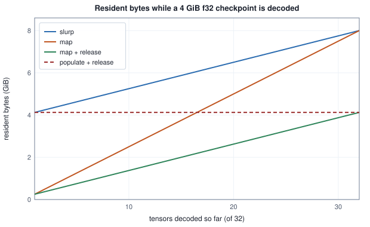
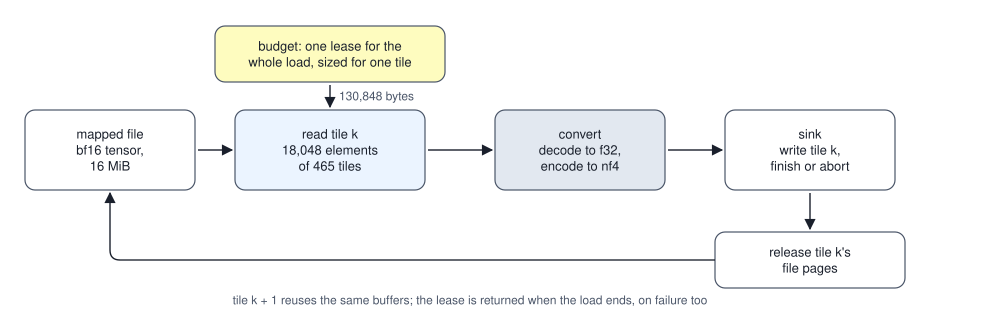

<!-- SPDX-License-Identifier: CC-BY-4.0 -->
<!-- Copyright (c) 2026 Martin Schröder <info@swedishembedded.com> -->

# Loading Models

*How do gigabytes of weights get from disk to the device quickly and safely?*

Before a language model can answer a single question, its weights have to be somewhere the arithmetic can reach them, and the weights are the largest thing the program will ever touch. Take a model of $8 \times 10^9$ parameters stored as 16-bit numbers: $16 \times 10^9$ bytes, a file of 14.9 GiB (1 GiB is $2^{30}$ bytes). The obvious loader reads the file into a buffer, walks the tensors, widens each one to 32-bit floats and keeps the result. At the moment the last tensor is widened the process holds the file buffer ($16 \times 10^9$ bytes) and every widened tensor ($32 \times 10^9$ bytes): $48 \times 10^9$ bytes, three times the file, for a model whose useful content is the file. Every one of those bytes was needed by some step, and the trouble is that they all exist at once. On a machine whose memory is a modest multiple of the model, "all at once" is the difference between a load that finishes and one that the operating system ends.

Loading is the part of an inference engine that decides which bytes exist when. Four questions make it up. How few copies of the weights must a process hold, and how does a file get read without becoming one of them? What does it mean to read part of a tensor, or a tensor that is stored in 4 bits and a scale, without first rebuilding the 32-bit number that nothing needs? How does a load stay inside a fixed amount of staging memory however large the tensor is, and how does it fail without leaving its memory behind? And how does a name that a person typed, `Qwen/Qwen3-0.6B-Q8_0`, become one file on a disk that arrived whole and from a place the process meant to trust?

The arithmetic of loading leans on four ideas from earlier volumes at once; bring each back before the counting starts. What do the first bytes of a safetensors file say, and how does a reader find tensor $x$ in the rest (Volume VI, Chapter 2, "Importing Pretrained Models and Proving Parity")? What must any checkpoint format say about each tensor so that a reader that has never seen the file can decode it (the same chapter)? A Q4_K block holds 256 weights: how many bytes does it take, and so how many bits per weight (Volume IV, Chapter 12, "Quantization: Fewer Bits per Weight")? And given that answer, why can a reader not start decoding a Q4_K tensor at weight number 100?

## Pages that are loaded only when touched

A process does not address the machine's memory directly. It addresses a range of **virtual addresses**, and the operating system keeps a table that says which fixed-size block of physical memory, a **page**, stands behind each page-sized block of addresses. Pages are $B_{\mathrm{page}} = 4{,}096$ bytes on the Linux x86-64 machines the numbers here assume (a system reports its own size). The table may say that a page is not there yet.

That freedom is what a file mapping uses. **Memory-mapping** a file asks the system to make a range of virtual addresses stand for the bytes of the file, without reading any of them. The first time the process reads an address in a page, the processor finds no physical page behind it and raises a **page fault**; the system reads that page of the file into memory, fills in the table and lets the read continue. A page of the file that some earlier reader already brought into the system's **page cache** is mapped without touching the disk. Nothing is read that nobody asked for (the system may read ahead of a sequential walk, which only changes when, not whether).

The memory a process holds in physical pages, its resident memory, comes in two kinds, and the difference between them decides every count below. **Heap** memory is what the process allocated: the only copy of its contents, which the system can keep only by writing it to swap or by ending the process. **File-backed** memory is pages of a mapped file: a read-only mapping's pages are exact copies of the file, so the system can drop them at any moment and fetch them again at the next fault. Both count in the process's resident set; only the second is cheap to give back.

A file mapping is also a promise. If another process shortens the file while it is mapped, a read of the missing page is an error that no check in the reading process could have prevented. The mapping calls in brain are `unsafe` in Rust for that reason, and each rests on one contract: weight files are treated as immutable while they are mapped (`MmapSafetensors::open` in `crates/checkpoint/src/mmap.rs`). The download that puts the file there is arranged so that this holds: it writes elsewhere and renames the finished file into place.

What a reader gains from the mapping is a cost proportional to what it touches. Take a safetensors file of four tensors, write down its layout and count the pages that five different reads touch.

<!-- worked: loading.pages_touched -->
The page size is 4,096 bytes, an assumption of the example (the usual size on Linux for x86-64; a system reports its own). Pages are numbered from 0 at the first byte of the file, and the byte range [a, b) touches pages a // 4096 through (b - 1) // 4096. No data is created: only the arithmetic of the layout is computed. The header is the compact JSON object with one entry per tensor in the order listed, each `{"dtype", "shape", "data_offsets": [start, end]}`, with offsets counted from the first byte after the header, padded with spaces to a multiple of 8 bytes. A row of `embed.weight` is 4,096 x 2 = 8,192 bytes.

The file holds 4 tensors, header text 384 bytes (the compact JSON is 378 bytes, padded with spaces to a multiple of 8), data starting at byte 392, size 385,892,744 bytes = 94,213 pages of 4,096 bytes.

- `embed.weight`: BF16 [32000, 4096], bytes 392 to 262,144,392
- `layers.0.attn.q.weight`: BF16 [4096, 4096], bytes 262,144,392 to 295,698,824
- `layers.0.attn.norm.weight`: F32 [4096], bytes 295,698,824 to 295,715,208
- `layers.0.mlp.up.weight`: BF16 [11008, 4096], bytes 295,715,208 to 385,892,744

| read | first byte | end byte (excluded) | pages touched | page count | % of the file's pages |
|---|---:|---:|---:|---:|---:|
| open: the length prefix and the header | 0 | 392 | 0 to 0 | 1 | 0.001061 |
| embed.weight, rows 100 to 102 (3 rows) | 819,592 | 844,168 | 200 to 206 | 7 | 0.00743 |
| layers.0.attn.norm.weight, whole | 295,698,824 | 295,715,208 | 72,192 to 72,196 | 5 | 0.005307 |
| layers.0.attn.q.weight, whole | 262,144,392 | 295,698,824 | 64,000 to 72,192 | 8,193 | 8.696 |
| every tensor, whole | 392 | 385,892,744 | 0 to 94,212 | 94,213 | 100 |
<!-- /worked -->

Opening the file, which means reading the 8-byte length prefix and the header, touches one page of 94,213 (0.001061 percent). Three rows of the embedding table touch 7 pages, 28,672 bytes, for 24,576 bytes of rows: the rows are not aligned to pages, and the count is the pages they overlap. The whole of the 4096 x 4096 matrix is 8,193 pages (8.696 percent of the file's pages), one more than its 33,554,432 bytes divide into, because the matrix does not start at a page boundary. The commit that introduced the mapped reader, commit `4c657adf8` (27 July 2026), says what it was for: `MmapSafetensors::open` parses only the header and maps the file, tensors are decoded on demand, and `advise_dontneed` drops the pages when a model is demoted, so that weights "stay on disk until touched" for the residency layer that Chapter 2 of this volume builds. The code does exactly this: `open_impl` reads the first 8 bytes, bounds the claimed header length with `validate_header_len` (at most `MAX_HEADER_BYTES`, 100,000,000 bytes, and no more than the file holds) and parses that range, and the tensor bytes are read only by the accessors.

A reader that maps a file and trusts its header is trusting a file that came from a network. Commit `53a6a5f54` (10 August 2026) records the failure that taught this: a download that was cut after the header and before the end of the data, "the common failure", made `open` unwrap offsets that were missing and slice past the end of the mapping, and the panic came deep inside an import or a serving lane's activation. `open` now checks every tensor once, when it is opened, and refuses with one error naming the tensor: offsets present, start not after end, a byte range that is a multiple of the element width, an end inside the data, a type the reader knows. The test `truncated_blob_is_a_clean_open_error_not_a_panic` cuts the blob of a valid file and expects a clean error.

## Four ways to read the same file, counted in resident bytes

Count what a process holds while it widens a checkpoint of $n_{\mathrm{t}}$ equal tensors, each $b_{\mathrm{sto}}$ bytes in the file and $b_{\mathrm{dec}}$ bytes once widened to 32-bit floats ($b_{\mathrm{dec}} = b_{\mathrm{sto}}$ for a file that already stores 32-bit floats, $2\,b_{\mathrm{sto}}$ for 16-bit numbers). The peak $R_{\mathrm{peak}}$ is the most resident bytes at any moment. There are four ways to do it, and brain has used each.

*Slurp*: read the whole file into a buffer first. The buffer is heap, whole, from the first byte, so while tensor $i$ is widened the process holds $n_{\mathrm{t}} b_{\mathrm{sto}} + (i+1)\,b_{\mathrm{dec}}$ bytes, and the peak is $n_{\mathrm{t}} b_{\mathrm{sto}} + n_{\mathrm{t}} b_{\mathrm{dec}}$. *Map*: read from a mapping instead. The file copy is gone from the heap, but every page that was touched stays resident, so the file-backed part grows to the whole file and the total to the same peak (the part that is file-backed can at least be taken back). *Map and release*: after a tensor is widened, tell the system its pages may go (`madvise` with the advice that they are not needed again; they re-fault from the file if read again). Only the tensor being widened is resident from the file, and the peak is $n_{\mathrm{t}} b_{\mathrm{dec}} + b_{\mathrm{sto}}$. *Populate and release*: ask the system to load every page when the mapping is made, in one bulk read-ahead, and release each tensor after it is widened. The file-backed part starts at the whole file and shrinks by one tensor at a time as the heap grows by one, so while tensor $i$ is widened the process holds $n_{\mathrm{t}} b_{\mathrm{sto}} - i\,b_{\mathrm{sto}} + (i+1)\,b_{\mathrm{dec}}$ bytes, a straight line in $i$ whose larger end is $\max(n_{\mathrm{t}} b_{\mathrm{sto}} + b_{\mathrm{dec}},\; n_{\mathrm{t}} b_{\mathrm{dec}} + b_{\mathrm{sto}})$.

<!-- worked: loading.resident_bytes -->
The resident bytes of a process while the tensors of a checkpoint are decoded to 32-bit floats one after another. Heap is memory the process owns: the decoded tensors, and in the first strategy a buffer that holds the whole file. File-backed is the pages of the mapped file that are resident. While tensor i (counted from 0) is decoded, the decoded tensors 0 to i are heap in every strategy. slurp: the file was read into a buffer first, so a heap copy of the whole file exists throughout. map: the file is mapped and every page that was touched stays resident, tensors 0 to i. map + release: a tensor's pages are dropped after it is decoded, so only tensor i's are resident. populate + release: every page was loaded when the mapping was made, and tensors 0 to i - 1 have been dropped, so the pages of tensors i to 31 remain. Two cases of 32 equal tensors: f32, 134,217,728 bytes stored (as f32) and 134,217,728 decoded each, 4 GiB in all; bf16, 500,000,000 bytes stored and 1,000,000,000 decoded each, 16 x 10^9 bytes of file. The peak is the largest value of heap plus file-backed over the 32 tensors; GiB = 2^30 bytes, GB = 10^9 bytes, four significant digits.

| strategy | f32: peak (GiB) | heap | file-backed | bf16: peak (GB) | heap | file-backed |
|---|---:|---:|---:|---:|---:|---:|
| slurp | 8 | 8 | 0 | 48 | 48 | 0 |
| map | 8 | 4 | 4 | 48 | 32 | 16 |
| map + release | 4.125 | 4 | 0.125 | 32.5 | 32 | 0.5 |
| populate + release | 4.125 | 4 | 0.125 | 32.5 | 32 | 0.5 |
<!-- /worked -->



The lines are the same accounting as the table, drawn for the 4 GiB case. Both axes are linear. Slurping starts at 4.125 GiB, the whole file plus one tensor, and climbs to 8; mapping without release starts low and climbs to the same 8; with release the climb stops at the widened model plus one tensor, 4.125 GiB. Populate and release is flat at 4.125 GiB, because what the heap gains the file-backed part loses.

Two readings of the table matter. No peak of these four can be lower than the widened model itself, $n_{\mathrm{t}} b_{\mathrm{dec}}$, which is 4 GiB in the first case and $32 \times 10^9$ bytes, twice the file, in the second; the best strategies reach it plus one tensor. To go below it, the loader must stop widening, and that is what moving the stored form does. And the extra heap a slurp costs is exactly the file: $16 \times 10^9$ bytes in the second case, the quantity the opening counted.

The history can be held against the table where numbers were recorded. Commit `c4c629921` (20 August 2026) found that the safetensors `read` function called `std::fs::read`, "a second anonymous copy of the whole file on the heap", and changed it to map the file.

<!-- perf-number: historical measurement, commit c4c629921 -->
Its message gives one observation: on a run whose text encoder was a 26 GB bf16 checkpoint the peak resident size went from about 80 GB to 73 GB. The commit attributes the drop to the heap copy that disappeared, but the table says that mapping alone leaves the resident peak where it was, since touched pages count. The 7 GB is a dated observation of one run on one machine that the accounting does not explain, and the measurement that followed found why mapping alone was not enough.

<!-- perf-number: historical measurement, commit a77e8931f -->
Seven days later, commit `a77e8931f` (27 August 2026) measured the whole process on a 4.00 GiB checkpoint of 32 tensors of 128 MiB stored as 32-bit floats, the first case of the table, and records the maximum resident size of the whole process as 8.00 GiB for reading the file and decoding, 8.00 GiB for mapping without release and 4.11 GiB for mapping with release. Its message says that mapping "took the second copy off the HEAP" and "did NOT take it off the process's RESIDENT set", since touching a mapping faults its pages in and faulted pages count, and that this was found by measuring the whole process and not by trusting the change. The table's 8, 8 and 4.125 GiB are the model of that measurement. The recorded 4.11 GiB is a little below the model's 4.125 GiB, and the model does not explain the difference.

Two things changed afterwards. Commit `dbea83dc7` (14 September 2026) profiled a cold activation of an 8-billion-parameter model whose checkpoint is 32.76 GB of 32-bit floats and found that the mapping was faulted in a page at a time, and added `MmapSafetensors::open_populated`, which asks for all pages at the mapping call, and wired it into `load_safetensors`. That function (`crates/checkpoint/src/st.rs`) opens the mapping populated, widens each tensor with `tensor_f32` and calls `advise_dontneed_tensor` on it: the last strategy of the table, in which the mapping starts whole and shrinks as each tensor is released. The accounting predicts that its peak is the same as the lazy one's, as the figure shows, and no recorded measurement checks that prediction for the populated variant, since the measurement above preceded it. The same commit removed a clone: `by_role` copied every widened tensor, a second full copy of the checkpoint that nothing read, and `into_by_role` moves them instead. Both changes are the opening's arithmetic again: a step that makes a second whole copy of what is already resident adds that copy to the peak, whatever else it does.

## Reading less than a tensor

A mapped file can be read at any byte, and the next step is to read less than the whole tensor. The need is a table that is indexed: a handful of rows of an embedding table of tens of thousands of rows, or one expert of a stacked tensor of experts, where decoding the whole tensor to read a slice would do work proportional to the table, not to the rows needed. Safetensors gives the byte range of every tensor, so an element range is a byte range: for a tensor whose data start at file offset $o$ and whose elements take $w$ bytes each, elements $j$ to $j + m - 1$ are the bytes $[o + jw,\ o + (j+m)w)$. `MmapSafetensors::tensor_f32_range` computes exactly that, refuses a range that leaves the tensor by returning nothing (a silently shortened read is the failure to avoid), and shares its decoder with the whole-tensor read, so that the range is the matching slice of the whole decode. The tests `a_range_read_gives_the_elements_of_the_whole_tensor_decode` and `range_read_out_of_bounds_returns_none_not_a_panic` pin both. The page count of the first example shows the saving: three rows touched 7 pages of a table that spans 64,000.

A tensor that must be read whole can still be read in pieces. `with_tensor_chunks` hands out chunks of at most `max_elems` elements, each widened into one scratch buffer that the call owns and reuses, so the extra heap is one chunk and not one tensor; the test `chunked_decode_bounds_host_peak_below_one_tensor` splits a 200,000-element tensor into chunks of at most 4,096, checks that every chunk is within the bound and that the chunks, joined, equal the whole-tensor decode exactly. The consumer of that interface is the device upload in `crates/paramstore/src/upload.rs`: its chunk is `UPLOAD_CHUNK_WORDS` = $2^{20}$ elements, 4 MiB of 32-bit words, and it moves a tensor to the device one chunk at a time, whatever the tensor's size.

The cheapest read copies nothing. If the bytes in the file already are the words the device wants (32-bit floats, or the packed 32-bit words of brain's int8 storage), the mapping can lend them as they lie. `raw_words` does so only when the stored type is `F32` or `U32` and the byte range is 4-byte aligned in the mapping, and `bytemuck::try_cast_slice` is the alignment check: a misaligned range, or the wrong type, returns nothing and the caller falls back to the chunked decode. Safetensors does not promise the alignment, as the table of "mod 4" values in Volume VI, Chapter 2 showed; the next example repeats that arithmetic on files where it fails.

<!-- worked: loading.zero_copy -->
Four tensors in this order, `a.weight` F32 [3, 5] (60 bytes), `b.bias` BF16 [3] (6 bytes), `c.weight` F32 [2, 2] (16 bytes) and `d.scale` U32 [8] (32 bytes), in a file whose header is a compact JSON object of the form of the first example, padded with spaces to a multiple of 8 bytes (pad 8) or not padded (pad 1). Offsets count from the first byte of the file; a mapping begins on a page boundary, so a byte's alignment in memory is its offset in the file mod 4. A tensor is lent as 32-bit words when its type is F32 or U32 and its first byte is a multiple of 4. The second table is the chunking of the upload: chunks of 1,048,576 elements, each decoded into one scratch buffer of 4 bytes per element that is reused; the last chunk holds the remainder. The first two shapes are those of the first example; the third is a hypothetical vocabulary table.

| header padding | header bytes | tensor | type and shape | first byte in the file | mod 4 | lent as words |
|---|---:|---|---:|---:|---:|---:|
| pad 8 | 256 | `a.weight` | F32 [3, 5] | 264 | 0 | yes |
|  |  | `b.bias` | BF16 [3] | 324 | 0 | no |
|  |  | `c.weight` | F32 [2, 2] | 330 | 2 | no |
|  |  | `d.scale` | U32 [8] | 346 | 2 | no |
| pad 1 | 251 | `a.weight` | F32 [3, 5] | 259 | 3 | no |
|  |  | `b.bias` | BF16 [3] | 319 | 3 | no |
|  |  | `c.weight` | F32 [2, 2] | 325 | 1 | no |
|  |  | `d.scale` | U32 [8] | 341 | 1 | no |

| tensor of shape (decoded to f32) | elements | bytes if decoded whole | chunks of 1,048,576 elements | bytes of the one scratch buffer | elements of the last chunk |
|---|---:|---:|---:|---:|---:|
| 11,008 x 4,096 | 45,088,768 | 180,355,072 | 43 | 4,194,304 | 1,048,576 |
| 32,000 x 4,096 | 131,072,000 | 524,288,000 | 125 | 4,194,304 | 1,048,576 |
| 151,936 x 4,096 | 622,329,856 | 2,489,319,424 | 594 | 4,194,304 | 524,288 |
<!-- /worked -->

With the header padded to a multiple of 8 the data start at byte 264 and `a.weight` is lent; then the 6 bytes of `b.bias` (an odd number of 2-byte elements) move `c.weight` to byte 330, which is 2 mod 4, and neither 32-bit tensor after it can be lent. With no padding the data start at byte 259 and none of the three 32-bit tensors can be lent. The tests `raw_words_is_zero_copy_for_f32_and_none_for_bf16` and `misaligned_tensor_is_not_cast_but_still_decodes` cover both sides: a misaligned tensor is not lent, and it still decodes through the chunked path to the same values. The chunk table shows the other bound: a 151,936 x 4,096 table (a hypothetical vocabulary of that size) is 2,489,319,424 bytes widened, and 594 chunks of 4,194,304 bytes through one buffer move it.

A caller that needs any of these reads does not care which file format holds the tensor. `checkpoint::TensorSource` is the interface (`crates/checkpoint/src/lib.rs`): `with_tensor`, `raw_words`, `with_tensor_chunks`, `with_tensor_range`, the packed-word chunk reader, `numel` and `advise_drop`, with defaults that decode the whole tensor so that any source works, and with a mapped safetensors file, a mapped GGUF file (the single-file quantized format of Volume IV, Chapter 12; commit `991c0f7f3`, 9 August 2026) and the by-name reader each overriding the bounded ones. The default is the safe behaviour and the override is the saving. Commit `c179a4901` (5 September 2026) shows what a missing override costs. A decoder of a vision-language model's text encoder was imported by `read_model_dir`, which widens every tensor of a directory before the destination allocates anything; for a 63 GB bf16 text encoder that is, as the message puts it, "an unavoidable ~126GB source materialization", and it ran past a 150 GB container limit twice, with a 32-bit and with an 8-bit destination alike, since the widened source dominated both. The fix streamed the decoder through the by-name reader and a renaming source, and added `TensorSource::advise_drop`, a hint that releases the pages behind a tensor as soon as the caller is done with it, so the loader does not wait for memory pressure to force the system to reclaim them. The arithmetic is the opening's: a source materialised in 32-bit floats costs twice the file for a 16-bit file, whatever the destination keeps.

## A quantized tensor is bytes plus a rule for reading them

Widening to 32 bits is what the previous section tried to avoid holding, and for a quantized model it is also the wrong thing to do: the file stores 4 or 8 bits plus scales precisely because the engine will compute with them in that form. A loader for such a model must move the stored bytes and know how to read them. A **packed tensor** is a tensor held in its stored form: a payload of codes and, beside it, sidecar tensors of scales, together with a descriptor that says how the bytes decode. The decoded value of element $i$ is

$$\text{value}_i = \text{element}(\text{code}_i) \times \text{scale}_0(i) \times \text{scale}_1(i) \times \cdots,$$

where $\text{element}$ turns one code into a number: a two's-complement integer; a small float such as E2M1 (4 bits: a sign, 2 exponent bits and 1 mantissa bit); an entry of a fixed 16-entry table such as NF4 (4-bit NormalFloat); or, for the single-file GGUF formats, a block with its own interleaved scales. Each scale level is a sidecar tensor with one value for a group of elements: one for the whole tensor, one for every $n$ consecutive elements along the innermost axis, one per row, or one per $128 \times 128$ tile of a matrix. The levels run from coarse to fine. That is the two-level scale of the k-quantization of Volume IV, Chapter 12 written once for all formats: Q4_K's super-block is the case in which the levels live inside the 144 bytes. `TensorDescriptor` and `QuantEncoding` in `crates/checkpoint/src/packed/encoding.rs` are this descriptor, and the tests `nvfp4_is_e2m1_with_block16_e4m3_and_global_f32_scales` and `ggml_geometry_is_the_gguf_block_table` pin two of its entries.

The descriptor makes sizes computable without opening a file. The payload is $\lceil N_{\mathrm{el}} / g \rceil$ blocks of the block's bytes, where $g$ is the number of elements one block holds (2 for 4-bit codes packed two to a byte, 32 or 256 for the GGUF formats), and each scale level adds its count times its width.

<!-- worked: loading.encodings -->
Counts for a tensor of 4096 x 4096 elements. The payload is ceil(elements / elements per block) blocks of the block's bytes (an element of 4 bits: 2 elements per byte). A scale level adds its count (1 per tensor; elements / n for a scale per n elements; ceil(4096 / 128)^2 = 1,024 for 128 x 128 tiles) times its width in bytes. Bits per element = 8 x total bytes / elements. The tile quantum is the least number of elements that is a multiple of the payload block and of every scale block (a scale per row or per tile counts the row length 4096); the encode quantum adds whole bands of tile rows (a band is 128 rows of 4096 elements, 524,288 elements, so a scale per 128 x 128 tile makes it a multiple of 524,288). The block bytes of the ggml types are Q8_0 34 per 32 elements, Q4_0 18 per 32, Q4_K 144 per 256 and Q6_K 210 per 256.

The tensor is 4096 x 4096 = 16,777,216 elements, row-major, innermost axis 4096.

| encoding | codes and scales | payload bytes | scale bytes per level | total bytes | bits per element | tile quantum | encode quantum |
|---|---|---:|---:|---:|---:|---:|---:|
| bf16 | bf16 | 33,554,432 | 0 | 33,554,432 | 16 | 1 | 1 |
| fp8 tiles | e4m3, one bf16 scale per 128 x 128 tile | 16,777,216 | 2,048 | 16,779,264 | 8.000977 | 4,096 | 524,288 |
| int8 block 32 | int8, one f32 scale per 32 | 16,777,216 | 2,097,152 | 18,874,368 | 9 | 32 | 32 |
| nf4 block 32 | 4-bit codebook, one f32 scale per 32 | 8,388,608 | 2,097,152 | 10,485,760 | 5 | 32 | 32 |
| nvfp4 | e2m1, e4m3 per 16, f32 per tensor | 8,388,608 | 4 + 1,048,576 | 9,437,188 | 4.500002 | 16 | 16 |
| mxfp4 | e2m1, e8m0 per 32 | 8,388,608 | 524,288 | 8,912,896 | 4.25 | 32 | 32 |
| Q8_0 | own interleaved scales | 17,825,792 | 0 | 17,825,792 | 8.5 | 32 | 32 |
| Q4_0 | own interleaved scales | 9,437,184 | 0 | 9,437,184 | 4.5 | 32 | 32 |
| Q4_K | own interleaved scales | 9,437,184 | 0 | 9,437,184 | 4.5 | 256 | 256 |
| Q6_K | own interleaved scales | 13,762,560 | 0 | 13,762,560 | 6.5625 | 256 | 256 |
<!-- /worked -->

The table says three things. The cost of a format is in its scales: NF4 with one 32-bit scale per 32 elements is 5 bits per element, 4 for the code and 1 for the scale, and NVFP4 (E2M1 codes, an 8-bit E4M3 float scale per 16 elements and a 32-bit scale per tensor) is 4.500002, the two scale levels adding half a bit and 4 bytes. Q4_0 and Q4_K cost the same 4.5 bits, as Volume IV found, and Q4_K spends the same bits on a better scale structure. And a repack that is lossless is not free: Q8_0 (8.5 bits per element, a 16-bit scale per 32) becomes 9 bits when the 16-bit scale is widened to the 32-bit scale of brain's int8 storage, 1,048,576 more bytes for a matrix of 16,777,216 elements. The loader implements exactly that repack (`repack_q8_0` in `crates/checkpoint/src/packed/load.rs` widens each block's half-float scale exactly to a 32-bit float and copies the 32 code bytes), and refuses every repack for which no exact conversion exists: the test `q8_0_repack_to_int8_blocks_is_lossless_and_other_repacks_are_refused`.

A packed tensor is addressed in tiles. The smallest piece that can be decoded alone is a payload block together with the scales that cover it, so a **tile** is a flat range of elements whose start is a multiple of the tile quantum, the least common multiple of the payload block and of every scale group (a per-row or per-tile scale counts the length of a row). Reading a tile means reading a byte range of the payload and the range of each scale level that covers it:

<!-- worked: loading.tile_ranges -->
A tile is a range [a, b) of the flat, row-major elements of a tensor, a multiple of the tile quantum (the last tile may end at the end of the tensor). Its payload bytes are [a // g x B, ceil(b / g) x B) for a payload block of g elements and B bytes; a scale per n elements covers scale elements [a // n, ceil(b / n)); a per-tensor scale is element 0 only; a scale per 128 x 128 tile covers the bands of 128 rows that the tile's rows touch, ceil(256 / 128) = 2 scales per band here.

| encoding | shape | tile (flat elements) | tile quantum | payload bytes | scale elements (half-open) |
|---|---|---:|---:|---:|---|
| nvfp4 | [8, 64] | 16 to 48 | 16 | 8 to 24 | level 0: 0 to 1; level 1: 1 to 3 |
| Q4_K | [4, 512] | 256 to 512 | 256 | 144 to 288 | none |
| int8 block 32 | [4, 64] | 32 to 96 | 32 | 32 to 96 | level 0: 1 to 3 |
| fp8 tiles | [256, 256] | 0 to 32768 | 256 | 0 to 32768 | level 0: 0 to 2 |
<!-- /worked -->

The first row is the rule worked out: a tile of elements 16 to 48 of an NVFP4 tensor is payload bytes 8 to 24, the one per-tensor scale (element 0 to 1) and scale elements 1 to 3 of the per-16 level. For Q4_K the quantum is 256, because a block cannot be cut: its 16 scale bytes are inside the 144, which is the answer to the last recall question. The reader interface deliberately has no whole-tensor method (`PackedTensorReader` in `crates/checkpoint/src/packed/reader.rs`: `read_blocks` serves "the packed bytes of a flat element range and nothing else", and a source that cannot serve a range reports it when its descriptor is asked for, not by decoding the tensor whole), and the test `no_read_path_asks_for_a_whole_tensor` wraps a reader that records the largest range it was asked for.

## A load that never holds a whole tensor

A load can now be planned before it runs. A **streaming loader** moves each tensor from storage to its destination one bounded tile at a time, from a plan made before the first byte is read, so that the memory it needs is a configured number and not the size of the tensor. The plan says, for each tensor, what happens to it and how big a piece is staged at a time. There are three things the loader can do to a tensor, and the caller picks one per tensor (`LoadPolicy` in `crates/checkpoint/src/packed/load.rs`): **Preserve** copies the packed bytes and scales unchanged; **Repack** changes the physical layout without changing any value (the Q8_0 case above); **Convert** decodes a tile and encodes it in another format, which is lossy in general and happens only when asked for, and is recorded in the plan. None of the three expands a quantized tensor to full precision on its own: the only 32-bit data is one tile's decode scratch.

The size of a tile follows from a budget. Let $\mathrm{tb}_{\mathrm{src}}(e)$ be the bytes of a tile of $e$ elements in the stored encoding and $\mathrm{tb}_{\mathrm{dst}}(e)$ the same in the target encoding (payload plus scales, counted from the start of a tensor). The staging bytes of a step are

$$\mathrm{stage}(e) = \begin{cases} \mathrm{tb}_{\mathrm{src}}(e) & \text{Preserve},\\ \mathrm{tb}_{\mathrm{src}}(e) + \mathrm{tb}_{\mathrm{dst}}(e) & \text{Repack},\\ \mathrm{tb}_{\mathrm{src}}(e) + 4e + 2\,\mathrm{tb}_{\mathrm{dst}}(e) & \text{Convert}, \end{cases}$$

the stored tile, plus for a Convert the $e$ decoded 32-bit values and the encoded tile twice, because the packers build a buffer of 32-bit words before they write bytes (`staging_bytes` in the same file counts it this way). The tile starts at the quantum $q_{\mathrm{tile}}$ and grows by one quantum while it stays inside the tensor and $\mathrm{stage}$ stays within the cap $c_{\mathrm{tile}}$, the smaller of the configured tile size (`LoadConfig::tile_bytes`, 4 MiB by default) and the capacity of the budget. If even one quantum does not fit, the plan is refused before anything is read.

```text
record Encoding:
    elems: int                    # elements per payload block
    bytes: int                    # bytes per payload block
    scales: list<(text, int, int)> # (kind, n, bits): kind "tensor", or "block" (one scale per n elements)

function pages_of(a: int, b: int, page: int) -> (int, int, int):
    require 0 <= a and a < b and page >= 1
    first = a // page
    last = (b - 1) // page
    return (first, last, last - first + 1)

function tile_bytes(enc: Encoding, e: int) -> int:
    total = ((e + enc.elems - 1) // enc.elems) * enc.bytes
    for (kind, n, bits) in enc.scales:
        count = 1 if kind == "tensor" else (e + n - 1) // n
        total = total + count * bits // 8
    return total

function stage(src: Encoding, dst: Encoding, op: text, e: int) -> int:
    if op == "Preserve":
        return tile_bytes(src, e)
    if op == "Repack":
        return tile_bytes(src, e) + tile_bytes(dst, e)
    return tile_bytes(src, e) + 4 * e + 2 * tile_bytes(dst, e)       # Convert

function tile_quantum(enc: Encoding) -> int:
    q = enc.elems
    for (kind, n, bits) in enc.scales:
        if kind == "block":
            q = lcm(q, n)
    return q

function plan_tiles(N: int, src: Encoding, dst: Encoding, op: text, cap: int) -> (int, int, int):
    require N >= 1 and cap >= 1
    q = tile_quantum(src)
    if op != "Preserve":
        q = lcm(q, tile_quantum(dst))
    if stage(src, dst, op, q) > cap:
        return (0, 0, 0)                               # refused: not even one quantum fits
    e = q
    while e + q <= N and stage(src, dst, op, e + q) <= cap:
        e = e + q
    e = min(e, N)
    return (e, (N + e - 1) // e, stage(src, dst, op, e))   # elements per tile, tiles, staging bytes
```

`plan_tiles` is `plan` of `Loader` in `crates/checkpoint/src/packed/load.rs` restricted to the encodings that have per-tensor and per-block scales; `pages_of` is the page rule of the first example. For a Preserve the target is the stored encoding.

<!-- worked: loading.load_plan -->
The plan of one tensor. The tile starts at the quantum (the step's tile quantum: the least common multiple of the quanta of the stored and the target encoding) and grows by one quantum at a time while it stays inside the tensor and its staging bytes are at most the cap, the smaller of the tile byte cap and the budget capacity; a tensor whose first tile exceeds the cap is refused. Staging bytes of a tile of e elements: Preserve, the stored tile; Repack, the stored tile plus the repacked tile; Convert, the stored tile, 4 e bytes of decoded f32 values and twice the encoded tile. The tile of a stored or target encoding is its payload bytes plus its scale bytes for e elements counted from the start of a tensor. Encodings: Q8_0 is 32 elements per 34 bytes; int8 block 32 is 1 byte per element plus 4 bytes per 32; nf4 block 32 is 4 bits per element plus 4 bytes per 32; bf16 is 2 bytes per element. The first table has a cap of 4 MiB; the second repeats the bf16 to nf4 load for tensors of 2^22, 2^26 and 2^30 elements.

| load | step | elements | tile byte cap | budget capacity (bytes) | elements per tile | tiles | staging bytes per tile |
|---|---|---:|---:|---:|---:|---:|---:|
| Q8_0 to Q8_0 | Preserve | 16,777,216 | 4,194,304 | unbounded | 3,947,552 | 5 | 4,194,274 |
| Q8_0 to int8 block 32 | Repack | 16,777,216 | 4,194,304 | unbounded | 1,917,376 | 9 | 4,194,260 |
| int8 block 32 to nf4 block 32 | Convert | 16,777,216 | 4,194,304 | unbounded | 657,920 | 26 | 4,194,240 |
| bf16 to nf4 block 32 (256 x 32768) | Convert | 8,388,608 | 131,072 | 524,288 | 18,048 | 465 | 130,848 |
| bf16 to int8 block 32, 64-byte budget | Convert | 16,384 | 1,048,576 | 64 | refused: the smallest tile (32 elements, 264 bytes) exceeds 64 bytes |  |  |

| elements | count | bytes stored as bf16 | elements per tile | tiles | staging bytes per tile |
|---|---:|---:|---:|---:|---:|
| 2^22 | 4,194,304 | 8,388,608 | 578,496 | 8 | 4,194,096 |
| 2^26 | 67,108,864 | 134,217,728 | 578,496 | 117 | 4,194,096 |
| 2^30 | 1,073,741,824 | 2,147,483,648 | 578,496 | 1,857 | 4,194,096 |
<!-- /worked -->

The first table runs the three steps on the 4096 x 4096 matrix with a 4 MiB cap. Each tile uses 4,194,274, 4,194,260 and 4,194,240 bytes, a little under the cap, because the tile grows only by whole quanta; the number of tiles is $\lceil N_{\mathrm{el}} / e_{\mathrm{tile}} \rceil$: 5, 9 and 26. The fourth row is the setup of the test `a_tensor_far_larger_than_the_budget_converts_within_it` (a 16 MiB bf16 tensor, converted to NF4 through a budget of 512 KiB and a tile size of 128 KiB), whose plan here is 465 tiles of 18,048 elements staging 130,848 bytes, and the test asserts more than 100 tiles, a leased peak within the budget and a heap peak within the budget plus 64 KiB. The last row is `a_tensor_whose_smallest_tile_exceeds_the_budget_is_refused_up_front`: with a 64-byte budget the smallest tile of 32 elements needs 264 bytes and the plan is an error naming the tile and the budget. The second table shows the property that matters most. For tensors of $2^{22}$, $2^{26}$ and $2^{30}$ elements the tile is 578,496 elements and 4,194,096 bytes of staging every time, and only the number of tiles changes, 8, 117 and 1,857: the staging footprint is a configured number, not a function of the tensor.



The staging is leased. A `MemoryBudget` caps the host bytes in flight and records the high-water mark; a load takes one `Lease` of its tile staging bytes before it allocates its buffers, waits until the bytes are free, and the lease is released when it is dropped, which is on success, error, panic and cancellation alike (`crates/checkpoint/src/packed/budget.rs`). The test `a_failed_load_aborts_the_sink_and_returns_every_byte_to_the_budget` fails a load at its third tile and checks three things: the sink was told to abort, the budget is back to zero bytes in use, and the budget serves another load afterwards. The test `concurrent_loads_share_one_budget` gives two loads room for one and a half and checks that the high-water mark stays within the capacity and that the two outputs are equal.

Why one lease for a load and not one for each buffer a load needs? Take two loads on a budget of 100 bytes, each needing 80 bytes in all. If a load asks for its two 40-byte buffers one after the other, and each holds the first while it waits for the second, each can hold 40 and wait for 40 that only the other can give back.

<!-- worked: loading.lease_schedules -->
Two loads share a budget of 100 bytes. A load that needs 80 bytes in all either asks for them in two leases of 40 bytes, one after the other, and gives both back when it is done, or asks for one lease of 80. A move is one step by one load, and the final release of everything a load holds is a move of its own; a request for bytes that are not free is not a move (the load waits). An interleaving is a maximal sequence of moves, counted by exhaustive search; two sequences that differ in the order of the moves are two interleavings.

| each of the two loads asks for | interleavings | both loads finish | stuck with both waiting |
|---|---:|---:|---:|
| two leases of 40 bytes, taken one after the other | 4 | 2 | 2 |
| one lease of 80 bytes | 2 | 2 | 0 |
<!-- /worked -->

Of the four interleavings of the two-lease case, two end with both loads stuck, each holding 40 bytes and waiting for 40; with one lease of 80 there are two interleavings and in both a load runs to the end while the other waits. A load that holds part of what it needs while it waits for the rest is the shape that deadlocks, and asking for the whole at once removes it. The budget in brain takes one lease per step for this reason, so that loads "cannot deadlock each other", and it has a stated limit: the budget coordinates the threads of one process, not separate processes, and the pages of a mapped file are not heap and are not leased; `resident_file_bytes` reads them from the system (the `RssFile` line of `/proc/self/status`) so that a report can say how much a load grew.

That last number is tested both ways. `consumed_file_pages_are_released_so_residency_stays_near_the_tile` streams a 64 MiB tensor in 1 MiB tiles and asserts that the file-backed resident bytes grew by less than 16 MiB; its negative control `without_release_the_same_load_leaves_the_whole_file_resident` forwards everything except the release and asserts a growth of more than 48 MiB, so the measurement can see pages pile up. Commit `b94a78726` (20 October 2026) added the reader, the budget and the loader together, and its message lists what a failed load does: it "aborts the sink and returns its lease".

A load of a whole model is a sequence of such steps, one per tensor, and `plan_all` plans them all before the first byte is read: it fails on the first tensor that cannot be planned, so a model whose smallest tile does not fit is refused before any work is done.

## Naming a model so that a name can do no harm

A person types a name and the engine turns it into a directory on a disk and a URL (web address) on a network. Two things can go wrong with that, and both are about the name: it can be ambiguous, so that two models answer to it, and it can be hostile, so that it names a place outside the store. The answer in brain is a grammar, small enough to state in full and strict enough that a name either has exactly one reading or is refused with a reason (`crates/modelref/src/lib.rs`).

A **model reference** has the form `vendor/repo`, optionally followed by `-QUANT` for a quantization, and optionally by an adapter. An adapter is `:owner:name:tag`, or the short form `+name` for the local adapter `local:name:latest` (and `+name:tag` for `local:name:tag`). The vendor and repo are those of the model hub the files come from, with case kept exactly, since a differently cased name is a different repository at the host. The reading of a string is a fixed sequence of checks, each of which, if it fails, is a named refusal:

1. A string that is empty or has no `/` has no vendor.
2. The string is cut at its first `/` into vendor and rest; either one empty is an empty segment.
3. A rest with another `/` has too many segments.
4. Whitespace anywhere is a bad character.
5. An adapter suffix is split off first, so that a quantization on its left is still found. With a `+`: what is left of it must hold no `:`, what is right of it no second `+`, the name and tag (the tag `latest` when none is given) must be non-empty, the tag must hold no `:`, and neither may be `.` or `..` (path traversal). Without a `+`, a `:` starts an adapter of exactly three segments, none of them empty. Anything else is a bad adapter, except that a segment that is `.` or `..`, in either form, is path traversal (once the shape is right), so `Qwen/Qwen3-8B:local:..:latest` is path traversal and not a bad adapter.
6. A repo that is empty after the split is an empty segment.
7. The quantization is one of 15 uppercase tokens: `Q4_0 Q4_1 Q5_0 Q5_1 Q8_0 Q2_K Q3_K_S Q3_K_M Q3_K_L Q4_K_S Q4_K_M Q5_K_S Q5_K_M Q6_K Q8_K`. The repo is tested against each token, longest first, for an ending of `-` followed by the token, with a non-empty base left over; if that base itself ends in `-` and a token with a non-empty base before it (so `v/Q8_0-Q4_0` is the repo `Q8_0` with the quantization `Q4_0`, since `Q8_0` has no `-` and base before its token), the name has two quantizations and is refused.
8. A vendor or a repo that is exactly `.` or `..` is path traversal.

Each check stands where it does for a reason: the adapter is split off before the quantization so that `Q4_K_M+maren` finds its quantization; the traversal check comes last so that it sees the repo without its quantization. And the closed list of quantization tokens is a decision, not a convenience: `BF16`, `F16`, `F32` and `FP8` are not in it. They are what a base repo's weights are stored as, and a name such as `nvidia/NVIDIA-Nemotron-3-Nano-30B-A3B-BF16-Q8_0` is only parsed correctly if `BF16` is part of the repo and `Q8_0` is the quantization. The commit that introduced the grammar, commit `67284efd8` (4 August 2026), says this in its message, and its tests cover examples like those of the table below.

<!-- worked: loading.reference_grammar -->
The fifteen quantization tokens are `Q4_0 Q4_1 Q5_0 Q5_1 Q8_0 Q2_K Q3_K_S Q3_K_M Q3_K_L Q4_K_S Q4_K_M Q5_K_S Q5_K_M Q6_K Q8_K`, uppercase only; `BF16`, `F16`, `F32` and `FP8` are not tokens. The checks run in the order the text gives, and the first that fails names the refusal.

| text | result |
|---|---|
| `Qwen/Qwen3-0.6B` | vendor `Qwen`, repo `Qwen3-0.6B`, quant none, adapter none; prints as `Qwen/Qwen3-0.6B` |
| `Qwen/Qwen3-0.6B-Q8_0` | vendor `Qwen`, repo `Qwen3-0.6B`, quant Q8_0, adapter none; prints as `Qwen/Qwen3-0.6B-Q8_0` |
| `qwen/qwen3-0.6b` | vendor `qwen`, repo `qwen3-0.6b`, quant none, adapter none; prints as `qwen/qwen3-0.6b` |
| `Qwen/Qwen3-0.6B-q8_0` | vendor `Qwen`, repo `Qwen3-0.6B-q8_0`, quant none, adapter none; prints as `Qwen/Qwen3-0.6B-q8_0` |
| `nvidia/NVIDIA-Nemotron-3-Nano-30B-A3B-BF16-Q8_0` | vendor `nvidia`, repo `NVIDIA-Nemotron-3-Nano-30B-A3B-BF16`, quant Q8_0, adapter none; prints as `nvidia/NVIDIA-Nemotron-3-Nano-30B-A3B-BF16-Q8_0` |
| `Qwen/Qwen3-0.6B-Q8_0-Q4_0` | refused: two quantizations |
| `Qwen/Qwen3-8B+maren` | vendor `Qwen`, repo `Qwen3-8B`, quant none, adapter local:maren:latest; prints as `Qwen/Qwen3-8B:local:maren:latest` |
| `Qwen/Qwen3-8B-Q4_K_M+maren:v2` | vendor `Qwen`, repo `Qwen3-8B`, quant Q4_K_M, adapter local:maren:v2; prints as `Qwen/Qwen3-8B-Q4_K_M:local:maren:v2` |
| `Qwen/Qwen3-8B:swedishembedded-com:generic-sft:latest` | vendor `Qwen`, repo `Qwen3-8B`, quant none, adapter swedishembedded-com:generic-sft:latest; prints as `Qwen/Qwen3-8B:swedishembedded-com:generic-sft:latest` |
| `Qwen/Qwen3-8B:local:maren` | refused: bad adapter |
| `Qwen/Qwen3-8B+a:b:c` | refused: bad adapter |
| `Qwen/Qwen3-8B:local:..:latest` | refused: path traversal |
| `Qwen` | refused: no vendor |
| `/Qwen3` | refused: empty segment |
| `Qwen/Qwen3/x` | refused: too many segments |
| `../Qwen3` | refused: path traversal |
| `Qwen/..` | refused: path traversal |
| `Qwen/Qwen3 8B` | refused: bad character |
| `Q4_K_M/-Q4_K_M` | vendor `Q4_K_M`, repo `-Q4_K_M`, quant none, adapter none; prints as `Q4_K_M/-Q4_K_M` |
| `Qwen/-Q8_0` | vendor `Qwen`, repo `-Q8_0`, quant none, adapter none; prints as `Qwen/-Q8_0` |
<!-- /worked -->

Some rows are worth pausing on. Lowercasing the whole name still parses, but it names another repository (`qwen/qwen3-0.6b` is a valid name, not of the same repository), and a lowercase `-q8_0` is a repo suffix and not a quantization, because strict beats guessing. `Qwen/Qwen3-0.6B-Q8_0-Q4_0` is refused, since stripping one suffix and quietly leaving the other would load a model the person did not name. The two refusals about `..` make the grammar itself the security gate: the vendor and the repo become directory names verbatim (`Store::repo_dir` joins them onto the store root with no further check), so a reference that parses can never name a place outside the store. And the last two rows show that a repo that is nothing but a token is a repo, not an empty one with a quantization.

The set of reserved vendors is the other half of the gate:

<!-- worked: loading.reserved_vendors -->
The vendors `brain`, `local` and `test` are reserved.

| reference | network |
|---|---|
| `brain/demo` | never fetched |
| `local/qwen` | never fetched |
| `test/x` | never fetched |
| `Qwen/Qwen3-0.6B` | may be fetched |
<!-- /worked -->

A name with no `/`, or under `brain`, `local` or `test`, never causes network access (`is_reserved`): `brain/...` are the engine's built-in residents, `local/...` is a file a person put into the store with no upstream, and `test` is reserved. Whether something is fetched is therefore decided by a pure function of a string, which can be tested without a network.

The quantization tokens are ranked. `Quant::fidelity_rank` orders them `Q8_0`, `Q6_K`, `Q5_K_M`, `Q5_K_S`, `Q4_K_M`, `Q4_K_S`, `Q3_K_L`, `Q3_K_M`, `Q3_K_S`, `Q2_K` from best to worst and ranks the legacy and internal types last, so that a release repo that publishes fifteen interchangeable quantizations and a person who named none get the best of the ladder and never a legacy type by accident; `fidelity_rank_is_monotonic_in_the_documented_order` is the test. Seven of the tokens (`Q3_K_S` to `Q5_K_M`) name a mixed recipe in which attention and output tensors get a higher block type than the rest, so `Quant::ggml_type` returns no single block type for them, and a caller that wants exact sizes must read them tensor by tensor from the file. Old short names such as `qwen` are mapped to a canonical reference by `alias::canonical`, which only two places consult: the catalog of the HTTP (Hypertext Transfer Protocol) server, and the dispatch of D-Bus (the desktop message bus) and of `brain do`. A model's own record holds the canonical name, never the legacy one.

## Where models live and how they arrive

A reference names a place. The **model store** is the directory tree where those places are, and the code that finds a model in it, or decides what has to happen to put one there (`crates/modelstore`). The store is keyed by `vendor/base-repo`, with the quantization stripped, since a quantization shares its base's tokenizer and configuration and lives in the same directory: `<models>/Qwen/Qwen3-0.6B/` holds the configuration, the tokenizer, the checkpoint as downloaded and each quantization as `<QUANT>.gguf`, and an adapter lives under `<repo>/adapters/<owner>/<name>/<tag>/` as `adapter.brain.safetensors`. `Store::local` answers "is this reference on disk and servable": for a base reference (no quantization, no adapter) it looks for a compound manifest first (`brain.manifest.json`, which names role files such as a weights file or directory, relative to the repository directory; a pull writes one, so a download serves as it is), then the single brain-format file `model.brain.safetensors`, then a complete checkpoint directory that came some other way. A manifest whose role path is absolute or contains `..` is refused by name, `LocalError::UnsafeRolePath` (commit `204e8eb87`, 7 September 2026, after which a manifest cannot read or serve a file outside its own directory), and one whose role file did not arrive is `MissingRole`; `Store::local_detailed` reports both, so a broken install is told apart from one that is not installed.

Finding the models directory is the first lookup of every load, and it is a ladder with a fixed order:

<!-- worked: loading.store_directories -->
The models directory is the first of: a non-empty flag; the data root published by a flag, followed by `/models`; the non-empty variable BRAIN_MODELS_DIR; XDG_DATA_HOME followed by `/brain/models`; HOME followed by `/.local/share/brain/models`. A variable that is set to the empty text counts as unset. Angle brackets stand for a directory the machine names, `<home>` for the value of HOME.

| what is set | the models directory |
|---|---|
| nothing set | none: no store |
| HOME only | `<home>/.local/share/brain/models` |
| XDG_DATA_HOME and HOME | `<xdg>/brain/models` |
| BRAIN_MODELS_DIR, XDG_DATA_HOME and HOME | `<m>` |
| an empty BRAIN_MODELS_DIR and HOME | `<home>/.local/share/brain/models` |
| a published data root `<data>` and BRAIN_MODELS_DIR | `<data>/models` |
| the flag `<flag>`, a data root and BRAIN_MODELS_DIR | `<flag>` |

- `<models>/Qwen/Qwen3-0.6B/`  holds the base, its tokenizer and its `Q8_0` quantization (`Q8_0.gguf`)
- `<models>/Qwen/Qwen3-8B/adapters/local/maren/latest/adapter.brain.safetensors`  holds the adapter of `Qwen/Qwen3-8B+maren`
<!-- /worked -->

`default_root` in `crates/modelstore/src/lib.rs` is that ladder, and `loader::model_dir::resolve` puts a non-empty flag above it. An explicitly typed flag outranks an inherited variable; a variable set to the empty text does not count. With nothing set the answer is no store, and the callers report it, instead of guessing a directory.

When the reference is not on disk the store plans. `plan` returns a list of steps, each one of `Serve` (it is already there), `Download` (fetch one file from `vendor/repo` at a revision to a name in the repository's directory), `Convert` (make a downloaded checkpoint servable, a step the caller runs because converting needs a model crate) or `Quantize` (quantize a base that is already there to the requested quantization, locally). The plan tries these cases in order. A reference that is on disk plans to `Serve` with no call to the hub (`on_disk_ref_plans_to_serve_with_no_hub_calls`). A reserved vendor that is not on disk is not fetchable (`reserved_vendor_not_on_disk_is_not_fetchable`). A reference without a quantization is planned from a listing of the repo's files by the recipe that matches it best, and a tie at the best level is an error, `AmbiguousRecipe`, and not a pick by declaration order. A reference with a quantization first lists the repo it names, and if that is itself a quantized release the suffix selects a file inside it (`a_quant_suffix_selects_a_file_inside_the_named_gguf_repo`); otherwise it looks for a published quantized file elsewhere and then falls back to the base plus a local `Quantize`:

<!-- worked: loading.quant_candidates -->
For a reference with a quantization, repos are listed in this order and the first that holds the file is downloaded (`<repo>` is the repo name without the suffix, `<Q>` the token); the file looked for is always `<repo>-<Q>.gguf`.

| order | repo listed | file looked for |
|---:|---|---|
| 1 | `Qwen/Qwen3-0.6B-GGUF` | `Qwen3-0.6B-Q8_0.gguf` |
| 2 | `Qwen/Qwen3-0.6B` | `Qwen3-0.6B-Q8_0.gguf` |
| 3 | `Qwen/Qwen3-0.6B-Q8_0` | `Qwen3-0.6B-Q8_0.gguf` |
<!-- /worked -->

The three repos are the same-vendor conventions of `quant_candidates` in `crates/modelstore/src/plan.rs`: a sibling repo named for the format, the file beside the safetensors in the same repo, or one repo per quantization (a table of cross-vendor publishers precedes them, for a model whose own vendor publishes none; it has one row, which sends `Qwen/Qwen3.5-35B-A3B` first to the repo `bartowski/Qwen_Qwen3.5-35B-A3B-GGUF` for the file `<repo>-<Q>.gguf`). The first repo whose listing holds the file is downloaded to `<QUANT>.gguf` (`quant_ref_with_upstream_gguf_repo_plans_a_single_download`), and when none does, the plan is the base's steps followed by a `Quantize` (`quant_ref_with_no_upstream_artifact_falls_back_to_base_plus_quantize`), which is always a valid answer, so that a hub that errors for one candidate does not fail the ladder.

`execute` runs the `Download` steps and returns the steps it could not run. It is idempotent per file: a download whose destination exists is skipped. That is the whole of resuming, and it is correct only because of how a file is written.

## A file that arrives whole or not at all

A multi-gigabyte download will be interrupted, and the store must not mistake the interrupted file for a complete one, because the mapped reader of the first sections maps whatever is there. The writer, `stream_to_file` in `crates/modelstore/src/fetch.rs`, makes three decisions. It writes to a part file next to the destination, with a name of its own for each transfer (the process identifier and a counter), created exclusively, and renames it onto the destination only when the transfer has succeeded; the rename is the single moment the file exists under its real name, and a failure removes the part file. It reads in chunks of 64 KiB, so its memory is one chunk whatever the file's size, the same bound as the loader's. And it checks before it commits: more bytes than the server declared is an error, a stream that ends before the declared size is an error (`UnexpectedEof`), and an expected digest, when one is given, is compared with the SHA-256 (a 256-bit cryptographic hash) of the bytes written.

<!-- worked: loading.atomic_download -->
A download writes its bytes to a part file beside the destination and renames the part file onto the destination only when every check has passed. The first four rows are the four outcomes of the transfer of `model.safetensors` through an in-memory file system; in the fifth the process is killed after 2 bytes, so nothing runs that could remove the part file. The second table asks whether a download of the first size may start when the file system has the second size free: it needs the download plus a reserve of 2^30 bytes.

The SHA-256 digest of `abc` is the 64 hexadecimal digits `ba7816bf8f01cfea414140de5dae2223` followed by `b00361a396177a9cb410ff61f20015ad`.

| transfer | outcome | `model.safetensors` exists | part file left |
|---|---|---|---|
| 10 bytes arrive, 4 declared | error: runs past its declared length | no | no |
| 3 bytes arrive, 10 declared | error: ends before its declared length | no | no |
| b"abc", digest 00 | error: digest differs | no | no |
| b"abc", 3 declared, digest of b"abc" | ok | yes | no |
| b"abcdef", killed after 2 bytes | killed | no | yes |

| download (bytes) | free on the file system (bytes) | starts |
|---|---:|---:|
| 8,589,934,592 | 9,663,676,416 | yes |
| 8,589,934,592 | 9,663,676,415 | no |
| 8,589,934,592 | 107,374,182,400 | yes |
| 107,374,182,400 | 106,300,440,576 | no |
<!-- /worked -->

The first four rows are the transfers of the tests `a_failed_download_leaves_nothing_behind`, `a_download_shorter_than_declared_is_refused` and `sha256_match_renames_into_place`: too much data, too little, a wrong digest (the digest of `abc` is as printed), and a transfer that passes all three. In each failing row neither the destination nor the part file is left. The fifth row is not a test but the situation the design is for: a killed process cannot clean up, so its part file stays, under a name that nothing mistakes for the model. The call to `stream_to_file` that a hub download makes passes the length the server declared in `Content-Length` and, for a file stored with the host's large-file mechanism (every weight file), the SHA-256 that the revision listing records for it, read by `lfs_sha256`; a plain file has none to check (`HfHub::download` in `crates/modelstore/src/hub.rs`, test `the_listing_gives_each_lfs_file_its_sha256`). Both checks were added together by commit `00d4940d0` (14 November 2026), whose message gives the defect: the writer refused a stream that ran past its declared size but renamed one that ended early, so a dropped connection became a truncated checkpoint under the final name, and the digest check it already had was never used for a real download. The second table is the check before it starts: a download whose length the server declared is refused when it would leave less than `DISK_RESERVE`, 1 GiB, free on the file system, so that a request for a repository larger than the disk cannot take the space that the server, its logs and every other model share (`a_download_must_leave_the_reserve_free`).

The rename is what makes the skip in `execute` correct, and the history of that skip is also the history of a claim corrected. Commit `d6a67a032` (24 August 2026) found that a killed fetch of a multi-shard repository re-downloaded every shard it already had, including a 4.97 GB shard that was complete, because `plan` always returned the full list of files and its one early exit fires only when every file is present. The fix skips a `Download` whose destination exists. Its message gives the reason bare existence is the right test and a size or checksum comparison is not needed: because of the rename, a file at the destination is by construction a download that completed. It also says that the dependence now runs the other way, and the doc comment of `execute` repeats it: if `stream_to_file` ever wrote its destination incrementally, the check would have to become a size or digest comparison in the same change. Four days later, commit `45a98facd` (28 August 2026) corrected a sentence: the help text and the guide said that an interrupted download "is resumed by repeating the command", true by file and false by byte, since the part file is created afresh by a retry. For a sharded checkpoint the loss is one shard of six, which looks like a resume; for a release that is one 9.29 GiB file, a pull interrupted at 4.83 GiB had nothing it could keep.

<!-- worked: loading.resume_by_file -->
A repository of six shards of 4 GiB each, 24 GiB in all, is fetched file by file, and the process is killed in the fourth shard after 1.5 GiB of it was written. The part file is not continued by a retry (the retry opens it afresh), and a file that exists is complete. GiB = 2^30 bytes. 'Moved twice' is the bytes of both attempts minus the bytes of the complete repository.

| interrupted fetch | retry rule | first attempt (GiB) | retry (GiB) | both attempts (GiB) | moved twice (GiB) |
|---|---|---:|---:|---:|---:|
| six shards of 4 GiB, killed in the fourth after 1.5 GiB | skip a file that exists | 13.5 | 12 | 25.5 | 1.5 |
| same kill | download everything again | 13.5 | 24 | 37.5 | 13.5 |
| one file of 9 GiB, killed after 4.5 GiB | skip a file that exists | 4.5 | 9 | 13.5 | 4.5 |
<!-- /worked -->

The table counts the bytes of a hypothetical six-shard repository. Skipping what exists moves 12 GiB on the retry, the three shards that are missing, and the 1.5 GiB written to the killed shard is moved twice; starting over would move 24 GiB. The single file of 9 GiB, killed halfway, loses all 4.5 GiB and moves 9 on the retry, which is what the 4.83 GiB of that 9.29 GiB pull would have done had it been retried. Byte-level resume needs an HTTP range request, which the `Hub` interface does not express (its methods list a repository, read a small file and stream a file to disk), and the commit records that gap at the interface, which is where such a method would have to be added.

A download goes to a host, and a host can redirect. `HfHub` follows redirects one hop at a time and refuses any whose target is not a listed domain or one of its subdomains (the host equals the domain, or ends in a dot followed by it, never a substring), with at most 10 hops, and an operator can name one more domain for a mirror.

<!-- worked: loading.hosts -->
A redirect is followed only to a host that is a listed domain or a subdomain of one (the host equals the domain, or ends in a dot and the domain). The listed domains are `huggingface.co` and `hf.co`, plus the one domain an operator may name for a mirror.

| host a redirect names | mirror named by the operator | followed |
|---|---|---:|
| `huggingface.co` | none | yes |
| `cdn-lfs.huggingface.co` | none | yes |
| `us.aws.cdn.hf.co` | none | yes |
| `evilhuggingface.co` | none | no |
| `huggingface.co.evil.example` | none | no |
| `hf-mirror.example` | none | no |
| `hf-mirror.example` | `hf-mirror.example` | yes |
<!-- /worked -->

Commit `dd02c63e0` (4 August 2026) records two defects that the unit tests could not reach and that running the real fetch against the real host did. The HTTP client, asked not to follow redirects itself, returns a redirect as an ordinary response, and the loop that was meant to follow them checked only the error branch, so it was never taken and every redirect handed the caller the redirect's own text page as if it were the file. And the allowlist named only the older content hosts, while the host's current large-file storage redirects to a regional subdomain of a shorter domain; the suffix rule above replaced the list of regions. The lesson is about where a check lives: a security boundary written against a mock is a claim about the mock.

## What a caller asks of the loader

Resolving, placing and fetching a model sat inside the command-line program until commit `b3adfc6ca` (15 September 2026) moved them out: `crates/loader` holds the parts of "find and load a model" that need nothing from a command line, so that any program can resolve a model without linking the `brain` binary. What stays in the binary is what must exit the process.

The first function is `resolve_base`, which turns the argument a person gave into the weights file, its directory and a canonical identifier. The order of its attempts is what matters: a directory is resolved through the store as `<root>/<vendor>/<repo>`; an existing file is its own weights, its directory supplies the tokenizer and its identifier is `local/<stem>`; only then is the text parsed as a reference. The existence of the file comes first because `out/qwen.safetensors` is also a perfectly valid reference, and the test `resolve_base_prefers_a_real_file_over_parsing_it_as_a_model_ref` pins that. A pulled directory whose manifest says its weights are the directory itself resolves to the directory and not to the manifest (`resolve_base_opens_a_pulled_checkpoint_directory_not_its_manifest`): opening the manifest as tensors would read JSON as weights.

The second is the resolver for an architecture's roles. `try_resolve` returns an assembly of role files or one of three failures, each with its message and its code: no models directory (1), ambiguous (3, `AMBIGUOUS_EXIT`), or missing (4, `MISSING_EXIT`), so that a script can tell "name one more thing" from "nothing here" without reading the message. An override that names an existing file outside the store is that role's file (`an_override_outside_the_store_resolves_to_that_file`) and the store is not modified.

The third is the decision about the network, made explicit. `ensure_default_weights` returns a runnable checkpoint for an architecture, and `DownloadPolicy` says how eagerly it may touch the network, where the program used to decide silently from one environment variable. The three policies, read from the order of their checks in `ensure_default_weights_with`:

<!-- worked: loading.download_policy -->
What the three policies do for a default checkpoint, from the order of their checks. The last column assumes the hub answers.

| policy | reference already in the store | hub contacted | result |
|---|---|---|---|
| Offline | yes | no | use the local copy |
| Offline | no | no | stop with an error that names `brain pull` |
| IfMissing | yes | no | use the local copy |
| IfMissing | no | yes | list, download, convert, then use it |
| AlwaysCheck | yes | no | use the local copy |
| AlwaysCheck | no | yes | list, download, convert, then use it |
<!-- /worked -->

`Offline` is the guarantee that no network is used, whatever the environment says; its failure names the remedy (`offline_never_fetches_and_names_the_remedy_when_nothing_is_pulled`). `IfMissing` looks in the store first and fetches once when the checkpoint is absent (`if_missing_never_touches_the_hub_once_the_checkpoint_is_local`, `if_missing_fetches_once_when_nothing_is_local`). `AlwaysCheck` goes through the plan and execute sequence at every call; a reference already complete on disk is served by `plan` without a call to the hub, and execute skips each file that has landed, so for a checkpoint that is present the two policies do the same, as the table's rows show, and `AlwaysCheck` differs only when the local copy is incomplete or absent.

The last is the question asked before a load: whether this model can be served here. `doctor` answers it from the store, the disk and the free memory of the cards, without loading weights or opening the network. It fails below 1 GiB of free disk and warns below 10 GiB (`FAIL_BELOW_FREE_BYTES`, `WARN_BELOW_FREE_BYTES`), and for the GPUs it compares the bytes of the model's weight files with the free memory of the best card, an estimate that counts the weights and not the activations or the cache of keys and values. Where the model should live among the devices a machine has is not decided here. `BudgetPlacer` in `crates/loader/src/placement.rs` probes the free memory of each card, subtracts a headroom and hands the question to the residency planner, and what the planner does when a model does not fit is taken up in Chapter 2 of this volume, "Memory Budgets and Model Residency".

## Where each part of loading is kept in brain

The mapped readers and the widening are in `crates/checkpoint` (`mmap.rs`, `st.rs`, `safetensors.rs`, with the page hints in `pio.rs`), and the packed descriptor, the tiled loader and the budget are in `crates/checkpoint/src/packed/` (`encoding.rs`, `reader.rs`, `load.rs`, `budget.rs`). The device upload is `crates/paramstore/src/upload.rs`. The grammar is `crates/modelref`, a leaf crate with no dependency on any other brain crate, so that the checkpoint crate, the store, the servers and the model crates can all use it without a cycle. The store, the planner and the fetcher are `crates/modelstore`, whose planner depends on nothing above the checkpoint and reference crates, and the library half of the command line is `crates/loader`.

## Summary

A model's weights exist in memory as heap, which only the process can give up, or as file-backed pages, which the system can take back. Memory-mapping a file makes its bytes addressable without reading them and makes the cost of a read proportional to the pages touched; reading a file by mapping and releasing each tensor's pages after it is widened brings the peak of a load down from the file plus the widened model to the widened model plus one tensor, and every copy counts: a second whole copy of what is resident adds its whole size to the peak. A packed tensor keeps a quantized tensor as codes, sidecar scales and a descriptor from which the sizes, the tile that can be read alone and the byte ranges of a tile follow by arithmetic, and a streaming loader plans its tiles from a staging budget so that the staging bytes are a configured number independent of the tensor, takes its memory as one lease so that concurrent loads cannot deadlock, and leaves no memory and no half-written destination behind when it fails. A model reference is a grammar with a fixed order of checks, so that a name has one reading or a named refusal and cannot name a place outside the store; the model store keys directories by that reference, plans what must be fetched, and writes a file under its real name only when it is whole, of the declared size and, for a large-file object, of the digest the host lists.

The method has limits. The accounting is a model of resident bytes, checked against two recorded measurements, not against every machine; the budget coordinates one process; a failed download retries by file and not by byte; and the mapping rests on the contract that a weight file is not modified while it is mapped. What follows from loading is a question about many models: a server that holds several does not have room for all of them in the memory of one device, and which ones live where is the subject of the next chapter.

## Check your understanding

1. A colleague says that mapping a 16 GB file "uses no memory until it is read", and so a program that maps it and then reads every tensor once, keeping the pages, needs no more memory than before. Use the first two rows of the resident-bytes table to say what is right and what is wrong in this.
2. A loader decodes bf16 tensors to 32-bit floats one tensor at a time, releases each tensor's pages after decoding, and reports a peak of 32.5 GB on a 16 GB file. A second loader reports 48 GB with everything else the same. Name what the second loader holds that the first does not.
3. `raw_words` returns nothing for a tensor of type `F32` in a file whose header is 251 bytes long and whose first tensor is a 60-byte `F32` tensor. The same tensor in a file whose header is 256 bytes long is lent. Explain, using offsets.
4. A load has a staging budget of 4,194,304 bytes. Its Convert step has $\mathrm{stage}(e) = 6.375\,e$ for a tile quantum of 32. How many elements does a tile hold, and what happens if the tensor has fewer than that many elements?
5. Two loads each need two buffers of 45 bytes from a budget of 100 bytes. One of them argues that taking the buffers one at a time is fine since "there is always a moment when one is free". Show the interleaving that disproves it.
6. `Qwen/Qwen3-8B-Q4_K_M+maren` parses. In what order did the grammar find the adapter and the quantization, and what would break if the order were reversed?
7. A fetch of a single file is killed at 80 percent. The store has no `.part` cleanup. Why is it nevertheless safe to retry, and what does the retry cost in bytes? A second fetch is not killed but its connection drops at 80 percent and the stream ends quietly: what does the writer do?

## Exercises

1. **[Calculate]** A checkpoint has 40 tensors of 200,000,000 bytes stored as bf16 and widened to 32-bit floats. Find $R_{\mathrm{peak}}$ of the four strategies and the tensor at which each is reached.
2. **[Calculate]** A table of 50,000 rows of 2,048 F16 values starts at byte 1,000 of a file. How many 4,096-byte pages do rows 10 to 14 (five rows) touch? How many pages does the whole table touch?
3. **[Calculate]** An encoding stores 4-bit codes, one 16-bit scale per 64 elements and one 32-bit scale per 4,096 elements. Find its bits per element, its tile quantum, and the payload and scale byte ranges of the tile of elements 8,192 to 12,288.
4. **[Calculate]** Plan a Repack of a Q8_0 tensor of 1,048,576 elements to int8 blocks of 32 under a 256 KiB cap: elements per tile, number of tiles and staging bytes per tile.
5. **[Calculate]** Five shards of 6 GiB are fetched; the process is killed in the second shard after 2 GiB, and again, after the retry, in the fourth after 3 GiB. Count the bytes moved by all three attempts under skipping existing files and under starting over.
6. **[Implement]** Reproduce `loading.reference_grammar` in a language other than Python: the eight checks in order and the table of results for the 20 texts printed. Your table must agree on every row.
7. **[Implement]** Reproduce `loading.load_plan`: the plan of each row, with the quantum rule, the growth of the tile by one quantum and the staging rule of the three steps. Your tile sizes, tile counts and staging bytes must equal the table's, and the last row must be refused.
8. **[Implement]** Reproduce `loading.lease_schedules` by exhaustive search over interleavings, and then extend it to three loads of 40 + 40 bytes on a budget of 120 bytes, counting the interleavings that end stuck.
9. **[Investigate]** Read `stream_to_file` and the tests of `fetch.rs`, and list every condition that must hold before the part file is renamed onto the destination, naming the statement of the function that checks each and the test, if any, that exercises it. Say what changes for a caller that passes a digest.
10. **[Calculate]** For a file of 32 equal tensors of 128 MiB stored as 32-bit floats, give the heap and the file-backed bytes before the first tensor is widened, after the sixteenth, and after the last, for the loop of `load_safetensors` in `crates/checkpoint/src/st.rs` (populated mapping, release after each tensor), and say what their sum does.

## Key terms

- **memory-mapping**: making the bytes of a file addressable as memory without reading them, so that the system loads a page of the file the first time a read touches it and can drop a clean page again at any time. <!-- concept: memory-mapping -->
- **streaming loader**: a loader that moves a tensor from storage to its destination one bounded tile at a time, planned in advance from a staging budget, so that the memory it needs is a configured number and not the size of the tensor. <!-- concept: streaming-loader -->
- **packed tensor**: a tensor kept in its stored, quantized form: a payload of codes, sidecar tensors of scales and a descriptor that says how the bytes decode, so that sizes and byte ranges of a tile follow from arithmetic. <!-- concept: packed-tensor -->
- **model store**: the directory tree of a machine's models, keyed by the reference's vendor and base repository, together with the code that finds what is on disk and plans what must be fetched to serve a reference. <!-- concept: model-store -->
- **model reference**: the string that names a model, `vendor/repo` with an optional quantization and adapter suffix, whose grammar gives it exactly one reading or a named refusal and keeps it from naming a place outside the store. <!-- concept: model-reference -->

## Answers

**Recall.**

1. The first 8 bytes are an unsigned 64-bit little-endian integer $n$, the length of the header; the next $n$ bytes are a JSON object that maps each tensor's name to its type, shape and `data_offsets`, a start and an end that are counted from the first byte after the header. Tensor $x$ is the bytes $[8 + n + \text{start},\ 8 + n + \text{end})$ of the file.
2. Each tensor's name, shape, number format and the byte range of its data, in a header a reader can parse without the data.
3. 144 bytes for 256 weights, 1,152 bits, 4.5 bits per weight.
4. A block cannot be cut: the scales and minimums of its sub-blocks are inside its 144 bytes, so a decoder needs the whole block, and a tile of a Q4_K tensor starts at a multiple of 256 weights.

**Check your understanding.**

1. Right: a mapping reads nothing when it is made, and a file-backed page can be given back. Wrong: every page that is touched stays resident, so after reading every tensor once without release the file-backed part is the whole 16 GB, and with the widened tensors the total is the same as slurping, 48 GB in the 16-bit case. The mapping saved the heap copy, not the resident bytes; releasing each tensor's pages is what reduces them.
2. A whole second copy of the file in the heap (slurping the file into a buffer first, or keeping the file's pages and the widened tensors both). The difference of 15.5 GB is the file less the one tensor that the first loader keeps.
3. The data start at $8 + L_{\mathrm{h}}$, with $L_{\mathrm{h}}$ the header's length in bytes. With a header of 251 bytes they start at byte 259, which is 3 mod 4, so the first tensor starts at an address that is not a multiple of 4 and cannot be cast to 32-bit words. With 256 bytes they start at 264, a multiple of 4, and the tensor is lent.
4. $4{,}194{,}304 / 6.375 \approx 657{,}930$, rounded down to a multiple of 32: 657,920 elements (staging 4,194,240 bytes). If the tensor has fewer elements, the tile is cut to the tensor's length and the load has one tile.
5. A takes 45 and B takes 45, leaving 10 bytes free. A asks for its second 45 and waits, and B does the same: each holds 45 and waits for 45 that only the other can give back, and neither can proceed. Either load alone would fit (90 bytes of 100), but the moment when a second buffer is free never comes.
6. The `+maren` suffix is split off first, leaving `Qwen3-8B-Q4_K_M`, whose quantization is then found at its end. If the quantization were looked for first, the text would end in `maren`, not a token, and the quantization would be missed; the adapter's name would also be left inside the repo.
7. The part file is not the destination, so the store sees no file and the retry starts a fresh transfer (and a new part file, named for its own transfer); the whole file is moved again, 100 percent of its size, since the part file cannot be continued without a range request. A stream that ends quietly short of the declared size is refused with `UnexpectedEof`, the part file is removed and nothing is renamed, so the retry starts the same way.

**Exercises.**

1. $b_{\mathrm{sto}} = 2 \times 10^8$, $b_{\mathrm{dec}} = 4 \times 10^8$, $n_{\mathrm{t}} = 40$. Slurp: $8 \times 10^9 + 1.6 \times 10^{10} = 2.4 \times 10^{10}$ bytes. Map: the same, $2.4 \times 10^{10}$. Map and release: $1.6 \times 10^{10} + 2 \times 10^8 = 1.62 \times 10^{10}$. Populate and release: $\max(8 \times 10^9 + 4 \times 10^8,\ 1.6 \times 10^{10} + 2 \times 10^8) = 1.62 \times 10^{10}$, reached at the last tensor, where the line is highest. Each peak is reached at the last tensor: the resident bytes rise with the tensor index whenever $b_{\mathrm{dec}} > b_{\mathrm{sto}}$, and the line of the populated strategy rises here by $b_{\mathrm{dec}} - b_{\mathrm{sto}} = 2 \times 10^8$ bytes per tensor, and would be flat only if the two were equal.
2. The rows are $2{,}048 \times 2 = 4{,}096$ bytes each. Rows 10 to 14 are bytes $1{,}000 + 40{,}960 = 41{,}960$ to $1{,}000 + 61{,}440 = 62{,}440$ (end excluded). Pages $41{,}960 // 4{,}096 = 10$ to $(62{,}439) // 4{,}096 = 15$: 6 pages. The whole table is $1{,}000$ to $1{,}000 + 204{,}800{,}000 = 204{,}801{,}000$; pages 0 to $204{,}800{,}999 // 4{,}096 = 50{,}000$: 50,001 pages.
3. Per element: $4 + 16/64 + 32/4096 = 4.2578125$ bits. The payload block is 2 elements per byte, the 64-element scale makes $\operatorname{lcm}(2, 64) = 64$, and the 4,096-element scale gives $\operatorname{lcm}(64, 4096) = 4{,}096$: the quantum is 4,096. Elements 8,192 to 12,288 are payload bytes 4,096 to 6,144, 64-element scale elements 128 to 192 (bytes 256 to 384) and 4,096-element scale elements 2 to 3 (bytes 8 to 12).
4. Q8_0 is 34 bytes per 32 elements and int8 blocks 36 bytes per 32 elements, so $\mathrm{stage}(e) = (34 + 36)\,e/32 = 2.1875\,e$; the cap is 262,144, so $e \le 119{,}837.3$, a multiple of 32: 119,808 elements, staging 262,080 bytes, $\lceil 1{,}048{,}576 / 119{,}808 \rceil = 9$ tiles.
5. Skipping files that exist: the first attempt moves shard 1 (6 GiB) and 2 GiB of shard 2, 8 GiB; the retry needs shards 2 to 5 and is killed after shard 2 (6), shard 3 (6) and 3 GiB of shard 4, 15 GiB; the third attempt fetches shards 4 and 5, 12 GiB. Total $8 + 15 + 12 = 35$ GiB. Starting over each time: 8, then shards 1 to 3 (18) and 3 GiB, 21, then all five, 30: 59 GiB.
6. Implementation: the 20 printed rows of the table are the check.
7. Implementation: the printed plans, including the refusal, are the check.
8. Implementation: the printed counts are the check, and for the extension three loads of two 40-byte buffers on a budget of 120 bytes have 102 interleavings, of which 6 end stuck (the 6 orders in which the three loads take their first buffers, after which none of the second buffers fits), and one lease of 80 per load has 6 interleavings and none stuck.
9. The part file is renamed when the loop has read the stream to its end (a read of 0 bytes), after every chunk was written, after the declared length, when there is one, was neither exceeded (`the download runs past its declared length`, the first assertion of `a_failed_download_leaves_nothing_behind`) nor fallen short of (`a_download_shorter_than_declared_is_refused`), after `sync_all`, and, when a digest is given, after the SHA-256 of the bytes written equals it (the second assertion of that test and `sha256_mismatch_is_rejected_and_leaves_no_dest_file`); an error at any point removes the part file. Without a declared length the function still treats the end of the stream as the end of the file, so what is renamed is whatever the stream delivered; a digest turns that into a check of the content, which is what a caller that passes one changes, and the hub download passes one for every large-file object.
10. Before the first tensor: heap 0, file-backed 4 GiB (every page was loaded at the mapping call), sum 4 GiB. After the sixteenth: heap 16 x 128 MiB = 2 GiB, file-backed 2 GiB, sum 4 GiB. After the last: heap 4 GiB, file-backed 0, sum 4 GiB. The sum is 4 GiB throughout, and 4.125 GiB at the moment a tensor is being widened, because the tensor's own pages and its widened copy exist together.
