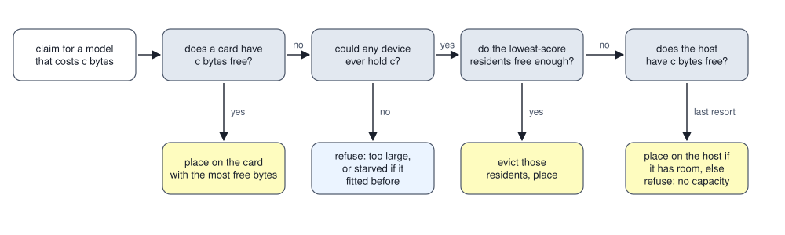
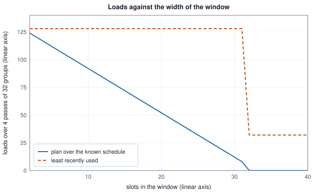

<!-- SPDX-License-Identifier: CC-BY-4.0 -->
<!-- Copyright (c) 2026 Martin Schröder <info@swedishembedded.com> -->

# Memory Budgets and Model Residency

*How does a server decide which models live on which device when they do not all fit?*

A server on one card of 24 GiB (1 GiB is $2^{30}$ bytes) is asked for three models of 10 GiB each. One model fits with 14 GiB to spare, two fit if the card gives up nothing else, and three need 30 GiB. Whatever the server does, one of three requests will find its model missing from the card, and the interesting questions are which model has to leave, how the server knows that two models fit at all, and what happens to the bytes a running request needs that no model's weights account for. A card that is filled to its last byte by weights has nothing left for the scratch of the first forward pass, for the driver's own context or for another process that took a slice while the server was not looking. The first number every such server needs is therefore not the capacity of the card but the part of it that the server may promise away.

Three facts decide the design of such a server: memory is finite, a model costs bytes before it costs time, and the bytes that other things need are not under the server's control. A **budget** says what a device may be asked for. A rule of **placement** says which device a model goes to, and a rule of **eviction** says whom to remove when none has room. Models that are never alive together can share bytes, and a model whose weights do not fit at all can pass through a window of them. A process-wide authority keeps the whole account honest when the machine, and not the server, decides how much is left.

Two ideas from earlier are used throughout, and each can be answered from memory before reading on. What are the terms of the inference memory formula, and which of them grows while a conversation goes on (Volume VI, Chapter 10, "Counting Parameters, FLOPs and Memory")? Why did brain's planner stop reserving a fixed 2 GiB off a card and start budgeting a fraction of what the card reports free, and what are the two terms of the rule (the same chapter)? What is the difference between the heap pages of a process and the file-backed pages of a mapped weight file, and which of the two can the system take back without writing anything (Chapter 1 of this volume, "Loading Models")? And when a loader maps a file and reads every tensor once without releasing any of it, how does its peak of resident bytes compare with the peak of a loader that read the file into a buffer first (the same chapter)? The answers are at the end.

## A budget is a capacity less a reserve less what is charged

The server's account of one device has three numbers. The **memory budget** of a device is its total capacity, the part of it **reserved** and never promised, and the bytes already **charged** to the instances that live on it. The bytes that a new instance may still be promised are

$$\mathrm{free} = \max(0,\ \mathrm{total} - \mathrm{reserved} - \mathrm{used}),$$

and a request of $n$ bytes fits when $n \le \mathrm{free}$. The `Budget` type in `crates/residency/src/budget.rs` is exactly this, with `usable` (total less reserved, ignoring what is charged: the most that one instance could ever hold) and a charge and a release that move `used`. The reserve is what the inference memory formula leaves out of a model's own figure: the scratch that a forward pass allocates beyond the weights, the driver's context, the allocator's overhead. The serving path keeps a fixed slice per card (the `--reserve-gb` flag, per the module comment of `budget.rs`), and the planner that budgets from the bytes a card reports free uses the proportional rule of Volume VI, Chapter 10 (`capacity::headroom` in `crates/gpu-core/src/capacity.rs`). Both say the same thing: a budget is smaller than the card, by an amount that is a policy and not a measurement.

<!-- worked: residency.budgets_and_pools -->
A device's budget: total capacity 24 GiB, reserved headroom 2 GiB, used bytes starting at 0. free = max(0, total - reserved - used); a request of n GiB fits when n <= free; a charge adds n to used and is made only after a fit. Sizes are whole GiB.

| step | bytes asked (GiB) | usable (GiB) | used (GiB) | free (GiB) | fits |
|---|---:|---:|---:|---:|---:|
| a device of 24 GiB with 2 GiB reserved | - | 22 | 0 | 22 | - |
| charge 10 GiB | 10 | 22 | 10 | 12 | yes |
| charge 10 GiB | 10 | 22 | 20 | 2 | yes |
| ask for 10 GiB more | 10 | 22 | 20 | 2 | no |
| ask for 2 GiB more | 2 | 22 | 20 | 2 | yes |

Two devices that physically share memory. Each has its own budget of 24 GiB with no reserve, and both are declared into one pool of 20 GiB with no reserve. A charge on either device is added to the device's own used bytes and to the pool's. The free bytes of a device are the smaller of its own free bytes and the pool's free bytes.

| step | pool used (GiB) | free on the gpu (GiB) | free on the cpu (GiB) |
|---|---:|---:|---:|
| nothing charged | 0 | 20 | 20 |
| charge 8 GiB to the gpu | 8 | 12 | 12 |
| release it | 0 | 20 | 20 |
<!-- /worked -->

The three models of the opening now have an answer: the card has 22 GiB to promise, two models take 20, and the 2 GiB left over is what no third model can use. That is what the test `three_models_on_one_gpu_swap_by_lru` in `crates/residency/src/manager.rs` builds, with a card of 24 GiB and 2 GiB reserved, and the table later in this chapter replays it.

Two details of `Budget` are decisions about failure. Over-subscription cannot be seen after the fact: `free` clamps at 0, so a budget charged past its usable bytes looks the same as one charged exactly to them, and an eviction planner that computed its deficit from it would free only what it was asked for while the device stayed short by the overshoot. `Budget::alloc` therefore carries a debug assertion that the charge fits, and so does `release` for a charge larger than what is held, and the manager's own callers check `fits_on` first. The second is the measured capacity. A card's total is not constant: a neighbouring process takes memory and returns it. `Budget::measure` sets the total from a live measurement and keeps `peak_total`, the largest total the device has had, and `ResidencyManager::refresh_accelerator_capacity` feeds it with the bytes the driver reports free by setting the total to what the instances hold plus what is free, so that its own residents are not counted twice. The current total says what is free now. The peak says what the device has been known to hold, and the difference between the two decides, below, whether a refusal is permanent.

Devices that are not separate need a second layer. On a machine whose integrated graphics processor shares system memory, the card's "video memory" and the host's RAM are the same bytes, and two budgets that each believe they own 20 GiB together promise 40. `Budgets::set_pool` declares which devices share a pool, and `free_on` is the smaller of a device's own free bytes and its pool's, which is what the second table computes: a charge of 8 GiB on the gpu takes 8 GiB from the cpu's view as well. Commit `898c84c74` (9 August 2026) records that the double count was what it set out to fix, and `build_executor` in `crates/serving/src/executor.rs` declares the integrated devices into one pool beside the host. With no pool declared every `_on` figure is numerically the plain per-device one, which the test `no_pool_declared_is_unchanged` pins, so a discrete-card machine is unaffected.

## Which device gets a model

A model that is asked for must be somewhere. The rule of **residency placement** is the one `pick_device` in `crates/residency/src/place.rs` applies, and its first half is easy to state. Among the cards whose free bytes cover the model, take the one with the most free bytes, and take the lower index on a tie. A card with more room keeps more room open for whatever comes next, which spreads models across cards without any model naming one. A model that declares neural-processor bytes is offered the processor first, and a model that declares only host bytes goes to the host.

The second half is what happens when no card has room, and brain's answer was bought with a failure. The host's memory is not offered while a card exists to be evicted for: placing a model that was made for a card into RAM would quietly make it slow when an eviction would have kept it fast. But a refusal when the host has tens of GiB idle is worse than a slow run. Commit `385fe4034` (10 September 2026) records the production crash that settled it, a run that stopped with `cannot place 'dit' ... free: gpu0=4.9 GiB gpu1=7.8 GiB cpu=45.6 GiB`, refusing 45 GiB of free host memory because a card existed. The order is now: a card that has room; then eviction of residents from a card; then, only when no card could ever hold the model, the host (`spill_to_host`, and the host class of `plan_eviction_with`). Which of these happens, and what a refusal means, is the whole of the next figure and table.



A refusal comes in kinds, and the kind decides what the server does next. A model that is larger than every device's usable bytes can never run, and queuing it would make every job for it wait forever. A model of 11 GiB on a card with 2 GiB free, where 20 GiB are held by residents that can be evicted, is only waiting. The manager's `ClaimError` has a variant for each (`manager.rs`), and `could_ever_fit` in `place.rs` is the test that separates them, evaluated against each device's best-ever usable bytes and not its present ones. There is a third kind, and commit `d8d4160a5` (28 October 2026) records its origin: the default context was the longest that the cards could hold, so a model's cost equalled the card's usable bytes at startup, then the live probe moved the budget when a neighbour held memory, and the shortfall was reported as too large, the permanent kind, for every request, even after the neighbour exited. A budget now remembers `peak_total`; a cost above that ceiling is `TooLarge`, and a cost that only exceeds the current usable bytes is `ClaimError::Starved`, retried on every request and cleared when the memory returns (`refuse_unfittable` in `manager.rs`, and the test `a_model_that_fitted_before_is_starved_not_too_large_and_recovers`).

<!-- worked: residency.claim_outcomes -->
A model that holds only device bytes (cost c GiB) claims a device. Cards: 24 GiB total with 2 GiB reserved each; host: 128 GiB total with 8 GiB reserved (usable 120 GiB) where a host is listed. The rule, in order: (1) among the cards whose free bytes are at least c, take the one with the most free bytes (the lower index on a tie); (2) otherwise, if every card's best usable bytes (the largest total it has had, less its reserve) and the host's usable bytes are all below c, refuse as too large; (3) otherwise, if every card's current usable bytes and the host's usable bytes are all below c, refuse as starved; (4) otherwise, on the first card (by index) whose current usable bytes are at least c, evict residents oldest use first until the deficit is covered, and place; (5) otherwise place on the host if its free bytes allow, else refuse for lack of capacity. Free bytes of a card: total - reserved - used.

| case | outcome | note |
|---|---|---|
| 6 GiB; gpu0 holds 15 GiB, gpu1 is empty | place on gpu1 | - |
| 13 GiB; both cards hold 20 GiB; on gpu1 the older resident is 8 GiB, the newer 12 GiB | evict old, new on gpu1, then place | frees 20 GiB |
| 23 GiB; cards empty | place on the host | no card can ever hold it |
| 121 GiB; cards empty | refuse: too large | no device has ever held it |
| 20 GiB; one card of 24 GiB, no host budget, empty | place on gpu0 | - |
| 20 GiB; the same card now measures 14 GiB total | refuse: starved | an empty device would not hold it now |
| 25 GiB; the same card at its best 24 GiB | refuse: too large | no device has ever held it |
<!-- /worked -->

Read the table against the code. The first row is the spreading rule: gpu1 has 22 GiB free and gpu0 only 7. The second shows that eviction frees what it must and no more than the oldest-first order gives: 13 GiB on a card with 2 GiB free leaves a deficit of 11 GiB, the older resident of 8 GiB is not enough, so both go. The third row is the host as the last resort, and the fourth is what the unconditional host check in `could_ever_fit` leaves as truly impossible: 121 GiB is above the host's 120 GiB usable. The last three rows are the one-card box with no host budget, where a 20 GiB model fits when the card is whole, is starved when the card measures 14 GiB, and is too large at 25 GiB. Every refusal is decided before any eviction is planned, which the commit that introduced `TooLarge` (`898c84c74`) gives as its purpose: a claim that could never succeed must not cost its neighbours their residency on the way to failing.

A model with several parts, such as a diffusion pipeline with a denoiser, a text encoder and a decoder, asks the same question for each part. `plan` in `crates/residency/src/plan.rs` takes a list of `Part` values, each with a name, a cost and at most one constraint, and returns where each goes or an `Unplaceable` that prints every number a person needs (the part, what it needed, every device's free bytes, what had been placed). A part declared `with` another is placed together with it, as one group of the summed cost, since placing them one after another lets the first take the last card that could have held the pair. A part declared `apart` prefers a card that no other part has taken, and falls back to sharing one when there is only one. Commit `0703d3257` (27 August 2026) says what the seam replaced: two cards, one of them already holding 18 GiB for another job, and no device named, and the run died with an out-of-memory error because the default was the first card, with the capacity model sitting in a crate that the model crates could not depend on. The planner answers; the device layer asks; the command line supplies the live free bytes.

## The question of whom to evict

When no device has room and one could, something resident must go. A resident instance carries what the choice can be made from: its cost, its device, a clock value for its last use, a count of its uses and whether it is pinned, which it is while a job runs on it (`Entry` in `crates/residency/src/lru.rs`). Pinned instances and the model being claimed are never victims. The **eviction policy** orders the rest by a score and takes the lowest until the bytes freed cover the deficit.

The oldest rule is least recently used, which scores an entry by its last-use clock value. It needs no knowledge of the models and it is right when the past predicts the next request. It has two blind spots. It does not know how much a reload costs, and it does not know how often a model is asked for. <!-- perf-number: historical measurement, commit dab2cdfd7 -->
The commit that gave the planner a policy seam (`dab2cdfd7`, 28 July 2026) records, in its message, what brain's own `perf residency` benchmark measured: strict least-recently-used had an eviction regret of 64 to 70 percent under a shifting Zipf load (a load in which the request counts of the models fall off as a power of the model's rank), meaning that most evictions were of models wanted again almost at once (the words of the code comment in `place.rs`). The chapter quotes these figures as the commit gives them; it did not rerun that benchmark. A cost-aware score was added beside it: $\text{score} = \text{uses} \times \text{bytes} / \text{age}$, where the age is the clock value now less the last use, plus 1 so that a model used just now has a finite score (`CostAware` in `place.rs`, whose comment calls the shape GDSF-style: it is a relative of the Greedy-Dual-Size-Frequency policy that Cherkasova proposed for caches of web objects of different sizes, which also combines how often an object is used with its size; brain's score is the comment's own reduction of that shape and not Cherkasova's formula). A model that is large, popular and recently used scores high and stays; a model that is small, rarely used and idle scores low and goes first.

<!-- worked: residency.pinned_scenario -->
A hot model of 4 GiB (51 uses, last used at clock 52) and a cold one of 200 MiB (1 use, last used at clock 53, the most recent), clock now 53 (both inserted, the hot one touched 50 times, the cold one touched last). The score of the least-recently-used policy is the last-use clock value; the cost-aware score is uses x bytes / (now - last use + 1), bytes in bytes (1 GiB = 2^30). The model with the lower score is evicted first.

| policy | evicted first | its score | kept | its score |
|---|---|---|---|---|
| least recently used | hot 4 GiB | 52 | cold 200 MiB | 53 |
| cost-aware | cold 200 MiB | 2.09715e+08 | hot 4 GiB | 1.09522e+11 |
<!-- /worked -->

This is the scenario that `cost_aware_spares_the_hot_expensive_model` in `place.rs` constructs: the last touch went to the cold model, so recency alone throws out the model that is asked for most and costs most to bring back. The test pins only that one case. What a policy is worth on a stream is a measurement, and the next example makes one on a stream that the text can reproduce.

<!-- worked: residency.eviction_stream -->
Six models share one device of 22 GiB usable. A stream of 2000 requests, one claim and release each: request k asks for model m with probability proportional to its weight. Generator: the book's SplitMix64, seed 0xccdcce1596b2c409 (`seed_of` of the name `residency.eviction_stream`), one draw `integer(W)` per request with W = 147 the sum of the weights, mapped by walking the models in the order listed and subtracting each weight from the draw until it is smaller than the next weight. One generator runs once through the stream and both policies replay the same stream. Everything else is the rule of the previous example: the clock advances at every claim and every release, a hit adds 1 to the use count, a load starts it at 1, and the score of the cost-aware policy at clock value now is uses x bytes / (now - last use + 1) with the lowest score evicted first.

| model | size (GiB) | request weight | share of requests (%) |
|---|---:|---:|---:|
| m1 | 6 | 60 | 40.8 |
| m2 | 12 | 30 | 20.4 |
| m3 | 2 | 20 | 13.6 |
| m4 | 8 | 15 | 10.2 |
| m5 | 4 | 12 | 8.2 |
| m6 | 1 | 10 | 6.8 |

| policy | hits | loads | GiB loaded | hit rate (%) |
|---|---:|---:|---:|---:|
| least recently used | 1295 | 705 | 4335 | 64.8 |
| cost-aware: uses x bytes / age | 1315 | 685 | 3741 | 65.8 |
<!-- /worked -->

The count of hits moves by 20 of 2,000 requests, one percentage point, and the bytes that had to be brought back move by 594 GiB of 4,335, about 14 percent.

<!-- perf-number: historical measurement, commit dab2cdfd7 -->
That is the direction the commit message reports for its own benchmark, whose stream is not the one above: a hit rate from 50.0 to 54.3 percent on identical seeds (the message gives no other detail of the setup), and a limit recorded in the scoring's comment, that the count of regretted evictions barely changes when the working set exceeds the capacity several times over, since something wanted soon must always go, so the gain is in what each eviction costs. Both setups are one stream on one skewed mix and neither says what a policy does on another. A reload is bytes, and bytes are what the second column of the table counts; the speed of a reload is those bytes over the path they take, which Chapter 1 of this volume counted.

Two defaults differ, and both are in the code. `ResidencyManager::new` in `manager.rs` installs `CostAware`, so every claim through the manager evicts by the cost-aware score, and `with_eviction_policy` swaps it, which is how a benchmark compares two policies on the same code. The free function `plan_eviction` in `place.rs` is the older entry point and defaults to `Lru` (it calls `plan_eviction_with` with it, and its comment calls `Lru` the historical default); only a caller that builds a plan without the manager gets recency alone. The routine that both policies share is the selection of victims, and it is the same one that the worked module runs.

```text
record Resident:
    size: int                     # bytes charged
    last_use: int                 # clock value of the latest claim or release
    uses: int                     # claims that found the model resident, plus 1 for the load

function cost_score(e: Resident, now: int) -> real:
    return real(e.uses) * real(e.size) / real(now - e.last_use + 1)

function choose_victims(residents: map of text to Resident, deficit: int,
                        score: function, now: int) -> (list of text, int):
    require deficit > 0
    order = keys of residents sorted ascending by residents[k].last_use
    order = order sorted ascending by score(residents[k], now)     # stable
    victims = []
    for k in order:
        append k to victims
        if residents[k].size >= deficit:
            return (victims, 0)
        deficit = deficit - residents[k].size
    return (victims, deficit)     # a remaining deficit above 0 means no plan
```

The victims are chosen against a plan, and the plan is made before anything is destroyed. Eviction itself is two-step. `evict_entry` first asks the instance to demote to a **warm** tier, which releases its device buffers and keeps its host bytes and the instance alive, so that the next claim promotes it again without rebuilding from the checkpoint (commit `021ad2515`, 10 August 2026). That is a charge on the host and must fit there, which `evict_entry` checks before it demotes anything; if it does not fit, or the model has not opted in (the default `demote` refuses), the instance is dropped. Memory-mapping gives the third tier its meaning: the instance's weights stay as file-backed pages that the system can reclaim, and `MemCost` carries them in a field of their own, `mapped`, apart from `ram`, because the kernel can take them back and never takes a live allocation. A transient model, one that is a workload and not a service, is dropped on release and gives its reservation back (`release` in `manager.rs`).

<!-- worked: residency.lru_swap -->
One card of 24 GiB with 2 GiB reserved (usable 22 GiB) and three models a, b and c of 10 GiB each, claimed in the order a, b, c, b, a, c. Policy: least recently used first. The clock advances by 1 at every claim and by 1 at every release, and a claim finds its model resident (a hit, no bytes moved) or loads it, evicting the least recently used models until the deficit is covered. Steps are counted from 0.

| step | claim | outcome | evicted | resident, oldest use first | free (GiB) |
|---:|---|---|---|---|---:|
| 0 | a | load | - | a | 12 |
| 1 | b | load | - | a, b | 2 |
| 2 | c | load | a | b, c | 2 |
| 3 | b | hit | - | c, b | 2 |
| 4 | a | load | c | b, a | 2 |
| 5 | c | load | b | a, c | 2 |

Loads: 5, bytes loaded: 50 GiB, hits: 1 of 6 claims.
<!-- /worked -->

The replay is the test's scenario continued. The third claim evicts a, and a later claim for a evicts c, whose last use was the oldest: the card holds two of three models at every step after the first two, and the only hit is the one claim of b that came while b was still among them. Five loads of 10 GiB move 50 GiB for six claims. Two models of three fit, so every claim that cycles through all three loads: that is what a working set larger than the capacity looks like, and no ordering of victims prevents it.

## Parts that are never alive together

A card of 24 GiB cannot hold a denoiser of 13.35 GiB and a decoder graph of 10.90 GiB at once, and a pipeline that wants both seems to need two cards. It does not, if the two are never alive in the same moment. A denoiser runs for the denoising steps and then its weights are idle; the decoder builds afterwards. Commit `fa81ef938` (31 August 2026) records the failure on the card that taught it: the plan refused to co-locate the two, fell back to the ambient card, and the decode ran out of memory after all ten denoising steps had succeeded. It declared the two as phases that never co-reside, and the planner charges a card their maximum and not their sum.

**Lifetime-based fitting** is that rule. Each part is permanent (alive in every phase) or belongs to a phase; the charge a card pays for the parts that share it is the bytes of its permanent parts plus the largest, over the phases, of the sum of the parts of one phase:

$$\mathrm{peak} = \sum_{p\ \text{permanent}} s_p + \max_{k} \sum_{p \in \text{phase } k} s_p.$$

The rule is a contract, and `plan`'s doc says so: the caller must free phase $k$'s weights before phase $k+1$'s are allocated on every device, or the charge is a lie. Two parts of one phase are two simultaneous residents and add; a permanent part is alive beside every phase and adds to each.

<!-- worked: residency.phased_fit -->
The charge a card pays for a set of parts that share it is the bytes of its permanent parts plus the largest sum, over the phases, of the parts live in one phase; the sum of all parts is shown for comparison. All sizes are GiB and every card has no reserve (the card is 24 GiB, except in the last row, 22 GiB).

| parts (GiB) | card (GiB) | sum | peak | fits by the peak | fits by the sum |
|---|---:|---:|---:|---:|---:|
| denoiser 16 (phase 1), decoder 16 (phase 2) | 24 | 32 | 16 | yes | no |
| denoiser 16 (phase 1), encoder 16 (phase 1) | 24 | 32 | 32 | no | no |
| text encoder 10 (permanent), denoiser 16 (phase 1) | 24 | 26 | 26 | no | no |
| text encoder 6 (permanent), denoiser 16 (phase 1), decoder 16 (phase 2) | 24 | 38 | 22 | yes | no |
| denoiser 13 (phase 1), vae encode 8 (phase 1), vae decode 11 (phase 2) | 22 | 32 | 21 | yes | no |

Placement order. Two cards of 23 GiB and 8 GiB with no reserve, and a host that has room. Each part in turn goes to the card with the most free bytes among those that fit it, else to the host; a card is charged the part's size. The text encoder `te` is live in one phase only, so the cards are charged for it only at that time, but here the order alone decides who gets the large card.

| order of placement | te (18 GiB, live in one phase) | dit (14 GiB, permanent) |
|---|---|---|
| largest first: te, then dit | gpu0 | host |
| permanent first: dit, then te | host | gpu0 |
<!-- /worked -->

The first table is the five tests that pin the rule (`parts_in_different_phases_take_turns_on_one_card` and its neighbours in `crates/residency/tests/it/plan.rs`), with the sizes of the last the shape of the commit's case: a denoiser, the encode graph of a decoder that lives beside it, and the decode graph that takes the denoiser's place. A group joining a card that already holds part of its peak is charged only how far the peak grows, since the decode graph takes the denoiser's place at no cost the denoiser did not already pay. A probe that charges a part its whole peak is exact on an empty card and over-refuses on a shared one, which is why `plan` computes the marginal charge from a per-card ledger.

The second table is a different consequence of the same idea. Which part gets the large card depends on the order of placement, and a transient part is not the part that must have it. Biggest-first gives the 18 GiB encoder, alive for one phase, the only card that could hold the permanent 14 GiB denoiser, and the denoiser is left to the host. Ordering groups by permanent bytes first (`plan` sorts sized before unsized, then by permanent bytes, then by peak) gives the denoiser the card and lets the transient part take the slower tier. The test `a_permanent_part_outranks_a_bigger_transient_one_for_the_cards` is that case. The comment in `plan` calls it the production failure that printed `cannot place 'dit' ... after placing te=gpu0`, and commit `385fe4034` records the change to permanent-first, away from a size-only sort that let a bigger transient part take the only card a permanent one could fit.

## A window over weights whose order is known

Eviction by score is for a stream that cannot be seen in advance. Some access patterns can. A diffusion model runs its denoiser for a fixed number of steps, and each step visits the same blocks in the same order. A decoder visits its layers in order once for every token. A model whose weights do not fit a card can then keep a **window** of them on the device and stream the rest, and since the schedule of visits is known before the first step, the window needs no guess about the future.

`crates/weightset` is this idea and is separate from the instance-level eviction on purpose: its own header says that `residency::EvictionPolicy` answers which of several independent instances to throw away from a past pattern, and that this is a different problem. A `WeightSet` holds `budget` slots over a model's weight groups (a transformer block, a unit that is always used together; coarser than a tensor so that the bookkeeping stays small). It owns no device memory. It is host-side bookkeeping that says which group occupies which slot, and the caller, who has allocated `budget` buffers of one group's shape, loads a slot on a miss. Its size never changes after `build`, so there is no suballocator and no fragmentation, and the one place an allocation can fail is `build`, where the caller has already secured room for `budget` slots.

For a known schedule the victim that causes the fewest later misses is the resident group whose next use is furthest ahead, a group never used again counting as infinitely far. This is Bélády's rule, shown optimal among replacement policies for a fixed number of equal-sized slots in his 1966 study of replacement algorithms (the code's comment names it so; see the references). It decides only which group to evict at a miss. Which groups are pinned is a separate choice, and the chapter does not claim that the pair is optimal. The policy `CyclicScan` adds a second decision: it pins a prefix of the groups and never evicts them, and reserves a rotating slot for the rest. The scan visits $0, 1, \dots, n-1$ again and again, so a group evicted early is exactly the one needed soonest next pass; pinning $s - 1$ groups of $s$ slots turns the other $n - s + 1$ groups into a stream that passes through one slot, and the loads per pass are the size of that stream. Least recently used does the opposite of what the schedule asks: the group evicted is the one used longest ago, which is always the one needed next, so every touch of a scan longer than the window is a miss.

<!-- worked: residency.weight_window -->
A model of 32 weight groups (one per block) of 400 MiB each is run 4 times over its groups in order 0, 1, ..., 31, a schedule known before the first step. The window has `slots` slots, each holding one group; a slot that is empty is filled first. A load is a group that is in no slot when its turn comes. scan: reserve 1 slot when the window is narrower than the model, pin groups 0 to slots - 2 (in slot order) and never evict them, and on a load into a full window evict the unpinned resident whose next use is furthest ahead; with slots at least 32 it pins every group. lru: pin nothing and evict the resident whose last use is oldest. The closed form for scan is 4 x (32 - (slots - 1)) loads below 32 slots and 0 from 32 slots up. GiB moved = loads x 400 MiB / 1,024.

| slots | loads, scan | closed form | loads, lru | GiB moved, scan | GiB moved, lru |
|---:|---:|---:|---:|---:|---:|
| 4 | 116 | 116 | 128 | 45.31 | 50.00 |
| 8 | 100 | 100 | 128 | 39.06 | 50.00 |
| 10 | 92 | 92 | 128 | 35.94 | 50.00 |
| 16 | 68 | 68 | 128 | 26.56 | 50.00 |
| 24 | 36 | 36 | 128 | 14.06 | 50.00 |
| 31 | 8 | 8 | 128 | 3.12 | 50.00 |
| 32 | 0 | 0 | 32 | 0.00 | 12.50 |
| 40 | 0 | 0 | 32 | 0.00 | 12.50 |
<!-- /worked -->



The ten-slot row is the case the crate's test `cyclic_scan_reloads_exactly_the_unpinned_tail_once_per_pass` builds (32 groups, 10 slots, 4 passes, 1 rotating slot): 9 groups pinned, 23 groups through the last slot, $23 \times 4 = 92$ reloads, and the test `lru_reloads_the_whole_model_every_pass_including_the_prefix_that_should_stay_pinned` finds 128, a miss on every touch. The same table counts bytes: 92 reloads of 400 MiB move 35.94 GiB where the other moves 50 GiB, and a window of 32 slots moves none, because every group is pinned. The two are equal at the point where the least-recently-used policy fills 32 slots with the first pass (the 32 loads of its last two rows) and then never misses; the pinning policy has paid for them already, at build, which is why it shows 0.

That the plan is not the best any policy could do on a known schedule can be checked on small cases, where every choice of victim at every miss can be tried. The first touch of a group is a load in the search, and the plan's preloaded groups are loads too.

<!-- worked: residency.window_versus_optimum -->
Small schedules, so that every sequence of eviction choices can be tried. groups x passes touches in the order 0, ..., groups - 1 repeated; the window starts empty. scan: the policy of the previous example (it preloads slots - 1 groups, which are loads too, and then reloads on a miss). minimum: the fewest loads, first touches included, over every choice of victim at every miss, found by exhaustive search with no pinning rule.

| groups | slots | passes | preloaded by scan | reloads by scan | loads by scan, in all | minimum loads | scan minus minimum |
|---:|---:|---:|---:|---:|---:|---:|---:|
| 6 | 3 | 1 | 2 | 4 | 6 | 6 | 0 |
| 6 | 3 | 2 | 2 | 8 | 10 | 9 | 1 |
| 6 | 3 | 3 | 2 | 12 | 14 | 12 | 2 |
| 8 | 4 | 2 | 3 | 10 | 13 | 12 | 1 |
| 8 | 4 | 4 | 3 | 20 | 23 | 20 | 3 |
| 10 | 4 | 3 | 3 | 21 | 24 | 22 | 2 |
| 12 | 5 | 4 | 4 | 32 | 36 | 33 | 3 |
<!-- /worked -->

On these seven schedules the plan is within passes minus 1 loads of the exhaustive minimum, and equal for one pass. The pinning is a decision made once for all passes, and the optimum is free to keep a different set at each pass boundary (Exercise 9). The weight loop of the Z-Image denoiser is the consumer in brain: `build_windowed_phase` in `crates/s3dit/src/dev.rs` clamps the window to the number of blocks, builds a `CyclicScan` with one rotating slot, loads the pinned slots once, and on every forward pass reloads only the slots that miss from a freshly opened checkpoint. Commit `b5f67beb5` (10 August 2026) gives its purpose, a model of about 24 GB at 32-bit floats that would otherwise need two cards, and the test `windowed_dit_matches_fully_resident_dit_bit_for_bit_when_window_is_narrower_than_the_model` compares the windowed output to the fully resident one exactly. The lesson is the one the commit states: where a weight lives is a placement decision, never a numerical one, so the proof that a window is correct is equality and not closeness.

## Who keeps the account when the machine changes it

Everything above accounts for bytes that the server itself charged. A cgroup limit that is tighter than what the system reports, another process that takes memory in the middle of a generation, and a model that allocates directly on a device without asking anyone are all outside that account. `crates/memauth` is the **memory authority** that closes it: one process-wide answer to "may I allocate $n$ bytes on this device right now", built from a ledger of what the process has been granted and a live view of what the machine has left.

The live view is a `PoolProbe`, injected so that every test supplies a fixed one and none reads a real machine. The production probe, `HostProbe`, reads `MemAvailable` from `/proc/meminfo` and the headroom of the process's control group, `min(memory.max, memory.high) - memory.current`, and takes the smaller, because `MemTotal` includes bytes that the process can never get and `MemAvailable` already counts reclaimable cache. The test `cgroup_limit_beats_meminfo` builds the case with fixture files: a meminfo that reports 20 GiB available and a control group with a limit of 7,523,905,536 bytes of which 3,000,000,000 are in use, and the answer is the control group's 4,523,905,536. The headroom the authority reports for a device's pool is

$$\mathrm{headroom} = \max\bigl(0,\ \min(\mathrm{available},\ \mathrm{total} - \mathrm{charged}) - \mathrm{reserved}\bigr),$$

<!-- perf-number: a constant of the code, memo_ttl in crates/memauth/src/lib.rs, not a measurement -->
the tighter of the probe's view and the ledger's. Each half protects against a different failure. The probe falls the moment another process takes memory. The ledger keeps the process from counting its own bytes twice when the probe is stale, since an allocation does not always move `MemAvailable` at once; the probe's reading is memoised for 250 ms (`memo_ttl`), and `refresh_now` forces a live one. A request of $n$ bytes is refused as `NeverFits` when $n$ exceeds `total - reserved`, the permanent kind, and as `WouldExceedPool` when it exceeds the headroom, the transient kind. These are the two kinds of refusal of placement, one layer down.

<!-- worked: residency.authority_ledger -->
One pool of 30 GiB, shared by the gpu and the cpu, with 4 GiB reserved. The authority's ledger counts the bytes of its live grants (charged). The probe reports what the machine says is available. headroom = max(0, min(available, 30 - charged) - 4). A request of n GiB is refused as never fitting when n exceeds 30 - 4 = 26 GiB, refused as exceeding the pool when n exceeds the headroom, and otherwise granted and added to charged; a refused request charges nothing. All values in GiB.

| event | probe available | charged | headroom | result |
|---|---:|---:|---:|---|
| start: pool of 30 GiB, 4 GiB reserved, probe sees all of it | 30 | 0 | 26 | - |
| request 14 GiB on the gpu (same pool as the cpu) | 30 | 14 | 12 | granted |
| request 12 GiB on the cpu | 30 | 26 | 0 | granted |
| another process takes memory: the probe now reports 8 GiB available | 8 | 26 | 0 | - |
| request 8 GiB | 8 | 26 | 0 | would exceed the pool now |
| the 12 GiB grant is dropped | 8 | 14 | 4 | released |
| request 30 GiB | 8 | 14 | 4 | never fits |
| request 5 GiB | 8 | 14 | 4 | would exceed the pool now |
| request 27 GiB | 8 | 14 | 4 | never fits |
<!-- /worked -->

Three properties of the authority carry its weight. A grant is a value that releases its bytes when it is dropped (`Grant` implements `Drop`), because the device buffer type has no size and no drop hook of its own, so the bytes and their grant are meant to live together in one owned value. The check and the charge happen under one lock. Commit `0fbb2b48c` (10 August 2026) records the earlier shape, which computed the headroom, released the ledger and locked it again to add the charge, so that two concurrent requests could both pass the check and jointly exceed the pool; the fix is the lock the code now takes in `request_pool`. That guarantee is process-local: a mutex coordinates the threads of one process, and another process is seen only through the probe, a reading and not a reservation. Last, the failure is cheap and early: a refused request charges nothing, and the test `never_fits_is_denied_before_any_allocation` pins it.

The ceiling is how the authority is used. `--limit-vram-total` and `--limit-ram-total` publish one pair of numbers for the process, once, before any device exists (`publish_limits` in `crates/memauth/src/limits.rs`; a second call is ignored, so a process cannot change its ceiling halfway), and `gpu_core::Gpu` charges each of its four allocation methods against it. The commit that introduced it (`0b25aaebe`, 20 August 2026) gives the reason: every reserve until then was advisory and local, and none bound a model that allocates directly on the device, which is what every model does. The vram ceiling is a total across every card, not a cap per card: it is declared as one pool for every GPU (`VRAM_POOL`), so two cards under 8 GiB hold 8 GiB between them. The ram ceiling covers the host and every neural-processor device, whose bytes are host memory, and is the smaller of the flag and the live probe. With no ceiling set, `authority()` returns nothing, no authority is built and nothing is charged. `Limits::clamp` is what keeps the two accounts in agreement: `build_executor` clamps every device's budget by it, so the advisory placement is never planned against bytes the hard layer would refuse.

The refusal that results names its way out. `denial_message` produces one line with the device, the amount asked, what the ceiling had left and which flag to raise, instead of a driver-level out-of-memory error.

## Where each piece is kept in brain

The pieces sit in three crates with a one-way dependency. `crates/memauth` is a leaf (it uses the standard library only) that holds the `Device` type, the pool topology, the probe and the authority; the residency crate re-exports `Device` and depends on it. `crates/residency` holds the budgets (`budget.rs`), the resident table (`lru.rs`), placement and eviction (`place.rs`), the multi-part planner (`plan.rs`), the manager that makes a claim (`manager.rs`) and the pre-flight answer that a caller can ask for without changing anything (`runplan.rs`). That last answer, `RunPlan`, is the manager's own decision with its reasoning kept: what a start would evict, where the model would go, how many bytes would move, and why it cannot run, if it cannot, as a prediction and not a reservation. The test `a_plan_predicts_exactly_the_eviction_that_then_happens` ties it to the claim that follows. `crates/weightset` has no dependencies: its slot count is a number the caller chose, and the account that the caller's slots are charged against is the caller's.

## Summary

A device's budget is its capacity less a reserve less what is charged, and every claim is a comparison against it. Placement spreads models over the cards that fit them and keeps the host for the case in which no card could ever hold the model; refusal comes in three kinds that mean different things to a queue, and the difference is the largest total a device has had against the one it has now. Eviction removes the lowest-scoring residents, and the cost-aware score trades recency against how large and how popular a model is; on the one stream of the example it moved 14 percent fewer bytes than recency alone. Parts that are never alive together are charged by their peak, and the order of placement decides who gets the large card. A known schedule needs a window and no score: pinning a prefix and evicting the furthest next use reloads only the unpinned tail once per pass. The authority keeps the account honest when the machine changes it, with a ledger and a live probe whose smaller figure wins, an RAII grant and one lock for check and charge, and a ceiling that clamps the advisory budgets.

What is resident is now decided, and what each resident holds while it runs is not. A conversation's cache of keys and values grows with every token it reads, and it grows inside the bytes that this chapter promised to the model. The next chapter takes that part of memory, in pages, and asks how many conversations can share what the budget leaves.

## Check your understanding

1. A server has a card of 24 GiB with 2 GiB reserved and two models of 11 GiB resident. A third model of 11 GiB is claimed. A colleague says the claim fails because 33 GiB is more than 24. Is that the right reason, and does the claim fail?
2. A model that fitted a card of 24 GiB at startup is refused as too large an hour later, for every request, after another process took 10 GiB from the card and exited. Which kind of refusal should it be, what does the budget have to remember to tell them apart, and what happens to the queued jobs under each kind?
3. Two models of 8 GiB each share a pool of 12 GiB on a machine whose integrated graphics processor and CPU have one budget of 16 GiB each and no reserve. The server places one on the gpu. Can it place the other on the cpu? What goes wrong with two independent budgets?
4. An eviction policy that scores a model by uses times bytes over age evicts a 200 MiB model and keeps a 4 GiB one. A colleague says it has made the cache worse because the 200 MiB model was used last. What does the 4 GiB model's score contain that last use does not?
5. A pipeline declares a 12 GiB denoiser in phase 1 and a 12 GiB decoder in phase 2 and shares a card of 14 GiB. The planner accepts. At runtime the decoder's build runs out of memory. What contract did the caller break?
6. The window policy is run on 20 blocks with 5 slots for 6 passes. A colleague computes its reloads as $6 \times (20 - 5) = 90$ and concludes that it beats least recently used, which misses on every touch. What did the colleague get wrong, and does the conclusion survive?
7. The authority's headroom is 6 GiB. Two threads each ask for 5 GiB at the same moment. Which property of `request` keeps both from being granted, and does it help when another process asks for 5 GiB at the same moment?

## References

- L. A. Belady, "A study of replacement algorithms for a virtual-storage computer", IBM Systems Journal 5(2), 1966, pages 78 to 101.
- L. Cherkasova, "Improving WWW proxies performance with Greedy-Dual-Size-Frequency caching policy", HP Laboratories technical report HPL-98-69 (R.1), 1998.

## Exercises

1. **[Calculate]** A card has 40 GiB with 3 GiB reserved. Models p, q, s, t have 12, 9, 15 and 7 GiB. They are claimed in the order p, q, s, t, p, q, s under least recently used, with the clock of the first example. Give the models evicted at each load, the free bytes after each claim and the bytes loaded in all.
2. **[Calculate]** Model A has 6 GiB, 10 uses and was last used at clock 40. Model B has 2 GiB, 3 uses and was last used at clock 45. The clock reads 46. Which does least recently used evict first, and which does the cost-aware policy? Give both scores of the cost-aware policy in GiB.
3. **[Calculate]** A card of 22 GiB has no reserve. Parts: a text encoder of 5 GiB (permanent), a denoiser of 12 GiB (phase 1), an auxiliary network of 3 GiB (phase 1) and a decoder of 14 GiB (phase 2). Find the peak. Move the auxiliary network to phase 2 and find the peak again.
4. **[Calculate]** A model of 20 blocks of 250 MiB is run for 3 passes through a window of 6 slots. Find the reloads of the pinning policy with one rotating slot, the reloads of least recently used and the GiB moved by each.
5. **[Calculate]** A pool of 48 GiB has 6 GiB reserved. 20 GiB are charged and the probe reports 30 GiB available. Find the headroom. Then the probe falls to 18 GiB: find the headroom, and the result of requests of 12, 15 and 43 GiB in that state.
6. **[Implement]** Reproduce `residency.eviction_stream` in a language other than Python: the generator, the draw order, the clock, the cost-aware score and the table of hits, loads and GiB loaded for both policies.
7. **[Implement]** Reproduce `residency.claim_outcomes`: the five-step rule, the table of seven cases and its notes.
8. **[Implement]** Reproduce `residency.weight_window` and `residency.window_versus_optimum`, the second by exhaustive search over the choice of victim at every miss.
9. **[Investigate]** For 6 groups, 3 slots and 2 passes, the exhaustive minimum is 9 loads and the plan makes 10. Find a sequence of victims that reaches 9 and say at which touches it differs from the plan. Then say why the difference grows with the number of passes in the table.
10. **[Investigate]** Read `a_model_that_fitted_before_is_starved_not_too_large_and_recovers` and `refuse_unfittable` in `crates/residency/src/manager.rs`. Say what the test changes to make the model starved, what it changes to make it recover, and which figure of the budget each of the two refusals compares the model against.

## Key terms

- **memory budget**: the account of one device: its total capacity, the part reserved and never promised, and the bytes charged to the instances on it, so that what a new instance may still be promised is the capacity less the reserve less the charge. <!-- concept: memory-budget -->
- **residency placement**: the rule that decides which device a model's instance goes to: the card that fits it with the most free bytes, the host only when no card could ever hold it, and a refusal that says whether the model can never fit or only does not fit now. <!-- concept: residency-placement -->
- **eviction policy**: the rule that orders resident instances that are not in use by a score, such as the clock value of the last use or uses times bytes over age, and removes the lowest until the freed bytes cover a deficit. <!-- concept: eviction-policy -->
- **lifetime-based fitting**: charging a device for the parts that share it by their lifetimes, the permanent parts plus the largest sum over the phases, so that parts that are never alive together do not add. <!-- concept: lifetime-based-fitting -->
- **memory authority**: the process-wide ledger of granted bytes, checked against a live view of what the machine has left, that answers whether a request may be allocated now, never, or not yet, and releases a grant when it is dropped. <!-- concept: memory-authority -->

## Answers

**Recall.**

1. The weights ($P\,b_w$, parameter count times bytes per parameter), the cache summed over the layers with each layer's window, the scratch of one forward pass over a chunk of rows, and an overhead for the allocator and the driver. The cache grows while a conversation goes on, at a fixed number of bytes per token for a layer without a window.
2. The fixed 2 GiB left a budget of 22,385 MiB on a card that reported 24,433 MiB free, and a load that asked for 21,232 MiB of buffers failed, since the allocator's overhead grows with what is allocated. The rule is that a budget $b$ holds when $1.14\,b + 512$ MiB is at most the free bytes (14 percent for the allocator and 512 MiB for the driver's context), with the headroom never below 2 GiB.
3. Heap pages are the process's own allocations and the only copy of their contents. File-backed pages are copies of a mapped file's pages, and the system can drop them at any moment and fault them in again, which is why only they can be given back without writing.
4. It is the same: every page that was touched stays resident, so after one read of every tensor the file-backed part is the whole file, and the total reaches the same peak as the buffer (8 GiB against 8 GiB in the 4 GiB example). The mapping took the second copy off the heap and not out of the resident set.

**Check your understanding.**

1. No. The budget is 22 GiB of usable bytes, two models charge 22 GiB, and 0 are free. What fails is the first step of the claim: no card has 11 GiB free. The claim does not fail, however: the card could hold the model when empty (11 of 22), so eviction is planned and the least recently used (or lowest-scoring) resident of 11 GiB is removed, freeing exactly the deficit.
2. Starved, a transient refusal. The budget remembers its largest total (its peak) and compares a refused model's cost against it: a cost at or below the peak's usable bytes but above the current usable bytes is starved. Under too large the queued jobs for the model are failed, because no eviction can ever make room; under starved the jobs fail with the reason and the next request tries again, and the model is served as soon as the neighbour's memory returns.
3. No. A charge of 8 GiB on the gpu leaves 12 - 8 = 4 GiB in the pool, and the cpu's free bytes are the smaller of its own 16 GiB and the pool's 4: 4 GiB, so 8 GiB does not fit. Two independent budgets would show 16 - 8 = 8 GiB free on the cpu and place a second 8 GiB model, 16 GiB in all on 12 GiB of memory.
4. The use count and the size. The 4 GiB model has been asked for many times and costs 4 GiB to load again, so its score is the product $\text{uses} \times \text{bytes}$ divided by a small age; the 200 MiB model was used once and costs 200 MiB to reload, so evicting it costs less even though it was used last.
5. The contract that the caller frees phase 1's weights before phase 2's are allocated, on the card they share. The planner charged the card $\max(12, 12) = 12$ GiB and trusted the caller to have evicted the denoiser. If the denoiser is still resident when the decoder builds, 24 GiB is alive on a card of 14.
6. One slot rotates, so only $5 - 1 = 4$ groups are pinned and 16 groups stream through the last slot: $6 \times (20 - 4) = 96$ reloads, not 90. Least recently used misses on every touch of a scan longer than its window: $20 \times 6 = 120$. The conclusion survives, with 96 against 120.
7. The check and the charge under one lock: the second request sees the first's charge and is refused as exceeding the pool (headroom 1 GiB after the first grant). It does nothing for another process, because the lock is in this process; the other process is seen only through the probe, and the probe's reading is memoised, so it can be a little stale.

**Exercises.**

1. Usable 37 GiB. p (12) loads, free 25; q (9) loads, free 16; s (15) loads, free 1; t (7) needs 6 more: evicts p, free 6; p (12) needs 6 more: evicts q (the oldest, 9 GiB), free 3; q (9) needs 6 more: evicts s (15), free 9; s (15) needs 6 more: evicts t (7), free 1. All seven claims load: 12 + 9 + 15 + 7 + 12 + 9 + 15 = 79 GiB, and the four evictions are p, q, s, t. Free bytes after each claim: 25, 16, 1, 6, 3, 9, 1.
2. Least recently used scores 40 for A and 45 for B and evicts A. The cost-aware scores are A: $10 \times 6 / (46 - 40 + 1) = 8.571$ GiB, B: $3 \times 2 / (46 - 45 + 1) = 3$ GiB, so it evicts B.
3. Permanent 5; phase 1: 12 + 3 = 15; phase 2: 14; peak $5 + 15 = 20 \le 22$ (the sum is 34). With the auxiliary network in phase 2: phase 1 is 12, phase 2 is 17, peak $5 + 17 = 22$, which still fits exactly.
4. The plan pins 5 and rotates 15: $3 \times 15 = 45$ reloads, $45 \times 250 = 11{,}250$ MiB = 10.99 GiB. Least recently used: $3 \times 20 = 60$ reloads, 15,000 MiB = 14.65 GiB.
5. Headroom $\min(30, 48 - 20) - 6 = 22$ GiB. At 18 GiB available, $\min(18, 28) - 6 = 12$ GiB. A request of 12 is granted, 15 exceeds the pool (12 before the grant), and 43 never fits (usable 42 GiB, and refused before anything is charged).
6. Implementation: the table of hits, loads and GiB loaded is the check, for the seed printed.
7. Implementation: the printed table of seven cases is the check.
8. Implementation: the printed loads and the minimum are the check.
9. One optimal sequence loads 0, 1, 2 into the empty window, then at touches of 3, 4 and 5 evicts 1, 2 and 3, leaving $\{0, 4, 5\}$. In the second pass 0 hits; 1, 2 and 3 are loaded (evicting 0, 1 and 2); 4 and 5 hit. Its 9 loads are the 6 of the first pass and 3 of the second. The plan pins $\{0, 1\}$, so in the second pass 0 and 1 hit and 2, 3, 4 and 5 are loaded: 4 loads. The optimum keeps the end of the first pass for the end of the second, which a fixed prefix cannot. Each pass boundary in the table gives it one such saving, so the difference is passes minus 1 in the seven rows.
10. The test registers a model of 22 GiB that fills a card of 24 GiB with 2 GiB reserved, evicts it, and then feeds the live measurement `refresh_accelerator_capacity` 21 GiB free, so that the card's total is 21 and its usable bytes 19; the claim is starved, while a model of 23 GiB, above the peak total's 22 usable, is too large. A second refresh with 24 GiB free restores the total and the model runs again. `refuse_unfittable` compares the cost with the budgets' best-ever usable bytes (`could_ever_fit`, which uses `ceiling_on`, the peak total less the reserve) for too large, and with the current usable bytes (`fits_when_empty`, which uses `usable_on`) for starved.
