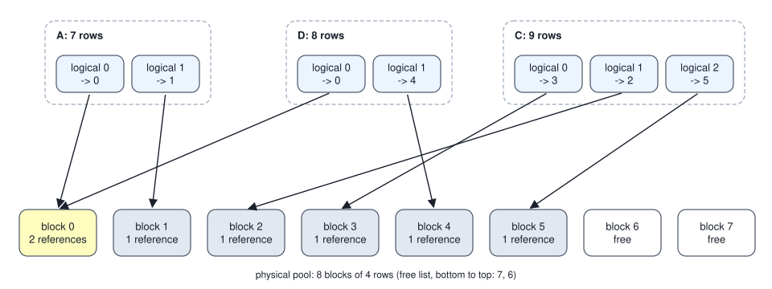

<!-- SPDX-License-Identifier: CC-BY-4.0 -->
<!-- Copyright (c) 2026 Martin Schröder <info@swedishembedded.com> -->

# Managing the KV Cache

*How do many conversations share one device's memory for their caches?*

Give a device 64 GiB (1 GiB is $2^{30}$ bytes) for the caches of one model, the 7.5-billion-parameter decoder of Volume V, whose cache costs 131,072 bytes for every token of context in bf16. A conversation may grow to 32,768 tokens, so a server that sets aside room for the longest conversation it allows reserves 4 GiB for each, and sixteen conversations fill the device. Now look at what the sixteen actually hold. In the sample of conversations drawn below, their final lengths add up to 34,453 tokens, and the reservations add up to 524,288. Of the memory set aside, 6.57 percent ever holds a row of the cache. The rest waits for tokens that never come, while a seventeenth conversation is refused for want of room.

Nothing about the model forces that waste. The cache of a conversation is a list of rows, one per token, and what the server needs is room for the rows that exist, plus a way to find row $t$ of conversation $i$ wherever it was put. That is the problem an operating system solved for programs decades ago, and the same solution, cutting memory into fixed blocks and keeping a table per owner, works here. Once the cache is in blocks, three more economies open up. Conversations that begin with the same words can share the blocks of their common beginning. Each row can be stored in fewer bits. And a conversation that does not fit can wait somewhere slower, or be forgotten and rebuilt. Each of these has a cost in bytes or in arithmetic, and each comes with a way to get it wrong.

Four earlier results carry the argument. Volume V, Chapter 12 ("The KV Cache") gave the size of the cache: how many bytes does one token of context cost a decoder of $L$ layers with $h_{\mathrm{kv}}$ key-value heads of width $d_h$, stored at $b$ bytes per value, and what does the formula give for 32 layers, 8 heads of width 128 and bf16? Volume VI, Chapter 8 ("Long Context") moved caches to host memory: why does moving the blocks that have not been used lately to the host fail to free memory for a sequence that is still decoding? Volume IV, Chapter 12 ("Quantization: Fewer Bits per Weight") defined affine quantization: for a symmetric 8-bit code whose largest magnitude in the group is $a$ and whose codes run from $-127$ to $127$, what is the step $\Delta$ between neighbouring codes, and how large can the error of rounding to nearest be? And the previous chapter of this volume ("Memory Budgets and Model Residency") kept an account of each device: what may still be promised to a new tenant of a device whose capacity, reserve and charges are known, and why must a cache that grows be counted against that account before work is admitted? Their answers are collected under Answers.

## A table between a position and its memory

The sixteen reservations fail because a conversation's final length is not known when it starts. The fix is to stop reserving a length and to hand out memory in small pieces as rows arrive. A **paged KV cache** keeps one pool of $N_{\mathrm{pool}}$ physical **blocks**, each with room for $B_{\mathrm{blk}}$ consecutive token rows of every layer's keys and values, and gives each sequence a **block table**: the list of the physical blocks it holds, in logical order. Row $t$ of a sequence (counted from 0) lives in block $\mathrm{table}[\lfloor t / B_{\mathrm{blk}} \rfloor]$, at offset $t \bmod B_{\mathrm{blk}}$ within it. A sequence takes a new block only when its last block is full, so it holds $\lceil n / B_{\mathrm{blk}} \rceil$ blocks for $n$ rows, and the memory it holds without using is at most $B_{\mathrm{blk}} - 1$ rows, in its last block. Kwon and colleagues (2023) built the memory manager of a serving system this way, and the name comes from the pages of virtual memory that the first chapter of this volume used for files.

How much does the block size matter? The next example draws 256 conversation lengths, admits them in order into the 64 GiB pool, and compares the reservation with blocks of several sizes. A slot is room for one token row; a conversation takes 32,768 slots under the reservation and $\lceil n/B_{\mathrm{blk}} \rceil B_{\mathrm{blk}}$ slots in blocks.

<!-- worked: paged_kv.reservation -->
The pool holds 64 GiB = 68,719,476,736 bytes, 524,288 token rows at 131,072 bytes per token (the 7.5-billion-parameter decoder of Volume V, Chapter 12, in bf16). The 256 conversations come from the generator `paged_kv.reservation` (seed 0x76a7c5786e9263d5): for each in turn, k = 1 + `integer(15)` and then n = 2^(k - 1) + `integer(2^(k - 1))` tokens, k drawn first, so every octave from 1 to 32,767 tokens is equally likely. The first eight are 15, 1,786, 27,368, 235, 183, 27, 1,411, 3; the shortest is 1, the longest 32,491, the sum 868,924 and the mean 3,394.23 tokens. Conversations are admitted in arrival order at their final length until the next one does not fit (it and all after it are left out). A slot is a token row of the pool; a conversation of n tokens takes 32,768 slots under the reservation and ceil(n / b) x b slots in blocks of b tokens. The last column is the tokens stored over the slots allocated, rounded half away from zero.

| policy | conversations held | tokens stored | slots allocated | % of allocated slots holding a row |
|---|---:|---:|---:|---:|
| reserve 32,768 tokens each | 16 | 34,453 | 524,288 | 6.57 |
| blocks of 1,024 tokens | 112 | 438,288 | 522,240 | 83.92 |
| blocks of 256 tokens | 137 | 488,554 | 512,256 | 95.37 |
| blocks of 64 tokens | 139 | 502,600 | 507,968 | 98.94 |
| blocks of 16 tokens | 139 | 502,600 | 503,776 | 99.77 |
| blocks of 1 token | 139 | 502,600 | 502,600 | 100.00 |
<!-- /worked -->

The reservation holds 16 conversations and fills 6.57 percent of what it allocates. Blocks of 16 tokens hold 139 conversations, all of whose 502,600 tokens fit in 503,776 slots: 99.77 percent of the allocated memory holds a row, and the 1,176 slots left empty are close to the 139 conversations times the 7.5 rows by which a last block falls short of full on average. Conversation 140 is long enough that it does not fit beside the first 139 under any block size, which is why the bottom three rows hold the same number. At blocks of 1,024 tokens the waste is visible again (83.92 percent), and at 32,768 the scheme is the reservation itself.


The curve says that past a few dozen tokens per block the waste is no longer worth fighting, and the other side of the trade explains why nobody uses blocks of one token. The attention kernel of a decode step reads every row of a sequence, and with paging it reads them block by block, looking up one table entry for each block: a sequence of 32,768 tokens has 2,048 entries in blocks of 16 and 32,768 in blocks of 1, and the rows of one block are contiguous in memory, so a larger block is a longer run of bytes that the memory system can stream. The serving configuration of brain uses blocks of 16 tokens (`pool_sizing` in `crates/catalog/src/resident_llm.rs`).

None of this may change what attention computes. The block table changes where a key and a value are, not what they are, so a paged attention must give the same scores and outputs as the contiguous one. The commit that introduced brain's paged cache, commit `dde2dc0fb` (27 July 2026), states that it validated exactly this, bit for bit: the test `paged_attention_matches_contiguous` in `crates/model/src/paged.rs` scatters the keys and values into a scrambled order of physical blocks, so that the mapping is really exercised, and compares the paged decode attention with the contiguous one by their bit patterns; its batched twin, `batched_paged_matches_per_sequence`, does the same for sequences of different lengths that share one pool. The equality is exact because each output element is the same sum of the same products in the same order, only gathered from other addresses.

### Handing out blocks

The pool needs an allocator that hands out a free block, takes it back, and lets two sequences hold one block at once. A block is shared when two sequences have the same rows in it: a sequence forked to sample two continuations of one prompt, or two conversations that begin with the same words. A **reference count** per block says how many tables hold it, and a block returns to the free list only when the last one lets go. The free list is a stack: an allocation takes the block on top, a released block goes on top.

```text
record Pool:
    block_size: int
    free: list<int>                # a stack of free block ids; the last element is the top
    refs: list<int>                # one reference count per block

record Table:
    blocks: list<int>              # physical block ids in logical order
    len: int                       # rows stored, which is also the position of the next row

function new_pool(num_blocks: int, block_size: int) -> Pool:
    require num_blocks >= 1 and block_size >= 1
    free = []
    for b in num_blocks - 1 down to 0:
        append b to free           # block 0 ends on top, so the lowest ids are handed out first
    return Pool(block_size, free, a list of num_blocks zeros)

function alloc(inout pool: Pool) -> optional int:
    if len(pool.free) == 0:
        return nothing
    b = pop_last(pool.free)
    pool.refs[b] = 1
    return b

function incref(inout pool: Pool, b: int):
    pool.refs[b] = pool.refs[b] + 1

function decref(inout pool: Pool, b: int):
    require pool.refs[b] > 0, "double free"
    pool.refs[b] = pool.refs[b] - 1
    if pool.refs[b] == 0:
        append b to pool.free

function append_row(inout t: Table, inout pool: Pool) -> (int, int):
    off = t.len mod pool.block_size
    if off == 0:
        b = alloc(pool)
        require b is present, "pool exhausted"
        append b to t.blocks
    t.len = t.len + 1
    return (t.blocks[len(t.blocks) - 1], off)    # where the caller writes the new row

function reserve(inout t: Table, n: int, inout pool: Pool) -> int:
    start = t.len
    need = (t.len + n + pool.block_size - 1) // pool.block_size
    while len(t.blocks) < need:
        b = alloc(pool)
        require b is present, "pool exhausted"
        append b to t.blocks
    t.len = t.len + n
    return start                   # the first position the caller writes

function release(inout t: Table, inout pool: Pool):
    for b in t.blocks:
        decref(pool, b)
    t.blocks = []
    t.len = 0

function fork(t: Table, inout pool: Pool) -> Table:
    for b in t.blocks:
        incref(pool, b)
    return Table(copy of t.blocks, t.len)

function unshare_tail(inout t: Table, inout pool: Pool) -> optional (int, int):
    last = t.blocks[len(t.blocks) - 1]
    if pool.refs[last] <= 1:
        return nothing
    fresh = alloc(pool)
    require fresh is present, "copy-on-write needs a free block"
    t.blocks[len(t.blocks) - 1] = fresh
    decref(pool, last)
    return (last, fresh)           # the caller copies the live rows of last into fresh

function locate(t: Table, pos: int, B: int) -> (int, int):
    require 0 <= pos and pos < t.len
    return (t.blocks[pos // B], pos mod B)
```

`append_row` takes the offset from the length before it advances it, which is the position rule of Volume V, Chapter 12 in the allocator's language: the row being written is at position `t.len`, and only afterwards does the table hold it. `reserve` is the prefill's form, backing a whole chunk of positions before the kernel writes them. A fork shares every block, and its copy-on-write comes later: before the child writes a row that the parent does not have, `unshare_tail` gives the child a private copy of the block it is about to write into, if that block is shared. Only the last block ever needs this, because the earlier ones are full and nobody writes them again.

<!-- worked: paged_kv.block_trace -->
A pool of 8 blocks of 4 token rows, ids 0 to 7. The free list is a stack printed bottom to top: an allocation takes the top, a freed block is put on the top. A table is printed as its physical blocks in logical order and its length in rows; 'shared' lists block:count for every block with more than one reference. Events run in the order listed.

| event | tables after the event | shared | free list (bottom to top) |
|---|---|---|---|
| A reserves 6 rows (its prompt) | A [0, 1] len 6 | none | [7, 6, 5, 4, 3, 2] |
| B reserves 3 rows | A [0, 1] len 6; B [2] len 3 | none | [7, 6, 5, 4, 3] |
| A appends one row: block 1, offset 2 | A [0, 1] len 7; B [2] len 3 | none | [7, 6, 5, 4, 3] |
| B appends two rows, the second at block 3, offset 0 | A [0, 1] len 7; B [2, 3] len 5 | none | [7, 6, 5, 4] |
| D forks A (shares blocks 0 and 1) | A [0, 1] len 7; B [2, 3] len 5; D [0, 1] len 7 | 0:2, 1:2 | [7, 6, 5, 4] |
| D copies its tail block 1 to 4, then appends at block 4, offset 3 | A [0, 1] len 7; B [2, 3] len 5; D [0, 4] len 8 | 0:2 | [7, 6, 5] |
| B finishes and releases its blocks | A [0, 1] len 7; D [0, 4] len 8 | 0:2 | [7, 6, 5, 2, 3] |
| C reserves 9 rows | A [0, 1] len 7; D [0, 4] len 8; C [3, 2, 5] len 9 | 0:2 | [7, 6] |

Row 5 of C (counted from 0) is at block C[5 // 4] = 2, offset 5 mod 4 = 1.
<!-- /worked -->

Two lines of the trace are the point of it. When D, a fork of A, is about to write its eighth row, the row's block, block 1, is still A's as well, so D first takes block 4, copies the three live rows of block 1 into it and writes there; block 0, full and read-only, stays shared with two references. And when B finishes, its blocks 2 and 3 go back on top of the stack, so C, which reserves 9 rows next, receives them first, in the order 3 and then 2, and its logical order no longer matches the physical one. That is harmless, because every reader goes through the table: row 5 of C is at block 2, offset 1.



The allocator in brain is `BlockAllocator` in `crates/model/src/paged.rs`, a free stack and a 16-bit reference count per block, built so that the lowest ids come out first, and `BlockTable` is the table, with `append`, `reserve`, `truncate` (which gives back the blocks a rejected speculative continuation used), `release`, `fork` and `unshare_tail` as in the pseudocode, and the unit tests `block_table_grows_one_block_per_block_size_tokens` and `fork_shares_blocks_and_cow_unshares_tail` among others. Two details of the real type go beyond the sketch. A table carries the namespace its rows were computed in, an identifier of the adapter whose weights produced them, so that the rows of one adapter can never be read under another (Volume V, Chapter 12 told that story). And a pool that shares its budget with something else can be backed lazily: a `BlockBacking` attaches device memory to a block the first time it is handed out, and when the backing refuses, the allocation fails with the reason.

Paging was not the first design that brain served with, and the commit that changed the pool's size shows why the arithmetic of the table above matters. Before commit `0b3589769` (6 August 2026) the serving resident sized its pool as a full context for every one of the concurrent decode slots, `max_blocks_per_seq * max_batch + max_batch` blocks, which its message counts as about 7 GiB of 32-bit cache at a context of 2,048 tokens and 16 slots, and about 52 GiB had the context been raised to serve a prompt of about 15,000 tokens. "This is exactly what paged attention exists to avoid," the message says: concurrent sequences are meant to share one pool. The commit sized the pool at two contexts plus one block per slot, and the reason it chose two and not one is the prefix cache: with room for only one context, a prompt's blocks could not stay behind after it finished, and a test of the prefix cache through the real HTTP (Hypertext Transfer Protocol) router went from a real hit rate to none. Two contexts plus a block per slot is still the fallback of `pool_sizing`; a live server with a known device budget first tries a larger default, room for a history of half a context for every slot, halved until the pool fits beside the weights (`fleet_pool_tokens`), and a pool whose size an operator names in tokens is never made smaller than one full context, so that any request that is admitted can run alone.

Paging leaves one question unanswered, and it is the one the reservation answered by brute force. A server that admits a conversation knows its prompt, not its final length. The 139 conversations of the table fit at their final lengths, but a server that admits them as they arrive learns their lengths only as they grow, and a batch that fits today can outgrow the pool tomorrow.

## Conversations that begin with the same words

Many requests to one server begin alike: the same instructions to the model at the top of every conversation, the same long document asked about several times, the earlier turns of a conversation resent with every new turn. Volume V, Chapter 12 proved the fact that makes their caches shareable: in a causal decoder, the key and value of position $t$ in every layer are functions of the weights and of the tokens at positions 0 to $t$, and of nothing else. Two prompts that agree on their first $p$ tokens therefore have identical cache rows for those positions, and a request whose beginning was already computed can adopt those rows and compute only the rest. **Prefix caching** keeps the blocks of earlier prompts after their sequences finish, indexed by the tokens they hold, so that a later request with the same beginning skips that part of its prefill.

The fact has a consequence for the key of the index. A block holds rows $kB_{\mathrm{blk}}$ to $(k+1)B_{\mathrm{blk}} - 1$, and those rows depend on every token from position 0 up to the end of the block, not only on the block's own tokens. A key made of the block's own tokens would match the same tokens at the start of another prompt and hand over rows computed under a different past. A hash of the whole prefix would be correct until two prefixes collided. The `PrefixCache` of brain takes a third way: the key of a block is the pair of its parent's *physical block id* and its own token ids, with a sentinel for the first block of a prompt (the real key also carries the adapter namespace of the table's rows, which the sketch leaves out). To reach a block, a lookup must already hold the actual block before it, so two different prefixes can never reach the same entry, and there is no hash that could collide. Only full blocks are indexed, because a block that is still being written is not yet a function of a finished prefix.

```text
ROOT = -1                                  # the parent of a prompt's first block

function lookup_prefix(cache: map<tuple, int>, inout stamp: map<int, int>, inout tick: int,
        prompt: list<int>, B: int, max_tokens: int) -> list<int>:
    parent = ROOT
    out = []
    for i in 0 .. len(prompt) // B:
        if (len(out) + 1) * B > max_tokens:
            break
        key = tuple(concat([parent], prompt[i * B : (i + 1) * B]))
        if not (key in cache):
            break
        parent = cache[key]
        tick = tick + 1
        stamp[parent] = tick               # a hit refreshes the block's recency
        append parent to out
    return out                             # the physical blocks to adopt, in order

function insert_chain(inout cache: map<tuple, int>, inout stamp: map<int, int>, inout tick: int,
        prompt: list<int>, blocks: list<int>, start: int, inout pool: Pool):
    B = pool.block_size
    full = min(len(prompt) // B, len(blocks))
    parent = ROOT if start == 0 else blocks[start - 1]
    for i in start .. full:
        key = tuple(concat([parent], prompt[i * B : (i + 1) * B]))
        if key in cache:
            parent = cache[key]            # another sequence cached the same prefix first: follow its chain
            continue
        incref(pool, blocks[i])            # the cache holds its own reference
        cache[key] = blocks[i]
        tick = tick + 1
        stamp[blocks[i]] = tick
        parent = blocks[i]
```

A request with prompt $\mathbf{p}$ calls `lookup_prefix` with `max_tokens` equal to `len(p) - 1`, adopts the blocks it returns (one reference each, as in `fork`), reserves room for the rest of its prompt, prefills only that rest, and indexes its own new full blocks with `insert_chain` from the first block it did not adopt. The limit of one token short is not a detail. The prefill's job is to produce the hidden state of the last prompt token, from which the first new token is sampled, and only a real forward pass over at least one token produces it. The commit that introduced the cache, commit `354ba0f1a` (28 July 2026), gives that reason ("always leaving at least one token, since the caller needs the last hidden state") and the engine's code repeats it beside the lookup.

<!-- worked: paged_kv.prefix_trace -->
Blocks of 4 tokens in a pool of 12 blocks (ids 0 to 11, the stack free list of the previous example). Each prompt arrives after the previous one has finished: it adopts the longest cached chain of full blocks covering at most its length minus one token, computes the rest, indexes its new full blocks under (parent, tokens), with the parent `root` for a first block, and releases its own references. The cache keeps one reference on every block it indexes.

| prompt | token ids | tokens | blocks adopted | rows computed | keys added -> block |
|---|---|---:|---|---:|---|
| P1 | 11 12 13 14 15 16 17 18 21 22 | 10 | none | 10 | (root, (11, 12, 13, 14)) -> 0; (0, (15, 16, 17, 18)) -> 1 |
| P2 | 11 12 13 14 15 16 17 18 31 32 33 | 11 | 0, 1 | 3 | none |
| P3 | 15 16 17 18 11 12 13 14 41 | 9 | none | 9 | (root, (15, 16, 17, 18)) -> 2; (2, (11, 12, 13, 14)) -> 3 |
| P4 | 11 12 13 14 15 16 17 18 | 8 | 0 | 4 | none |

After the four prompts the cache holds 4 blocks, each with this reference count (block:count): 0:1, 1:1, 2:1, 3:1.
<!-- /worked -->

P1 is cold and leaves its two full blocks behind; its third block, half full, is freed when P1 finishes. P2 shares P1's first eight tokens, adopts both blocks and computes 3 rows. P3 contains the same two blocks of tokens in the other order, and gets nothing: its first block's tokens, 15 to 18, have the parent `root` here and the parent 0 in the cache, and the rows of 15 to 18 that follow 11 to 14 are not the rows of 15 to 18 at the start of a text. It is cached as a chain of its own. P4 is exactly P1's first eight tokens. It could have adopted both blocks, but then it would have nothing left to compute and no hidden state for its first token, so the limit of 7 tokens stops it after one block and it computes 4 rows. The rule costs one block at most.

What sharing is worth follows from counting blocks and floating-point operations (FLOPs). A server whose every request begins with the same system prompt of 1,000 tokens and adds 200 of its own, in blocks of 16 tokens for the 7.5-billion-parameter decoder:

<!-- worked: paged_kv.prefix_savings -->
Every request is a shared system prompt of 1,000 tokens followed by 200 tokens of its own, 1,200 in all, in blocks of 16 tokens for the 7.5-billion-parameter decoder. A cold prefill computes all 1,200 rows: 1.7129e+13 FLOPs (`flops_new` of Volume V, Chapter 12, from position 0). A request that finds the system prompt cached adopts 1,000 // 16 = 62 full blocks (992 tokens; the last 8 system tokens share a block with its own tokens) and computes 208 rows from position 992: 3.0240e+12 FLOPs. The first request is always cold. Blocks are those held while all requests are alive at once: 75 per request without sharing, 62 shared plus 13 per request with it; a block is 16 x 131,072 = 2,097,152 bytes in bf16.

| requests | prefill FLOPs, no cache | prefill FLOPs, cached prefix | % of the cold FLOPs | blocks, no sharing | blocks, shared prefix | GiB, shared prefix |
|---|---:|---:|---:|---:|---:|---:|
| 1 | 1.7129e+13 | 1.7129e+13 | 100.0 | 75 | 75 | 0.146 |
| 8 | 1.3703e+14 | 3.8297e+13 | 27.9 | 600 | 166 | 0.324 |
| 64 | 1.0963e+15 | 2.0764e+14 | 18.9 | 4,800 | 894 | 1.746 |
<!-- /worked -->

Two savings come from one mechanism. The arithmetic of a warm request is the 208 rows it computes, $3.0240 \times 10^{12}$ FLOPs against $1.7129 \times 10^{13}$ for a cold one; over 64 requests the prefills cost 18.9 percent of what they would cost cold, and the share tends to $3.0240/17.129 = 17.7$ percent as the first, cold request is spread over more. The bytes are the other saving: 64 live requests hold 894 blocks with the prefix shared and 4,800 without, so the same pool holds more than five times as many of them. A warm request is not quite free even at its own 200 tokens, because its 208 rows attend to the 992 cached ones; that is the attention term of `flops_new`, which grows with the starting position.

### What the cache may give back

A prefix cache is memory that no running sequence needs at the moment, held in the hope that a request will. When the pool runs short, that hope is the first thing to go: live sequences outrank the cache. The cache in brain holds one reference on every block it indexes, so a block whose reference count is 1 is held by the cache alone and may be evicted, and a block that a running sequence also holds stays. Which cache-only blocks go first is a decision with a trap in it. An eviction that frees the least recently used block wherever it sits in a chain frees the head of an old chain first, since a chain's blocks are stamped in order when it is inserted. Every later block of that chain then becomes unreachable, since a lookup must pass through the head to find them, yet each still holds a reference and occupies the pool.

<!-- worked: paged_kv.eviction_orders -->
Blocks of 4 tokens. Conversation X (tokens 1 to 16) was cached first, its four blocks stamped 1 to 4 in chain order, then conversation Y (tokens 101 to 116), stamped 5 to 8; both have finished, so all 8 blocks are held by the cache alone. The pool asks for 2 blocks. 'Reachable' is the cached tokens a lookup of the conversation's own 16 tokens finds; a stranded block is still indexed and occupies the pool but no lookup can reach it, because a block before it in its chain is gone.

| eviction rule | blocks freed | blocks still cached | reachable tokens of X | reachable tokens of Y | stranded blocks |
|---|---:|---:|---:|---:|---:|
| least recently used, any entry | 2 | 6 | 0 | 16 | 2 |
| least recently used, leaves only | 2 | 6 | 8 | 16 | 0 |
| leaves only, sparing X's chain | 2 | 6 | 16 | 8 | 0 |
<!-- /worked -->

All three rules free 2 blocks and keep 6. The first keeps 6 blocks of which 2 are dead: X's head and second block are gone, X's last two blocks are stranded, and the next turn of X finds nothing. The second evicts only **leaves**, blocks that no other cached block chains off, the least recently used first: X's fourth block goes, the third becomes a leaf and goes next, and X keeps a reachable prefix of 8 tokens. The third row adds what admission needs. When the request that triggers the eviction is X's own next turn, the blocks it is about to adopt must survive the eviction its own admission causes; sparing them shifts the cost to Y.

```text
function evict_leaves(inout cache: map<tuple, int>, stamp: map<int, int>, want: int, keep: list<int>,
        inout pool: Pool) -> int:
    freed = 0
    while freed < want:
        parents = the set of key[0] over every key in cache   # blocks that some cached block chains off
        best = nothing
        for key in keys(cache):
            b = cache[key]
            if pool.refs[b] == 1 and not (b in keep) and not (b in parents):
                if not (best is present) or (stamp[b], b) < (stamp[best[1]], best[1]):
                    best = (key, b)
        if not (best is present):
            break
        remove best[0] from cache
        decref(pool, best[1])
        freed = freed + 1
    return freed
```

This is `PrefixCache::evict_keeping` of `crates/model/src/paged.rs`, which keeps a heap of the evictable leaves and adds a parent when its last child leaves instead of scanning again; the order is the same, the least recently used leaf first and the lower block id on a tie of stamps. Commit `5c384d4cb` (19 October 2026) replaced plain least-recently-used eviction with it. Its message names two failures of the plain rule: it "frees a chain's head first, stranding every later block" (the first row of the table), and "with as many conversations as the pool holds" it frees "exactly the conversation whose next turn arrives soonest" (what the third row's sparing of a chain addresses). The second follows from the order of use: a conversation's previous turn is its oldest entry at the moment its next turn arrives. The tests `eviction_takes_a_cold_chains_tail_and_keeps_its_head_reachable` and `eviction_keeping_spares_the_named_chain_even_when_it_is_the_coldest` pin the two rules. A lookup that only asks how much of a prompt would hit uses `peek_in`, which does not refresh any stamp, so that asking does not change who is evicted next.

### Counting what a request adopts

The cache changes what admission must count. A request whose prompt adopts 62 cached blocks needs 62 fewer free blocks than a cold one, because those blocks are resident already. Commit `51e99f712` (29 October 2026) records what happened while admission did not know this: it charged a request's whole prompt against the free pool, so the next turn of a conversation whose cached history was larger than the pool less the prompt "was therefore never admitted, even on an idle server: the scheduler livelocked". The pool had room for the request, since most of it was the request's own history; the account said it did not. The fix asks the decoder how many blocks a fresh prefill would adopt (`cached_prefix_blocks`, answered with the non-refreshing peek) and charges only the rest, and the integration test `the_next_turn_of_a_conversation_filling_most_of_the_pool_is_admitted_on_its_cached_history` in `crates/model/tests/it/serve_prefix_admission.rs` is the case. The same arithmetic appears in `Scheduler::admit_one` in `crates/model/src/serve.rs`: the blocks wanted are those of the prompt and its first token less the adopted ones, plus, for a decoder with a recurrent state, the blocks of that state, plus what the running sequences and the unfinished prefills are owed this step.

### An exact key and a prompt that changes at its end

The key is exact, and exactness is a promise in both directions: a hit is always correct, and a prompt that differs anywhere before a block's end never hits that block. For a paged cache the cost of a late difference is small. If the next turn of a conversation re-renders its last few tokens, the blocks before them still hit, and only the last block or two are computed again.

A decoder whose layers keep a recurrent state instead of rows cannot resume that way. Such a layer (the linear-attention layers of a hybrid decoder) carries one fixed-size state forward through the tokens, and a prefix can be resumed only from the state exactly after it, so a cache entry is a whole prompt plus a snapshot of the state at its end (`SnapshotPrefixCache` in `crates/model/src/snapshot_prefix.rs`, keyed like the block cache by namespace and exact tokens). Knowledge #347 records how that met a chat template. A prompt with thinking switched on ends with the start of the model's reply, the thinking tag and a newline, and the next turn renders the same position as the finished reply, the tag and a blank line. The last tokens differ, the exact match of the whole earlier prompt failed, and every turn of such a conversation prefilled its whole history again. The fix files the entry at the prompt's length less 16 tokens, rounded down to a whole 64-token chunk of the recurrent layers (`checkpoint_len`, with `CHECKPOINT_TAIL` and `CHECKPOINT_ALIGN`, in the 27-billion-parameter hybrid engine, `crates/qwen35/src/int8_gguf_resident/engine.rs`), so that the next turn resumes from there and recomputes the tail with its new tokens. An exact cache needs its keys to be stable where the requests agree, and the server, not the cache, has to know where that is.

## Eight bits and a scale for every row

Paging removed the slack and sharing removed the duplicates. What is left is the size of a row itself, $2 L h_{\mathrm{kv}} d_h b$ bytes per token, and the factor $b$ is the one a server can still choose. Volume VI, Chapter 8 counted the four storage formats of brain's cache and measured what eight bits do to a toy attention: a relative error of order $10^{-2}$ in the attention output. Here the question is what such a format must look like to live in a paged pool that grows one row at a time.

A row of the cache is written once and never changed. At the moment it is written, the server knows that row and the rows before it, and nothing about the rows to come. A scale for a whole tensor, or for each channel across tokens, would need the statistics of rows that do not exist yet; a scale for each row needs only the row. **KV quantization** stores each (token, layer, key or value, key-value head) row of $d_h$ elements as 8-bit codes with one scale of its own, computed when the row is appended: the symmetric affine quantization of Volume IV, Chapter 12 with its zero point at 0, a scale $\Delta = a/127$ for a row whose largest magnitude is $a$, and codes $q_i = \mathrm{clamp}(\mathrm{round}(x_i/\Delta), -127, 127)$. The attention kernels widen each element to a 32-bit float as they load it, $x_i' = q_i\Delta$, so the arithmetic is the same as before and only the resident bytes shrink. The scales live in a buffer of their own beside the codes, four bytes for every row, so a block in an 8-bit format costs $(d_h + 4)/d_h$ bytes per element.

<!-- worked: paged_kv.pool_formats -->
Blocks of 16 tokens of the 7.5-billion-parameter decoder (32 layers, 8 key-value heads of width 128): a block holds 16 x 2 x 32 x 8 x 128 elements, and in int8 and fp8 also one 4-byte scale for every (token, layer, K or V, key-value head) row of 128 elements, so 1 + 4/128 bytes per element. The pool is the 64 GiB of the first example, its blocks the whole blocks that fit (rounded down). Conversations are those of the first example, admitted in arrival order at their final length until the next does not fit.

| format | bytes per element | bytes per block | blocks in 64 GiB | token rows | conversations held |
|---|---:|---:|---:|---:|---:|
| f32 | 4.00000 | 4,194,304 | 16,384 | 262,144 | 68 |
| bf16 | 2.00000 | 2,097,152 | 32,768 | 524,288 | 139 |
| int8 | 1.03125 | 1,081,344 | 63,550 | 1,016,800 | 256 |
| fp8 | 1.03125 | 1,081,344 | 63,550 | 1,016,800 | 256 |
<!-- /worked -->

A block of 16 tokens costs 2,097,152 bytes in bf16 and 1,081,344 in int8, and the 64 GiB pool goes from 32,768 blocks to 63,550: from 139 of the drawn conversations to all 256, whose 868,924 tokens fit in the 1,016,800 rows. The 8-bit float format (E4M3, 4 exponent and 3 mantissa bits) has the same layout and the same bytes, with the scale $a/448$ for its largest value 448 and a grid that is relative rather than uniform. Against 32-bit storage the ratio is $4d_h/(d_h + 4)$, 3.88 at $d_h = 128$ and less at narrower heads, which is why a pool's size must be counted from the layout and not from a rule of thumb of 4 to 1 (the documentation of `kv_pool_bytes` in `crates/qwen3/src/serve.rs` gives the exact ratio, and the test `kv_pool_bytes_identity_holds_at_the_real_shape` pins it at the real shape and at a tiny one).

One descriptor, `KvTier` in `crates/model/src/kv_tier.rs`, describes the formats in brain: an element codec (32-bit float, bf16, symmetric 8-bit integer or E4M3) and whether each (token, key-value head) row carries a 32-bit scale. The code calls these formats tiers; here a tier is a level of storage (the device, the host, nothing), and the encodings are called formats. Every size the planner counts comes from that descriptor through the checkpoint crate's packed encodings of the first chapter of this volume, so the code that counts bytes and the kernels that read them cannot disagree, and the append kernels for the two 8-bit formats (`paged_kv_append_i8_clipped_batched.wgsl` and its fp8 twin in `crates/kernels/wgsl/`) compute each row's scale as they write it. The serving configuration stores the cache as int8 by default and leaves fp8 opt-in (`QwenServeConfig` in `crates/catalog/src/resident_llm.rs`).

### A ceiling on the scale

A row's scale is set by its largest element, so one large element coarsens the grid of the whole row. The append kernels of brain therefore take a second input, a **ceiling** per (layer, key or value, key-value head), and compute $\Delta = \min(a, c_{\mathrm{clip}})/127$; an element beyond the ceiling is clamped to $\pm 127$ codes. The ceilings come from a calibration run: a model prefills a set of representative prompts with a 32-bit cache, reports every key and value row to a collector, and the ceiling of each head is a chosen percentile of the magnitudes it saw (`KvCalib` in `crates/model/src/kvcalib.rs`). Keys are calibrated apart from values, after the rotary rotation, since that is what the cache stores. A ceiling of the largest 32-bit float is the "no calibration" sentinel: $\min(a, c_{\mathrm{clip}}) = a$ for every finite row, so the clipped kernel computes exactly the scale of the plain one.

Whether a ceiling helps can be worked out before it is measured. Take a row of $d_h$ elements whose largest is an outlier of magnitude $m$, the others of order 1 and below a ceiling $c_{\mathrm{clip}} < m$. Without the ceiling every other element is rounded on a grid of step $m/127$, a squared error of about $(m/127)^2/12$ each, and the outlier itself is exact. With it, the other elements get the finer step $c_{\mathrm{clip}}/127$ and the outlier is clamped, an error of $m - c_{\mathrm{clip}}$. The ceiling lowers the row's squared error only when

$$(m - c_{\mathrm{clip}})^2 < \frac{(d_h - 1)\,(m^2 - c_{\mathrm{clip}}^2)}{12 \cdot 127^2},$$

and dividing both sides by $m - c_{\mathrm{clip}}$ gives $m - c_{\mathrm{clip}} < (d_h - 1)(m + c_{\mathrm{clip}})/193{,}548$. At $d_h = 64$ that is $m - c_{\mathrm{clip}} < (m + c_{\mathrm{clip}})/3{,}072.2$: the outlier must lie within about a three-thousandth of the ceiling. The squared error of a row is the right yardstick for the keys, since a score is $\mathbf{q}\cdot\mathbf{k}$ and its error $\mathbf{q}\cdot(\mathbf{k}' - \mathbf{k})$ has a variance proportional to it for a query of no preferred direction. The next table measures it.

```text
function quantize_row_clipped(x: array<real>[d], clip: real) -> array<real>[d]:
    a = 0.0
    for i in 0 .. d:
        a = max(a, abs(x[i]))
    step = min(a, clip) / 127.0
    if step == 0.0:
        step = 1.0
    y = zeros(real, [d])
    for i in 0 .. d:
        y[i] = clamp(round_half_even(x[i] / step), -127, 127) * step
    return y
```

<!-- worked: paged_kv.clip_tradeoff -->
400 rows of 64 elements for each outlier size m, from the generator `paged_kv.clip_tradeoff` (seed 0xf712f51972ef47da), one generator across the whole table: for m = 3, 5, 10, 20 in turn and each row in turn, 63 `normal()` draws fill elements 1 to 63, then one `uniform()` gives the sign of element 0, + when it is below 0.5, and element 0 is that sign times m (63 is odd, so the unused second value of a pair of `normal()` draws is held over into the next row, as in Volume I, Chapter 17). Each row is stored as int8 with scale = min(absmax, ceiling) / 127 and codes round(x / scale) (to nearest, ties to even) clamped to -127 .. 127. Squared errors are summed per row and averaged over the rows; the last column is sqrt(total squared error / total sum of squares) over all rows of that m. Three significant digits, which the draws fix.

| outlier m | ceiling | squared error of the outlier, per row | squared error of the other 63, per row | relative error of the rows |
|---|---:|---:|---:|---:|
| 3 | absmax (no ceiling) | 9.03e-06 | 0.00302 | 0.00648 |
| 3 | 4 | 9.33e-06 | 0.00367 | 0.00714 |
| 3 | 8 | 9.03e-06 | 0.00302 | 0.00648 |
| 5 | absmax (no ceiling) | 0 | 0.00818 | 0.00967 |
| 5 | 4 | 1 | 0.00559 | 0.107 |
| 5 | 8 | 0 | 0.00818 | 0.00967 |
| 10 | absmax (no ceiling) | 0 | 0.0327 | 0.0142 |
| 10 | 4 | 36 | 0.00528 | 0.47 |
| 10 | 8 | 4 | 0.0208 | 0.157 |
| 20 | absmax (no ceiling) | 0 | 0.131 | 0.0168 |
| 20 | 4 | 256 | 0.00539 | 0.743 |
| 20 | 8 | 144 | 0.0208 | 0.557 |
<!-- /worked -->

The table follows the inequality. At $m = 20$ the ceiling of 8 cuts the error of the other 63 elements from 0.131 to 0.0208 per row, as the grid step falls from $20/127$ to $8/127$ (the prediction $63 \cdot (20/127)^2/12 = 0.130$ is the measured 0.131 to within the draws), and it pays for this with $(20 - 8)^2 = 144$ on the outlier: the relative error of the rows goes from 0.0168 to 0.557. At $m = 3$ the ceiling of 4 does not touch the planted element at all, yet it still costs a little, because a few of the normal draws exceed 4 and are clamped. A ceiling above every element, the 8 at $m = 3$ and $m = 5$, changes nothing. Under squared error the online scale of each row is already the better choice whenever the large element is real information.

Both 8-bit append kernels compute one scale per (token, key-value head) row, so a token's large element coarsens only its own row's grid, and another token's row keeps its own scale whatever that element was. What the ceiling bounds is each row's own step, and the inequality says when that pays. The measurement that came with the mechanism agrees with the arithmetic. Commit `28428516e` (6 August 2026), which added the clipped kernel and the calibration table, recorded a measurement on the Qwen3-0.6B checkpoint (28 layers, 8 key-value heads), whose keys and values make 448 streams, a stream being the elements of one layer's keys or one layer's values for one key-value head over every token of the calibration prompts. For each stream the ratio of its largest magnitude to its 99.99th percentile (`outlier_ratio` in `crates/model/src/actstats.rs`) is the measure of its tail. The commit reports a largest ratio of 1.72 (the values of head 5 in layer 26) and a median of 1.07, a narrow distribution with its tail in the late-layer value heads (the figures as the commit records them). Its message reads this, for a calibration set of 8 prompts, as meaning that "clipping recovers little" on that model, while the mechanism is tested regardless. The serving configuration leaves calibration opt-in, and a calibration file whose shape does not match the model is refused with a message and the model is served uncalibrated (`KvCalib::from_model_dir`).

## Where a sequence waits when the device is full

Admission checks that a prompt fits, and a prompt that fits today can grow past the pool tomorrow, since every running sequence takes a block every $B_{\mathrm{blk}}$ tokens and none of them knows when it will stop. When the free blocks no longer cover the next row of every running sequence, something has to give way. **KV tiering** arranges a cache across levels of storage that differ in capacity and in what a move between them costs, with a rule for which sequence's blocks live where. There are three levels: the device pool, where a sequence must be to run; the host's memory, where an exact copy of its blocks can wait at the price of moving its bytes across the bus twice; and nowhere, which costs nothing to enter and a prefill of its whole context to leave. A fourth level sits inside the device: blocks that only the prefix cache holds, which can be taken at no cost to any running sequence.

The alternative, reserving room for the prompt plus the largest number of tokens a request may generate, would remove the need for any of this, and it is declined for a reason: the largest number of new tokens "is a ceiling, not a forecast: most sequences stop earlier", so a worst-case reservation would hold every batch far below what the pool can carry, on every request, to avoid a cost that is paid only under overload. The scheduler of brain gives that reason beside the policy, in `Scheduler::ensure_decode_room` (`crates/model/src/serve.rs`). That is the opening table again, one level up.

The order in which the levels are used follows from their costs. Cache-only blocks go first, since they cost a future hit and nothing now. Then the sequence that gives way is the newest one: it has the furthest to go and will hold its blocks longest, while the oldest finish soonest and free theirs. A sequence that is still in its prefill is newer than any that is decoding and has produced nothing, so it goes back to the head of the queue first. A decoding victim is copied to the host when the host pool has room for all of its blocks, and otherwise dropped, to be prefilled again from its tokens. The last running sequence is never removed, since it has nobody to yield to.

```text
function make_room(inout running: list<int>, promoted: list<int>, need_of: function(int) -> int,
        blocks_of: function(int) -> int, inout free: int, inout cached: int, inout host_free: int)
        -> list<(int, text)>:
    need = 0
    for s in running:
        need = need + need_of(s)           # blocks each running sequence takes for its next row
    if free < need:
        r = min(need - free, cached)       # cache-only blocks first
        cached = cached - r
        free = free + r
    moved = []
    while free < need and len(running) > 1:
        v = the last s in running that is not in promoted, or the last s in running if every one is
        remove v from running
        need = need - need_of(v)
        free = free + blocks_of(v)
        if host_free >= blocks_of(v):
            host_free = host_free - blocks_of(v)
            append (v, "swap out") to moved
        else:
            append (v, "recompute") to moved
    return moved
```

Two rules keep the policy from undoing its own work, and both cost a transfer for no token if they are dropped. A sequence swapped back in during this step is not chosen again in the same step unless nothing else can yield. And a swapped-out sequence comes back only when the free blocks cover its own blocks plus the next row of every running sequence plus one, so that its return does not immediately force another removal; the slack is dropped when nothing is running, or a sequence whose blocks nearly fill the pool could never return. The queue of swapped-out sequences is first in, first out, and the loop stops at the first that does not fit, so a long sequence is not starved by shorter ones slipping past it. While any sequence is swapped out, nothing new is admitted.

The trace below runs that policy on a pool small enough to follow. It is a simplified model of `Scheduler::ensure_decode_room` and `Scheduler::resume_swapped` in `crates/model/src/serve.rs`, not a recording of them: it keeps their order of decisions (swap back in, prefill again, make room, decode one row, reap) and their rules for choosing a victim and for resuming one, and leaves out what would hide those rules in a small example. Every prefill completes within one step; no sequence is still prefilling; no decoder keeps a recurrent state whose blocks must be counted; no device allocation fails; the batch has no limit on its size; and no new request arrives. Four sequences decode at once in a pool of 24 blocks of 16 rows, 3 of them held by the prefix cache, with a host pool of 7 blocks.

<!-- worked: paged_kv.preemption_trace -->
Blocks of 16 rows, a device pool of 24 blocks of which 3 are held by the prefix cache alone, and a host pool of 7 blocks. Four sequences are running at step 0, in admission order: A with 60 rows cached and 20 to append, B with 70 rows cached and 60 to append, C with 80 rows cached and 50 to append, D with 90 rows cached and 40 to append. Each appends one row per step and finishes when it has appended its count. A step runs, in order: (0) swap sequences back in, oldest swap-out first, while the free blocks cover the sequence's blocks plus one row's growth of every running sequence plus 1 (no slack when nothing runs), and stop at the first that does not fit; (1) while nothing is swapped out, prefill again the sequences dropped for recompute, front of the queue first, when the free blocks cover ceil((rows + 1) / 16) blocks plus the running sequences' growth; (2) if the free blocks do not cover one row's growth of every running sequence, take cache-only blocks first, then remove the newest running sequence (not one swapped in this step, unless no other is left) until they do or one sequence is left: it is swapped out when the host pool has room for all its blocks and dropped for recompute otherwise, its blocks freed either way; (3) every running sequence appends a row, taking a block when its last is full; (4) finished sequences free their blocks. Steps (0) and (1) also take cache-only blocks when they are short. A newly swapped-in or re-prefilled sequence joins the end of the running list. A sequence's growth is 1 block when its cached rows are a multiple of 16 and 0 otherwise, and a dropped sequence keeps the rows it had cached when it was dropped, which is what is prefilled again (the 128 rows of D are its 90 plus the 38 it appended). Steps are numbered from 1, the first after the state described; steps (0) and (1) do nothing while no sequence is swapped out or dropped. Only the steps on which something other than a plain decode happens are listed.

| step | events, in order | free device blocks after the step | host blocks in use |
|---|---|---|---:|
| 5 | cache gives back 1 | 0 | 0 |
| 7 | cache gives back 1 | 0 | 0 |
| 11 | cache gives back 1 | 0 | 0 |
| 17 | D swapped out (7 blocks) | 6 | 7 |
| 20 | A finishes | 11 | 7 |
| 21 | D swapped in (7 blocks) | 4 | 0 |
| 43 | D dropped for recompute (8 blocks) | 8 | 0 |
| 50 | C finishes | 16 | 0 |
| 51 | D prefilled again (128 rows) | 7 | 0 |
| 52 | D finishes | 16 | 0 |
| 60 | B finishes | 24 | 0 |
<!-- /worked -->

The sequences start with 20 of the 24 blocks and 1 free. The first three times a sequence crosses into a new block (steps 5, 7 and 11) the prefix cache gives up one of its 3 blocks. At step 17 the pool is dry, D is the newest, and its 7 blocks go to the host. A finishes at step 20 and frees 5 blocks, which leaves 11 free; D needs its 7 plus the next row of B and C plus 1, which the 11 cover at step 21, so it comes back and joins the end of the running list, newest again. At step 43 the pool is dry again and D is again the victim, now with 8 blocks, one more than the host pool holds, so it is dropped and its 128 rows are prefilled again at step 51, once C has finished and the pool has room. The schedule is "newest first" doing what it says: D, admitted last and swapped in last, pays for the whole overload, and A, B and C never stop.

The same trace with a host pool of 0 and 16 blocks, and what each would cost for the real decoder:

<!-- worked: paged_kv.preemption_costs -->
The trace run with host pools of 0, 7 and 16 blocks, and the cost if the blocks were those of the 7.5-billion-parameter decoder in int8 (1,081,344 bytes per block of 16 tokens): bytes over the host bus are the blocks copied out plus the blocks copied back, times the block's bytes; FLOPs of the prefills run again are `flops_new` of Volume V, Chapter 12, from position 0, summed over the re-prefills.

| host blocks | steps until all finish | finishing order | blocks out | blocks in | rows prefilled again | bytes over the bus | FLOPs prefilled again |
|---:|---:|---|---:|---:|---|---:|---:|
| 0 | 60 | ACDB | 0 | 0 | 106 + 128 | 0 | 3.2757e+12 |
| 7 | 60 | ACDB | 7 | 7 | 128 | 15,138,816 | 1.7921e+12 |
| 16 | 60 | ACDB | 15 | 15 | none | 32,440,320 | 0 |

The second preemption of D, priced both ways: prefilling its 128 rows again is 1.7921e+12 FLOPs, and swapping its 8 blocks out and back is 17,301,504 bytes, so the recompute spends 103,580 FLOPs (rounded to a whole number) for each byte the swap would move.
<!-- /worked -->

In this model every run takes 60 steps and finishes in the same order, because a swap and a recompute both happen between steps; what differs is the work. With no host pool, D is prefilled twice, 106 and then 128 rows, $3.2757 \times 10^{12}$ FLOPs; with 16 host blocks it is copied out and back twice, 32,440,320 bytes over the bus and no arithmetic. The last line of the table prices one preemption both ways: the recompute spends 103,580 FLOPs for every byte the swap would move. On the model device of Volume IV, Chapter 4, with an arithmetic rate of 40,000 (GFLOP/s) and a host bus of 32 (GB/s), the break-even is $40{,}000/32 = 1{,}250$ FLOPs per byte, so the swap is the cheaper way by a factor of about 83 here, the same factor Volume VI, Chapter 8 found for the weights' share of a recompute (at 128 rows the attention adds little). That factor is a ratio of model times on the model device, a count of bytes and FLOPs divided by two assumed rates, and it holds only as far as those rates do: on a machine whose bus is slower relative to its arithmetic the break-even moves in proportion, and a transfer's fixed cost, which the model ignores, matters for short sequences. The swap's advantage grows with the length of what is preempted, since the recompute's attention is quadratic in it and the swap's bytes are linear.

This policy is not where brain started. Commit `fd8c0a29c` (2 September 2026) describes the scheduler before it: admission checked that a prompt fits, every admitted sequence then grew a block at a time, and nothing checked that the pool could back the batch's next row, so a batch that outgrew the pool reached the append's error with nowhere to go, which in the one engine that used the scheduler then was an `expect`, so that "the serving lane dies". It was reproduced before the fix with eight sessions against a pool sized for two. The commit added the order of the policy above, the swap to host memory (`crate::kv_offload`), newest first, and both anti-thrash rules, each of which, the message says, would "cost a transfer pair for no token if dropped". Recompute is the other branch of the same function today: when a decoder has no host pool, or its budget is spent, the victim is requeued at the head of the waiting queue with the tokens it has produced, its sampler's random stream and its place in a speculative window, so that the continuation is the same tokens. The integration tests in `crates/model/tests/it/serve_kv_pressure.rs` hold it to that, among them `a_preempted_sampled_sequence_keeps_its_seeded_stream` and `cancelling_a_preempted_request_returns_its_progress_and_frees_everything`.

### A copy that is exact or not made

The swap itself has one job: to give back exactly the bytes it took, whatever they encode. `KvOffload` in `crates/model/src/kv_offload.rs` copies a sequence's blocks as raw 32-bit words, never as numbers, so that a packed int8 block and its scales, or a bf16 one, come back bit for bit; its test paints the blocks with patterns that are not valid floats so that any path through a float conversion would fail. The order of its steps is chosen so that a refusal costs nothing. A demotion checks the host budget before it reads a single block back from the device, "refusing after the readback would have paid the expensive half of the swap for nothing", and leaves the sequence untouched when it refuses. A promotion allocates fresh device blocks, which need not be the ones the sequence left, since a paged cache is addressed through its table; when the pool runs out halfway, it gives every block back and leaves the record on the host for the next try. A block that the prefix cache also holds is copied like any other, and only the sequence's own reference is dropped. The tests `demote_promote_round_trips_the_exact_bytes`, `a_refused_demote_leaves_the_sequence_untouched`, `a_promote_with_no_device_room_rolls_back_completely` and `a_shared_prefix_block_is_copied_and_only_its_own_reference_dropped` pin the four properties. A host pool of zero bytes is the configuration in which offload is off, and every demotion is refused, which is what sends a victim to recompute; the serving configuration's default is zero (`kv_offload_gb` in `crates/catalog/src/resident_llm.rs`).

## The cache in brain, file by file

The paged cache and its policies live in `crates/model`, and nothing in them names a model. `paged.rs` holds the allocator, the block table with its namespace and the prefix cache with its leaf eviction; `snapshot_prefix.rs` the prefix cache of decoders whose layers keep a recurrent state; `kv_tier.rs` the storage formats, their byte counts and the kernels that append to and read each one; `kvcalib.rs` the calibrated ceilings and the interface any decoder implements to be calibrated; `kv_offload.rs` the exact swap of whole sequences to host memory; and `serve.rs` the scheduler that admits, makes room, swaps back and requeues for recompute, through the `PagedDecoder` trait that each serving engine implements over its own buffers. The engines that serve real checkpoints (`crates/qwen3`, `crates/qwen35` and others) adopt them, and the pool's size is set per resident in `crates/catalog/src/resident_llm.rs`.

## Check your understanding

1. A colleague halves the block size from 16 to 8 tokens to "halve the waste". For the 139 conversations of the first table, about how many slots does that save, and what does it cost the attention kernel of a decode step for a sequence of 32,768 tokens?
2. In the allocator trace, C's blocks are 3, 2 and 5. Someone proposes to keep each table's physical blocks in ascending order "so the kernel reads memory in order". What would that require of the allocator, and what does the bit-for-bit test of the paged attention say about whether the order matters for the result?
3. A prefix cache keys a block by a hash of its own 16 tokens only. Construct two prompts for which a lookup returns rows that are wrong, using the prompts P1 and P3 of the trace.
4. A request's prompt is exactly 32 tokens, the blocks are 16 tokens, and both blocks of the same prompt are cached. How many rows does the request compute, and why not zero?
5. Predict the reachable cached tokens of X and Y if, before the pool asks for 2 blocks in the eviction example, X's 16 tokens are looked up once (refreshing their stamps to 9 to 12).
6. "A ceiling at the 99.9th percentile can only help: it bounds the scale of rare outliers and leaves ordinary rows alone." Use the inequality of the ceiling section and the row $m = 20$, ceiling 8, to find what is wrong.
7. In the preemption trace D is preempted twice and A, B and C never. Which rule of the policy decides that, and what would change at step 43 if the rule were "oldest first"?

## Summary

A cache that reserves a conversation's longest possible length holds memory for tokens that never arrive; in the drawn sample, 6.57 percent of the reserved slots ever held a row. A **paged KV cache** hands out fixed blocks of rows as a sequence grows and finds row $t$ through a block table, which wastes less than one block per sequence (99.77 percent of the slots hold a row with blocks of 16 tokens) and leaves attention unchanged, bit for bit, because only addresses change. Reference counts let sequences share blocks, with a copy of the last block before a sequence writes into a shared one. **Prefix caching** keeps the full blocks of finished prompts, keyed by the physical parent block and the block's tokens so that a hit is exact by construction, and lets a request that begins alike compute only its tail, at least one token; its blocks are the first memory to give back, evicted as leaves so that no chain is stranded, and admission must charge only what a request does not adopt. **KV quantization** stores each (token, head) row in 8 bits with its own scale, computed when the row is written, which nearly doubles the rows a pool holds (in the drawn sample, from 139 conversations to all 256); a ceiling on the scale trades the clamping of a large element for a finer grid on the rest, and under squared error pays only when the element barely exceeds the ceiling. **KV tiering** decides where a sequence waits when the pool runs dry: cache-only blocks first, then the newest sequence, copied exactly to the host when there is room and dropped for a recompute otherwise, with the copy far cheaper than the recompute in work for anything but a short sequence.

The limits are those of the models used. The conversation lengths are drawn, not measured; the scheduler trace is a simplified model of brain's order, with every prefill finished in one step and no new arrivals; the costs are counts of bytes and FLOPs, not times. What remains is the schedule itself: which requests to admit, how to share one step between prompts that are being read and sequences that are generating, and how to keep a device busy while doing it, which is the next chapter.

## References

- W. Kwon, Z. Li, S. Zhuang, Y. Sheng, L. Zheng, C. H. Yu, J. E. Gonzalez, H. Zhang and I. Stoica, "Efficient memory management for large language model serving with PagedAttention", 2023.

## Exercises

1. **[Calculate]** A pool of 40 GiB holds the cache of a decoder with 40 layers, 8 key-value heads of width 128, in bf16, in blocks of 32 tokens. How many blocks does it hold, and how many conversations of 5,000 tokens each? How many would fit if each reserved 16,384 tokens?
2. **[Calculate]** For lengths whose remainders modulo $B_{\mathrm{blk}}$ are uniform, show that the expected empty slots of one sequence are $(B_{\mathrm{blk}} - 1)/2$, and compare $139 \times 15/2$ with the 1,176 empty slots of the first table.
3. **[Calculate]** Continue the allocator trace: A finishes, then D appends 5 rows. Give the tables, the reference counts and the free list after each event.
4. **[Calculate]** In the prefix-savings example the shared prompt has 1,000 tokens. Find the share of the cold FLOPs that 64 requests pay if the shared prompt were 1,008 tokens instead, everything else equal, and say why 8 more shared tokens change it.
5. **[Calculate]** For $d_h = 128$ and an outlier $m = 6$, find the ceilings below 6 for which the ceiling lowers the row's squared error, by the inequality of the ceiling section.
6. **[Implement]** Implement `new_pool`, `alloc`, `decref`, `append_row`, `reserve`, `release`, `fork`, `unshare_tail` and `locate` in a language other than Python and reproduce `paged_kv.block_trace`: every row of the table and the final location of row 5 of C.
7. **[Implement]** Implement `lookup_prefix`, `insert_chain` and `evict_leaves` and reproduce `paged_kv.prefix_trace` and `paged_kv.eviction_orders`, including the first row of the eviction table, which needs the rule without the leaf test.
8. **[Implement]** Implement `quantize_row_clipped` with the book's generator and reproduce `paged_kv.clip_tradeoff` to the printed three significant digits. Then add the row $m = 4.001$, ceiling 4, and check the prediction of the inequality.
9. **[Implement]** Implement the scheduler model of `paged_kv.preemption_trace` with `make_room` as step (2) and reproduce the trace with a host pool of 7 blocks and the three rows of `paged_kv.preemption_costs`.
10. **[Investigate]** Read `Scheduler::resume_swapped` and `Scheduler::ensure_decode_room` in `crates/model/src/serve.rs` and list every place where the real scheduler differs from the model of the trace (prefills in slices, a sequence still prefilling, the decoder's own blocks for a recurrent state, a device allocation that fails). For each, say whether it would change the trace.
11. **[Investigate]** Read `SnapshotPrefixCache::take_row` in `crates/model/src/snapshot_prefix.rs` and explain, with an example of two conversations and one free row, why it takes the row of the entry the finishing prompt supersedes before the least recently used one.

## Key terms

- **paged KV cache**: a cache of keys and values kept in a shared pool of fixed-size blocks of token rows, each sequence holding the blocks it has filled through a block table that maps a position to a block and an offset, so that a sequence holds memory for the rows it has and not for its longest possible length. <!-- concept: paged-kv-cache -->
- **prefix caching**: keeping the full cache blocks of earlier prompts after their sequences finish, indexed so exactly that a later prompt beginning with the same tokens adopts them and computes only the rest, and giving them back first when the pool runs short. <!-- concept: prefix-caching -->
- **KV quantization**: storing each row of the cache, one token's keys or values for one key-value head, as low-bit codes with a scale of its own computed when the row is written, and widening it as the attention loads it, so that the cache's bytes shrink and its arithmetic does not change. <!-- concept: kv-quantization -->
- **KV tiering**: arranging a cache across levels of storage of different capacity and cost (blocks in use on the device, blocks only the prefix cache holds, an exact copy in host memory, and nothing at all, to be prefilled again) with a rule that decides which sequence's blocks move where when the device runs short. <!-- concept: kv-tiering -->

## Answers

**Recall.**

1. $2 L h_{\mathrm{kv}} d_h b$ bytes per token: keys and values, for every layer and key-value head, $d_h$ values of $b$ bytes each. For 32 layers, 8 heads of width 128 and bf16 ($b = 2$) that is $2 \times 32 \times 8 \times 128 \times 2 = 131{,}072$ bytes, 128 KiB.
2. Every decode step of a causal decoder attends to the whole cache of its sequence, so no block of a sequence being decoded is ever cold; a scheme that moves blocks by recency would move them back at the next token, streaming the whole cache across the bus every step. What pays is moving whole sequences that are not being advanced.
3. $\Delta = a/127$, and the error of rounding to nearest is at most half a step, $a/254$, for every element whose code is not clamped.
4. The capacity less the reserve less what is already charged, and nothing below zero. A cache grows while its conversation runs, so the bytes it will need are a charge that rises after admission; a server that admits on the present size alone promises bytes it does not have.

**Check your understanding.**

1. The expected empty slots per sequence fall from 7.5 to 3.5, about $139 \times 4 = 556$ slots, about 0.1 percent of the pool. The kernel reads 4,096 table entries instead of 2,048 for a sequence of 32,768 tokens, and its contiguous runs of rows are half as long.
2. An allocator that hands out blocks in ascending order per table would have to find a free block above the sequence's last one, or move blocks, and would fail when the free ones are below. The test shows that a scrambled physical order gives the same bits, since each output is the same sum in the same order; the order of blocks in memory can only change how fast the reads are, not what they compute.
3. P1 begins 11 12 13 14 | 15 16 17 18 and P3 begins 15 16 17 18 | 11 12 13 14. A key of a block's own tokens would let P3's first block adopt P1's second block, whose rows were computed after 11 to 14, and P3's second block adopt P1's first, whose rows were computed with no past; both are wrong for P3.
4. 16 rows. A lookup may cover at most 31 tokens, so it adopts the first block and stops before the second; the request must compute at least one token to obtain the hidden state of its last prompt token, and with whole blocks that is the second block.
5. X's blocks now have the newest stamps, so the leaf rule evicts Y's leaves: Y's fourth block, then its third. X keeps 16 reachable tokens and Y 8, and nothing is stranded; plain least-recently-used eviction would now free Y's head and second block, stranding Y's last two.
6. The ceiling does not leave the row with the outlier alone: it clamps the outlier. At $m = 20$ and a ceiling of 8 the row loses $(20 - 8)^2 = 144$ on that element and gains about 0.11 on the other 63, and its relative error rises from 0.0168 to 0.557. The inequality says the ceiling pays only when $m - c_{\mathrm{clip}} < (d_h - 1)(m + c_{\mathrm{clip}})/193{,}548$, a few thousandths at most.
7. The victim is the newest running sequence that was not swapped in during the same step. D was admitted last, and when it is swapped back in it joins the end of the running list, so it is the newest again at step 43. With "oldest first" the victim at step 43 would be B, the oldest of B, C and D, which then holds 7 full blocks (70 + 42 = 112 rows); its 7 blocks fit the empty host pool of 7, so B would be swapped out and D would keep running.

**Exercises.**

1. Bytes per token $2 \times 40 \times 8 \times 128 \times 2 = 163{,}840$; a block is $32 \times 163{,}840 = 5{,}242{,}880$ bytes; $40 \cdot 2^{30} / 5{,}242{,}880 = 8{,}192$ blocks. A conversation of 5,000 tokens takes $\lceil 5{,}000/32 \rceil = 157$ blocks, so $\lfloor 8{,}192/157 \rfloor = 52$ fit. A reservation of 16,384 tokens is 512 blocks, so 16 fit.
2. A sequence with remainder $r = n \bmod B_{\mathrm{blk}}$ leaves $B_{\mathrm{blk}} - r$ empty slots when $r > 0$ and none when $r = 0$; averaged over $r = 0, \dots, B_{\mathrm{blk}} - 1$ that is $\frac{1}{B_{\mathrm{blk}}}\sum_{r=1}^{B_{\mathrm{blk}}-1} (B_{\mathrm{blk}} - r) = (B_{\mathrm{blk}} - 1)/2$. For 139 sequences and $B_{\mathrm{blk}} = 16$ that is 1,042.5 against the 1,176 measured, within the scatter of 139 draws.
3. A releases blocks 0 and 1: block 0 drops to one reference (D's), block 1 to zero and goes on top of the stack, [7, 6, 1]. D has 8 rows in [0, 4], so its ninth row (position 8, counting from 0) opens a new block from the top of the stack, block 1, at offset 0; positions 9 to 11 fill offsets 1 to 3, and position 12, the thirteenth row, takes block 6. D is [0, 4, 1, 6] with 13 rows, block 0 has one reference, the free list is [7].
4. With 1,008 shared tokens a request has 1,208 tokens; a cold prefill is $1.7246 \times 10^{13}$ FLOPs, 63 full blocks (1,008 tokens) are adopted and a warm request computes 200 rows from position 1,008, $2.9090 \times 10^{12}$ FLOPs (`flops_new` of Volume V, Chapter 12, four significant digits). The share for 64 requests is $(\mathrm{cold} + 63\,\mathrm{warm})/(64\,\mathrm{cold}) = 18.2$ percent, below the 18.9 percent of the table, because the system prompt now ends on a block boundary: no system token shares a block with a request's own tokens, so none is computed again by every request.
5. $m - c < 127(m + c)/193{,}548 = (m + c)/1{,}524$ at $d_h = 128$. With $m = 6$: $6 - c < (6 + c)/1{,}524$, so $c > 6 \times 1{,}523/1{,}525 = 5.99213$ (five decimals, rounded half away from zero). Every ceiling strictly between 5.99213 and 6 lowers the row's squared error, and every ceiling at or below it raises it.
6. Implementation: the printed table and the location (block 2, offset 1) are the check.
7. Implementation: the printed tables are the check.
8. Implementation: the printed table is the check. For $m = 4.001$ and a ceiling of 4, the inequality at $d_h = 64$ needs $0.001 < 8.001/3{,}072.2 = 0.0026$, so in expectation the ceiling lowers the error of the planted element's row, by about $1.6 \times 10^{-6}$ per row. That gain is far below the noise of a 400-row run: a normal draw above 4 turns up about 1.6 times in the 25,200 draws and costs $(x - 4)^2$ at once, so the measured squared error with the ceiling can come out higher than without it, and does in these draws. The check is the inequality, not the sign of the measured difference.
9. Implementation: the printed trace and the cost table are the check.
10. Investigation: the real scheduler prefills in slices under a token budget, so a re-prefill can span several steps; it removes a sequence still prefilling before any decoding one; it counts the blocks of a hybrid decoder's recurrent state; and it recovers from a failed device allocation by requeuing what was in flight. The trace has no prefilling sequence, no recurrent state and no failed allocation, so of the four only the slicing could change it: D's prefill of 128 rows would take as many steps as the budget requires.
11. Investigation: every conversation holds its previous turn's entry while its next turn runs. With two conversations and the row count equal to them, the least recently used entry when X's turn finishes is Y's, whose next turn arrives next, so evicting it costs Y a full prefill; X's own previous turn, which X's new entry replaces anyway, costs nothing to give up.
