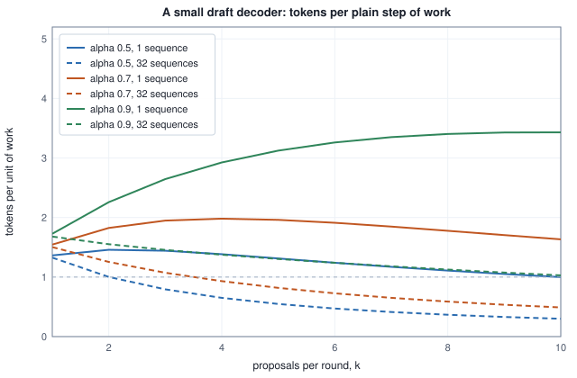

<!-- SPDX-License-Identifier: CC-BY-4.0 -->
<!-- Copyright (c) 2026 Martin Schröder <info@swedishembedded.com> -->

# Speculative Decoding

*How can a small model's guesses make a large model generate faster without changing its output?*

Give a decoder of 7.5 billion parameters one token to extend, at a context of 1,024 tokens, and it does 15,546,712,064 floating-point operations (FLOPs) while it reads 15,143,534,592 bytes: every weight once and the cached keys and values of the sequence once. That is 1.03 FLOPs per byte, on a device that could do 50 for every byte it is sent. Now give the same pass eight rows instead of one: the token it was going to consume and the seven tokens that will follow it. The FLOPs grow about eightfold, to 124,388,376,576, and the bytes do not grow at all, because the weights are read once whatever the number of rows and the eight rows share one cache. At 8.21 FLOPs per byte the pass is still far below the device's ridge, so by the roofline it costs exactly what the one-row pass costs. Eight tokens' worth of the large model's judgement for the price of one.

The catch is obvious. To put a token into row 5 of the pass, the decoder must know what token 4 is, and the whole point of decoding one token at a time is that it does not. Unless somebody guesses. If something cheap could guess the next few tokens, the large model could score all of them in one pass, keep the ones it agrees with, and throw the rest away. The guess does not have to be right; it only has to be right often enough, and the check has to be strict enough that a wrong guess changes nothing in the text. That is speculative decoding, and the rest of the chapter makes each part of that sentence exact: what the large model's agreement means when it decodes greedily and when it samples, how often a guess is kept and what that buys in work, which guesser to use, and what has to be undone when a guess is thrown away.

Four earlier ideas carry the argument, and each is worth bringing back before it is needed.

1. A decode step processes one row through the whole model. Why is it limited by bytes and not by arithmetic, and which two memories does it read (Volume V, Chapter 12, "The KV Cache")?
2. On the roofline of Volume IV, Chapter 3 ("Memory Bandwidth, Compute and the Roofline"), what is the ridge of a device, and what happens to a computation's arithmetic intensity when $B$ rows share one read of the weights?
3. Rejection sampling (Volume I, Chapter 17, "Randomness on a Deterministic Machine") draws a candidate from an easy distribution and keeps it with some probability. With what probability must a candidate $x$ be kept so that the kept values have density $f$, if candidates come uniformly from $[0, 1]$ and $f \le M$?
4. Top-p sampling (Volume V, Chapter 11, "Decoding: Turning Probabilities into Text") keeps a nucleus of tokens. Which tokens, and what happens to a token outside it?

Each one is answered in the last section, after the exercises, for checking afterwards.

## Rows that cost nothing extra

Count the work of a pass that scores $n$ rows for each of $B$ sequences. Every weight multiplies every row, so the matrix products cost $2Pn$ FLOPs per sequence for $P$ parameters, and every row now needs its logits, so the output head is applied $n$ times and not once. Every row also attends: to the $c$ keys already cached and to the new rows up to its own. The bytes are the weights, read once for the whole pass, plus every sequence's cache, read once. The new rows' keys and values are computed in the pass, and their writes are left out of the count, as Volume V, Chapter 12 left out the write of a decode step's own key. The roofline then says that a pass costs at least the larger of its FLOPs divided by the device's rate and its bytes divided by the bandwidth. Dividing both by the bandwidth turns that into a cost in byte-equivalents, $\max(N_{\mathrm{flop}}/\mathcal{I}_{\mathrm{ridge}},\ N_{\mathrm{byte}})$, which depends on the device only through its ridge $\mathcal{I}_{\mathrm{ridge}}$, and dividing again by the cost of a plain decode step of the same $B$ sequences gives a number that says how many plain steps the pass is worth:

$$C(B, n) = \frac{\max\!\big(N_{\mathrm{flop}}(B, n)/\mathcal{I}_{\mathrm{ridge}},\ N_{\mathrm{byte}}(B)\big)}{\max\!\big(N_{\mathrm{flop}}(B, 1)/\mathcal{I}_{\mathrm{ridge}},\ N_{\mathrm{byte}}(B)\big)}.$$

Here a row is the token the step consumes followed by $k$ guesses, so $n = k + 1$.

<!-- worked: speculative_decoding.verify_cost -->
The decoder of Volume V, Chapter 12: D = 4096, L = 32, 32 query heads and 8 key-value heads of width 128, F = 14,336 (SwiGLU), V = 128,256, 7,504,658,432 parameters in matrix products, every value in bf16 (2 bytes). Every sequence holds 1,024 tokens in its cache. A pass scores k + 1 rows per sequence (the token the step consumes and k proposals). FLOPs: 2 per parameter per row, the head included for every row, plus 4 L H d_h per key a row attends to (the cached keys and the new rows up to its own). Bytes: the weights once per pass plus each sequence's cached keys and values once; activations and the writes of the new rows are not counted. The unit of the last column is one plain decode step of the same batch: the larger of FLOPs / 50 (the ridge of the illustrative GPU of Volume IV, in FLOP per byte) and bytes, divided by that of one row per sequence.

| sequences | proposals k | rows each | FLOPs | bytes | FLOP per byte | cost in plain steps |
|---|---:|---:|---:|---:|---:|---:|
| 1 | 0 | 1 | 15,546,712,064 | 15,143,534,592 | 1.03 | 1.000 |
| 1 | 1 | 2 | 31,093,948,416 | 15,143,534,592 | 2.05 | 1.000 |
| 1 | 3 | 4 | 62,189,993,984 | 15,143,534,592 | 4.11 | 1.000 |
| 1 | 7 | 8 | 124,388,376,576 | 15,143,534,592 | 8.21 | 1.000 |
| 8 | 0 | 1 | 124,373,696,512 | 16,083,058,688 | 7.73 | 1.000 |
| 8 | 1 | 2 | 248,751,587,328 | 16,083,058,688 | 15.47 | 1.000 |
| 8 | 3 | 4 | 497,519,951,872 | 16,083,058,688 | 30.93 | 1.000 |
| 8 | 7 | 8 | 995,107,012,608 | 16,083,058,688 | 61.87 | 1.237 |
| 32 | 0 | 1 | 497,494,786,048 | 19,304,284,160 | 25.77 | 1.000 |
| 32 | 1 | 2 | 995,006,349,312 | 19,304,284,160 | 51.54 | 1.031 |
| 32 | 3 | 4 | 1,990,079,807,488 | 19,304,284,160 | 103.09 | 2.062 |
| 32 | 7 | 8 | 3,980,428,050,432 | 19,304,284,160 | 206.19 | 4.124 |
| 64 | 0 | 1 | 994,989,572,096 | 23,599,251,456 | 42.16 | 1.000 |
| 64 | 1 | 2 | 1,990,012,698,624 | 23,599,251,456 | 84.33 | 1.687 |
| 64 | 3 | 4 | 3,980,159,614,976 | 23,599,251,456 | 168.66 | 3.373 |
| 64 | 7 | 8 | 7,960,856,100,864 | 23,599,251,456 | 337.34 | 6.747 |
<!-- /worked -->

For one sequence the last column is 1.000 in every row: up to eight rows ride on the bytes of one step, which is the opening's arithmetic. The same holds for eight sequences up to four rows each; at eight rows each the pass reaches 61.87 FLOPs per byte, crosses the ridge and costs 1.237 plain steps. At 32 sequences a plain step already runs at 25.77 FLOPs per byte, half the ridge, so one extra row each nearly fits (1.031) and three cost twice a plain step (2.062). At 64 sequences a plain step is close to the ridge and every extra row is paid for almost in full: eight rows each cost 6.747 plain steps. The free rows are the bandwidth that a lone sequence leaves unused, and batching, which Chapter 4 of this volume uses to fill that bandwidth with other users' tokens, uses up the same headroom. A server that speculates is choosing between filling the pass with more sequences and filling it with more guesses for each.

## Guessing with a smaller model and keeping what the large one agrees with

The guesser is called the **draft model**: a model much cheaper to run than the one whose text is wanted (the target), used only to propose the next few tokens of a sequence, whose proposals the target then checks. Any procedure that proposes tokens can play the part, from a smaller network trained on the same data to a lookup in the text already written; the target never trusts it and never needs to.

The check, for a target that decodes greedily, is short. Let the context be $x_1 \dots x_t$ and let the draft propose $d_1, \dots, d_k$. The target runs one pass over the $k + 1$ rows $x_t, d_1, \dots, d_k$, at positions $t$ to $t + k$. Because attention is causal, row $j$ sees exactly the context followed by $d_1 \dots d_j$, so its logits are the target's distribution for the token after $d_j$: the same logits a plain decode step would compute if $d_1 \dots d_j$ had already been generated. Write $b_j$ for the target's greedy token at row $j$. Then $b_0$ is the token the target would emit next, and if $d_1 = b_0$, the token after it would be $b_1$, and so on. **Speculative verification** is the rule that keeps the longest prefix $d_1 \dots d_a$ of the proposals with $d_j = b_{j-1}$ for every $j \le a$, and emits after it the target's own token $b_a$: at the first disagreement it replaces the wrong proposal, and when every proposal was kept it is a bonus token from the last row. A round therefore emits $a + 1$ tokens, between 1 and $k + 1$, for one pass of the target.

```text
function verify_greedy(props: list<int>, best: list<int>) -> (int, int):
    require len(best) == len(props) + 1, "one best token per row"
    a = 0
    while a < len(props) and props[a] == best[a]:
        a = a + 1
    return (a, best[a])                        # proposals kept, the target's own token

function draft_proposals(ctx: list<int>, k: int, stop: int,
        draft: function(list<int>) -> int) -> list<int>:
    props = []
    c = copy(ctx)
    for j in 0 .. k:
        t = draft(c)
        append t to props
        append t to c
        if t == stop:
            break                              # nothing follows the end of a sentence
    return props

function speculative_greedy(prompt: list<int>, k: int, max_new: int, stop: int,
        draft: function(list<int>) -> int, target: function(list<int>) -> int) -> list<int>:
    require k >= 0 and max_new >= 1, "a window and a length"
    out = []
    while len(out) < max_new and (len(out) == 0 or out[len(out) - 1] != stop):
        ctx = concat(prompt, out)
        props = draft_proposals(ctx, min(k, max_new - len(out) - 1), stop, draft)
        best = [target(concat(ctx, props[0 : j])) for j in 0 .. len(props) + 1]   # one target pass
        (a, nxt) = verify_greedy(props, best)
        for t in concat(props[0 : a], [nxt]):
            if len(out) == max_new:
                break
            append t to out
            if t == stop:
                break
    return out
```

Here `draft(c)` and `target(c)` return each model's greedy token after the context `c` (the largest probability, the lowest id on a tie), `copy` is an independent copy of a list and the list comprehension that builds `best` stands for the rows of one target pass. The window, the number $k$ of proposals a round asks for, is shortened to `max_new - len(out) - 1` because a round emits at most $k + 1$ tokens and more proposals could never all be used. brain's scheduler applies the same bound, `remaining.saturating_sub(1)`, in `draft_windows` of `crates/model/src/serve/speculate.rs`.

The models of the example are small enough to follow by hand. The target is the order-4 interpolated counting model of Volume V, Chapter 4 ("Language Modeling"), over its 18 tokens and 40 training sentences; the draft is the order-2 model of the same chapter, trained on the same sentences. The order-2 model reads one token of context where the target reads three, so it is cheaper and wrong more often, which is all a draft has to be.

<!-- worked: speculative_decoding.greedy_trace -->
Target: the order-4 interpolated model of Volume V, Chapter 4; draft: the order-2 model of the same chapter, both over the same 18 tokens and with that chapter's smoothing ratios. Greedy means the largest probability, the lowest id on a tie. A round asks the draft for up to k = 3 greedy proposals (fewer when only 12 - generated - 1 tokens remain, and none after a full stop), scores the context and each proposal with the target in one pass (row j is the target's best token after the context and the first j proposals), accepts the longest prefix that equals the target's best tokens and emits it followed by the target's own token at the first disagreement, or after the last proposal; a full stop ends the generation and anything emitted after it is dropped. The prompt is `the dog`.

| round | context | proposals | target's best at each row | accepted | emitted |
|---:|---|---|---|---:|---|
| 1 | the dog | near the fox | near the dog sees | 2 | near the dog |
| 2 | the dog near the dog | near the fox | sees the dog sees | 0 | sees |
| 3 | the dog near the dog sees | small fish . | small ball . the | 1 | small ball |
| 4 | the dog near the dog sees small ball | . | . the | 1 | . |

The speculative text is `near the dog sees small ball .` in 4 target passes; plain greedy decoding of the target gives `near the dog sees small ball .` in 7 passes. The two are identical.
<!-- /worked -->


Round 1 is the figure. The draft guesses `near the fox`; the target, given the four rows `dog near the fox`, would have written `near` after `dog`, `the` after `near` and `dog` after `the`. The first two guesses are kept, the third is replaced by `dog`, and the fourth row's answer (`sees`, what would follow `fox`) belongs to a continuation that no longer exists, so it is not used. Round 2 is a total miss: the draft guesses `near the fox` again, the target wants `sees`, and the round emits only that one token, which is exactly what a plain decode step would have produced for the same pass. Seven tokens arrive in four passes of the target where plain decoding needs seven.

## Why the text cannot change

The equality in the last line of the table is not luck, and it holds for any draft. Suppose that before a round the speculative text equals the plain greedy text so far. Plain greedy decoding would emit $b_0$ next, then $b_0$'s successor, and so on. The round emits $d_1 \dots d_a$ and then $b_a$, and $d_j = b_{j-1}$ for $j \le a$ by the rule; each $b_{j-1}$ is the target's greedy token after the context followed by $d_1 \dots d_{j-1}$, which by the same equalities is the plain greedy text, so each emitted token is the one plain decoding emits at that place. The last token $b_a$ is the target's greedy token after the context and $d_1 \dots d_a$, the plain text again. After the round the two texts are still equal, and since they are equal at the start (both empty), they are equal after every round. The draft's quality enters only through $a$: a draft that is always wrong gives $a = 0$ and one token per pass, plain decoding at its own cost plus the draft's; a draft that is always right gives $k + 1$ tokens per pass.

The proof leaned on one assumption that a real engine has to earn: that row $j$ of the verify pass computes the same logits as a plain decode step at that position. On a computer the two are different programs. A verify pass may run its matrix products as a matrix-matrix kernel where a decode step runs a matrix-vector kernel, and the two add their products in different orders, so the logits can differ in their last bits (Volume IV taught why the order of additions changes a floating-point sum). Where the two largest logits are nearly equal, that is enough to flip the greedy token, and the text changes even though every step of the argument was right. brain states this as a contract. The conformance property `speculation_equals_plain_greedy` in `crates/model/src/serve/conformance.rs` compares the token streams of speculative and plain greedy decoding exactly, under a drafter that is always right, one that is right half the time and one that is always wrong, and its documentation says that a decoder whose verify kernels order their arithmetic differently must document the exception and build its test weights with a clear margin between the two best logits, because "a tolerant comparison would hide a verify that really diverges". The property was added in commit `12f7e6325` (22 October 2026), together with its negative control: a toy decoder whose commit step skips the rollback, which the property must and does catch (the test `the_speculation_property_catches_a_verify_that_does_not_roll_back` in `crates/model/tests/it/serve_speculative.rs` expects the panic "speculative output differs from plain greedy").

## How often the guesses land

The work a round saves is decided by how many proposals it keeps. Run the same loop over many prompts and three drafts of different strength: the order-1 model (no context at all), the order-2 model of the trace and the order-3 model, each against the order-4 target.

<!-- worked: speculative_decoding.draft_orders -->
The 21 prompts are the distinct prefixes of 1, 2 and 3 tokens of the 30 test sentences of Volume V, Chapter 4, in order of first appearance: `the`; `the dog`; `the dog chases`; `the cat`; `the cat sees`; `the cat near`; `the fox`; `the fox near`; `the dog near`; `the dogs`; `the dogs chase`; `the cats`; `the cats see`; `the foxes`; `the foxes see`; `the dog sees`; `the cats chase`; `the cats near`; `the cat chases`; `the foxes near`; `the dogs near`. Plain greedy decoding of the target generates 98 tokens for them in 98 passes. The models are those of the previous example, with the interpolation ratios of Volume V, Chapter 4 for the orders 1, 2, 3 and 4 of 1, 8, 4, 2 and its uniform floor of 0.01. Each generation follows the rules of the previous example with the draft order and the k of the row. 'rejections' counts the rounds in which some proposal was not accepted; 'accepted / proposed' is the share of proposals accepted; the per-position estimate is accepted / (accepted + rejections); 'tokens per pass' is tokens / passes.

| draft | k | target passes | tokens | proposed | accepted | rejections | accepted / proposed | per-position estimate | tokens per pass | same text as plain greedy |
|---|---:|---:|---:|---:|---:|---:|---:|---:|---:|---|
| order 1 | 1 | 86 | 98 | 86 | 12 | 74 | 0.140 | 0.140 | 1.140 | yes |
| order 1 | 3 | 86 | 98 | 258 | 12 | 86 | 0.047 | 0.122 | 1.140 | yes |
| order 1 | 5 | 86 | 98 | 430 | 12 | 86 | 0.028 | 0.122 | 1.140 | yes |
| order 2 | 1 | 66 | 98 | 66 | 50 | 16 | 0.758 | 0.758 | 1.485 | yes |
| order 2 | 3 | 57 | 98 | 132 | 62 | 29 | 0.470 | 0.681 | 1.719 | yes |
| order 2 | 5 | 53 | 98 | 158 | 66 | 32 | 0.418 | 0.673 | 1.849 | yes |
| order 3 | 1 | 61 | 98 | 61 | 53 | 8 | 0.869 | 0.869 | 1.607 | yes |
| order 3 | 3 | 41 | 98 | 108 | 78 | 13 | 0.722 | 0.857 | 2.390 | yes |
| order 3 | 5 | 35 | 98 | 132 | 81 | 13 | 0.614 | 0.862 | 2.800 | yes |
<!-- /worked -->

Every row emits the same 98 tokens as plain decoding; what changes is the number of target passes, from 98 down to 86 for the draft that ignores the context, 53 for the order-2 draft at $k = 5$ and 35 for the order-3 draft at $k = 5$. The table also shows that "how often the guesses land" has two different numbers, and they answer different questions.

The share of proposals accepted, accepted / proposed, falls as the window grows, for every draft: the order-3 draft's share goes from 0.869 at $k = 1$ to 0.614 at $k = 5$. It falls because a proposal deep in a window is only tested if every proposal before it was accepted; a window of five that misses at its first proposal counts four untested proposals as not accepted. That share is what a server counts naturally (brain's `SpecStats` has the fields `proposed` and `accepted` and reports their totals), and it measures the waste of the draft's work, but it is not a property of the draft alone, since it depends on $k$.

The per-position estimate does not depend on $k$ in that way. Suppose that each proposal is accepted with the same probability $\alpha$, given that the ones before it were, independently of how deep it sits in the window. Then a round of $k$ proposals keeps $a$ of them with probability $\alpha^a(1 - \alpha)$ if $a < k$ (accepted $a$ times, then one rejection) and $\alpha^k$ if $a = k$ (all accepted, no rejection observed). Over many rounds the likelihood is $\alpha^{\sum a}(1 - \alpha)^{n_{\mathrm{rej}}}$, where $n_{\mathrm{rej}}$ counts the rounds that ended in a rejection, and setting the derivative of its logarithm to zero gives the maximum-likelihood estimate

$$\hat\alpha = \frac{\sum a}{\sum a + n_{\mathrm{rej}}}.$$

That is the table's per-position estimate: for the order-3 draft 0.869, 0.857 and 0.862 at the three windows, nearly constant (the order-2 draft's 0.758, 0.681 and 0.673 drift more, since the order-2 draft is the one that misses most at the first proposal), while the share accepted moved from 0.869 to 0.614. The **acceptance rate** of a draft against a target is this conditional probability: the chance that a proposal is kept by verification given that the proposals before it in the same round were kept. It is the number to compare drafts by, and the one from which the window is chosen. The order-1 draft has 0.122 to 0.140, the order-2 draft 0.67 to 0.76 (0.681 at the middle window) and the order-3 draft about 0.86.

## Expected tokens of a round

If the acceptance rate is $\alpha$ at every depth, a round emits its first token for sure, the second with probability $\alpha$, the third with $\alpha^2$, and the $(k + 1)$-th with $\alpha^k$, so its expected number of tokens is a geometric sum:

$$E(\alpha, k) = 1 + \alpha + \alpha^2 + \dots + \alpha^k = \frac{1 - \alpha^{k+1}}{1 - \alpha}.$$

<!-- worked: speculative_decoding.expected_table -->
Expected tokens of one round, 1 + alpha + alpha^2 + ... + alpha^k = (1 - alpha^(k+1)) / (1 - alpha), for a per-position acceptance alpha that is the same at every depth; the last column is the limit 1 / (1 - alpha) of an unbounded window.

| alpha | k = 1 | k = 2 | k = 3 | k = 4 | k = 5 | k = 7 | k unbounded |
|---|---:|---:|---:|---:|---:|---:|---:|
| 0.5 | 1.500 | 1.750 | 1.875 | 1.938 | 1.969 | 1.992 | 2.000 |
| 0.7 | 1.700 | 2.190 | 2.533 | 2.773 | 2.941 | 3.141 | 3.333 |
| 0.9 | 1.900 | 2.710 | 3.439 | 4.095 | 4.686 | 5.695 | 10.000 |
<!-- /worked -->

Two facts in this table govern everything after it. The expected tokens are bounded by $1/(1 - \alpha)$ however wide the window: a draft whose guesses land half the time can never more than double the tokens of a pass. And the gain from widening the window shrinks geometrically; at $\alpha = 0.7$ the seventh proposal adds $0.7^7 = 0.082$ tokens. A wide window pays only for a draft that is right almost always.

The formula is also a model, and the toy shows where it stops describing reality. The order-2 draft at $k = 3$ has $\hat\alpha = 0.681$, for which $E = 2.461$, yet the table of the previous section measured 1.719 tokens per pass. The toy's sentences are short (98 tokens for 21 prompts, 4.7 tokens per prompt), and a round is cut whenever the sentence ends inside it or fewer than $k + 1$ tokens remain, so many rounds are shorter than the formula assumes; and the acceptance of a real draft is not the same at every depth or in every part of a text. The formula is the right tool for choosing a window in a long generation, and the measured counts are the truth.

## Paying for the guesses

Proposals are not free. A round costs one target pass of $k + 1$ rows, $C(B, k + 1)$ plain steps by the first table, plus the work of drafting, and it emits $E(\alpha, k)$ tokens per sequence where a plain step emits one. The number to maximise is therefore

$$\text{tokens per unit of work} = \frac{E(\alpha, k)}{C(B, k + 1) + D(k)},$$

where $D(k)$ is the drafting work in the same unit and a value above 1 means the round beats plain decoding. Three drafters bracket the possibilities. A free one costs nothing ($D = 0$); the prompt lookup of a later section is close to that. A small decoder that is the target scaled down to a fraction $r_{\mathrm{d}}$ of its FLOPs and bytes costs $r_{\mathrm{d}}$ of a plain step per proposal, since it runs once for each proposal, $D = k\,r_{\mathrm{d}}$. A block drafter, which proposes a whole block of tokens in one pass of its own (the drafter of a later section does that), costs one pass of its block whatever $k$ is, $D = r_{\mathrm{d}}\,C(B, 16)$ for a block of 16 rows.

<!-- worked: speculative_decoding.economics -->
Tokens per sequence per unit of work, the unit being one plain decode step of the same batch (which emits 1 token per sequence), for the decoder and context of the first table. A round of k proposals costs one target pass of k + 1 rows per sequence (the last column of the first table) plus the drafting, and emits the expected tokens of the previous table. Drafts: 'free' costs nothing (prompt lookup); 'small decoder' is the target scaled down to 0.1 of its FLOPs and bytes, run once per proposal (k passes of one row); 'block drafter' is the same scaled model run once over a block of 16 rows whatever k is (at most 15 proposals). The best k is searched over 1 to 15 for every drafter, the smaller k on a tie. Above 1 the round is worth more than plain decoding.

| sequences | drafter | alpha | k = 1 | k = 2 | k = 3 | k = 5 | k = 7 | best k | at best k |
|---|---|---:|---:|---:|---:|---:|---:|---:|---:|
| 1 | free | 0.5 | 1.500 | 1.750 | 1.875 | 1.969 | 1.992 | 15 | 2.000 |
| 1 | free | 0.7 | 1.700 | 2.190 | 2.533 | 2.941 | 3.141 | 15 | 3.322 |
| 1 | free | 0.9 | 1.900 | 2.710 | 3.439 | 4.686 | 5.695 | 15 | 8.147 |
| 1 | small decoder | 0.5 | 1.364 | 1.458 | 1.442 | 1.312 | 1.172 | 2 | 1.458 |
| 1 | small decoder | 0.7 | 1.545 | 1.825 | 1.948 | 1.961 | 1.848 | 4 | 1.981 |
| 1 | small decoder | 0.9 | 1.727 | 2.258 | 2.645 | 3.124 | 3.350 | 10 | 3.431 |
| 1 | block drafter | 0.5 | 1.364 | 1.591 | 1.705 | 1.790 | 1.811 | 15 | 1.818 |
| 1 | block drafter | 0.7 | 1.545 | 1.991 | 2.303 | 2.674 | 2.856 | 15 | 3.020 |
| 1 | block drafter | 0.9 | 1.727 | 2.464 | 3.126 | 4.260 | 5.178 | 15 | 7.406 |
| 32 | free | 0.5 | 1.455 | 1.132 | 0.909 | 0.637 | 0.483 | 1 | 1.455 |
| 32 | free | 0.7 | 1.649 | 1.416 | 1.229 | 0.951 | 0.762 | 1 | 1.649 |
| 32 | free | 0.9 | 1.843 | 1.753 | 1.668 | 1.515 | 1.381 | 1 | 1.843 |
| 32 | small decoder | 0.5 | 1.326 | 1.002 | 0.794 | 0.548 | 0.413 | 1 | 1.326 |
| 32 | small decoder | 0.7 | 1.503 | 1.254 | 1.072 | 0.819 | 0.651 | 1 | 1.503 |
| 32 | small decoder | 0.9 | 1.680 | 1.552 | 1.456 | 1.304 | 1.181 | 1 | 1.680 |
| 32 | block drafter | 0.5 | 0.808 | 0.738 | 0.650 | 0.503 | 0.403 | 1 | 0.808 |
| 32 | block drafter | 0.7 | 0.916 | 0.924 | 0.877 | 0.751 | 0.635 | 2 | 0.924 |
| 32 | block drafter | 0.9 | 1.024 | 1.143 | 1.191 | 1.196 | 1.151 | 4 | 1.204 |
<!-- /worked -->



At one sequence the target's rows are free, so a free drafter should propose as many tokens as it can, and the value approaches $1/(1 - \alpha)$; in the model of the table a small decoder pays $r_{\mathrm{d}} = 0.1$ of a plain step for each proposal (an assumed ratio, not a measurement of any drafter), and its value has a peak: $k = 2$ at $\alpha = 0.5$ (1.458 tokens per unit), $k = 4$ at $\alpha = 0.7$ (1.981) and $k = 10$ at $\alpha = 0.9$ (3.431). A modelled block drafter pays one 16-row pass of the same 0.1-scaled model for 15 proposals, so at one sequence it asks for all of them and, at $\alpha = 0.9$, reaches 7.406 against the small decoder's 3.431. At 32 sequences the picture turns over, as the dashed curves of the figure show. The target's extra rows now cost almost their full share, the best window is 1 for the free and the small decoder drafters at every $\alpha$ (the table's best $k$ column), 1 to 4 for the block drafter, and the block drafter, whose 16-row pass is itself no longer free, loses to plain decoding at $\alpha = 0.5$ and $0.7$ (0.808 and 0.924 tokens per unit). Speculation is a way to spend bandwidth that would otherwise idle, and how much idles depends on how many sequences share the pass.

## Choosing the window one proposal at a time

A server does not know $\alpha$ in advance, and it changes along a text: a reply that quotes its prompt is easy to guess, one that reasons is not. brain keeps one estimate per sequence and chooses a window from it every step. The estimate is the maximum-likelihood one of the previous section, with two changes (`SeqSpec` in `crates/model/src/serve/speculate.rs`): it starts from a prior of one accepted proposal and one rejection, and it forgets. After a round of $k > 0$ proposals of which $a$ were kept,

$$A \leftarrow 0.75\,A + a, \qquad R \leftarrow 0.75\,R + [a < k], \qquad \hat\alpha = \frac{A}{A + R},$$

with $A = R = 1$ at the start and $[a < k]$ equal to 1 when the round ended in a rejection and 0 otherwise; a round without proposals changes neither count. The weight 0.75 (`ACCEPT_DECAY`) makes the estimate follow the last handful of rounds, "since repeated text comes in bursts", as its comment gives the reason.

The window comes from a marginal argument. The $j$-th proposal of a round adds a token only if it and all before it are kept, which happens with probability $\alpha^j$, and it costs one more verify row and one more draft step. If $c$ is that cost in units of the work of one plain token, the proposal pays when $\alpha^j \ge c$, and since $\alpha^j$ falls with $j$ the window is the longest run of proposals that pays:

```text
function marginal_window(alpha: real, c: real, cap: int) -> int:
    k = 0
    reach = 1.0
    while k < cap:
        reach = reach * alpha
        if reach < c:
            break
        k = k + 1
    return k

function update_estimate(A: real, R: real, proposed: int, accepted: int) -> (real, real):
    if proposed == 0:
        return (A, R)
    rejected = 1.0 if accepted < proposed else 0.0
    return (0.75 * A + accepted, 0.75 * R + rejected)
```

`marginal_window` is `SpecPrices::window` of the same file, whose prices are the seconds a verify row and a draft step take and the seconds a plain step spends per token, all measured while the server runs; the cap there is `MAX_WINDOW`, 7, which the code bounds by "the verify kernels' rows per sequence". Here the prices are units of work, so $c$ is the draft's $r_{\mathrm{d}}$ plus the extra verify row's share of a plain step.

<!-- worked: speculative_decoding.window_rule -->
The window of the marginal rule: the largest k (at most 7) for which alpha^j >= c for every j = 1 .. k, where c is the work of one more proposal (a verify row and a draft step) over the work of one plain token. The last column is the k in 1 to 7 that maximises the tokens per unit of the previous table for the small decoder at one sequence (the smaller k on a tie), where one more proposal costs c = 0.1 (a verify row is free there and a draft step costs 0.1).

| alpha | c = 0.02 | c = 0.1 | c = 0.3 | best k for tokens per unit, c = 0.1 |
|---|---:|---:|---:|---:|
| 0.3 | 3 | 1 | 1 | 1 |
| 0.5 | 5 | 3 | 1 | 2 |
| 0.7 | 7 | 6 | 3 | 4 |
| 0.8 | 7 | 7 | 5 | 6 |
| 0.9 | 7 | 7 | 7 | 7 |
<!-- /worked -->

The marginal rule asks for more than the ratio's optimum when $\alpha$ is moderate: 6 against 4 at $\alpha = 0.7$, 3 against 2 at 0.5. The two maximise different things. The marginal rule values a token at what plain decoding pays for it, one unit, and keeps adding proposals while each earns more than it costs; that maximises the tokens a round produces beyond what the same work would have produced plainly. The ratio values a token at what the round as a whole already achieves, which is more than one unit, so it stops earlier. Both are defensible, and at the high and low ends of $\alpha$ they agree.

Run the whole loop: estimate, window, draft, verify, update, on one sequence of 40 tokens after `the`, generated without stopping at the full stop so that the text repeats.

<!-- worked: speculative_decoding.estimator_trace -->
One sequence generated greedily for 40 tokens after `the`, without stopping at the full stop, by the order-4 target with the order-2 draft. Before each round the estimate is a = A / (A + R), with A and R starting at 1.0; the round asks for the marginal window at a with c = 0.1 (the previous table's rule, at most 7; the 'window' column is that rule's value), and proposes the smaller of the window and 40 - generated - 1 tokens (the 'proposed' column, which is why the last round has window 7 and 3 proposals). After a round with proposals, A becomes 0.75 A + (accepted) and R becomes 0.75 R + 1 if some proposal was rejected, else 0.75 R; a round with no proposals changes neither. The draft proposes greedily and the target verifies as before.

| round | estimate before | window | proposed | accepted | emitted | A after | R after |
|---:|---:|---:|---:|---:|---|---:|---:|
| 1 | 0.500 | 3 | 3 | 0 | foxes | 0.7500 | 1.7500 |
| 2 | 0.300 | 1 | 1 | 1 | near the | 1.5625 | 1.3125 |
| 3 | 0.543 | 3 | 3 | 2 | fox sees ball | 3.1719 | 1.9844 |
| 4 | 0.615 | 4 | 4 | 4 | . the fox sees ball | 6.3789 | 1.4883 |
| 5 | 0.811 | 7 | 7 | 4 | . the fox sees ball | 8.7842 | 2.1162 |
| 6 | 0.806 | 7 | 7 | 4 | . the fox sees ball | 10.5881 | 2.5872 |
| 7 | 0.804 | 7 | 7 | 4 | . the fox sees ball | 11.9411 | 2.9404 |
| 8 | 0.802 | 7 | 7 | 4 | . the fox sees ball | 12.9558 | 3.2053 |
| 9 | 0.802 | 7 | 7 | 4 | . the fox sees ball | 13.7169 | 3.4040 |
| 10 | 0.801 | 7 | 3 | 3 | . the fox sees | 13.2877 | 2.5530 |

10 target passes produce the 40 tokens; the text is identical to plain greedy decoding of the target, which takes 40 passes.
<!-- /worked -->

The first round misses and drives the estimate down to 0.300, which earns a window of one; two kept proposals bring it back, and once the text settles into its loop (`. the fox sees ball`, which the draft knows up to `sees` and then completes with `small`) the window opens to 7 and every round keeps four of seven. The estimate settles near 0.80 because a round of seven that keeps four counts four acceptances and one rejection. Forty tokens take ten passes. In a real server two more rules sit around this loop, both in `SeqSpec::window`: a sequence whose estimate earns no proposal at all proposes nothing, and after `PROBE_EVERY`, 8, such steps it proposes one anyway, so that a text that has become predictable is noticed.

## Keeping the sampled distribution exact

Greedy verification asks one question per row: is the guess the target's best token? A target that samples has no single best token, and "the same output" must mean the same distribution of outputs. Speculative sampling (Leviathan, Kalman and Matias 2023; Chen and colleagues 2023, who found the same rule independently) is a rejection test whose losses are paid back exactly.

Take one position. The target would sample from $p$, the draft samples its proposal $d$ from its own distribution $q$. Keep $d$ with probability $\min(1, p(d)/q(d))$; otherwise draw a replacement from the **residual**

$$r(x) = \frac{\max(0,\ p(x) - q(x))}{\sum_y \max(0,\ p(y) - q(y))}.$$

The emitted token is $x$ either because $d = x$ was proposed and kept, with probability $q(x)\min(1, p(x)/q(x)) = \min(p(x), q(x))$, or because a proposal was rejected and the replacement is $x$. The probability of a rejection is $1 - \sum_y \min(p(y), q(y))$, and since $\min(p, q) + \max(0, p - q) = p$ for every token and $p$ sums to 1, the rejection probability equals $\sum_y \max(0, p(y) - q(y))$, the normaliser of $r$. So

$$\begin{aligned}P(\text{emit } x) &= \min(p(x), q(x)) + \sum_y \max(0, p(y) - q(y)) \cdot r(x)\\ &= \min(p(x), q(x)) + \max(0, p(x) - q(x)) = p(x).\end{aligned}$$

Compare it with the rejection sampling of Volume I, Chapter 17, which kept a candidate with probability $f(x)/M$ and drew again after a rejection, paying $M$ proposals per kept value. Here a rejection does not start over: the residual is exactly the probability that the test took away from the tokens where the draft over-proposes and failed to give to the tokens where it under-proposes, so one extra draw from it completes the distribution. And the probability that a proposal is kept is $\sum_y \min(p(y), q(y)) = 1 - \mathrm{TV}(p, q)$, one minus the total variation distance between the two distributions (half the sum of $|p(y) - q(y)|$): under sampling, the acceptance rate of a draft is its closeness to the target.

The example is four tokens whose logits are those of a test in brain, (1.2, 0.7, 0.1, -0.4), sampled from with nothing cut, and two drafts: one that samples uniformly, and one that always proposes the second token.

<!-- worked: speculative_decoding.four_tokens -->
Four tokens t0 to t3 with logits 1.2, 0.7, 0.1 and -0.4; the target's distribution p is their softmax (temperature 1, nothing cut). First a draft that samples its proposal from the uniform q; then a draft that always proposes t1 (a point mass). A proposal d is kept with probability min(1, p(d) / q(d)); a rejected one is replaced by a draw from the residual, max(0, p - q) renormalised. 'emitted' is the exact probability that the round's first token is that token, q(t) min(1, p(t) / q(t)) + (1 - sum of min(p, q)) residual(t).

| token | logit | p | q | kept if proposed | min(p, q) | residual | emitted |
|---|---:|---:|---:|---:|---:|---:|---:|
| t0 | 1.2 | 0.4670 | 0.2500 | 1.0000 | 0.2500 | 0.8671 | 0.4670 |
| t1 | 0.7 | 0.2833 | 0.2500 | 1.0000 | 0.2500 | 0.1329 | 0.2833 |
| t2 | 0.1 | 0.1555 | 0.2500 | 0.6218 | 0.1555 | 0.0000 | 0.1555 |
| t3 | -0.4 | 0.0943 | 0.2500 | 0.3771 | 0.0943 | 0.0000 | 0.0943 |

Probability that the proposal is kept: 0.7497 (the sum of min(p, q)). Largest difference between 'emitted' and p: below 1e-15.

| token | p | q (always t1) | residual | emitted |
|---|---:|---:|---:|---:|
| t0 | 0.4670 | 0 | 0.6516 | 0.4670 |
| t1 | 0.2833 | 1 | 0.0000 | 0.2833 |
| t2 | 0.1555 | 0 | 0.2169 | 0.1555 |
| t3 | 0.0943 | 0 | 0.1315 | 0.0943 |

Probability that t1 is kept: 0.2833, which is p(t1). The residual is p with t1 removed and renormalised. Largest difference between 'emitted' and p: below 1e-15.
<!-- /worked -->

Read the first table row by row. A uniform draft under-proposes t0 and t1 (0.25 against 0.4670 and 0.2833), so those are always kept, and over-proposes t2 and t3, which are kept with probabilities 0.6218 and 0.3771. The missing mass, $0.4670 - 0.25 = 0.2170$ for t0 and $0.0333$ for t1, is the residual, renormalised to 0.8671 and 0.1329; the emitted column equals $p$ to the printed digits, and the largest difference is below $10^{-15}$, which is rounding.

The second table is the case brain uses. A draft that proposes deterministically, as every drafter in this chapter does, is a point mass: $q(d) = 1$ for its proposal and 0 for every other token. The test then keeps $d$ with probability $p(d)$, and the residual is $p$ with $d$ removed and renormalised. That is the rule `verify_proposals` in `crates/model/src/serve/speculate.rs` states in its documentation, "the standard speculative-sampling test reduces to accepting a proposal `d` with probability `p(d)` ... and on rejection drawing from that distribution with `d` removed and renormalised", and its body does it with unnormalised weights: it draws a uniform number, keeps the proposal when the number times the sum of the kept weights is below the proposal's weight, and otherwise draws again over the weights with the proposal's taken out (`verify_survivors`). Several proposals are tested in order, and the first rejection ends the round:

```text
function residual(p: array<real>[V], q: array<real>[V]) -> array<real>[V]:
    r = [max(0.0, p[i] - q[i]) for i in 0 .. V]
    s = sum(r)
    require s > 0, "a rejection is possible only where q exceeds p somewhere"
    return [r[i] / s for i in 0 .. V]   # called only after a rejection, which needs s > 0

function verify_sampled(props: list<int>, p: list<array<real>[V]>, q: list<array<real>[V]>,
        rng: inout Generator) -> (int, int):
    require len(p) == len(props) + 1 and len(q) == len(props), "a distribution per row"
    for j in 0 .. len(props):
        d = props[j]
        if rng.uniform() * q[j][d] < p[j][d]:     # kept with probability min(1, p / q)
            continue
        return (j, draw(residual(p[j], q[j]), rng))
    return (len(props), draw(p[len(props)], rng))  # every proposal kept: a bonus token
```

`residual` is called only after a rejection. When $p = q$ exactly, as after a context where both toy models fall back to the same unigram, the sum $s$ is 0, but then the test keeps every proposal, since $u\,q(d) < p(d)$ holds for every uniform $u$ below 1, so no rejection occurs and no residual is needed (the worked module's enumeration gives such a residual the value 0, which is multiplied by a rejection probability of 0). `draw` is the routine of Volume V, Chapter 11; `p[j]` is the distribution the target samples from at row `j` (after its temperature and cuts) and `q[j]` the one the proposal was drawn from, a one-hot row for a deterministic draft. A kept proposal costs one uniform number and a rejection two.

One position is the easy half of the argument; a round tests several positions, and the second is tested only when the first was kept, with distributions that depend on the first token. The next example checks the whole round by enumeration on the toy models: the draft samples two proposals from the order-2 model, the target tests them against the order-4 model, and the joint distribution of the first two emitted tokens is computed over all $18 \times 18$ pairs, including the pairs whose second token comes from the next round.

<!-- worked: speculative_decoding.two_token_joint -->
Rounds of k = 2 sampled proposals after `the`: the draft draws d1 from its order-2 distribution and d2 from its distribution after d1; the target keeps d1 with probability min(1, p(d1) / q(d1)) and, if it did, d2 with min(1, p(d2 given d1) / q(d2 given d1)); a rejection is replaced from the residual and ends the round, whose next round starts after the emitted token. The joint distribution of the first two emitted tokens over the 18 x 18 pairs is computed exactly. The two differences that are zero in exact arithmetic are printed as the bound below which the floating-point sums leave them.

| quantity | value |
|---|---:|
| probability that both proposals are kept | 0.7469 |
| largest difference, emitted pairs against the target's p(t1) p(t2 given t1) | below 1e-15 |
| total variation, emitted pairs against the target | below 1e-15 |
| total variation, the draft's own pairs against the target | 0.2114 |
<!-- /worked -->

The draft's own pairs are 0.2114 away from the target's in total variation; after verification the distance is below $10^{-15}$, rounding error. The induction behind it is the greedy one with distributions in place of tokens: if the first emitted token has distribution $p(t_1)$, then given $t_1$ the next token is either the second proposal tested against $p(\cdot \mid t_1)$ or the first token of a fresh round after $t_1$, and both have distribution $p(t_2 \mid t_1)$ by the one-position result. brain tests the same property statistically: `rejection_sampling_preserves_the_target_distribution` in `crates/model/tests/it/serve_speculative.rs` proposes the second most likely of the four tokens above 60,000 times and requires every emitted frequency within 0.01 of $p$, and `sampled_speculation_matches_the_sampled_distribution_end_to_end` compares the texts of 3,000 seeded runs with and without a drafter, requiring a total variation below 0.05.

## The nucleus, and a drafter that never samples

A served request rarely samples from the model's whole distribution. With a temperature, a top-k or a top-p, the target's $p$ is the truncated and renormalised distribution, and the proof above holds for any $p$, so the verifier must test against exactly the distribution plain sampling would draw from, cuts included. A token outside the nucleus has $p(d) = 0$, so it is never kept, however confident the draft was. The next table runs the four-token arithmetic on four contexts of the toy, with and without a top-p of 0.9, for a draft that samples from the order-2 model and for one that proposes the order-2 model's greedy token.

<!-- worked: speculative_decoding.sampled_contexts -->
Target p: the order-4 model's distribution after the context at temperature 1; draft q: the order-2 model's. With a top-p of 0.9 both are cut to their own nucleus (the shortest prefix in order of decreasing probability, ties to the lower id, whose cumulative probability reaches 0.9) and renormalised, as Volume V, Chapter 11 defines it; 'tokens in p' counts the tokens the target can emit. 'kept, sampled draft' is the sum of min(p, q), the probability that a proposal drawn from q is kept, beside 1 - TV(p, q) (TV is half the sum of |p - q|); 'kept, greedy draft' is p(d) for the draft's greedy token d. The last column is the largest difference between the exact distribution of the emitted token and p, over both drafts; it is zero in exact arithmetic and printed as the bound below which the floating-point sums leave it.

| context | top-p | tokens in p | kept, sampled draft | 1 - TV(p, q) | greedy draft proposes | kept, greedy draft | largest error |
|---|---|---:|---:|---:|---|---:|---:|
| the | none | 18 | 0.8929 | 0.8929 | fox | 0.1721 | below 1e-15 |
| the | 0.9 | 6 | 0.9071 | 0.9071 | fox | 0.1829 | below 1e-15 |
| the cat | none | 18 | 0.8294 | 0.8294 | near | 0.5155 | below 1e-15 |
| the cat | 0.9 | 3 | 0.8087 | 0.8087 | near | 0.5726 | below 1e-15 |
| the dogs chase | none | 18 | 0.4143 | 0.4143 | fish | 0.8319 | below 1e-15 |
| the dogs chase | 0.9 | 3 | 0.3469 | 0.3469 | fish | 0.9243 | below 1e-15 |
| the fox near | none | 18 | 0.9653 | 0.9653 | the | 0.9386 | below 1e-15 |
| the fox near | 0.9 | 1 | 1.0000 | 1.0000 | the | 1.0000 | below 1e-15 |
<!-- /worked -->

The two kinds of draft fail in opposite places. After `the` the target's distribution is spread over six nouns; a sampled draft, spread the same way, is kept 0.8929 of the time, while the draft's single best guess `fox` is kept only with the target's own probability of `fox`, 0.1721. After `the dogs chase` the target is nearly sure of `fish` (0.8319), and the greedy guess is kept at that rate, while the sampled draft, which puts more weight elsewhere, is kept 0.4143 of the time. A point-mass drafter is right as often as the target is sure, which is a good bargain for the confident stretches of a text and a poor one where the target is undecided. With the nucleus, the target's set of possible tokens shrinks to 6, 3, 3 and 1, the acceptance moves with it, and the last column stays at rounding error throughout.

The nucleus raises a practical problem that Volume V, Chapter 11 met for plain sampling: a server reads back a short list of each row's best candidates, and a nucleus can be wider than the list. brain's verifier tests a proposal against "the survivors of the whole row" when a request needs it, and the test `a_proposal_is_tested_against_the_whole_row_nucleus` in `crates/model/src/serve/speculate.rs` makes the point with 300 equal logits and a top-p of 0.9: the nucleus holds 270 tokens, so a proposal inside it is kept with probability 1/270, one outside it never is, and the replacement after a rejection reaches tokens past the 64th, which a 64-entry candidate list could not hold.

## Taking back the rejected rows

A verify pass writes state for every row it scores, the rejected ones included: each row's key and value in the cache of every attention layer, and in a recurrent layer the state that the layer carries from one token to the next. After the round, the sequence's state must be what plain decoding would have left after the emitted tokens and nothing else.

For attention the repair is a matter of lengths. A sequence's cache is a list of blocks and a count of positions (Chapter 3 of this volume builds it), and a later step attends only to the positions the count covers. Truncating the count to the kept length makes the rejected rows invisible, and the next round's rows overwrite them; whole blocks past the new length are handed back. That is `BlockTable::truncate` in `crates/model/src/paged.rs`, which drops the reference of every block beyond the one that holds the new last position, and the scheduler calls it after every verify with the length before the pass plus the input row and the kept proposals (`settle_verified` in `crates/model/src/serve/speculate.rs`). It arrived with speculative decoding in the paged serving engine, commit `174b1909a` (27 July 2026), whose message records the check that frames this whole chapter: with an oracle draft 20 tokens took 4 target passes, with a bad draft 20 passes, and both produced "token-for-token the same output as greedy".

A recurrent layer has no positions to truncate. Its state is one buffer that the verify pass has already advanced through every row, rejected rows included. Commit `ea80c2dff` (15 September 2026) met this in a model three quarters of whose layers are of the recurrent kind (the Gated DeltaNet layers of Volume VI, Chapter 5), and its message states the distinction exactly: attention layers "need no rollback", since a later step's attention is bounded by its own count of positions, while the recurrent state and its convolution history "are single buffers that the verify pass has already advanced through every row". That commit copied every recurrent layer's state before a verify and restored it after a rejection, then recomputed the kept prefix, so a rejecting round paid a second pass. The scheduler's contract today puts the repair in the decoder: `PagedDecoder::commit_verified` in `crates/model/src/serve.rs` is told how many rows of each sequence stand and must leave the recurrent state "restored to the state after row `keep[i] - 1`", and the conformance property of the earlier section, with its toy decoder that skips the restore, is what checks that a decoder did.

## Drafters that cost almost nothing

The cheapest draft reads only the text. Prompt lookup finds the latest earlier place where the context's last $n$ tokens occurred and proposes the tokens that followed there. It needs no model and no device work, and it is strong exactly where generations copy their context: an edit of code, a quotation, the arguments of a tool call.

```text
function prompt_lookup(ctx: list<int>, n: int, k: int) -> list<int>:
    require n >= 1, "a suffix of at least one token"
    m = len(ctx)
    if k == 0 or m <= n:
        return []
    for i in m - n - 1 down to 0:              # the suffix itself (start m - n) is not a match
        if ctx[i : i + n] == ctx[m - n : m]:
            return ctx[i + n : min(i + n + k, m)]
    return []
```

Two lists compare equal when they have the same length and the same entries in order.

<!-- worked: speculative_decoding.lookup_table -->
The context is the 16 tokens `the cat sees the dog . the dog chases the cat . the cat sees the`, positions counted from 0. For each n the drafter finds the latest earlier start of the context's last n tokens (a start at most len - n - 1, so the suffix itself is not a match) and proposes the k = 3 tokens that followed it.

| n | suffix | latest earlier start | proposals |
|---:|---|---:|---|
| 1 | `the` | 12 | cat sees the |
| 2 | `sees the` | 2 | dog . the |
| 3 | `cat sees the` | 1 | dog . the |
<!-- /worked -->

A suffix of one token matches too easily: `the` last occurred at position 12, and the proposal copies `cat sees the` from there, a continuation of a different sentence. Two tokens find the one earlier `sees the` and propose `dog . the`, what the text actually did after it. brain's `NgramDrafter` in `crates/model/src/serve/speculate.rs` implements this rule. Its documentation is careful about the cost, which matters for a drafter whose whole claim is that it is free: each sequence keeps an index of its n-grams, chains of start positions by hash with the latest first, extended only by the tokens appended since its previous query, so that a query costs work proportional to the new tokens and $n$, not a scan backwards through the whole context; the test `the_ngram_index_equals_the_backwards_scan` checks the index against the plain scan above for $n$ from 1 to 4 over 120 rounds of three growing contexts.

<!-- perf-number: historical measurement, commit 091de1b3e -->
A free drafter is no guarantee of a gain, because a rejected round still costs what the verify path costs. In September 2026, on two 24 GiB GPUs serving a 27-billion-parameter model whose weights were stored in 8 bits, the n-gram drafter at $k = 7$ was kept 0.57 times per round on free-form prose and 5.12 times per round on a prompt that asked for its own text back; on the prose it lost to plain decoding (0.67 of plain decoding's tokens per unit of time), and on the copied text it won (commit `091de1b3e`). The same commit measured why the arithmetic of this chapter's first table did not hold there: on that stack a verify pass of an all-accepted round cost about 2.4 plain decode steps "almost regardless of its row count", because a fixed overhead per call dominated. The roofline is a lower bound, and a verify path that is far above it turns free rows into expensive ones.

## A drafter that reads the target's hidden states

A drafter that is a small copy of the target has two weaknesses that the economics table exposes: it pays one pass per proposal, and it knows only the tokens, not what the target computed from them. The crate `crates/dflash2` implements a drafter built against both. It is a block-diffusion drafter: one forward pass over the block `[anchor, MASK, MASK, ..., MASK]`, where the anchor is the last token of the context and the masks are a reserved token id, denoises the whole block at once, so that "`k` proposals cost one draft forward, not `k`", as its crate documentation puts it. The block is always the full `block_size` rows, 16 for the published draft, because the rows attend to each other and a shorter block would propose differently (`Dflash2Drafter` in `crates/dflash2/src/drafter.rs`); proposals beyond what the scheduler asked for are dropped.

It does not read the context's tokens. Each of its layers computes its keys and values from the target's own residual stream at a few of the target's layers (the taps), concatenated, projected by a matrix `fc` and normalised, one row per context token (`Dflash2::append_context` in `crates/dflash2/src/model.rs`). The target already computed those rows while it decoded; the server keeps them for the drafter (`PagedDecoder::enable_taps` and `read_taps` in `crates/model/src/serve.rs`, stored in blocks addressed by the same block table as the cache, so that truncation and prefix reuse need nothing extra). The drafter has no embedding table and no output head of its own: it embeds the block with the target's table and turns its output rows into logits with the target's head, after applying its own final norm (`DraftHost` in `drafter.rs`). Attention in the draft is not causal: the block's rows see each other, each row sees the whole context on a full layer, or the positions within a window on a sliding layer, and a layer flagged as having no rotary position embedding applies none. Every attention and feed-forward sublayer is wrapped in a dynamic grouped convolution whose taps are computed per token from the activations, causal inside the block and restarted at every block.

The last step turns the block's logits into a path. Proposing each row's most likely token independently would ignore that the tokens must fit together, so a selector walks the rows left to right (`selector.rs`). At each row it takes the head's 32 most likely tokens and scores each candidate $x$ by its logit plus a learned pairwise term between the token chosen at the previous row and $x$:

$$\text{score}(x) = z_x + \big\langle\, \mathbf{u}_{\mathrm{prev}} \odot (\mathbf{W}_{\mathrm{sel}}\,\hat{\mathbf{h}}),\ \mathbf{v}_x \big\rangle,$$

where $z_x$ is the logit, $\hat{\mathbf{h}}$ the row's hidden state after the draft's final norm, $\mathbf{W}_{\mathrm{sel}}$ a projection to 256 dimensions, $\mathbf{u}_{\mathrm{prev}}$ and $\mathbf{v}_x$ rows of a predecessor and a successor codebook of one 256-entry row per token, and $\odot$ the elementwise product. The best candidate becomes the next row's predecessor, and an earlier row is never revisited.

The configuration of a published draft, which a test of `crates/dflash2/src/config.rs` holds, gives the size of all this.

<!-- worked: speculative_decoding.dflash2_inventory -->
The draft has 5 layers of width 5120 (feed-forward width 40,960, 80 query heads and 8 key-value heads of width 128); four layers attend within a window of 4,096 positions and the fifth to every position; it reads the target's residual stream at 5 layers, denoises blocks of 16 rows, wraps each sublayer in a dynamic convolution of 4 taps per group of 16 channels, and its selector has rank 256 over the top 32 candidates of a vocabulary of 100,352. 'each layer' rows are summed over the five layers. The draft holds no embedding table and no output head: it uses the target's.

| tensor | shape | parameters |
|---|---|---:|
| fc (fuses the taps) | 5120 x 25600 | 131,072,000 |
| each layer: q | 10240 x 5120 | 262,144,000 |
| each layer: k | 1024 x 5120 | 26,214,400 |
| each layer: v | 1024 x 5120 | 26,214,400 |
| each layer: o | 5120 x 10240 | 262,144,000 |
| each layer: gate | 40960 x 5120 | 1,048,576,000 |
| each layer: up | 40960 x 5120 | 1,048,576,000 |
| each layer: down | 5120 x 40960 | 1,048,576,000 |
| each layer: attention conv projection | 2560 x 5120 | 65,536,000 |
| each layer: MLP conv projection | 2560 x 5120 | 65,536,000 |
| each layer: attention conv base | 2 x 4 x 5120 | 204,800 |
| each layer: MLP conv base | 2 x 4 x 5120 | 204,800 |
| each layer: input norm | 5120 | 25,600 |
| each layer: post-attention norm | 5120 | 25,600 |
| each layer: q norm | 128 | 640 |
| each layer: k norm | 128 | 640 |
| hidden norm | 5120 | 5,120 |
| final norm | 5120 | 5,120 |
| selector projection | 256 x 5120 | 1,310,720 |
| selector predecessor codebook | 100352 x 256 | 25,690,112 |
| selector successor codebook | 100352 x 256 | 25,690,112 |

In all 4,037,752,064 parameters (8.08 GB in bf16), of which 3,984,588,800 are in the matrices a pass multiplies on the device. A draft cache row of one layer holds the keys and values of one position, 2 x 8 x 128 values of 4 bytes = 8,192 bytes. A sliding layer keeps min(positions, 4,096) + 16 rows and the full layer positions + 16 rows, so a sequence shorter than the window fills its sliding layers as well; one sequence's cache holds:

| positions in the sequence | rows of a sliding layer | rows of the full layer | bytes, all five layers |
|---|---:|---:|---:|
| 1,024 | 1,040 | 1,040 | 42,598,400 |
| 32,768 | 4,112 | 32,784 | 403,308,544 |
| 1,048,576 | 4,112 | 1,048,592 | 8,724,807,680 |
<!-- /worked -->

The draft is 4.04 billion parameters, almost all of them in five layers' feed-forward matrices, and one pass of it proposes up to 15 tokens. The conv projection's 2,560 rows are $2 \times 4 \times 320$: one set of 4 taps for each of the 320 groups of 16 channels, once for the convolution entering a sublayer and once for the one leaving it (`Dflash2Config::dyn_width`). The cache rows follow `Dflash2Config::cache_rows`: a sliding layer keeps the window plus one block, since a block row reads back $4{,}096 - 1$ positions and forward to the end of its block, and the full layer keeps every position plus one block; the test `a_sliding_cache_is_the_window_and_a_full_cache_every_position` pins the values at 1,048,576 positions. At a context of 32,768 tokens the draft's cache is 403,308,544 bytes per sequence, two thirds of it in the one full layer (32,784 of its 49,232 rows).

Two design choices remove work that a draft would otherwise repeat. The cache is indexed by absolute position, so a verify that rejects proposals needs no rollback in the draft: the next round projects the taps of the positions the target has just committed, starting where the last round's context ended, and those rows overwrite exactly the rows the denoising block wrote there (the module documentation of `drafter.rs`). And context rows are projected incrementally, so a round pays for the tokens the target has just committed and not for the whole context; `CTX_CHUNK`, 256 rows, bounds one projection's input at $256 \times 25{,}600$ values of 4 bytes, 26,214,400 bytes. A sequence that cannot be served in a round (no free cache slot, a context out of step with its table, taps that cannot be read) proposes nothing that round, and the drafter says why in the log; zero proposals are a correct input for the verifier, so a drafter's failure costs work and never correctness.

The drafter came into brain as part of one model's engine, commit `091de1b3e` (16 September 2026), and was moved into a crate of its own that knows nothing of its target in commit `e46df139d` (8 November 2026), with the per-layer sliding, full and position-free attention read from the checkpoint's configuration, a window that the cache applies as a ring rather than asserts, and one batched forward over several sequences' blocks. The crate's tests compare every layer of a denoising pass with a host reference: `one_round_matches_the_reference_layer_by_layer` and its neighbours in `crates/dflash2/tests/it/tiny.rs` on a tiny random draft, within a scaled error of $10^{-4}$, and `the_published_ripple_draft_matches_the_reference_layer_by_layer` in `real.rs` on the published draft, within $2 \times 10^{-3}$, including the selector's path token for token.

## A bug that only the acceptance rate can see

Speculative verification has a property that is a blessing for users and a trap for whoever builds a drafter: nothing the drafter does can change the output. A drafter with its convolution taps transposed produces exactly the same text as a correct one and differs only in how often it is kept, and a low acceptance rate looks the same as an architecture that is simply not very good. The message of commit `091de1b3e` says it directly, "Correctness cannot be gated on the text, because every proposal is verified by the target", and gates the port in four independent steps instead: every tensor of the 8-bit file compared elementwise with the original 16-bit release, a host reference that reimplements the published model over the same bytes, that reference run on the original weights reproducing the authors' own implementation (the same seven ids, hidden states to 7 significant figures), and the device port reproducing the reference.

The selector shows why. The draft's denoising pass returns its hidden rows before the final norm, and the norm is applied afterwards with the draft's gain, once for the rows the target's head turns into logits and once for the selector, whose projection was trained on rows after the norm. The selector's documentation records what happens when the two are confused: the rows before the norm have a root mean square near a thousand on the published drafts, so projecting them scales the pairwise term by about a thousand against logits of order ten, and "the selector would override the head at every position, including the ones the head had right", which "shows up only as an acceptance rate near zero". The code applies the norm first (`Selector::select` calls `normed` before the projection), and the test against the reference's path is what holds it there.

The same commit found a second, subtler effect of a greedy walk. At an 8-bit weight tier the draft's hidden states differed from the 32-bit ones by about 1.37 percent, small for a single prediction; but the selector's choice at one row becomes the predecessor of the next, and on the gated prompt the reference's own margin between the two best candidates at the second row was 0.0086 on scores of order 23. The two tiers took opposite sides of that near tie and agreed on nothing after the first row, which is why the commit runs its last gate at 32 bits. Neither effect can harm the output. Both cost acceptance, and only measuring acceptance against a reference shows them.

## Deciding per step whether to speculate

The scheduler that runs speculation for every decoder in brain (`Scheduler::speculative_step` and `propose` in `crates/model/src/serve/speculate.rs`, added in commit `30c1695ec` on 17 October 2026) makes a sequence of decisions before each step, and each corresponds to something counted above. Speculation is off when the batch is larger than the decoder's crossover (`PagedDecoder::spec_max_batch`), the batch size past which, as the first table showed, extra rows stop being free. It is off for a step that carries a sequence running under a runtime adapter, whose verify path has no per-row adapter selection, and for a sequence whose logit processors read tokens chosen earlier in the same step, which a single verify pass cannot provide. The windows come from each sequence's estimate and are shrunk until the proposals fit the decoder's row budget and the free blocks of the cache, the widest first. A drafter's output is treated as untrusted input: proposals are cut at the first token outside the vocabulary rather than spliced around it. And a step in which no sequence received a proposal is a plain step, which does not count as a rejection.

The cost model of this chapter assumes the roofline; a real decoder can be far from it, as the verify path of commit `091de1b3e` was. brain therefore does not trust a model of the cost for decoders whose step time is a meaningful signal (`PagedDecoder::spec_cost_aware`). Commit `8987df2c1` (17 October 2026) introduced measuring instead: "Whether a verify step beats a plain step depends on the decoder's kernels, the batch size and the workload's acceptance, none of which a constant can know." The current `CostGate` times whole rounds per batch-size bucket (powers of two) and per window, keeps the mean tokens and the mean time of each window over its last 8 rounds, leaving out a round more than 1.5 times slower than the median of those rounds (a stall rather than a cost), runs the window that has produced the most tokens per unit of time, plain decoding being the window of none, and every 16th step re-measures a window beside the best so that the choice follows the workload. It is the tokens-per-unit-of-work comparison of the economics table, with the unit replaced by what the machine actually spent.

## Check your understanding

1. A colleague proposes to verify proposals by comparing the draft's probability of each proposal with the target's and keeping it when they are within 10 percent of each other. Give two ways this changes the output of a greedy target.
2. A draft is kept with share accepted / proposed of 0.40 at $k = 5$. A second draft has 0.60 at $k = 1$. Can you tell which draft is better from these numbers? What would you compute instead?
3. Predict, from the first table, whether speculation with a free drafter and $k = 3$ pays at 64 sequences for a draft with $\alpha = 0.9$, and check it with $E(\alpha, k)$.
4. In the four-token example, a draft that always proposes t0 is used instead of t1. What is the probability that the proposal is kept, and what distribution is the replacement drawn from?
5. Find the error: "Since the residual is drawn from only after a rejection, the tokens where $q > p$ are emitted less often than $p$ says."
6. A decoder's verify pass leaves its recurrent state advanced through all $k + 1$ rows, and its `commit_verified` does nothing. Which of the three drafters in the conformance property (always right, half right, always wrong) can still produce the plain greedy text, and why?
7. Why does a block drafter's cost per round not grow with $k$, and at what batch size does that advantage disappear in the economics table?

## Summary

A decode step of a large model is limited by the bytes it reads, so a pass can score several rows for the price of one as long as it stays below the device's ridge. Speculative decoding fills those rows with proposals from a **draft model** and keeps them by **speculative verification**: the longest prefix the target agrees with, followed by the target's own token, which makes greedy output identical to plain greedy decoding for any draft and, with the accept-or-residual rule, makes sampled output follow exactly the distribution plain sampling would, temperature and nucleus included. The **acceptance rate**, the probability that a proposal is kept given that those before it were, decides the gain: a round of $k$ proposals emits $(1 - \alpha^{k+1})/(1 - \alpha)$ tokens on average, never more than $1/(1 - \alpha)$, and its worth is that number over the work of the verify pass and the drafting. That worth is large for one sequence and shrinks as the batch fills the same bandwidth; a free drafter favours wide windows, a small decoder a window that grows with $\alpha$, a block drafter all of its block. Rejected rows are undone by truncating the cache's length and, for a recurrent layer, by restoring its state.

The limits are the model's. The work counts are roofline lower bounds, and a verify path with a large fixed cost per call lives far above them, which is why brain measures rounds instead of predicting them; the geometric acceptance is an approximation that short or uneven texts break; and a drafter's defects are invisible in its output and show only in its acceptance rate, which must therefore be measured against a reference. The next chapter turns from what happens inside a step to what the engine shows the outside world: how hundreds of models, each with its own drafters, caches and options, are presented through a few stable interfaces.

## References

- Leviathan, Y., Kalman, M. and Matias, Y. Fast Inference from Transformers via Speculative Decoding. ICML 2023.
- Chen, C., Borgeaud, S., Irving, G., Lespiau, J.-B., Sifre, L. and Jumper, J. Accelerating Large Language Model Decoding with Speculative Sampling. DeepMind technical report, arXiv:2302.01318, 2023.
- Stern, M., Shazeer, N. and Uszkoreit, J. Blockwise Parallel Decoding for Deep Autoregressive Models. NeurIPS 2018.

## Exercises

1. **[Calculate]** For the decoder of the first table at 16 sequences and context 1,024, find the largest $k$ for which a verify pass still costs one plain step.
2. **[Calculate]** A draft has $\alpha = 0.8$. Find $E(0.8, k)$ for $k = 1, 3, 7$, and the tokens per unit of work at one sequence for a small decoder with $r_{\mathrm{d}} = 0.05$. Which $k$ is best in 1 to 7?
3. **[Calculate]** Rounds of $k = 4$ proposals keep 4, 1, 0, 4, 2 and 4 proposals. Compute the share accepted, $\hat\alpha$ by maximum likelihood, and the decayed estimate $A/(A + R)$ after the six rounds starting from $A = R = 1$ with weight 0.75.
4. **[Calculate]** Target $p = (0.5, 0.3, 0.2)$, draft $q = (0.2, 0.2, 0.6)$. Compute the probability that a sampled proposal is kept, the residual, and check that the emitted distribution is $p$.
5. **[Calculate]** With the same $p$ and a top-p of 0.7, which tokens survive? What is the probability that a deterministic proposal of token 2 is kept?
6. **[Implement]** Reproduce `speculative_decoding.greedy_trace` and `speculative_decoding.draft_orders` from the counting models of Volume V, Chapter 4, with `speculative_greedy` as written. Every row of both tables must agree, including the 98 tokens and the target passes.
7. **[Implement]** Reproduce `speculative_decoding.verify_cost` and `speculative_decoding.economics` from the decoder's shape and the counting rules stated in the first block. Your costs in plain steps and your tokens per unit must agree to the printed digits.
8. **[Implement]** Reproduce `speculative_decoding.two_token_joint` by exact enumeration, then implement `verify_sampled` with the book's generator and confirm, on 100,000 rounds after `the` with $k = 2$, that the frequencies of the first two emitted tokens are within sampling noise of the exact joint distribution.
9. **[Implement]** Reproduce `speculative_decoding.estimator_trace`: the 40 tokens, the windows and the decayed counts of every round.
10. **[Investigate]** Read `Dflash2Config::from_json` and `Dflash2Config::from_gguf` in `crates/dflash2/src/config.rs`. The two formats name the target layers a draft taps by different numbers for the same layers. Find the conversion, say what each number counts, and say what a drafter would read if the conversion were left out.
11. **[Investigate]** Read `CostGate::choose` in `crates/model/src/serve/speculate.rs` and describe, step by step, which windows a new batch-size bucket runs during its first steps, and when plain decoding is measured again.

## Key terms

- **draft model**: a model, or any procedure, much cheaper to run than the target, used only to propose the next few tokens of a sequence for the target to check; its quality changes how many proposals are kept, never what the target emits. <!-- concept: draft-model -->
- **speculative verification**: scoring a draft's proposals with the target in one pass and keeping the longest prefix the target agrees with (its greedy token, or a token kept by the accept-or-residual test when sampling), followed by the target's own next token, so that the output is exactly what plain decoding would produce. <!-- concept: speculative-verification -->
- **acceptance rate**: the probability that a proposal is kept by verification given that the proposals before it in the same round were kept, estimated as accepted proposals over accepted proposals plus rounds that ended in a rejection; it bounds the tokens a round can emit at one over one minus itself. <!-- concept: acceptance-rate -->

## Answers

**Recall.**

1. Every weight multiplies the one row, so the step reads all the weights for $2P$ FLOPs, about 1 FLOP per byte in 16-bit weights, far below the ridge of a device; it also reads the cached keys and values of every earlier position, because the new query attends to all of them. Those two memories, the weights and the cache, are its bytes.
2. The ridge is the arithmetic intensity, peak rate over bandwidth, above which a computation is limited by arithmetic and below which by bytes (50 FLOPs per byte on the illustrative GPU). When $B$ rows share one read of the weights, the FLOPs grow $B$-fold and the weight bytes do not, so the intensity grows nearly in proportion to $B$.
3. With probability $f(x)/M$; the kept values then have density proportional to $f$, and each costs $M$ proposals on average.
4. The smallest set of most probable tokens whose probability adds up to at least the threshold, renormalised; a token outside it has probability zero and is never drawn.

**Check your understanding.**

1. A proposal the target would not choose can be kept when the two models assign it similar probability, so the text changes; and a correct proposal can be rejected when the probabilities differ though both models rank it first, which only costs work. The first breaks the guarantee: the test must compare with the target's choice, not with the draft's confidence.
2. No. The share depends on $k$, because deep proposals are tested only after earlier ones were kept. Compute the per-position acceptance, accepted over accepted plus rejecting rounds, for each draft (or run both at the same $k$).
3. At 64 sequences four rows cost 3.373 plain steps, and $E(0.9, 3) = 3.439$, so the round gives $3.439/3.373 = 1.02$ tokens per unit: barely above 1. At $k = 1$ it is $1.9/1.687 = 1.13$.
4. $p(t_0) = 0.4670$; the replacement is drawn from $p$ without t0, renormalised: $(0, 0.2833, 0.1555, 0.0943)/0.5331$.
5. Tokens with $q > p$ are over-proposed and kept only with probability $p/q$, so each is emitted with probability $\min(p, q) = p$ through the proposal and 0 through the residual (where $\max(0, p - q) = 0$); the total is exactly $p$. The statement forgets that it was proposed more often than $p$ to begin with.
6. Only the always-right drafter, whose rounds keep every row, so the state advanced through all rows is the correct one. A half-right or always-wrong drafter leaves the state advanced through rejected rows, which then corrupt later tokens.
7. It runs one pass over its whole block whatever $k$ is. At 32 sequences its 16-row pass is no longer free (and the target's extra rows are not either), and it loses to plain decoding at $\alpha = 0.5$ and 0.7.

**Exercises.**

1. At 16 sequences a plain step does about $16 \times 15.55 \times 10^9$ FLOPs against about $15.0 \times 10^9 + 16 \times 134{,}217{,}728$ bytes, 248,747,393,024 FLOPs against 17,156,800,512 bytes, 14.50 FLOPs per byte; $n$ rows multiply the FLOPs by about $n$, so the pass stays below the ridge of 50 while $14.5\,n \le 50$, $n \le 3$: $k = 2$ (with $k = 3$ the pass costs 1.160 plain steps). (The first table's rows at 8 and 32 sequences bracket this: 4 rows free at 8, 2 rows almost free at 32.)
2. $E = 1.8$, $2.952$, $4.161$. Tokens per unit $E/(1 + 0.05k)$: 1.714, 2.567, 3.082 at $k = 1, 3, 7$; for all $k$ in 1 to 7 the values are 1.714, 2.218, 2.567, 2.801, 2.951, 3.040, 3.082, so $k = 7$ is best.
3. Proposed 24, accepted 15: share 0.625. Rejecting rounds: three (1, 0 and 2 kept), so $\hat\alpha = 15/18 = 0.833$. The decayed counts after each of the six rounds are, $A$: 4.75, 4.5625, 3.421875, 6.56640625, 6.9248046875, 9.193603515625; $R$: 0.75, 1.5625, 2.171875, 1.62890625, 2.2216796875, 1.666259765625; estimate $9.1936/(9.1936 + 1.6663) = 0.847$.
4. $\sum \min = 0.2 + 0.2 + 0.2 = 0.6$. Residual: $\max(0, p - q) = (0.3, 0.1, 0)$, renormalised $(0.75, 0.25, 0)$. Emitted: $(0.2 + 0.4 \times 0.75,\ 0.2 + 0.4 \times 0.25,\ 0.2) = (0.5, 0.3, 0.2)$.
5. Cumulative 0.5, then 0.8 reaches 0.7: tokens 0 and 1 survive, renormalised to $(0.625, 0.375, 0)$. Token 2 is outside the nucleus, so a proposal of it is kept with probability 0.
6. Implementation: the printed tables are the check.
7. Implementation: the printed tables are the check.
8. Implementation: the printed values are the check; with 100,000 rounds a pair of probability 0.05 has a standard deviation of its frequency of about 0.0007.
9. Implementation: the printed table is the check.
10. `from_gguf` subtracts 1 from every entry of `dflash.target_layers` and refuses an entry of 0. The GGUF stores indices into the list of hidden states whose entry 0 is the output of the embedding and entry $i + 1$ the output of decoder layer $i$; the configuration's `target_layer_ids` and the tap contract count decoder layers from 0. Without the conversion every tap would read the residual stream one layer later than the draft was trained on, and the only symptom would be a lower acceptance rate.
11. A new bucket first runs the windows of `GATE_TRY_ORDER`, 2, 1 and 3 (those not above the cap), each until it has `GATE_WARMUP_STEPS`, 2, samples; then plain decoding once if it has no sample; afterwards it runs the window with the most tokens per unit of time, except on every 16th step of the bucket, when it runs a window beside the best, and plain decoding on every third of those refresh steps.
