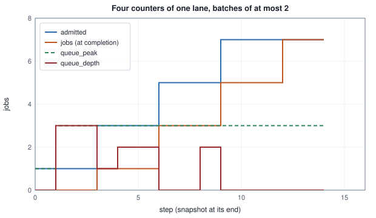

<!-- SPDX-License-Identifier: CC-BY-4.0 -->
<!-- Copyright (c) 2026 Martin Schröder <info@swedishembedded.com> -->

# Running and Observing an Engine

*How do we see what a running engine is doing, control it, and shut it down cleanly?*

Eight conversations are being answered at once. The server decodes them together, one batch of eight, for 512 decode steps, and produces 4,096 tokens. Its operator asks what it is doing. The most complete answer the program could give is a line for every decision it takes: each conversation admitted and finished, each decode step and the batch it ran, each token sampled for each conversation. Count them and the complete answer is 4,625 lines, more lines than the run produced tokens, about 555,000 bytes of text at 120 bytes a line, for a run whose useful output is a few kilobytes. The least complete answer, the lines that report something that went wrong, is one line. Between the two there is a whole scale, and the table below counts it for this run.

<!-- worked: operations.trace_volume -->
A scripted run: 8 conversations decoded together as one batch for 512 decode steps, 4,096 tokens in all. It emits, by severity: 0 error lines; 1 warn line (one fallback for the whole run); 16 info lines (each conversation admitted and finished); 512 debug lines (one per decode step, naming the batch it ran); 4,096 trace lines (one per token of each conversation). A filter at level L writes every line of severity 1 to L. Bytes assume 120 bytes per rendered line, an assumption of the example; the last column divides the lines written by the tokens generated, to four decimals.

| level | name | lines written | bytes written | lines per token |
|---|---:|---:|---:|---:|
| 0 | off | 0 | 0 | 0.0000 |
| 1 | error | 0 | 0 | 0.0000 |
| 2 | warn | 1 | 120 | 0.0002 |
| 3 | info | 17 | 2,040 | 0.0042 |
| 4 | debug | 529 | 63,480 | 0.1292 |
| 5 | trace | 4,625 | 555,000 | 1.1292 |
<!-- /worked -->

Level 3 is 17 lines, enough to know which conversations ran and that the run fell back once. Level 4 is 529 lines, one per decode step, which is what a person debugging the scheduler wants and nobody else does. Level 5 is 1.1292 lines per token. None of these is the right level; each is right for one question, and the engine cannot know in advance which question will be asked. So the first thing a running engine needs is a way for the person running it to choose, while it runs or at the moment it starts, how much of itself it describes, and about which of its parts.

Seeing is the first of three things the operator of an engine asks of it. The second is control: telling it to stop what it is doing for one client and go on with the next, without the session that was interrupted ending in a broken state. The third is stopping: a server that is told to end has requests in flight, connections open and gigabytes of device memory reserved, and "clean" means that the requests get an answer, the memory is given back and the process actually ends, whatever state its parts are in. Each of the three looks simple and each has failed in a real engine in a way worth understanding.

Ideas from two earlier chapters of this volume carry most of the weight, and they are worth bringing back now. In Chapter 4, "Batching and Scheduling Requests", a scheduler held waiting requests in a queue and admitted them onto the device: what is the difference between a request that is queued and one that is running, and why can a scheduler not simply admit each request the moment it arrives? In the same chapter, requests that share a model were grouped into one batch: when does a batch's work count as done, at the moment it is admitted or at the moment it finishes? In Chapter 6, "Capabilities, Providers and APIs", every model was presented through the same interface: what does a model's manifest list, and how does a caller run an action of a model it has never seen before? And what in that interface lets a caller ask a running action to stop?

## Events that carry their own description

The obvious way to make a program say what it is doing is to print a sentence: `step 37 ran 8 requests`. A sentence is easy to write and hard to use. It cannot be switched off without editing the program, it does not say which part of the program wrote it, and a script that wants the number 8 out of it has to parse English. The history of brain records what that costs. Commit `c83ccd06f` (20 August 2026), which added the engine's tracing, describes the situation before it: every investigation into why a run behaved as it did began by adding print statements by hand, running once and deleting them, so the same breadcrumbs (which layer, cache hit or miss) had been worked out by hand more than once on the same code.

**Structured tracing** replaces the sentence with an event that carries its own description. An event has a severity, a target that names the component that emitted it, a message, and named fields with typed values; `layer = 7` is a field, not a part of a sentence. Events can happen inside a span, a named unit of work with fields of its own (a whole denoising run, one request), and an event inside a span carries the span's name and fields with it, so a line that says "cache miss" also says in which run it happened. Emitting and rendering are separated: the code that emits an event says only what happened, and one component decides, for the whole process, which events are written, in what form and where.

Severity is a scale of five, and the scale is the one the table above counted. Level 1 admits only errors (something failed), level 2 adds warnings (something degraded, was retried or fell back), level 3 adds coarse lifecycle (a run started, a stage finished), level 4 adds per-step decisions and level 5 adds everything, per iteration. Level 0 is off. A filter at level $L$ writes an event of severity $\sigma$ when $\sigma \le L$, so the levels nest: everything level 3 writes, level 4 writes too.

brain uses the Rust ecosystem's `tracing` library for the mechanism and adds a vocabulary on top of it (`crates/trace/src/lib.rs`). Library crates emit through the plain `tracing` macros and depend on nothing else, so no engine crate can install a renderer by accident; one binary installs exactly one, at the start of `main`, from what the command line asked for. The scale is not a second notion of verbosity laid over the library's: levels 1 to 5 are the library's five levels, error to trace, which the test `the_scale_is_tracings_own_five_levels_plus_off` pins, so `--trace-ltxv 4` and a `debug!` call mean the same thing by construction. And level 0 is not a filter that rejects everything: when every family is at 0, no renderer is installed at all and `install_to` returns false (`level_zero_emits_nothing_at_all`), so an untraced run is the same program it was before tracing existed. A file named for output is not even created on such a run, so a run that traces nothing does not empty a trace someone kept from an earlier one.

Two renderings are offered. Text is one line per event: a timestamp, the level, the target (the module path of the emitting code), the message and then the fields as `name=value`; colour codes are written only when the output is a terminal, because a file with colour escapes baked into it cannot be searched afterwards. JSON is one object per line, with the target, the level, the fields and the enclosing spans as real members of the object, so a tool reads `fields.layer` without parsing text. The test `json_output_is_parseable_with_the_target_as_a_field` parses every line back as JSON rather than looking for braces in it, and `span_context_reaches_json_output` checks that an event inside a span named `denoise` with `steps = 8` carries both. When several threads emit at once, each event takes the lock on the output for the whole of its line (`SinkWriter` in `crates/trace/src/init.rs`), so two events never interleave in the middle of a line.

## Naming components the way an operator thinks of them

A target is the module path of the code that emitted the event, `ltxv::dit` or `gpu_core::devices`. That is precise and it is not how a person thinks. Someone chasing a problem with the graphics device wants "the GPU", and the GPU in brain is four crates: the device facade and three backends. The vocabulary brain adds is a registry of families (`crates/trace/src/registry.rs`), each a short name over a list of targets: `gpu` covers `gpu_core`, `backend_wgpu`, `backend_vulkan` and `vulkan`, and `ltxv` (a video generation pipeline) covers `ltxv` and `gemma4`, the text encoder that pipeline runs as one of its stages, so that tracing the pipeline accounts for the whole generation and not for everything except its largest stage.

A family turns into a filter by one rule. Every target of every family at a nonzero level becomes a directive, `target=level`; the filter starts from "everything off" and adds the directives. An event is matched against the directives whose target is a prefix of the event's target, and the longest such target decides; with none, the event is off. The match is a prefix of the text, character by character, not of the path's segments: that is how the library's filter matches (it compares with `starts_with`, and orders directives by the length of their targets so the most specific is tried first), which means that a directive `ltxv` would also admit a crate whose name merely began with those four letters. The registry's own test `targets_are_lib_names_not_package_names` guards the other edge: a target must be a crate's library name with underscores, because a package name with a hyphen never appears in a module path, and a filter built from it would match nothing without any error.

```text
function starts_with(s: text, p: text) -> bool:
    return len(p) <= len(s) and s[0 : len(p)] == p

function trace_admits(directives: list<(text, int)>, target: text, severity: int) -> bool:
    require 1 <= severity and severity <= 5
    best = 0                                   # no directive matches: the event is off
    best_len = -1
    for (t, level) in directives:
        if starts_with(target, t) and len(t) > best_len:
            best = level
            best_len = len(t)
    return severity <= best
```

The flags that set the levels are parsed by one function, `strip_args` in `crates/trace/src/cli.rs`, and their grammar is small enough to state whole. `--trace-<family> L` sets one family, and there is one such flag per registry entry, derived from the table and not listed anywhere else. `--trace <family>=L` is the generic form and reaches every family, so a new family is usable before it has a flag of its own. `--trace-format text|json` and `--trace-output -|PATH` choose the rendering and the destination. The flags are recognised anywhere on the command line and removed before the rest is handed to the subcommand, so no subcommand needs to know they exist. A family named twice keeps its last level, as every repeated option does. The environment variable `BRAIN_TRACE`, in the generic form with commas (`gpu=5,ltxv=1`), is read only when no flag named a family: a flag wins outright rather than merging with it. And a mistake is an error, never a guess: an unknown family, a level outside 0 to 5 and a malformed pair all stop the command before anything runs (`a_bad_family_level_or_format_is_an_error_not_a_default`), because a run that silently traced nothing after a typo looks exactly like a run whose tracing is broken.

The next table applies the grammar and the filter to eight events, the six that the test `each_level_admits_exactly_the_levels_at_or_above_it` emits and two more: one from a backend that belongs to the `gpu` family, and one from a backend that belongs to no family.

<!-- worked: operations.trace_filter -->
The families: `gpu` covers `gpu_core`, `backend_wgpu`, `backend_vulkan`, `vulkan`; `ltxv` covers `ltxv`, `gemma4`. The eight events below are emitted once each, in this order; a target is the module path of the code that emitted it. The configurations are the flags of one command line (after the program name) and the value of BRAIN_TRACE, if set. A level of 0 for every family installs no subscriber; a refused command line is an error before anything runs.

| event | target | severity | message |
|---|---|---|---|
| E1 | `ltxv::pipeline` | 1 (error) | boom |
| E2 | `ltxv::pipeline` | 2 (warn) | degraded |
| E3 | `ltxv::pipeline` | 3 (info) | started |
| E4 | `ltxv::dit` | 4 (debug) | cache miss |
| E5 | `ltxv::dit` | 5 (trace) | per-iteration detail |
| E6 | `gpu_core::devices` | 1 (error) | adapter enumeration failed |
| E7 | `backend_vulkan` | 4 (debug) | queue submitted |
| E8 | `backend_cuda::exec` | 3 (info) | graph launched |

| flags | BRAIN_TRACE | levels | directives | events written |
|---|---|---|---|---|
| `(none)` | unset | gpu=0, ltxv=0 | none: no subscriber | none |
| `--trace-ltxv 3` | unset | gpu=0, ltxv=3 | ltxv=info, gemma4=info | E1 E2 E3 |
| `--trace-ltxv 1 --trace ltxv=5` | unset | gpu=0, ltxv=5 | ltxv=trace, gemma4=trace | E1 E2 E3 E4 E5 |
| `--trace-gpu 2 --trace-format json` | unset | gpu=2, ltxv=0 | gpu_core=warn, backend_wgpu=warn, backend_vulkan=warn, vulkan=warn | E6 |
| `--trace-ltxv 4 --trace-gpu 1` | unset | gpu=1, ltxv=4 | gpu_core=error, backend_wgpu=error, backend_vulkan=error, vulkan=error, ltxv=debug, gemma4=debug | E1 E2 E3 E4 E6 |
| `(none)` | `gpu=5,ltxv=1` | gpu=5, ltxv=1 | gpu_core=trace, backend_wgpu=trace, backend_vulkan=trace, vulkan=trace, ltxv=error, gemma4=error | E1 E6 E7 |
| `--trace-ltxv 3` | `gpu=5` | gpu=0, ltxv=3 | ltxv=info, gemma4=info | E1 E2 E3 |
| `--trace-ltxv 0` | unset | gpu=0, ltxv=0 | none: no subscriber | none |
| `--trace-ltxv 9` | unset | refused: level '9' is not 0-5 |  |  |
| `--trace-quen 5` | unset | refused: unknown family 'quen' |  |  |
| `--trace ltxv` | unset | refused: --trace expects <family>=<level> |  |  |
<!-- /worked -->

Three rows and one event say most of it. The third row names `ltxv` twice and gets level 5, the later one. The fifth row asks for two families at two levels at once, and each event is judged by its own family's directive: E4, a debug event, is written for the video pipeline at level 4 while the GPU family at level 1 admits only its error E6. In the seventh row the variable asks for the GPU at level 5 and the flag for the video pipeline at level 3, and the GPU events are not written, because a flag that names any family replaces the variable whole. And E8 is written in no row: a component outside every family is invisible to this filter, whatever the levels, which is the property the test `a_family_is_isolated_from_the_others` states the other way round (asking for one family must not turn on another). The family is the unit of vocabulary, and something that should be traceable has to belong to one.

What all this buys is the opening table made selective. Asking for `--trace-ltxv 4` writes the per-step decisions of one pipeline and nothing of the others, and the cost is paid only by the events that pass. The documentation of `crates/trace/src/lib.rs` claims more for the cost of the rest ("a crate emitting events costs nothing when no subscriber is installed"); what the tests establish is narrower: with level 0 everywhere no renderer exists, and an event that a filter does not admit is not written.

## A snapshot of the engine's state, sampled while it runs

A trace answers "what happened". The operator of a server more often asks "what is the state now": how much memory each device has in use, which models are resident where, how many requests are waiting. A log can answer that only by being read from the beginning and replayed. **Runtime statistics** answer it directly: a set of numbers that the engine keeps up to date as it works, and that anyone can sample at any moment without disturbing it.

The numbers come in two kinds, and confusing them is the commonest way to misread a dashboard. A counter only grows: jobs completed, models built, models evicted. Its value at one moment says little; the difference between two samples says how much happened between them. A gauge is a level that goes up and down: requests queued now, bytes in use now. A third kind is a running extreme, the largest value a gauge has ever had, which is a gauge's history folded into one number and never comes down. And a counter has a moment at which it counts, which a reader has to know: a job can be counted when it is admitted to the device or when its result is delivered, and the two counters differ by exactly the work in progress.

brain's scheduler keeps all of these (`Stats` in `crates/residency/src/executor.rs`), and the next example runs a small scheduler with its rules for four of them. `admitted` counts a job when its batch is given the device, `jobs` counts it when the batch's completion arrives, `queue_peak` is raised to the queue's length each time a job joins it, and `queue_depth` is the queue's length now.

<!-- worked: operations.counters -->
One lane, batches of at most 2 jobs of the same model, each batch running for 3 steps; jobs arrive 1 at step 0, 3 at step 1, 1 at step 4, 2 at step 8. Steps are counted from 0. Within a step: a batch that has run its steps completes first (jobs and batches count it), then the step's arrivals join the queue (queue_peak is raised by each arrival), then an idle lane admits from the front of the queue (admitted counts the jobs). The snapshot is taken at the end of the step; running is the size of the batch on the lane, and admitted - jobs equals it in every row.

| step | arrivals | queue_depth | queue_peak | admitted | jobs | batches | running |
|---|---:|---:|---:|---:|---:|---:|---:|
| 0 | 1 | 0 | 1 | 1 | 0 | 0 | 1 |
| 1 | 3 | 3 | 3 | 1 | 0 | 0 | 1 |
| 2 | 0 | 3 | 3 | 1 | 0 | 0 | 1 |
| 3 | 0 | 1 | 3 | 3 | 1 | 1 | 2 |
| 4 | 1 | 2 | 3 | 3 | 1 | 1 | 2 |
| 5 | 0 | 2 | 3 | 3 | 1 | 1 | 2 |
| 6 | 0 | 0 | 3 | 5 | 3 | 2 | 2 |
| 7 | 0 | 0 | 3 | 5 | 3 | 2 | 2 |
| 8 | 2 | 2 | 3 | 5 | 3 | 2 | 2 |
| 9 | 0 | 0 | 3 | 7 | 5 | 3 | 2 |
| 10 | 0 | 0 | 3 | 7 | 5 | 3 | 2 |
| 11 | 0 | 0 | 3 | 7 | 5 | 3 | 2 |
| 12 | 0 | 0 | 3 | 7 | 7 | 4 | 0 |
| 13 | 0 | 0 | 3 | 7 | 7 | 4 | 0 |
<!-- /worked -->



Read at step 9, the four numbers tell four different stories. The queue is empty (`queue_depth` 0), and `queue_peak` still says 3, because at step 1 three jobs waited at once and a high-water mark never forgets; a dashboard that watched only the peak would show a backlog for the rest of the server's life. Seven jobs have been given the device and five have finished, and the two that separate them are exactly the batch on the lane, which is why the scheduler keeps `admitted` beside `jobs`: `admitted` moves the instant a job starts, while `jobs` and `batches` move only when a group's completion message arrives, so only the two together show the work on the device. The live `queue_depth` exists for the same reason: it is the number a dashboard wants to watch change, which the peak cannot be. A rate, finally, is a difference of a counter: between steps 6 and 12 the lane finished $7 - 3 = 4$ jobs, which says how much work was done in those six steps whatever the absolute values were.

### A snapshot tree that fits any number of devices

A snapshot has to describe a machine whose shape is not known in advance: one GPU or eight, no models resident or fifty. brain's snapshot (`StatsSnapshot` in `crates/stats/src/snapshot.rs`) is a tree whose sections are lists keyed by an identifier, never fixed slots: accelerators (`cpu`, `gpu0`, `npu1`, each with its total, used and reserved bytes), models (each with the instances that are resident, an instance naming its device, its tier and its bytes), the scheduler's counters, the requests in flight and the front-end connections. Every level carries an open map called `extra` in which a new metric can appear without changing the typed shape, and a schema number (1 today) that changes only when the typed shape changes incompatibly; growth of `extra` never changes it. The whole tree serialises to one JSON document. An empty `extra` is left out of the document, and an empty list is an empty array, never a null, so that "nothing resident" and "not reported" stay different things (`empty_snapshot_serializes_stably`).

The tree is assembled from contributors. A `StatsSource` fills the sections it owns, and an `Assembler` walks the registered sources in order into a fresh snapshot (`crates/stats/src/source.rs`), so a component adds its numbers without a central switchboard that has to know about it. The live source today is `ExecutorSource` in `crates/stats/src/build.rs`: from one handle to the scheduler it reads the counters, the catalog of models and the residency report, and fills accelerators (one row per device that has a memory budget), models (the catalog joined with where each one is resident) and requests (each in-flight job with its model, action, phase and age). Two choices in it are worth noticing because both are refusals to guess. The typed `util` field of an accelerator is always empty: real occupancy needs a performance counter that an unprivileged process cannot read, and the code puts what it can read honestly (the GPU's frequency and whether it is throttled, from the system's device files) into `extra` under labelled names instead. And those device-file readings are attached to `gpu0` only, because matching the system's numbering of graphics cards to the engine's numbering of devices is not attempted, and a second card's readings attributed to the wrong card would be worse than none (`only_gpu0_gets_sysfs_extra_a_second_gpu_is_left_alone`). Commit `b5f4bee46` (5 November 2026) extended the models section so that a model run as several replicas shows each replica as an instance, one row per device it spans, carrying the replica's index, its queued and running jobs and the metrics the instance reports, such as its prefix-cache counters (`replicas_are_instances_with_their_device_load_and_metrics`).

A person reads a snapshot through a live monitor, `braintop`, which subscribes to the snapshots a server pushes over D-Bus, the desktop message bus, and draws them as panels (`crates/braintop`). A script reads it through the same program's `--cli` mode, which prints one snapshot as lines of `path=value` and exits, and here the keying by identifier pays off: a line's path names the device or the model, never its position in a list, so the line for `gpu0` has the same path whatever order the server listed its devices in.

<!-- worked: operations.flatten -->
A snapshot with two accelerators, a resident model `qwen` with one instance and a cold model `tts`, an `extra` map on the GPU, on the instance and at the top (one nested object and one array). The second snapshot holds the same data with both collections listed in the opposite order. GiB = 2^30 bytes; memory is printed in bytes.

```text
schema=1
accelerator.cpu.kind=cpu
accelerator.cpu.mem_total=17179869184
accelerator.cpu.mem_used=2147483648
accelerator.gpu0.kind=gpu
accelerator.gpu0.mem_total=25769803776
accelerator.gpu0.mem_used=10737418240
accelerator.gpu0.extra.gpu_freq_mhz=1650
accelerator.gpu0.extra.gpu_throttled_thermal=false
model.qwen.resident=true
model.qwen.instances.gpu0.tier=hot
model.qwen.instances.gpu0.mem=8589934592
model.qwen.instances.gpu0.extra.queued=3
model.qwen.instances.gpu0.extra.replica=0
model.qwen.instances.gpu0.extra.running=2
model.tts.resident=false
extra.build.rev=abc
extra.lanes.0=2
extra.lanes.1=1
```

The first snapshot gives 19 lines and the reordered one 19; as sets they are equal, and only the order of the lines differs.
<!-- /worked -->

The listing follows a flattening rule over a subset of the typed fields that `flatten_snapshot` in `crates/braintop/src/cli.rs` prints, with the same treatment of `extra`: keys in sorted order, nested objects dotted, arrays indexed from 0, so a metric added to `extra` tomorrow appears as a line with no change to the program that prints it. The order of the lines is the order of the tree: `schema`, then the accelerators, the models and the top-level `extra`; within a record its typed fields in the order printed above and then its `extra`, keys sorted; within a collection the items in the order the snapshot lists them (the first snapshot lists `cpu` before `gpu0`). The 19 lines are the whole content of the snapshot, so the tree can be rebuilt from them. A shell script can `grep accelerator.gpu0.mem_used` and get one line on every machine that has that device.

How a snapshot travels is the last choice. Pulling, where the reader asks for a snapshot when it wants one, costs the server nothing between requests and gives the reader stale data between its polls. Pushing, where the server sends a snapshot at a fixed cadence to whoever is subscribed, keeps every reader current and costs one snapshot per interval whether anyone reads it or not. brain offers both on D-Bus: a method that returns one snapshot, and a signal that the server emits every 500 milliseconds (`STATS_INTERVAL` in `crates/dbus/src/service.rs`, a configured cadence). The monitor primes itself with one pull when it connects, subscribes to the signal, and polls only when no signal has arrived for 900 milliseconds, so a healthy stream is not doubled and a stalled one still yields a picture; when the connection is lost it shows that it is waiting and tries again every second (`crates/braintop/src/client.rs`). Everything that touches the bus is confined to that one file, and the rest of the monitor is a function from a snapshot value to the screen, which is why its tests draw panels from a fixed snapshot in memory with no bus at all.

## The tail that a mean hides

Some numbers an operator wants are not counters or gauges but distributions: how long requests waited in the queue, measured in scheduler steps. The mean is the obvious summary and the wrong one for a service, because what a person waiting for an answer experiences is their own wait, and the slow waits are rare enough to vanish into an average. A percentile names a point of the distribution instead. The $q$-th percentile of $n$ sorted values $x_{(1)} \le \dots \le x_{(n)}$ is, by the nearest-rank rule, the value of rank

$$r_q = \min\!\big(\max(\lceil q\,n \rceil,\ 1),\ n\big),$$

the smallest value such that at least a fraction $q$ of the sample is at or below it. It is always one of the observed values, never an interpolation between two, and with the clamp it is defined for every $q$ from 0 to 1. This is the first of the nine sample-quantile definitions that Hyndman and Fan compare, the inverse of the empirical distribution function. brain's latency summary computes exactly it (`Dist::percentile` in `crates/stats/src/latency.rs`), keeping every sample rather than a histogram: its documentation reasons that a run holds at most tens of thousands of samples, and that a histogram's bucket boundaries distort exactly the tail it is meant to report.

```text
function nearest_rank(xs: list<real>, q: real) -> real:
    require len(xs) >= 1 and 0.0 <= q and q <= 1.0
    require xs is in ascending order
    n = len(xs)
    r = min(max(ceil(q * n), 1), n)        # rank, counted from 1
    return xs[r - 1]                       # the list is indexed from 0
```

The product $q\,n$ must be exact. With $q$ a binary double, $0.07 \times 100$ is $7.000000000000001$, its ceiling is 8 and the rank is wrong by one; take $q$ as a fraction (percent or per mille as an integer) and compute $\lceil q\,n \rceil$ in integers, as $\lceil 7 \cdot 100 / 100 \rceil = 7$.

<!-- worked: operations.percentiles -->
Waits are counted in scheduler steps, the number of steps a request spent queued. The 20 waits in the order recorded: 3, 1, 4, 1, 5, 9, 2, 6, 5, 3, 5, 8, 9, 7, 9, 3, 2, 3, 8, 40; sorted: 1, 1, 2, 2, 3, 3, 3, 3, 4, 5, 5, 5, 6, 7, 8, 8, 9, 9, 9, 40. The percentile at q is the nearest-rank value: the sample of rank ceil(q n) in ascending order, ranks counted from 1 and clamped to 1 .. n. The mean divides the sum by n and is rounded to 3 decimals, half away from zero. The last column is the fraction of the waits that are at most 10 steps.

| sample | n | p50 | p95 | p99 | p999 | mean | min | max | share <= 10 |
|---|---:|---:|---:|---:|---:|---:|---:|---:|---:|
| the 20 waits | 20 | 5 | 9 | 40 | 40 | 6.65 | 1 | 40 | 0.95 |
| 999 waits of 1, one of 10,000 | 1000 | 1 | 1 | 1 | 1 | 10.999 | 1 | 10000 | 0.999 |
| 990 waits of 1, ten of 10,000 | 1000 | 1 | 1 | 1 | 10000 | 100.99 | 1 | 10000 | 0.99 |

Jain's index $(\sum x)^2 / (n \sum x^2)$ of the tokens served to each class, rounded to 3 decimals half away from zero:

| tokens served per class | fairness index |
|---|---:|
| 5, 5, 5 | 1.0 |
| 6, 3, 1 | 0.725 |
| 10, 0, 0 | 0.333 |
| 7, 7, 0, 0 | 0.5 |
<!-- /worked -->

In the first row the 95th percentile is the 19th of 20 values, 9 steps, and the 99th is the 20th, the 40-step outlier: with 20 samples, every percentile above 95 is the maximum, and a 99th percentile means something only when there are enough samples for one in a hundred to exist. The second and third rows are a thousand waits each and differ only in how many of them are slow. One slow wait in a thousand moves the mean from 1 to 10.999 steps and leaves every percentile up to the 99.9th at 1, since rank $\lceil 0.999 \times 1000 \rceil = 999$ is still a fast one; ten slow waits put the 99.9th percentile at 10,000 while the 99th, rank 990, is still 1. The mean of the third sample, 100.99 steps, describes no request at all: nine hundred and ninety waited one step and ten waited ten thousand. The latency module's own test `p999_reports_the_real_tail` is the second row. The share column is the attainment of a target, the fraction of requests that met it (`fraction_under`), which is how a service objective of "at most 10 steps" is reported.

The last table is a different question about the same server: when several classes of client share it, did they get equal shares? Jain, Chiu and Hawe's index of the amounts $x_i$ served to $n$ classes,

$$J = \frac{\left(\sum_{i=1}^{n} x_i\right)^2}{n \sum_{i=1}^{n} x_i^2},$$

is 1 when every class got the same amount and $1/n$ when one class got everything. When $k$ of the $n$ classes share the service equally and the rest get nothing it is $k/n$, which is why Jain, Chiu and Hawe read it as the fraction of the classes that were treated fairly: two classes served 7 and two served nothing give 0.5. `jain_fairness` in the same file computes it, returning 1 for a sample that is all zeros, where the formula divides zero by zero.

## Reacting to one event at a time

Control is the second question, and it starts with how the engine's work is driven. An inference engine that serves one interactive session receives a stream of things that happen: a user's text arrives, a camera frame arrives, the user asks to cancel, a model reports an error. Each needs a response that depends on what the engine is doing at that moment: a cancel while a reply is streaming means something different from a cancel while nothing is running, and a new message during a reply has to be either queued or ignored by some rule.

An **event-driven runtime** organises the engine around exactly that. Every input becomes an event placed on one queue, and a single loop takes events off the queue one at a time and handles each completely before it looks at the next: run to completion. The handler of an event may change the engine's state and may emit output, and it may post new events onto the queue, but it never waits, and nothing else touches the engine's state while it runs. The appeal is that every question of the form "what if two things happen at once" disappears: two things never happen at once inside the engine, because they are two events and one comes first. Long work is cut into steps, each its own event. A streaming reply is a sequence of events called ticks, each of which produces one token and posts the next tick, and between two ticks the queue can deliver a cancel, which then takes effect before the next token. This self-posted event is called a reminder.

brain's controller is such a runtime (`crates/runtime/src/lib.rs`). It speaks a protocol of events encoded one per line as JSON, `user_text`, `camera_frame`, `cancel` and others, and emits events back in the same form, each tagged with the request it answers. Its models plug in through small interfaces (a text model, a detector, a speech synthesiser, a forecaster, and the generic capability interface of Chapter 6), so the controller is written once against the interfaces, and its tests run it against stand-in models with scripted outputs and no device at all.

The state the controller is in decides how an event is handled, and a state machine is the natural way to write that down: a set of states, and for each state and event the action to take and the next state. The trouble appears as soon as the machine is written flat. The controller has seven states in which it is doing or ready to do work (idle, chatting, detecting, synthesising speech, forecasting, backtesting, and acknowledging a cancel), and two events that mean the same thing in every one of them: a cancel stops the work and acknowledges, an error faults the controller. Written flat, that is $7 \times 2 = 14$ transitions that are copies of one another, and an eighth working state added later must repeat both copies or silently lose them.

## States inside states

A **hierarchical state machine** removes the copies by letting states contain states. Each state has at most one parent, the parents form a tree, and an event that a state does not handle is offered to its parent, then to the parent's parent, up to the top. This is behavioural inheritance: a state inherits everything its ancestors handle and overrides what it handles itself. The formalism is Harel's statecharts, and the dispatch algorithm below follows the one Miro Samek describes in his book on statecharts for embedded systems, the usual reference for implementing them in C and C++. In the controller, the seven working states are children of a state called Operational, and Operational handles cancel and error once for all of them: 2 transitions instead of 14.


Nesting raises one question that a flat machine never had: when the machine moves from one state to another, which states does it leave and which does it enter? A state can have actions that run when it is entered and when it is left (start a streaming pump on entering the chatting state, free it on leaving), and those must run exactly once, for exactly the states the move crosses. The answer is the least common ancestor (LCA) of the state whose handler asked for the transition and the target: the deepest state that contains both. Every state from the currently active one up to, but not including, the LCA is left, innermost first, and every state from just below the LCA down to the target is entered, outermost first. The LCA itself is neither left nor entered: a move from Chatting to Idle stays inside Operational and does not re-run Operational's entry action.

```text
function path_to_root(s: text, parent: map<text, text>) -> list<text>:
    out = [s]
    while out[len(out) - 1] in parent:          # the top state has no entry in parent
        append parent[out[len(out) - 1]] to out
    return out

function lca(a: text, b: text, parent: map<text, text>) -> text:
    up = path_to_root(a, parent)
    for c in path_to_root(b, parent):
        if c in up:
            return c
    require false, "the two states have no common ancestor"

function hsm_step(state: text, ev: text, parent: map<text, text>,
                  dispatch: function(text, text) -> (text, text),
                  on_exit: function(text) -> none, on_entry: function(text) -> none) -> text:
    source = state                                # offer the event to the active state first
    loop:
        (kind, target) = dispatch(source, ev)     # kind: "handled", "unhandled" or "tran"
        if kind == "handled":
            return state
        if kind == "tran":
            break
        if not (source in parent):
            return state                          # the top state did not handle it: ignored
        source = parent[source]
    top = lca(source, target, parent)
    s = state
    while s != top:                               # leave, innermost first
        on_exit(s)
        s = parent[s]
    path = []
    t = target
    while t != top:
        append t to path
        t = parent[t]
    for st in reverse(path):                      # enter, outermost first
        on_entry(st)
    return target
```

The exits start from the active state, not from the state whose handler answered: when Chatting is active and Operational answers a cancel with a transition to Cancelled, the LCA of Operational and Cancelled is Operational, and the state left is Chatting, whose exit action frees the pump. That is what makes inheritance safe; a superstate can move the machine without knowing which substate is active, and each substate still cleans up after itself. Entry and exit actions take no event and cannot themselves move the machine, so a transition always ends in the target it named.

`Hsm` in `crates/hfsm/src/lib.rs` is this engine, generic over a `Machine` that supplies `dispatch`, `parent`, `on_entry` and `on_exit`, with an internal first-in, first-out queue; `run` drains it, one event to completion at a time, and refuses to start a second drain inside the first. Its `lca` also handles two states with no common ancestor (then every state on both paths is left and entered), which a machine with one top state never needs. Its tests, on a toy machine of four states, are the rules above: a move between two siblings leaves and enters only the two (`peer_transition_runs_lca_correct_chains`), an event only the parent handles is handled there with no transition, and an event nobody handles is ignored. One property is a choice, and the engine makes it deliberately: a transition from a state to itself has that state as its own LCA, so nothing is left and nothing entered. UML's external self-transition would leave and re-enter the state, running both actions; the engine's local semantics runs neither, and the test of it asserts an empty log.

The controller adds one thing the generic engine does not have: a machine's actions cannot post onto the engine's queue, because they hold the machine and not the engine. So the actions set one of two flags instead, `pending_tick` (another step of streaming is wanted) or `want_idle` (this piece of work is finished), and the controller's loop turns the flags into events after each drain. That loop is also where cancellation comes in from outside: before every tick it polls a control source, and a cancel found there is posted in place of the tick.

```text
record Ctl:
    state: text
    queue: list<text>
    pending_tick: bool              # set by the machine's actions
    want_idle: bool                 # set by the machine's actions

function controller_turn(c: inout Ctl, ev: text, poll: function() -> text, cap: int):
    append ev to c.queue
    for i in 0 .. cap:              # a bound on the steps of one turn, never reached by a healthy pump
        while len(c.queue) > 0:
            e = c.queue[0]
            c.queue = c.queue[1 : len(c.queue)]
            c.state = hsm_step(c.state, e, ...)    # the machine's parent, dispatch, on_exit, on_entry
        if c.want_idle:
            c.want_idle = false
            c.pending_tick = false
            append "GoIdle" to c.queue
            continue
        if c.pending_tick:
            c.pending_tick = false
            p = poll()              # "" when nothing is pending
            if p != "":
                append p to c.queue
                continue
            append "Tick" to c.queue
            continue
        break
```

In brain the bound is the larger of the turn's token limit plus 8 and 100,000 steps (`pump_streaming`), a safety net so that a pump that never finishes cannot turn into an endless loop. The next example drives the controller through six turns with a stand-in language model that answers `hi`, one character per token.

<!-- worked: operations.hsm_trace -->
The controller starts in Idle (its entry chain Root, Operational, Idle has run). The language model is a stand-in that produces the text `hi`, one character per token, and then its end token; the detector returns one box. Each turn posts one external event and runs to completion; the third turn polls a control source before every Tick that answers nothing once and `cancel` after that. One row per event the engine dispatches, in order: the state whose handler took it (after bubbling up from the active state), the transition and its least common ancestor, the states exited and entered in order, and what was emitted.

| turn | event | handled by | transition to | exited | entered | emitted | state after |
|---|---|---|---|---|---|---|---|
| 1 | `user_text` | Idle | Chatting (LCA Operational) | Idle | Chatting |  | Chatting |
|  | `Tick` | Chatting |  |  |  | chunk 'h' seq 0 | Chatting |
|  | `Tick` | Chatting |  |  |  | chunk 'i' seq 1 | Chatting |
|  | `Tick` | Chatting |  |  |  | chunk done seq 2 | Chatting |
|  | `GoIdle` | Chatting | Idle (LCA Operational) | Chatting | Idle |  | Idle |
| 2 | `camera_frame` | Idle | Detecting (LCA Operational) | Idle | Detecting | object_detected | Detecting |
|  | `GoIdle` | Detecting | Idle (LCA Operational) | Detecting | Idle |  | Idle |
| 3 | `user_text` | Idle | Chatting (LCA Operational) | Idle | Chatting |  | Chatting |
|  | `Tick` | Chatting |  |  |  | chunk 'h' seq 0 | Chatting |
|  | `cancel` | Operational | Cancelled (LCA Operational) | Chatting | Cancelled | cancelled | Cancelled |
|  | `GoIdle` | Cancelled | Idle (LCA Operational) | Cancelled | Idle |  | Idle |
| 4 | `cancel` | Operational | Cancelled (LCA Operational) | Idle | Cancelled | cancelled | Cancelled |
|  | `GoIdle` | Cancelled | Idle (LCA Operational) | Cancelled | Idle |  | Idle |
| 5 | `error` | Operational | Faulted (LCA Root) | Idle, Operational | Faulted | error | Faulted |
| 6 | `user_text` | Faulted |  |  |  |  | Faulted |
<!-- /worked -->

The first turn is the reminder pattern at work: entering Chatting starts the pump and asks for a tick, each tick emits one chunk and asks for another, and the tick that finds the end token emits the final chunk (sequence number 2, marked done; in brain it also carries the seed the turn sampled under) and asks for Idle. The third turn shows the cancel arriving between two tokens: the control source answered nothing before the first tick and `cancel` before the second, so one chunk went out, the cancel was offered to Chatting, which does not handle it, then to Operational, which does, and the state left was Chatting, whose exit action freed the pump. The fourth turn is the same cancel with nothing running, handled by the same one transition and leaving Idle instead. In the fifth turn an error moves the machine to Faulted, a sibling of Operational, so the LCA is Root and Operational itself is left. Faulted handles every event by doing nothing, which the sixth turn shows: a faulted controller accepts input and answers none of it.

## A detection that never finished, and a cancel that ended the session

Both of the controller's recoverable paths exist because their absence was found. Commit `bdaea8d29` (25 June 2026), on the day the controller was written, records that after emitting a detection the controller stayed in Detecting and silently dropped every later camera frame. The detection runs in Detecting's entry action, and the action asked for a tick to finish, but a tick in Detecting is handled by doing nothing; nothing asked for the way back to Idle. The fix makes the action ask for Idle, as the chat's end and the error paths already did, and adds the test `successive_camera_frames_each_emit_a_detection`. The next table replays three frames under both versions.

<!-- worked: operations.stuck_detector -->
Three camera frames in a row, each its own turn, under the two ways a detection can complete. The detection itself runs in the entry action of Detecting. 'Dispatches' counts the events the engine took from its queue during the turn.

| completion | frame | emitted | dispatches | state after |
|---|---:|---|---:|---|
| completion asks for a Tick | 1 | object_detected | 2 | Detecting |
|  | 2 | nothing | 1 | Detecting |
|  | 3 | nothing | 1 | Detecting |
| completion asks for GoIdle | 1 | object_detected | 2 | Idle |
|  | 2 | object_detected | 2 | Idle |
|  | 3 | object_detected | 2 | Idle |
<!-- /worked -->

With the tick, the second frame is offered to Detecting, which handles only ticks and the way back, then to Operational and to Root, and nobody handles it, so it is ignored, which is exactly the rule that an unhandled event is dropped. Nothing failed, nothing was logged, and the controller looked healthy. The general lesson is about states whose work happens in their entry action: such a state is a one-shot, and it must always end by asking to leave, because the event that would have moved it on is never going to come.

The second history is about what a cancel means. When the controller was first written, cancel moved it to Faulted, the terminal state that swallows everything. Commit `400d1ea4b` (22 July 2026) describes the effect bluntly, "Cancel bricked the session", and gives the fix that the figure shows: a cancel goes to a new state, Cancelled, which emits a `cancelled` acknowledgement on entry and returns to Idle, while a genuine error still faults. The same commit made streaming real. Until then the pump ran a whole turn into a list and returned it, so chunks arrived together at the end; now each emission is handed to a sink as it is produced, the buffered form is a thin wrapper over the streaming one, and a control source polled between ticks lets a cancel stop a reply mid-stream. Its tests replay the third turn above on speech synthesis: `cancel_mid_stream_stops_early_and_recovers` lets exactly two audio chunks through, expects no final chunk, expects the stream to end with `cancelled`, and then runs the same request to completion, and `streaming_sink_matches_buffered_output` checks that, with nothing cancelling, streaming changes nothing in what is emitted.

## One shutdown source for a whole process

Stopping is the third question. A server is asked to stop by a signal from the operating system: SIGINT when a person presses Ctrl-C, SIGTERM when a service manager stops it. **Graceful shutdown** is the sequence that turns that signal into a clean end: stop accepting new work, let the work in flight finish or cancel it, give back what the process holds, and end, with a bound on every wait so that the end comes whatever the state of the parts.

The first difficulty is that a signal is delivered to a process, not to a part of it. What a process does on SIGINT is one setting for the whole process, and when a server runs several surfaces, an HTTP listener and a D-Bus service each with its own asynchronous runtime on its own thread, each surface that registers its own handler competes for that one setting. Commit `65f2bc0b7` (4 August 2026) records two failures at once in a server running both surfaces. The D-Bus surface's task that pushed statistics held its own handle to the bus connection for as long as it ran, and closing the connection gracefully waits until every handle is dropped, so with a healthy connection the close waited forever: a deadlock, in which each side waits for the other. And with both surfaces up, the two runtimes raced for the one signal registration, the deadlocked one could win it, and Ctrl-C did nothing at all.

The fix is the crate `crates/shutdown`, built around a latch. A shutdown signal inside the process is a latch: a value that starts unfired, can be fired once from anywhere, and is observed by every holder. `channel` returns its two halves, a `Trigger` that fires it and needs no runtime, and a `Shutdown` that any number of surfaces clone and wait on. Firing twice is harmless, a holder that starts waiting after the fire returns at once (`wait_returns_immediately_once_already_fired`), and every clone sees the one fire (`clones_are_independent_but_share_the_signal`). Exactly one place in the process owns the operating system's signals: `install_signals` starts a dedicated thread that registers handlers for both SIGINT and SIGTERM and fires the trigger on the first of them. The D-Bus surface now ends its statistics task when the latch fires and waits for the task to have returned before it closes the connection (`run_stats_stream` in `crates/dbus/src/service.rs`); the general lesson is that a close which waits for every handle to go is correct only if every holder of a handle has a way out, and a loop that keeps succeeding looks, from the inside, exactly like a reason to keep going.

Two details of the signal thread each close a real gap. The first is the moment the handler exists. A shell script that starts a program in the background sets SIGINT to "ignore" for it before starting it, and that setting survives into the program, so until the program installs its own handler a SIGINT is neither delivered nor allowed to end the process; it simply disappears. `install_signals` therefore registers both handlers with the call that installs them immediately (not the convenience function whose registration waits until it is first polled), and blocks its caller until the thread confirms, with a cap of 2 seconds on the wait, so that no surface starts listening before the signals are caught. The second is the order of firing and logging. Commit `1a4405566` (16 October 2026) found that the thread wrote "received SIGTERM" to the error stream before firing; when the reader of that stream had gone away, the write failed, the failure ended the thread, and the signal was consumed with the server still running. The thread now fires first and logs afterwards with a write whose failure is ignored, because the log is a courtesy and the shutdown is the job. The test `sigterm_stops_a_process_whose_stderr_reader_is_gone` runs the handler in a child process whose error stream has no reader and checks that the signal still ends it.

A second signal after the first ends the process at once with exit status 130, the conventional status of a process ended by SIGINT (128 plus the signal's number, 2), used here for either signal. A shutdown that wedges can always be escaped from the terminal, and a test harness never needs SIGKILL, the signal that cannot be caught.

## Draining work in flight within a bound

Once the latch fires, each HTTP surface stops accepting connections and waits for the connections it has to finish (`serve` in `crates/apiserve/src/listener.rs`). Waiting is right for a request that is almost done and wrong for a generation that has 120 tokens left to produce, because a generation answers only when it ends. So the moment the latch fires, the server also cancels every job it has registered (`serve_all` in `crates/apiserve/src/lib.rs`). Cancellation is cooperative, a flag that the work reads (the `CancelToken` of an invocation, Chapter 6's interface): a decode loop that checks it between steps ends at the end of the step it is in, with an answer that says it was cancelled. Work that does not check it, a step that cannot be interrupted such as building a model on a device, runs on, and so the drain has a bound: whatever is still running when it expires is abandoned. The closing of an idle keep-alive connection is not brain's own logic: the listener hands each connection to the graceful-shutdown helper of the HTTP library it uses (hyper, through `hyper_util`'s `GracefulShutdown` in `crates/apiserve/src/listener.rs`), which stops a connection that has no request in flight and lets one that has a request finish. The next table plays four open connections through four policies.

<!-- worked: operations.drain -->
Four connections are open when the shutdown signal fires, at time 0 (times in seconds; the step lengths are an example, not a measurement). The listener stops accepting at once. A cancelled generation ends at the end of the decode step it is in, where it next looks at its cancellation flag; an idle connection is closed at once; a step that cannot be interrupted runs to its end. With a bound, whatever is still running at 3 is abandoned. The last row is the time the surface has drained: the latest end.

|  | open at the signal | wait, no cancel | cancel, no bound | bound only | cancel and bound |
|---|---|---|---|---|---|
| A | generation, 120 decode steps of 0.1 left | finished at 12 | cancelled at 0.1 | abandoned at 3 | cancelled at 0.1 |
| B | generation, 30 decode steps of 0.4 left | finished at 12 | cancelled at 0.4 | abandoned at 3 | cancelled at 0.4 |
| C | cold model build, 20 left, cannot be interrupted | finished at 20 | finished at 20 | abandoned at 3 | abandoned at 3 |
| D | idle keep-alive connection | closed at 0 | closed at 0 | closed at 0 | closed at 0 |
| surface | drained at | 20 | 20 | 3 | 3 |
<!-- /worked -->

Each policy alone leaves a hole. Waiting without cancelling holds the process for the longest piece of work, 20 in the example. Cancelling without a bound fixes the generations, which end within one step with a proper answer, and leaves the process hostage to the step that cannot be interrupted, still 20. A bound without cancelling ends at 3 and cuts both generations off in the middle of their responses. Only the two together end the drain at the bound while giving every interruptible request its clean end. brain's HTTP surface uses a bound of 3 seconds (`SHUTDOWN_DRAIN`), and its tests measure both halves: `shutdown_cancels_the_generation_in_flight_and_stops_at_once` with a stand-in generation that polls its flag, and `a_generation_that_cannot_be_interrupted_holds_shutdown_only_for_the_drain_bound` with one that ignores it.

<!-- perf-number: historical observation of one server, commit f4aefbd8e -->
The surfaces are not the whole process, and a second bound covers the rest. Commit `f4aefbd8e` (19 October 2026) records the observation that motivated it: a server found idle 34 minutes after its SIGTERM, still holding its card's memory reservation, because one connection had not finished draining. `bound_drain` in `crates/shutdown/src/lib.rs` now starts a thread that waits for the latch, then waits the bound, and then runs an expiry action that ends the process; a server that drained normally never reaches it, because the process is gone first. `brain serve` sets that bound to 30 seconds after the signal (`SHUTDOWN_DRAIN_TIMEOUT` in `crates/cli/src/run_cli.rs`) and gives the D-Bus thread 5 seconds to finish its own close after the HTTP surfaces have drained. The figure shows the whole path.


The last step is the exit itself, and it carries the least intuitive lesson of shutdown. The ordinary end of a program runs every registered clean-up handler and then unloads the shared libraries it used. That is safe only if no thread is still running code from those libraries, and a process that has used a GPU does not control that: the graphics driver runs worker threads of its own that the program can neither see nor join. Commit `8f95b2f23` (12 August 2026) traced an intermittent crash at SIGTERM, which appeared only when a server had placed a model across two GPUs, to such a driver thread jumping into code that had already been unloaded, with no frame of the engine's own code in the trace. Nothing in that final teardown is needed, since the operating system reclaims every allocation, mapping and device handle of a process that ends. So the server's last statement is `exit_now`, which flushes the standard output streams and then ends the process with the system call that runs no clean-up at all; the server also deliberately keeps one handle to its scheduler alive so that the resident models and their devices are not torn down during shutdown. One rule makes this safe: `exit_now` may be only the last statement of a shutdown path that has already drained every surface, because nothing after it is flushed or committed.

## Readiness, the same latch at the start

A process has a start as well as an end, and a script that starts a server needs to know when it can send the first request. "Ready" for a server with several surfaces is the conjunction of all of them, and no one surface can answer for the others: an HTTP health route on one port says nothing about a second port or about the D-Bus name. brain's answer is the mirror of the shutdown latch, a counting latch (`Gate` in `crates/shutdown/src/ready.rs`). It is created with the number of surfaces expected and a path; each surface reports that it is bound, right after its listener exists; and the report whose count reaches the expected number creates an empty file at the path. A waiter checks whether that file exists. Exactly one report sees the count arrive (the count is incremented atomically, so two surfaces binding at the same moment cannot both see it), and the file is created with the call that fails if it already exists, so the operating system enforces "once" as well (`concurrent_bound_calls_fire_exactly_once`). The file is deliberately empty, so a waiter checks its existence and not its content, and cannot read a half-written one.

The order of the preparation matters, and one detail of it was wrong until commit `9c015ca40` (18 October 2026). Constructing the gate removes a marker left by a previous run, so a waiter cannot mistake it for this run's, and then probes that the directory is writable by creating a file and deleting it, so that a bad path is an error when the flags are read rather than after every surface has bound. The probe used to create and delete the marker path itself.

<!-- worked: operations.ready_probe -->
A server with two surfaces starts with a readiness marker left behind by a previous run. A waiter checks whether the marker path exists after each step of the start; '(false)' marks a yes that signals readiness falsely, while fewer than both surfaces are bound. The writability probe either creates and deletes the marker path itself or a sibling name beside it.

| after | step of the start | surfaces bound | path exists, probe on the path | path exists, probe on a sibling |
|---:|---|---:|---|---|
| 0 | the previous run's marker is on disk | 0 | yes (stale) | yes (stale) |
| 1 | construction removes a stale marker | 0 | no | no |
| 2 | writability probe: create | 0 | yes (false) | no |
| 3 | writability probe: delete | 0 | no | no |
| 4 | surface 1 bound (1 of 2) | 1 | no | no |
| 5 | surface 2 bound (2 of 2): marker created | 2 | yes | yes |
<!-- /worked -->

Between the probe's create and its delete the marker path existed, and a waiter that looked at that moment saw a server that had bound nothing as ready. The commit message says the window was wide enough to hit under disk load, and that the client then found no API keys written yet. The probe now uses a sibling name with the process identifier appended, and the marker path exists only in the last row. The first row is a limit of any marker: a waiter that starts looking before the server has constructed its gate can still see the previous run's file, so a script removes the old marker or starts waiting only after starting the server.

A latch that counts to two has one more way to fail: a surface that never binds. The gate is one-sided on purpose, so a surface that fails simply never reports and the marker never appears, but a waiter that sees no marker cannot tell "slow" from "never". Commit `32f8b1eb8` (17 September 2026) closed that from the other side: when the D-Bus surface of a server that also serves HTTP fails to bind before the server is ready, the process now ends, because a process missing one of its surfaces can never satisfy the conjunction, and the waiter then sees an exit rather than its own timeout. After readiness the same failure leaves the rest of the server running, since taking working surfaces down because one was lost would be the more destructive of the two mistakes.

## How the six crates divide the work

The pieces sit in six crates, and their dependencies follow the same division into seeing, controlling and stopping. `crates/trace` depends only on the tracing library, and every other crate emits events without depending on it. `crates/stats` is data and assembly: the snapshot tree, the sources, the live source over the scheduler and the latency summary, depending on the scheduler's crate and the capability interface and on nothing that touches a device, so that the monitor and the D-Bus service can use it without pulling in a model. `crates/braintop` depends on `crates/stats` and on its rendering and bus libraries, and links no engine code at all. `crates/hfsm` depends on nothing but the standard library, and `crates/runtime` builds the controller on it, with the models behind interfaces. `crates/shutdown` holds the latch, the signal thread, the drain bound, the immediate exit and the readiness gate, and every serving surface uses it so that there is exactly one place that claims the process's signals and one place that a waiter watches.

## Summary

A running engine answers three questions, and each has a mechanism. To be seen, it emits **structured tracing**: events with a severity, a target, a message and typed fields, inside spans, rendered by one component that a person configures with families of targets and a level from 0 to 5, where 0 installs nothing, a family is the unit of selection and the most specific matching directive decides. Its state is sampled as **runtime statistics**: counters, gauges and high-water marks, whose moment of counting a reader must know, kept in a snapshot tree keyed by identifiers with an open map for new metrics, pulled or pushed, flattened to stable lines for scripts, and summarised by nearest-rank percentiles and a fairness index where a mean would hide the tail. It is controlled through an **event-driven runtime** that handles one event at a time to completion and cuts long work into self-posted steps, so that a cancel arrives between two tokens; its states are a **hierarchical state machine**, in which a superstate handles what all its substates share and a transition leaves and enters exactly the states between the active state and the least common ancestor. And it stops by **graceful shutdown**: one thread owns the signals and fires one latch that every surface watches, surfaces stop accepting and cancel their jobs, the drain is bounded twice, and the process ends without running the teardown that a GPU driver's own threads can crash, with a counting latch that is the same idea at the start.

The limits are the ones the examples showed. A filter sees only what belongs to a family; cancellation is cooperative, so a bound is what ends a step that ignores it; a percentile means something only when the sample is large enough for its rank to exist; and a readiness marker can be stale before the gate that removes it exists. The volume ends with a project that puts its parts together: a server for many clients at once, within a fixed memory and safe under hostile input, built so that it can be seen, controlled and stopped in these ways.

## Check your understanding

1. A colleague sets `BRAIN_TRACE=gpu=5` in the shell profile and then runs a command with `--trace-ltxv 3`. They expect GPU events at level 5 and video events at level 3. What do they get, and why was the rule chosen that way?
2. A dashboard shows `queue_peak = 40` for a server that has been idle for an hour. Is the server in trouble? Which field should the dashboard show instead, and what would it read?
3. Predict the result: a sample of 200 waits, of which 198 are 1 step and 2 are 500 steps. What are the 99th and the 99.9th percentiles by the nearest-rank rule?
4. In the controller, Synthesizing is active and an error event arrives. Which handler takes it, what is the LCA, and which states are left and entered, in order?
5. Someone proposes to simplify the controller by giving Detecting a handler for `camera_frame` that runs the next detection directly, instead of returning to Idle. Explain why the history of commit `bdaea8d29` would still argue for completing to Idle.
6. Find the error: "A server that cancels every job when the signal arrives does not need a drain bound, because every job ends at its next step."
7. The signal thread fires the latch and only then writes "received SIGTERM". Predict what happens, with the order reversed, to a server whose error stream has lost its reader, and say why the order matters there and not for an ordinary progress message.

## Exercises

1. **[Calculate]** Repeat the opening count for 16 conversations of 256 tokens each, decoded as one batch, with the same rules (one warn line, two info lines per conversation, one debug line per decode step, one trace line per token of each conversation). How many lines and bytes are written at levels 4 and 5, at 120 bytes per line?
2. **[Calculate]** With the eight events of `operations.trace_filter`, which events are written for the flags `--trace-gpu 4 --trace ltxv=2`?
3. **[Calculate]** Run the counter example with batches of at most 3 jobs and everything else unchanged. Give `queue_depth`, `admitted`, `jobs` and `batches` at steps 3, 6 and 12.
4. **[Calculate]** For the waits 2, 7, 4, 4, 10, 1, 3, 9 find the nearest-rank 25th, 50th and 90th percentiles and the mean.
5. **[Calculate]** Find Jain's index for three classes served 4, 4 and 2 tokens, rounded to 3 decimals.
6. **[Implement]** Reproduce `operations.trace_filter` in a language other than Python: the flag grammar with its refusals, the rule that a flag replaces the variable, the last-wins rule, and `trace_admits`. Your table must agree on every row.
7. **[Implement]** Reproduce `operations.hsm_trace` and `operations.stuck_detector`: the engine of `hsm_step` over the controller's parent table, the controller's handlers and entry and exit actions as the chapter describes them, and `controller_turn`. Your rows must agree in every column.
8. **[Implement]** Reproduce `operations.counters` from the stated order of the three phases of a step.
9. **[Calculate]** Replay `operations.drain` with a bound of 1 instead of 3 under "cancel and bound". When does each connection end, and when has the surface drained?
10. **[Investigate]** Read `run_stats_stream` in `crates/dbus/src/service.rs` and the shutdown sequence after it in `crates/dbus/src/lib.rs`. Explain why the D-Bus surface waits for the statistics task to return before it closes the connection, and what would happen if the two were done in the other order.
11. **[Investigate]** Read the self-transition test of `crates/hfsm/src/lib.rs`. Using `hsm_step`, show what a transition from B to B runs, and say how the outcome differs from an external self-transition that leaves and re-enters B.

## Key terms

- **structured tracing**: describing what a program does as events that carry a severity, the component that emitted them, a message and named, typed fields, inside named units of work, so that one configurable component can choose which events to write and render them as text or as data. <!-- concept: structured-tracing -->
- **runtime statistics**: numbers that a running engine keeps up to date as it works (counters that only grow, gauges that go up and down, high-water marks) and that can be sampled at any moment as a snapshot without disturbing it. <!-- concept: runtime-statistics -->
- **hierarchical state machine**: a state machine whose states can contain states, so that an event a state does not handle is offered to its parent, and a transition leaves and enters exactly the states between the active state and the least common ancestor of source and target. <!-- concept: hierarchical-state-machine -->
- **graceful shutdown**: the sequence that turns a request to stop into a clean end: stop accepting new work, finish or cancel the work in flight, bound every wait, give back what is held and end the process. <!-- concept: graceful-shutdown -->
- **event-driven runtime**: a program organised around one queue of events, taken one at a time and each handled to completion before the next, with long work cut into steps that post themselves as further events. <!-- concept: event-driven-runtime -->

## References

- David Harel, "Statecharts: A Visual Formalism for Complex Systems", *Science of Computer Programming* 8(3), 231-274, 1987.
- Rob J. Hyndman and Yanan Fan, "Sample Quantiles in Statistical Packages", *The American Statistician* 50(4), 361-365, 1996.
- Raj Jain, Dah-Ming Chiu and William R. Hawe, "A Quantitative Measure of Fairness and Discrimination for Resource Allocation in Shared Computer Systems", Digital Equipment Corporation technical report DEC-TR-301, 1984.
- Miro Samek, *Practical UML Statecharts in C/C++: Event-Driven Programming for Embedded Systems*, second edition, Newnes, 2008.

## Answers

**Recall.**

1. In brain's scheduler (`Executor` in `crates/residency/src/executor.rs`) a queued job sits in a list until a device's lane can claim the memory its model needs; a running job has been given a lane and is being computed. The scheduler cannot admit every job at once because a device's memory is fixed and a claim can be refused for lack of it, so the rest wait.
2. In brain's scheduler a batch of requests for the same model is given the device as one group, and its jobs are counted as done when the group's completion arrives, not when it is admitted; the difference between the two moments is the work in flight.
3. A manifest names a model and lists its actions, each with its parameters, their types and defaults, and its outputs. A caller reads the manifest, builds an invocation from parameters and named data, which the action's specification validates, and runs the action by name through its provider, receiving progress while it runs and a result at the end.
4. The invocation carries a cancellation token: any holder of a clone of it can request cancellation, and the running action reads the flag between its steps.

**Check your understanding.**

1. They get video events at level 3 and no GPU events: a flag that names any family replaces the variable whole, so the variable is not read. The rule means a flag never has to fight an exported variable, and what a person typed on the command line is all that applies.
2. Not necessarily: `queue_peak` is a high-water mark that never comes down, so 40 means that 40 jobs once waited at the same time. The live gauge `queue_depth` says what is waiting now; on an idle server it reads 0.
3. 99th: rank $\lceil 0.99 \times 200 \rceil = 198$, the last of the 198 ones, so 1. 99.9th: rank $\lceil 0.999 \times 200 \rceil = \lceil 199.8 \rceil = 200$, so 500.
4. Synthesizing does not handle an error, so it bubbles to Operational, which answers with a transition to Faulted. The LCA of Operational and Faulted is Root. Left: Synthesizing (its exit action frees the audio pump), then Operational; entered: Faulted, whose entry action emits an error.
5. The defect was that a state whose work runs in its entry action never asked to leave, so any event it did not handle was silently dropped. Handling `camera_frame` in Detecting would fix that one event and leave every other event that Idle handles (text, synthesis, forecasts, capability queries) dropped while Detecting stays active; completing to Idle makes Detecting a one-shot and puts the machine back where every request is understood.
6. Cancellation is cooperative: a job ends at its next step only if it reads its flag, and a step that cannot be interrupted (building a model on a device) or code that does not check the flag runs on. Without a bound such a step holds the process and its device memory for as long as it runs; in the drain example, until 20 instead of 3.
7. With the log line first, the write to an error stream without a reader fails, the failure ends the signal thread before it fires, and the signal has been consumed: the server keeps running, and a second signal finds no thread left listening for it. With the fire first, the shutdown has already happened when the write fails. An ordinary progress message has no such duty behind it; on the signal path the side effect that matters, the fire, must come before the courtesy, the log.

**Exercises.**

1. Warn 1, info $2 \times 16 = 32$, debug 256, trace $16 \times 256 = 4{,}096$. Level 4: $1 + 32 + 256 = 289$ lines, 34,680 bytes. Level 5: $289 + 4{,}096 = 4{,}385$ lines, 526,200 bytes.
2. The levels are gpu=4 and ltxv=2. E1 and E2 (video, severities 1 and 2), E6 (GPU, severity 1) and E7 (GPU backend, severity 4). Not E3, E4, E5 (video above 2) and never E8 (no family).
3. Step 3: queue_depth 0, admitted 4, jobs 1, batches 1 (the first job completes, and the three waiting jobs are admitted as one batch). Step 6: queue_depth 0, admitted 5, jobs 4, batches 2. Step 12: queue_depth 0, admitted 7, jobs 7, batches 4.
4. Sorted: 1, 2, 3, 4, 4, 7, 9, 10. 25th: rank $\lceil 2 \rceil = 2$, value 2. 50th: rank 4, value 4. 90th: rank $\lceil 7.2 \rceil = 8$, value 10. Mean $40 / 8 = 5$.
5. $(4 + 4 + 2)^2 / (3 \times (16 + 16 + 4)) = 100 / 108 = 0.9259$, 0.926.
6. Implementation: the printed tables are the check.
7. Implementation: the printed rows are the check.
8. Implementation: the printed table is the check, and admitted minus jobs must equal the running batch in every row.
9. A is cancelled at 0.1, B at 0.4, C is abandoned at 1 and D is closed at 0; the surface has drained at 1.
10. The task holds a clone of the connection for as long as it runs, and a graceful close waits until every clone has been dropped. If the close were started first, it would wait for the task's clone, while the task, whose emits keep succeeding on a healthy connection, would keep running and keep its clone: a deadlock, the failure of commit `65f2bc0b7`. Waiting for the task to observe the latch and return first drops its clone, so the close can complete.
11. The handler of B returns a transition to B. The LCA of B and B is B itself (the first state of B's path that is on B's path), so the exit loop starts at B, finds it equal to the LCA and leaves nothing, and the entry path is empty: no action runs and the state stays B. An external self-transition would run B's exit action and then its entry action, which matters when those actions reset something (a pump, a timer); with this engine a state that needs that must be left for a sibling and re-entered, or reset in its handler.
