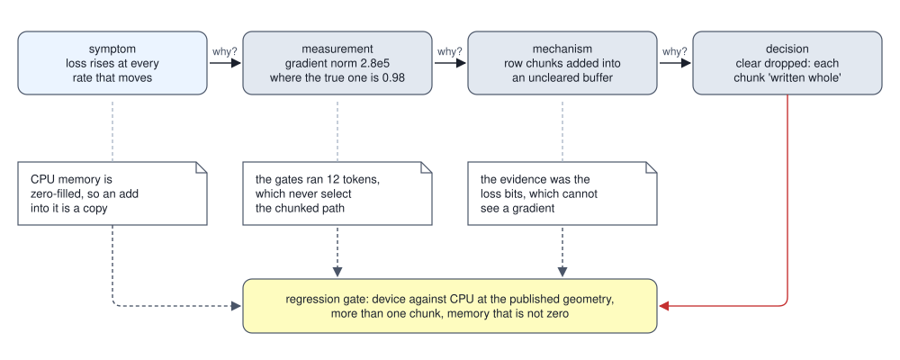

<!-- SPDX-License-Identifier: CC-BY-4.0 -->
<!-- Copyright (c) 2026 Martin Schröder <info@swedishembedded.com> -->

# A Catalogue of Expensive Mistakes

*What went wrong while building a real engine, and what general lesson does each failure teach?*

A fine-tuning run's loss falls for about ten steps and then climbs, at every learning rate large enough to move the weights. At smaller rates it stops climbing, and it stops falling as well. The reading that suggests itself is that the rate is too high, and for this curve it is wrong, for a reason that can be computed in one line. The run clips its gradient to a global norm of 1. Suppose the gradient that reaches the clip has a norm of 279,760, because something has added stale numbers to it, while the true gradient's norm is 0.98. The clip divides everything by 279,760, so the true gradient enters the step with a length of about $3.5 \times 10^{-6}$, and the step points wherever the stale numbers point. The optimizer follows a direction that has nothing to do with the loss, the loss rises, and a smaller rate "fixes" it by taking smaller steps in that meaningless direction and learning nothing.

That curve is not invented, and neither are the numbers; they are the subject of the first story below. What makes such a failure expensive is the distance between where its symptom appears and where its cause lies. The symptom is a loss curve on a large model, many steps into a run; the cause is one line in a backward kernel, three explanations away; and every test that touched that line was green. A catalogue of failures is worth keeping only if it shortens that distance for the next engineer, and the record "the gradient was wrong" does not. The record that does says what the mechanism was, why each existing check was blind to it, and which check, placed where, now sees it. The stories below are told in that form. Each is a real defect in a real engine, brain, found and fixed with its commit, and they are sorted by mechanism and by blind spot.

Three ideas from the opening chapters of this volume carry the argument, and they are worth bringing back first. A test reports green, but on inspection it skipped itself on every machine but one: what is that called, and why is it worse than having no test (Chapter 2, "Testing Numerical Code")? A report says a backward pass reaches some fraction of the device's arithmetic rate: name two conditions the measurement behind that fraction must meet before anyone may quote it (Chapter 3, "Benchmarking and Performance Claims"). And when a published model is reimplemented, in what order is its correctness established, and against what is each step compared (Chapter 1, "Porting a Model from Its Reference")? A fourth question reaches further: a parity test compares two outputs by their cosine similarity; which one difference between them can it never see (Volume I, Chapter 3, "Vectors: Lists of Numbers with Geometry")? The answers are at the end of the chapter.

## A diverging fine-tune traced to one dropped clear

The curve of the opening belongs to a low-rank adaptation (LoRA) fine-tune of a 27-billion-parameter model which diverged on real records at every learning rate that moved: the held-out loss fell for about ten steps and then rose without stopping (knowledge #344 records the curves). The same records through the same fine-tuning code on a 0.6-billion-parameter model of another architecture improved steadily at the same rates. The natural reading is that the large model needs a smaller rate, and a smaller rate did stop the divergence, by stopping the learning: the runs at the rates that did not diverge tracked a control run at a rate of $10^{-9}$ to three digits.

Volume III, Chapter 12 ("Training Dynamics and Debugging") used this run's step log to show what a gradient norm reports. Here the interest is in the path from the symptom to the line of code, and in why nothing on the way saw it coming. That path is **root-cause analysis**: starting from the observed failure, ask what immediate fact explains it, then what explains that fact, and continue until you reach a decision that could have been made otherwise and whose correction removes every defect of the same kind, not only this one; then, for every check that existed, ask why it did not see the defect. The first half of that is the habit Ohno (1988) described as asking "why" five times at the scene of a stopped production line. The second half is what turns the analysis into a gate, and it is the half most often skipped.

The first "why" was answered by a measurement. The global gradient norm of the first step, on the first four real layers at 10,142 tokens, was $2.8 \times 10^5$ where the true norm is 0.98 (the entry's measurement). The run clipped its gradient to a global norm of 1 (Volume III, Chapter 8, "Learning-Rate Schedules and Gradient Clipping"). What happens to the true gradient inside such a clip can be computed in a small model of it: a true gradient of norm 0.98, plus some stale vector unrelated to the loss, clipped.

<!-- worked: failure_catalogue.stale_clip -->
A true gradient of norm 0.98 in 64 dimensions and a stale vector of norm s are added, and the sum is clipped to a global norm of at most 1 (multiplied by min(1, 1 / norm)). Directions: 64 normal() draws for the true gradient, then 64 for the stale vector, of the generator seeded 16446746467197234993 (seed_of 'failure_catalogue.stale_clip'), each divided by its norm; the same two directions serve every row. 'true part of the step' is the clip factor times 0.98, the length of the true gradient inside the update; 'cosine' is the cosine similarity of the update with the true gradient. The cosine of the two directions themselves is -0.01201. Normal draws use the library log, sin and cos, so numbers are to four significant digits.

| stale norm s | norm before the clip | clip factor | true part of the step | cosine with the true gradient |
|---|---:|---:|---:|---:|
| 0 | 0.98 | 1 | 0.98 | 1 |
| 1 | 1.39171 | 0.7185 | 0.7042 | 0.6955 |
| 10 | 10.0362 | 0.09964 | 0.09765 | 0.08568 |
| 1000 | 999.989 | 0.001 | 9.800e-04 | -0.01103 |
| 279760 | 279760 | 3.574e-06 | 3.503e-06 | -0.01201 |
<!-- /worked -->

With a stale part of norm 279,760 the clip multiplies everything by $3.574 \times 10^{-6}$, so the true gradient's contribution to the step has length $3.503 \times 10^{-6}$, and the direction of the step agrees with the true gradient only as much as the stale vector happens to (a cosine of $-0.01201$ here, the chance alignment of the two directions). The optimizer then follows the stale vector, a persistent direction that has nothing to do with the loss. The run's adapter showed exactly that: every element of the `lora_b` matrices had kept the sign it started moving in. That explains both the divergence and why a smaller rate "fixed" it: a smaller step along a meaningless direction does less damage, and learns nothing either.

The second "why" asks where the stale vector came from. The model's multilayer perceptron (MLP) backward on long sequences runs in chunks of rows, to bound its memory. `mlp_bwd_saved` in `crates/qwen35/src/model.rs` rebuilt each chunk's activations, took the chunk's gradient, and placed it into the gradient buffer `d_xn2` with `put_rows`. `put_rows` dispatches the `SPLICE_ADD` kernel, which computes `dst += src`. The buffer had been allocated with `storage_uninit`, which skips the clear. So each chunk added its gradient to whatever the allocator had last left in that memory, which on the graphics processing unit (GPU) was real activations of earlier work.

The third "why" asks why the buffer was not cleared, and it reaches a decision. Commit `f3c83d307` (19 October 2026) had changed several MLP-backward buffers from `storage` to `storage_uninit` to stop paying for clears that did nothing, and its argument was correct for most of them: the first projection writes its buffer with the accumulate flag off (it overwrites), and `swiglu_bwd` writes both of its outputs. Beside the chunked buffer it left the comment "The row chunks tile all n rows, and each is written whole by put_rows." That sentence is true about coverage, every row is touched, and false about the kind of write: `put_rows` does not write, it adds. The reasoning checked the property that matters for a copy and skipped the one that matters for an accumulation. The comment was the claim, and only the kernel behind `put_rows` could confirm or refute it.

The last question, the one that produces the gate, asks why no check saw it, and there were three answers. The central processing unit (CPU) backend hands out zero-filled memory, so on it an addition into an uncleared buffer is a copy, and every CPU gate passed. The device gates ran a tiny configuration of 12 tokens, which never selects the chunked path at all, since chunking turns on for long rows. And the evidence the commit offered for itself, three probe steps of the large model with "identical loss bits", measured the forward pass, which never reads the gradient buffer. A debug build for the backend of NVIDIA's Compute Unified Device Architecture (CUDA) even fills memory from `storage_uninit` with `0xFF` bytes, a mechanism designed for exactly this mistake (the documentation of `storage_uninit` in `crates/gpu-core/src/lib.rs` says so), and it could not help, because no test that ran in a debug build reached the line. The figure lays the chain out: the "why" questions run left to right, and the notes underneath are the three blind spots, one for each existing check.



The repair, commit `8ad0ab962` (21 October 2026), is one line: `put_rows_copy`, which dispatches the plain `SPLICE` copy. The documentation of the two functions now states their contracts, `put_rows` "for a `[rows, width]` source and a zero-fresh `dst`" and `put_rows_copy` as "a copy, so `dst` need not be zero-fresh". The other user of `put_rows`, the chunked forward `mlp_fwd_rows`, keeps it, because it allocates its output with `storage`, which clears. The rule the analysis produced is a statement about every such buffer, not about this one: when a clear is removed, every writer of that buffer is read for the kind of its write (copy or accumulate), not for whether it covers all rows.

A **regression gate** is a test written from a fixed defect that fails on the defective code, passes on the corrected code, and runs in the configuration in which that defect, and every other defect of its kind, is visible. Here it is `the_cuda_trainer_matches_the_cpu_at_the_published_mixer_geometry` in `crates/qwen35/tests/it/lora_real_dims_cuda_matches_cpu.rs`. Its module documentation names the blind spot it removes: the tiny configuration's "16- and 20-wide heads over 12 tokens (chunks of 4) exercise none of the kernels those shapes select". It builds the large model's own attention and mixer geometry at a width a test can afford (16 key and 48 value heads of 128, 256-wide attention heads, 4 layers), 320 rows long, and compares the device trainer's loss and every adapter gradient with the CPU trainer's, for six arms, among them recomputed, segmented and chunked with `mlp_rows: Some(128)`, so the chunked path runs over three chunks on device memory that is not zero. The commit message reports the chunked arms at a cosine of 0.989 before the fix and 1.000000 after; the gate asks for at least 0.99999 on a float32 stream and 0.999 on the arm whose residual stream is stored in bf16 (the 16-bit brain floating-point format). A cosine is enough here because stale data is not a scale: it rotates the gradient, and cosine sees rotation. On a machine without a CUDA device the test cannot run, and it says so through `brain_testutil::skip` rather than passing in silence, the property Chapter 2 asked of every gate that can skip.

## One layer that hides four kinds of defect

The fine-tune's defect hid behind memory that happened to be zero. Chapter 2 showed mistakes in the formula of an attention head that hide behind an instance too small to tell them apart and behind a measure that forgives them. Many of the costly defects in an engine are of a different origin: the formula is right, and the mistake lies in the environment of the kernel, the buffer it writes, the file it reads, the configuration it is handed. They hide in the same way, and a single small layer can hold four of them at once.

The layer is the query side of rotary attention, which every recent language model computes billions of times. The input $\mathbf{x}$ has $m = 3$ numbers. The weight $W$ has $n_{\mathrm{h}} d_{\mathrm{h}}$ rows and $m$ columns, for $n_{\mathrm{h}}$ heads of width $d_{\mathrm{h}}$ each. The projection is $\mathbf{q} = W\mathbf{x}$. Inside head $a$, the number at offset $j$ and the number at offset $j + d_{\mathrm{h}}/2$ form a pair, the half-split pairing of the rotary position embedding of Volume V, Chapter 8 ("Positional Information"), and the pair is rotated by the angle $\theta_j = \mathrm{pos} \cdot 10000^{-2j/d_{\mathrm{h}}}$, where $\mathrm{pos}$ is the token's position and 10,000 is the base. Last, every entry is multiplied by $1/\sqrt{d_{\mathrm{h}}}$, the scale that later keeps the attention scores of wide heads from growing with their width. In the pseudocode `H` is $n_{\mathrm{h}}$, `D` is $d_{\mathrm{h}}$, `M` is $m$ and `R` is the number of rows of the matrix handed in.

```text
function rotate_pairs(q: array<real>[H * D], H: int, D: int, pos: int, base: real) -> array<real>[H * D]:
    require D >= 2 and D mod 2 == 0
    out = zeros(real, [H * D])
    for a in 0 .. H:
        for j in 0 .. D / 2:
            t = pos * base ^ (-2 * j / D)
            (qa, qb) = (q[a * D + j], q[a * D + j + D / 2])
            out[a * D + j] = qa * cos(t) - qb * sin(t)
            out[a * D + j + D / 2] = qa * sin(t) + qb * cos(t)
    return out

function rope_project(W: array<real>[R, M], x: array<real>[M], H: int, D: int,
                      pos: int, base: real) -> array<real>[H * D]:
    require R >= H * D
    q = [dot(W[r], x) for r in 0 .. H * D]            # dot from 0.0, k increasing
    return rotate_pairs(q, H, D, pos, base) * (1 / sqrt(D))
```

That is the reference. The engine computes the same thing in the way engines do. Its weights come from a file that stores the rows of each head in another order: row $\mathrm{half} \cdot d_{\mathrm{h}}/2 + i$ of the reference's head is stored at row $2i + \mathrm{half}$, so that the two members of a pair sit next to each other. A correct reader therefore takes model row $a d_{\mathrm{h}} + \mathrm{half} \cdot d_{\mathrm{h}}/2 + i$ from stored row $a d_{\mathrm{h}} + 2i + \mathrm{half}$. It projects in chunks of 2 rows at a time into a buffer the caller hands it, and then rotates and scales the buffer.

```text
function engine_project(stored: array<real>[R, M], x: array<real>[M], H: int, D: int,
                        pos: int, base: real, buf: array<real>[H * D]) -> array<real>[H * D]:
    require D >= 2 and D mod 2 == 0 and R >= H * D
    order = zeros(int, [H * D])
    for r in 0 .. H * D:                                # which stored row model row r reads
        (a, rest) = (r // D, r mod D)
        (half, i) = (rest // (D / 2), rest mod (D / 2))
        order[r] = a * D + 2 * i + half
    for c in 0 .. (H * D) // 2:                         # chunks of 2 rows; H * D is even
        for r in 2 * c .. 2 * c + 2:
            buf[r] = dot(stored[order[r]], x)           # a copy into the buffer
    return rotate_pairs(buf, H, D, pos, base) * (1 / sqrt(D))
```

The buffer `buf` belongs to the caller and is changed in place. The four defective versions each change one line. Defect A writes `buf[r] = buf[r] + dot(...)`, an addition into a buffer it assumes is zero. Defect B sets `order[r] = r`, reading the stored rows as if they were in the reference's order. Defect C returns `rotated` without the scale. Defect D is called with the base 1,000,000 because that is its configuration's default, where the reference uses 10,000.

The checks are the ordinary ones. A cosine check passes when the cosine similarity of the engine's output with the reference's is at least 0.9999. An elementwise check passes when the largest absolute difference is at most $10^{-9}$ times the largest absolute reference output. Each check runs at some configuration: a number of heads and a width, a position, and a buffer that is either fresh (all zeros) or reused (the same buffer was first handed to a call on another input, `x_prev`, and the second call's output is the one compared). The table runs every implementation through six checks, each changing exactly one thing from the one before it.

<!-- worked: failure_catalogue.blind_spots -->
A layer projects x (3 numbers) by W (rows 0 to heads x dh - 1 of the 8 x 3 matrix below), rotates the half-split pairs (j, j + dh/2) of each head by the angle pos x 10000^(-2j/dh) (the library cos, sin and pow) and multiplies by 1/sqrt(dh). The engine reads W from a file that stores row half x dh/2 + i of each head at row 2i + half, so a correct reader takes model row h dh + half dh/2 + i from stored row h dh + 2i + half; it projects in chunks of 2 rows into a buffer, then rotates and scales. 'fresh' means the buffer starts at zero; 'buffer reused' means the same layer was first called on x_prev with that buffer and the second call's output on x is checked. 'cosine' passes when the cosine similarity with the reference is at least 0.9999; 'elementwise' passes when the largest absolute difference is at most 1e-9 times the largest absolute reference output. Each column changes one thing from the one before it. Inputs: generator seeded 4218248590212533466 (seed_of 'failure_catalogue.blind_spots'), drawing W row by row, then x, then x_prev, each value 2 uniform() - 1 (shown to 6 decimals; the computation uses the full doubles).

| row of W | col 0 | col 1 | col 2 |
|---|---:|---:|---:|
| 0 | -0.357022 | 0.827911 | -0.102755 |
| 1 | -0.962994 | 0.191256 | -0.774499 |
| 2 | 0.854196 | -0.673248 | -0.036723 |
| 3 | -0.129692 | -0.403138 | 0.889018 |
| 4 | -0.880352 | 0.986897 | 0.275913 |
| 5 | 0.103293 | -0.619721 | -0.940167 |
| 6 | 0.214170 | -0.749194 | -0.089807 |
| 7 | 0.629805 | 0.328015 | -0.724210 |

x = (-0.061578, -0.376281, 0.085214); x_prev = (0.246551, -0.712577, -0.430208).

| implementation | 1 head of 2, pos 0, fresh, cosine | same, elementwise | 2 heads of 4 | pos 3 | buffer reused | all of these, cosine |
|---|---|---|---|---|---|---|
| correct | pass | pass | pass | pass | pass | pass |
| A: adds into an uncleared buffer | pass | pass | pass | pass | FAIL | FAIL |
| B: stored rows read in place | pass | pass | FAIL | FAIL | FAIL | FAIL |
| C: 1/sqrt(dh) dropped | pass | FAIL | FAIL | FAIL | FAIL | pass |
| D: rotary base 10^6 by default | pass | pass | pass | FAIL | FAIL | FAIL |
<!-- /worked -->

The first column is the test most people would write first: a comparison by cosine similarity at a small shape. All five implementations pass it. Then each defect fails at exactly the column that removes its own hiding place, and at no earlier one. Defect C fails as soon as the comparison is elementwise, because cosine similarity divides out the length of both vectors and a missing constant factor is invisible to it. Defect B needs heads wider than 2: for $d_{\mathrm{h}} = 2$ there is one pair per head, $i$ is always 0, and the stored row of $\mathrm{half} \cdot 1 + 0$ is $2 \cdot 0 + \mathrm{half}$, the same row, so the two layouts coincide. Defect D needs a position other than 0, because at position 0 every angle is 0 whatever the base; it also needs $d_{\mathrm{h}} > 2$, since the only pair of a 2-wide head has $j = 0$ and its angle $\mathrm{pos} \cdot \mathrm{base}^0 = \mathrm{pos}$ does not involve the base at all. Defect A needs a buffer that has been used before, because adding into zero is copying: it is the fine-tune's defect in miniature. The last column runs the full configuration with the cosine check again, and defect C passes it: no configuration helps a metric that cannot see the quantity that is wrong.

Two lessons sit in this table. The first is that a test has a region of configuration, and inside it a whole family of defects is equivalent to the correct program. Those families are what a catalogue of failures should be organized by. A **defect class** is a set of defects that share a mechanism and are hidden by the same property of a test: an accumulation into memory assumed clear, hidden by memory that happens to be zero; a permutation of rows, hidden by a dimension at which the permutation is the identity; a dropped scale, hidden by a scale-invariant metric. Naming the class says where every future member will hide, which a list of individual bugs does not. The second lesson is that the remedy is not more tests of the same kind. A hundred cosine checks at 1 head of width 2 catch nothing more than one. What catches a class is one check that leaves its hiding place.

Sorting defects by what their fix changed, and separately by what exposed them, is an old idea in software engineering. Chillarege and colleagues (1992) proposed a classification of defects by the meaning of the fix (an assignment, a check, an interface, an algorithm) and by the trigger that made them visible, so that the counts across a project describe the development process and not only its code. The classes used here pair a mechanism with a blind spot, which is the same two axes seen from the side of the person who has to write the next gate.

## When the golden itself is wrong

The porting workflow of Chapter 1 rests on goldens, the stored outputs of the reference implementation for fixed inputs, and every later comparison inherits their correctness. A defect in the golden is a defect class of its own, and an awkward one: the engine is compared against a wrong answer, fails, and the search starts in the wrong place.

The face-landmark port in `crates/openseeface` met this in November 2026 (commit `c4b3ac9b6`, knowledge #450). Its goldens were dumped by a Python script that ran the released networks in their reference runtime and saved every input and every stage output to a safetensors file. One input was a photograph, prepared for the network as such inputs often are: its channels reversed and moved from last to first, which in an array library produces a view, a description of the same memory with different strides, and not a new array. The writer it was saved with copied the memory under the view, in memory order, and labelled it with the view's shape. The reference runtime, fed the view itself, computed the right outputs, and those were saved too. So the file held correct outputs and an input that was not the one they came from. The model below reproduces the mechanism with a one-by-one convolution, which mixes channels at each pixel.

<!-- worked: failure_catalogue.scrambled_golden -->
A 1 x 1 convolution M (2 x 3) mixes the 3 channels of a 4 x 4 input stored channels first, (c, h, w). The photo is held as (h, w, c) with c fastest, and the network is given the view that reverses its channels and moves them first; the seeded input is drawn directly as (c, h, w). The golden file stores each input by writing the memory under it and labelling it (c, h, w); the reference outputs are computed from the view, and the replay runs the network on the stored input. Draws, in order, of the generator seeded 11098789049937438541 (seed_of 'failure_catalogue.scrambled_golden'): M row by row (2 uniform() - 1), the 48 photo values in memory order (uniform()), the 48 seeded values in memory order (2 uniform() - 1). Sums run over c in increasing order from 0.

| input | stored input equals the input used | cosine of replay and reference | largest difference |
|---|---|---:|---:|
| photo, a reversed and transposed view | no | 0.6706 | 1.012 |
| seeded, drawn in place | yes | 1 | 0 |
<!-- /worked -->

The replay of the photograph disagrees with its own golden from the first stage (a cosine of 0.6706 in the model, and of 0.546 at the first stage of the real network, the entry's measurement), and the replay of the seeded input agrees exactly. That asymmetry is the diagnostic, and it is worth stating as a rule of root-cause analysis for ports: when two inputs pass through one network and one agrees while the other does not, the network is the same in both cases, so the difference lies in what differs between them, which is how each input was made and stored. The fix is in the dumper and not in the engine: every saved tensor in `tools/goldens/openseeface_dump_reference.py` goes through one helper, `saved`, which makes it contiguous in float32 before writing (`np.ascontiguousarray`), and its documentation says why. The class is "a fixture written from a strided view", its blind spot is any input that happens to be contiguous already, and the regression gate is structural: no tensor reaches the writer except through the helper.

The weight-layout defect B of the rotary table is the same class seen from the engine's side, a file that is right and a reading of it that is wrong, and it is a real hazard of one popular file format. A GGUF file converted from a model of the Llama architecture stores the rows of the query and key projections interleaved within each head, so that a rotary kernel that rotates adjacent pairs finds its pairs adjacent; brain's rotary code rotates half-split pairs, as the original checkpoint does. Read as a plain renaming of tensors, such a file loads, every shape checks, the model runs, and attention rotates the wrong pairs. Commit `b01b78add` (30 September 2026), which taught the qwen3 decoder to read files of that architecture, built the permutation in from the start: `llama_unpermute_order` in `crates/qwen3/src/gguf_import.rs` returns, for model row $a d_{\mathrm{h}} + \mathrm{half} \cdot d_{\mathrm{h}}/2 + i$, the stored row $a d_{\mathrm{h}} + 2i + \mathrm{half}$, exactly the `order` of `engine_project`, and the read path applies it as a permutation of whole rows, so quantized rows move without being decoded. The commit's gates follow the shape of the table. The unit test of `llama_unpermute_order` checks the round trip through the converter's permutation at three shapes, (2 heads, width 4), (4, 8) and (1, 2), the last being the degenerate case in which the permutation is the identity and would prove nothing alone. And `a_llama_gguf_serves_the_model_it_was_converted_from` in `crates/qwen3/tests/it/deepseek_gguf_parity.rs` compares, at every position, the token a real converted file predicts with the token the original checkpoint predicts, which no renaming error survives.

## Values that change meaning at a boundary

A third class lives where a value crosses from one representation into another: a wire format, a parser, a build profile. The value means one thing on one side and something else on the other, and the test that exercises it usually stays on the part of the range where the two meanings agree.

Volume V, Chapter 11 ("Decoding: Turning Probabilities into Text") told the plainest case. The server draws a seed for a request that sends none and echoes it, so that sending it back reproduces the decode. The seed is an unsigned 64-bit integer, and the layer that speaks the Hypertext Transfer Protocol (HTTP) read it, and the echoed value, as a signed 64-bit integer, so a seed above $2^{63} - 1$ was dropped from the reply and refused with an error when sent back (commit `83e2f44a3`, 19 October 2026, knowledge #321). Exactly half of all seeds lie above that line. A test that sends a small literal seed, as tests do, sits on the half where signed and unsigned agree and can never see it; the regression gate in `crates/apiserve/src/sampling.rs` sends the largest seed there is, $2^{64} - 1$, and requires that $-1$ and $1.5$ are refused with a message naming the rule.

How fast do random tests find such a thing, compared with one chosen value? If a defect shows on a fraction $p$ of the runs, $n$ independent runs all miss it with probability $(1 - p)^n$, so the number of runs needed to see it at least once with probability $c$ is the least $n$ with $1 - (1 - p)^n \ge c$, that is $n = \lceil \log(1 - c) / \log(1 - p) \rceil$.

<!-- worked: failure_catalogue.detection_odds -->
For a defect that shows on a fraction p of the runs, the chance that n independent runs all miss it is (1 - p)^n, and the columns give the least n for which the chance of at least one failure reaches 50, 95 and 99 percent (log is the library logarithm; the counts are whole runs). The shared-prefix p is exact: keep is uniform over 0 .. 13, a trial reaches a block when keep >= 4 (probability 10/14), and p = (4/14)^6 + 6 (10/14)(4/14)^5 = 1024/117649; with two dtypes per run it is 1 - (1 - p)^2. The last row's p is the failure count of the relative rule in the table of the cancelling-sum check (29 of 10000). A fixed seed literal below 2^63 meets the first defect with probability 0, and the single boundary value 2^64 - 1 meets it with probability 1.

| defect and run | p | runs for 50% | runs for 95% | runs for 99% |
|---|---:|---:|---:|---:|
| u64 seed above 2^63 - 1, one uniform u64 seed per run | 1/2 | 1 | 5 | 7 |
| shared-prefix trials: fewer than 2 of 6 reach a 4-token block, one dtype | 0.008704 | 80 | 343 | 527 |
| the same, both dtypes in one run | 0.01733 | 40 | 172 | 264 |
| relative tolerance of the cancelling-sum check (its table) | 0.0029 | 239 | 1032 | 1586 |
<!-- /worked -->

The first row is the seed. With one uniformly drawn seed per run, half the runs see the defect and 5 runs give a 95 percent chance; with a fixed literal, no number of runs does; with the boundary value $2^{64} - 1$, one run does with certainty. The other rows belong to the next section, and they make the opposite point: a rare event in a test is a fact about the test's distribution of draws before it is a fact about the code.

The same class appeared in a build profile. The bidirectional flash-attention kernels are specialised from three source strings, and `block::flash_bidir_kernels` in `crates/model/src/block.rs` once chose each one's registered name by comparing the address of its source string with the address of a named constant (`std::ptr::eq`), falling through to the name of the third kernel when neither matched (knowledge #352). An address is not part of a string constant's meaning: the language reference of Rust states that references to the same constant are not guaranteed to refer to the same memory address. In the debug profile the comparison happened to succeed; in the optimised profile it did not (the entry infers this from the symptom and from the fix), all three kernels were registered under the third name, and the forward pass dispatched through a pipeline whose layout had six bindings where its call supplied nine. Every debug test passed. Commit `fd573ec22` (21 October 2026) states each name beside its source, `specialise("flash_attn_causal_gqa_bwd_dq", kernels::FLASH_ATTN_CAUSAL_GQA_BWD_DQ)`, and the gate `the_specialised_kernels_have_distinct_names_in_trio_order` in `crates/model/tests/it/flash_attn_bidir_train.rs` checks the names and their order directly, which holds or fails the same way in every build profile. The general rule is about identity: identify a thing by something that is part of its definition (its name, its content), never by an incidental property such as where it happens to be stored.

## Tests whose premise was false

Not every red test is a defect in the code. Some tests assert something that is not a property of the code at all, and they fail on a correct program. These are defects of the test, and they cost as much as defects of the code, because each false alarm spends an investigation and teaches people to rerun until green.

The shared-prefix test of the qwen3 server (`crates/qwen3/src/serve.rs`) built a random base prompt of 14 tokens and ran six trials through one engine whose prefix cache persists across trials. Each trial kept a random number `keep` of the base's leading tokens, drawn uniformly from 0 to 13, appended random tokens, compared the cached engine's output with a fresh engine's, and at the end asserted that at least one trial had reused a cached prefix. The cache stores keys and values in blocks of 4 tokens, and only whole blocks are reused, so a reuse needs two trials that both keep at least 4 tokens: an earlier one that puts a block into the cache and a later one that finds it. The test failed once in a full run of the suite on a GPU and passed six times alone, which looks like a race in the cache. It was not (knowledge #301): reproduced 125 times with the drawn seed printed, it failed once, with every output exact and 0 reuses out of 48 lookups. The second row of the odds table computes why. Each trial reaches a block with probability $10/14$, the chance that fewer than two of six do is $(4/14)^6 + 6 \cdot (10/14)(4/14)^5 = 1024/117649 \approx 0.008704$, and the test ran this for two key-value formats, so a run failed with probability 0.01733, about one in 58. The assertion "a prefix was reused" was a property of the draw, not of the cache.

Commit `ec4fe7dd7` (16 October 2026) made the effect reachable by construction, `keep = BLOCK + (draw mod (len - BLOCK))`, so that every trial keeps at least one whole block, and pinned the draw that had failed as its own test, `shared_prefix_trials_reuse_a_block_for_the_draw_that_once_kept_none`, with seed 12198852813623603017; the entry records that it was red before the fix with the same 0/48. That is how a randomized test becomes a regression gate: the random version keeps exploring, and the draw that once found something is kept forever as a fixed case. The rule generalizes. When a randomized test asserts that an effect happened (a cache hit, a collision, a reuse), bound the draw so that the effect is always reachable, and keep the assertion of exactness separate from the assertion that the effect occurred.

A tolerance is a premise too. A gradient check of the GEGLU activation (a gated linear unit whose gate is the Gaussian error linear unit) in `crates/moondream3/src/kernels_check.rs` compared an analytic directional derivative with a central difference and passed when the relative difference was below 0.01, measured against $\max(\lvert d \rvert, 10^{-3})$. That is the natural first tolerance, and it carries a hidden assumption: that the error of the numeric side is proportional to the derivative it estimates. It is not. A directional derivative is a sum of signed terms, $d = \sum_i \partial L / \partial x_i \, v_i$, and when those terms cancel, $d$ is small while the rounding noise of the central difference is not, since that noise is set by the size of the terms that were added, not by their sum. The commit that fixed it, `2836844db` (12 November 2026), reports the old check failing about one draw in 1,300. The same mechanism can be reproduced in a function simple enough to bound by hand, $L(\mathbf{x}) = \sum_i w_i x_i^3$, evaluated in float32.

The bound is derived term by term, from the rounding error of a sum in Volume I, Chapter 15 ("Floating Point and Numerical Error"), written with $u = 2^{-24}$ for float32 and $\gamma_k = ku/(1 - ku)$ as in the project of Volume IV, Chapter 14. A float32 evaluation of $L$ performs 3 multiplications per term and $n - 1$ additions, so its error is at most $\gamma_{n+2} S$, where $S = \sum_i \lvert w_i z_i^3 \rvert$ over the point $\mathbf{z}$ at which it is evaluated; two evaluations divided by $2h$ give $\gamma_{n+2}(S_+ + S_-)/(2h)$. Rounding the perturbed inputs $x_i \pm h v_i$ to float32 moves each by at most $u(\lvert x_i \rvert + 2h\lvert v_i \rvert)$ (one rounding of the product $h v_i$, one of the sum), which moves $L$ by at most $3 \lvert w_i \rvert z_i^2$ times that, to first order in $u$; over two evaluations divided by $2h$ this is the second term of the table's bound. For a cubic the central difference is exact up to one term: $((x + hv)^3 - (x - hv)^3)/(2h) = 3x^2 v + h^2 v^3$, so the truncation error is at most $h^2 \sum_i \lvert w_i v_i^3 \rvert$. The analytic side, computed in 64 bits, contributes a term of order $2^{-53}$.

<!-- worked: failure_catalogue.collapsing_tolerance -->
The function L(x) = sum_i w_i x_i^3 over n = 32 terms is evaluated in float32 (t = (x x) x, then w t, accumulated in increasing i from 0, every operation rounded to float32, no fused multiply-add). Its derivative along v is d = sum_i 3 w_i x_i^2 v_i, computed in double from the float32 inputs in increasing i. The check compares d with the central difference (L(x + h v) - L(x - h v)) / (2 h), where h is the float32 nearest 0.001 (0.0010000000474974513), h v_i and x_i +- h v_i are rounded to float32, the two values of L are float32 and the difference and the division by 2 h are done in double. The relative rule passes when the difference is at most 0.01 max(|d|, |numeric|, 0.001); the derived rule passes when it is at most gamma_(n+2)(u) (S+ + S-) / (2 h) + (1/h) sum_i 3 |w_i| (|x_i| + h |v_i|)^2 u (|x_i| + 2 h |v_i|)(1 + u) + h^2 sum_i |w_i v_i^3| + gamma_(n+3)(2^-53) sum_i |3 w_i x_i^2 v_i| + 2^-52 |numeric|, with u = 2^-24, gamma_k(u) = k u / (1 - k u) and S+- = sum_i |w_i z_i^3| over the two perturbed inputs z. 10000 draws of the generator seeded 2881733067566167544 (seed_of 'failure_catalogue.collapsing_tolerance'); each draw takes the 32 x_i, then the 32 w_i, then the 32 v_i, every one 2 uniform() - 1 rounded to float32.

| quantity | value |
|---|---:|
| draws | 10000 |
| failures of the relative rule | 29 |
| failures of the derived rule | 0 |
| smallest abs(d) among the relative rule's failures | 6.133e-04 |
| largest abs(d) among the relative rule's failures | 0.04102 |
| largest ratio of difference to derived bound | 0.07424 |

The first five failures of the relative rule (numbers to four significant digits):

| draw (from 0) | d | numeric | difference | relative tolerance | derived bound |
|---|---:|---:|---:|---:|---:|
| 43 | 0.0172 | 0.0174 | 2.035e-04 | 1.740e-04 | 0.01324 |
| 500 | 0.003806 | 0.003964 | 1.581e-04 | 3.964e-05 | 0.006998 |
| 735 | 0.00629 | 0.006199 | 9.150e-05 | 6.290e-05 | 0.005698 |
| 1060 | 0.002263 | 0.002339 | 7.683e-05 | 2.339e-05 | 0.006291 |
| 2221 | 0.01026 | 0.01007 | 1.890e-04 | 1.026e-04 | 0.009398 |
<!-- /worked -->

The relative rule fails 29 of 10,000 draws on a correct derivative, and the derived bound fails none, with the largest observed difference at 0.07424 of its bound. The failures are not only draws in which the derivative cancels to nearly zero: they range up to $\lvert d \rvert = 0.04102$, because the rule fails whenever $0.01\lvert d \rvert$ falls below the rounding noise, which here is of the order of $10^{-4}$ (up to a few times that) whatever $d$ is. The figure shows it. The noise of the check is a horizontal band set by the terms, the relative rule is a line that falls with $\lvert d \rvert$, and the line crosses into the band on the left. The derived bound is another band, above every difference: larger than the relative rule's tolerance for derivatives below about 1, and smaller above. It is a ceiling, not an estimate, and it is still tight enough to catch a wrong derivative, whose difference would be of the size of $d$ itself.


The bound brain uses has the same structure. The rewritten check derives its tolerance from five terms, the accumulation bound of the analytic side, that of the two evaluations divided by $h$, the rounding of the perturbed inputs, the truncation of the central difference and the difference between the forward's polynomial approximation of the error function and the exact derivative the backward uses, and its documentation lists each with its source. Commit `65c09d5df` (12 November 2026) added the shared helper, `crates/testutil/src/rounding.rs`, whose `accumulation_bound(k, s)` is $\gamma_k s$ with $u = 2^{-24}$ and which refuses a bound for $ku \ge 1$, where it would be vacuous. Commit `b5508dbd3` (12 November 2026) applied the same discipline to a rotary-embedding test that had asked $10^{-5}$ of hardware sine and cosine at angles up to 5 radians, a precision measured on one device: the WebGPU Shading Language (WGSL) specification promises those functions to an absolute error of $2^{-11}$ only on $[-\pi, \pi]$ and nothing outside, so the test now keeps its angles inside that interval and derives its bound from the promise. A tolerance read off one device is a premise about that device; a tolerance derived from the arithmetic is a property of the computation, and knowledge #451 records four such failures on a device that met its specification.

The last premise in this group was about isolation. Two library tests of the qwen3 crate forced a "tile budget", the number of 32-bit words one tile of a weight may span, which decides how the language-model head is split into tiles and therefore the order of its sums, by setting an environment variable of the process. The test runner executes all tests of a library in one process, on several threads. Any training that built its model while one of those tests had the variable set tiled its head differently, and a test that trained twice and compared the adapter bytes failed when exactly one of its two runs fell inside such a window: 332 of 8,664 bytes differed in one failing run, and the failure appeared in one of four loaded runs of the suite and never alone (knowledge #353). Both tests took a lock around the variable, and the lock serialized only the tests that also took it. Commit `eadf4126c` (21 October 2026) moved them to `with_tile_budget_words`, which sets the budget for the current thread only, and commit `032492d01` (1 November 2026) removed the environment variable altogether: the budget is now `set_tile_budget_words` for a whole process or the thread-scoped form, "never read from the environment", as the documentation in `crates/model/src/block.rs` says. The class gate is a source scan, `no_lib_test_forces_the_tile_budget_process_wide` in `crates/qwen3/src/caps.rs`, which fails if the crate's `model.rs` or `serve.rs`, where its library tests of the head live, calls the process-wide setter. The premise each test had made was "nothing else is running"; in a test process, something always is.

## Gates whose verdict cannot change

Chapter 2 named the gate that never runs, the check that reports green because it skipped itself, could not find its fixture, or never selected the path it was written for. Its mirror image is the gate that always fails. The documentation gate `scripts/gates/check-arch-names.sh` checked, among other things, that every model page was listed in the documentation's manifest, and it looked the page up under a path the manifest no longer used, so every one of the 67 pages was reported unpublished on every run. A red that never changes is read as noise, and under it four real violations accumulated: commands missing from an allowlist, a registered architecture with no page, and two pages with no category. Commit `f08206888` (29 September 2026) corrected the path the check reads, and only then could it report what it had been hiding.

Both failures are the same in one respect, and the respect is what makes them a class: the gate's verdict does not depend on the code. A check is information only if it could have come out the other way. That suggests the one test of a gate that is always worth running, the one the rotary table above ran and the one Chapter 2 built its mutants for: put a known defect into the code and see whether the gate turns red. A gate that no mutant can turn red protects nothing; a gate that every input turns red has stopped measuring.

Benchmark validity, the subject of Chapter 3, has its own version. A profiler summed the floating-point operation (FLOP) counts of the kernels of a pass and divided by the time of the whole pass, but 10 of the 26 kernel kinds of the backward pass of the vector-quantized image model it was measuring had no cost formula, so their arithmetic was missing from the numerator while their time was in the denominator. The quoted fraction of the device's rate was an under-report that nothing flagged. Commit `fc902a817` (6 August 2026), told in Volume IV, Chapter 3 ("Memory Bandwidth, Compute and the Roofline"), made a partly covered pass report no rate at all and name the kinds it is missing. The class is "a ratio whose numerator and denominator cover different sets", and the gate is the refusal: a number that cannot be computed honestly is not printed.

## Writing an entry that prevents the next failure

brain keeps its catalogue in `.agents/knowledge/`, one numbered file per finding, and each entry has the same parts: a one-sentence lesson, what happened, why, what to do and, where there is one, the evidence. That shape is the root-cause analysis written down. "What happened" is the symptom and the measurement. "Why" is the chain down to the decision. "What to do" states the rule for the class, and names the regression gate. The entries are claims written on the day, and later work moves on from them, as the commit that removed the tile-budget variable moved on from the thread-scoped fix. A catalogue of this kind is read like any other source: the lesson is checked against the code before it is trusted.

Gathered in one place, the failures of this chapter are these.

| failure | class | what hid it | regression gate | commit |
|---|---|---|---|---|
| chunked backward added into uncleared memory | accumulate into memory assumed clear | zero-filled CPU memory; tiny shapes that never chunk; loss-only evidence | device against CPU at the real geometry, chunked | `8ad0ab962` |
| golden input saved from a view | fixture differs from the input used | inputs that are already contiguous | every saved tensor made contiguous by one helper | `c4b3ac9b6` |
| interleaved rows of a converted file | permutation read as a rename | widths at which the permutation is the identity | round trip at three shapes; token parity on real files | `b01b78add` |
| seed parsed as a signed integer | narrowing at a wire boundary | small literal seeds | the largest seed, and refused bad ones | `83e2f44a3` |
| kernel named by its source's address | identity from an incidental property | the debug profile | names and order checked directly | `fd573ec22` |
| reuse asserted of a draw that could not reuse | test premise about the draw | the roughly 99 percent of draws in which two trials reach a block | draw bounded; failing seed pinned | `ec4fe7dd7` |
| relative tolerance on a cancelling sum | tolerance not derived | draws with large derivatives | bound derived from the arithmetic | `2836844db` |
| a test changed a process-wide setting | shared mutable state between tests | running alone | thread-scoped setting; source scan | `eadf4126c` |
| a gate red on every run | verdict independent of the code | constant output read as noise | the path the check reads corrected | `f08206888` |
| a rate from a partial numerator | ratio over mismatched sets | kinds too cheap to reach the top rows | no rate unless every kind is covered | `fc902a817` |

Two kinds of regression gate appear in the fourth column, and the difference matters for what the catalogue protects. An instance gate reproduces the one failure that happened: the pinned seed, the largest seed. It will catch that exact failure if it returns, and nothing else. A class gate removes the hiding place of every member of the class: a comparison at the geometry that selects the device kernels, a source scan that forbids the process-wide setter, a check of names that does not depend on the build profile, a profiler that refuses to divide mismatched sums. A good entry usually leaves both, the instance as proof that the gate was red before the fix, and the class gate as the reason the next member will be caught.

What makes either kind a regression gate, and not just one more test, comes out of the stories. It must have been red on the defective code; the shared-prefix entry records that its pinned seed failed before the fix with the same 0/48, and the chunked-backward commit records its arms at cosine 0.989 before. It must run in the configuration in which the class is visible, which is the whole lesson of the rotary table. It must run where the code runs: a device gate that cannot find a device must say so, and a suite that is never run is the gate of Chapter 2 that never runs. And its verdict must be able to change, which is the lesson of the gate that was always red.

## Summary

Expensive failures share a shape. A defect has a region of inputs and configurations in which it computes the right answer, and a test that lives inside that region passes every member of a whole **defect class**: a set of defects with one mechanism and one hiding place, such as an accumulation hidden by zero-filled memory, a permutation hidden by a width at which it is the identity, or a scale hidden by a scale-invariant metric. A small rotary projection showed four defects passing one cosine check at a tiny shape, and each failing at exactly the configuration change that left its own hiding place.

**Root-cause analysis** follows the symptom back through measurements and mechanism to the decision that let the defect in, and then asks why each existing check missed it. On the diverging fine-tune it led from a loss that rose at every rate, through a gradient norm of $2.8 \times 10^5$ against a true 0.98 and a clip that left $3.5 \times 10^{-6}$ of the true gradient in the step (the chapter's model), to an addition into memory whose clear had been removed on the argument that every row was covered, and to three blind spots: zero-filled CPU memory, gates too small to select the chunked path, and evidence that measured only the forward pass. The same method located a golden whose input had been saved from a strided view, by the asymmetry between two inputs through one network.

A **regression gate** is the test that analysis produces: red on the defective code, run in the configuration where the class is visible, run where the code runs, and able to change its verdict. Some failures were defects of tests: a randomized test whose asserted effect was unreachable for about one draw in a hundred, a relative tolerance that collapsed below rounding noise (29 of 10,000 draws in the chapter's model, none under a bound derived from the arithmetic), and a test whose process-wide setting changed the bytes of a training on another thread. Gates that never run and gates that are always red fail for the same reason, a verdict that does not depend on the code, and planting a defect is the check of a check.

The limits are those of any catalogue. It records the classes that have been found, and the next failure may belong to none of them. What carries over is the method: name the hiding place, and put a gate outside it. The project that closes this volume asks you to reproduce a published component, prove it correct, make it fast and defend the result, and each of those steps is a place where one of these classes waits.

## References

- Chillarege, R., Bhandari, I. S., Chaar, J. K., Halliday, M. J., Moebus, D. S., Ray, B. K. and Wong, M.-Y. Orthogonal Defect Classification: A Concept for In-Process Measurements. IEEE Transactions on Software Engineering 18(11), 943-956, 1992.
- Ohno, T. Toyota Production System: Beyond Large-Scale Production. Productivity Press, 1988.

## Check your understanding

1. A colleague adds a test that runs the rotary layer of the table at 2 heads of width 4, position 3, a fresh buffer, with the cosine check. Which of the four defects does it catch, and which does it miss?
2. "The buffer is uninitialised, but every row of it is written by the chunk loop, so no clear is needed." Find the missing condition.
3. A port's replay matches its golden on a seeded random input and disagrees from the first layer on a photograph. Where do you look first, and why not at the first layer's code?
4. A randomized test fails once in a hundred runs and passes on every rerun. Give two explanations that are not a race condition, and say how to tell them apart.
5. A gradient check uses the tolerance $10^{-2} \max(\lvert d \rvert, 10^{-3})$. Predict for which draws it fails on a correct backward, and why a smaller step $h$ in the central difference makes this worse for float32, not better.
6. A gate has been red on every run for a month. Why is it not protecting anything, and what is the first thing to do with it?

## Exercises

1. **[Calculate]** A defect shows on one run in 1,300. How many independent runs give a 95 percent chance of seeing it at least once? How many give 99 percent?
2. **[Calculate]** In the shared-prefix test, suppose 8 trials instead of 6, with `keep` still uniform over 0 to 13 and a block of 4 tokens. Compute the exact probability that fewer than two trials reach a block, for one key-value format.
3. **[Calculate]** A true gradient of norm 0.98 and a stale vector of norm $10^4$ orthogonal to it are added and clipped to a global norm of 1. Compute the norm before the clip, the clip factor, the length of the true gradient inside the step and the cosine of the step with the true gradient.
4. **[Calculate]** For a head of width 6, list the stored row that each of the 6 model rows of `engine_project` reads, and confirm that the map is a permutation. For which head widths is it the identity?
5. **[Implement]** Reproduce `failure_catalogue.blind_spots` in a language other than Python: the reference, the engine's projection with the four defects, and the six checks. Your pass and fail marks must equal the table's.
6. **[Implement]** Reproduce `failure_catalogue.collapsing_tolerance`, emulating float32 arithmetic exactly (one rounding per operation, no fused multiply-add). Your failure counts and the first five failures must agree with the table.
7. **[Implement]** Reproduce `failure_catalogue.scrambled_golden`, then change the way the photo is stored so that its replay agrees with its golden.
8. **[Investigate]** Add a fifth defect to your implementation of exercise 5: the chunk loop never writes the last model row (its last chunk stops at row `H * D - 2`). Which column of the table first catches it? Describe a test configuration in which it would pass, and name its defect class.
9. **[Investigate]** Read `put_rows`, `put_rows_copy`, `mlp_fwd_rows` and `mlp_bwd_saved` in `crates/qwen35/src/model.rs`. For each buffer they write, state how it is allocated and whether its writer copies or accumulates, and confirm that every accumulating writer has a cleared destination.
10. **[Investigate]** Read `crates/testutil/src/rounding.rs`. State what `accumulation_bound` and `agreement_bound` return, why the second is twice the first, and why `gamma` refuses $ku \ge 1$.
11. **[Investigate]** Pick one entry in `.agents/knowledge/` that is not told in this chapter. Write its root-cause chain as in the figure, name its defect class and its blind spot, and say whether its regression gate is an instance gate or a class gate.

## Key terms

- **defect class**: a set of defects that share one mechanism and are hidden by the same property of a test (zero-filled memory, a degenerate width, a scale-invariant metric), so that a single check outside that hiding place catches every member. <!-- concept: defect-class -->
- **root-cause analysis**: working back from an observed failure through measurements and mechanism to the decision that let the defect in, until a change is found that removes the whole class, and asking for every existing check why it did not see the defect. <!-- concept: root-cause-analysis -->
- **regression gate**: a test written from a fixed defect that fails on the defective code, passes on the corrected code, runs in the configuration where the defect's class is visible and where the code really runs, and can change its verdict. <!-- concept: regression-gate -->

## Answers

**Recall.**

1. A gate that never runs: a check that reports success without exercising what it was written to check (it skips itself, cannot find its fixture, or never reaches the code path). It is worse than no gate because its green verdict is believed, so nobody looks again.
2. Any two of these: the computation is the right one (its outputs are checked before its speed is), the workload is the one the claim is about, the denominator is stated and of the right kind (a rate divides work and time that cover the same operations, and a fraction of a peak names which peak), and a comparison differs only in the thing claimed, by more than the procedure's own variation.
3. Facts are taken from the references first and goldens generated from the reference before any engine code runs; the weight mapping is checked for coverage and shape; a smoke run at toy size follows; then parity is established stage by stage, each stage fed the reference's own input (isolated) and then fed the engine's previous stage (chained), against the goldens at a stated tolerance; then a gradient check of every trained path; and optimisation comes last, under the frozen parity gate. Each step begins only when the one before it passes.
4. Their lengths. Cosine similarity divides each vector by its norm, so two outputs that differ by a positive constant factor have a cosine of exactly 1.

**Check your understanding.**

1. It misses A, because the buffer is fresh and the addition is a copy. It catches B (the permutation is not the identity at width 4) and D (position 3 and width 4 make the base matter), as the last column of the table shows for the full configuration, and it misses C, because cosine cannot see a missing scale.
2. Whether the writers copy or accumulate. Covering every row is enough for a copy; an accumulating writer adds to what is there, and an uncleared buffer holds whatever the allocator last left.
3. At how the photograph's input was produced and stored. The network is the same for both inputs, so a layer defect would show on both; the difference lies in what differs between the inputs, such as an input saved from a strided view.
4. The asserted effect may be unreachable for some draws (a property of the test's distribution), or the code may have a defect that only some inputs reach. Print the seed of every run, reproduce the failing draw alone; if it fails deterministically, analyse what it asserts: if the assertion is about the draw (as "a prefix was reused"), the premise is wrong, and if the outputs themselves are wrong, the code is.
5. It fails when $0.01\lvert d \rvert$ is smaller than the noise of the central difference, about $u S / h$ with $S$ the size of the terms, so for draws whose derivative is small compared with its terms. A smaller $h$ divides the same rounding noise by a smaller number, so the noise grows and more draws fail.
6. Its verdict does not depend on the code, so a new violation changes nothing anyone sees. Fix the gate first (why is it red for every input?), then read what it reports.

**Exercises.**

1. $n = \lceil \log 0.05 / \log(1 - 1/1300) \rceil = \lceil 2.9957 / 0.00076953 \rceil = 3893$ runs for 95 percent, and $\lceil 4.6052 / 0.00076953 \rceil = 5985$ for 99 percent.
2. With $q = 10/14$, $P = (4/14)^8 + 8 \cdot (10/14)(4/14)^7 = (4^8 + 80 \cdot 4^7)/14^8 = 1{,}376{,}256 / 1{,}475{,}789{,}056 = 768/823{,}543 \approx 9.326 \times 10^{-4}$.
3. The norm is $\sqrt{0.98^2 + 10^8} \approx 10{,}000.000048$, the clip factor is its reciprocal, $\approx 9.99999995 \times 10^{-5}$, the true part is $0.98$ times that, $\approx 9.8 \times 10^{-5}$, and the cosine is $0.98 / 10{,}000.000048 \approx 9.8 \times 10^{-5}$, since the stale vector is orthogonal to the true gradient.
4. With $d_{\mathrm{h}} = 6$ the model rows 0, 1, 2 (half 0, $i$ = 0, 1, 2) read stored rows 0, 2, 4, and rows 3, 4, 5 (half 1) read 1, 3, 5. Every stored row is read once, so it is a permutation. It is the identity only for $d_{\mathrm{h}} = 2$.
5. to 7. The tables printed by the three worked blocks. For exercise 7, store the array the network was given (the view's elements in its own index order), not the memory under it.
8. The first column already catches it: in a fresh buffer the unwritten entry is 0, where the reference has a value of the size of the others, and even the cosine sees an entry that is wrong by its whole size. It would pass in a buffer that already holds the right value of that entry, for instance a test that calls the layer twice on the same input and checks the second call. Its class is incomplete coverage of a buffer, hidden by a buffer whose previous contents happen to be correct, the opposite hiding place from that of defect A.
9. `mlp_fwd_rows` allocates `out` with `storage` (cleared) and accumulates into it with `put_rows`; `mlp_bwd_saved` allocates `d_xn2` with `storage_uninit` and copies into it with `put_rows_copy`. Every accumulating writer has a cleared destination.
10. `accumulation_bound(k, s)` is $\gamma_k s$, the bound on the error of a float32 computation with $k$ roundings over terms whose absolute values sum to $s$; `agreement_bound` is twice that, because two independent computations can each be wrong by that much in opposite directions. For $ku \ge 1$ the denominator $1 - ku$ is zero or negative and the bound says nothing, so it is refused.
11. The answer depends on the entry chosen; its chain should end at a decision, and its gate should be checked against the four properties of a regression gate.
