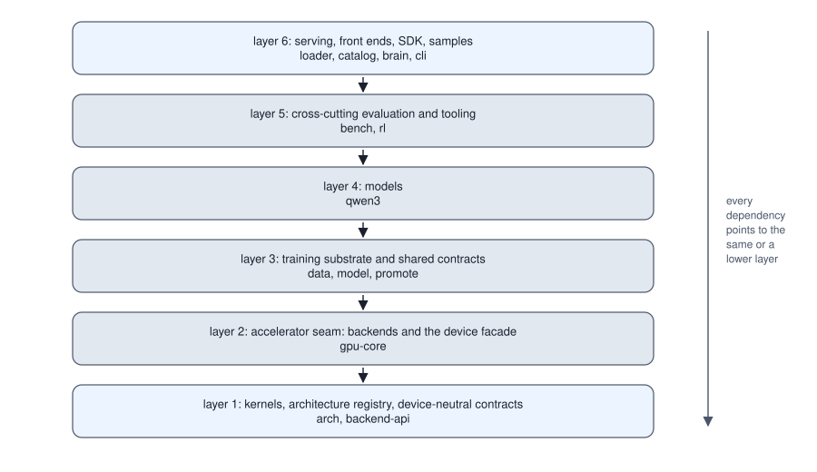

<!-- SPDX-License-Identifier: CC-BY-4.0 -->
<!-- Copyright (c) 2026 Martin Schröder <info@swedishembedded.com> -->

# The Architecture of a Machine Learning Engine

*How should the parts of an engine be divided so that it can grow to hundreds of models without collapsing?*

Take an engine that runs 100 model architectures and that people reach in five ways: a command line, a web server that speaks HTTP (the hypertext transfer protocol), a local message bus between processes, a library linked into their own programs, and a client in another language. If each front end calls each model through code written for that pair, there are $100 \times 5 = 500$ adapters, and the 101st architecture costs five more. If every model offers the same small interface and every front end calls only that interface, there are $100 + 5 = 105$ pieces, and the 101st architecture costs one. Now add a second kind of growth. Four parts of the program need to know which architecture a file on disk is: the command line, to pick a subcommand; the downloader, to pick an importer; the reader of single-file quantized checkpoints, to pick a decoder; and the label written into a saved model. If each keeps its own list of names, the four lists agree only if all six pairs of lists agree on every one of the 100 names: 600 facts that nothing checks, and each new architecture adds six more. A product of two counts grows quickly; a sum grows slowly; and a quantity that has to be kept equal in several places drifts as soon as one of them is edited without the others.

That arithmetic is most of what architecture means for a machine learning engine. The mathematics of a model is the subject of the volumes before this one, and none of it is hard to implement once. What breaks an engine is the hundredth model, when every new architecture touches every front end, every table and every test, and when changing one part forces a rebuild of all the others. The remedy is to divide an engine so that the costs add instead of multiply: into layers whose dependencies point one way, around one registry that answers "which architecture is this" for everyone, and under a rule that each behaviour lives in one place.

Three ideas from earlier chapters carry the weight, and it is worth bringing them back first. The backend abstraction of Volume IV, Chapter 9 ("One Program, Many Devices") is a short list of operations every device backend provides with the same meaning: which operations are they, and why does the code that builds a model never name the device that runs it? When a fourth backend is added there, what does the new code depend on, and which existing code changes? Volume XIV, Chapter 6 ("Capabilities, Providers and APIs") describes a capability: what does one consist of, and what does a front end need to know about a model to invoke one? And the same chapter's model catalog: what is in one entry, and what goes wrong when the list of models that can be listed, the list that can be run and the list that can be served are three separate lists?

## Counting the cost of the hundredth model

The two counts generalize. Let $N_{\mathrm{a}}$ be the number of architectures, $N_{\mathrm{f}}$ the number of front ends and $k_{\mathrm{t}}$ the number of places that each keep a list naming every architecture. Without a shared interface, every pair of an architecture and a front end needs its own adapter: $N_{\mathrm{a}} N_{\mathrm{f}}$ pieces. With one interface between them, each architecture implements it once and each front end calls it once: $N_{\mathrm{a}} + N_{\mathrm{f}}$ pieces. The $k_{\mathrm{t}}$ lists agree when every pair of lists agrees on every architecture, and there are $\binom{k_{\mathrm{t}}}{2}$ pairs, so $\binom{k_{\mathrm{t}}}{2} N_{\mathrm{a}}$ name pairs must match. If the $k_{\mathrm{t}}$ places stop keeping lists and read one table instead, the table has $N_{\mathrm{a}}$ rows and there is nothing left to keep in agreement, because there is nothing to disagree with.

<!-- worked: engine_architecture.growth_cost -->
Counting rule: an engine serves $N_{\mathrm{a}}$ architectures through $N_{\mathrm{f}} = 5$ front ends, and $k_{\mathrm{t}} = 4$ separate tables each name every architecture. Without a shared interface every pair (architecture, front end) needs its own adapter, $N_{\mathrm{a}} N_{\mathrm{f}}$ of them; with one interface every architecture implements it once and every front end calls it once, $N_{\mathrm{a}} + N_{\mathrm{f}}$ pieces. Four separate tables agree only when every one of the $\binom{4}{2} = 6$ pairs of tables agrees on every architecture, $6 N_{\mathrm{a}}$ name pairs; one registry that all four read has $N_{\mathrm{a}}$ rows and nothing to keep in agreement.

| architectures $N_{\mathrm{a}}$ | adapters, one per model and front end | pieces through one interface | name pairs that must agree, four tables | rows of one registry |
|---|---:|---:|---:|---:|
| 10 | 50 | 15 | 60 | 10 |
| 100 | 500 | 105 | 600 | 100 |
| 300 | 1,500 | 305 | 1,800 | 300 |
<!-- /worked -->

At 300 architectures the adapters number 1,500 against 305, and the name pairs 1,800 against none. The cost of one more architecture is the derivative of each column: $N_{\mathrm{f}} = 5$ adapters and $k_{\mathrm{t}} = 4$ list entries (nine edits, and six new pairs to keep equal) without the shared pieces, and one implementation of the interface plus one table row with them. The first saving is what the backend abstraction of Volume IV and the capability of Volume XIV were for: each is a narrow interface that turns a product into a sum, one between models and devices, the other between models and front ends. The second saving is new here. A table that several parts consult is not something to copy into each of them; it is a part of its own, and everything else depends on it.

## A routing table that guesses

The danger of separate lists is easiest to see in the one that decides what to download. A checkpoint published in the common format of the `transformers` library carries a `config.json` whose `architectures` field names a Python class, such as `Qwen3ForCausalLM`. A downloader that wants to choose an importer from that class name, and that knows a handful of families, may be tempted to test for substrings: if the lowercased name contains `qwen`, use the Qwen importer; if it contains `gpt`, use the GPT importer. That works for exactly the names its author had in mind. It fails, silently, for every name that contains a family string by accident.

Such a scan once ran in brain. Until commit `88010a6aa` (13 August 2026), `family_of_architecture` in `crates/modelstore/src/plan.rs` lowercased the class name and returned the first of `omni`, `gpt`, `glm`, `qwen`, `lfm` that it contained. The order was not arbitrary. Its comment explained that `omni` had to be tested before `qwen`, because the class `Qwen3OmniMoeForConditionalGeneration` contains both, and in the other order the multimodal model would be routed to the dense text importer, which would download the whole checkpoint and then fail on a family it could not represent. The correctness of the table depended on the order of its entries, and the only test of that order existed because of one class name. The next example runs the scan in its own order and with `omni` moved last, and puts beside it an exact lookup against a few rows of the table that replaced it. The rows are read from today's registry, so the example also applies the retired scan to classes it never saw; that part is a hypothetical, stated as one below.

<!-- worked: engine_architecture.class_routing -->
The scan lowercases the class name and returns the first of the family strings `omni`, `gpt`, `glm`, `qwen`, `lfm` (in this order) that it contains; the second scan column tries them in the order `gpt`, `glm`, `qwen`, `lfm`, `omni`. A family string names one importer. The exact lookups read this excerpt of the registry, one row per id with its names, which are class names and, where there is a second lowercase spelling, the `model_type` string: `gpt2`: `GPT2LMHeadModel`; `qwen3`: `Qwen3ForCausalLM`, `qwen3`; `llama`: `LlamaForCausalLM`, `llama`; `qwen2`: `Qwen2ForCausalLM`, `qwen2`; `glmdsa`: `GlmMoeDsaForCausalLM`, `glm_moe_dsa`; `lfm2`: `Lfm2ForCausalLM`; `qwen3omnimoe`: `Qwen3OmniMoeForConditionalGeneration`; `qwen3vl`: `Qwen3VLForConditionalGeneration`; `fastvlm`: `LlavaQwen2ForCausalLM`; `qwen3tts`: `Qwen3TTSForConditionalGeneration`; `deepseekvl`: `MultiModalityCausalLM`, `multi_modality` (probe `gen_head_config` absent); `januspro`: `MultiModalityCausalLM`, `multi_modality` (probe `gen_head_config` present). The class lookup answers only when exactly one row lists the class; the class and configuration lookup also keeps only the rows whose probe agrees with the configuration's keys, and answers when exactly one remains; a probe is satisfied when the configuration's key set contains the probed key, and the only configuration used is the key set {`gen_head_config`} in the row that has it and the empty set otherwise. Text comparison is exact and case-sensitive.

| class name (and configuration key) | scan | scan, omni last | exact class | class and configuration |
|---|---|---|---|---|
| `GPT2LMHeadModel` | `gpt` | `gpt` | `gpt2` | `gpt2` |
| `Qwen3ForCausalLM` | `qwen` | `qwen` | `qwen3` | `qwen3` |
| `Qwen3OmniMoeForConditionalGeneration` | `omni` | `qwen` | `qwen3omnimoe` | `qwen3omnimoe` |
| `Qwen3VLForConditionalGeneration` | `qwen` | `qwen` | `qwen3vl` | `qwen3vl` |
| `LlavaQwen2ForCausalLM` | `qwen` | `qwen` | `fastvlm` | `fastvlm` |
| `Qwen3TTSForConditionalGeneration` | `qwen` | `qwen` | `qwen3tts` | `qwen3tts` |
| `Qwen2ForCausalLM` | `qwen` | `qwen` | `qwen2` | `qwen2` |
| `LlamaForCausalLM` | none | none | `llama` | `llama` |
| `GlmMoeDsaForCausalLM` | `glm` | `glm` | `glmdsa` | `glmdsa` |
| `Lfm2ForCausalLM` | `lfm` | `lfm` | `lfm2` | `lfm2` |
| `MultiModalityCausalLM` | none | none | none | `deepseekvl` |
| `MultiModalityCausalLM` with `gen_head_config` | none | none | none | `januspro` |
| `MistralForCausalLM` | none | none | none | none |
<!-- /worked -->

The scan routes `Qwen3OmniMoeForConditionalGeneration` correctly only because of where `omni` stands: moved last, the same name goes to `qwen`. And whatever the order, the scan sends `Qwen3VLForConditionalGeneration` (a vision-language model), `LlavaQwen2ForCausalLM` (a vision-language model whose language half is a Qwen2 decoder) and `Qwen3TTSForConditionalGeneration` (a text-to-speech model) to the Qwen text importer, because all three contain `qwen`. What follows for those three is a hypothetical, not a record: the scan was replaced on 13 August (commit `88010a6aa`), and the three classes were first registered two days later (commit `015ee0a6e`, 15 August 2026), so the scan never routed them. The table applies the retired scan to today's registry to show what it would do with them. Nothing in a substring scan can be checked in isolation, since whether an entry is safe depends on every name it will ever see.

The exact lookup cannot make that mistake: a class name either is in a row's list or is not, and the order of the rows does not matter. Two other things change. A class nobody registered, `MistralForCausalLM` in the last row, gets an answer of none, which a caller can turn into a clear refusal instead of a wrong import. And a name that two rows share is no longer resolved by position. DeepSeek-VL and Janus-Pro are both published with the class `MultiModalityCausalLM`, so the class alone answers none. The two are told apart by their configurations: only Janus-Pro configures a generation head, so its row carries the probe "the key `gen_head_config` is present", DeepSeek-VL's carries "absent", and the class plus the configuration answers exactly one of them (commit `8209760ae`, 30 September 2026, added that probe for exactly this pair). Here are the two lookups in the book's pseudocode, where a row is a record of an id, a list of class names and an optional probe:

```text
record ClassRow:
    id: text
    classes: list<text>
    probe: optional (text, bool)          # (key, whether the key must be present)

function route_by_substring(name: text, order: list<text>) -> optional text:
    lowered = lower(name)
    for fam in order:
        if contains(lowered, fam):
            return fam                    # first family string found wins
    return nothing

function by_hf(rows: list<ClassRow>, cls: text) -> optional text:
    found = [r for r in rows if cls in r.classes]
    if len(found) == 1:
        return found[0].id
    return nothing                        # unknown, or shared by several rows

function by_hf_config(rows: list<ClassRow>, cls: text, keys: list<text>) -> optional text:
    found = []
    for r in rows:
        if cls in r.classes:
            if not (r.probe is present) or ((r.probe[0] in keys) == r.probe[1]):
                append r to found
    if len(found) == 1:
        return found[0].id
    return nothing
```

The lookup that answers none for a shared class is a choice, not an accident. A function that returned the first matching row would bring back the dependence on order that the exact table was built to remove. Returning none forces a caller that has a shared class in hand to supply the configuration, and the registry's own test (below) guarantees that every shared class can then be resolved.

## One row per architecture

An **architecture registry** is one table with a row per architecture the engine supports, giving each architecture a canonical identifier and every spelling under which the outside world names it, which every other part of the engine reads to answer "which architecture is this" instead of keeping its own list. The identifier is a key: it is what the rest of the engine stores, compares and prints. The spellings are how a file, a command or a published repository refers to the same thing, and each of them maps back to the key.

In brain, the registry is the constant `ARCHS` in `crates/arch/src/lib.rs`, a list of records of type `Arch`. Reading the type field by field shows what such a row needs:

- `id`, the canonical identifier, restricted to lowercase letters and digits. It is taken from the architecture vocabulary of llama.cpp, the reference reader of the most widely used single-file checkpoint format, where that vocabulary has an entry (its enumeration name lowercased, with the prefix and underscores dropped), and coined in the same style otherwise. The `source` field records which of the two it is, or that the architecture is one of brain's own with no published reference.
- `display`, a human-readable name, and `domain`, the broad kind of task (`Text`, `Multimodal`, `Audio`, `Vision`, `Image`, `Video`, `ThreeD`, `Forecast`, `World`, `Creature`, `Decision`, `Timeline` or `Toy`), which decides how results are grouped for a person and what a generic "infer" request means.
- `package`, the name of the code package that implements it.
- `gguf`, the architecture's spelling in the header of a GGUF file (the single-file quantized format of Volume IV, Chapter 12) when it differs from the id; `hf`, the exact class names (and the `model_type` spellings used when a configuration has no class list) of `transformers` checkpoints; `hf_config_key`, the probe for a shared class.
- `default_ref`, the published checkpoint to fetch when a command needs weights and none were named, and `variants`, the published checkpoints of the family with their parameter counts, the quantizations each publishes and the licence each declares.
- `families`, other names that a download recipe may have recorded for the architecture.
- `caps`, what the architecture can be trained to do.

Each lookup the engine needs is a function over that one list: `by_id`, `by_hf`, `by_hf_config`, `by_gguf` (the explicit spelling, or the id when there is none), `by_family` (the id first, then the alias lists), `public` (every row outside the `Toy` domain, for listings meant for users) and `Arch::implementation`. The last answers a question that grows in importance as an engine grows: which code runs this architecture? Many published architectures are the same mathematics with different switches. A Llama checkpoint and a Qwen2 checkpoint use the tensor names of brain's Qwen3 decoder and differ from it only in whether the query and key are normalized, whether the projections carry a bias, and how positions are scaled. Writing a package per name would copy the decoder three times. brain gives each its own row, so that a checkpoint is still named for what it is, and points the row's `package` at the decoder's package; `implementation` then finds the row whose id is that package's name (commit `1fa75d7e1`, 29 September 2026). The rule that came with it is short: a new package is for new mathematics, and a switch the existing configuration lacks is added to that configuration.

<!-- worked: engine_architecture.lookups -->
The registry excerpt: `qwen3`: package `brain-qwen3`, family alias `qwen`; `llama`: package `brain-qwen3`; `qwen2`: package `brain-qwen3`; `qwen35`: package `brain-qwen35`, file spelling `qwen35`; `edgerock`: package `brain-qwen35`; `deepseek2ocr`: package `brain-deepseek2ocr`, file spelling `deepseek2-ocr`; `s3dit`: package `brain-s3dit`, family alias `zimage`; `autoencoderkl`: package `brain-vae`; `wan`: package `brain-wan`. A row with no file spelling uses its id as its spelling. The family lookup tries the id first and then the alias lists in row order. The implementation of a row is the row whose id is the row's package name without the `brain-` prefix, and the row itself when no row has that id.

| lookup | query | answer |
|---|---|---|
| id | `qwen3` | `qwen3` |
| id | `Qwen3` | none |
| file spelling | `deepseek2-ocr` | `deepseek2ocr` |
| file spelling | `deepseek2ocr` | none |
| file spelling | `wan` | `wan` |
| family | `zimage` | `s3dit` |
| family | `qwen` | `qwen3` |
| family | `s3dit` | `s3dit` |
| implementation | `llama` | `qwen3` |
| implementation | `edgerock` | `qwen35` |
| implementation | `qwen3` | `qwen3` |
| implementation | `autoencoderkl` | `autoencoderkl` |
<!-- /worked -->

Each answer in the table follows from one rule. The query `Qwen3` finds nothing, because ids are compared exactly. The file spelling `deepseek2-ocr` keeps a hyphen that the id grammar forbids, so the row carries it explicitly, and the id `deepseek2ocr` is then not a file spelling at all. The row `wan` has no explicit spelling and is found by its id. The alias `zimage`, the name the download recipe of the Z-Image model writes into its manifest, finds the `s3dit` row through its alias. The rows `llama` and `edgerock` resolve to the packages that run them, and `autoencoderkl`, whose package is a shared image-autoencoder package with no row of its own name, resolves to itself. In pseudocode, with a row now a record `IdRow` holding the id, the package and the alias list:

```text
function implementation(rows: list<IdRow>, id: text) -> text:
    row = the r in rows with r.id == id
    crate = row.package
    if crate[0:6] == "brain-":
        crate = crate[6:len(crate)]
    for r in rows:
        if r.id == crate:
            return r.id                   # the row that names the implementing package
    return row.id                         # no such row: the row implements itself
```

A table that everyone reads is only useful if it cannot contradict itself, and brain's registry checks that in its own tests in `crates/arch/src/lib.rs`: ids are non-empty and use only lowercase letters and digits (`ids_are_lowercase_alphanumeric_only`); no id appears twice (`ids_are_unique`); no two rows claim one file spelling (`gguf_spellings_are_unique_across_archs`); a class shared by several rows is shared only when every one of them probes the same configuration key with a different expectation, so that `by_hf_config` always finds exactly one (`hf_class_names_resolve_to_one_arch`); an alias never equals a real id or another row's alias (`family_aliases_never_collide_with_a_real_id_or_each_other`); and the multimodal class of the scan's story resolves to its own row (`by_hf_omni_does_not_fall_through_to_dense_qwen3`). Each is a property of the whole table, checked in one place, where four separate lists would have needed it checked six times.

The id is used as a key far beyond the registry, and that is where most of the agreement was. The id is at once the package's directory under `crates/`, the suffix of its package name (`brain-<id>`), the word on the command line, the architecture recorded in a saved model card and the file name of the model's documentation page. A gate, `scripts/gates/check-arch-names.sh`, holds the repository to that: every row's package suffix equals its id and names a directory that exists, apart from four exceptions listed with their reasons (the three configuration rows of the shared decoders, and `autoencoderkl`, whose package is shared infrastructure); the command line's top-level dispatch names no architecture as a literal string, so every architecture command goes through the registry-driven resolver in `crates/cli/src/resolve.rs`; and every public id has a documentation page and every page belongs to an id, checked in both directions. The registry crate itself has no dependencies at all: its manifest's dependency list is empty, so it needs no file system, no network and no other part of the engine, and any part at any layer can read it.

The history of brain shows both why the registry was built and what drift had already cost. Commit `e2879ae14` added the crate with the message that brain had "four separate, drifting answers" to which architecture a file is: the command line's hand-written subcommand names, the substring scan, the table of importers for single-file checkpoints, and a family string in the saved model card. It deliberately changed no behaviour; commit `88010a6aa`, eight minutes later, rewired the downloader and the single-file importer onto it, making `family_of_architecture` a call to `by_hf`. A series of commits then renamed packages so that each directory carried its row's id. The first of them, commit `b4e016aa4`, also fixed `scripts/gates/parity-gate.sh`, which had been running the tests of a package named `brain-qwen`, a name no package had ever had, so that one arm of that gate could never have passed. That is the drift the registry exists to prevent, found by the act of building it: a name typed in a fourth place, agreeing with nothing.

## A declaration that the tests must back

A row that says what an architecture *is* invites a row that says what it *can do*, and an engine with many architectures needs that answer in a form a program can read: can this one be fine-tuned in full, can an adapter be trained over a base stored in 4 bits? An answer kept in prose drifts like any other copy. In brain the answer is the `caps` field of the row (`crates/arch/src/caps.rs`): a flag for full fine-tuning, the list of base storage formats a low-rank adapter can be trained over (`F32`, `Bf16`, `I8`, `Nf4`, `Fp8`), and a flag for anything else the evidence records. A row that declares nothing is `Caps::NONE`, an inference-only architecture.

The declaration is a claim, and the evidence is elsewhere: `scripts/gates/training-capabilities.tsv` has one line per capability of an architecture, naming the tests that back it. The test `crates/arch/tests/caps_vs_matrix.rs` reads that file and compares, for every row, the set of capabilities the row declares with the set the file records, and requires them to be equal (`declared_capabilities_match_the_evidence_matrix`); it also refuses a line of the file for an architecture the registry does not know. Equality in both directions is the point. A declared capability with no evidence would be a promise nobody tested, and evidence with no declaration would be a tested capability no program can discover. With the check, an architecture's support has two states only, "not offered" and "offered and tested" (commit `ca8bea8d9`, 24 October 2026, which moved the claim into the row).

## Layers, numbered from the device up

The registry is one part that many others need. An engine has dozens of such parts, and the question of which may use which is the next thing to settle, because the answer decides what a change costs and whether the engine can be built at all. The standard answer, as old as structured operating systems (Dijkstra, 1968, built one as a hierarchy of layers, each using only the ones beneath it), is to order the parts.

A **layered architecture** divides a system into parts that each sit on one of a few numbered layers, ordered from the parts that know least about the rest (device contracts, shared formats) to the parts that know most (front ends), so that each layer is built from the ones below it and offers what the ones above need. The order is chosen by asking, of each part, what it must know about to do its job. Kernels and the description of a device know nothing about models. The code that runs an operation on a chosen device must know the kernels. Tensors, checkpoints, optimizers and the generic training loop must know how to run operations, but not which model they serve. A model must know all of those. Tools that evaluate or train many models must know the models. And a front end must know everything it exposes.

The crates of brain sit on six layers, listed in `scripts/gates/crate-layers.map`, one line per package:

1. kernels, the architecture registry and contracts that name no device;
2. the accelerator seam: the device backends and the one device facade over them;
3. the training substrate and shared contracts: checkpoints, parameter storage, optimizers, the generic model and trainer, data, the capability and model-store contracts, residency;
4. models;
5. evaluation and tooling that span models: benchmarks, the gradient checker, reinforcement-learning drivers;
6. serving, front ends, the public library and samples.



The figure shows the thirteen crates the next examples use, on their layers. The registry (`arch`) sits on layer 1 beside the backend interface (`backend-api`), and the public library, the engine's software development kit (SDK in the figure), whose package is named `brain`, sits on layer 6 beside the command line (`cli`), the model catalog (`catalog`) and the loader that resolves a model name to files (`loader`). Placing the registry on the lowest layer is what lets every other part read it; that it depends on nothing is what makes the placement legal.

## Why every dependency must point down

Numbering the layers is only useful with a rule about the numbers. The rule of **dependency direction** is that a part on layer $i$ may depend on a part on layer $j$ only when $j \le i$: every dependency points to the same layer or a lower one, never up. Write $\mathrm{layer}(c)$ for the layer of crate $c$ and $c \to d$ for "$c$ depends on $d$". An edge $c \to d$ is upward when $\mathrm{layer}(d) > \mathrm{layer}(c)$, and the rule says there are none.

The rule's first consequence is about cycles. Suppose there is a cycle $c_0 \to c_1 \to \cdots \to c_m = c_0$ in a graph with no upward edge. Along each edge the layer cannot increase, so $\mathrm{layer}(c_0) \ge \mathrm{layer}(c_1) \ge \cdots \ge \mathrm{layer}(c_m) = \mathrm{layer}(c_0)$. A chain of inequalities that begins and ends at the same number has every inequality an equality, so every crate on the cycle sits on one layer. A layered graph can therefore only have a cycle inside a single layer, and a build system that refuses cycles (Cargo, the one brain uses, refuses them between packages) then has only one layer's worth of edges to look at to find it. The second consequence is about reach.

A cycle among packages is not a style problem. A package cannot be compiled before the packages it depends on, so a cycle has no order in which to compile it, and the build refuses. One arose in brain in September 2026. A model crate, `qwen3`, needed the promote-or-reject gate of Volume XII (an exact sign test over paired scores and a decision over four bars) to gate its own trained adapter. The gate lived in the reinforcement-learning crate, `rl`, which used the sign test from the benchmark crate, `bench`; and `bench` links every model it benchmarks, `qwen3` among them. Adding the dependency would have closed the loop `qwen3` -> `rl` -> `bench` -> `qwen3`. Commit `71c2a9ef1` (7 September 2026) records that an earlier attempt found the cycle by adding the dependency and reading the dependency tree, and refused to route around it. The fix starts from the observation in that commit that "nothing in the decision ever needed a model": a gate over scores that are already computed is arithmetic. So the model-free half moved down into a new crate, `promote`, on layer 3, depending only on the data crate. The next example checks both graphs mechanically.

```text
function upward_edges(layer: map<text, int>, deps: map<text, list<text>>) -> list<(text, text)>:
    out = []
    for c in keys(deps):
        for d in deps[c]:
            if layer[d] > layer[c]:
                append (c, d) to out
    return out

function closure(deps: map<text, list<text>>, c: text) -> list<text>:
    seen = []
    todo = deps[c]
    while len(todo) > 0:
        d = todo[0]
        todo = todo[1:len(todo)]
        if not (d in seen):
            append d to seen
            todo = concat(todo, deps[d])
    return seen                            # contains c only when c lies on a cycle

function components(deps: map<text, list<text>>) -> list<list<text>>:
    out = []
    placed = []
    for c in keys(deps):
        if not (c in placed) and (c in closure(deps, c)):
            group = [c]
            for d in keys(deps):
                if d != c and (d in closure(deps, c)) and (c in closure(deps, d)):
                    append d to group
            for x in group:
                append x to placed
            append group to out
    return out
```

The order in which `keys(deps)` visits the crates changes only the order in which the table lists groups and edges, not which they are. `closure` visits each crate once, so it ends on any graph, cycles included.

<!-- worked: engine_architecture.layer_check -->
Thirteen crates and their layers (layer 1: `arch`, `backend-api`; layer 2: `gpu-core`; layer 3: `data`, `model`, `promote`; layer 4: `qwen3`; layer 5: `bench`, `rl`; layer 6: `loader`, `catalog`, `brain`, `cli`; `brain` is the package name of the public library). Today's edges, "depends on" written as an arrow: `gpu-core` -> `backend-api`; `model` -> `data`, `gpu-core`; `promote` -> `data`; `qwen3` -> `arch`, `data`, `gpu-core`, `model`, `promote`; `bench` -> `data`, `gpu-core`, `model`, `promote`, `qwen3`; `rl` -> `bench`, `data`, `model`, `promote`, `qwen3`; `loader` -> `arch`, `gpu-core`; `catalog` -> `data`, `gpu-core`, `loader`, `model`, `qwen3`; `brain` -> `arch`, `catalog`, `data`, `gpu-core`, `loader`, `model`, `promote`, `qwen3`, `rl`; `cli` -> `arch`, `bench`, `brain`, `catalog`, `data`, `gpu-core`, `loader`, `model`, `qwen3`, `rl`. The layers are those of `scripts/gates/crate-layers.map` and the edges are read from the `[dependencies]` tables of the thirteen crates' current `Cargo.toml` files (normal dependencies, optional ones included, development-only ones excluded). The second graph is a constructed counterfactual, not the dependency graph of any past commit: it is today's graph with the gate put back inside `rl` and `bench` (no `promote` crate and none of its five edges) and the edge `qwen3` -> `rl` that a model crate needs to reach it. An edge is upward when its target's layer number is larger than its source's; a cycle group is a set of two or more crates that each depend, directly or through others, on all the rest.

| graph | crates | edges | upward edges | cycle groups |
|---|---:|---:|---|---|
| today's edges | 13 | 45 | none | none |
| gate in rl, plus qwen3 -> rl | 12 | 41 | `qwen3` -> `rl` | {`qwen3`, `bench`, `rl`} |
<!-- /worked -->

Today's 45 edges among the thirteen crates, read from the crates' current `Cargo.toml` files, contain no upward edge and no cycle. The second graph is a constructed counterfactual: it is built by deleting `promote` from today's graph and adding the one edge `qwen3` -> `rl`, so it is not a snapshot of the workspace as it stood in September 2026, whose other crates and edges differed. It has exactly one upward edge, from layer 4 to layer 5, and one cycle group, {`qwen3`, `bench`, `rl`}. The proof above predicts the link between the two columns: a cycle that spans layers must use an upward edge, so removing every upward edge removes every such cycle. Notice which edge of the second graph is not at fault: `rl` depending on `qwen3` is a downward edge (it exists today, behind an optional switch, for `rl`'s own tests), and on its own it is harmless. The edge that does the damage is the one that points up.


The figure draws the six crates that matter, the left graph being the constructed counterfactual of the table. On the left, the red upward edge closes the loop through `bench`; on the right, `qwen3`, `rl` and `bench` all point down to `promote`, and nothing points up. The move kept one implementation of the gate: `rl` re-exports the moved modules (`pub use promote::{env, gate}` in `crates/rl/src/lib.rs`), and `bench` re-exports the sign test (`crates/bench/src/metrics.rs`), so every existing caller kept its paths and the same tests passed without edits, which the commit gives as the argument that nothing changed. The commit also added `scripts/gates/check-crate-layers.sh`, which reads the whole dependency closure of each such leaf crate with every optional feature switched on and fails if it reaches layer 4 or above. It reads all features on purpose: `rl` already kept `qwen3` behind a switch that is off by default, and a check of the default build alone would pass a leaf crate that hid the same edge behind a switch.

Six weeks later the rule was extended from a few leaf crates to the whole workspace. Commit `f06c10368` (20 October 2026) assigned every package a line in `scripts/gates/crate-layers.map` and added `scripts/gates/crate-layers.py`, which fails on a package without a layer, on any normal dependency (optional ones included, development-only ones excluded) that points upward, and on any difference between the map and the generated table in the architecture document. It found three upward edges and listed them in `scripts/gates/crate-layers.allow` with a reason each. The allowlist is shrink-only: the script also fails on an entry whose edge has gone, so a line can be deleted but not kept for later. Commit `bca395aa1`, eighteen minutes after it, removed all three, and the three fixes are the three ways an upward edge can be removed. Sampling of logits, which an image generator on layer 4 took from the event runtime on layer 6, moved down into the data crate on layer 3; the latency statistics that the neural-processing-unit export took from the performance tool moved down into the statistics crate; and the evaluation crate, which the export used for detection scoring, was moved from layer 5 to layer 4 in the map, since it was the map that was wrong about where evaluation belongs. Move the shared code down, or correct the layer of a crate whose number was wrong; what is never done is to keep the edge.

## What a change sets in motion

Dependency direction has a second consequence, and it is the one that decides the daily cost of working on an engine. When crate $c$ changes, every crate that depends on it, directly or through others, has to be compiled again and its tests run again, because what it was built against is different. Call the set of crates other than $c$ that depend on it its **reach**, $\mathrm{reach}(c)$, and the set that $c$ depends on its closure, $\mathrm{needs}(c)$. The work a change to $c$ sets in motion is counted here in crates rebuilt and retested, $1 + \lvert\mathrm{reach}(c)\rvert$; the arithmetic inside each crate differs, but the count is what the structure decides, and it does not depend on the machine. In a graph whose edges all point down, the reach of $c$ lies entirely on layers at or above $c$'s, so a change can only travel upward.

<!-- worked: engine_architecture.change_reach -->
The graph is today's thirteen-crate graph of the previous table. A crate's closure, $\mathrm{needs}(c)$, is every crate it depends on, directly or through others; its reach is every crate other than itself whose closure contains it. The work of a change is counted in crates rebuilt and retested: the changed crate and its reach. The mean is taken over the 13 crates, each counted once (divisor 13), and printed to three decimals.

| crate | layer | crates in its closure | crates in its reach | crates rebuilt by a change |
|---|---:|---:|---:|---:|
| `arch` | 1 | 0 | 7 | 8 |
| `backend-api` | 1 | 0 | 9 | 10 |
| `gpu-core` | 2 | 1 | 8 | 9 |
| `data` | 3 | 0 | 8 | 9 |
| `model` | 3 | 3 | 6 | 7 |
| `promote` | 3 | 1 | 6 | 7 |
| `qwen3` | 4 | 6 | 5 | 6 |
| `bench` | 5 | 7 | 3 | 4 |
| `rl` | 5 | 8 | 2 | 3 |
| `brain` | 6 | 11 | 1 | 2 |
| `catalog` | 6 | 8 | 2 | 3 |
| `cli` | 6 | 12 | 0 | 1 |
| `loader` | 6 | 3 | 3 | 4 |

Mean crates rebuilt by a change to one crate: 73 / 13 = 5.615.
<!-- /worked -->

The two ends of the table are the two ends of the stack. A change to `backend-api` rebuilds 10 of the 13 crates, a change to the registry `arch` 8, and a change to `cli` only itself; the public library `brain` rebuilds 2 (itself and `cli`, which depends on it). The mean over the thirteen crates, each counted once, is 73 / 13 = 5.615 crates per change. Reading the columns together gives the design rule that layering implies: a part at the bottom is cheap to build (`arch` needs nothing) and expensive to change, and a part at the top is the reverse. So what goes at the bottom should be what changes least, or what changes only by adding. The registry is a good tenant of layer 1 for that reason: its rows are data, a new architecture appends a row, and nothing in the crate does input, output or computation that could need repair. The model crates, which change most, sit in the middle, where their reach is the tools and front ends above them and nothing else.

A cycle would undo all of this. In the second graph of the previous section, `qwen3`, `rl` and `bench` reach one another, so a change to any of them rebuilds all three and everything above all three; the layered order no longer bounds anything.

## Each behaviour in one place

The registry and the gate have the same shape: a thing that several parts need, put in one part that they all depend on. Stated as a rule for the whole engine, this is the **single-implementation rule**: each behaviour of the engine is implemented in exactly one place, and every other part that needs it reaches that place by depending on it, re-exporting it or configuring it, never by copying it. The rule's long form in the literature is the principle that every piece of knowledge has one authoritative representation (Hunt and Thomas, 1999). Parnas (1972) argued earlier that a system should be divided into modules each of which hides one design decision that is difficult or likely to change, so that the decision can be revised in one place. That is a rule about where a decision lives, and the single-implementation rule applies the same discipline to behaviour.

The opening count is the argument for it. A behaviour that exists in $n$ copies costs $n$ edits for every fix, and the copies agree only while every fix reaches all $n$; each fix that misses one leaves a difference that no single test of one copy can see. The cost is not the copying, which is cheap, but the agreement, which is not, and which nothing enforces.

The three permitted forms each appeared above. *Depend*: every part that needs to know an architecture calls `brain_arch::by_hf` instead of keeping a list. *Re-export*: when the gate moved into `promote`, `rl` and `bench` re-export it, so two paths name one implementation. *Configure*: a Llama checkpoint is the Qwen3 decoder with different switches, so it gets a row and not a package. The repository rules of brain (`AGENTS.md`, "One implementation") name the canonical home of several behaviours that are easy to copy: device arithmetic is a kernel in `crates/kernels/wgsl/`, host arithmetic is in the model crate's host-math module, parallelism on CPU cores comes from one module of the CPU backend (and no other crate depends on the parallel-iterator library), and the deterministic filler for tests is one generator in the data crate. The same rule forbids the subtle copy, a local alias that wraps a shared function "for readability", because the alias is a second place where the next change can be made.

The rule has exceptions, and they are instructive because they are deliberate. A gradient check (Volume III) compares a model's backward pass with an independent computation of the same derivative; if the check called the same code, it would compare a function with itself and could never fail. A fast device-specific path for an operation is checked against the portable reference kernel for the same reason. In both, a second implementation is the point, and the rule asks only that each say so in a comment. An exception that is written down is a design; one that is not is drift.

## The facade at the top: tasks, not models

Layer 6 holds the parts a user touches, and the largest of them in brain is the public library, the crate `crates/sdk` whose package is named `brain`. It is where the earlier rules meet a person who knows nothing about them, and its shape follows from them.

The library is organized by task, not by model. Text-to-image generation is one type, `ImagePipeline`, whatever architecture serves it; detection is `DetectionPipeline`; forecasting is `ForecastPipeline`. Each has a constructor, `from_pretrained`, that takes a model name and returns a ready object, and a call that does the task and returns a value of the task's own kind (an `Image`, a `Forecast`), not a tensor whose layout the caller must know. The module documentation of `crates/sdk/src/lib.rs` opens with the whole of it (the model name is put in a variable here to fit the page):

```rust
let model = "black-forest-labs/FLUX.2-klein-9B";
let mut pipe = brain::ImagePipeline::from_pretrained(model)?;
pipe.generate("a lighthouse at dusk")?.save("out.png")?;
```

Behind `ImagePipeline` two architectures serve the same task, and the choice between them is made once, internally: `resolve_arch` in `crates/sdk/src/pipeline.rs` asks the model store to resolve the first architecture, and only if that fails the second, and every call after that point is uniform. `AutoPipeline` (`crates/sdk/src/auto.rs`) goes one step further and returns, for any supported model name, whichever task type it resolves to, as one variant of an enumeration. Its module documentation explains why it is an enumeration and not one common interface: the tasks have genuinely different calls and results, and a single interface would either lose them or force every method onto every task.

The library holds to the single-implementation rule at its boundary. Its device type is not its own: `brain::Device` is a re-export of the device specification that the command line's `--device` option parses into, and `brain::DType` is the model crate's precision type, so that a caller's device and the command line's cannot drift apart. Its errors carry the model store's structured answer to an ambiguous or missing model (every candidate it found, and what to pass to choose), not a flattened string. And the command line itself depends on the library: `crates/cli/Cargo.toml` lists the `brain` package, so a fine-tuning command calls the same training type a program would.

That last point needed a change of layout first. The resolver that turns a model name into files, the lookup of the models directory, the automatic download and the placement on a device had been written inside the command-line crate, which is a program, and a library cannot link a program. Commit `b3adfc6ca` (15 September 2026) moved them into a library crate of their own, `loader`, which depends on nothing in the command line, so that "a future SDK or any other embedder can resolve and load a model without linking the brain binary"; the command line's own functions became calls into it. The library crate was added the same day, built on `loader` (commit `c44076117`). The order matters as a lesson: the facade could only be one implementation shared with the command line once the shared code was no longer trapped in one of its consumers.

## A vocabulary of features that each compile alone

A library that covers dozens of tasks would force every user to compile every model if it were one indivisible package. Cargo's answer is features: named switches, each listing the optional dependencies and other features it turns on, chosen by the program that depends on the library. Features need rules of their own, because of how they combine. A build turns on every feature that anything in it asks for, and everything those list, repeatedly; and a library's `default` features are on unless a program switches defaults off. The union means that a feature can quietly depend on another that some other request happened to turn on, and nobody notices until a program asks for the first one alone.

The library states its feature rules in the manifest and enforces them in `scripts/gates/check-sdk-features.sh`. A feature that a program names is a *surface*, and its name must be one of the registry's `Domain` variants (written in lowercase with hyphens), so that the library and the registry cannot grow two words for the same kind of task; three named exceptions (`auto`, `study`, `reader`) cut across domains and are listed as such. The features `device`, `resolve`, `imagetype` and `viewport` are *tiers*, infrastructure that a surface turns on (the library's documentation tells a program to name a surface, not a tier). The `default` feature is exactly `full`, which lists every surface, so that the library works with no configuration and its own tests cover everything. And every surface must compile on its own with defaults switched off, with no warning from the library. The next example shows why the last rule is there, with excerpts of the feature table before and after the change that introduced `imagetype`.

```text
function feature_closure(table: map<text, list<text>>, chosen: list<text>,
                         defaults: bool) -> (list<text>, list<text>):
    todo = chosen
    if defaults:
        todo = concat(todo, ["default"])
    on = []
    crates = []
    while len(todo) > 0:
        f = todo[0]
        todo = todo[1:len(todo)]
        if not (f in on):
            append f to on
            for x in table[f]:
                if x[0:4] == "dep:":
                    if not (x[4:len(x)] in crates):
                        append x[4:len(x)] to crates
                else:
                    todo = concat(todo, [x])
    return (on, crates)
```

A build compiles when every item compiled under a feature that is on finds every item it uses compiled too.

<!-- worked: engine_architecture.feature_builds -->
Excerpts of the feature table of `crates/sdk/Cargo.toml` (`full` is cut to the three surfaces shown; the real one lists more). Before: `default` = [`full`]; `full` = [`image`, `forecast`, `vision`]; `image` = [`resolve`, `dep:brain-flux2`, `dep:brain-s3dit`, `dep:brain-imaging`, `dep:brain-rrdbnet`, `dep:brain-codeformer`]; `forecast` = [`resolve`, `dep:brain-forecast`, `dep:brain-kronos`, `dep:brain-timesfm3`]; `vision` = [`resolve`, `dep:brain-clip`, `dep:brain-yolov8`, `dep:brain-sam2`]; `device` = [`dep:brain-gpu-core`]; `resolve` = [`device`, `dep:brain-loader`, `dep:brain-model`]. After, three lines differ (the same commit also added `dep:brain-zipdepth` to `vision`): `image` = [`resolve`, `imagetype`, `dep:brain-flux2`, `dep:brain-s3dit`, `dep:brain-rrdbnet`, `dep:brain-codeformer`]; `vision` = [`resolve`, `imagetype`, `dep:brain-clip`, `dep:brain-yolov8`, `dep:brain-sam2`, `dep:brain-zipdepth`]; `imagetype` = [`dep:brain-imaging`]. Items are compiled under one feature each, before: `Image` under `image`, `DetectionPipeline` under `vision`, `ForecastPipeline` under `forecast`, `ImagePipeline` under `image`; after, `Image` is compiled under `imagetype`. `DetectionPipeline` and `ImagePipeline` use `Image`. A build turns on the features it names, `default` unless defaults are switched off, and every feature those list, repeatedly; it compiles when every compiled item finds the items it uses compiled too. The features turned on are listed in alphabetical order; crates are counted once each.

| table | build names | features turned on | crates linked | compiles |
|---|---|---|---:|---|
| before | `vision` | `default`, `device`, `forecast`, `full`, `image`, `resolve`, `vision` | 14 | yes |
| before | `vision`, no defaults | `device`, `resolve`, `vision` | 6 | no: `DetectionPipeline` needs `Image` |
| before | `forecast`, no defaults | `device`, `forecast`, `resolve` | 6 | yes |
| before | `image`, no defaults | `device`, `image`, `resolve` | 8 | yes |
| after | `vision` | `default`, `device`, `forecast`, `full`, `image`, `imagetype`, `resolve`, `vision` | 15 | yes |
| after | `vision`, no defaults | `device`, `imagetype`, `resolve`, `vision` | 8 | yes |
| after | `forecast`, no defaults | `device`, `forecast`, `resolve` | 6 | yes |
| after | `image`, no defaults | `device`, `image`, `imagetype`, `resolve` | 8 | yes |
<!-- /worked -->

Before the change, the image type `Image` was compiled under the `image` surface, and the detection pipeline under `vision` used it. Asking for `vision` with defaults on turns on `full`, hence `image`, and compiles; asking for `vision` alone does not turn on `image`, and the detection pipeline finds no `Image`. After the change `Image` is compiled under a tier of its own, `imagetype`, which both surfaces list, and every build in the table compiles. This is a historical failure, not a constructed one. Commit `8fdc7a647` (17 September 2026) records that the command every earlier verification had used, building the library with `--features vision`, "never actually tests `vision` standalone, because `default = ["full"]` silently backfills `image` underneath it"; running the gate's own build with defaults off showed that `vision` could not compile alone, and splitting `Image` into `imagetype` fixed it. The general lesson is the one the gate's header states: a feature nobody builds alone is a feature that silently stops compiling, and only a check that builds each one alone can find it.

The surface-name rule had already proved itself the day before. When the library gained a surface for a connectome driving a simulated body, the gate refused the name `creature` because no domain had that name; commit `c13894678` (16 September 2026) added `Creature` to the registry's `Domain`, explaining why it is a domain of its own (its state outlives a request, so a request-scoped "infer" has no meaning for it) rather than a filing under an existing one whose serving contract it could not honour. The refusal forced the decision into the one table where every other part would see it.

## How a new architecture enters the engine

The pieces fit into an order for adding a model, and each step touches one layer. The porting rules of brain (`.agents/rules/porting.md`, section 0) put the registry first: the architecture's row is added, with its id chosen by the naming rule and its declared capabilities, before any other code, so that the id is reserved and the gates that check names have something to check against. The implementation follows on layer 4, as a new crate if the mathematics is new and as a row pointing at an existing crate if it is a configuration of one. It reaches its devices through the device facade of layer 2 and its tensors, checkpoints and trainer through layer 3, so it contains no device code and no training loop of its own. It is made reachable by implementing the capability interface and adding one entry to the model catalog, which every front end reads; and it becomes part of the public library by joining the task type that already serves its kind of work, under the surface named for its domain.

At each step a gate checks the agreement that a person would otherwise have to remember: the registry's own tests, the name gate's check of directory, documentation page and command dispatch, the capability declaration against its evidence, the layer map against the dependency graph, and each library surface built alone. None of them makes adding a model free. What they do is keep the cost of the hundredth model where the opening's arithmetic put it, at a sum of a few pieces rather than a product of every part with every other.

## Summary

An engine that grows by models collapses when each model multiplies against the front ends, the tables and the tests. Narrow interfaces between models and devices (the backend abstraction) and between models and front ends (the capability) turn those products into sums. An architecture registry turns $k_{\mathrm{t}}$ lists of names, $\binom{k_{\mathrm{t}}}{2} N_{\mathrm{a}}$ facts to keep equal, into one table of $N_{\mathrm{a}}$ rows; its exact lookups cannot depend on the order of entries the way a substring scan does, a shared class name is resolved by a probe of the configuration, and the table checks its own consistency. A layered architecture with every dependency pointing down confines any cycle to one layer and makes a change travel only upward, so the cheapest parts to change sit at the top and the stable ones at the bottom. The single-implementation rule keeps each behaviour in one place, reached by dependence, re-export or configuration, with independent copies only where independence is the purpose, as in a gradient check. The public library sits at the top as a facade organized by task, shares its types and its code with the command line, and splits its features so that each compiles alone. These are structural guarantees, and the gates that check them check structure; whether each model computes the right numbers is checked elsewhere, by the parity and gradient tests of earlier volumes. The next chapter uses this structure end to end, building the whole path from raw data to a served model in a language of the reader's choosing.

## References

- Dijkstra, E. W. (1968). The structure of the "THE"-multiprogramming system. *Communications of the ACM*, 11(5).
- Parnas, D. L. (1972). On the criteria to be used in decomposing systems into modules. *Communications of the ACM*, 15(12).
- Hunt, A. and Thomas, D. (1999). *The Pragmatic Programmer: From Journeyman to Master*. Addison-Wesley.

## Check your understanding

1. A colleague proposes keeping the substring scan but sorting its family strings from longest to shortest, so that `omni` and `qwen` (four letters, `omni` first) are tested before the three-letter strings. Using the routing table, name a class that this order still sends to the wrong importer, and say why no order of the five strings can fix it.
2. `by_hf` returns none for `MultiModalityCausalLM`. Someone suggests returning the first matching row instead, "since one answer is better than none". What would that bring back, and which registry test would no longer protect a caller?
3. A package on layer 3 needs a helper that lives in a package on layer 5. List the ways of satisfying it that respect dependency direction, and say which of them the three edges removed by commit `bca395aa1` used.
4. Predict, without computing, whether a change to `model` or to `rl` rebuilds more crates in the thirteen-crate excerpt, and explain from the layers. Then check against the reach table.
5. Find the error: "Our dependency graph has no upward edges, so it has no cycles." Give a two-crate counterexample and say what extra check catches it.
6. The library's `vision` surface built cleanly in every verification before 17 September 2026 and still could not compile alone. Explain how both were true, using the feature closures of the table.
7. Why is a gradient checker that calls the model's own backward function worthless as a check, and what does the single-implementation rule say about the checker's second implementation?

## Exercises

1. **[Calculate]** An engine has 40 architectures, 3 front ends and 5 places that each keep a list of architecture names. Count the adapters with and without one shared interface, the name pairs that must agree, and the edits needed to add the 41st architecture in each design.
2. **[Calculate]** Run `route_by_substring` by hand on `Glm4vForConditionalGeneration` and `GptOssForCausalLM` with the scan's order, and say what an exact lookup over the excerpt of the routing table returns for each.
3. **[Implement]** Reproduce `engine_architecture.class_routing` in a language other than Python: the two scans, `by_hf` and `by_hf_config` over the printed excerpt, and the thirteen printed rows. Every cell must agree.
4. **[Implement]** Reproduce `engine_architecture.lookups`: `by_id`, `by_gguf`, `by_family` and `implementation` over the printed excerpt, with the twelve printed answers.
5. **[Implement]** Reproduce `engine_architecture.layer_check` and `engine_architecture.change_reach` from the printed layers and edges: the counts of crates and edges, the upward edges, the cycle groups, and every row of the reach table with the mean 73 / 13.
6. **[Calculate]** In the second graph of the layer check (the gate inside `rl` and `bench`, plus `qwen3` -> `rl`), compute the reach of `qwen3` and the number of crates a change to it rebuilds, and compare with today's graph.
7. **[Implement]** Reproduce `engine_architecture.feature_builds`, then add a build of `forecast` and `vision` together with defaults off to both tables and say whether each compiles.
8. **[Investigate]** Read the four sections of `scripts/gates/check-arch-names.sh`. For each, name the kind of drift it catches and give a concrete edit to the repository that it would refuse.
9. **[Investigate]** Read `crates/arch/tests/caps_vs_matrix.rs` and list what it checks in each direction between the registry's declared capabilities and the evidence file. Describe one change to the evidence file that the test would refuse and one change to a row that it would refuse.
10. **[Investigate]** Read the module documentation of `crates/sdk/src/auto.rs`. It tries architectures in a fixed order against the model store. Say what that order decides when a store holds checkpoints of two architectures, and relate it to the order dependence of the substring scan: what makes one acceptable and the other a defect?

## Key terms

- **layered architecture**: a division of a system into parts that each sit on one of a few ordered layers, from those that know least about the rest (device contracts, shared formats) to those that know most (front ends), so that each layer is built from the ones below it. <!-- concept: layered-architecture -->
- **architecture registry**: one table with a row per supported model architecture, holding its canonical identifier and every outside spelling of it (configuration class names, file-format names, default checkpoint), which every part of an engine reads instead of keeping its own list. <!-- concept: architecture-registry -->
- **single-implementation rule**: the rule that each behaviour of a system exists in exactly one place and is reached elsewhere by depending on it, re-exporting it or configuring it, never by copying it, with deliberate and documented exceptions only where independence is the purpose. <!-- concept: single-implementation-rule -->
- **dependency direction**: the rule that a part on one layer may depend only on parts of its own or a lower layer, so that no dependency points up; it confines cycles to one layer and makes a change spread only upward. <!-- concept: dependency-direction -->

## Answers

**Recall.**

1. The backend abstraction is the set of operations every device backend provides with the same meaning: report its capabilities, compile a kernel, create a buffer, upload data, dispatch a kernel, read data back and release resources. The code that builds a model calls only those operations through one device facade, so it never names a device; which backend runs is chosen at run time.
2. A new backend depends only on the backend interface (in brain, `crates/backend-api`), and implements its operations. No model code changes, because no model code names a backend; the facade learns to select the new one.
3. A capability is one named action a model offers (generate, embed, detect...), described by a self-describing schema of typed parameters and named binary inputs and outputs, and offered by a provider that holds the loaded model (`crates/capability/src/lib.rs`). A front end needs only the model's name and the action's schema: it can discover the schema and invoke the action the same way for every model.
4. A catalog entry holds a model's manifest (what it offers), the constructor of its provider (how to run it) and its residency adapter (how a serving process schedules it under a memory budget), in one list (`crates/catalog/src/lib.rs`). With three separate lists a model can be listed but not runnable, runnable but invisible, or served by nothing, and each omission fails silently in a different place; the catalog's module documentation records a model that had a manifest, a provider, an adapter and passing tests and was still unreachable because only one list had been edited.

**Check your understanding.**

1. `LlavaQwen2ForCausalLM` (or `Qwen3VLForConditionalGeneration`, `Qwen3TTSForConditionalGeneration`) contains `qwen` and none of the other strings, so every order sends it to the Qwen text importer. The defect is not the order but the test: a substring says nothing about what else a name contains, so no order of five strings can distinguish names that share the substring and nothing else.
2. It would bring back dependence on the order of rows: whichever of DeepSeek-VL and Janus-Pro came first would receive both models' checkpoints. `hf_class_names_resolve_to_one_arch` would still pass, since it checks the probes, but the guarantee it backs (that a shared class is resolved by its configuration) would be bypassed by any caller that never supplied the configuration.
3. Move the helper down to layer 3 or lower (into the package itself or a new low crate), invert the dependency so the layer-5 package supplies the helper through an interface defined lower down, or, if the layer-5 package was simply misplaced, correct its layer in the map. Commit `bca395aa1` moved code down twice (sampling into the data crate, latency statistics into the statistics crate) and corrected a layer once (evaluation moved from layer 5 to layer 4).
4. `model` sits on layer 3 and everything above it that does model work depends on it; `rl` sits on layer 5 with only front ends above. So `model` rebuilds more: the table gives 7 crates for `model` against 3 for `rl`.
5. Two crates on the same layer can depend on each other, `a -> b` and `b -> a`, with no upward edge. The proof only says a cycle stays inside one layer. A check for cycles within each layer (or the build system's own refusal of cycles) catches it.
6. Every verification built with defaults on, and `default` turns on `full`, which turns on `image`, which compiled `Image`; so the detection pipeline found it. With defaults off, `vision` turns on only `vision`, `resolve` and `device`, and `Image` was not compiled. Both builds were real; only the second tested what a program asking for `vision` alone would get.
7. Calling the same function compares the backward pass with itself, so any error in it appears on both sides and the check passes. The single-implementation rule permits a second implementation exactly here, because an independent computation is what a check is made of, and asks that the exception be stated in a comment.

**Exercises.**

1. Adapters: $40 \times 3 = 120$ without, $40 + 3 = 43$ with. Name pairs: $\binom{5}{2} \times 40 = 10 \times 40 = 400$; with a registry, none. The 41st architecture: $3 + 5 = 8$ edits (and 10 new pairs) without, 2 (one interface implementation, one row) with.
2. `glm4vforconditionalgeneration` contains none of `omni`, `gpt`; it contains `glm`, so the scan returns `glm` (the GLM text importer for a vision-language class). `gptossforcausallm` contains `gpt`, so the scan returns `gpt`. Neither class is in the excerpt, so both exact lookups return none.
3. Implementation: the printed table is the check.
4. Implementation: the printed table is the check.
5. Implementation: the printed tables and the mean 73 / 13 = 5.615 are the check.
6. In the second graph `qwen3` depends on `rl`, which depends on `bench`, which depends on `qwen3`, so `qwen3` is in its own closure. Its reach is every other crate whose closure contains it: `bench`, `rl`, `catalog`, `brain`, `cli` (`qwen3` itself also lies in its own closure, but the reach leaves the changed crate out), so the reach is 5 and a change to `qwen3` rebuilds 6 crates, the same counts as today. What changes is that a change to `rl` or `bench` now also rebuilds `qwen3` and `catalog`: the reach of `rl` grows from 2 (`brain`, `cli`) to 5 (`qwen3`, `bench`, `catalog`, `brain`, `cli`).
7. Before: `forecast` and `vision` with defaults off turn on `device`, `forecast`, `resolve` and `vision`; `Image` is not compiled and the detection pipeline needs it, so it does not compile. After: `imagetype` is turned on by `vision`, and it compiles, linking 11 crates (`brain-gpu-core`, `brain-loader`, `brain-model`, the three forecasting crates, the four vision crates and `brain-imaging`).
8. Section 1 catches a row whose package suffix differs from its id or names no directory (refused: renaming `crates/qwen3` without changing its row). Section 2 catches an architecture wired into the command line by a literal match arm (refused: adding a `Some("newarch")` arm to the top-level dispatch in `crates/cli/src/main.rs`). Section 3 catches a public id without a documentation page or a page without an id (refused: deleting a model's page, or renaming an id and leaving the old page). Section 4 catches a model page missing from the published documentation manifest, or a manifest entry naming a missing page (refused: adding a model page without listing it in `docs/manifest.yaml`).
9. From the evidence to the registry: every architecture named in the evidence file has a registry row (`every_architecture_in_the_matrix_is_registered`), and for every row the training capabilities the file records equal those the row declares (`declared_capabilities_match_the_evidence_matrix`), which also covers the other direction; every row that declares training or `other` has evidence lines (`every_declared_capability_is_backed_by_evidence`); base tiers are not declared twice; and toy rows declare nothing. Refused: adding an evidence line `newarch<TAB>lora_f32...` for an architecture with no row; adding `BaseTier::Nf4` to a row's LoRA list with no `lora_nf4` evidence line.
10. When two architectures' checkpoints are present, the first in the try order that resolves is chosen, whatever name was asked for; the module documentation calls this a documented narrowing. The scan's order decided which importer a single name went to and was invisible to the caller, with failure as a wrong import; the try order decides between two checkpoints that are both genuinely present and each resolve completely, every candidate is a real match, and the behaviour is stated. What separates them is whether a wrong answer is possible for a single correct input: the scan gives one, the try order does not.
