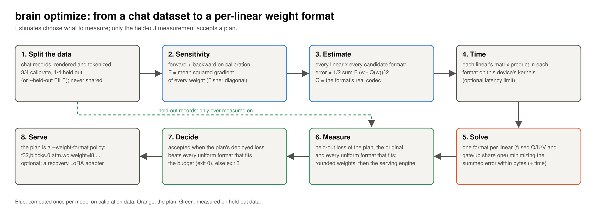
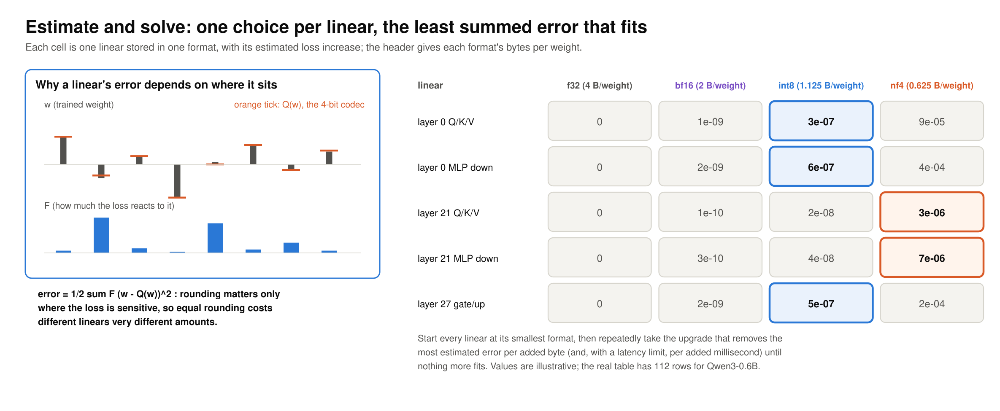
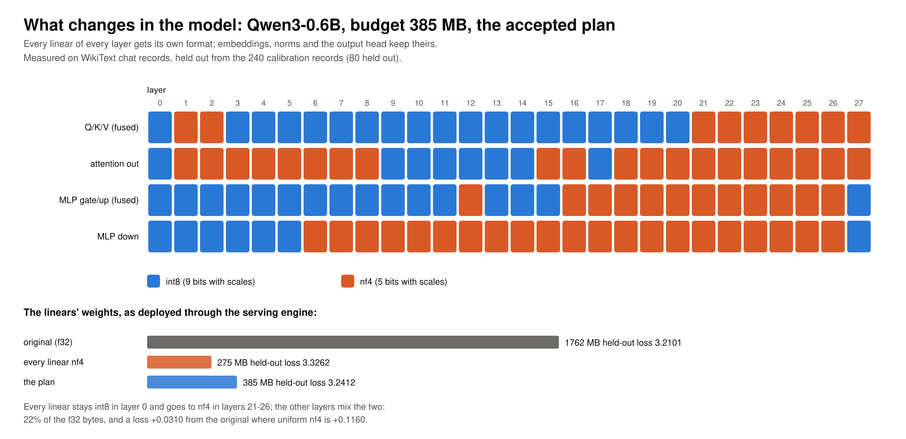
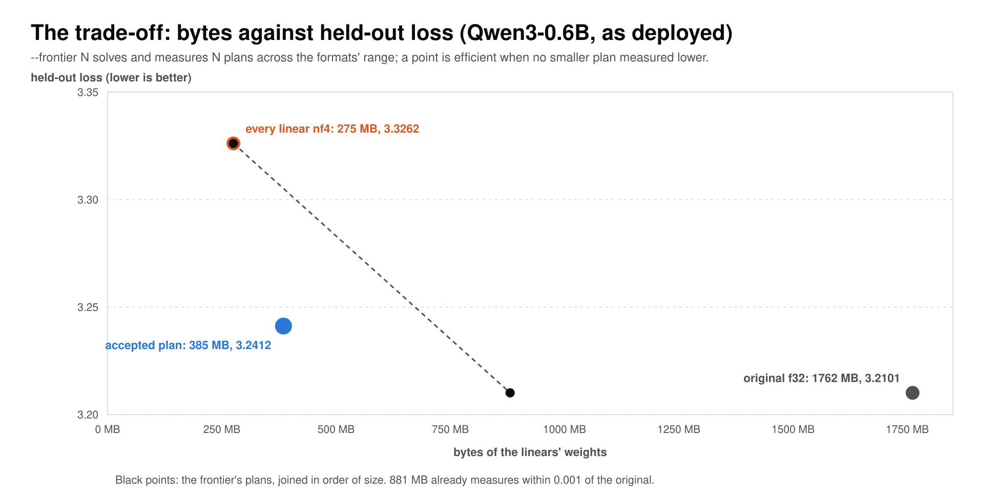
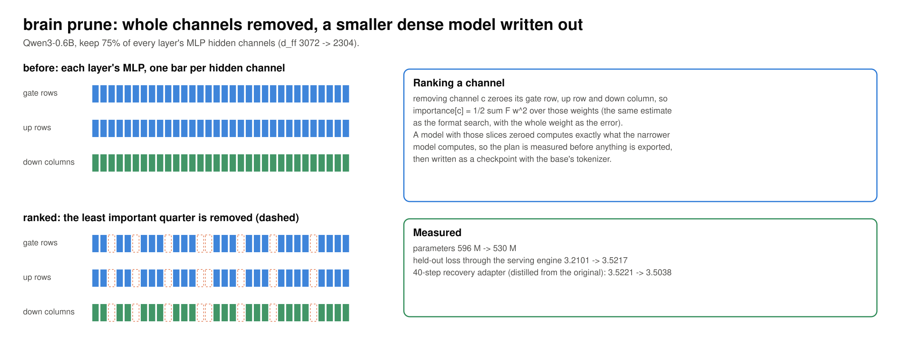

<!-- SPDX-License-Identifier: CC-BY-4.0 -->
<!-- Copyright (c) 2026 Martin Schröder <info@swedishembedded.com> -->

# How the model optimizer works

brain's model optimizer makes a trained chat model cheaper to serve without
retraining it, and it proves each result on data the search never saw. It has
two tools:

- **`brain optimize`** chooses a storage format for every linear layer
  (f32, bf16, int8 or nf4) so the model fits a byte budget, and keeps
  precision where the model is most sensitive. The checkpoint on disk does
  not change. The result is a serving policy, `--weight-format`, that the
  engine applies as it loads the original weights.
- **`brain prune`** removes whole channels the model needs least and writes
  a narrower model as a new checkpoint. Every brain command opens it like any
  other.

Both can finish by distilling a small LoRA **recovery adapter** that pulls the
compressed model back toward the original's output distributions.

This page explains how they work and what each changes in the model. For
commands and options, see
[optimizing a model for a memory budget](../guides/serving/optimizing.md).
The numbers below come from one run on Qwen3-0.6B. The calibration and
held-out records were WikiText passages rendered as chat records, and the
model was measured through the serving engine on a Tesla P40.

## The pipeline

1. **Split.** The chat dataset is rendered with the model's own chat template
   and tokenized. A quarter of the records is held out and is used only for
   measuring; the rest is the calibration set. No record is in both.
2. **Sensitivity.** The model is built trainable and runs forward and
   backward over the calibration records without taking a step. The mean
   squared gradient of each weight is the diagonal of the empirical Fisher
   information, written `F`. It says how strongly the loss reacts when that
   weight moves.
3. **Estimate.** For every linear and every candidate format, the weights go
   through the format's real codec, `Q`, the same code that packs them for
   the serving kernels, and come back. The estimated loss increase from
   storing that linear in that format is the second-order Taylor term
   `error = 1/2 * sum_j F_j * (w_j - Q(w_j))^2`.
4. **Time.** Every linear's matrix product is timed in every candidate format
   on the device the run uses, at the batch rows you will serve with (one row
   by default, which is single-stream decode). On a given card, a small
   format is not always a fast one.
5. **Solve.** The solver picks one format per linear that minimizes the
   summed estimated error within the byte budget, and also within a latency
   limit if you set one.
6. **Measure.** On the held-out records it measures the plan, the original
   model and every uniform format that fits the budget. It measures each one
   twice: once with the weights rounded through the codec, and once through
   the serving engine `brain serve` runs, so its kernels are included (int8
   quantizes activations too).
7. **Decide.** The plan is accepted only when its loss as deployed is lower
   than that of every uniform format that fits the same budget. Otherwise the
   command refuses it and exits 3. The estimate only decides what to measure.
8. **Serve.** The accepted plan is a `--weight-format` value with one rule per
   linear stored narrower than f32.

## Why one linear costs more than another

Rounding error alone does not predict damage. A weight the loss barely reacts
to can be rounded hard at no cost, while the same rounding on a sensitive
weight costs a lot. Weighting the squared error by `F` captures this, and
summing within a linear gives one number per (linear, format) pair. Linears
the serving engine fuses into one matrix product are scored together as a
single choice, because they must share a format: Q, K and V in one product,
and the MLP's gate and up projections in another.

The solver starts every linear at its smallest format. It then repeatedly
takes the upgrade that removes the most estimated error per added byte, until
nothing more fits. With a latency limit as well, the cost of an upgrade is its
share of each limit. The default budget is halfway between the two smallest
candidates' uniform sizes (for qwen3, between all-nf4 and all-int8). That
forces real choices: at the size of the larger format, the answer would be
that format everywhere.

## What changes in the model

The model's architecture, tokenizer and checkpoint stay as they are. The
change is in how each linear's weights are stored once the engine loads them:

- **int8** keeps one 8-bit integer per weight and one scale per group of 32
  weights (9 bits per weight with the scales). The engine also quantizes the
  activations entering an int8 product.
- **nf4** keeps one 4-bit index into a fixed table of 16 values, spaced for
  normally distributed weights, and one scale per group of 32 weights (5 bits
  per weight).
- **bf16** and **f32** keep the weight itself, at 16 and 32 bits.

On Qwen3-0.6B the plan above stores the linears in 385 MB, 22% of their f32
size. Its held-out loss as served is 3.241, against 3.210 for the original
model and 3.326 with every linear in nf4 at 275 MB.

Embeddings, norms and the output head keep the format they have. Because the
policy is applied when the weights load, one checkpoint can be served under
different plans, and dropping the flag serves the original.

## The trade-off

`--frontier N` solves N more plans across the range from the smallest format
everywhere to the largest, and measures each one as deployed. The result is
the measured curve of loss against bytes for this model on this data. A point
is marked efficient when no smaller plan measured lower.

The curve also answers questions the budget does not ask. For example, where
does adding bytes stop paying? On a card whose nf4 products are slow, which
plans are both smaller and faster than f32? The report lists each plan's
summed product time next to its bytes.

## Recovery

With `--recover-steps N` the original model acts as a teacher. Its top
next-token probabilities on the calibration records are collected, and a LoRA
adapter is trained over the compressed base, with every linear held in its
plan format, to match them. The plan is measured with and without the adapter. The
adapter is written beside the report, and `brain serve` loads it like any
other adapter.

## Removing channels

Each channel of a prunable dimension owns slices of several weights. In
qwen3, MLP hidden channel `c` owns row `c` of the gate and up projections
and column `c` of the down projection. Removing the channel sets all of those
weights to zero, so the same Taylor estimate ranks channels, with the whole
weight as the error: `importance[c] = 1/2 * sum F w^2` over its slices.

The least important share of every layer's channels is removed. A model with
those slices zeroed computes exactly what the narrower model computes, so the
plan is measured before anything is written. The narrower model is then
exported in the family's checkpoint format with the base's tokenizer and
measured again, this time through the serving engine. Unlike a format plan,
pruning changes the model itself: its config names the new width, and the
matrices it serves are smaller dense matrices, not masked ones.

## Any model, any backend

Neither tool has code for a particular architecture. A model family takes
part by declaring five things about itself:

- the linears whose format can be chosen (`Model::linear_sites`);
- which of them its engine fuses into one product (`Model::coupled_tensors`);
- the dimensions whose channels may be removed (`Model::prunable_dims`);
- the formats its serving engine can hold one linear at a time
  (`ChatTrainer::SERVED_WEIGHTS`);
- how to build that engine at a format plan (`ChatTrainer::serving_engine`).

qwen3 declares all five, and so do the Llama and Qwen2 checkpoints it serves
as config variants. qwen35 and qwen35moe declare them too: for a
mixture-of-experts model, every expert is its own linear. The architecture is
read from the checkpoint's config.

The sensitivity pass, the estimates and the measurements run on whatever
backend `--device` selects. A format the device cannot hold natively is left
out of the search and named in the report. One example is int8 on a backend
without packed-int8 products.

## Limits

- The estimate is second order and uses only the diagonal of the Fisher. It
  ignores interactions between linears, which is why every plan is accepted
  or refused by measurement, never by estimate.
- A plan is only as good as the records it was searched and measured on.
  Records unlike what will be served measure the wrong thing.
- The sensitivity pass and pruning need the model's full-parameter trainable
  build, with gradients, on one card. That bounds the size of model they can
  handle.
