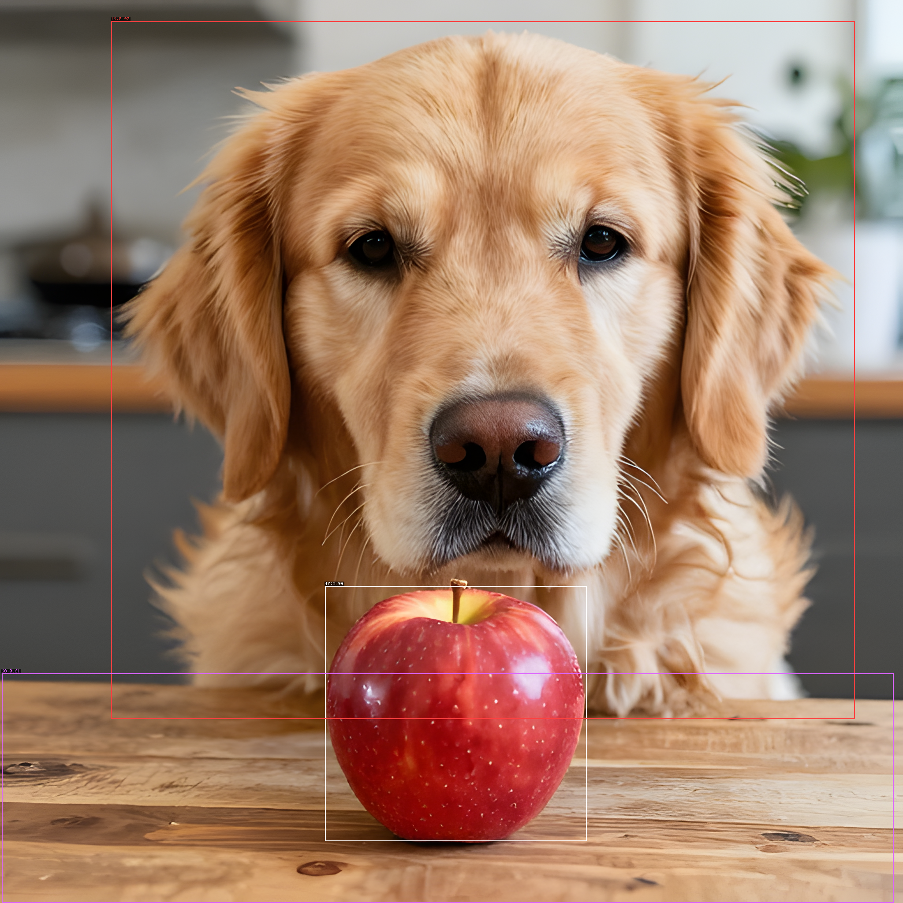
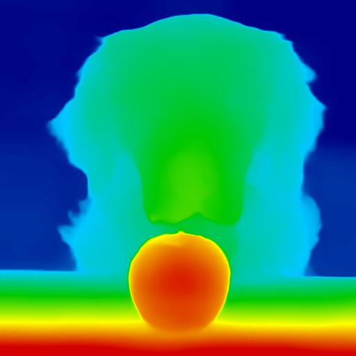
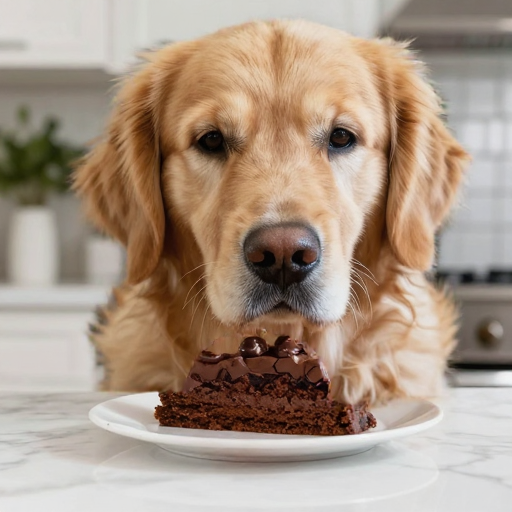
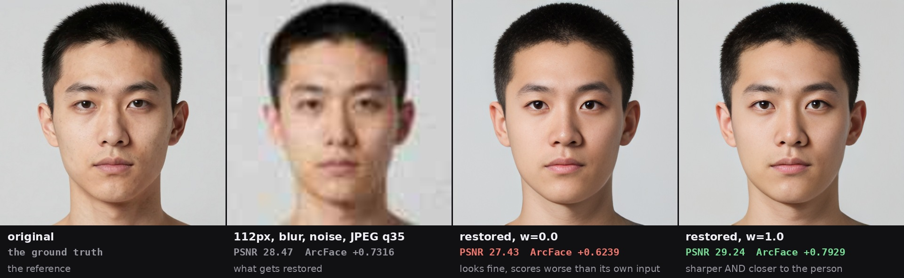
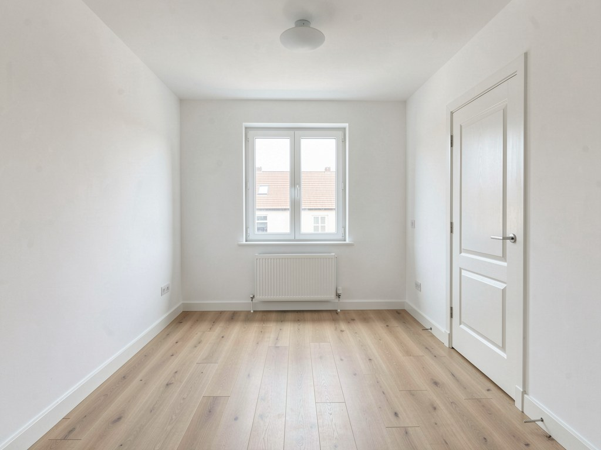
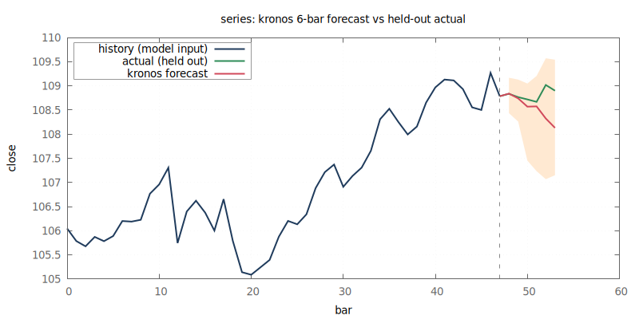
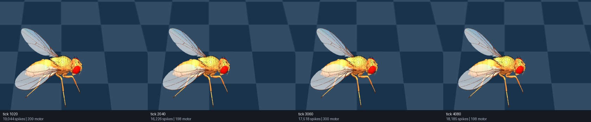

# See it work

Every command below is real, and every picture is that command's output. The
first few feed into each other: one model's output is the next model's input.

```bash
$ brain --device gpu s3dit text2image \
    --prompt "a golden retriever dog and a red apple on a wooden table, photorealistic, natural lighting" \
    --width 512 --height 512 --seed 7 --steps 8 --precision int8 --out image=seed.png   # the seed reproduces the picture below
```


A detector finds what the prompt asked for: an apple, a dog and a dining table.

```bash
$ brain yolov8 detect --weights <models>/Ultralytics/YOLOv8/model.brain.safetensors --image seed.ppm
brain yolov8 detect: 3 detection(s) on 512x512
```



A segmentation model cuts out the dog from one click, and a depth model
estimates how far away everything is:

```bash
$ brain sam2 segment --in image=seed.png --points "220,180" --labels "1" --out mask=dog-mask.png
$ brain zipdepth --image seed.ppm --weights <models>/zipdepth/zipdepth_base.pth \
    --headless --view depth --colormap turbo --out depth.ppm
```

| segmentation (sam2) | depth (zipdepth) |
|---|---|
|  |  |

## Change everything except what you selected

Turn the dog mask around and regenerate the rest of the picture. The dog stays
exactly as it was; the table, the apple and the background change:

```bash
$ brain --device gpu s3dit inpaint --in image=seed.png --in mask=bg-mask.png \
    --prompt "a golden retriever dog sitting behind a slice of chocolate cake on a white marble kitchen countertop, bright natural daylight, blurred modern kitchen background, photorealistic" \
    --strength 1.0 --feather 0 --steps 8 --precision int8 \
    --out image=inpainted.png
```



## Restore a damaged face, and check it is still the same person

One model finds the face, a second restores a badly damaged copy, and a third
compares the result with the original to check that the restoration kept the
person's identity:

```bash
$ brain scrfd detect --in image=portrait.png --json
$ brain codeformer restore_face --w 1.0 --in image=degraded.png --out image=restored.png
$ brain arcface embed --align false --in image=restored.png --out embedding=restored.bin
```



The restoration at `w=1.0` is closer to the original than the damaged copy, both
pixel by pixel and by identity. The one at `w=0.0` looks just as good and is
further away on both: the third model catches what the eye does not
([`reference/models/codeformer.md`](../reference/models/codeformer.md)). The original
portrait was generated by brain; it is not a photograph of a real person.

## Furnish an empty room with a LoRA you trained

Generate an empty room, then furnish it in a style learned from your own
pictures, keeping the room itself:

```bash
$ brain --device gpu flux2 generate --variant klein-9b --precision int8 \
    --prompt "Photorealistic professional real estate photograph of an empty unfurnished bedroom. Bare white walls, plain light oak floorboards, a single large window, a radiator under the window, a white panelled door. Completely empty room, no furniture, no rugs, no curtains." \
    --width 1024 --height 768 --seed 20260827 --out empty-room.png   # the seed reproduces the picture below
$ brain --device gpu flux2 generate --variant klein-9b --precision int8 \
    --ref empty-room.png --strength 1.0 --ref-size 768 \
    --adapter boho.brain --lora-scale 1.0 \
    --prompt "a bohemian style room, photorealistic interior photograph, warm natural daylight, layered textiles and patterned fabrics, rattan and natural wood, plants, eclectic decor, professional real estate photography" \
    --width 1024 --height 768 --seed 7 --out staged-room.png   # the seed reproduces the picture below
```

| before | after |
|---|---|
|  |  |

`brain flux2 finetune <captioned-image-dir> --out boho.brain` trains the style
adapter; LoRA files from other tools load too
([`reference/models/flux2.md`](../reference/models/flux2.md)).

## Text to video

```bash
$ brain --device gpu wan t2v \
    --prompt "a golden retriever running along a sandy beach at sunset, waves in the background, cinematic" \
    --frames 9 --width 416 --height 240 --steps 20 --seed 7 --output-path wan.mp4   # the seed reproduces the picture below
```


## Text to speech and back

```bash
$ brain qwen3tts synth --text "Brain trains and runs neural networks from scratch, in Rust." --out spoken.wav
$ brain nemotronasr transcribe --in audio=spoken.wav --json
{"text":"Brain trains and runs neural networks from scratch in rust. ",...}
```

## Read a document

```bash
$ brain deepseek2ocr generate --in image=doc.png --prompt "<|grounding|>Convert the document to markdown."
Brain trains and runs neural networks from scratch, in Rust.
```

## Forecast, and score the forecast

```bash
$ brain forecast predict --csv crates/kronos/tests/data/synthetic_hourly.csv \
    --horizon 6 --samples 16 --origins 16 --gnuplot kronos-forecast.png
```



The forecast is scored against data the model never saw and against simple
baselines, and the report says where the model's uncertainty band was too
narrow rather than hiding it ([`reference/models/kronos.md`](../reference/models/kronos.md)).

## A fruit fly's nervous system, running

A real *Drosophila* connectome, mapped by published neuroscience work, run as a
network of spiking neurons on the GPU and moving a simulated body through the
animal's own motor neurons:

```bash
$ make samples/fly/interactive/run ARGS="--connectome $BRAIN_CONNECTOME_DIR --body $BRAIN_FLYBODY_FRUITFLY_XML --frames 240"
```



It moves its legs; it does not walk yet. [`reference/models/fly.md`](../reference/models/fly.md)
says which behaviours are there and which are not.

