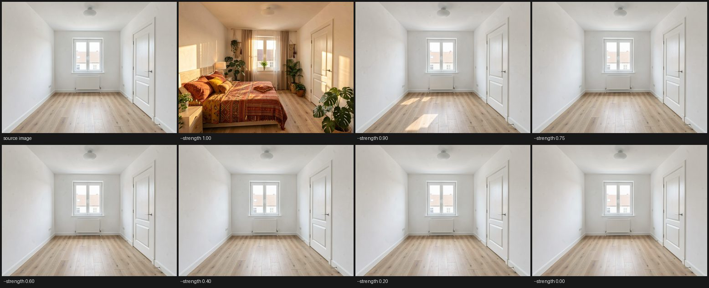

# FLUX.2 Klein

FLUX.2 Klein is a text-to-image and reference-image editing model: give it a
prompt to generate an image from scratch, or a prompt plus one or more
reference images to edit them in place (recolor a photo, add weather, change
style, and similar edits). The Klein variant is a fast, distilled variant
requiring only a few generation steps, trading the slower full ("base")
model's extra flexibility for speed.

## Support

| Capability | Supported |
|---|---|
| Inference             | [x] |
| LoRA fine-tune         | [x] |
| INT8                   | [x] |
| CLI (`brain <arch> <action>`)       | [x] |
| HTTP API               | [x] |
| D-Bus                  | [x] |
| Batched serving        | [x] |

## Getting the weights

Model id: `brain/flux2-klein`. Weights are not auto-fetched - put a
diffusers-layout checkout (or a GGUF) under the models directory
(`--models-dir` / `BRAIN_MODELS_DIR`) and brain finds the four roles by
scanning it.

`brain flux2 <action>` resolves those roles from that scan, and each role has
**one flag, spelled as the role is**, for the
cases the scan cannot decide on its own - several candidate DiTs in the store,
say. An ambiguous or missing role prints every real candidate and exits rather
than guessing, naming the flag to pass:

```bash
brain flux2 text2image --prompt "…" --seed $RANDOM --out image=fox.png \
    --dit …/FLUX.2-klein-4B-GGUF/Q8_0.gguf \
    --vae …/flux2-vae.safetensors \
    --text-encoder …/FLUX.2-klein-4B/text_encoder \
    --tokenizer …/FLUX.2-klein-4B/tokenizer/tokenizer.json
```

The `BRAIN_FLUX2_{DIT,VAE,TE,TOKENIZER}` variables belong to `brain serve`
(below), not to `brain flux2 <action>`.

### Serving more than one checkpoint at once

`brain serve` does not require the `BRAIN_FLUX2_*` variables at all: with the
model dir holding one or more real `dit` checkpoints (a diffusers-layout
directory or a GGUF), each becomes its own served resident, addressed by its
real `<vendor>/<repo>` id - e.g. a store holding both
`black-forest-labs/FLUX.2-klein-9B` and `unsloth/FLUX.2-klein-4B-GGUF` serves
both, simultaneously, under those two names. This is `dit` specifically: two
or more `dit` checkpoints are genuinely independent models, never one
ambiguous choice, and each is resolved against the SAME shared `vae`/
`text_encoder`/`tokenizer` pool found anywhere in the store, so a `dit`-only
checkpoint (nothing else in its own directory) still serves as long as a
compatible VAE/text-encoder/tokenizer exists somewhere on disk.

Setting `BRAIN_FLUX2_DIT` (and the other three variables) pins one exact
instance instead, which is the single-resident behavior to reach for when the
store holds more checkpoints than you want served.

`lora_train`'s `--activations keep|recompute` (default `keep`) sets what the host trainer
(`--trainer host`) holds of each step's forward for its backward: `keep` holds
every block's activations, `recompute` holds only each block's input and
rebuilds the rest block by block in the backward. The loss and gradients are
bit-identical; `recompute` trades extra forward compute for lower memory. The
device trainer ignores it. Any other value is refused.

## Running it

```bash
brain flux2 text2image --prompt "a red fox on a mossy rock" --seed $RANDOM --out image=fox.png \
    --width 512 --height 512

# reference-image editing: the source image and an instruction as the prompt
brain flux2 edit --image fox.png --prompt "make it snow" --seed $RANDOM --out image=snow.png

# a LoRA from a folder of captioned images
brain flux2 lora_train --data my-set/ --save my.brain --seed $RANDOM
```

The three actions, `text2image`, `edit` and `lora_train`, are the same ones
`brain serve` publishes over D-Bus and over HTTP at `/v1/images/generations`;
`brain flux2 <action> --help` lists every parameter with its default, and
`samples/models/flux2` is the same command line as a standalone program. The
params that name files on the serving machine - `adapter`, `lora_train`'s
`data`, `save` and `cache_dir` - are host-only: `brain flux2 <action>` on the
machine takes them, while D-Bus and HTTP do not list or accept them, so
`lora_train` runs from the machine that holds the dataset.

## Options

- `--width` / `--height` - default 512; an edit that starts from its image
  (`--strength` or `--mask`) takes that image's size
- `--steps`, `--seed` - on the distilled Klein variants the sampler is fixed
  at 4 steps, so `--steps` is ignored with a warning; `--experimental-steps`
  makes it honour `--steps` again, for experiments only
- `--guidance` - classifier-free guidance strength; only meaningful on the
  undistilled `base` variants, since Klein is guidance-distilled
- `--variant klein-4b|klein-9b|base-4b|base-9b`
- `--precision fp32|int8` - supports INT8 inference for lower VRAM use; unset,
  the checkpoint's own (int8 for a GGUF DiT)
- `edit`'s `--image <image>` and `--image0` ... `--image6` - the image to edit
  and up to seven further references, in order
- `--ref-size <N>` - downscale every further reference so its **long edge**
  is at most `N` pixels before the /16 centre crop, preserving aspect (default
  512; `0` keeps every reference at its own resolution). The image an edit
  starts from, and a tiled run's anchor, are never bounded. Each
  reference contributes `(w/16)·(h/16)` tokens to the joint sequence, so a
  full-resolution camera photograph costs more of them than the generation it
  is conditioning - and the failure that causes is an out-of-memory during the
  build, not a warning. This is the dial that makes a folder of unprepared
  photographs a valid input; the per-reference sizes and token counts are
  printed before the pipeline is built, so a run that does not fit says which
  reference spent the budget.
- `--adapter <list>` - fold LoRA adapters into the DiT before generating:
  comma-separated `path` or `path@strength` entries, in the order they fold
  in. brain's own `lora_train` checkpoint and third-party
  `.safetensors` files are told apart by extension; a third-party file may be
  in either of the two conventions the ai-toolkit / ComfyUI / diffusers /
  LyCORIS ecosystem writes, and which one it is comes from its own keys:

  | family | keys | delta |
  | --- | --- | --- |
  | LoRA | `<module>.lora_A/.lora_B` (aliases `.lora_down`/`.lora_up`) | `(alpha/r)·B·A`, a low-rank product |
  | LoKr | `<module>.lokr_w1`/`.lokr_w2`, either optionally stored as its own `_a`/`_b` pair | `W1 ⊗ W2`, a Kronecker product |

  The two are different math, not spellings of one thing: a LoKr delta is
  full rank in general. A LoKr file's `.alpha` is a scale **only** when one of
  its factors is stored decomposed (then `alpha/dim`); with both factors
  stored whole the multiplier is `1.0` and the stored alpha is ignored, which
  is what both reference implementations do and what real ai-toolkit files
  depend on (they write a ~`1e10` sentinel there).

  The adapter must have been trained for the `--variant` you select; a key
  that does not match a tensor of that variant is a hard error naming the
  tensor, never a silent skip.

  List several to **stack** adapters in one generation - a face-identity
  adapter plus a style adapter, say. The two families mix
  freely. They fold in the order given, each onto the result of the ones
  before it, so a linear that more than one of them adapts ends up moved by
  the **sum** of their deltas: two adapters both at strength `1.0` push that
  weight further than either was trained and validated at, which usually
  reads as an over-cooked image. Lower each one's strength when stacking
  rather than expecting the result to be an average:

  ```
  brain flux2 text2image --prompt "..." --seed $RANDOM --out image=out.png \
    --adapter "face.brain@0.8,style.safetensors@0.4"
  ```
- `--lora-scale <S>` - the strength of every listed adapter that names none,
  ComfyUI's `strength_model`. Default `1.0`. Third-party adapter files usually
  carry no alpha, in which case both ai-toolkit and ComfyUI resolve the alpha
  multiplier to exactly 1.0 and the strength is the only dial; `0.0`
  reproduces the base model, which is the way to check what the adapter is
  actually contributing.
- `--strength` - for image-to-image editing, a **continuous anchoring dial**
  in `0..=1` on `--image`, whose size the output takes unless `--width` and
  `--height` say otherwise. `1.0` is free generation conditioned on the reference; lowering it
  anchors progressively more of the source photograph; `0` returns the source
  through the VAE round trip. It does not add color/hue changes on its own.

  It is a dial and not a mode switch. `--strength` is the noise level the
  init latent `x_σ = (1−σ)·x₀ + σ·ε` is mixed at, and the descent from there
  is **the same schedule `--strength 1.0` runs, scaled into `[0, strength]`**
  - so the same sampler integrates the same shape at every setting, `0.99`
  renders a hair from what `1.0` renders, and `1.0` is reached exactly rather
  than approached. Lowering the dial lowers every sigma and raises the
  source's weight in the init latent, so preservation only ever increases; it
  never reverses. (A *uniform* ramp over `[strength, 0]` would be a different
  sampler rather than a lower-noise version of the same one: klein is a
  distilled few-step model whose schedule is shifted by a token-count- and
  step-count-dependent `mu` and spends nearly every step at high sigma before
  one long final leap.)

  It controls **how much denoising starts from the init latent, not whether
  the model can see the reference**: a supplied reference contributes
  conditioning tokens at every value of `--strength`. Below `1.0` the first
  reference does double duty - it is the init latent *and* it is attended to.
- `--ref-resolution-scale <S>` - linear size of the **conditioning copy** of that
  init reference, in `0..=1`, default `1.0`. Only `--image` under
  `--strength < 1` is affected: the init-latent role pins it to the output
  size, so it is the one reference whose resolution you cannot choose by
  picking a different file. Reference tokens cost joint attention
  quadratically, so a full-size copy of a same-size reference doubles the
  image half of the sequence; a lower value keeps an edit at roughly the cost
  of a moderate second reference (`0.75` halves it). The default `1.0`
  conditions at full size - identical token cost to `--strength 1.0`. `0`
  switches the conditioning
  copy off, which is the explicit opt-in to the cheap mode where the
  reference reaches the denoiser only through the init latent.
- `--mask <image>` - a spatial preservation mask over the output canvas.
  **White regenerates, black preserves, greys blend.** See
  [Masked editing](#masked-editing-blended-latent-diffusion) below.

For edits, short imperative instructions that name the change
(`"Colorize this photograph."`, `"Make it snow."`) work much better than a
descriptive scene prompt - the model treats a description as a
text-to-image prompt rather than an edit instruction. If you need a strong
color or hue change with guaranteed structural fidelity, use the
undistilled `base` variant (which supports CFG) or train a LoRA for it.

## What `--strength` actually does

`--strength` decides **where the denoise starts**, not how hard the model
tries. Every rung below runs the same prompt, seed, adapter and step count
against the same generated empty room; only `--strength` changes.



Read it as one statement: **1.00 furnishes the room and nothing else does.**

That is the dial working correctly, not failing. Below `1.0` the first
reference becomes the init latent, so the denoise begins from the
photograph's own pixels - and those pixels say *empty room*. The model
reproduces what it was given, more and more literally as the number falls,
until `0.00` returns the source through a VAE round trip. There is nothing
for a staging adapter to restyle, and the init latent gives it no licence to
invent furniture that was never there.

At exactly `1.0` the reference stops being an init latent and becomes
conditioning only. The denoise starts from noise, the model *looks* at the
room instead of starting from it, and it is free to put a bed in the middle
of the floor while keeping the walls, window, radiator and door where the
reference put them.

So the two ends are different jobs, and which one you want depends on your
input:

| your source | what you want | setting |
|---|---|---|
| empty room | furnish it | `--strength 1.0` |
| furnished room | restyle what is there | `--strength 0.85`-`0.95` |
| any image | relight or nudge it | `--strength` below `0.8` |
| any image | prove the round trip | `--strength 0` returns the source |

The schedule is one curve across that whole range: `--strength` scales
`klein_sigmas` into `[0, strength]`, so lowering the dial lowers every sigma
and raises the source weight monotonically, and `1.0` reproduces the
free-generation schedule bit for bit. An earlier implementation integrated a
*different* schedule below `1.0`, which made `0.999` and `1.000` behave like
two unrelated samplers; that is fixed, and the ladder above is the
regression picture.

The ladder was generated with `--ref-size 768` throughout so every rung pays
the same reference-token cost and the comparison is about `--strength` alone.

## Masked editing (blended latent diffusion)

`--strength` is a **global** dial. Some edits need a **spatial** one: redraw
the middle of a room, keep the walls and the windows. Virtual staging is the
motivating case - there is no single `--strength` that both replaces the
furniture and leaves the architecture where it was, because the two demands
pull the same knob in opposite directions.

`--mask <image>` takes a greyscale image over the **output canvas**:

* **white (255) = regenerate** - the denoiser owns these pixels;
* **black (0) = preserve** - these track `--image` exactly;
* **grey = blend** - the value is used verbatim as a linear weight, so
  mid-grey is an even mix of source and generation. There is no threshold, and
  soft edges are the point: a hard latent-cell boundary between "kept" and
  "redrawn" shows up as a seam.

After every Euler step the masked-out region is replaced by the source latent
renoised to that step's own sigma:

```text
x = m·x_denoised + (1 − m)·((1 − σ)·x₀ + σ·ε)
```

`(1 − σ)·x₀ + σ·ε` is the rectified-flow forward process - the same one
`--strength` uses to build its init latent - so the preserved region is always
a legal point on the source's own trajectory rather than an out-of-distribution
paste, and at the terminal sigma it is the source latent exactly. That is the
difference from `--strength`: preserved regions *track* the source at every
step instead of being softly guided toward it and drifting a little with each
forward.

```bash
brain flux2 edit --variant klein-9b --precision int8 \
    --prompt "..." --image room.png --mask arch-mask.png \
    --strength 0.999 --steps 12 --experimental-steps --seed $RANDOM --out image=staged.png
```

### Rules the implementation guarantees

* `--image` is the preserved source and the canvas takes its size - the
  same rule `--strength` already imposes. `--mask` does **not** consume
  it and does not change the token budget either way: that reference
  contributes conditioning tokens regardless, at the size
  `--ref-resolution-scale` picks.
* An **all-white** mask is bit-for-bit identical to no mask at all, and an
  **all-black** one reproduces the source latent exactly. Both are asserted,
  and both are exact rather than approximate - the mask resampler accumulates
  integer area overlaps so that a mask which is constant over a latent cell
  resamples to exactly that constant.
* The mask is resampled to the latent grid by an exact **area average**
  (box filter), each axis independently, so a non-square canvas is not a
  special case. It may be supplied at any resolution.
* One weight per latent **token** (a 16x16 pixel block), applied to all 128
  latent channels. That is the finest granularity that exists - latent
  channels are not spatial - so a mask edge is quantised to 16 pixels before
  the VAE decoder's own receptive field smears it a little further. Preserved
  regions are exact in *latent* space; in *pixel* space the guarantee softens
  within a few pixels of a mask boundary.

### Producing a mask

There is no automatic mask generator in brain, and the honest reason is that
the obvious ones do not work. A monocular-depth mask (`brain zipdepth infer
--view depth --colormap gray`, threshold the near field) segments a bedroom
where the bed is the only near object, but on a living room it marks the
*ceiling* as foreground - the ceiling directly above the camera is genuinely
the nearest surface in the frame - while leaving a sofa against the far wall
as background. "Near" is not "furniture". A depth top-hat (opening by
reconstruction) fixes the ceiling but then misses any object larger than the
structuring element, which for a bed filling half the frame is all of it.

Two things make the segmentation genuinely hard, and both are worth knowing
before trusting any automatic mask:

1. Staging must **add** furniture where there is none - a rug on bare floor, a
   plant in an empty corner. A mask that covers only the existing furniture
   cannot stage. What has to be described is the enclosing shell to keep, not
   the objects to remove.
2. The floor is simultaneously architecture (its perspective and material must
   not drift) and the place new objects go. That is what the grey levels are
   for: a mid-weight floor band lets objects appear while keeping the plane
   half-anchored.

So today a mask is authored, not inferred. Any greyscale image works - a paint
program, a few polygons rasterised over the frame, or a segmentation model's
output thresholded by hand. A working recipe: mark the interior volume white
(existing furniture plus the space new furniture must occupy), leave the
ceiling, walls, windows and doors black, put the floor band at ~0.45 grey,
and feather the whole thing with a few pixels of blur so the seams blend.

## Hardware and limits

INT8 precision lowers resident VRAM use for the transformer. A `.gguf` DiT is
executed through that Q8_0/DP4A path automatically when `--precision` is
omitted; `--precision fp32` with a `.gguf` DiT is rejected rather than silently
building a different representation. Automatic placement reads each validated
GGUF tensor header and budgets the buffers FLUX.2 actually retains: Q8_0
linears become packed int8 plus group scales, while boundary linears,
double-stream MLP-down projections, and QK/RMS scales remain f32 by design.
The entire DiT remains GPU-resident today: GGUF mmap loading limits host
materialization during construction, but it is not runtime weight paging, so
there is no host-RAM placement mode. Klein does not
use classifier-free guidance, so it cannot be steered as strongly as the
`base` variants for edits that need to fight the source image's content - use
`base-4b`/`base-9b` or a LoRA for those.

A GGUF with non-Q8_0 DiT linears is rejected. Preserving and executing mixed
quantizations without conversion, and an explicit opt-in fp16-to-fp32 fallback
for hardware that cannot execute fp16, require dedicated runtime support and
are not implicit behaviors.

Licensing: Klein 4B, the FLUX.2 VAE, and the Qwen3 text encoders are Apache
2.0 (commercial use OK). The 9B variants (`klein-9b`, `base-9b`) are under the
FLUX Non-Commercial License - research/non-commercial use only, and require
setting `BRAIN_FLUX2_ALLOW_NC=1` to opt in.
