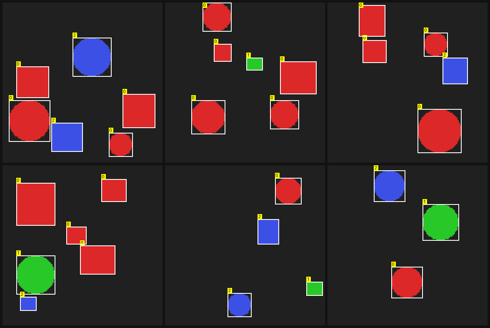
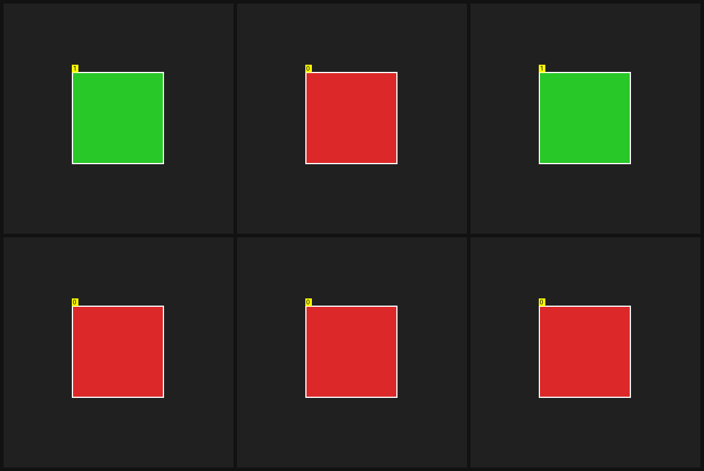
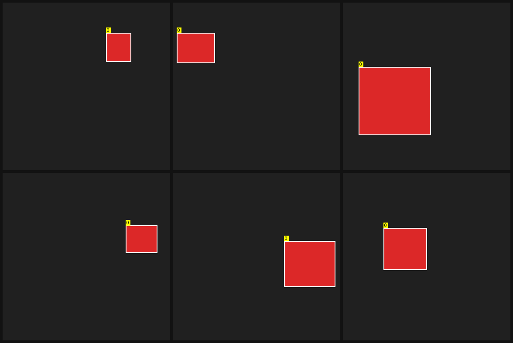
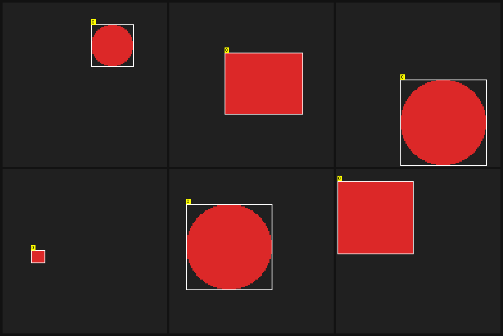
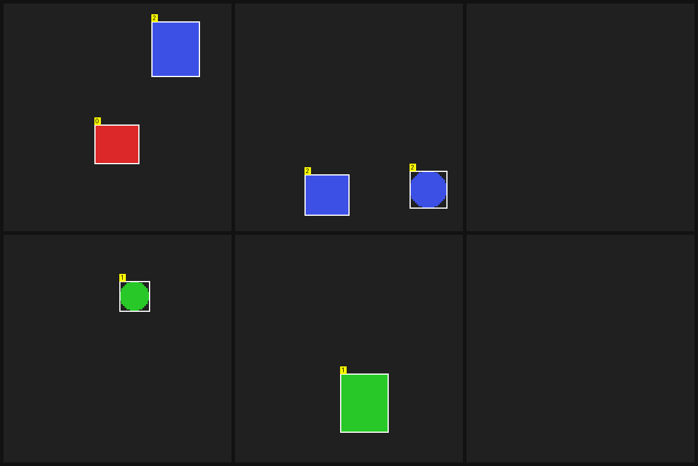

# YOLOv8-style object detector

An anchor-free, single-stage real-time object detector. brain's implementation
is byte-compatible with the canonical Ultralytics YOLOv8n graph, so the
official pretrained weights import and run unchanged, and the detector can
also be trained or fine-tuned from scratch on your own data. Reach for it
whenever you need bounding-box detection - as a one-shot `detect` call, wired
into an event-driven pipeline, or exported to run on an Intel NPU.

## Support

| Capability | Supported |
|---|---|
| Inference               | [x] |
| Training from scratch   | [x] |
| Fine-tuning             | [x] |
| CLI (`brain <arch> <action>`)        | [x] |
| Intel NPU export        | [x] |
| Batched serving         | [x] |

## Getting the weights

Reference the model as `Ultralytics/YOLOv8` and brain fetches the official
nano (`n`) weights itself on first use - no manual `.pt` export, no extra
setup. The first call downloads `yolov8n.pt`, and every call reads that file
as it is; nothing is converted on disk.

Detection has no HTTP route, so it's served over D-Bus:

```bash
brain serve --dbus
```

then call `Ultralytics/YOLOv8`'s `detect` action with an RGB image blob.

`brain do` does not auto-fetch - it only reaches models already registered
locally by name. A checkpoint you've already converted (or a YOLOv8-compatible
one of your own) is found once it is in the model store, or named outright with
`--weights PATH`. Auto-fetch only pulls the `n` variant; larger YOLOv8 sizes
need this manual path.

## Running it

Every action is `brain yolov8 <action>` (the generic runner, flags built from
the model's manifest) or the same action in the standalone program
`sample-models-yolov8 <action>` (`samples/models/yolov8`), which adds the NPU
actions below. `<action> --help` lists every flag with its default.

```bash
# train a detector from scratch on a detection dataset (`make yolo/data`)
brain yolov8 train --data data/detect --save out/yolo.safetensors --seed $RANDOM

# fine-tune a checkpoint; a larger --nc appends classes
brain yolov8 finetune --data mine/ --save out/tuned.safetensors --nc 81 \
    --freeze-backbone --freeze-reg-head --freeze-cls-hidden --train-classes 80 --wd 0

# evaluate: mAP@0.5, mAP@0.5:0.95, precision, recall, per-class AP
brain yolov8 eval --data data/detect --split val --conf 0.001 --dump-preds out/preds.jsonl

# run detection on an image
brain yolov8 detect --image photo.png --conf 0.25 --iou 0.45 --out detections=boxes.json
```

The checkpoint is resolved from the model store unless named with
`--weights <file>`. `train` and `finetune` take `--activations keep|recompute`:
`recompute` keeps only each normed conv unit's input and rebuilds its
intermediates in the backward, for the same gradients at lower memory. Their
defaults are 200 steps, batch size 4, learning rate 1e-3, weight decay 1e-2.

### Telling which person it is

`detect` becomes a two-stage detect-then-verify recognizer when it is given a
reference embedding. The detector finds every `--identity-class` box (COCO
`person`), SCRFD finds every face in the original full-resolution frame, each
face is attributed to the person box its centre falls inside, and ArcFace
embeds it. A box whose cosine against the reference clears
`--identity-threshold` is labelled `--identity-name`; every other person box
keeps `--identity-class-name`.

```bash
brain arcface embed --image reference.png --out embedding=ref.bin
brain yolov8 detect --image group.png --identity-ref ref.bin --identity-name alice \
    --identity-threshold 0.35 --identity-margin 0.05 --json
```

SCRFD and ArcFace come from the model store (`glintr100.onnx` with
`scrfd_10g_bnkps.onnx` beside it); `--components arcface.weights=<dir>/glintr100.onnx`
names them outright. Detections gain `label` and `similarity` fields. The
identity stage runs on the engine, not the NPU.

### The training data

`make yolo/data` generates the detection dataset brain trains against -
coloured shapes on a dark field, with ground-truth boxes and classes. It is
synthetic on purpose: every box is exact by construction, so a detector that
misses one has a bug rather than a labelling dispute, and the generator can
dial the specific difficulty being tested.



The generator (`crates/data/src/gen_detect.rs`) varies each axis separately -
object count, scale, class and background - so a training failure can be
attributed to one of them:

| | |
|---|---|
|  | **class** - shape and colour identify the class |
|  | **localization** - one object, anywhere in the frame |
|  | **scale** - the same class across a wide size range |
|  | **background** - distractor texture the detector must ignore |

For continuous inference, an event-driven controller can map a camera frame
straight to a detection event:

```bash
brain run --yolo out/yolo.safetensors
```

## Options

`detect`:

- `--conf` - confidence threshold below which a candidate box is dropped
  (default `0.25`).
- `--iou` - IoU threshold used by NMS to suppress overlapping boxes of the
  same class; detection keeps at most 300 boxes per image.
- `--input` - the side the image is letterboxed to (default: the checkpoint's
  own). A fine-tune's cheap training side need not be the pretrained classes'
  inference side.
- `--identity-ref`, `--identity-ref-path`, `--identity-name`,
  `--identity-class-name`, `--identity-threshold`, `--identity-class`,
  `--identity-margin`, `--components` - the identity stage above.
- Input images are letterboxed (aspect-preserving resize + grey pad) onto the
  model's square input - 640x640 for the pretrained `Ultralytics/YOLOv8n`
  graph.

`train` / `finetune`: `--data`, `--save`, `--steps`, `--batch`, `--lr`, `--wd`,
`--nc`, `--input`, `--seed`, `--arch auto|tiny|yolov8n`, `--freeze-backbone`,
`--freeze-reg-head`, `--freeze-cls-hidden`, `--train-classes`, `--activations`.
`train` always starts from fresh weights; `finetune` builds on the resolved
checkpoint's own architecture. `--train-classes` gates every other class's
gradient off; AdamW's weight decay is not a gradient, so also pass `--wd 0` to
keep those classes bit-exact.

`eval`: `--data`, `--split val|all` (`val` is the last 10%), `--conf`, `--iou`,
`--dump-preds`; the mAP numbers are scalar outputs and `--out report=table.txt`
writes the table.

## Intel NPU export

brain can quantize the detector to INT8 and run it on an Intel NPU (Meteor
Lake and newer) via OpenVINO, through a separate export -> quantize -> run
pipeline: the `npu-export`, `npu-quantize`, `npu-sim` and `npu-run` actions of
`sample-models-yolov8` (`brain npu bench` and `check` stay the generic ONNX
tools). See [the NPU export page](npu.md) for the full command reference, and
[the configuration reference](../../configuration.md) and the NPU note
in [the hardware page](../../../guides/hardware/choosing-hardware.md) for setup.

## Hardware and limits

- Runs on CPU and any wgpu-supported GPU; the NPU path is a separate
  compiled-graph pipeline, not a third live backend, and always finishes box
  decoding and NMS on the host CPU.
- Serving batches nothing across requests: each request is one forward.
- Auto-fetch only provides the `n` (nano) variant; larger YOLOv8 sizes must
  be converted and placed in the model store.
- Detection is not exposed over HTTP - only D-Bus, `brain do`, and the
  `brain yolov8` / `brain run` CLI paths.
